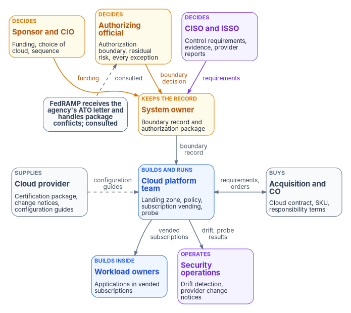
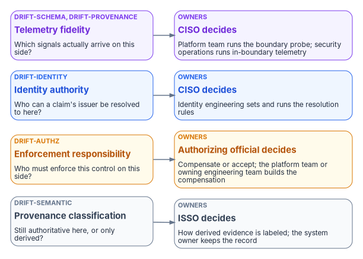

# Chapter 08 — Who Owns the Boundary

*A cloud boundary has more owners than anything else in this workbook: the provider draws the service, the authorizing official draws the agency's system, the platform team builds the landing zone that makes it real, and the gaps between those three are where features quietly disappear; naming one decider for each of them is the cheapest control an agency has.*

::: {.callout-note}
## In this chapter
The people who decide, do and advise when an agency places a system on a certified cloud service: the sponsor and CIO, the authorizing official and the designated representative, the system owner as boundary owner, the CISO and ISSO, the cloud platform team, workload and application owners, identity, endpoint and network engineering, security operations, acquisition and the contracting officer, the cloud provider and FedRAMP. A responsibility matrix covers each decision; a three-party table splits responsibility between the provider, the platform team and the workload team; and each of the four boundary impact dimensions gets an owner.
:::

Earlier chapters describe the boundary as a thing: a certification that covers some features and not others ([Chapter 03](03-what-changed-at-fedramp.md)), a feature gap that runs in more than one direction ([Chapter 04](04-gcc-and-the-feature-gap.md)), and a landing zone of management groups, subscriptions, policy and address space that makes the boundary concrete ([Chapter 05](05-the-landing-zone.md) to [Chapter 07](07-the-front-door.md)). This chapter describes it as a set of decisions, because that is how it fails. A feature is designed in before anyone confirms it works in the agency's cloud. A workload is placed in a subscription that no one has added to the system description. A provider changes the service and the notice goes to a mailbox no one reads. None of these is an engineering error. Each is a decision that no one owned.

The 2026 FedRAMP rules make the split explicit. FedRAMP certifies the cloud service offering; the agency's own authorizing official accepts the risk of the agency's specific use, including its data, configuration and integrations; and an agency "should never create a standalone authorization to operate for a cloud service offering," but should authorize its own federal information system that uses the service.[^c08-fedramp-use] That sentence assigns two boundaries to two owners. The provider owns the service boundary and the certification behind it. The agency owns the boundary of its own system, and everything it builds, configures and connects inside it.

[Book 02, Chapter 06](../b02-identity/06-who-owns-the-migration.md) sets out the program's ownership model and the Risk Management Framework roles. [Book 05, Chapter 06](../b05-devices/06-who-owns-the-endpoint.md), [Book 07, Chapter 05](../b07-pki/05-who-owns-the-certificate-estate.md), [Book 08, Chapter 09](../b08-ddi/09-who-owns-dns.md) and [Book 09, Chapter 09](../b09-network/09-who-owns-the-network.md) apply it to endpoints, certificates, DNS and the network. This chapter applies it to the cloud boundary and the landing zone. The roles, the matrix and the tables are the program's recommended model. Adapt them to the agency's governance, but keep one decider per row.

{#fig-ch08-boundary-owners fig-alt="Four rows of cards. Top row, decision makers: the sponsor and CIO in amber, who own funding, the choice of cloud and sequence; the authorizing official in amber, who determines the authorization boundary and accepts residual risk, including every documented exception; and the CISO and ISSO in violet, who set control requirements and assemble the evidence. Arrows run from the decision row down to the system owner in amber, who owns the boundary record and the authorization package, labeled funding, boundary decision and requirements. Beside the system owner, a slate pill reads: FedRAMP receives the agency's ATO letter and handles package conflicts; consulted, with a dashed arrow to the authorizing official. The system owner sends the boundary record down to the cloud platform team in blue, which builds and runs the landing zone, policy and subscription vending. On one side of the platform team, the cloud provider in slate supplies the certification package, change notifications and secure configuration guidance, with a dashed arrow of configuration guides; on the other side, the platform team and acquisition and the contracting officer in slate, who own the cloud contract and the SKU, exchange requirements and orders. Bottom row, under the platform team: workload owners in blue, who build inside vended subscriptions, and security operations in violet, which runs drift detection and reviews provider change notices."}

## Where the roles come from

Four sources supply the roles.

The **Risk Management Framework** supplies the decision rights. NIST SP 800-37 gives the authorizing official primary responsibility for determining a system's authorization boundary, with the CIO, system owner, mission owner, senior agency information security officer and enterprise architect in supporting roles, and says boundaries "are determined by authorizing officials with input from the system owner."[^c08-sp80037] The same publication gives the system owner the job of assembling the authorization package and the authorizing official the risk decision, and states that "the explicit acceptance of risk is the responsibility of the authorizing official and cannot be delegated." That is why this chapter separates the person who decides where the boundary runs from the person who keeps the record of where it runs.

The **FedRAMP 2026 rules** supply the division between provider and agency. Agencies must complete the authorization process for systems that use certified services, review the provider's secure configuration guides and configure the relevant settings, notify FedRAMP after authorizing use with a copy of the authorization letter, and keep governance, risk and compliance tools that can produce and ingest machine-readable artifacts, at minimum OSCAL and JSON.[^c08-fedramp-agu] The agency system security plan "should only contain information that the agency is responsible for."[^c08-fedramp-resp] Each of those obligations lands on a named role below.

The **shared responsibility model** supplies the line between the provider's work and the agency's. Microsoft's model puts customer data, configurations and settings, and identities and users with the customer in every service model, including software as a service; physical hosts, network and datacenter with Microsoft in every cloud model; and splits applications, network controls and client devices according to whether the service is IaaS, PaaS or SaaS.[^c08-shared] The three-party table later in this chapter applies it to the agency's own organization.

The **Boundary Impact Model** supplies the program's own test of whether ownership is complete. It describes a boundary as any surface across which four things change: telemetry fidelity, identity authority, enforcement responsibility and provenance classification ([Chapter 02](02-the-invisible-boundary.md)). The third dimension, enforcement responsibility, is an ownership question by definition: a control that a commercial customer consumes as a platform feature can become the agency's to enforce when the boundary removes it. The model is useful here because it turns "who owns the boundary" into four questions with four owners, set out at the end of the chapter.

## Decision rights and work are different things

The program separates three kinds of involvement, as Book 02 does. A role *decides* when it is accountable for the outcome and can say no. A role *does* the work when it builds, configures, buys or runs the thing. A role is *consulted* when the decision can't be made well without its input, even though the decision isn't its to make.

The split matters more for a cloud boundary than for most systems, because the most consequential boundary decisions look like engineering. Choosing a feature that turns out not to deliver data in the agency's cloud is a design choice that becomes an undocumented control gap. Placing a workload in a new subscription is a platform operation that changes the system the authorization describes. Accepting a provider's change notice without reading it is an operations choice that can move the agency's residual risk. SP 800-37 says the authorizing official determines "whether significant changes in the information systems or environments of operation require reauthorization,"[^c08-sp80037] so decisions that change the system have to reach that person, not stop at a pull request or a ticket.

Two more facts shape the split. The authorizing official can delegate the day-to-day work of the role to a designated representative, but not the authorization decision and signature; and for federal agencies the role "is an inherent U.S. Government function and is assigned to government personnel only."[^c08-sp80037] And the contract is a decision right of its own: under the Federal Acquisition Regulation only contracting officers can enter into, administer or terminate contracts, within the limits of their written delegation.[^c08-far] Neither the platform team nor the provider's account team can change what the agency has bought.

## The roles

The **sponsor and CIO** decide which clouds the agency uses for which workloads, fund the landing zone and the platform team that runs it, and set the order in which workloads move. In the program's model they also own the honest version of the plan: a certification class or a second listing in progress is not a commitment that excluded features will arrive, and a plan that assumes they will has a date no one controls ([Chapter 04](04-gcc-and-the-feature-gap.md)). The CIO breaks ties between the platform team, security and the workload owners, which will happen, because all of them can reasonably claim the landing zone.

The **authorizing official** determines the authorization boundary and accepts residual risk. For this book that means four things. The boundary itself: which cloud services, subscriptions, tenants and connections are inside the agency's system, decided before workloads arrive rather than discovered by an assessor. The documented exceptions in [Chapter 09](09-equivalents-and-exceptions.md): every gap the agency accepts rather than closes, with an owner and an end date. The significant-change decisions: whether a new subscription class, a new connection or a provider's transformative change requires reauthorization. And the plan of action and milestones, which SP 800-37 lists among the things authorizing officials approve.[^c08-sp80037] A designated representative can run the process; only the authorizing official signs.

The **system owner** is the program's **boundary owner**. SP 800-37 makes the system owner responsible for the procurement, development, integration, operation and maintenance of the system, for developing and maintaining its security and privacy plans with the system security officer, and for assembling the authorization package and submitting it to the authorizing official.[^c08-sp80037] In the program's model the system owner also keeps the boundary record: the list of in-scope services, subscriptions and connections, the capability dispositions from the boundary probe ([Chapter 09](09-equivalents-and-exceptions.md)), and the exception register. The system owner is where the rule "nothing enters production outside the recorded boundary" is enforced: a workload whose subscription isn't in the record doesn't go live.

The **CISO and ISSO** decide the control requirements the cloud configuration must meet and assemble the evidence. The CISO decides which baselines and secure configuration settings apply to the agency tenant and subscriptions, which provider configuration guidance becomes agency policy, and what counts as evidence of an in-boundary equivalent. FedRAMP recommends that agencies designate a federal senior information security official to review each provider's Ongoing Certification Reports and represent the agency at Quarterly Reviews;[^c08-fedramp-agu] in the program's model that is the CISO or a named delegate, because a provider's report can change the risk the agency accepted. The ISSO maintains the security posture of the system day to day, serves as principal advisor on its controls, and helps the system owner keep the plans current.[^c08-sp80037] The ISSO is the role that reads the provider's change notices against the agency's boundary record.

The **cloud platform team** builds and runs the landing zone. Microsoft's Cloud Adoption Framework describes a platform landing zone as a management group hierarchy, centralized shared services and a repeatable way to distribute workload landing zones, usually one platform landing zone per Microsoft Entra tenant; in subscription vending, workload teams get autonomy inside their subscriptions while "the platform team remains responsible for subscription governance."[^c08-caf-vending] In the program's model the platform team owns the management group hierarchy, the policy assignments that enforce the boundary (allowed regions, allowed services, diagnostic settings), subscription vending, the hub network and address pools ([Chapter 06](06-ipam-and-network-as-code.md)), the front door ([Chapter 07](07-the-front-door.md)) and the boundary probe. It decides how a control is implemented in the platform. It doesn't decide whether a gap is acceptable; that goes to the authorizing official. The platform team is the most likely to be over-trusted, because its administrators can change every subscription at once. The program's answer is the same as for network engineering in Book 09: scoped roles, a second approver for policy changes that affect the boundary, and privileged access that is eligible rather than standing.

**Workload and application owners** build inside vended subscriptions and own their applications' fit to the boundary. They state which cloud features their designs depend on, so the system owner can check each against the capability dispositions before the design is built; they accept the policy guardrails the platform team sets; and they own the data classification of what their workloads hold, which drives the security category the agency asserts. A workload owner who needs a feature the boundary doesn't deliver brings it to the system owner as a requirement, not to the platform team as a policy exception.

**Identity, endpoint and network engineering** own the parts of the boundary that other books describe. Identity engineering owns the tenant's Conditional Access and the identity authority dimension ([Book 04](../b04-access/index.md)); endpoint engineering owns the agents and clients on agency devices, which the 2026 rules treat differently from the service ([Chapter 09](09-equivalents-and-exceptions.md)); network engineering owns the paths to the service and their TIC 3.0 posture ([Book 09](../b09-network/index.md)). Each does work the boundary record depends on, and each is consulted when a boundary decision touches its domain.

**Security operations** receives what the boundary emits: drift findings when a resource appears outside the recorded boundary or a policy assignment changes, telemetry from in-boundary equivalents, and the provider's notices. It is consulted on every exception, because it is the team that finds out when an exception gets used, and it runs the detections that tell the system owner the record is wrong.

**Acquisition and the contracting officer** own the contract, and in the cloud the contract decides more of the boundary than most people expect. The Marketplace listing for Microsoft 365 GCC states that customers must purchase a GCC SKU to be covered by the GCC FedRAMP authorization,[^c08-fr-mso365] so a licensing choice is a boundary choice. The 2026 rules also limit what a contract may ask for. Agencies must not require a certified offering to supply information or materials beyond what FedRAMP requires, or to hold a specific certification type or path, unless the agency head or a delegate determines there is a demonstrable need and notifies FedRAMP; and agencies must avoid contract terms that would prevent the provider from meeting its FedRAMP obligations to other agencies.[^c08-fedramp-agu][^c08-fedramp-resp] SP 800-53's SA-4 makes the other half of the job explicit: acquisition contracts include security and privacy requirements and the "allocation of responsibility or identification of parties responsible for information security, privacy, and supply chain risk management."[^c08-sp80053] The acquisition team's job in this book is to write the shared responsibility split into the order, to buy the SKU the boundary assumes, and to specify capabilities rather than program badges ([Chapter 09](09-equivalents-and-exceptions.md)).

The **cloud provider** owns the service boundary and the certification behind it. It supplies the certification package, ongoing certification reports, significant change notifications and secure configuration guidance, and it decides which features exist in which cloud. It is not an agency role and it decides nothing about the agency's system, but almost every row in the matrix below depends on something it publishes. SP 800-37 puts the agency's side of that dependency plainly: when controls are implemented by an external provider, "the organization ensures that the information needed to make risk-based decisions is made available by the provider."[^c08-sp80037]

**FedRAMP** is consulted, not in charge. Agencies notify FedRAMP after authorizing use, must collaborate with FedRAMP when agency security determinations conflict with a provider's package, and must notify FedRAMP if something in an ongoing certification report is a serious concern.[^c08-fedramp-agu] FedRAMP's certification is an input to the authorizing official's decision; it never replaces it.

## The responsibility matrix

D = decides (accountable) · R = does the work · C = consulted · blank = informed at most.

| Decision or work item | Sponsor / CIO | AO | System owner | CISO / ISSO | Platform team | Workload owners | Identity, endpoint, network | SecOps | Acquisition / CO |
|---|---|---|---|---|---|---|---|---|---|
| Which clouds and services the agency uses, for which workloads | D | C | C | C | C | C | C | | C |
| Authorization boundary: services, tenants, subscriptions and connections in scope | C | D | R | C | C | C | C | | |
| Boundary record and package kept current | | C | D, R | R | R | C | C | C | |
| Security category and information types for the system | | D | R | C | | R | | | |
| Landing zone design: management groups, policy, regions, address pools | C | | C | C | D, R | C | C | C | |
| Secure configuration settings from provider guides, as agency policy | | | C | D | R | C | R | C | |
| Subscription vending and placement of a new workload | | | D | C | R | R | | C | |
| Feature dependency checked against capability dispositions | | | D | C | R | R | C | | |
| Boundary probe and capability dispositions | | | C | C | D, R | C | R | C | |
| In-boundary equivalent: design and evidence class | | C | C | D | R | C | R | R | |
| Documented exception with an end date | | D | R | C | C | C | C | C | |
| Provider-side exception request (for example ExpressRoute for Microsoft 365) | C | C | D | C | R | C | R | | R |
| Review of ongoing certification reports and Quarterly Reviews | | C | C | D, R | C | | | C | |
| Provider change notice: does it change the agency's risk? | | D | R | R | C | C | C | C | |
| Significant change in the agency's own system | | D | R | R | R | C | C | C | |
| Drift findings on the boundary | | | C | D | R | C | C | R | |
| Cloud contract, SKU and shared responsibility terms | C | | C | C | C | | | | D, R |
| Request for provider materials beyond FedRAMP's requirements | D (agency head or delegate) | C | R | C | | | | | C |
| ATO letter and notification to FedRAMP | | D | R | R | | | | | |

Five rows need comment. The **boundary** row gives the decision to the authorizing official and the work to the system owner because that is how SP 800-37 assigns it, and because a boundary drawn by the team that builds the landing zone tends to follow the landing zone rather than the mission. The **placement** row gives the decision to the system owner rather than the platform team: subscription vending is the platform team's mechanism, but whether a workload is inside the authorized system is a boundary question, and the cheapest way to turn an authorized system into an unauthorized one is to vend it a new subscription no one recorded. The **feature dependency** row is the one the invisible boundary punishes most ([Chapter 02](02-the-invisible-boundary.md)): the system owner decides, before a design is built, whether the feature it depends on is dispositioned as working in the agency's cloud. The two **exception** rows split on whose exception it is. An agency-side exception is a risk acceptance, so the authorizing official decides. A provider-side exception is a request to the provider through its own process, so the system owner decides whether to make it and acquisition and engineering do the work. And the **provider materials** row exists because the 2026 rules put that decision above the program: only the agency head or a delegate can decide that an agency needs more than FedRAMP requires of a certified offering.[^c08-fedramp-agu]

## Three parties, not two

The shared responsibility model is usually drawn with two parties, the provider and "the customer." Inside an agency the customer is at least two teams: the platform team that runs the tenant and landing zone, and the workload teams that build in it. The table applies Microsoft's published split[^c08-shared] to those three parties. The provider column follows Microsoft's matrix; the split between the platform and workload columns is the program's recommended model.

| Responsibility area | SaaS (Microsoft 365 GCC) | IaaS and PaaS (Azure subscriptions) |
|---|---|---|
| Customer data and its classification | Workload owner, under CISO policy | Workload owner, under CISO policy |
| Configurations and settings | Platform team for tenant-wide settings; workload owner for site, team and application settings | Platform team for policy and guardrails; workload owner inside the subscription |
| Identities and users | Identity engineering | Identity engineering; workload owner for application identities |
| Client devices | Shared: Microsoft supplies management capabilities; endpoint engineering protects and evidences devices | Endpoint engineering |
| Applications | Shared: Microsoft runs the application; the workload owner configures it and its access | Workload owner (IaaS); shared with Microsoft (PaaS) |
| Network controls | Microsoft inside the service; network engineering for the agency's paths to it | Platform team for hub, address pools and front door; workload owner for application-level rules (PaaS); all of it in IaaS |
| Operating system, hosts, physical network and datacenter | Microsoft | Microsoft for hosts and below; workload owner for guest operating systems in IaaS |

Two things follow. First, the rows Microsoft marks "customer" in every model (data, configuration, identities) are exactly the rows where a feature the boundary removes becomes an agency enforcement duty, so they are where in-boundary equivalents land ([Chapter 09](09-equivalents-and-exceptions.md)). Second, the agency's system security plan describes only these agency-side rows. FedRAMP's guidance for using a Rev5 package says: "Do not copy and paste provider controls into the agency System Security Plan."[^c08-fedramp-rev5] [Chapter 11](11-the-authorization-package.md) describes what the plan says instead.

## An owner for each impact dimension

The Boundary Impact Model's four dimensions give the program a completeness test: if any dimension has no owner, a boundary crossing can change it without anyone noticing.

{#fig-ch08-dimension-owners fig-alt="Four rows, one per impact dimension, each with a card on the left naming the dimension and a card on the right naming its owners. Telemetry fidelity, in violet, raises DRIFT-SCHEMA or DRIFT-PROVENANCE; the CISO decides what evidence is acceptable and the platform team and security operations run the boundary probe and in-boundary telemetry. Identity authority, in blue, raises DRIFT-IDENTITY; identity engineering does the work and the CISO decides the trust rules. Enforcement responsibility, in amber, raises DRIFT-AUTHZ; the authorizing official decides whether a removed platform control is compensated or accepted, and the platform team or the owning engineering team builds the compensation. Provenance classification, in slate, raises DRIFT-SEMANTIC; the ISSO decides how derived evidence is labeled in the package and the system owner keeps the record."}

| Dimension | Question | Decides | Does | Drift class on violation |
|---|---|---|---|---|
| Telemetry fidelity | Which signals actually arrive on this side? | CISO | Platform team (boundary probe); security operations | `DRIFT-SCHEMA`, `DRIFT-PROVENANCE` |
| Identity authority | Who can a claim's issuer be resolved to here? | CISO | Identity engineering | `DRIFT-IDENTITY` |
| Enforcement responsibility | Who must enforce this control on this side? | Authorizing official | Platform team or the owning engineering team | `DRIFT-AUTHZ` |
| Provenance classification | Is the claim still authoritative here, or only derived? | ISSO | System owner | `DRIFT-SEMANTIC` |

The drift classes are the program's taxonomy, described in the workbook's [Drift Engine](https://github.com/WhalerMike/modernization-workbook/blob/main/docs/architecture/drift-engine.md) page. The owners are the program's model. The enforcement row is the one to watch: it is the dimension where a gap becomes a risk decision, so it is the only one the authorizing official decides.

## Roles in each system

Decision rights don't change what a console lets someone do. Roles do. A cloud boundary touches at least five systems: the FedRAMP Marketplace and the provider's package repository or trust center, the Azure management group hierarchy and its policy, the Microsoft 365 admin centers, the agency's governance, risk and compliance tool, and the contract record. The program maps each team to the least-privileged role in each. Role names are generic because they differ by product and agency.

| Team | Provider package and trust center | Azure management groups and policy | Microsoft 365 admin centers | GRC tool and package | Contract record |
|---|---|---|---|---|---|
| Authorizing official and designated representative | Read | None | None | Approver | Read |
| System owner | Read; requests access | Read | Read reports | Owner of the boundary record and package | Read |
| CISO and ISSO | Read; reviewer of ongoing reports | Read; policy reviewer | Read security and compliance settings | Editor | Read |
| Cloud platform team | Read secure configuration guides | Administrator at platform scope, eligible not standing; second approver for boundary policy | Tenant-wide settings their role requires | Contributor of evidence | Read |
| Workload owners | None | Owner within their subscription, inside platform policy | Settings for their own sites, teams and applications | Contributor of evidence | None |
| Security operations | Read change notices | Read; drift alerts | Read audit and security data | Contributor of findings | None |
| Acquisition and contracting officer | None | None | None | Read | Owner |

Two notes. FedRAMP's guidance for packages hosted in USDA Connect says the agency's authorizing official must sign the package access request, and access requires a .gov or .mil address; a provider using a FedRAMP-compatible trust center must instead offer certification data through APIs.[^c08-fedramp-packages] Either way, the access request is a step with an owner, and the program puts it with the system owner. And the automation that connects these systems (the identity that deploys policy, the pipeline that vends subscriptions, the connector that pulls provider data into the GRC tool) belongs to the team that owns the platform, is non-interactive, and is evidenced like any other privileged identity.

## What changes from "the cloud team owns the cloud," in one table

| Old habit | What replaces it |
|---|---|
| The cloud team decides what's in the cloud | One decider per row; the authorizing official determines the boundary and the system owner keeps the record |
| FedRAMP authorized it, so it's authorized | The provider's certification is an input; the agency authorizes its own system and never issues a standalone ATO for a cloud service |
| A new subscription is a platform ticket | Placement inside the authorized system is the system owner's decision; vending is the platform team's mechanism |
| A feature in the admin portal is a feature the agency has | The system owner checks each design dependency against the capability dispositions before it's built |
| The provider's package is copied into the SSP | The SSP describes only what the agency implements, configures, operates or inherits |
| Provider change notices go to whoever is on the distribution list | The CISO's designated official reviews them, and the authorizing official decides whether one changes the agency's risk |
| The contract is a licensing matter | The SKU and the shared responsibility split are boundary decisions, written into the order by the contracting officer |
| Asking the provider for more is a negotiation | Only the agency head or a delegate can require more than FedRAMP does, and FedRAMP is notified |

::: {.callout-tip}
## Continue the book
[← Previous: Chapter 07 — The Landing Zone Front Door](07-the-front-door.md) · [Book index](index.md) · [Next: Chapter 09 — In-Boundary Equivalents and Documented Exceptions →](09-equivalents-and-exceptions.md)
:::

[^c08-fedramp-use]: FedRAMP, "Using a FedRAMP Certified Cloud Service," *FedRAMP Consolidated Rules for 2026*, <https://www.fedramp.gov/2026/agencies/use/> (accessed Oct 21, 2026).
[^c08-sp80037]: National Institute of Standards and Technology, SP 800-37 Rev. 2, *Risk Management Framework for Information Systems and Organizations: A System Life Cycle Approach for Security and Privacy*, December 2018, Task P-11 (Authorization Boundary), Task R-1, Task R-4 and Appendix D (Authorizing Official, Authorizing Official Designated Representative, System Owner, System Security or Privacy Officer), and Appendix G (Authorization Boundaries and External Providers), <https://csrc.nist.gov/pubs/sp/800/37/r2/final>; text read from <https://nvlpubs.nist.gov/nistpubs/SpecialPublications/NIST.SP.800-37r2.pdf> (accessed Oct 21, 2026).
[^c08-fedramp-agu]: FedRAMP, "Agency Use" rules, *FedRAMP Consolidated Rules for 2026*, rules AGU-USE-ABU, AGU-USE-RSG, AGU-USE-RCF, AGU-USE-NFC, AGU-USE-DSO, AGU-AGC-NAA, AGU-AGC-GRC, AGU-AGC-NAR and AGU-AGC-TPP, <https://www.fedramp.gov/2026/agencies/rules/agency-use/> (accessed Oct 21, 2026).
[^c08-fedramp-resp]: FedRAMP, "Federal Agencies" shared responsibilities, *FedRAMP Consolidated Rules for 2026*, <https://www.fedramp.gov/2026/responsibilities/agencies/> (accessed Oct 21, 2026).
[^c08-shared]: Microsoft Learn, "Shared responsibility in the cloud," sections "Responsibility matrix" and "Responsibilities you always retain," <https://learn.microsoft.com/azure/security/fundamentals/shared-responsibility> (accessed Oct 21, 2026).
[^c08-far]: Federal Acquisition Regulation, 48 CFR 1.602-1, "Authority," <https://www.acquisition.gov/far/1.602-1> (accessed Oct 21, 2026).
[^c08-caf-vending]: Microsoft Learn, "What is an Azure landing zone?", section "Platform landing zone," <https://learn.microsoft.com/azure/cloud-adoption-framework/ready/landing-zone/>; and "Subscription vending," section "How to implement subscription vending," <https://learn.microsoft.com/azure/cloud-adoption-framework/ready/landing-zone/design-area/subscription-vending> (both accessed Oct 21, 2026).
[^c08-fr-mso365]: FedRAMP Marketplace product data, package MSO365MT, "Microsoft 365 Government Community Cloud & Supporting Services" (FedRAMP Certified, Class C, Moderate; listing message on GCC SKUs), <https://www.fedramp.gov/marketplace/products.json> (accessed Oct 21, 2026).
[^c08-sp80053]: National Institute of Standards and Technology, SP 800-53 Rev. 5, *Security and Privacy Controls for Information Systems and Organizations*, control SA-4, <https://csrc.nist.gov/pubs/sp/800/53/r5/upd1/final>; control text checked against the release 5.2.0 OSCAL catalog, <https://github.com/usnistgov/oscal-content/blob/main/nist.gov/SP800-53/rev5/json/NIST_SP-800-53_rev5_catalog.json> (accessed Oct 21, 2026).
[^c08-fedramp-rev5]: FedRAMP, "Rev5 Certification Packages," *FedRAMP Consolidated Rules for 2026*, <https://fedramp.gov/2026/agencies/use/packages/rev5/> (accessed Oct 21, 2026).
[^c08-fedramp-packages]: FedRAMP, "Certification Packages," *FedRAMP Consolidated Rules for 2026*, <https://www.fedramp.gov/2026/agencies/use/packages/> (accessed Oct 21, 2026).
