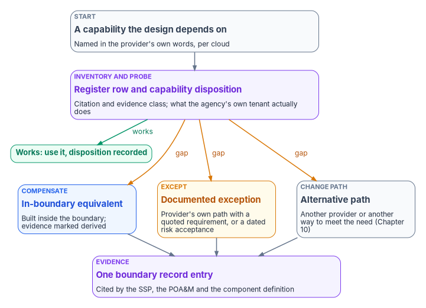

# Chapter 09 — In-Boundary Equivalents and Documented Exceptions

*A boundary can't be negotiated, but a published exclusion can be inventoried, tested, compensated, excepted or argued one feature at a time; the work is to stop treating the gap as a perimeter and start treating it as a list.*

::: {.callout-note}
## In this chapter
The playbook for a capability the agency's cloud boundary doesn't deliver: build a per-feature exclusion register with a citation per row, run a boundary probe to record what actually works, build in-boundary equivalents that say they are derived, use a provider's documented exception path where one exists or a dated risk acceptance where it doesn't, make the scope arguments the 2026 FedRAMP rules allow, and specify capabilities rather than program badges in acquisitions. It ends with why a higher certification class doesn't restore an excluded feature.
:::

[Chapter 02](02-the-invisible-boundary.md) describes the invisible boundary: features that appear in the admin portal and in commercial documentation, and may be written into system security plans and migration plans, but deliver nothing in the agency's cloud. [Chapter 04](04-gcc-and-the-feature-gap.md) describes the gap itself. This chapter is about what to do once a gap is found.

NIST frames the choice in four options. When an agency's trust in an external provider doesn't give enough assurance, SP 800-37 says the organization "employs compensating controls; accepts greater risk; contracts with a more trustworthy external provider; or does not obtain the service."[^c09-sp80037] The program's playbook uses the same four moves under different names. An **in-boundary equivalent** is a compensating control built inside the boundary. A **documented exception** is either a request through the provider's own exception process or the agency accepting greater risk, in writing, with an end date. An **alternative path** is a different provider or a different way of meeting the mission need, which [Chapter 10](10-alternative-collaboration-paths.md) covers for collaboration. Going without the capability is also a legitimate outcome when someone decides it and records it.

{#fig-ch09-three-responses fig-alt="Top to bottom. A slate card: a capability the design depends on. An arrow to a violet card: inventory and probe, a register row with a citation and a capability disposition from the boundary probe. If the probe shows the capability works, a green card: use it, disposition recorded. If not, three cards side by side. A blue card: in-boundary equivalent, compensating control built inside the boundary, telemetry marked derived. An amber card: documented exception, either the provider's own exception path with a named regulatory requirement, or a dated risk acceptance signed by the authorizing official. A slate card: alternative path, a different provider or a different way to meet the need, covered in Chapter 10. All three lead to a violet card: one boundary record entry cited by the SSP, the POA&M and the component definition."}

## Start with a register, not a boundary

The prevailing federal framing treats Microsoft 365 GCC as a compliance perimeter that attenuates telemetry and withholds features for accreditation reasons. The program's FedRAMP whitepaper argues that this framing produces the wrong remedy. A perimeter can only be accepted or left, and the usual alternative, GCC High, is more restricted on several axes rather than fewer. A list of individually published exclusions can be worked one row at a time ([Chapter 04](04-gcc-and-the-feature-gap.md) sets out the evidence). The first move is therefore a per-feature register with a citation per row.

The citation is what makes the register usable. Compare two statements. "GCC withholds network telemetry" is an inference a Microsoft reader will reject. "Network connectivity in the Microsoft 365 admin center supports tenants in worldwide commercial and China, but not GCC Moderate, GCC High or DoD" is a sentence from Microsoft's own documentation, and no reader can reject it.[^c09-mac] The first starts an argument. The second starts a design.

Each register row records:

| Field | What it holds |
|---|---|
| Capability | The feature, in the provider's own name for it |
| Clouds affected | Each cloud the exclusion applies to, because exclusions run in more than one direction |
| Evidence class | **Vendor-confirmed** (the provider documents the exclusion), **inferred** (the program's reading, not yet confirmed), **restricted** (available, but with narrower access or other limits) or **retention-limited** (available, but kept for a shorter period) |
| Citation | The provider page and section, with the date it was read |
| Probe result | What the boundary probe observed in the agency's own tenant, with the date |
| Dependent designs | Which agency designs, controls or plans rely on the capability |
| Response | Use, equivalent, exception or alternative path, or going without (decided and recorded), with its owner |

The program keeps its own register of this kind for Microsoft 365 GCC telemetry gaps. Of its 26 rows, 8 are vendor-confirmed, 15 are the program's own inference, 1 is a restriction (a signal available with limits) and 2 are retention limits rather than absences ([Chapter 02](02-the-invisible-boundary.md)). The program's rule is that only vendor-confirmed rows support a claim made to a provider or an assessor; inferred rows are hypotheses for the boundary probe to test.

That rule exists because inferred rows go wrong. The program's own earlier worked example of the invisible boundary named five features as unavailable in GCC Moderate, and [Chapter 02](02-the-invisible-boundary.md) shows that Microsoft's documentation supports only one of them. The clearest miss is in Intune, which has no separate GCC instance: "GCC is the same instance as Microsoft Intune in the commercial space." Device Health Attestation and expedited Windows updates appear in Microsoft's Intune government service description as features not yet available in **GCC High and DoD**, a different cloud.[^c09-intune-gov] A design that marked those features unavailable in GCC would have built compensating controls for capabilities the agency already had. Rows like those belong in the register as inferred, for the probe to test, not as findings.

## Probe what actually works

A register says what the provider documents. A **boundary probe** says what the agency's own tenant actually does. In the program's design it's a scripted test, owned by the platform team ([Chapter 08](08-who-owns-the-boundary.md)), that exercises each capability the agency's designs depend on and records a **capability disposition**: the capability, the tenant or subscription tested, the test performed, the observed result (works, absent, works with limits, fails silently), the date, and the register row it confirms or contradicts.

Three properties make the probe worth more than a portal screenshot.

- **It tests for silence.** The failure mode the invisible boundary produces isn't an error message; it's a report that never fills in. A probe that only checks whether a setting can be turned on will pass a feature that delivers no data. The probe checks for the output, not the switch.
- **It runs on a schedule.** Exclusions change in both directions, and providers ship continuously. A disposition that was true at authorization can stop being true, and a gap can close without notice. The program reruns the probe on a fixed cadence and after any provider change notice that names an affected capability.
- **It feeds the record.** Every disposition goes into the boundary record the system owner keeps, so the system security plan, the plan of action and milestones and the component definition all cite the same result ([Chapter 11](11-the-authorization-package.md)).

## Build in-boundary equivalents

An in-boundary equivalent is a compensating mechanism that runs inside the agency's boundary and does part of what the excluded capability would have done. The Boundary Impact Model names four kinds, one for each way a boundary can change a claim:

| Impact dimension | What the boundary can remove | In-boundary equivalent | What the evidence must say |
|---|---|---|---|
| Telemetry fidelity | A signal or report that never arrives | An adapter inside the boundary that collects a substitute signal | `source_classification: derived`, and the signal it substitutes for |
| Identity authority | A trust that resolves differently on each side | An explicit resolution rule for each federated issuer | Which issuer is authoritative on this side |
| Enforcement responsibility | A control the platform enforces commercially | An agency-side enforcement mechanism whose evidence flows through the same evidence chain | That the control is agency-enforced, not inherited |
| Provenance classification | An authoritative claim that is only derived on this side | A label carried with the claim through every report | `derived` (or absent), never silently upgraded |

The rule that runs through every row is **say that it's derived**. An equivalent rarely matches the original. A substitute signal may be sampled rather than continuous, collected by the agency rather than the provider, or produced by a tool with its own failure modes. That doesn't make it worthless, but it changes what the agency can assert. A control narrative that says "the agency monitors network performance at each location" on the strength of a substitute signal, without saying it's a substitute, is the kind of claim an assessor will take apart. One that says "the provider's per-location network assessment isn't available in this cloud; the agency runs scheduled connectivity tests from each location, and results are marked derived" survives review.

A worked example shows the pattern. Network connectivity in the Microsoft 365 admin center, which gives commercial tenants per-location network assessments and insights, isn't available to GCC Moderate, GCC High or DoD tenants.[^c09-mac] Microsoft's separate network connectivity test tool, by contrast, lists the US Government (GCC) version as supporting signed-in tests, saved reports, sharing within the tenant, network health status and command-line testing; only sharing reports publicly is disabled for GCC.[^c09-mac-tool] The two aren't the same thing. The admin center's insights come from regular in-product measurements aggregated daily for the tenant, while the test tool's results are run locally in the tool.[^c09-mac-tool] So an in-boundary equivalent built on the test tool needs a schedule (tests run from each location, from the command line, on a cadence the network team sets), a place for the results to land, and the `derived` label. It closes part of the gap. The comparative per-provider scoring that commercial tenants receive isn't replaced by it, and the register row should say so, because an agency choosing a transport or SASE provider will have to fund its own measurement for that ([Book 09](../b09-network/index.md)).

Microsoft 365 informed network routing is the opposite case: Microsoft documents that it isn't available to GCC Moderate tenants, and [Book 08, Appendix C](../b08-ddi/appendix-c-applicability.md) and [Book 09, Chapter 12](../b09-network/12-microsoft-365-traffic.md) cover what an agency does instead. Not every exclusion has an equivalent. When none exists, the honest entry is an exception.

## Use documented exceptions

A documented exception comes in two kinds, and they have different owners ([Chapter 08](08-who-owns-the-boundary.md)).

### The provider's own exception path

Some excluded or restricted capabilities have a provider-defined path for getting them anyway. ExpressRoute for Microsoft 365 is the worked example, and it cuts both ways. Microsoft says it does "not recommend" ExpressRoute for Microsoft 365 because it doesn't provide the best connectivity model in most circumstances, requires Microsoft authorization, and authorizes it "only in the rare scenarios where it's necessary"; a subscription that isn't authorized gets an error when it tries to create Microsoft 365 route filters.[^c09-er] Microsoft's network assessment guidance is more specific: it authorizes ExpressRoute for Microsoft 365 "only when a customer's regulatory requirement mandates direct connectivity," and asks the customer to provide "the text excerpt and web link to the regulation" in its request form.[^c09-er-assess]

Two lessons follow. The first is a warning. Federal readers often assume that FedRAMP or FISMA supplies that regulatory hook. The program hasn't found a FedRAMP rule or a FISMA provision that mandates private connectivity to Microsoft 365, and TIC 3.0 mandates no specific technology ([Book 09, Chapter 03](../b09-network/03-what-tic-3-requires.md)). An agency that writes ExpressRoute for Microsoft 365 into a task order without the authorization in hand may find the gate afterwards. The second is a template. Microsoft's process shows what a feature-level ask looks like when it works: a named requirement, quoted, with a link. The program uses the same structure for every provider-side ask, whether or not the provider has a form for it, and records the request and the answer in the register.

### The agency's own risk acceptance

When no provider path exists, or the agency decides not to use one, the remaining exception is an agency risk acceptance: the authorizing official accepts the residual risk of going without the capability, or of an equivalent that only partly closes the gap. SP 800-37 is clear that "the explicit acceptance of risk is the responsibility of the authorizing official and cannot be delegated."[^c09-sp80037] SP 800-53's CA-5 requires a plan of action and milestones that documents planned remediation of weaknesses and deficiencies found in assessment, updated from assessments, audits and continuous monitoring.[^c09-sp80053] The program uses both, deliberately:

- A gap the agency intends to close (with an equivalent still being built, a provider ask outstanding, or a migration planned) goes on the plan of action and milestones, with a milestone and an owner.
- A gap the agency has decided to live with goes into a signed exception with an end date or a review date, so that "permanent" is a decision someone repeats, not a default.

Each exception record carries the register row, the capability disposition, the dependent designs, what compensates (if anything) and its evidence class, the residual risk in plain words, the signer, the end or review date, and the event that would reopen it: a provider change notice, a certification change, or a probe result that changes. [Book 09, Appendix A](../b09-network/appendix-a-optimize-exemption-instruments.md) shows the same discipline applied to Microsoft 365 traffic exemptions, with separate signers for the risk acceptance, the scope register and the architecture determination.

## Make the scope arguments the 2026 rules allow

[Chapter 03](03-what-changed-at-fedramp.md) describes what changed at FedRAMP. Four of the changes give an agency arguments it can actually use when a capability is refused, and each one comes with a limit.

**1. Security categories can vary by resource, on the provider's side.** The Minimum Assessment Scope rule MAS-CSO-FLO requires providers to identify and document information flows and security categories for the resources in their offering, and says those resources "MAY vary by security category as appropriate to the type of information handled by or impacted by the information resource."[^c09-mas] Under Rev5 practice one impact level was stamped across an entire boundary. Where a provider has withheld a capability because it would pull a whole offering to a higher level, this rule removes the premise, and the agency can ask the provider which resources carry which category. The limit: the rule binds the provider's description of its offering. The agency's own system is still categorized under the Risk Management Framework, and the agency's system owner and authorizing official still decide that.

**2. Software installed on agency systems is outside FedRAMP's scope.** The guidance on MAS-CSO-IIR says that "agents, application clients, mobile applications, etc. that are not fully managed by the cloud service provider" are software delivered for installation on agency systems rather than services operated under shared responsibility, and are "entirely outside the scope of FedRAMP."[^c09-mas] For an estate full of management agents, endpoint sensors and synchronization engines, that answers a scoping question many boundary documents never ask. The limit, and it's important: outside FedRAMP's scope doesn't mean outside the agency's authorization. Software installed on agency systems is part of the agency's system, assessed and monitored by the agency like any other component on its devices and servers. The argument moves the agent from "constrained by the provider's certification" to "owned by the agency's endpoint engineering," which is often the more useful place for it, but it is not a free pass.

**3. Routine recurring changes don't generate notices.** Under the Significant Change Notification rules, providers "SHOULD NOT make formal Significant Change Notifications for routine recurring changes"; adaptive changes are notified within 10 business days after they finish; and transformative changes need notice at least 30 business days before work starts, final plans at least 10 business days before, and further notices within 5 business days after finishing and after verification.[^c09-scn] A provider that ships continuously can classify that cadence as routine recurring, which changes what keeping current with commercial costs on the compliance side. The limit: the agency still has to decide whether a provider change affects its own risk, and FedRAMP's rules put the review of ongoing certification reports on the agency ([Chapter 11](11-the-authorization-package.md)).

**4. Agencies can't simply demand more.** An agency must not require a certified offering to provide information or materials beyond what FedRAMP requires, or to hold a specific certification type or path, unless the agency head or an authorized delegate determines there is a demonstrable need and notifies FedRAMP.[^c09-agu] This cuts against agencies as much as for them. An ask to a provider is strongest when it's a request for something FedRAMP already requires (machine-readable certification data, change notices, configuration guidance) or a feature-level ask with a cited requirement, and weakest when it's an open-ended demand for parity.

These rules apply to Rev5 certifications as well as to new ones: FedRAMP's Rev5 Class C ruleset includes the Minimum Assessment Scope, Significant Change Notification and Certification Data Sharing families,[^c09-rev5c] and adoption of the 2026 rules becomes mandatory on January 1, 2027.[^c09-timeline]

## Buy the capability, not the badge

Acquisition is where an exception path gets closed by accident. The Microsoft 365 Network Provider Program is the example: Microsoft's documentation says the program "is no longer open for new network providers," although other Microsoft pages still invite network equipment vendors to join it.[^c09-npp] A solicitation that names membership as a qualification or evaluation criterion restricts competition to a closed pool and gives a new entrant no way in.

The program's position is to specify the capability instead: automated ingestion of the Microsoft 365 IP address and URL web service, direct egress and inspection bypass for the Optimize and Allow categories, and checking the web service's `/version` method no more than once an hour, which is Microsoft's recommendation, before fetching new endpoint data.[^c09-endpoints] Program membership, if a solicitation mentions it at all, is evidence a bidder may offer, not a gate. The same rule applies to every boundary-related purchase: write the requirement the register row describes, not the product or program that happens to meet it today.

## A higher class doesn't restore an excluded feature

The FedRAMP Marketplace lists Microsoft 365 Government Community Cloud & Supporting Services twice. The package most agencies run, MSO365MT, is FedRAMP Certified at Class C (Moderate). A second package with the identical name, MSO365MTA, is FedRAMP In Process at Class D (High), in Initial Implementation, with no authorizations.[^c09-fr] The Marketplace doesn't state how the two relate. The straightforward reading is a High certification effort for the GCC service, but whether it will supersede the Moderate package, run alongside it or be withdrawn is a question for Microsoft, not a roadmap.

Whatever the answer, a higher class is a different axis from feature availability. The network connectivity layer of the admin center is documented as unavailable in GCC High and DoD as well as GCC Moderate,[^c09-mac] and GCC High is already certified at Class D.[^c09-fr] A certification at High would change what information an agency may place in the service. It would not, by itself, return the per-location network assessments. An agency that defers an in-boundary equivalent because "High is coming" may wait for something the certification was never going to deliver. The register row should record the certification status as context and keep the response it already has.

## The playbook, in order

| Step | Action | Owner ([Chapter 08](08-who-owns-the-boundary.md)) | Output |
|---|---|---|---|
| 1 | List every capability the agency's designs depend on | Workload owners, with the system owner | Dependency list |
| 2 | Find the provider's statement for each, per cloud | Platform team | Register rows with citations and evidence class |
| 3 | Probe each dependency in the agency's own tenant | Platform team | Capability dispositions |
| 4 | For each gap, choose a response: equivalent, provider exception, risk acceptance or alternative path, or going without (decided and recorded) | System owner proposes; authorizing official decides exceptions | Response per row |
| 5 | Build equivalents and label their evidence as derived | Platform team or owning engineering team; CISO sets the evidence class | Equivalent and its evidence |
| 6 | File provider-side requests with a quoted requirement and link | System owner, with acquisition | Request and answer recorded |
| 7 | Record accepted gaps on the POA&M or in a dated exception | System owner; authorizing official signs | POA&M entry or signed exception |
| 8 | Rerun the probe on a cadence and after relevant provider notices | Platform team; ISSO reviews | Updated dispositions and reopened rows |

[Chapter 11](11-the-authorization-package.md) shows where each output lands in the authorization package.

::: {.callout-tip}
## Continue the book
[← Previous: Chapter 08 — Who Owns the Boundary](08-who-owns-the-boundary.md) · [Book index](index.md) · [Next: Chapter 10 — Alternative Collaboration Paths →](10-alternative-collaboration-paths.md)
:::

[^c09-sp80037]: National Institute of Standards and Technology, SP 800-37 Rev. 2, *Risk Management Framework for Information Systems and Organizations*, December 2018, Task R-4 and Appendix G (Authorization Boundaries and External Providers), <https://csrc.nist.gov/pubs/sp/800/37/r2/final>; text read from <https://nvlpubs.nist.gov/nistpubs/SpecialPublications/NIST.SP.800-37r2.pdf> (accessed Oct 21, 2026).
[^c09-mac]: Microsoft Learn, "Network connectivity in the Microsoft 365 Admin Center," note on supported clouds, <https://learn.microsoft.com/microsoft-365/enterprise/office-365-network-mac-perf-overview?view=o365-worldwide> (accessed Oct 21, 2026).
[^c09-intune-gov]: Microsoft Learn, "Microsoft Intune for US Government GCC High and DoD service description," sections "Intune commercial and government instances" and "Intune features planned for GCC High and DoD," <https://learn.microsoft.com/intune/fundamentals/government-service> (accessed Oct 21, 2026).
[^c09-mac-tool]: Microsoft Learn, "Microsoft 365 network connectivity test tool," feature table (Global service, US Government (GCC), China operated by 21Vianet), <https://learn.microsoft.com/microsoft-365/enterprise/office-365-network-mac-perf-onboarding-tool?view=o365-worldwide> (accessed Oct 21, 2026).
[^c09-er]: Microsoft Learn, "Azure ExpressRoute for Microsoft 365," <https://learn.microsoft.com/microsoft-365/enterprise/azure-expressroute?view=o365-worldwide> (accessed Oct 21, 2026).
[^c09-er-assess]: Microsoft Learn, "Assessing Enterprise network last mile," note on ExpressRoute authorization, <https://learn.microsoft.com/microsoft-365/enterprise/assessing-network-connectivity?view=o365-worldwide> (accessed Oct 21, 2026).
[^c09-sp80053]: National Institute of Standards and Technology, SP 800-53 Rev. 5, *Security and Privacy Controls for Information Systems and Organizations*, control CA-5, <https://csrc.nist.gov/pubs/sp/800/53/r5/upd1/final>; control text checked against the release 5.2.0 OSCAL catalog, <https://github.com/usnistgov/oscal-content/blob/main/nist.gov/SP800-53/rev5/json/NIST_SP-800-53_rev5_catalog.json> (accessed Oct 21, 2026).
[^c09-mas]: FedRAMP, "Minimum Assessment Scope," *FedRAMP Consolidated Rules for 2026*, rules MAS-CSO-IIR (with its guidance note on agents and clients) and MAS-CSO-FLO, <https://www.fedramp.gov/2026/reference/minimum-assessment-scope/> (accessed Oct 21, 2026).
[^c09-scn]: FedRAMP, "Significant Change Notification," *FedRAMP Consolidated Rules for 2026*, rules SCN-RTR-NNR, SCN-ADP-NTF, SCN-TRF-NIP, SCN-TRF-NFP, SCN-TRF-NAF and SCN-TRF-NAV, <https://www.fedramp.gov/2026/reference/significant-change-notification/> (accessed Oct 21, 2026).
[^c09-agu]: FedRAMP, "Agency Use" rules, *FedRAMP Consolidated Rules for 2026*, rules AGU-AGC-NAR and AGU-AGC-TPP, <https://www.fedramp.gov/2026/agencies/rules/agency-use/> (accessed Oct 21, 2026).
[^c09-rev5c]: FedRAMP, "Rev5 Class C," *FedRAMP Consolidated Rules for 2026* ruleset reference, <https://www.fedramp.gov/2026/reference/rev5/c/> (accessed Oct 21, 2026).
[^c09-timeline]: FedRAMP, "Important Dates for the Consolidated Rules for 2026," <https://www.fedramp.gov/2026/timeline/> (accessed Oct 21, 2026).
[^c09-npp]: Microsoft Learn, "Microsoft 365 Network Provider Program," note on enrollment; and "Set up your network for Microsoft 365," section "Support Microsoft 365 networking as a network equipment vendor," <https://learn.microsoft.com/microsoft-365/enterprise/microsoft-365-networking-partner-program?view=o365-worldwide>, <https://learn.microsoft.com/microsoft-365/enterprise/set-up-network-for-microsoft-365?view=o365-worldwide> (both accessed Oct 21, 2026).
[^c09-endpoints]: Microsoft Learn, "Managing Microsoft 365 endpoints," sections "Proxy server bypass processing of Microsoft 365 network traffic" and "Change notification using the Web Service," <https://learn.microsoft.com/microsoft-365/enterprise/managing-office-365-endpoints?view=o365-worldwide> (accessed Oct 21, 2026).
[^c09-fr]: FedRAMP Marketplace product data, packages MSO365MT (FedRAMP Certified, Class C, Moderate), MSO365MTA (FedRAMP In Process, Initial Implementation, Class D, High, 0 authorizations) and FR1824057433 (Microsoft 365 Government Community Cloud-High, FedRAMP Certified, Class D, High), <https://www.fedramp.gov/marketplace/products.json> (accessed Oct 21, 2026).
