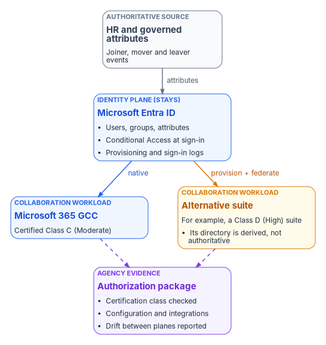
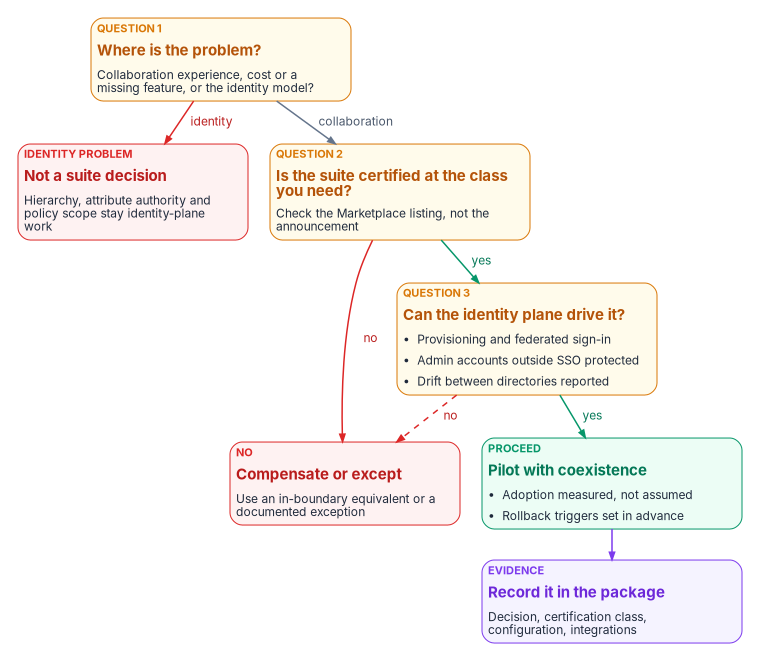

# Chapter 10 — Alternative Collaboration Paths

*The collaboration suite is a workload that consumes identity; it can change without moving the place where identity is decided.*

::: {.callout-note}
## In this chapter
The third answer to a capability the boundary doesn't give you: choosing a different certified service for the workload. The chapter separates the identity plane from the collaboration plane, shows how to read a provider's certification before trusting its announcement, walks through a public example of a cabinet-level department moving its suite (and a public counter-example), and gives the identity patterns, the gaps to close and the decision record that keep the choice governable.
:::

## The third answer

[Chapter 09](09-equivalents-and-exceptions.md) covered two answers to a capability that sits outside the boundary: compensate with an in-boundary equivalent, or take a documented exception. The third answer is to change the service that delivers the workload. For collaboration (mail, documents, chat, meetings and the AI features now bundled with them), that means a different suite, or a different certified service for one piece of the suite, such as meetings.

That choice is only safe if it leaves the identity plane where it is. The identity plane is where attributes have one authoritative source, where organizational structure and policy scope come from, and where access is decided. The collaboration plane is where people do their daily work. The two can be separated, and the program treats them as separable by design: a collaboration suite is a workload that consumes identity, not a second directory of record.

{#fig-ch10-separable-planes fig-alt="Top to bottom. A slate card for HR and governed attributes, the authoritative source of joiner, mover and leaver events, feeds a blue card for Microsoft Entra ID, labeled identity plane (stays), holding users, groups and attributes, Conditional Access at sign-in, and provisioning and sign-in logs. From Entra ID, a blue arrow labeled native leads to a blue card for Microsoft 365 GCC, certified Class C (Moderate), and an amber arrow labeled provision and federate leads to an amber card for an alternative suite, for example a Class D (High) suite, whose directory is derived, not authoritative. Dashed violet arrows run from both collaboration cards to a violet card for the agency's authorization package: certification class checked, configuration and integrations, drift between planes reported."}

| Layer | What it does | Can it move? |
|---|---|---|
| Identity and governance | Authoritative attributes, groups, policy scope, drift detection | Not as part of a suite decision; it stays the root |
| Collaboration | Mail, documents, chat, meetings, embedded AI | Yes, if it's provisioned and federated from the identity plane |
| Access control | Conditional Access, app access, zero trust signals | Stays with the identity platform; it applies at federated sign-in |

## Read the certification, not the announcement

A suite's suitability starts with its FedRAMP status, and the status that counts is the one in the Marketplace data, not in a press release. Under FedRAMP's 2026 rules, services are certified in Classes A to D, Class C includes the former Moderate baseline, and the agency still authorizes its own system: it "should never create a standalone authorization to operate for a cloud service offering," and instead authorizes its own system as one that uses the service as an external service.[^c10-fedramp-use] [Chapter 03](03-what-changed-at-fedramp.md) covers the rules; this chapter applies them.

Some collaboration services, as the Marketplace lists them today. They're examples, not recommendations, and the status of any service can change, so read the listing again on the day you decide.[^c10-marketplace]

| Service (Marketplace listing) | Status | Class (impact level) |
|---|---|---|
| Microsoft 365 Government Community Cloud & Supporting Services (MSO365MT) | FedRAMP Certified | Class C (Moderate) |
| Microsoft 365 GCC, second listing (MSO365MTA) | FedRAMP In Process | Class D (High) |
| Microsoft 365 Government Community Cloud-High (FR1824057433) | FedRAMP Certified | Class D (High) |
| Google Workspace (F1206081364) | FedRAMP Certified | Class D (High) |
| Gemini for Government (FR2604952026) | FedRAMP Certified, January 21, 2026 | Class B (Low) |
| Zoom for Government (FR1825941347A) | FedRAMP Certified | Class C (Moderate) |
| Webex for Government (F1511207635) | FedRAMP Certified | Class C (Moderate) |
| Slack (FR1823447014) / GovSlack (FR2230252267) | FedRAMP Certified | Class C (Moderate) / Class D (High) |
| Box Enterprise Cloud Content Collaboration Platform (F1212191840A) | FedRAMP Certified | Class D (High) |

Two cautions come out of that table. First, the provider's description and the listing don't always say the same thing. Google states that "Google Workspace, Gemini in Workspace apps and the Gemini app are FedRAMP High authorized,"[^c10-google-dot] and Google's own FedRAMP scope page lists the Gemini app and Workspace with Gemini among its Workspace services.[^c10-google-scope] The separately listed Gemini for Government offering, though, appears on the Marketplace at Class B with an impact level of Low.[^c10-marketplace] Which AI features fall inside the Workspace authorization and which belong to a different offering is a question to settle from the certification package, not from marketing copy. Second, the listing is only the start. The Marketplace description of Google Workspace says its boundary is assessed against the High baseline but that services marked with an asterisk "do not meet the SA-9(5) requirement," the control enhancement on where processing and storage happen.[^c10-marketplace] Google also says that meeting its FedRAMP High configuration requires specific editions, such as Enterprise Plus, and that not every service in those editions is authorized.[^c10-google-scope] Those details decide which features an agency can turn on.

## A public example: a department moves its suite

In September 2025 a cabinet-level department awarded a five-year enterprise license agreement, with a ceiling of up to $89 million and a reseller as prime contractor, to move its workforce from Microsoft's collaboration suite to Google Workspace with Gemini and NotebookLM.[^c10-nextgov-award] The award ran under the General Services Administration's April 2025 agreement with Google, which GSA described as "a temporary price reduction of 71%" off Multiple Award Schedule pricing, with the temporary pricing expiring on September 30, 2025;[^c10-gsa-april] GSA later folded it into its OneGov strategy.[^c10-gsa-onegov] The department's deputy CIO said the discount "got us to the table."[^c10-nextgov-inside] The award was signed days before that window closed.

This is drawn from public reporting about a real department, not from an engagement of the Federal Modernization Program, and the figures come from the department, the vendor and the press. What the record shows:

| Aspect | Public record |
|---|---|
| Scale | More than 50,000 employees across the department and its largest component[^c10-nextgov-inside][^c10-google-dot] |
| Speed | Google says the foundational system was deployed and initial users migrated in 22 days; the press reports initial users within 30 days and agency-wide AI tool access within 60[^c10-google-dot][^c10-nextgov-inside] |
| Coexistence | A period of coexistence with the Microsoft tools until the rollout completes[^c10-nextgov-inside] |
| Security posture claimed | Workspace Enterprise Plus with Assured Controls Plus "for 100% U.S.-based support," per Google[^c10-google-dot] |
| Status, October 2026 | Department staff fully migrated to Gmail; the largest component's mail migration expected "in the coming months"; all 50,000-plus employees have access to Gemini and NotebookLM[^c10-nextgov-cio] |

Three things the record doesn't say matter as much. None of the sources describes how identity was integrated: which directory is authoritative, how users are provisioned, or where Conditional Access applies.[^c10-nextgov-inside][^c10-google-dot] The identity patterns below are therefore the program's design, not a description of what the department did. The discount was temporary and tied to an agreement window, so a five-year cost model has to price the renewal years on terms the agency can see, not on the launch price. And speed of first deployment says nothing about the cost of coexistence, which runs until the last component moves.

### A counter-example

The public record also holds a move in the other direction. A military department that had bought about 150,000 Google email licenses decommissioned them on February 28, 2025, after an audit found low use: about 16% were in use at any given time, and its chief information officer said "the return on investment wasn't there." Users moved to the department's Microsoft environment.[^c10-stripes] The lesson isn't about either vendor. A suite that people don't adopt is a cost with no capability behind it, so adoption has to be measured in the pilot, not assumed.

## Keep the identity plane where it is

Two patterns keep the identity plane authoritative. Both are the program's design; the product behavior they rely on is documented by Microsoft and Google.

### Pattern 1: Entra ID as the source, with provisioning and federated sign-in

Entra ID's provisioning service creates, updates and disables users and groups in Google Workspace based on assignment to the enterprise app or on scoping filters.[^c10-entra-gws-prov] The details shape the design:

- Every provisioned user needs a user name on a custom domain verified in both Entra ID and Google; `onmicrosoft.com` names aren't accepted. Matching is on `primaryEmail` only.[^c10-entra-gws-prov]
- The default mappings carry `suspended`, manager, department, title and `OrgUnitPath`, so Google organizational units can be derived from governed attributes rather than maintained by hand. Groups carry name, email, description and members.[^c10-entra-gws-prov]
- Users who already have a personal Google account on the agency's address cause conflicts, which Google's transfer tool resolves before the first sync.[^c10-entra-gws-prov]

Sign-in federates to Entra ID over SAML: Google's third-party SSO profile points at Entra ID's sign-in and sign-out URLs and trusts its signing certificate, and Entra ID maps the user's email as the identifier Google expects.[^c10-entra-gws-sso] Because the suite is now an Entra-integrated app, Conditional Access policies can target it like any gallery app,[^c10-ca-targets] which keeps device, risk and authentication-strength rules in one place ([Book 04](../b04-access/index.md)). Conditional Access applies at the federated sign-in; what happens inside the Google session afterward is Google's session control, which the agency configures separately.

### Pattern 2: Federated coexistence

During a transition, a limited set of users, attributes and groups flows one way into the second suite, and both suites run side by side. Conditional Access and high-assurance signals stay with the identity platform; the second suite is treated as a workload that consumes identity. This is the shape the public example describes as coexistence, and its cost is a second set of mailboxes, sharing settings and retention rules to govern for as long as it lasts.

### Gaps both patterns must close

- **Administrators who bypass SSO.** Google assigns SSO profiles to organizational units or groups, never per user.[^c10-google-sso] Super administrators are a special case: SSO for them works only through the legacy SSO profile and only in some situations, and signing in at the admin console takes the administrator's Google email address and Google password, not the identity provider's credentials. Google recommends 2-Step Verification for super administrators at both the identity provider and Google.[^c10-google-superadmin] Those accounts sit outside Conditional Access. Keep them few, enforce that recommendation, and log their use.
- **A second directory that drifts.** Google keeps its own directory of users, groups and organizational units. Under both patterns it's derived, and the program treats any object or attribute there that the provisioning service didn't write as drift to report, not as an accepted edit. Provisioning logs and the Google audit log are the evidence that the derived directory still matches the source.
- **What the identity plane carries today.** A mature Entra ID deployment already carries Conditional Access, Privileged Identity Management, app registrations and zero trust signals. Changing the suite doesn't move any of that, and it shouldn't. If a plan for a new suite starts to include rebuilding those controls inside it, the plan has turned into an identity migration.

## What the boundary still asks of you

A Class D suite removes the largest barrier, but the agency still accepts risk for "the configuration selected, the integrations enabled, and the controls the agency is responsible for operating," and FedRAMP expects it to configure identity, logging, monitoring and data protection securely.[^c10-fedramp-use] For a collaboration suite that means, at least:

- **Service by service scope.** Turn on only the services and features inside the certification, using the edition the provider names, and record which asterisked services (those not meeting SA-9(5)) are disabled or accepted.[^c10-marketplace][^c10-google-scope]
- **Retention, eDiscovery and records.** Check that the suite's retention and eDiscovery tools (for Google, Vault is listed in the FedRAMP scope)[^c10-google-scope] meet the agency's records schedule before the first mailbox moves. The counter-example kept its old mail for National Archives and eDiscovery purposes, which is a cost of exit worth planning at entry.[^c10-army]
- **Encryption and data location.** Options such as client-side encryption and data regions change what the provider can see and where data lives. Validate them against the agency's own requirements; they aren't settled by the listing.
- **Logging.** Bring the suite's audit logs into the agency's central logging alongside Entra ID's sign-in and provisioning logs, so the identity and collaboration planes can be correlated ([Chapter 11](11-the-authorization-package.md)).

## When the path fits

The path is worth evaluating when:

- The pain is in the collaboration experience, its cost, or a missing feature, not in the identity governance model.
- AI features embedded in the suite are a real requirement, and the specific features are inside the certification.
- The agency is already comfortable running more than one cloud provider.
- Provisioning and federation from the existing identity plane can be governed and monitored for drift.
- There's capacity to run coexistence: training, support, two sets of sharing and retention settings.

It's probably the wrong path when:

- The real problem is directory hierarchy, attribute authority, dynamic groups or policy scope. Those stay identity-plane problems ([Book 02](../b02-identity/index.md)), and a new suite doesn't touch them.
- High-assurance Conditional Access, privileged access workflows or many application integrations already run on Entra ID and would be expensive to re-create around a different suite.
- The organization can't govern two directories during the transition.

{#fig-ch10-path-decision fig-alt="A top-to-bottom decision flow. Question 1, amber: where is the problem, the collaboration experience, cost or a missing feature, or the identity model? An arrow labeled identity leads to a red card, not a suite decision: hierarchy, attribute authority and policy scope stay identity-plane work. An arrow labeled collaboration leads to Question 2, amber: is the suite certified at the class you need? Check the Marketplace listing, not the announcement. An arrow labeled no leads to a red card, compensate or except: use an in-boundary equivalent or a documented exception. An arrow labeled yes leads to Question 3, amber: can the identity plane drive it? Provisioning and federated sign-in, admin accounts outside SSO protected, drift between directories reported. A dashed arrow labeled no also leads to the compensate-or-except card. An arrow labeled yes leads to a green card, pilot with coexistence: adoption measured, not assumed, and rollback triggers set in advance. That leads to a violet card, record it in the package: decision, certification class, configuration, integrations."}

## The decision record

Whatever the outcome, record it the way [Chapter 09](09-equivalents-and-exceptions.md) records equivalents and exceptions, so the authorizing official sees one consistent kind of entry:

1. **Identity origin.** State that Entra ID (or the agency's governed directory) stays authoritative, and which pattern (provisioning and federation, or federated coexistence) connects the suite.
2. **Dependency inventory.** List the applications and workflows that depend on the current suite's identity, mail or files: mail-enabled applications, shared mailboxes, sites and channels used as records stores, embedded Power Platform or add-ins.
3. **Certification check.** Record the Marketplace listing, class and date read, the edition required, and the services and features turned off because they're outside the certification.
4. **Identity design.** Record the provisioning scope, attribute mappings, SSO profile assignments, the handling of administrators outside SSO, and the drift report between directories.
5. **Coexistence plan.** Set the coexistence duration, training, adoption measures and the rollback triggers before the first cutover wave.
6. **Separation.** Treat the suite decision as separate from the identity and governance modernization program, with its own approval, so neither one's schedule silently depends on the other.

::: {.callout-tip}
## Continue the book
[← Previous: Chapter 09 — In-Boundary Equivalents and Documented Exceptions](09-equivalents-and-exceptions.md) · [Book index](index.md) · [Next: Chapter 11 — Evidencing the Boundary in the Authorization Package →](11-the-authorization-package.md)
:::

[^c10-fedramp-use]: FedRAMP, "Using a FedRAMP Certified Cloud Service," *FedRAMP Consolidated Rules for 2026*, <https://www.fedramp.gov/2026/agencies/use/> (accessed Oct 21, 2026).
[^c10-marketplace]: FedRAMP Marketplace product data, <https://www.fedramp.gov/marketplace/products.json>, `last_change` 2026-10-21T05:02:15Z (accessed Oct 21, 2026). Listings MSO365MT, MSO365MTA, FR1824057433, F1206081364, FR2604952026, FR1825941347A, F1511207635, FR1823447014, FR2230252267 and F1212191840A: `status`, `cert_class`, `impact_level`, event-log certification date, and `service_description` (the SA-9(5) note is in the Google Workspace description).
[^c10-google-dot]: Google Cloud, "Driving the future of government: U.S. Department of Transportation selects Google Workspace as new agency-wide collaboration suite," December 5, 2025, <https://cloud.google.com/blog/topics/public-sector/driving-the-future-of-government-us-department-of-transportation-selects-google-workspace-as-new-agency-wide-collaboration-suite> (accessed Oct 21, 2026). Vendor statements.
[^c10-google-scope]: Google Cloud, "FedRAMP and DoD compliance scope," Google Workspace section, <https://docs.cloud.google.com/architecture/security/fedramp-dod-compliance-scope> (accessed Oct 21, 2026).
[^c10-nextgov-award]: Nextgov/FCW, "Transportation awards Google major contract after 'OneGov' deal," October 29, 2025, <https://www.nextgov.com/acquisition/2025/10/transportation-awards-google-major-contract-after-onegov-deal/409133/> (accessed Oct 21, 2026).
[^c10-gsa-april]: General Services Administration, "GSA secures cost savings through strategic agreement with Google," April 10, 2025, <https://www.gsa.gov/about-gsa/newsroom/news-releases/gsa-secures-cost-savings-through-strategic-agreement-with-google-04102025> (accessed Oct 21, 2026).
[^c10-gsa-onegov]: General Services Administration, "GSA, Google Announce Gemini for Government OneGov Agreement," August 21, 2025 (refers to the earlier Workspace agreement at a 71% price reduction), <https://www.gsa.gov/about-us/newsroom/news-releases/gsa-google-announce-gemini-onegov-agreement-08212025> (accessed Oct 21, 2026).
[^c10-nextgov-inside]: Frank Konkel, "Inside the Transportation Department's technology transformation," Nextgov/FCW, December 29, 2025, <https://www.nextgov.com/modernization/2025/12/inside-transportation-departments-technology-transformation/410400> (accessed Oct 21, 2026).
[^c10-nextgov-cio]: Nextgov/FCW, "Former Transportation CIO most proud of creating 'momentum for change'," October 16, 2026, <https://www.nextgov.com/people/2026/10/former-transportation-cio-most-proud-creating-momentum-change/416630/> (accessed Oct 21, 2026).
[^c10-stripes]: Stars and Stripes, "Army ending Google email accounts after low use among soldiers," February 28, 2025, <https://www.stripes.com/branches/army/2025-02-28/army-email-trump-doge-google-16987652.html> (accessed Oct 21, 2026).
[^c10-army]: Jonathan Austin, Army News Service, "Army to sunset Army Google Workspace accounts," February 28, 2025, <https://www.army.mil/article/283432/army_to_sunset_army_google_workspace_accounts> (accessed Oct 21, 2026, as the Internet Archive capture of November 15, 2025, <https://web.archive.org/web/20251115181302/https://www.army.mil/article/283432/army_to_sunset_army_google_workspace_accounts>; army.mil doesn't resolve from this network). The article says individual Gmail data "will be retained for National Archives and electronic discovery purposes."
[^c10-entra-gws-prov]: Microsoft Learn, "Configure Google Cloud / Google Workspace for automatic user provisioning with Microsoft Entra ID," <https://learn.microsoft.com/entra/identity/saas-apps/g-suite-provisioning-tutorial> (accessed Oct 21, 2026).
[^c10-entra-gws-sso]: Microsoft Learn, "Configure Google Cloud / G Suite Connector by Microsoft for Single sign-on with Microsoft Entra ID," <https://learn.microsoft.com/entra/identity/saas-apps/google-apps-tutorial> (accessed Oct 21, 2026).
[^c10-ca-targets]: Microsoft Learn, "Conditional Access: Target resources," <https://learn.microsoft.com/entra/identity/conditional-access/concept-conditional-access-cloud-apps> (accessed Oct 21, 2026).
[^c10-google-sso]: Google Workspace Admin Help, "Setting up SSO," <https://knowledge.workspace.google.com/admin/apps/setting-up-sso> (accessed Oct 21, 2026).
[^c10-google-superadmin]: Google Workspace Admin Help, "Super administrator SSO," <https://knowledge.workspace.google.com/admin/apps/super-administrator-sso> (accessed Oct 21, 2026).
