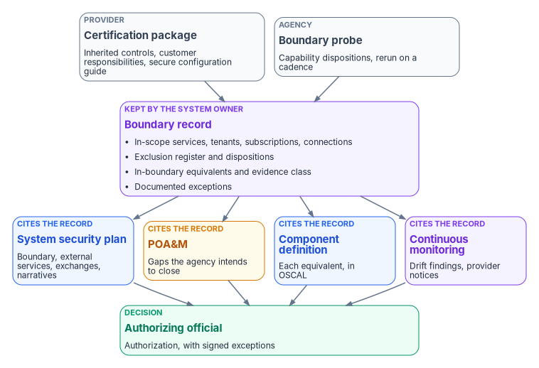
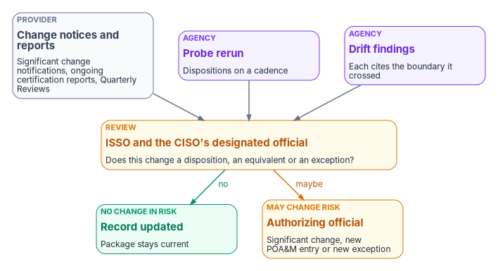

# Chapter 11 — Evidencing the Boundary in the Authorization Package

*The provider's certification covers the service; the agency's package has to cover everything the agency did with it, including every place where the service didn't deliver what the design assumed, and the cheapest way to do that is to write the boundary down once and cite it everywhere.*

::: {.callout-note}
## In this chapter
What an authorization package contains and what the 2026 FedRAMP rules say goes in the agency's half of it; the boundary record as a single named artifact that the system security plan, the plan of action and milestones and the component definition all reference; control narrative patterns for inherited, shared, agency-implemented and compensating controls; how provider change notices and ongoing certification reports feed the agency's continuous monitoring; and a checklist of what an assessor should find.
:::

An agency never authorizes a cloud service. It authorizes its own system, which uses the service. FedRAMP's 2026 rules say so directly: an agency "should never create a standalone authorization to operate for a cloud service offering," and should instead authorize its own federal information system that uses the service as an external service; agencies "remain responsible for issuing their own ATO or ATU even when they rely on a FedRAMP Certification."[^c11-fedramp-use] The provider's certification is evidence the agency reads. The agency's authorization package is evidence the agency writes.

This chapter is about what the agency writes when the system crosses a boundary of the kind this book describes. The Boundary Impact Model's answer is that the boundary should be a "named, modeled, drift-monitored surface" in the package rather than an assumption embedded in every control narrative ([Chapter 02](02-the-invisible-boundary.md)). The rest of this chapter turns that into artifacts.

## What the package is

NIST SP 800-37 defines the package and who builds it. The system owner (with the common control provider and, for systems that process personally identifiable information, the senior agency official for privacy) assembles it, and it includes "security and privacy plans, security and privacy assessment reports, plans of action and milestones, and an executive summary," with more at the authorizing official's request.[^c11-sp80037] The authorizing official reviews it and issues one of a defined set of decisions: authorization to operate, authorization to use, common control authorization, or a denial of any of them. When controls are implemented by an external provider, "the organization ensures that the information needed to make risk-based decisions is made available by the provider."

Two kinds of authorization matter for cloud use. An **authorization to operate** covers a system the agency operates. An **authorization to use** is issued when an agency accepts the authorization package another federal entity produced for a system that entity authorized; SP 800-37 says the official issuing it "has the same level of responsibility and authority for risk management" as one issuing an authorization to operate, and that the customer organization remains "responsible and accountable for the risks."[^c11-sp80037] In practice the agency's system that uses Microsoft 365 or Azure is authorized to operate, and it inherits from the provider's certified service. Either way the decision and the risk stay with the agency's authorizing official.

The 2026 rules then say what the agency's half contains, and, as important, what it doesn't:

- The agency's system security plan "should only contain information that the agency is responsible for," and covers what the agency implements, configures, operates or inherits.[^c11-fedramp-resp][^c11-fedramp-use]
- The agency shouldn't copy the provider's package into its own. FedRAMP's guidance for Rev5 packages says: "Do not copy and paste provider controls into the agency System Security Plan," and provider vulnerabilities and corrective actions "should not be blindly copied into agency POA&Ms."[^c11-fedramp-rev5]
- The agency reviews the provider's package for the service boundary, included services, inherited controls and customer responsibilities, and configures the agency's tenant, accounts, integrations, logging and data flows accordingly.[^c11-fedramp-rev5] It must review the provider's secure configuration guides and configure the relevant security settings.[^c11-fedramp-agu]
- After authorizing, the agency notifies FedRAMP through its ATO letter form, with a copy of the authorization letter.[^c11-fedramp-agu]
- The agency's governance, risk and compliance tools must be able to produce and ingest machine-readable artifacts in formats FedRAMP identifies, at minimum OSCAL and JSON.[^c11-fedramp-agu]

The boundary is the hinge between those two halves. The provider's package says what the service does. The agency's package has to say where the agency's use of it starts, what crosses the line, and what the agency does about anything the design expected and the service didn't deliver.

## The boundary as one artifact

The Boundary Impact Model asks for three things in a package that treats the boundary as a governed object:

1. The boundary itself appears in the system security plan, with disposition data for each of the four impact dimensions.
2. Compensating mechanisms are documented per impact dimension, not as generic mitigations.
3. Drift findings cite the boundary they crossed (for example `DRIFT-PROVENANCE @ gcc-moderate-edge`), so remediation scope is explicit.

The program implements this as a **boundary record**, kept by the system owner ([Chapter 08](08-who-owns-the-boundary.md)), that every other artifact cites rather than restates. One source, many references, is the point: when the boundary probe finds that a capability started or stopped working, one record changes, and every narrative that cites it is current.

{#fig-ch11-package-map fig-alt="A violet card in the center: the boundary record, kept by the system owner, holding in-scope services, tenants, subscriptions and connections, capability dispositions from the boundary probe, the exclusion register, in-boundary equivalents with their evidence class, and documented exceptions. Slate cards feed it from above: the provider's certification package and secure configuration guide, and the boundary probe. Four cards below it are cited from it: the system security plan in blue, with the boundary description, external services and control narratives; the POA&M in amber, with gaps the agency intends to close; the component definition in blue, describing each in-boundary equivalent in OSCAL; and continuous monitoring in violet, with drift findings that cite the boundary and provider change notices. A green card at the bottom: the authorizing official's decision, with signed exceptions."}

The table shows where each part of the record goes and what requires it.

| Package artifact | What the boundary contributes | Basis |
|---|---|---|
| System security plan: system description and boundary | The authorization boundary, determined by the authorizing official; the components inside it; the operational environment and every dependency on or connection to other systems | SP 800-37 Task P-11; SP 800-53 PL-2[^c11-sp80037][^c11-sp80053] |
| System security plan: external services | Each certified service used, its Marketplace package and class, the agency's oversight roles, and how the agency monitors the provider's compliance on an ongoing basis | SP 800-53 SA-9[^c11-sp80053] |
| System security plan: information exchanges | Each exchange that crosses the boundary (a federated trust, a connector, a private link), with interface characteristics, requirements, responsibilities and the impact level of the information | SP 800-53 CA-3[^c11-sp80053] |
| System security plan: control narratives | For each affected control, whether it is inherited, shared, agency-implemented or compensating, citing the record (patterns below) | FedRAMP agency responsibilities[^c11-fedramp-resp] |
| Plan of action and milestones | Each gap the agency intends to close, with a milestone and owner; not the provider's own findings | SP 800-53 CA-5; FedRAMP Rev5 package guidance[^c11-sp80053][^c11-fedramp-rev5] |
| Component definition | Each in-boundary equivalent described as a component, with the controls it supports and how | OSCAL component definition model[^c11-oscal] |
| Security assessment report | Assessor results for the agency-side controls, including tests of the equivalents and the probe | SP 800-37 Task R-1[^c11-sp80037] |
| Signed exceptions | Gaps the authorizing official has accepted, with an end or review date ([Chapter 09](09-equivalents-and-exceptions.md)) | SP 800-37 Task R-4[^c11-sp80037] |
| Continuous monitoring | Probe reruns, drift findings that cite the boundary, and the review of provider change notices and ongoing certification reports | SP 800-53 CA-7; FedRAMP CCM rules[^c11-sp80053][^c11-fedramp-ccm] |

Two of these rows deserve emphasis. **SA-9** asks the agency to define and document "organizational oversight and user roles and responsibilities with regard to external system services" and to monitor the provider's control compliance on an ongoing basis.[^c11-sp80053] That is [Chapter 08](08-who-owns-the-boundary.md)'s responsibility matrix and three-party table, written into the plan. And **CA-3** is where most boundary crossings that aren't the service itself belong: a federated identity trust whose resolution rules differ on each side, a connector that copies data out of the service, a private connection into a subscription. Each one is an exchange with an agreement, and each one is a place where the identity authority or provenance dimension can change.

## Know whose package you are reading

An agency reviewing a provider's package should confirm what the package itself inherits. The FedRAMP Marketplace record for Microsoft 365 GCC (MSO365MT) states that the service "leverages Azure Government as the IaaS/PaaS for the underlying infrastructure," relies on Azure Government-inherited services, and refers readers to the Azure Government package for them; the same record states that customers must purchase a GCC SKU to be covered by the GCC authorization.[^c11-fr] The Marketplace lists Azure Government (F1603087869) and Azure Commercial Cloud (F1209051525) as separate packages, both FedRAMP Certified at Class D (High).[^c11-fr] [Chapter 04](04-gcc-and-the-feature-gap.md) explains how that statement sits beside Microsoft's description of GCC as paired with Entra ID in commercial Azure. For the package, the consequence is that the chain of inheritance for a Microsoft 365 GCC system runs through two provider packages before it reaches the agency, and the agency's external-services entry should name both, together with the SKU that puts the tenant inside the certified service.

The same Marketplace record carries empty fields for a trust center and for secure configuration guidance as of October 21, 2026.[^c11-fr] That isn't evidence that the guidance doesn't exist; it's evidence that the agency has to obtain it through the package rather than from the listing, and the system owner should record where it came from. Microsoft's own FedRAMP page states that customers can use the certifications of Microsoft cloud services as the foundation of an agency authorization, but "need to achieve your own authorizations for components outside these services."[^c11-ms-fedramp] Those components are what the boundary record lists.

## Writing control narratives at the boundary

Most of the controls in an agency package aren't affected by the boundary at all. The ones that are fall into four patterns. Naming the pattern in each narrative is what lets an assessor follow it.

| Pattern | When it applies | What the narrative says | Evidence |
|---|---|---|---|
| Inherited | The provider implements the control for the service, and the agency relies on it | Which package and control the agency inherits, and that the agency has reviewed it | The provider's package; the agency's review record |
| Shared | The provider implements part and the agency configures or operates the rest | The provider's part by reference; the agency's part in full, including the settings from the secure configuration guide | Configuration exports; policy assignments |
| Agency-implemented | The control is entirely the agency's, including for agents and clients on agency systems | How the agency implements it | The agency's own evidence |
| Compensating | A capability the control relied on is outside the boundary, and an in-boundary equivalent does part of the work | What isn't available and the citation; what the equivalent does and doesn't do; that its evidence is derived; the register row and disposition | Equivalent's output, labeled derived; probe result; POA&M entry or signed exception for the remainder |

The compensating pattern is the one the invisible boundary requires, and it is easy to write badly. A narrative that names the commercial capability as if it were in use, because the feature appears in the portal, is the failure [Chapter 02](02-the-invisible-boundary.md) describes. A narrative that hides the substitution is nearly as bad. A good one has four sentences: what the control needs; what the provider documents as unavailable in this cloud, with its citation; what the agency runs instead and what that does and doesn't cover, with the evidence marked derived; and where the remaining gap is recorded. Agents and clients installed on agency systems belong in the agency-implemented pattern: the 2026 rules place them outside FedRAMP's scope, which puts them inside the agency's ([Chapter 09](09-equivalents-and-exceptions.md)).

## Keeping the package current

A package describes the system on the day it was signed. The boundary moves after that, in both directions, and the agency needs a way to notice.

{#fig-ch11-ongoing-review fig-alt="Three slate and violet cards across the top feed an amber review card. Left, slate: provider inputs, meaning significant change notifications, ongoing certification reports and Quarterly Reviews. Center, violet: the boundary probe rerun on a cadence. Right, violet: drift findings that cite the boundary they crossed. The amber review card reads: the ISSO and the CISO's designated official assess each item against the boundary record. Two arrows leave it. One, labeled no change in risk, goes to a green card: record updated, package current. The other, labeled may change risk, goes to an amber card: the authorizing official decides whether it is a significant change requiring reauthorization, a new POA&M entry or a new exception."}

Three inputs feed the review.

**Provider change notices.** Under the 2026 Significant Change Notification rules, providers don't notify routine recurring changes, notify adaptive changes within 10 business days after they finish, and give at least 30 business days' notice before starting a transformative change, with further notices before and after; notices must be available in human-readable and JSON formats, and providers keep 12 months of them with their certification data.[^c11-scn] SP 800-37 puts the customer side of this plainly: it is "incumbent on the customer organization" to make sure the provider shares monitoring information and notifies the customer of significant changes.[^c11-sp80037] In the program's model the ISSO reads each notice against the boundary record and asks one question: does this change a disposition, an equivalent or an exception?

**Ongoing certification reports and Quarterly Reviews.** FedRAMP's collaborative continuous monitoring rules say agencies must review each Ongoing Certification Report to understand how changes to the service may affect the risk tolerance agreed in their authorization, and should consider the security category in their authorization when they assign security staff to reviewing reports, attending Quarterly Reviews and reading other certification data.[^c11-fedramp-ccm] The agency-use rules add that agencies should designate a federal senior information security official to review the reports and represent the agency at Quarterly Reviews, and must notify FedRAMP if a report raises a serious concern.[^c11-fedramp-agu]

**The agency's own signals.** The boundary probe reruns on its cadence ([Chapter 09](09-equivalents-and-exceptions.md)), and drift detection reports any resource, policy or connection that no longer matches the record. Both are continuous monitoring under CA-7, which asks for ongoing control assessments, ongoing monitoring of defined metrics, analysis, and response actions.[^c11-sp80053]

Every item that might change the agency's risk goes to the authorizing official, who decides whether it is a significant change. SP 800-37 defines a significant change as one "likely to substantively affect the security or privacy posture of a system," and lists among its examples new or upgraded applications, changes to ports, protocols or services, changes to cryptographic modules or services, and changes in the information types the system handles.[^c11-sp80037] A provider removing a capability that a compensating narrative depends on, or restoring one that an exception covers, is exactly that kind of change.

## Two models at once

An agency will hold packages in more than one form for several years. Providers certified under Rev5 keep Rev5 packages; FedRAMP stops accepting new Rev5 certification requests on June 11, 2027, and adoption of the 2026 rules becomes mandatory on January 1, 2027.[^c11-timeline] The 2026 rule families on minimum assessment scope, significant change notification and certification data sharing apply to Rev5 Class C certifications as well.[^c11-rev5c] The program's response is to keep the boundary record in a form that doesn't depend on which model a provider uses, and to read each provider's data in whatever form it arrives. FedRAMP-compatible trust centers must provide documented programmatic access to all certification data;[^c11-cds] where a provider has one, the system owner should pull certification data and change notices into the agency's governance tool as data. NIST's OSCAL models give the agency's side the same shape: the system security plan and component definition sit in OSCAL's implementation layer, and the plan of action and milestones in its assessment layer,[^c11-oscal] which is what the agency-use rule on machine-readable artifacts expects.

## What an assessor should find

| Check | Where |
|---|---|
| The authorization boundary is documented, determined by the authorizing official, and matches what the landing zone actually contains | System security plan; boundary record; drift report |
| Every certified service used is named with its Marketplace package, class and inheritance chain, and the SKU that puts the tenant in scope | External services section |
| No provider control text is copied into the agency plan; inherited controls are cited by reference | Control narratives |
| The provider's secure configuration guidance has been reviewed and the relevant settings applied | Configuration evidence; review record |
| Every design dependency on a cloud capability has a disposition with a date | Boundary record |
| Every compensating narrative names the unavailable capability with a citation and marks its evidence as derived | Control narratives; component definition |
| Every gap is either on the POA&M with a milestone or in a signed exception with an end or review date | POA&M; exceptions |
| Every boundary crossing that isn't the service itself is an information exchange with an agreement | CA-3 entries |
| Provider change notices and ongoing certification reports have a named reviewer and a record of review | Continuous monitoring records |
| FedRAMP was notified with the authorization letter | ATO letter submission record |

## What changes, in one table

| Old habit | What replaces it |
|---|---|
| The agency gets an ATO for Microsoft 365 | The agency authorizes its own system that uses the certified service |
| The provider's SSP is pasted into the agency's | The agency plan describes what the agency implements, configures, operates or inherits, and cites the provider by reference |
| The boundary is a diagram in an appendix | The boundary record is one artifact that every narrative, POA&M entry and component definition cites |
| A feature in the portal is written up as a control | Each capability has a disposition; compensating narratives say what is missing and mark the substitute derived |
| Provider findings are copied into the agency POA&M | The agency POA&M holds only gaps the agency manages or accepts |
| Provider change notices are informational | Each is reviewed against the boundary record, and the authorizing official decides whether it is a significant change |
| The package is refreshed every three years | The probe, drift findings and provider data keep it current, in machine-readable form |

::: {.callout-tip}
## Continue the book
[← Previous: Chapter 10 — Alternative Collaboration Paths](10-alternative-collaboration-paths.md) · [Book index](index.md) · [Next: Appendix A — What to Ask a Cloud Provider For →](appendix-a-what-to-ask-for.md)
:::

[^c11-fedramp-use]: FedRAMP, "Using a FedRAMP Certified Cloud Service," *FedRAMP Consolidated Rules for 2026*, <https://www.fedramp.gov/2026/agencies/use/> (accessed Oct 21, 2026).
[^c11-sp80037]: National Institute of Standards and Technology, SP 800-37 Rev. 2, *Risk Management Framework for Information Systems and Organizations: A System Life Cycle Approach for Security and Privacy*, December 2018, Task P-11, Task R-1, Task R-4, and Appendix F (Authorization to Use; Event-Driven Triggers and Significant Changes), <https://csrc.nist.gov/pubs/sp/800/37/r2/final>; text read from <https://nvlpubs.nist.gov/nistpubs/SpecialPublications/NIST.SP.800-37r2.pdf> (accessed Oct 21, 2026).
[^c11-fedramp-resp]: FedRAMP, "Federal Agencies" shared responsibilities, *FedRAMP Consolidated Rules for 2026*, <https://www.fedramp.gov/2026/responsibilities/agencies/> (accessed Oct 21, 2026).
[^c11-fedramp-rev5]: FedRAMP, "Rev5 Certification Packages," *FedRAMP Consolidated Rules for 2026*, <https://fedramp.gov/2026/agencies/use/packages/rev5/> (accessed Oct 21, 2026).
[^c11-fedramp-agu]: FedRAMP, "Agency Use" rules, *FedRAMP Consolidated Rules for 2026*, rules AGU-USE-ABU, AGU-USE-RSG, AGU-USE-NFC, AGU-USE-DSO, AGU-AGC-NAA and AGU-AGC-GRC, <https://www.fedramp.gov/2026/agencies/rules/agency-use/> (accessed Oct 21, 2026).
[^c11-sp80053]: National Institute of Standards and Technology, SP 800-53 Rev. 5, *Security and Privacy Controls for Information Systems and Organizations*, controls PL-2, SA-9, CA-3, CA-5 and CA-7, <https://csrc.nist.gov/pubs/sp/800/53/r5/upd1/final>; control text checked against the release 5.2.0 OSCAL catalog, <https://github.com/usnistgov/oscal-content/blob/main/nist.gov/SP800-53/rev5/json/NIST_SP-800-53_rev5_catalog.json> (accessed Oct 21, 2026).
[^c11-oscal]: National Institute of Standards and Technology, OSCAL, "Component Definition Model" (implementation layer; site navigation lists the System Security Plan model in the implementation layer and the Plan of Action and Milestones model in the assessment layer), <https://pages.nist.gov/OSCAL/learn/concepts/layer/implementation/component-definition/> (accessed Oct 21, 2026).
[^c11-fedramp-ccm]: FedRAMP, "Collaborative Continuous Monitoring," *FedRAMP Consolidated Rules for 2026*, rules CCM-AGM-ROR and CCM-AGM-CSC, <https://www.fedramp.gov/2026/reference/collaborative-continuous-monitoring/> (accessed Oct 21, 2026).
[^c11-fr]: FedRAMP Marketplace product data, packages MSO365MT (Microsoft 365 Government Community Cloud & Supporting Services: FedRAMP Certified, Class C, Moderate; service description and listing message), F1603087869 (Azure Government (includes Dynamics 365): FedRAMP Certified, Class D, High) and F1209051525 (Azure Commercial Cloud: FedRAMP Certified, Class D, High), <https://www.fedramp.gov/marketplace/products.json> (accessed Oct 21, 2026).
[^c11-ms-fedramp]: Microsoft Learn, "Federal Risk and Authorization Management Program (FedRAMP)," frequently asked question "Can I use Microsoft compliance in my agency's authorization process?", <https://learn.microsoft.com/compliance/regulatory/offering-fedramp> (accessed Oct 21, 2026).
[^c11-scn]: FedRAMP, "Significant Change Notification," *FedRAMP Consolidated Rules for 2026*, rules SCN-RTR-NNR, SCN-ADP-NTF, SCN-TRF-NIP, SCN-TRF-NFP, SCN-TRF-NAF, SCN-TRF-NAV, SCN-CSO-HRM and SCN-CSO-HIS, <https://www.fedramp.gov/2026/reference/significant-change-notification/> (accessed Oct 21, 2026).
[^c11-timeline]: FedRAMP, "Important Dates for the Consolidated Rules for 2026," <https://www.fedramp.gov/2026/timeline/> (accessed Oct 21, 2026).
[^c11-rev5c]: FedRAMP, "Rev5 Class C," *FedRAMP Consolidated Rules for 2026* ruleset reference, <https://www.fedramp.gov/2026/reference/rev5/c/> (accessed Oct 21, 2026).
[^c11-cds]: FedRAMP, "Certification Data Sharing," *FedRAMP Consolidated Rules for 2026*, rules CDS-TRC-USH and CDS-TRC-PAC, <https://www.fedramp.gov/2026/reference/certification-data-sharing/> (accessed Oct 21, 2026).
