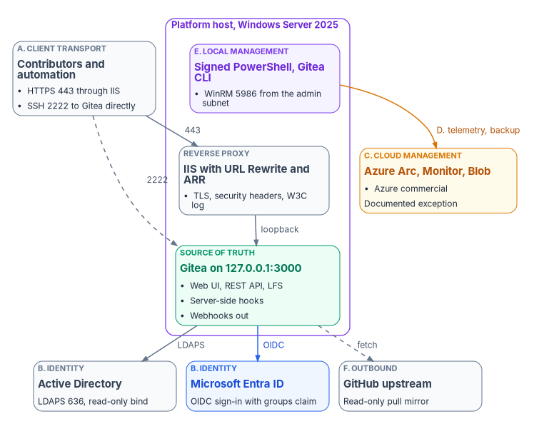
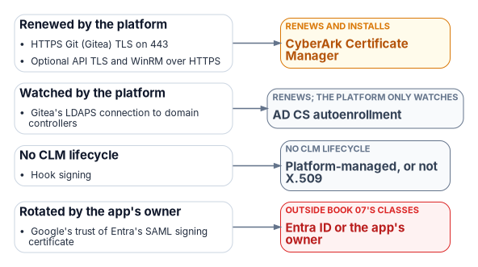

# Appendix B — Platform Host Interface Reference

*A host that holds the program's source of truth should have a finite list of conversations, and anything off the list is a finding.*

::: {.callout-note}
## In this appendix
The interface surface of the platform host once it's built: client transport, identity, the cloud management plane, governance and telemetry, local management, and outbound integrations. For each plane the appendix gives its listener or endpoint, how it authenticates, which boundary it sits in and what evidence it produces, with illustrative configuration. It closes with the boundary and egress posture, the control crosswalk, and how the inventory changes under other repository options.
:::

## What this reference covers

The platform host is the program's single governed server: one Windows Server 2025 machine, with a standby for recovery, that holds the authoritative repository and runs analysis, planning, delivery and evidence. [Book 01, Chapter 03](../b01-transformation-arc/03-platform-foundation.md) explains its roles and why one authoritative writer matters. This appendix answers the question that comes after the build: once it's installed, what does it talk to, what talks to it, and what governs each conversation?

That question belongs in a book about the boundary because the host's interfaces cross several boundaries at once: the agency's own network, Active Directory, Microsoft Entra ID, Azure commercial, and the public internet. An unenumerated interface on a control-plane host is exactly what an assessor finds and a drift report can't score. The program's position is that the list below is closed: every plane is enforced by the build runbook, pinned by the release manifest, and observed by the conformance adapter, and anything not on it is a drift finding or a decision to record, never a tolerated exception.

The reference architecture runs Gitea behind IIS. Gitea and IIS are the program's example components, chosen over IIS serving Git directly through the `git-http-backend` CGI for authentication integration and operational reasons; the reduced surface of that alternative is summarized at the end. Host names use `contoso` as the example domain throughout.

{#fig-apB-interface-families fig-alt="Top to bottom. A slate card for family A, client transport, contributors and automation, using HTTPS 443 through IIS and SSH 2222 to Gitea directly. A violet frame labeled platform host, Windows Server 2025, contains three cards: a slate reverse proxy card, IIS with URL Rewrite and ARR, doing TLS, security headers and the W3C log; a green source-of-truth card, Gitea on 127.0.0.1:3000, with web UI, REST API, LFS, server-side hooks and outbound webhooks; and a violet card for family E, local management, signed PowerShell and the Gitea CLI, with WinRM 5986 from the admin subnet. Clients reach IIS on 443 and Gitea directly on 2222 by a dashed line; IIS forwards to Gitea over loopback. From Gitea, an arrow labeled LDAPS leads to a slate family B card, Active Directory, LDAPS 636 with a read-only bind, and a blue arrow labeled OIDC leads to a blue family B card, Microsoft Entra ID, OIDC sign-in with groups claim. A dashed arrow labeled fetch leads to a slate family F card, GitHub upstream, read-only pull mirror. From local management, an amber arrow labeled D, telemetry and backup, leads to an amber family C card, Azure Arc, Monitor and Blob in Azure commercial, a documented exception."}

## The six families at a glance

| Family | Planes | Primary consumer |
|---|---|---|
| A. Client and operator transport | HTTPS Git (Smart HTTP), Gitea SSH, Gitea web UI, Gitea REST API, Git LFS, optional program API | Contributors, automation, auditors |
| B. Identity and authentication | Active Directory over LDAPS, Entra ID over OpenID Connect, Windows Authentication for the optional API, the host's own identities, signed-commit verification | Operators and service identities |
| C. Cloud management plane | Azure Arc agent, Azure Policy and machine configuration, Azure Monitor Agent, Azure Blob backup target | Platform engineering, security operations |
| D. Governance and telemetry | Server-side Git hooks, Gitea webhooks, the drift reporter, the conformance adapter, IIS W3C logs | The program's governance pipeline and continuous monitoring |
| E. Local management | PowerShell 7.6 (signed scripts only), Windows PowerShell 5.1 for legacy IIS cmdlets, the Gitea CLI, IIS Manager and `appcmd`, NTFS storage | Tier 0 administrators |
| F. Outbound integrations | GitHub upstream pull mirror, PostgreSQL back end (or embedded SQLite), build-time package sources | Upstream ingest, supply chain |

Two planes are absent on purpose. The host reports no Intune compliance policy and isn't hybrid joined to Entra ID; neither is possible for Windows Server 2025, as family B and family C explain.

::: {.callout-warning}
## Illustrative configuration
The configuration and PowerShell in this appendix are illustrative and haven't been tested against a production forest or tenant. Host names, group names and paths are examples. Review every block, check option names against the documentation for the versions you install, and run it first on a test host.
:::

## Family A — client and operator transport

### A.1 HTTPS Git over Smart HTTP, TCP 443

| Attribute | Value |
|---|---|
| Listener | IIS site `FMPReverseProxy`, host name `git.fmp.corp.contoso.com`, port 443 |
| TLS | Enterprise-CA-issued certificate (program template), 4096-bit RSA; private key readable only by the IIS app pool identity |
| Back end | `http://127.0.0.1:3000` (Gitea), through URL Rewrite and Application Request Routing |
| Forwarded headers | `Host` and `X-Forwarded-Proto`, so Gitea builds correct public URLs[^aB-gitea-proxy] |
| Security headers | HSTS (`max-age=31536000`, `includeSubDomains`), set with IIS's native site-level `<hsts>` element, available since IIS 10.0 version 1709;[^aB-iis-hsts] `X-Content-Type-Options: nosniff`; `X-Frame-Options: DENY` |
| Request size | `maxAllowedContentLength` raised to 524,288,000 bytes (500 MB); the IIS default is 30,000,000 bytes (about 28.6 MB)[^aB-iis-limits] |
| Authentication | Interactive sign-in through Entra ID OIDC for the web UI; personal access tokens for `git` over HTTPS |
| Audit | IIS W3C extended logs, read by the conformance adapter and forwarded by the Azure Monitor Agent |

This is the only plane that answers on the host's network address for HTTP. Gitea is bound to loopback and unreachable directly. The rewrite rule is single, catch-all and stop-processing, with no static-content fall-through. Gitea's own IIS guidance adds the steps that are easy to miss: install the WebSocket Protocol feature (Gitea's real-time updates use a WebSocket at `/-/ws`), don't let the proxy decode the request URI (an encoded `%2F` must stay encoded), turn off ARR's reverse rewrite of the host in response headers (otherwise redirects send browsers to the internal address), and serve a certificate with its full chain so `git clone` works.[^aB-gitea-proxy]

```xml
<!-- Illustrative: D:\inetpub\FMPReverseProxy\web.config (excerpt) -->
<configuration>
  <system.webServer>
    <rewrite>
      <rules>
        <rule name="ReverseProxyToGitea" stopProcessing="true">
          <match url="(.*)" />
          <!-- {UNENCODED_URL} keeps the request path exactly as the client sent it -->
          <action type="Rewrite" url="http://127.0.0.1:3000{UNENCODED_URL}" />
        </rule>
      </rules>
    </rewrite>
    <security>
      <requestFiltering>
        <!-- Large pushes and LFS uploads; IIS default is 30000000 bytes -->
        <requestLimits maxAllowedContentLength="524288000" />
      </requestFiltering>
    </security>
  </system.webServer>
</configuration>
```

Used by every `git clone`, `git fetch` and `git push` against the canonical repositories, every browser session in the web UI, and every REST call.

### A.2 SSH Git transport, TCP 2222

Gitea runs its own SSH server; the operating system's OpenSSH server isn't installed and port 22 isn't used. Gitea's built-in server needs `START_SSH_SERVER = true`, which defaults to `false`; `DISABLE_SSH = false` alone only leaves the SSH feature enabled. `SSH_PORT` is the port shown in clone URLs and `SSH_LISTEN_PORT` the port the built-in server listens on.[^aB-gitea-cheat] Users authenticate with SSH public keys they upload in the web UI or through `POST /api/v1/user/keys`.[^aB-gitea-api]

The SSH plane is equivalent to HTTPS for `git` operations but bypasses IIS, so it doesn't appear in the IIS W3C logs. Its audit trail is Gitea's own log under `D:\Gitea\log\`, which the conformance adapter reads alongside the IIS log. HTTPS is the default for people (web UI, README, configured push URLs); SSH is for build agents that can't reach HTTPS through the agency's authenticating forward proxy, because SSH doesn't use HTTP proxies.

```ini
; Illustrative: D:\Gitea\custom\conf\app.ini (excerpt)
RUN_USER = svc-fmp-gitea$

[server]
PROTOCOL         = http
HTTP_ADDR        = 127.0.0.1
HTTP_PORT        = 3000
ROOT_URL         = https://git.fmp.corp.contoso.com/
DISABLE_SSH      = false
START_SSH_SERVER = true
SSH_DOMAIN       = git.fmp.corp.contoso.com
SSH_PORT         = 2222
SSH_LISTEN_PORT  = 2222
LFS_START_SERVER = true

[service]
DISABLE_REGISTRATION = true
REQUIRE_SIGNIN_VIEW  = true

[security]
INSTALL_LOCK      = true
; Keep browser-editable server hooks off; hook bodies are deployed by the signed build
DISABLE_GIT_HOOKS = true

[database]
DB_TYPE = postgres
HOST    = pg01.corp.contoso.com:5432
NAME    = fmp_gitea
; USER and PASSWD are supplied by the build from the secret store

[mirror]
MIN_INTERVAL = 10m
```

### A.3 Gitea web UI, on TCP 443

Routed through IIS to Gitea's HTML surface: repository browsing, blame, raw files, diffs, issues, pull requests and reviews; OAuth2 application management; personal access token issuance for the signed-in user; and mirror status with a **Synchronize Now** control for the upstream pull mirror.[^aB-gitea-mirror]

Anonymous access is off. `DISABLE_REGISTRATION = true` (Gitea's default) means only administrators create accounts, and `REQUIRE_SIGNIN_VIEW = true` (default `false`) forces sign-in to view any page or use the API.[^aB-gitea-cheat]

Hook bodies aren't edited in the browser, and they aren't part of the webhook settings. Gitea does offer per-repository Git hook editing, but only when `DISABLE_GIT_HOOKS` is set to `false`, and Gitea's documentation warns that doing so lets users with the Git Hook privilege run arbitrary code on the host.[^aB-gitea-cheat] On a Tier 0 host the program keeps the default (`true`) and deploys hook bodies to disk through the signed build instead.

### A.4 Gitea REST API v1, `https://git.fmp.corp.contoso.com/api/v1/`

The REST API is the machine-to-machine control plane for Gitea. What the web UI does is reachable here under the same authentication: a personal access token sent as `Authorization: token <value>`, an OAuth2 token, or a session.[^aB-gitea-api]

| Endpoint | Method | Build step | Purpose |
|---|---|---|---|
| `/api/v1/orgs` | `POST` | Phase 8 | Create the `fmp` organization |
| `/api/v1/repos/migrate` | `POST` | Phase 8 | Create the GitHub pull mirror (`mirror: true`, `mirror_interval`) |
| `/api/v1/orgs/{org}/teams` | `GET` | Phase 14.4 | Drift reporter compares the team list with group claims |
| `/api/v1/admin/users` | `GET` | Runtime | Audit and drift reporting |
| `/api/v1/admin/users/{username}` | `PATCH` | Runtime | Leaver handling (`prohibit_login`) |
| `/api/v1/repos/{owner}/{repo}/hooks` | `GET`, `POST` | Phase 9 | Webhook registration |

All of these exist in Gitea's API definition.[^aB-gitea-api] There's no `/api/v1/admin/sources` endpoint, though, so authentication sources can't be registered through the REST API. Register them with the Gitea CLI (`gitea admin auth add-ldap` and `add-oauth`, shown in family B) or in the site administration pages.[^aB-gitea-cli] The REST surface isn't extended by the program; adapters that need new behavior add server-side hooks, not Gitea endpoints.

### A.5 Git LFS

With `LFS_START_SERVER = true` (default `false`), Gitea serves Git LFS on the same loopback listener.[^aB-gitea-cheat] The objects live under `D:\Gitea\data\lfs\`, with the same backup, ACL and quota posture as the bare repositories in `D:\GitRepos\`; there's no separate object-storage back end. The conformance adapter reports LFS bytes stored in each poll's repository inventory, and LFS quota drift is a CM-8 finding.

### A.6 Optional program API, through HttpPlatformHandler

Separate from Gitea. When the optional API extra is installed, a Python (uvicorn) application runs under IIS HttpPlatformHandler and exposes the program's own evidence and assessment surfaces. It's off by default: the standard build doesn't install it, and the governance pipeline doesn't depend on it.

| Property | Value |
|---|---|
| Process | `python.exe` running the program's `run.py`; one worker, bound to loopback |
| Bind | `127.0.0.1:%HTTP_PLATFORM_PORT%`, the port HttpPlatformHandler assigns |
| TLS | Terminated at IIS, with the same certificate as Gitea or a sibling |
| Authentication | IIS Windows Authentication, providers `Negotiate` then `NTLM`; anonymous off |
| Token forwarding | `forwardWindowsAuthToken="true"`: HttpPlatformHandler passes the caller's token to the process in the `X-IIS-WindowsAuthToken` header on each request, and the process must close the handle (default `false`)[^aB-httpplatform] |
| Headers | HSTS, `X-Frame-Options`, `X-Content-Type-Options`, `Referrer-Policy`, `Permissions-Policy`; `X-Powered-By` removed |
| Logging | The IIS W3C log is authoritative; the application's own access log is turned off deliberately |

## Family B — identity and authentication

### B.1 Active Directory over LDAPS, outbound TCP 636

The path for users whose identity is still only in the forest. Gitea's LDAP source binds with a least-privilege account, searches only the governed Users OU, and grants administrator rights through an LDAP filter on the canon stewards group. A successful bind creates a Gitea account on first sign-in. With user synchronization turned on, Gitea's `sync_external_users` job (on by default, nightly at midnight) also creates new users, updates existing ones and disables users no longer found in the source.[^aB-gitea-cheat] The host's own computer account uses Kerberos, separately, for domain services and Group Policy.

```powershell
# Illustrative: register the AD source with the Gitea CLI (run under the Gitea service identity)
$gitea  = 'D:\Gitea\gitea.exe'
$config = 'D:\Gitea\custom\conf\app.ini'
$bindPw = Get-Secret -Name 'svc-fmp-ldap' -AsPlainText   # Microsoft.PowerShell.SecretManagement

& $gitea --config $config admin auth add-ldap `
    --name 'corp-ad-ldaps' `
    --security-protocol 'LDAPS' `
    --host 'dc01.corp.contoso.com' `
    --port 636 `
    --bind-dn 'CN=svc-fmp-ldap,OU=ServiceAccounts,DC=corp,DC=contoso,DC=com' `
    --bind-password $bindPw `
    --user-search-base 'OU=Users,OU=ORG-IT-INF-PLATFORM,DC=corp,DC=contoso,DC=com' `
    --user-filter '(&(objectCategory=person)(objectClass=user)(sAMAccountName=%[1]s))' `
    --admin-filter '(memberOf=CN=IT-INF-PLATFORM-CanonStewards,OU=Groups,DC=corp,DC=contoso,DC=com)' `
    --username-attribute 'sAMAccountName' `
    --email-attribute 'mail' `
    --synchronize-users
```

`--name`, `--security-protocol`, `--host`, `--port`, `--user-search-base`, `--user-filter` and `--email-attribute` are required; the rest are optional.[^aB-gitea-cli] Passing the bind password on the command line exposes it to anyone who can read process arguments on the host, so run this once, at build, from the signed runbook.

### B.2 Entra ID over OpenID Connect

The federated sign-in path. The build registers an application in the agency's tenant with sign-in audience `AzureADMyOrg`, redirect URI `https://git.fmp.corp.contoso.com/user/oauth2/EntraID/callback` (Gitea's callback is `/user/oauth2/<source name>/callback`), and a `groups` claim in the ID token. Gitea's OIDC source then uses the tenant's discovery document.

```powershell
# Illustrative: register the Entra ID source with the Gitea CLI
$tenantId = '<tenant ID>'
$clientId = '<application (client) ID>'
$secret   = Get-Secret -Name 'fmp-gitea-oidc' -AsPlainText

& $gitea --config $config admin auth add-oauth `
    --name 'EntraID' `
    --provider 'openidConnect' `
    --key $clientId `
    --secret $secret `
    --auto-discover-url "https://login.microsoftonline.com/$tenantId/v2.0/.well-known/openid-configuration" `
    --scopes 'email profile' `
    --group-claim-name 'groups' `
    --admin-group '<object ID of the canon stewards group>' `
    --group-team-map '{"<object ID of the contributors group>": {"fmp": ["Contributors"]}}' `
    --group-team-map-removal
```

The Gitea options exist as shown;[^aB-gitea-cli] check the `--group-team-map` JSON shape against the reference for your version. Four points follow from how Entra ID issues the claim:

- **`groups` isn't a scope.** Don't request `openid profile email groups`. Group membership comes from the app registration's groups claim configuration, not from a requested scope; request the ordinary OIDC scopes.
- **The claim carries object IDs.** By default the groups claim contains group object IDs, so `--admin-group` and the team map are keyed by object ID, not display name. Synchronized groups can instead emit `sAMAccountName`, and cloud-only groups their display name, through optional claim settings.[^aB-entra-groupclaims]
- **Overage.** If a user is in more than 200 groups, a JWT carries no groups claim at all, only an overage indicator pointing to Microsoft Graph.[^aB-entra-groupclaims] Gitea's mapping would then see no groups. Configure the claim as **Groups assigned to the application**, which Microsoft recommends for large organizations, and assign only the groups that map to Gitea roles.[^aB-entra-optional]
- **Mapping happens at sign-in.** Gitea applies the group-to-team map when the user signs in, and Gitea's only background sync of external users is the LDAP job in B.1; nothing re-reads OIDC group membership between sign-ins.[^aB-gitea-cheat] A user removed from a group keeps their Gitea team membership, personal access tokens and SSH keys until they sign in again or someone acts. The leaver step therefore disables the Gitea account directly (`PATCH /api/v1/admin/users/{username}` with `prohibit_login`), and the drift reporter flags any Gitea account whose Entra ID user is disabled.

Dynamic groups need Microsoft Entra ID P1.[^aB-dynamic-license] A joiner, mover or leaver event doesn't reach Gitea in minutes. Microsoft says dynamic membership changes are usually processed within a few hours and can take more than 24 hours, depending on the number of groups, the volume of changes and rule complexity.[^aB-dynamic] For a synced user, the attribute change also waits for a directory sync cycle first. Treat propagation as hours, not minutes, and close the gap for leavers with the direct disable above.

### B.3 Windows Authentication for the optional API

When the optional API is on, IIS authenticates callers with Negotiate (Kerberos preferred, NTLM fallback) and forwards the token to the Python process (A.6). This applies only to that API. Gitea handles its own authentication through LDAPS or OIDC.

### B.4 The host's own identities

Three identities matter, and they're different things:

- **The Gitea service account** is a group managed service account (`CORP\svc-fmp-gitea$`). Services configured through the Service Control Manager, IIS application pools and scheduled tasks can all run as a gMSA, and Windows rotates its password automatically.[^aB-gmsa] Gitea's own Windows service instructions register the service with `sc.exe` and run it as the local system account by default, so the service account is set separately (family E).[^aB-gitea-winsvc]
- **The Arc managed identity** is the host's identity in Azure. Arc creates a system-assigned managed identity whose tokens come from a local endpoint, `http://localhost:40342`.[^aB-arc-mi] A local process can request a token only if it can read the challenge file in the agent's token directory, which is limited to administrators and members of the **Hybrid agent extension applications** group,[^aB-arc-identity] so the account that runs backups and the drift reporter must be in that group. The managed identity has no Azure permissions until role assignments grant them.
- **A device object in Entra ID** isn't one of them: the host isn't hybrid joined, so it has no device `extensionAttributes` to carry its organizational attributes. Microsoft's supported devices for hybrid join are Windows 11, Windows 10, and Windows Server 2016, 2019 and 2022; Windows Server 2025 isn't on the list.[^aB-hybrid-join] The host's organizational attributes therefore live as tags on its Arc resource, as Book 01 describes. The underlying distinction still holds where a device object exists: device `extensionAttributes` are managed only in Entra ID, while a synced user's `onPremisesExtensionAttributes` are read-only in Microsoft Graph because their source of authority is on-premises AD.[^aB-graph-ext]

### B.5 Signed-commit verification

The hook chain rejects unsigned pushes to `main`, `canon/*` and any path under the canon directory. Gitea already does most of this natively: it verifies GPG and SSH commit signatures against keys in its own database (without checking key expiry, revocation or key servers),[^aB-gitea-signing] and a protected branch's **Require signed commits** setting rejects pushes containing unsigned or unverifiable commits.[^aB-gitea-protected] Use the branch protection setting as the primary control and keep the hook's own `gpg.exe` check only for rules Gitea can't express, such as path-based requirements. If `gpg.exe` stays, pin its version in the release manifest; the current release is Gpg4win 5.1.1 (September 23, 2026).[^aB-gpg4win]

### B.6 Authentication identity matrix

| Caller | Authentication path | Where the identity comes from | Bound to |
|---|---|---|---|
| Federated contributor | Entra ID OIDC sign-in (web UI), then a personal access token for `git` | Entra ID tenant and group claims | Groups assigned to the Gitea app registration |
| AD-only contributor | LDAPS bind through the Gitea source | Forest user in the governed Users OU | `IT-INF-PLATFORM-CanonStewards` admin filter |
| Optional API caller | IIS Negotiate (Kerberos, then NTLM) | Forest user, impersonated in the API process | NTFS ACLs on what the API touches |
| Gitea service | gMSA `CORP\svc-fmp-gitea$` | Forest service account | `D:\GitRepos`, `D:\Gitea` |
| IIS reverse-proxy app pool | `IIS AppPool\FMPReverseProxy` | Built-in app pool identity | TLS private key (read), nothing else |
| Backup and drift tasks | Arc system-assigned managed identity, used by the gMSA | Arc resource's service principal | Storage account and Arc resource scope, by role assignment |
| GitHub upstream mirror | Anonymous HTTPS fetch | None; the upstream is public | None |

## Family C — cloud management plane

These planes run in Azure commercial. That matters for the boundary: an agency's Microsoft 365 GCC tenant uses Microsoft Entra ID in Azure public,[^aB-gcc-entra] and Azure Arc-enabled servers, Azure Monitor (including Log Analytics), Azure Policy's guest configuration and Blob storage are all listed in Azure public's FedRAMP High audit scope.[^aB-azure-scope] Azure Commercial Cloud is its own Marketplace listing, certified at Class D (High), separate from the Microsoft 365 GCC listing at Class C.[^aB-marketplace] The program records the Arc, Monitor and Blob dependency as a documented exception with a risk acceptance, as [Chapter 09](09-equivalents-and-exceptions.md) describes, and evidences it in the package ([Chapter 11](11-the-authorization-package.md)).

### C.1 Azure Arc

Phase 11 onboards the host as a `Microsoft.HybridCompute/machines` resource named `FMP-GIT01` in resource group `rg-fmp-governance`, with `DeviceRole` and `DeviceTier` tags so Azure Policy assignments can be scoped by tag. The Connected Machine agent's outbound endpoints in Azure public include:[^aB-arc-network]

| Endpoint | Purpose | When |
|---|---|---|
| `login.microsoftonline.com`, `*.login.microsoft.com`, `pas.windows.net` | Microsoft Entra ID tokens (regional endpoints in normal operation) | Always |
| `*.his.arc.azure.com` | Metadata and hybrid identity services | Always |
| `*.guestconfiguration.azure.com` | Extension management and guest configuration | Always |
| `guestnotificationservice.azure.com`, `*.guestnotificationservice.azure.com`, `azgn*.servicebus.windows.net` | Notification service for extensions and connectivity | Always |
| `management.azure.com` | Azure Resource Manager | Only when the server connects or disconnects |
| `download.microsoft.com` | Windows installation package | Install and automatic updates |

`management.azure.com` doesn't carry resource updates or extension installs: Microsoft documents it as needed only to create or delete the Arc resource, and lists the notification and Entra ID endpoints above as always required.[^aB-arc-network] [Book 05, Chapter 09](../b05-devices/09-servers-under-azure-arc.md) covers Arc onboarding and operations for servers in general.

### C.2 Azure Policy and machine configuration

Once the host is in Arc, Azure Policy assignments at `rg-fmp-governance` project machine configuration (formerly Guest Configuration) audits onto it. Results return through the Arc agent to Azure and to the drift engine.

There is no Intune compliance policy (`windows10CompliancePolicy`) assigned to the host attesting Secure Boot, BitLocker, code integrity, firewall, antivirus and TPM state. Intune's supported platforms don't include Windows Server,[^aB-intune-platforms] so the host can't enroll and the policy can't apply. The same signals are audited through machine configuration baselines and Defender for Servers on the Arc resource, as Book 05 describes.

### C.3 Azure Monitor Agent

Installed as the Arc extension `AzureMonitorWindowsAgent`, governed by data collection rules. It forwards the IIS log, Gitea's log, the Windows security audit categories set in Phase 13 (logon and logoff, object access, privilege use, system, account management, policy change) and the Defender event log to the agency's Log Analytics workspace. The agent's endpoints are `global.handler.control.monitor.azure.com`, `<region>.handler.control.monitor.azure.com`, `<workspace-id>.ods.opinsights.azure.com`, `<region>.monitoring.azure.com` and, where used, a data collection endpoint's `ingest.monitor.azure.com` address.[^aB-arc-proxy] `*.oms.opinsights.azure.com` isn't among them.

Three details of IIS log collection affect the evidence:[^aB-ama-iis]

- The IIS log must be W3C format on a local drive, without circular logging or renaming.
- The `X-Forwarded-For` custom field isn't supported by the IIS log data source; collect the file as a custom text log if that field matters.
- The agent collects when the log file rolls over. With the default daily rollover, data arrives once a day; Microsoft recommends hourly rollover.

### C.4 Azure Blob backup target

Phase 12's backup function uploads the nightly `gitea dump` archive (Gitea's single-archive backup of files and databases)[^aB-gitea-cli] and the zipped `D:\GitRepos\` to storage account `stfmpgovernance`, container `gitea-backups`, with 30-day retention, authenticating with the Arc managed identity (B.4). This is the default for the full-production (PostgreSQL) profile. The single-host SQLite profile, and any deployment without reachable Blob storage, instead quiesces Gitea, takes a Volume Shadow Copy-consistent snapshot of `gitea.db`, and ships the archive to local and SMB targets under the same retention.

Both paths meet the program's cold-restore baseline of a 24-hour recovery point and 4-hour recovery time; the optional hot standby raises that to near-zero data loss and a recovery time in minutes, with witness-gated failover so only one node accepts commits at a time. In the full-production profile, Blob is the host's only outbound data path; in the single-host profile, backups stay on-premises and there's no outbound data path at all.

## Family D — governance and telemetry

### D.1 Server-side Git hooks

Every bare repository under `D:\GitRepos\` carries the program's hook bodies, deployed by the signed build and signed with the program's code-signing certificate; application control would refuse to run an unsigned script anyway. Hooks write their own audit log to `D:\Gitea\log\hooks\`.

| Hook | Rule |
|---|---|
| `pre-receive` | Reject pushes to `main` unless the author is in the canon stewards group |
| `pre-receive` | Reject any commit containing `FOUO` or "For Official Use Only" markings |
| `pre-receive` | Validate canon-file YAML front matter (`document_id`, `version`, `status`, `owner`) |
| `pre-receive` | Reject canon files not matching `^FMP_\d{3}_[\w]+_v\d+\.\d+\.md$` |
| `pre-receive` | Reject unsigned `.ps1` files under `scripts/` |
| `update` | Enforce the branch-name allowlist: `main`, `develop`, `feature/*`, `bugfix/*`, `hotfix/*`, `canon/*`, `release/*` |
| `post-receive` | Log the push and notify the public mirror's CI (D.2) |

Git invokes `pre-receive`, `update` and `post-receive` from `git-receive-pack`, that is, when something pushes into the repository.[^aB-githooks] They don't run when Gitea fetches from an upstream, which matters for the mirror in F.1. Gitea's protected-branch settings (push allowlists by user or team, required approvals, required status checks and signed commits) cover several of these rules natively and should carry them where they can.[^aB-gitea-protected]

### D.2 Gitea webhooks

Configured per repository in the web UI or through `/api/v1/repos/{owner}/{repo}/hooks`, and used for three receivers: the drift engine (push events alongside the scheduled Arc state), the documentation build (pushes under `docs/**`), and the public mirror's CI. Gitea signs each delivery with the webhook secret: `X-Gitea-Signature` carries the hex HMAC-SHA256 of the raw body, and `X-Hub-Signature-256` the GitHub-compatible form. It can also send a custom `Authorization` header, and an earlier delivery can be resent from the delivery history.[^aB-gitea-webhooks] The receiver verifies the signature before acting.

Two cautions. Gitea's webhook documentation describes manual redelivery of failed deliveries, not automatic retries with backoff, so the drift engine must tolerate a missed event and reconcile from the scheduled poll. And a GitHub `repository_dispatch` can't be sent from a Gitea webhook. GitHub's dispatch endpoint (`POST /repos/{owner}/{repo}/dispatches`) takes its own body (`event_type`, optional `client_payload`) and a token with the `repo` scope for classic tokens,[^aB-gh-dispatch] and Gitea's webhook types don't include a GitHub dispatch format.[^aB-gitea-api] Send it from the `post-receive` hook or a small relay, with a narrowly scoped token held in the secret store. That makes it an authenticated outbound call to `api.github.com`, which belongs on the egress allowlist.

### D.3 Drift reporter

Phase 14.4 registers a scheduled task that runs as the gMSA (scheduled tasks support gMSAs)[^aB-gmsa] and authenticates to Azure and Graph with the Arc managed identity, so no interactive credential lives on the host. It collects the Arc resource's tags, the Gitea team list, administrative-unit membership through Graph, the Arc agent's last heartbeat, and the Gitea accounts whose Entra ID users are disabled, then submits them to the drift engine, which reports `DRIFT-SCHEMA`, `DRIFT-SEMANTIC`, `DRIFT-PROVENANCE`, `DRIFT-AUTHZ` and `DRIFT-IDENTITY` findings. Non-zero counts open service-level tickets. The build guide marks this Phase 14 capability as declared but still under operational validation.

### D.4 Conformance adapter

The program's read-only conformance adapter emits four evidence files per polling interval: service health (IIS app pool, Gitea service), TLS certificate inventory (expiry, chain, key algorithm, subject alternative names), repository inventory (size, last push, branch count, quota, LFS bytes), and IIS access summaries (request volume, response codes, top principals). It supports CA-7, CM-8, AU-2, AU-6 and SI-4.

### D.5 IIS W3C extended logs

The record of every request on port 443: authenticated principal, URL, user agent, response code and bytes. Files land under `%SystemDrive%\inetpub\logs\LogFiles\W3SVC<siteId>\` and feed the conformance adapter and the Azure Monitor Agent.[^aB-ama-iis] Set the rollover to hourly (C.3). They're evidence for AU-2 and AU-6.

## Family E — local management

### E.1 PowerShell

The administrative shell is PowerShell 7.6, the current Long-Term Servicing release (supported to November 14, 2028). PowerShell 7.4 reaches end of support on November 10, 2026.[^aB-ps-lifecycle] Windows PowerShell 5.1 stays only for `Install-WindowsFeature` and the legacy `WebAdministration` cmdlets; new automation runs on `pwsh`.

Signed-only execution comes from application control, not from the execution policy. An `AllSigned` policy at the user scope isn't enough: the `CurrentUser` and `Process` scopes are set by the user and the `Process` scope overrides the others, while a policy set by Group Policy (`MachinePolicy`) can't be overridden; Windows PowerShell 5.1 and PowerShell 7 also keep separate settings.[^aB-execpolicy] Set the policy by Group Policy for both shells, and rely on App Control for Business (formerly Windows Defender Application Control), which Microsoft recommends over AppLocker because AppLocker receives only security fixes, to refuse unsigned code.[^aB-appcontrol] Keep AppLocker only where it adds user- or group-specific rules.

### E.2 Gitea CLI and the service

`gitea.exe` is the local management surface: `gitea dump` for backup, `gitea admin user` for break-glass operator actions, `gitea admin auth` for authentication sources, and `gitea generate secret` for `INTERNAL_TOKEN`, `JWT_SECRET` and `SECRET_KEY`.[^aB-gitea-cli] Gitea has no `gitea service install` command; its Windows guidance registers the service with `sc.exe`.[^aB-gitea-winsvc]

```powershell
# Illustrative: install and test the gMSA on the host, then register Gitea as a service under it
Install-ADServiceAccount -Identity 'svc-fmp-gitea$'
Test-ADServiceAccount   -Identity 'svc-fmp-gitea$'

sc.exe create gitea start= auto binPath= '"D:\Gitea\gitea.exe" web --config "D:\Gitea\custom\conf\app.ini"'
# A gMSA logs on with an empty password; Windows retrieves the managed password
sc.exe config gitea obj= 'CORP\svc-fmp-gitea$' password= ''
sc.exe config gitea start= delayed-auto

# Let the gMSA request Arc managed identity tokens for backup and drift reporting
Add-LocalGroupMember -Group 'Hybrid agent extension applications' -Member 'CORP\svc-fmp-gitea$'
```

`RUN_USER` in `app.ini` must name the same account (A.2). Gitea's guidance also suggests a delayed start if the service times out at boot.[^aB-gitea-winsvc] There's no SSH-into-the-host workflow: Tier 0 administration uses WinRM over HTTPS on 5986, restricted to the admin subnet `10.1.20.0/24`, from a privileged access workstation.

### E.3 IIS management

IIS Manager, `appcmd` and the `IISAdministration` module are used at install (Phases 2 and 5) and during incident response. The conformance adapter's read access to IIS configuration comes from a scoped group membership for its identity, not from administrator rights.

### E.4 Storage

| Path | Owner | Contents |
|---|---|---|
| `D:\GitRepos\` | gMSA (Modify, inherited) | Bare repositories and their hooks: the Git object store |
| `D:\Gitea\` | gMSA (Modify, inherited) | `gitea.exe`, `custom\conf\app.ini`, `data\`, `data\lfs\`, `log\` |
| `E:\Backups\Staging\` | Backup identity, opt-in | Staging before the Blob upload |

NTFS ACLs are the only authorization boundary inside the host. In the full-production profile the Gitea database is off-host on `pg01.corp.contoso.com:5432`; in the single-host profile it's `D:\Gitea\data\gitea.db`, under the same ACL as the rest of `D:\Gitea\`. Gitea recommends an absolute path for the SQLite file when running as a Windows service.[^aB-gitea-winsvc]

## Family F — outbound integrations

### F.1 GitHub upstream pull mirror

Phase 8 creates a pull mirror of the public upstream `https://github.com/example-org/fmp.git` with `POST /api/v1/repos/migrate`, `mirror: true` and a 15-minute interval. Gitea's minimum mirror interval is 10 minutes and its default 8 hours.[^aB-gitea-cheat] Authentication is anonymous because the upstream is public.

```powershell
# Illustrative: create the upstream pull mirror through the Gitea REST API
$pat  = Get-Secret -Name 'fmp-gitea-admin-pat' -AsPlainText
$body = @{
    clone_addr      = 'https://github.com/example-org/fmp.git'
    repo_owner      = 'fmp'
    repo_name       = 'fmp-upstream'
    service         = 'git'
    mirror          = $true
    mirror_interval = '15m0s'
    private         = $true
} | ConvertTo-Json

Invoke-RestMethod -Method Post `
    -Uri 'https://git.fmp.corp.contoso.com/api/v1/repos/migrate' `
    -Headers @{ Authorization = "token $pat" } `
    -ContentType 'application/json' `
    -Body $body
```

The program's rule is that GitHub is where canon is ingested and the on-premises repository is where canon is authoritative: a commit pushed to GitHub isn't canon until it has been accepted on the host. Mirrored commits don't pass through the hook chain that governs operator pushes: a pull mirror updates by fetching, the receive hooks run only on pushes,[^aB-githooks] and a pull mirror is read-only: it changes only when it syncs from its upstream,[^aB-gitea-mirror] and Gitea refuses pushes to a mirror repository over both HTTPS and SSH.[^aB-gitea-mirror-ro] So the mirror (`fmp-upstream` above) is a quarantine copy, and canon moves into the authoritative repository only by a push or merged pull request from it, which runs the hook chain and the branch protections. The drift reporter flags any difference between the two that hasn't been promoted.

### F.2 Database: PostgreSQL or embedded SQLite

The program sanctions two profiles for Gitea's metadata (users, teams, OAuth applications, issue and pull request state, webhook history). **Full production** uses the `fmp_gitea` database on a separate PostgreSQL host, `pg01.corp.contoso.com:5432`, with connection details in the `[database]` section of `app.ini` and the password from the secret store; the database team owns its backup, and `gitea dump` adds a logical dump for cold restore. **Single host** (lab, disconnected or small footprint) uses Gitea's embedded SQLite (`DB_TYPE = sqlite3`; Gitea supports `mysql`, `postgres`, `mssql` and `sqlite3`),[^aB-gitea-cheat] with no relational tier and no outbound database connection. Only the full-production profile adds an outbound plane to this family.

### F.3 Build-time supply chain

Every binary the Phase 1–13 build downloads is pinned to a URL and SHA-256 hash in the release manifest. The hosts are `github.com`, `objects.githubusercontent.com`, `download.microsoft.com`, `aka.ms`, `dotnetcli.azureedge.net`, `packages.microsoft.com`, the Gpg4win site, `*.powershellgallery.com` and `timestamp.digicert.com`. Operators with an internal artifact mirror substitute its URLs; the hashes stay the same. This plane is build-only: after cutover, the supply-chain hosts aren't on the runtime egress allowlist.

## Boundary and egress posture

### Which boundary each plane sits in

| Plane | Boundary |
|---|---|
| Gitea HTTPS, SSH, web UI, REST | The agency's own system boundary (on-premises, agency network) |
| Active Directory LDAPS | The agency's own system boundary (the forest) |
| Entra ID OIDC and Microsoft Graph | Microsoft Entra ID in Azure public, paired with the Microsoft 365 GCC tenant[^aB-gcc-entra] |
| Azure Arc, Azure Policy and machine configuration | Azure commercial (Class D) — documented exception |
| Azure Monitor and Log Analytics | Azure commercial (Class D) — documented exception |
| Azure Blob backup target | Azure commercial (Class D) — documented exception |
| GitHub pull mirror | Public internet, read-only ingest |

None of these planes is "GCC-Moderate." The on-premises host is inside the agency's own authorization boundary, not a cloud service's; Entra ID for a GCC tenant runs in Azure public; and Intune no longer appears because it doesn't manage the server (C.2). The Azure set is recorded as a discrete exception, with a decision record and risk acceptance, not as a quiet departure from the tenant's boundary.

### Runtime egress allowlist

Phase 0.5 enumerates the runtime egress allowlist, and the proxy and firewall team permits only those host names through the agency's forward proxy; everything else is denied. The list is the union of family C's endpoints, the PostgreSQL host in the full-production profile, `github.com` for the mirror, and `api.github.com` for the CI notification (D.2). The proxy environment variables (`HTTPS_PROXY`, `HTTP_PROXY`, `NO_PROXY`) are set at machine scope so Git, PowerShell and the Arc agent use the same proxy; the Arc agent can also take its own proxy setting.[^aB-arc-proxy]

### Inbound posture

| Port | Protocol | Allowed sources | Purpose |
|---|---|---|---|
| 443 | HTTPS | Agency network and VPN ranges | Web UI, REST API, Git over HTTPS, optional API |
| 2222 | SSH | Agency network and VPN ranges | Git over SSH (Gitea's built-in server) |
| 5986 | WinRM over HTTPS | `10.1.20.0/24` (Tier 0 admin subnet) only | Tier 0 administration |
| Anything else | — | Denied by the domain firewall profile (`DefaultInboundAction Block`) | — |

There's no inbound access from the public internet. Operators outside the agency network come through the documented VPN and privileged access workstation path.

## Control crosswalk

Control identifiers are from NIST SP 800-53 Revision 5.[^aB-nist] The mapping is the program's.

| Interface | Controls | Mechanism |
|---|---|---|
| HTTPS Git | SC-8, SC-13, AU-2, AU-12 | TLS 1.2 or later at IIS, W3C log, conformance adapter |
| Gitea REST API | AC-3, AC-6, AU-2 | OIDC and LDAPS authentication, W3C log, Gitea log |
| SSH transport | SC-8, AU-2 | Gitea host key and per-user keys, Gitea log |
| AD LDAPS | IA-2, IA-5 | Least-privilege bind, scoped search base |
| Entra ID OIDC | IA-2, IA-8, AC-2 | Group claims mapped to roles; direct disable for leavers |
| Server-side hooks and branch protection | CM-3, CM-5, SI-7 | Pre-receive validation, signed-commit enforcement |
| Drift reporter | CM-8, SI-4, IR-4 | Scheduled task, drift taxonomy |
| Conformance adapter | CA-7, CM-8, AU-2, AU-6, SI-4 | Health, TLS, repository and access-log evidence |
| Azure Arc and machine configuration | CM-2, CM-6, CM-7 | Azure Policy assignments and baselines |
| Azure Monitor Agent | AU-6, AU-9, SI-4 | Log Analytics forwarding |
| Azure Blob backup | CP-9, CP-10 | Nightly archive and retention |
| Application control | CM-7, SI-7 | App Control for Business publisher rules |

CM-6, SI-2 and SI-7 don't map to an Intune compliance plane, because Intune doesn't manage the host: CM-6 sits with machine configuration, and patch evidence (SI-2) comes from Azure Update Manager on the Arc resource, as Book 05 describes.

## Group governance

Gitea roles map to three groups:

| Gitea role | Group |
|---|---|
| Owner | `IT-INF-PLATFORM-CanonStewards` |
| Write | `IT-INF-PLATFORM-Contributors` |
| Read | `IT-INF-Users` |

These groups are driven by user attributes, and a synced user's attributes are written in on-premises AD and reach Entra ID through directory sync before any group recalculates. The attributes have exactly one writer, the governance plane, and drift against it is a finding, not an accepted edit. A move in the HR feed reaches Gitea after directory sync, dynamic group processing (B.2) and the user's next sign-in, so the program measures it in hours and handles leavers directly. The group mapping is part of Phase 14, which the build guide marks as under operational validation. [Book 03, Chapter 08](../b03-hr-identity/08-joiner-mover-leaver.md) covers the joiner-mover-leaver flow.

The program's key security indicator library tests this host's posture on every evaluation run: continuous-monitoring presence and freshness (CA-7), repository and TLS inventory completeness (CM-8), IIS log presence and retention (AU-2, AU-6), and monitoring evidence freshness (SI-4). A failure opens a service-level ticket and gates the next authorization review.

## Other repository options

The program evaluated alternatives before choosing Gitea behind IIS. The inventory changes under each:

| Option | Interface change from the reference |
|---|---|
| IIS with `git-http-backend` (CGI) | No web UI, native LFS, OIDC, team model, REST API or webhooks; authentication collapses to IIS Windows Authentication. Kept for lab use (see below). |
| GitHub Enterprise Server | A vendor-supplied Linux appliance with its own upgrade path and REST API; adds a licensing surface. |
| GitLab self-managed, Bitbucket Data Center | Linux-first, with more components (clustered database, cache, background workers, web tier) to govern, without proportional governance value at this scale. |
| Azure DevOps Server | Still a current product: its latest release shipped December 9, 2025, with an upgrade path from 2022, 2020, 2019 and TFS 2015.[^aB-ado-server] It wasn't retired after 2020, as is sometimes assumed. A heavier Windows and SQL Server footprint than this host needs. |
| SaaS repositories (GitHub Enterprise Cloud, GitLab Dedicated for Government, Azure DevOps Services) | Available at various classes (GitHub Enterprise Cloud is listed at Class B, GitLab Dedicated for Government at Class C)[^aB-marketplace] but they move the authoritative copy outside a host the agency controls. The program keeps canon authority on-premises by design; that's a design choice, not a boundary prohibition. |
| Plain bare repositories over SSH | No per-URL access control, no read audit, no LFS or OIDC without add-ons. Acceptable only as an emergency offline mirror. |

Deviating from the reference is a recorded decision that supersedes the program's Git-infrastructure decision, and the conformance adapter reports any surface it doesn't expect as `DRIFT-SCHEMA` until that decision exists.

### The CGI option's smaller surface

Use this table when inventorying a lab or proof-of-concept host still on the CGI option. Any such host promoted to production needs a recorded decision first.

| Interface | Reference (Gitea behind IIS) | CGI option (lab only) |
|---|---|---|
| HTTPS Git | Yes, Gitea behind the reverse proxy | Yes, `git-http-backend.exe` as an IIS CGI handler |
| SSH transport | Yes, Gitea's built-in server on 2222 | No |
| Web UI | Yes | No; Git command line only |
| REST API | Yes | No |
| LFS | Yes, built in | Needs a hand-built IIS handler |
| Entra ID federation | Yes, OIDC source | No; IIS Windows Authentication only |
| AD LDAPS | Yes, LDAP source with admin filter | AD groups map to IIS authorization rules only; no per-repository teams |
| Server-side hooks | Same hook bodies | Same hook bodies |
| Webhooks | Yes, signed | Custom PowerShell and Task Scheduler |
| Conformance adapter | Full coverage | Partial: TLS and IIS log only |
| Drift integration | Team list included | No team or group state |

## Closing position

Every plane in the six families is one of four kinds:

1. **Inbound and gated** by IIS, Gitea's OIDC or LDAPS sources, or the firewall's subnet allowlist.
2. **Outbound and pinned** to a host name on the egress allowlist.
3. **Local and signed**, with application control refusing anything the program didn't sign.
4. **Telemetry**, observed by the conformance adapter and reported to the drift engine.

Anything outside that list is a finding: `DRIFT-SCHEMA` if a plane appeared without a recorded decision, `DRIFT-PROVENANCE` if its origin can't be traced, `DRIFT-AUTHZ` if its authorization drifted from the group mapping. The host is governed by the closure of this list, not by the absence of incidents.

## Certificates in this book and the CLM platform {#certificates-and-the-clm-platform}

[Book 07](../b07-pki/index.md) gives each class of certificate one issuer and one renewal engine, and makes CyberArk Certificate Manager, Self-Hosted the system of record for every certificate that Intune and the PIV system don't manage ([Chapter 04](../b07-pki/04-the-target-pki.md), [Chapter 05](../b07-pki/05-who-owns-the-certificate-estate.md)). The certificates this book's systems depend on map to it as follows; [Book 07, Appendix C](../b07-pki/appendix-c-anatomy-of-the-clm-platform.md) describes the platform itself.

| Certificate | Book 07 class | Issued by | Renewed by | What the CLM platform does |
|---|---|---|---|---|
| HTTPS Git (Gitea) TLS on 443 | Internal server TLS | Retained AD CS | CyberArk Certificate Manager | Renews it; the CAPI driver binds IIS and grants the app pool read access to the key |
| Optional API TLS and WinRM over HTTPS | Internal server TLS | Retained AD CS | CyberArk Certificate Manager | Renews them |
| Gitea's LDAPS connection to domain controllers | Domain controller and LDAPS | Retained AD CS | AD CS autoenrollment | Watches the DC certificates |
| Hook signing | Code signing | CA chosen by the CISO | Platform-managed, or not X.509 | At most watches; signing is a separate CyberArk product |
| Google's trust of Entra's SAML signing certificate | Not a Book 07 class | Entra | Entra ID or the app's owner | Nothing |

{fig-alt="HTTPS Git (Gitea) TLS on 443, Optional API TLS and WinRM over HTTPS go to CyberArk Certificate Manager (renews and installs); Gitea's LDAPS connection to domain controllers go to AD CS autoenrollment (renews; the platform only watches); Hook signing go to Platform-managed, or not X.509 (no clm lifecycle); Google's trust of Entra's SAML signing certificate go to Entra ID or the app's owner (outside book 07's classes)."}

The conformance adapter's TLS inventory (D.4) duplicates what the CLM platform already holds; reconcile the two, or read the platform's inventory through its API (inference).[^clm-capi]


::: {.callout-tip}
## Continue the book
[← Previous: Appendix A — What to Ask a Cloud Provider For](appendix-a-what-to-ask-for.md) · [Book index](index.md)
:::

[^aB-gitea-proxy]: Gitea Documentation, "Reverse Proxies," IIS section and general notes, <https://docs.gitea.com/administration/reverse-proxies> (accessed Oct 21, 2026).
[^aB-iis-hsts]: Microsoft Learn, "IIS 10.0 Version 1709 HTTP Strict Transport Security (HSTS) Support," <https://learn.microsoft.com/iis/get-started/whats-new-in-iis-10-version-1709/iis-10-version-1709-hsts> (accessed Oct 21, 2026).
[^aB-iis-limits]: Microsoft Learn, "Request Limits `<requestLimits>`," <https://learn.microsoft.com/iis/configuration/system.webserver/security/requestfiltering/requestlimits/> (accessed Oct 21, 2026).
[^aB-gitea-cheat]: Gitea Documentation, "Configuration Cheat Sheet" (`[server]`, `[service]`, `[security]`, `[database]`, `[mirror]`, `[cron.sync_external_users]`), <https://docs.gitea.com/administration/config-cheat-sheet> (accessed Oct 21, 2026).
[^aB-gitea-api]: Gitea API definition (Swagger), version 29.0.0+dev, <https://gitea.com/swagger.v1.json> (accessed Oct 21, 2026). Checked: the paths in the A.4 table, absence of any `/admin/sources` path, `POST /user/keys`, `EditUserOption.prohibit_login`, the `token` authorization header, and the webhook `type` values.
[^aB-gitea-mirror]: Gitea Documentation, "Repository Mirror," <https://docs.gitea.com/usage/repo-mirror> (accessed Oct 21, 2026). Pull mirroring: the repository "gets mirrored periodically from the remote repository," and **Synchronize Now** in the repository settings forces a sync.
[^aB-gitea-mirror-ro]: Gitea source code, `routers/web/repo/githttp.go` (a push over HTTP(S) to a mirror is answered 403, "mirror repository is read-only") and `routers/private/serv.go` (write access over SSH to a mirror is refused, "Mirror Repository %s is read-only"), commit 0948aed, <https://github.com/go-gitea/gitea/blob/0948aed411afbcac956c3c9a76cadf5260c6452f/routers/web/repo/githttp.go#L202-L205> and <https://github.com/go-gitea/gitea/blob/0948aed411afbcac956c3c9a76cadf5260c6452f/routers/private/serv.go#L171-L175> (accessed Oct 21, 2026). The documentation doesn't state the rule; confirm it on the host's Gitea version with a test push to the mirror.
[^aB-gitea-cli]: Gitea Documentation, "Gitea Command Line" (`admin auth add-ldap`, `admin auth add-oauth`, `dump`, `generate secret`, `admin user`), <https://docs.gitea.com/administration/command-line> (accessed Oct 21, 2026).
[^aB-httpplatform]: Microsoft Learn, "HttpPlatformHandler Configuration Reference," <https://learn.microsoft.com/iis/extensions/httpplatformhandler/httpplatformhandler-configuration-reference> (accessed Oct 21, 2026).
[^aB-entra-groupclaims]: Microsoft Learn, "Configure group claims for applications by using Microsoft Entra ID," <https://learn.microsoft.com/entra/identity/hybrid/connect/how-to-connect-fed-group-claims>, and "ID token claims reference," groups overage claim, <https://learn.microsoft.com/entra/identity-platform/id-token-claims-reference#groups-overage-claim> (both accessed Oct 21, 2026).
[^aB-entra-optional]: Microsoft Learn, "Configure and manage optional claims in ID tokens, access tokens, and SAML tokens," section "Configure groups optional claims," <https://learn.microsoft.com/entra/identity-platform/optional-claims#configure-groups-optional-claims> (accessed Oct 21, 2026).
[^aB-dynamic-license]: Microsoft Learn, "Create or update a dynamic membership group in Microsoft Entra ID," <https://learn.microsoft.com/entra/identity/users/groups-create-rule> (accessed Oct 21, 2026).
[^aB-dynamic]: Microsoft Learn, "Understand and manage dynamic group processing in Microsoft Entra ID," <https://learn.microsoft.com/entra/identity/users/manage-dynamic-group> (accessed Oct 21, 2026).
[^aB-gmsa]: Microsoft Learn, "Manage group Managed Service Accounts," <https://learn.microsoft.com/windows-server/identity/ad-ds/manage/group-managed-service-accounts/group-managed-service-accounts/manage-group-managed-service-accounts> (accessed Oct 21, 2026).
[^aB-gitea-winsvc]: Gitea Documentation, "Register as a Windows Service," <https://docs.gitea.com/installation/windows-service> (accessed Oct 21, 2026).
[^aB-arc-mi]: Microsoft Learn, "Access Azure resources by using managed identity on Azure Arc-enabled servers," <https://learn.microsoft.com/azure/azure-arc/servers/managed-identity-authentication> (accessed Oct 21, 2026).
[^aB-arc-identity]: Microsoft Learn, "Identity and authorization" (Azure Arc-enabled servers security), section "Microsoft Entra ID managed identity," <https://learn.microsoft.com/azure/azure-arc/servers/security-identity-authorization> (accessed Oct 21, 2026).
[^aB-hybrid-join]: Microsoft Learn, "Plan your Microsoft Entra hybrid join implementation," section "Review supported devices," <https://learn.microsoft.com/entra/identity/devices/hybrid-join-plan> (accessed Oct 21, 2026).
[^aB-graph-ext]: Microsoft Learn, "onPremisesExtensionAttributes resource type" (Microsoft Graph v1.0), <https://learn.microsoft.com/graph/api/resources/onpremisesextensionattributes?view=graph-rest-1.0> (accessed Oct 21, 2026).
[^aB-gitea-signing]: Gitea Documentation, "GPG/SSH Commit Signatures," <https://docs.gitea.com/administration/signing> (accessed Oct 21, 2026).
[^aB-gitea-protected]: Gitea Documentation, "Protected branches," <https://docs.gitea.com/usage/access-control/protected-branches/> (accessed Oct 21, 2026).
[^aB-gpg4win]: Gpg4win, home page news list (Gpg4win 5.1.1, released 2026-09-23), <https://www.gpg4win.org/> (accessed Oct 21, 2026).
[^aB-gcc-entra]: Microsoft Learn, "Planning identity for Azure Government applications," frequently asked questions ("Why does Office 365 GCC use Microsoft Entra Public?"), <https://learn.microsoft.com/azure/azure-government/documentation-government-plan-identity#frequently-asked-questions> (accessed Oct 21, 2026).
[^aB-azure-scope]: Microsoft Learn, "Azure, Dynamics 365, Microsoft 365, and Power Platform services compliance scope," Azure public services by audit scope (last updated February 2026), <https://learn.microsoft.com/azure/azure-government/compliance/azure-services-in-fedramp-auditscope> (accessed Oct 21, 2026).
[^aB-marketplace]: FedRAMP Marketplace product data, <https://www.fedramp.gov/marketplace/products.json>, `last_change` 2026-10-21T05:02:15Z (accessed Oct 21, 2026). Listings F1209051525 (Azure Commercial Cloud: FedRAMP Certified, Class D, High), MSO365MT (Microsoft 365 GCC: Class C, Moderate), FR1812058188 (GitHub Enterprise Cloud: Class B, LI-SaaS) and FR2411959145 (GitLab Dedicated for Government: Class C, Moderate).
[^aB-arc-network]: Microsoft Learn, "Azure Arc network requirements," Azure Arc-enabled servers, Azure cloud platform, <https://learn.microsoft.com/azure/azure-arc/network-requirements-consolidated#azure-arc-enabled-servers> (accessed Oct 21, 2026).
[^aB-intune-platforms]: Microsoft Learn, "Supported operating systems and browsers in Intune," <https://learn.microsoft.com/intune/fundamentals/ref-supported-platforms> (accessed Oct 21, 2026).
[^aB-arc-proxy]: Microsoft Learn, "Manage and maintain Azure Connected Machine agent proxy settings," proxy bypass values (`AMA` endpoints), <https://learn.microsoft.com/azure/azure-arc/servers/manage-agent-proxy-settings> (accessed Oct 21, 2026).
[^aB-ama-iis]: Microsoft Learn, "Collect IIS logs from virtual machine with Azure Monitor," <https://learn.microsoft.com/azure/azure-monitor/vm/data-collection-iis> (accessed Oct 21, 2026).
[^aB-githooks]: Git documentation, "githooks" (`pre-receive`, `update`, `post-receive`), <https://git-scm.com/docs/githooks> (accessed Oct 21, 2026).
[^aB-gitea-webhooks]: Gitea Documentation, "Webhooks," <https://docs.gitea.com/usage/webhooks> (accessed Oct 21, 2026).
[^aB-gh-dispatch]: GitHub Docs, "REST API endpoints for repositories," "Create a repository dispatch event," <https://docs.github.com/en/rest/repos/repos#create-a-repository-dispatch-event> (accessed Oct 21, 2026).
[^aB-ps-lifecycle]: Microsoft Learn, "PowerShell Support Lifecycle," end-of-support dates, <https://learn.microsoft.com/powershell/scripting/install/powershell-support-lifecycle> (accessed Oct 21, 2026).
[^aB-execpolicy]: Microsoft Learn, "about_Execution_Policies," scope and precedence, <https://learn.microsoft.com/powershell/module/microsoft.powershell.core/about/about_execution_policies?view=powershell-7.6>, and "Set-ExecutionPolicy," notes, <https://learn.microsoft.com/powershell/module/microsoft.powershell.security/set-executionpolicy?view=powershell-7.6> (both accessed Oct 21, 2026).
[^aB-appcontrol]: Microsoft Learn, "App Control for Business and AppLocker Overview," section "Choose when to use App Control or AppLocker," <https://learn.microsoft.com/windows/security/application-security/application-control/app-control-for-business/appcontrol-and-applocker-overview> (accessed Oct 21, 2026).
[^aB-ado-server]: Microsoft Learn, "Azure DevOps Server Release Notes," Azure DevOps Server release date December 9, 2025, <https://learn.microsoft.com/azure/devops/server/release-notes/azuredevopsserver?view=azure-devops> (accessed Oct 21, 2026).
[^aB-nist]: National Institute of Standards and Technology, SP 800-53 Rev. 5, *Security and Privacy Controls for Information Systems and Organizations*, September 2020 (updated December 10, 2020; minor release 5.2.0, August 27, 2025), <https://csrc.nist.gov/pubs/sp/800/53/r5/upd1/final> (accessed Oct 21, 2026).
[^clm-capi]: CyberArk, Certificate Manager, Self-Hosted 26.1, "CAPI" application driver (installs certificates and keys into the Windows CAPI store over WinRM, optionally binds IIS, and can grant a named Windows identity read access to the private key), <https://docs.venafi.com/Docs/current/TopNav/Content/Drivers/cco-CAPI-AppDriverConfig-tpp.php> and <https://docs.venafi.com/Docs/current/TopNav/Content/Drivers/r-CAPI-AppObjSettings-tpp.php> (accessed Oct 23, 2026).
