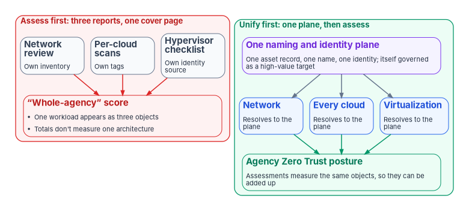
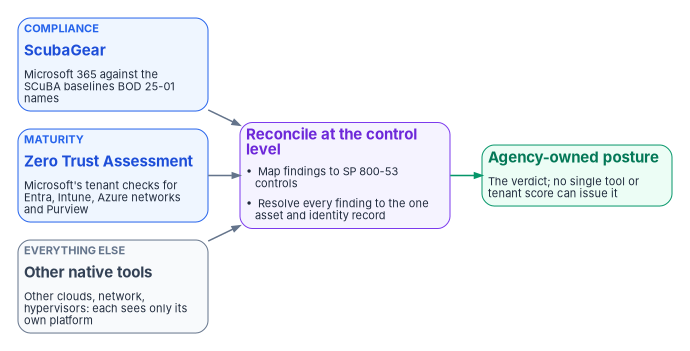

# Chapter 01 — Zero Trust Is a Whole-Agency Property

*No tool can certify an architecture it can't see, and no single tool sees the whole agency.*

::: {.callout-note}
## In this chapter
The question this book answers and the case in one paragraph. What CISA's Zero Trust Maturity Model, OMB M-22-09 and NIST SP 800-207 actually say about scope. Why three separately run assessments of the network, the clouds and the virtualization estate are three partial results rather than one score, and why a shared naming and identity plane has to come first. Two incidents that sat beneath what any single tool could observe, a worked example showing that even one vendor's two assessment tools don't add up to a whole-agency answer, and what the Federal Modernization Program adds to the stack an agency already runs.
:::

## The question this book answers

Book 11 asks one question: why is Zero Trust a property of the whole agency, not a product? The question matters because most of what an agency buys, deploys and reports on in the name of Zero Trust is scoped to something smaller than the agency. A Microsoft 365 tenant has a configuration score. A cloud account has a posture dashboard. A firewall estate has a rule review. A hypervisor cluster has a hardening checklist. Each of these is real, and each is useful. None of them is the agency.

The pattern this book argues against is familiar. A network team reviews the boundary against Trusted Internet Connections (TIC) 3.0 (see [Book 09](../b09-network/index.md)). A cloud security team runs each provider's native posture scan. A virtualization team works through a hypervisor hardening checklist. Each produces its own report on its own schedule for its own owner, and at the end of the year someone puts the three reports behind one cover page and calls the result the agency's Zero Trust maturity. It's three partial assessments with one title.

The reason this fails is architectural, not organizational. Zero Trust policy decisions are supposed to be made the same way wherever a workload runs. That only works if the network, every cloud the agency operates in, and the on-premises virtualization estate all resolve the same workload to the same asset, the same name and the same identity. When each domain keeps its own inventory, its own naming and its own identity source, the same physical workload shows up as three different objects to three different assessors, and no score computed across them is measuring one architecture.

::: {.callout-important}
## The case in one paragraph
**Problem.** Agencies assess the network, their cloud service providers and their on-premises virtualization as three separate exercises, staple the reports together and call the result a whole-agency Zero Trust score. Federal guidance describes Zero Trust as enterprise-wide and independent of network location, which only holds if all three domains resolve to the same asset, naming and identity records. When they don't, one workload is three objects to three assessors, and even Microsoft's own two assessment tools, run together, can't see past Microsoft's platform.

**Solution.** Unify first, assess second. Build one authoritative naming and identity plane across the network, every cloud and the virtualization estate, govern that plane as a high-value target once it exists, close the known Microsoft 365 baseline findings before measuring maturity, and treat every vendor's assessment tool as an evidence input reconciled at the control level, not as the score.

**Ask.** Reconcile network, cloud and virtualization asset identity to one authoritative source before scoring any of them. Name an agency-level owner of the Zero Trust posture who is separate from every cloud provider relationship. Treat any "whole-agency" score that can't point to that unified record as three partial assessments, not one.
:::

{#fig-ch01-three-reports-one-plane fig-alt="Two side-by-side panels. The left panel, outlined in red and labeled Assess first: three reports, one cover page, shows three slate cards, Network review with its own inventory, Per-cloud scans with their own tags, and Hypervisor checklist with its own identity source, each pointing to a red card labeled Whole-agency score: one workload appears as three objects, and the totals don't measure one architecture. The right panel, outlined in green and labeled Unify first: one plane, then assess, starts with a violet card, One naming and identity plane, one asset record, one name, one identity, itself governed as a high-value target. It points to three blue cards, Network, Every cloud and Virtualization, each resolving to the plane, which all point to a green card, Agency Zero Trust posture: assessments measure the same objects, so they can be added up."}

## For decision makers

- **The guidance describes the enterprise, not a tenant.** CISA's Zero Trust Maturity Model asks agencies to turn stove-piped, siloed IT services and staff into coordinated parts of one strategy with agency-wide buy-in for a common architecture and governance policies.[^c01-ztmm] OMB M-22-09 asks for enterprise-managed identities, a complete inventory of every device the government operates, and a named zero trust strategy implementation lead in every agency.[^c01-m2209]
- **Network location doesn't confer trust, so neither does the platform a workload runs on.** NIST SP 800-207 defines Zero Trust as granting no implicit trust based on physical or network location or asset ownership, and it extends the approach to virtual and cloud components.[^c01-sp800207]
- **Stapled reports are not a score.** If the network, the clouds and the hypervisors each name the same workload differently, a total across them counts objects, not architecture.
- **The worst incidents sit beneath any one tool's view.** A forged-token intrusion into federal email in 2023 was first detected by an agency's own logging, not by the provider,[^c01-csrb] and hypervisor attacks compromise every virtual machine on a host from a layer that many security products barely see.[^c01-esxi-admins]
- **Assessment tools are evidence inputs, not verdicts.** ScubaGear checks Microsoft 365 against the baselines Binding Operational Directive (BOD) 25-01 requires;[^c01-bod2501] Microsoft's Zero Trust Assessment checks a Microsoft tenant against Microsoft's guidance.[^c01-zta] Neither sees another vendor's cloud, the network or the hypervisor estate. Only the agency can hold one posture across all of them.

## What the federal guidance actually describes

Three documents set the target this book works toward, and none of them is scoped to a product.

CISA's Zero Trust Maturity Model (ZTMM), version 2.0, describes five pillars (Identity, Devices, Networks, Applications and Workloads, and Data), three cross-cutting capabilities (Visibility and Analytics, Automation and Orchestration, and Governance) and four stages from Traditional through Initial and Advanced to Optimal.[^c01-ztmm] Its language is consistently enterprise-wide. The Advanced stage calls for cross-pillar coordination, centralized visibility and identity control, policy enforcement integrated across pillars, and "building toward enterprise-wide awareness (including externally hosted resources)."[^c01-ztmm] The Advanced stage of Visibility and Analytics expands automated collection of logs and events enterprise-wide, explicitly including virtual environments, for analysis that correlates across sources.[^c01-ztmm] The model also says plainly what kind of document it is: "a general guide," not "a strict set of requirements."[^c01-ztmm] Neither the model nor M-22-09 requires an agency to reach a particular stage; [Chapter 03](03-what-the-mandates-require.md) sets out what each actually requires.

The model adds one caution that matters for this book. It is generally aligned to a federal enterprise's single administrative domain or accreditation boundary, and CISA tells agencies to assess separately how their reliance on external partners and service providers factors into their architecture.[^c01-ztmm] A cloud provider is inside the agency's Zero Trust architecture as a dependency, not as the owner of it.

OMB M-22-09 turns the strategy into goals organized by the same five pillars. Agency staff use enterprise-managed identities to reach the applications they use; agencies employ centralized identity management systems and consolidate authentication onto as few agency-managed identity systems as practicable; the government keeps a complete inventory of every device it operates and authorizes; and each agency designates a zero trust strategy implementation lead.[^c01-m2209] The memo calls a complete understanding of the devices, users and systems interacting within an organization "a necessary foundation for any enterprise-wide zero trust architecture."[^c01-m2209]

NIST SP 800-207 supplies the logic. Zero Trust grants no implicit trust to assets or user accounts based solely on physical or network location or on ownership, and it focuses on protecting resources rather than network segments.[^c01-sp800207] Its second tenet is that all communication is secured regardless of network location, and requests from inside a legacy perimeter must meet the same requirements as requests from anywhere else.[^c01-sp800207] NIST describes the approach as one that "can and should be expanded to include all enterprise assets (devices, infrastructure components, applications, virtual and cloud components)."[^c01-sp800207]

The whitepaper this chapter draws on said SP 800-207 defines the policy decision as "infrastructure-agnostic." NIST doesn't use that phrase. What it says is close and sufficient: location and ownership confer no trust, and the same requirements apply on every network. The consequence is the same. A policy engine that evaluates subject, device and resource together can only do so consistently if the subject, device and resource have one identity wherever they run.

## Three partial assessments are not one score

Put the guidance next to the usual assessment calendar and the gap is plain. The network team, the cloud team and the virtualization team each assess against their own inventory. The network list is keyed by address, the cloud estate by each provider's resource tags, and the hypervisor estate by whatever the virtualization management plane calls a machine. Reconciliation, if it happens, happens by hand at audit time.

When those three inventories disagree, three things follow:

1. **The same workload is counted three times, or not at all.** A database server that runs as a virtual machine, sits on an agency subnet and backs up to a cloud bucket can appear as three unrelated objects, each scored by a different tool.
2. **No policy decision is made the same way twice.** A policy engine evaluating a request needs one answer to "what is this device and who owns it." Three inventories give three answers.
3. **Findings can't be added up.** A score summed across domains that don't share identifiers is a sum of unlike things.

None of this is fixed by a better scanner. A scan can confirm that an architecture is unified; it can't make it unified. The work comes first, and it is the subject of [Chapter 06 — Beyond Microsoft 365](06-beyond-microsoft-365.md): one authoritative asset inventory, one naming and address-resolution authority, and segmentation that applies the same way on premises, in every cloud and on virtualized networks. That chapter also takes up a consequence this chapter only names. Once one plane names and identifies everything the agency runs, it is a complete map of the attack surface and, if it carries reconciliation privileges, a privileged broker in its own right. NIST already warns that the policy engine and policy administrator are "the key components of the entire enterprise" and that stored network and policy information becomes a target for attackers.[^c01-sp800207] The unification layer belongs in the same category and needs the same protection.

## Two incidents that sat beneath any single tool

Two documented incidents show why the whole-agency view is a security property rather than a reporting preference.

**A forged token from a provider's own signing key.** In May and June 2023, a threat actor Microsoft tracks as Storm-0558 used a Microsoft consumer signing key it had acquired to forge authentication tokens and read Exchange Online mail. The federal Cyber Safety Review Board found that the actor reached 22 enterprise organizations, including the Departments of State and Commerce, and 503 related personal accounts, with access to some mailboxes for at least six weeks; Microsoft still did not know how or when the key was obtained when the Board reported.[^c01-csrb] The Board's finding was blunt: "this intrusion was preventable and should never have occurred."[^c01-csrb] The detail that matters most for this book is who noticed. The State Department detected the intrusion on its own, through a custom alert it had built on mailbox-access logs it had paid for; few, if any, other victims had that logging.[^c01-csrb] (The whitepaper said "roughly 25 organizations"; the Board's count is 22 enterprise organizations plus 503 personal accounts.) The tokens were valid to every system that checked them. What caught the intrusion was evidence the agency held and analyzed itself.

**Attacks on the layer beneath the guest.** In February 2023, CISA and the FBI issued recovery guidance for the ESXiArgs ransomware campaign, which had compromised more than 3,800 VMware ESXi servers worldwide by encrypting the configuration files of the virtual machines on each host.[^c01-esxiargs] CISA attributed it to known vulnerabilities in unpatched or out-of-date ESXi and recommended disabling the Service Location Protocol service;[^c01-esxiargs] researchers reported the likely vulnerability as CVE-2021-21974 in ESXi's OpenSLP service, patched in 2021, though that link was never officially confirmed.[^c01-esxiargs-cve] (The whitepaper stated the CVE as settled.) In July 2024, Microsoft reported that several ransomware operators were exploiting CVE-2024-37085: ESXi hosts joined to an Active Directory domain gave full administrative access by default to any member of a domain group named "ESX Admins," matched by name rather than by security identifier, so a domain user able to create that group, or rename an existing one, could take over the hypervisor.[^c01-esxi-admins] (The whitepaper described the method as deleting and recreating the group; Microsoft's account is that the actively exploited method was creating it.) Microsoft also noted that many security products have limited visibility into an ESXi hypervisor, and that encrypting one hypervisor's file system reaches every virtual machine it hosts at once.[^c01-esxi-admins]

The hypervisor case is a distinct threat class, not a naming inconvenience. Endpoint detection, identity signals and network controls inside each guest observe the guest. An attacker who controls the host acts beneath all of them. And the hypervisor's management plane often has its own identity source: every vCenter Single Sign-On instance has an internal identity source (vsphere.local by default), and Active Directory or LDAP directories are added to it as further sources.[^c01-vsphere] Bringing that estate into the agency's identity plane is the right target, but CVE-2024-37085 shows the integration itself carries risk when the hypervisor trusts a directory group by name. Treating the virtualization estate as already unified, or as a low-risk configuration change, is the mistake.

Both incidents make the same point from opposite ends. A provider's tool sees the provider's platform, and the most consequential failures happened where no single platform's tool was looking: in a provider's signing infrastructure, and beneath every guest operating system.

## Even one vendor's two tools don't add up

The sharpest illustration of the whole-agency problem sits inside a single vendor's ecosystem. Federal agencies running Microsoft 365 have two free, read-only assessment tools available, and they are often treated either as interchangeable or as together amounting to full Zero Trust coverage. Both readings are wrong, in opposite directions.

| | CISA SCuBA and ScubaGear | Microsoft's Zero Trust Assessment |
|---|---|---|
| Question it answers | Compliance: does the Microsoft 365 configuration match the federal secure configuration baselines? | Maturity: how closely does the tenant follow Microsoft's Zero Trust guidance? |
| Federal mandate | Yes. BOD 25-01 requires agencies to deploy CISA's assessment tools against every in-scope tenant, report results by integrating with CISA's continuous monitoring solution or by quarterly submission, and implement the mandatory policies[^c01-bod2501] | No. It is Microsoft's own guidance, aligned to its Secure Future Initiative and the Zero Trust pillars[^c01-zta] |
| Scope | Microsoft 365 workloads with SCuBA baselines, including Entra ID, Defender, Exchange Online, Power Platform, SharePoint and OneDrive, and Teams; Google Workspace baselines (assessed by ScubaGoggles) are also in the required configurations[^c01-scuba-req][^c01-scuba] | Tests drawn from Microsoft's guidance for Entra, Intune, Azure networks and Purview, reported on Identity, Devices, Network and Data tabs[^c01-zta] |
| Where they overlap | Mainly Entra identity (legacy authentication, MFA, Conditional Access, privileged roles) and, as of the Zero Trust Assessment's version 3.1.0, Defender threat policies ([Chapter 05](05-two-assessment-tools.md)) | The same identity surface, alongside device, network and data checks SCuBA's baselines don't make |

Dropping either tool leaves gaps the other doesn't fill. Dropping ScubaGear because the Zero Trust Assessment covers identity abandons the tool the directive actually names and the federal baseline for workloads such as Exchange Online, Teams and Power Platform. Dropping the Zero Trust Assessment because ScubaGear already runs leaves device, network and data configuration unmeasured against Microsoft's guidance. [Chapter 05](05-two-assessment-tools.md) compares them in detail.

But running both, fully, still doesn't produce a whole-agency assessment, because both are scoped to one vendor's platform. The two exist side by side for a reason: a compliance-baseline check and a maturity assessment answer structurally different questions, and neither was built to answer the other's. (The whitepaper said Microsoft controls both tools. It doesn't: ScubaGear is CISA's tool, built against CISA's baselines;[^c01-scuba] only the Zero Trust Assessment is Microsoft's.) Multiply that by every other cloud provider the agency uses, each with its own native posture tooling, and by the network and the virtualization estate, and "run every vendor's tool" produces as many disconnected reports as there are vendors.

## Tools are evidence inputs, not verdicts

The governance principle follows directly: agency-level Zero Trust ownership can't be delegated to any single provider's assessment tool, however good that tool is. A provider assessing its own platform is necessarily scoped to its own platform. It has no visibility into, and no structural reason to reconcile against, the other providers, the network or the hypervisors. The agency is the only party positioned to hold one posture across all of them.

{#fig-ch01-evidence-not-verdict fig-alt="Left to right. Three input cards: a blue Compliance card, ScubaGear, Microsoft 365 against the SCuBA baselines BOD 25-01 names; a blue Maturity card, Zero Trust Assessment, Microsoft's tenant checks for Entra, Intune, Azure networks and Purview; and a slate Everything else card, Other native tools, for other clouds, network and hypervisors, each seeing only its own platform. All three point to a violet card, Reconcile at the control level: map findings to SP 800-53 controls and resolve every finding to the one asset and identity record. That points to a green card, Agency-owned posture: the verdict, which no single tool or tenant score can issue."}

That gives every tool a clear job. Keep ScubaGear for BOD 25-01, because it is the tool the directive names. Add the Zero Trust Assessment for breadth across device, network and data configuration in a Microsoft tenant. Reconcile both, and every other domain's evidence, at the control level, using NIST SP 800-53 as the common vocabulary, because the tools use different finding identifiers and severity models ([Chapter 10](10-evidence-not-verdicts.md)). And sequence the work so the assessment measures the target state rather than known gaps: close the BOD 25-01 findings first, then assess ([Chapter 08](08-close-before-you-assess.md)).

One federal caveat belongs here. In a government cloud tenant, feature availability differs from the commercial service, so a maturity assessment run there can't credit capabilities the tenant can't use. Microsoft documents those differences per service; [Chapter 02](02-governance-principles.md) treats modeling the cloud boundary as a governance principle in its own right, and [Book 10](../b10-cloud-boundary/index.md) covers the boundary itself.

## What the program adds to an existing stack

The Federal Modernization Program applies Zero Trust by anchoring every claim, certificate event and governance decision to an identity that is verified rather than assumed. As a program design rule, a binding between an identity and anything else (a device, an address, a certificate, a role) is untrusted by default until it is backed by cryptographic proof, independent corroboration or an explicit governance authorization.

The program is an overlay, not a replacement identity platform. It is designed to sit above the systems an agency already runs, such as Microsoft Entra ID, network access control and next-generation firewalls, normalize their identity-linked signals, and record traceable policy outcomes across them. Its design places Zero Trust policy in five mission classes:

| Mission class | How Zero Trust policy lands |
|---|---|
| Identity | Establishes identity truth and binding confidence before any trust decision is made |
| Telemetry | Continuously ingests identity-linked events and detects drift or anomalous behavior |
| Policy | Encodes conditional access, separation of duties and compliance rules as auditable decisions |
| Enforcement | Pushes approved decisions into control points, such as session revocation and network or device controls |
| Integration | Coordinates execution across the incumbent tools so controls are applied consistently end to end |

One figure in the program's design is a target, not a measurement. The program sets an objective of under 120 seconds for leaver revocation across identity and the access surfaces that depend on it. That is a target-state objective; it should not be read as shipped production performance. [Book 03](../b03-hr-identity/index.md) covers the leaver process that feeds it, and [Book 04](../b04-access/index.md) and [Book 09](../b09-network/index.md) cover the session controls, including continuous access evaluation, that determine how fast revocation actually takes effect.

## How the rest of the book is organized

- **Why** (this chapter and [Chapter 02](02-governance-principles.md)): the whole-agency argument, and the five governance principles that move a program past the Initial stage.
- **What** (Chapters 03 to 06): what the maturity model and M-22-09 actually require, what SCuBA and BOD 25-01 cover, how the two Microsoft assessment tools differ, and the estate beyond Microsoft 365.
- **Who** ([Chapter 07](07-who-owns-zero-trust.md)): who owns the agency's Zero Trust posture.
- **How** (Chapters 08 to 10): closing BOD 25-01 findings before assessing, running the assessment and ingesting the evidence, and turning findings into a program.
- **[Appendix A](appendix-a-requirements-mapping.md)**: requirements mapped to pillars, controls and books.

::: {.callout-note}
## What this chapter establishes
1. Federal Zero Trust guidance is written for the enterprise: CISA's model, M-22-09 and SP 800-207 all describe agency-wide identity, inventory and policy, and none is scoped to a product or tenant.
2. Separately run network, cloud and virtualization assessments are three partial results. They become one score only when all three resolve to one naming and identity plane, and that plane then has to be defended as a high-value target.
3. The most consequential incidents sat where no single platform's tool was looking; in the 2023 email intrusion, the agency's own evidence caught what the provider didn't.
4. Even one vendor's two assessment tools, run together, are a vendor-scoped answer. Every tool is an evidence input; the agency owns the verdict.
:::

::: {.callout-tip}
## Continue the book
[← Previous: Book 11 index](index.md) · [Book index](index.md) · [Next: Chapter 02 — Governance Principles for Zero Trust →](02-governance-principles.md)
:::

[^c01-ztmm]: Cybersecurity and Infrastructure Security Agency, *Zero Trust Maturity Model*, Version 2.0, April 2023, <https://www.cisa.gov/sites/default/files/2023-04/zero_trust_maturity_model_v2_508.pdf> (accessed Oct 21, 2026). §4, p. 6 (transition from stove-piped and siloed IT services and staff, "agency-wide buy in for a common architecture and governance policies"); §5, pp. 7–10 (five pillars, three cross-cutting capabilities, stage guiding criteria including Advanced "building toward enterprise-wide awareness (including externally hosted resources)"); p. 12 (model "generally aligned to a federal enterprise's single administrative domain or accreditation boundary"; external service providers; "not … a strict set of requirements but … a general guide"); §5.6, Table 7 (Visibility and Analytics at Advanced, "including virtual environments").
[^c01-m2209]: Office of Management and Budget, M-22-09, *Moving the U.S. Government Toward Zero Trust Cybersecurity Principles*, January 26, 2022, <https://www.whitehouse.gov/wp-content/uploads/2022/01/M-22-09.pdf> (accessed Oct 21, 2026). Pp. 4–5 (strategic goals by pillar; zero trust strategy implementation lead within 30 days); pp. 5–6 (centralized identity management systems; consolidate to as few agency-managed identity authentication systems as practicable); pp. 10–11 (complete device inventory as "a necessary foundation for any enterprise-wide zero trust architecture").
[^c01-sp800207]: Scott Rose, Oliver Borchert, Stu Mitchell and Sean Connelly, NIST Special Publication 800-207, *Zero Trust Architecture*, August 2020, <https://doi.org/10.6028/NIST.SP.800-207> (accessed Oct 21, 2026). Abstract (no implicit trust based on physical or network location or asset ownership; protect resources, not network segments); §1 (expand to all enterprise assets, including "virtual and cloud components"); §2.1, tenet 2 (communication secured regardless of network location); §5.1 (policy engine and administrator "the key components of the entire enterprise"); §5.5 (stored network and policy information as a target).
[^c01-csrb]: Cyber Safety Review Board, *Review of the Summer 2023 Microsoft Exchange Online Intrusion*, March 20, 2024, <https://www.cisa.gov/sites/default/files/2025-03/CSRBReviewOfTheSummer2023MEOIntrusion508.pdf> (accessed Oct 21, 2026). Executive summary ("this intrusion was preventable and should never have occurred"; Microsoft does not know how or when the key was obtained); overview (22 enterprise organizations and 503 related personal accounts; State and Commerce; access for at least six weeks; State's detection through its own custom alert on MailItemsAccessed logs).
[^c01-esxiargs]: Cybersecurity and Infrastructure Security Agency and Federal Bureau of Investigation, Cybersecurity Advisory AA23-039A, *ESXiArgs Ransomware Virtual Machine Recovery Guidance*, February 8, 2023, <https://www.cisa.gov/news-events/cybersecurity-advisories/aa23-039a> (accessed Oct 21, 2026). More than 3,800 servers compromised globally; encrypts virtual machine configuration files; known vulnerabilities in unpatched or out-of-date ESXi; disable the Service Location Protocol service.
[^c01-esxiargs-cve]: Recorded Future, "ESXiArgs Ransomware Targets Publicly-Exposed ESXi OpenSLP Servers," February 2023, <https://www.recordedfuture.com/blog/esxiargs-ransomware-targets-vmware-esxi-openslp-servers> (accessed Oct 21, 2026). Campaign likely exploits CVE-2021-21974 in OpenSLP, patched since February 2021; the link is not officially confirmed, and CVE-2020-3992 was also named as a possibility.
[^c01-esxi-admins]: Microsoft Threat Intelligence, "Ransomware operators exploit ESXi hypervisor vulnerability for mass encryption," Microsoft Security Blog, July 29, 2024, <https://www.microsoft.com/en-us/security/blog/2024/07/29/ransomware-operators-exploit-esxi-hypervisor-vulnerability-for-mass-encryption/> (accessed Oct 21, 2026). CVE-2024-37085; members of a domain group named "ESX Admins" get full administrative access by default, matched by name; creating the group was the method observed in the wild, renaming another; "many security products have limited visibility and protection for an ESXi hypervisor."
[^c01-vsphere]: VMware by Broadcom, *vSphere Authentication* (vSphere 8.0), "Identity Sources for vCenter Server with vCenter Single Sign-On," <https://docs.vmware.com/en/VMware-vSphere/8.0/vsphere-authentication/GUID-1F0106C9-0524-4583-9AC5-A748FD1DC4C5.html> (accessed Oct 21, 2026; now redirects to techdocs.broadcom.com). Every vCenter Single Sign-On instance has an internal identity source such as vsphere.local; Active Directory over LDAP, Active Directory (Integrated Windows Authentication) and OpenLDAP can be added.
[^c01-bod2501]: Cybersecurity and Infrastructure Security Agency, Binding Operational Directive 25-01, *Implementing Secure Practices for Cloud Services*, December 17, 2024, <https://www.cisa.gov/news-events/directives/bod-25-01-implementing-secure-practices-cloud-services> (accessed Oct 21, 2026). Scope: FCEB production cloud tenants with a finalized SCuBA baseline; deploy SCuBA assessment tools and report by integrating with CISA's continuous monitoring solution or by quarterly manual submission; implement all mandatory SCuBA policies.
[^c01-scuba-req]: Cybersecurity and Infrastructure Security Agency, "BOD 25-01: Implementing Secure Practices for Cloud Services — Required Configurations," <https://www.cisa.gov/resources-tools/services/bod-25-01-implementing-secure-practices-cloud-services-required-configurations> (accessed Oct 21, 2026). Microsoft 365 policies for Entra ID, Defender, Exchange Online, Power Platform, SharePoint Online and OneDrive, and Teams; Google Workspace policies with a due date of December 1, 2026.
[^c01-scuba]: Cybersecurity and Infrastructure Security Agency, "Secure Cloud Business Applications (SCuBA) Project," <https://www.cisa.gov/resources-tools/services/secure-cloud-business-applications-scuba-project> (accessed Oct 21, 2026). ScubaGear verifies Microsoft 365 tenant configuration against the SCuBA baselines; ScubaGoggles does the same for Google Workspace.
[^c01-zta]: Microsoft Learn, "What is the Zero Trust Assessment?," <https://learn.microsoft.com/security/zero-trust/assessment/overview>, and "Get started with the Zero Trust Assessment," <https://learn.microsoft.com/security/zero-trust/assessment/get-started> (accessed Oct 21, 2026). Automated tests aligned with the Secure Future Initiative and Zero Trust pillars, drawn from Microsoft's guidance for Entra, Intune, Azure networks and Purview; read-only; results on Identity, Devices, Network and Data tabs.
