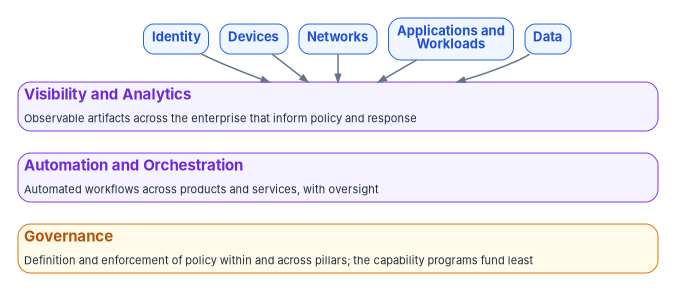
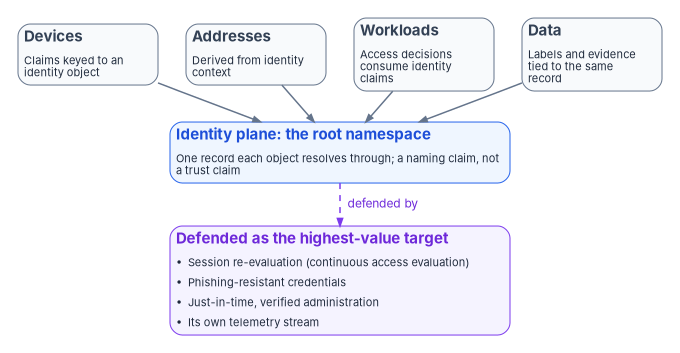

# Chapter 02 — Governance Principles for Zero Trust

*Pillars are bought one tool at a time; maturity is decided by the capability nobody sells, which is governance.*

::: {.callout-note}
## In this chapter
How CISA's Zero Trust Maturity Model is built (five pillars operated through three cross-cutting capabilities) and the three failure patterns that keep programs below the Advanced stage. Five governance principles that address them: identity as a necessary but defended anchor, controls of their own for privileged identity, continuous evidence as a governance property, enforcement rather than observation, and a cloud boundary that is modeled rather than assumed. Eight decisions an agency can make this quarter, none of them a purchase.
:::

## The model is not a shopping list

CISA's Zero Trust Maturity Model (ZTMM) is easy to misread. Its best-known figure shows five pillars (Identity, Devices, Networks, Applications and Workloads, and Data), and a program that reads only that figure plans five procurements. Underneath the pillars, the model draws three cross-cutting capabilities that "highlight activities to support interoperability of functions across pillars": Visibility and Analytics, Automation and Orchestration, and Governance.[^c02-ztmm] The pillars say what has to be protected. The cross-cutting capabilities say how the protections are operated together.

Governance, in the model's own definition, "refers to the definition and associated enforcement of agency cybersecurity policies, procedures, and processes, within and across pillars."[^c02-ztmm] Definition and enforcement, within and across pillars: a program can buy a strong tool for every pillar and still have none of that.

The common result is a program that spends two years or more buying a tool per pillar and stalls at the Initial stage, or low in Advanced. This chapter argues that the stall is structural, that governance is the capability programs invest in least, and that five principles, most of which are decisions rather than purchases, are what move a program past it. [Chapter 01](01-a-whole-agency-property.md) made the case that Zero Trust belongs to the whole agency; this chapter sets out how the agency governs it.

::: {.callout-important}
## The case in one paragraph
**Problem.** Programs read the maturity model as a five-pillar shopping list, buy a tool per pillar, and stall at Initial or low Advanced, because the model defines maturity as five pillars operated through three cross-cutting capabilities, and Governance is the one programs fund least.

**Solution.** Five governance principles. Identity is a necessary anchor but not a self-authenticating one. Privileged and administrative identity needs controls of its own. Continuous evidence is a governance property, not a tool feature. Governance must enforce, not only observe. And the cloud boundary must be modeled, not assumed away.

**Ask.** Eight governance decisions this quarter, none of them a procurement: find out which pillar evidence is reproducible, name a cross-pillar correlation owner, stand up drift detection as a governance function, model the cloud boundary, reconcile network, cloud and virtualization asset identity to one source, assign agency-level Zero Trust ownership separate from any cloud provider, convert one detective control to a preventive one, and time-box privileged access.
:::

{#fig-ch02-pillars-and-capabilities fig-alt="Five blue pills across the top, Identity, Devices, Networks, Applications and Workloads, and Data, each point down to a wide violet bar, Visibility and Analytics: observable artifacts across the enterprise that inform policy and response. Below it a second violet bar, Automation and Orchestration: automated workflows across products and services, with oversight. At the bottom an amber bar, Governance: definition and enforcement of policy within and across pillars, the capability programs fund least."}

## For decision makers

- **Maturity is cross-pillar by definition.** The model's Advanced stage calls for cross-pillar coordination, centralized visibility and identity control, and policy enforcement integrated across pillars.[^c02-ztmm] No single pillar's tool delivers any of those.
- **The target is a guide, not a mandate.** CISA calls the model a general guide rather than a strict set of requirements,[^c02-ztmm] and neither it nor OMB M-22-09 requires a particular stage. Agencies choose their targets; [Chapter 03](03-what-the-mandates-require.md) sets out what is actually required.
- **Identity is the anchor, and the anchor is the target.** A forged token signed with a stolen provider key passed every check in 2023.[^c02-csrb] Identity has to be continuously re-evaluated, not trusted once issued.
- **Standing privilege is the model's lowest stage.** At Traditional, an agency "authorizes permanent access with periodic review" for privileged accounts; at Optimal, it automates just-in-time, just-enough access.[^c02-ztmm]
- **A policy without enforcement is a report.** Governance in the model means definition *and* enforcement, and its Optimal stage is continuous enforcement with dynamic updates.[^c02-ztmm]

## Why programs stall below Advanced

Three failure patterns recur, whichever pillar tools an agency has bought.

1. **Pillars are administered, not governed.** Each pillar gets an owner, a tool and a roadmap, but no shared authority correlates decisions across them. When a policy decision needs input from two pillars, it degrades to whatever both can agree on, which is the lowest common denominator.
2. **Evidence is per tool, not per claim.** Each pillar's tool emits evidence in its own schema. Assembling it into a single authorization narrative is a manual, point-in-time exercise that can't be re-run, so the next assessment starts again from scratch.
3. **Drift is found at audit time.** The gap between declared policy and what is actually running surfaces only when an assessor finds it, months after it opened.

Set those against the model's own stage criteria and the stall is predictable. CISA describes the Advanced stage as automated controls for lifecycle and configuration "with cross-pillar coordination," "centralized visibility and identity control," and "policy enforcement integrated across pillars," and the Optimal stage as "cross-pillar interoperability with continuous monitoring."[^c02-ztmm] The same document's description of the Traditional stage reads like a list of the failure patterns: "siloed pillars of policy enforcement," "manual response and mitigation deployment," and "limited correlation of dependencies, logs, and telemetry."[^c02-ztmm] Adding another per-pillar tool doesn't move any of those. They are properties of how the pillars are run together, which is what governance is.

The five principles below address the patterns directly. The first two concern what the program governs most closely, identity and privilege. The third and fourth concern how governance works: through evidence that can be regenerated and controls that enforce. The fifth concerns where governance stops, at the boundary of what the agency's cloud can actually do.

## Principle one: identity is a necessary anchor, not a sufficient one

Identity has to work as the addressing root the other pillars resolve against. The Federal Modernization Program takes this further than the maturity model, which treats identity as one pillar of five. As a program design position, identity is the **root namespace**: devices, addresses, network paths, applications and data classifications are named through the identity plane rather than through parallel naming systems. In practice that means a device claim is keyed to an identity-plane object (for example, a Microsoft Entra object ID) rather than a separate device-pillar identifier; an address is derived from identity context rather than assigned by an independent address-management system; and a workload's access decision consumes identity claims as authoritative input rather than as one signal among many. The architectural payoff is that cross-pillar correlation reduces to resolving identity, which the identity plane already does authoritatively.

{#fig-ch02-identity-root-namespace fig-alt="Four slate cards across the top, Devices with claims keyed to an identity object, Addresses derived from identity context, Workloads whose access decisions consume identity claims, and Data whose labels and evidence are tied to the same record, all point down to a blue card: Identity plane, the root namespace, one record each object resolves through, a naming claim, not a trust claim. A dashed violet arrow labeled defended by leads from it to a violet card, Defended as the highest-value target: session re-evaluation through continuous access evaluation, phishing-resistant credentials, just-in-time verified administration, and its own telemetry stream."}

Federal guidance points the same way, though it doesn't use the program's terms. NIST SP 800-207 describes an "enhanced identity governance" approach that "uses the identity of actors as the key component of policy creation," with device, asset status and environment adjusting the result.[^c02-sp800207] OMB M-22-09 requires centralized identity management systems for agency users that can be integrated into applications and common platforms, and directs agencies to consolidate authentication onto as few agency-managed identity systems as practicable.[^c02-m2209] The model's Identity Stores function reaches Optimal when an agency "securely integrates their identity stores across all partners and environments as appropriate."[^c02-ztmm]

Root namespace is a naming and addressing claim, not a trust claim. It means every other pillar resolves its objects through the identity plane; it does not mean a validated identity is trusted unconditionally once issued. Treating identity as a self-authenticating root recreates the failure Zero Trust exists to retire. The 2023 Exchange Online intrusion described in Chapter 01 is the clearest case: the actor forged tokens signed with a Microsoft consumer signing key it had acquired, and because of a validation flaw the tokens were accepted by enterprise mail.[^c02-csrb] Every token checked out. The anchor itself had been subverted, and the root of the namespace is therefore the highest-value target in the estate.

So the identity plane needs operational hardening of its own:

- **Session re-evaluation, not one-time trust.** Microsoft Entra continuous access evaluation lets services such as Exchange Online, SharePoint Online and Teams act on critical events (account disabled or deleted, password changed or reset, all refresh tokens revoked by an administrator, high user risk) in near real time, and to enforce certain Conditional Access location policies inside the service.[^c02-cae] The whitepaper paired continuous evaluation with "short token lifetimes." The two are alternatives, not a pair: in sessions that negotiate continuous access evaluation, tokens become long-lived (up to 28 hours) because critical events, not expiry, drive revocation; clients that can't negotiate it keep the default one-hour lifetime.[^c02-cae] The requirement is that a session can be revoked promptly, by whichever mechanism the client and resource support. [Book 04](../b04-access/index.md) and [Book 09](../b09-network/04-logical-centralization-and-token-security.md) cover the session controls in detail.
- **Phishing-resistant credentials.** M-22-09 requires phishing-resistant MFA for agency staff, contractors and partners and defines it as authentication designed to detect and prevent disclosure of secrets to a site or application masquerading as a legitimate system.[^c02-m2209] The model puts phishing-resistant MFA, including FIDO2 or PIV, at the Advanced stage of authentication and continuous validation with it, "not just when access is initially granted," at Optimal.[^c02-ztmm]
- **Its own telemetry and blast-radius design.** Changes to the identity plane's configuration should be logged and monitored as a distinct, high-priority stream, consistent with NIST's warning that the components making access decisions are "the key components of the entire enterprise" and that anyone with configuration access to them can make unapproved changes.[^c02-sp800207]

## Principle two: privileged and administrative identity needs controls of its own

If identity is the root, administrative identity is the root of the root. Whoever can change the identity plane, its policies or the systems it federates with can change every decision that depends on them.

The maturity model makes the progression explicit in its Access Management function. At Traditional, an agency "authorizes permanent access with periodic review for both privileged and unprivileged accounts." At Advanced, it authorizes need-based and session-based access, including for privileged requests, tailored to actions and resources. At Optimal, it "uses automation to authorize just-in-time and just-enough access tailored to individual actions and individual resource needs."[^c02-ztmm]

In a Microsoft estate, Microsoft Entra Privileged Identity Management (PIM) is the mechanism. A user with an eligible role assignment has to activate it, through steps such as an MFA check, a business justification or an approval, and then holds the role for a preconfigured period; Microsoft describes this just-in-time model as preventing access after the permissions expire.[^c02-pim] Microsoft's deployment guidance is to keep zero permanently active assignments for roles other than emergency access accounts.[^c02-pim] [Book 04, Chapter 02](../b04-access/02-why-standing-privilege-fails.md) makes the case against standing privilege, and [Chapter 08](../b04-access/08-pim-self-request-with-approval.md) of the same book gives the activation pattern.

Two further rules follow from the principle:

- **Break-glass accounts are governed artifacts, not unwritten exceptions.** Emergency access accounts exist because an agency can lock itself out: a federation outage, an MFA provider outage, or every privileged assignment left eligible with no one able to approve activation. Microsoft's guidance is two or more such accounts, limited to emergencies, with monitoring and alerting on their use, and drills at least every 90 days and after staff changes to confirm they work and that the alerts fire.[^c02-emergency] An emergency account that nobody has tested, or whose use nobody would notice, is an unmanaged standing privilege.
- **Administrative trust must not hang on a name.** CVE-2024-37085, described in Chapter 01, gave full hypervisor administration to any member of a directory group named "ESX Admins," matched by name rather than by security identifier, so a domain user who could create that group could take over the host.[^c02-esxi-admins] Privilege granted by a recreatable label rather than a continuously verified identity is exactly the condition this principle exists to remove, and it applies to every system that federates administrative rights from the directory, not only to identity providers.

## Principle three: continuous evidence is a governance property, not a tool feature

The second failure pattern, evidence per tool rather than per claim, isn't fixed by a tool with a better export. It's fixed by a rule about what counts as evidence. Under this principle, evidence has to be:

- **Reproducible.** An assessor can re-run the pipeline that produced it, without coordinating with the operator, and get the same result from the same inputs.
- **Machine-readable.** It is structured data, not a screenshot or a narrative. NIST's Open Security Controls Assessment Language (OSCAL) is the federal reference for this: XML, JSON and YAML formats for control-based assessment and compliance.[^c02-oscal]
- **Regenerable from the record of what was closed.** Every finding that was remediated can be traced to the change that closed it, and the evidence can be rebuilt from that record.

Per-tool evidence that can't be re-executed is an assertion, not evidence. The maturity model's Visibility and Analytics capability describes the same progression from the other side: from manually collecting limited logs with minimal analysis at Traditional to "comprehensive visibility enterprise-wide via centralized dynamic monitoring and advanced analysis of logs and events" at Optimal.[^c02-ztmm] Visibility at that level is only useful to an authorizing official if the evidence it produces can be checked.

This is the principle that turns drift detection into a governance function rather than a scanner feature. Drift is the gap between declared policy and running state, and it's only detectable continuously if the declared state is machine-readable and the observed state can be regenerated on demand. [Chapter 10 — Evidence, Not Verdicts](10-evidence-not-verdicts.md) sets out how the program's evidence chain and drift classes work, and what is shipped versus target state.

## Principle four: governance must enforce, not only observe

A program that names an owner and writes a policy but never wires in automated, preventive enforcement has built a reporting system, not a control. The maturity model's definition already says so: governance is the definition *and associated enforcement* of policy.[^c02-ztmm] Its Governance capability runs from policies enforced "via manual processes or static technical mechanisms" at Traditional, through "tiered, tailored policies enterprise-wide" that use automation where possible at Advanced, to policies that are fully automated "with continuous enforcement and dynamic updates" at Optimal.[^c02-ztmm]

Enforcement is not the same as autonomy. The program's posture for automated change is gated: the governance layer detects drift and generates the corrective action, and a human approves it before it runs, with high-blast-radius operations gated permanently. That is a program design choice, explained in [Book 01, Chapter 09](../b01-transformation-arc/09-who-leads-the-transformation.md), and it is compatible with this principle. A gated preventive control is still a control. What fails the principle is a detective control that only ever produces a dashboard.

The practical test is simple. For each policy the program reports on, ask what happens when the running state violates it. If the answer is "a finding appears in next quarter's report," the policy is observed, not enforced. The quarter's work is to convert at least one such policy into a preventive control: a Conditional Access policy that blocks rather than reports, a configuration baseline that is reapplied rather than compared, an access assignment that expires rather than waits for review.

## Principle five: the cloud boundary must be modeled, not assumed away

The last principle carries Chapter 01's argument into governance. The network, every cloud service provider and the on-premises virtualization estate have to be assessed as one governed system. A provider's own tool can only ever see its own platform. The organization is the only party positioned to hold one Zero Trust posture across all of them, and the maturity model says as much when it asks agencies to assess how their reliance on service providers factors into their architecture, separately from the single administrative domain the model is aligned to.[^c02-ztmm]

Modeling the boundary has two parts.

**What each cloud can actually do.** Government cloud offerings don't have the same features as the commercial service. Microsoft publishes the differences service by service: Office applications list cloud-backed features that aren't available in GCC, GCC High or DoD,[^c02-govfeatures] and Intune's government service description lists features that are planned or unavailable for GCC High and DoD.[^c02-intune-gov] A program that reads a maturity score from a government tenant without knowing which capabilities that tenant can use is crediting or penalizing itself for things the platform decides. The governance response is to record each platform gap as a governed finding, with a compensating control or an accepted risk, rather than as an unstated assumption. (The whitepaper named specific device signals as "silently unavailable" in GCC, including Endpoint Analytics and Device Health Attestation. Microsoft's documentation doesn't support that: Intune has no separate GCC instance, so GCC tenants use the commercial Intune service, and Device Health Attestation appears among the features still planned for GCC High and DoD, not GCC.[^c02-intune-gov] The whitepaper's other items couldn't be matched to Microsoft's service descriptions, so the chapter keeps the principle and drops the list. The program's own inference that continuous access evaluation behaves differently in its GCC tenants is a tracked program finding, not a published Microsoft statement.)

**Where each mandate stops.** Binding Operational Directive 25-01 covers cloud tenants that have a finalized SCuBA baseline, starting with Microsoft 365;[^c02-bod2501] it does not reach the network, other cloud platforms without a baseline, or the virtualization estate. The whole-agency requirement rests on the enterprise-wide guidance in Chapter 01, not on the directive's legal scope. [Chapter 04](04-scuba-and-bod-25-01.md) covers what the directive does reach, and [Book 10](../b10-cloud-boundary/index.md) covers the federal cloud boundary itself.

Boundary exceptions are a governance object too. Where an agency deliberately uses a service outside its main cloud boundary, the program's design is to record each one as a named, discrete exception with its own authorizing decision, added to the boundary model at the same time as that decision, so that every exception is governed rather than glossed over.

## Governance decisions for this quarter

None of the principles waits on a procurement. Each maps to a decision an agency can make now.

| Decision | Principle | What done looks like |
|---|---|---|
| Find out which pillar evidence is reproducible today | Three | For each pillar, a yes or no: can the evidence pipeline be re-run without operator coordination? The "no" answers are the adoption boundary |
| Name a cross-pillar correlation owner | One, four | One accountable person or team for decisions that need input from more than one pillar |
| Stand up drift detection as a governance function | Three, four | Declared state is machine-readable, and differences from running state are reported continuously, not at audit |
| Model the cloud boundary | Five | Each platform gap and boundary exception recorded as a governed finding with a disposition |
| Reconcile network, cloud and virtualization asset identity to one source | One, five | One authoritative inventory every domain resolves to ([Chapter 06](06-beyond-microsoft-365.md)) |
| Assign agency-level Zero Trust ownership separate from any provider | Five | An owner of the agency posture who is not the owner of any single provider relationship ([Chapter 07](07-who-owns-zero-trust.md)) |
| Convert one detective control to a preventive one | Four | One policy that now blocks, reapplies or expires instead of reporting |
| Time-box privileged access | Two | Zero permanently active privileged assignments other than tested, monitored emergency accounts |

Each is a structural step that compounds. Together they are the governance capability the maturity model describes and no vendor sells.

::: {.callout-note}
## What this chapter establishes
1. CISA's model defines maturity as five pillars operated through three cross-cutting capabilities. Its Advanced and Optimal criteria are cross-pillar, so another per-pillar tool doesn't move a program past Initial.
2. Identity is the root namespace the other pillars resolve through, but it is not self-authenticating. It must be continuously re-evaluated and defended as the highest-value target.
3. Privileged identity needs time-boxed, verified access, with emergency accounts governed and tested rather than left as exceptions.
4. Evidence that can't be regenerated is an assertion, and policy that isn't enforced is a report.
5. The cloud boundary, including what each government cloud can actually do and where each mandate stops, has to be modeled explicitly. Only the agency can hold the posture across every provider.
:::

::: {.callout-tip}
## Continue the book
[← Previous: Chapter 01 — Zero Trust Is a Whole-Agency Property](01-a-whole-agency-property.md) · [Book index](index.md) · [Next: Chapter 03 — What CISA's Maturity Model and M-22-09 Actually Require →](03-what-the-mandates-require.md)
:::

[^c02-ztmm]: Cybersecurity and Infrastructure Security Agency, *Zero Trust Maturity Model*, Version 2.0, April 2023, <https://www.cisa.gov/sites/default/files/2023-04/zero_trust_maturity_model_v2_508.pdf> (accessed Oct 21, 2026). §5, pp. 9–11 (stage guiding criteria; definitions of the three cross-cutting capabilities, including Governance as "the definition and associated enforcement" of policy); p. 12 (single administrative domain; external service providers; "a general guide"); §5.1, Table 2, pp. 13–15 (Authentication; Identity Stores; Access Management from permanent access with periodic review to just-in-time and just-enough access); §5.6, Table 7, pp. 29–30 (Visibility and Analytics; Governance from manual enforcement to continuous enforcement and dynamic updates).
[^c02-m2209]: Office of Management and Budget, M-22-09, *Moving the U.S. Government Toward Zero Trust Cybersecurity Principles*, January 26, 2022, <https://www.whitehouse.gov/wp-content/uploads/2022/01/M-22-09.pdf> (accessed Oct 21, 2026). Pp. 5–6, Identity actions 1 and 2 (centralized identity management systems; phishing-resistant MFA required for staff, contractors and partners; consolidate to as few agency-managed identity systems as practicable) and footnote 6 (definition of phishing-resistant).
[^c02-sp800207]: Scott Rose, Oliver Borchert, Stu Mitchell and Sean Connelly, NIST Special Publication 800-207, *Zero Trust Architecture*, August 2020, <https://doi.org/10.6028/NIST.SP.800-207> (accessed Oct 21, 2026). §3.1.1 (enhanced identity governance: identity of actors as "the key component of policy creation"); §5.1 (policy engine and administrator as "the key components of the entire enterprise"; administrators with configuration access can make unapproved changes; changes must be logged and subject to audit).
[^c02-csrb]: Cyber Safety Review Board, *Review of the Summer 2023 Microsoft Exchange Online Intrusion*, March 20, 2024, <https://www.cisa.gov/sites/default/files/2025-03/CSRBReviewOfTheSummer2023MEOIntrusion508.pdf> (accessed Oct 21, 2026). Forged tokens signed with an acquired 2016 MSA consumer signing key; a validation flaw let consumer-key tokens access enterprise Exchange Online.
[^c02-cae]: Microsoft Learn, "Continuous access evaluation," <https://learn.microsoft.com/entra/identity/conditional-access/concept-continuous-access-evaluation> (accessed Oct 21, 2026). Critical event evaluation (account deleted or disabled, password changed or reset, MFA enabled, administrator revokes refresh tokens, high user risk); Conditional Access policy evaluation in Exchange Online, SharePoint Online, Teams and Microsoft Graph; token lifetime up to 28 hours in CAE sessions, configurable token lifetime not honored, one-hour default for clients that aren't CAE-capable.
[^c02-pim]: Microsoft Learn, "What is Microsoft Entra Privileged Identity Management?," <https://learn.microsoft.com/entra/id-governance/privileged-identity-management/pim-configure>, and "Plan a Privileged Identity Management deployment," <https://learn.microsoft.com/entra/id-governance/privileged-identity-management/pim-deployment-plan> (accessed Oct 21, 2026). Eligible and active assignments; activation through MFA, justification or approval for a preconfigured period; just-in-time access; "Keep zero permanently active assignments for roles other than your emergency access accounts."
[^c02-emergency]: Microsoft Learn, "Manage emergency access accounts in Microsoft Entra ID," <https://learn.microsoft.com/entra/identity/role-based-access-control/security-emergency-access> (accessed Oct 21, 2026). Two or more emergency access accounts; scenarios including federation outage and eligible-only assignments with no approvers; monitoring and alerting; validation at least every 90 days and after staff changes.
[^c02-esxi-admins]: Microsoft Threat Intelligence, "Ransomware operators exploit ESXi hypervisor vulnerability for mass encryption," Microsoft Security Blog, July 29, 2024, <https://www.microsoft.com/en-us/security/blog/2024/07/29/ransomware-operators-exploit-esxi-hypervisor-vulnerability-for-mass-encryption/> (accessed Oct 21, 2026). CVE-2024-37085; "ESX Admins" group membership grants full administrative access, matched by name rather than SID.
[^c02-oscal]: National Institute of Standards and Technology, "OSCAL: the Open Security Controls Assessment Language," <https://pages.nist.gov/OSCAL/> (accessed Oct 21, 2026). Machine-readable XML, JSON and YAML formats for control-based security assessment and compliance.
[^c02-govfeatures]: Microsoft Learn, "Office application and feature availability in Government plans," <https://learn.microsoft.com/office365/servicedescriptions/office-applications-service-description/office-application-and-feature-availability-in-government-plans> (accessed Oct 21, 2026). Per-feature availability for GCC, GCC High and DoD.
[^c02-intune-gov]: Microsoft Learn, "Microsoft Intune for US Government GCC High and DoD service description," <https://learn.microsoft.com/intune/fundamentals/government-service> (accessed Oct 21, 2026). GCC is the same instance as commercial Intune ("Intune doesn't have a separate GCC instance"); features in planning (including Windows Device Health Attestation) and features not available for GCC High and DoD.
[^c02-bod2501]: Cybersecurity and Infrastructure Security Agency, Binding Operational Directive 25-01, *Implementing Secure Practices for Cloud Services*, December 17, 2024, <https://www.cisa.gov/news-events/directives/bod-25-01-implementing-secure-practices-cloud-services> (accessed Oct 21, 2026). Scope: FCEB production cloud tenants with a finalized SCuBA baseline, Microsoft Office 365 at issuance, other products as baselines are issued.
