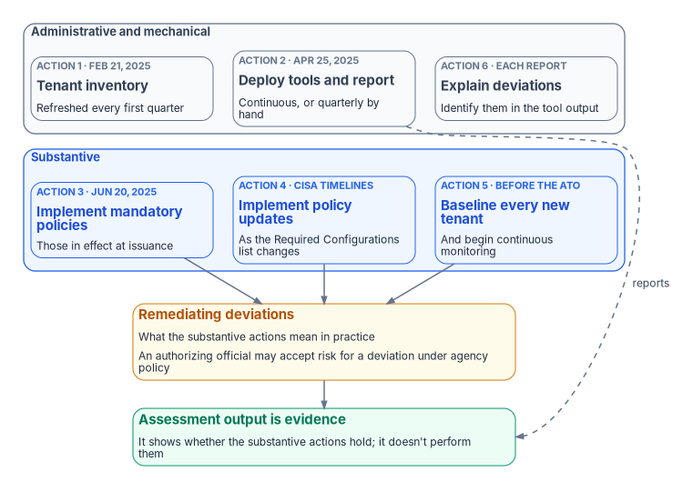

# Chapter 04 — SCuBA and BOD 25-01

*BOD 25-01 is a short list of concrete obligations, and the one that matters most is the one agencies count least: fixing what the scan finds.*

::: {.callout-note}
## In this chapter
What CISA's Secure Cloud Business Applications (SCuBA) project publishes, and the six required actions of BOD 25-01 with their dates. How the mandatory-policy list differs from the full baselines, how Google Workspace came into scope, and the ways agencies can report. What the directive doesn't cover, and why half of its required actions are administrative while the rest, which amount to remediation, are architectural.
:::

CISA's Zero Trust Maturity Model and OMB M-22-09 describe a target for the whole agency ([Chapter 03](03-what-the-mandates-require.md)). BOD 25-01 is narrower and more concrete. It doesn't ask for "Zero Trust" or "better cloud security." It names a set of configuration settings for cloud business applications, tells agencies to implement them, and tells them how to prove it. For Microsoft 365 it is the most specific federal statement of what a correctly configured tenant looks like, which is why this book treats it as the Microsoft 365 baseline that a whole-agency assessment builds on.

{#fig-ch04-bod-25-01-obligations fig-alt="Two groups of three cards, one above the other. The slate group at the top, labeled administrative and mechanical, holds action 1, tenant inventory, due February 21, 2025 and refreshed every first quarter; action 2, deploy the tools and report, due April 25, 2025, continuously or quarterly by hand; and action 6, explain deviations identified in the tool output, with each report. The blue group below, labeled substantive, holds action 3, implement the mandatory policies in effect at issuance, due June 20, 2025; action 4, implement policy updates on CISA's timelines as the Required Configurations list changes; and action 5, baseline every new tenant and begin continuous monitoring before its authorization to operate. Arrows from all three blue cards lead to an amber card, remediating deviations, which is what the substantive actions mean in practice; an authorizing official may accept risk for a deviation under agency policy. The amber card leads to a green card: assessment output is evidence that shows whether the substantive actions hold but doesn't perform them. A dashed slate arrow labeled reports runs from action 2 to the green card."}

## What SCuBA is

CISA established the SCuBA project in 2022 to address cybersecurity and visibility gaps in federal cloud business applications. It publishes secure configuration baselines for Microsoft 365 and Google Workspace, two no-cost assessment tools (ScubaGear for Microsoft 365 and ScubaGoggles for Google Workspace), and supporting guidance, including Hybrid Identity Solutions guidance on identity interoperability between on-premises and cloud systems and a Technical Reference Architecture.[^c04-scuba]

Each baseline is a document of numbered policies, each written as a SHALL or a SHOULD and identified by product and version, for example `MS.AAD.1.1v1`, "Legacy authentication SHALL be blocked."[^c04-aad] The baselines and the tool ship together: ScubaGear's repository holds the Microsoft 365 baseline documents alongside the code that tests them. The current release is ScubaGear 2.0.0, published October 22, 2026; its baselines cover Microsoft Entra ID, Security Suite, Exchange Online, Power BI, Power Platform, SharePoint and Teams. Security Suite replaces the Defender baseline that the previous release, 1.8.0 (May 7, 2026), shipped, and 2.0.0 also adds and renumbers policies.[^c04-scubagear][^c04-psgallery] This chapter's policy counts come from the 2.0.0 baseline documents. CISA's Required Configurations page still lists the 1.8.0-era policy IDs, so the tool and the list now disagree; the section on the mandatory list below sets out where, and [Chapter 05](05-two-assessment-tools.md) covers what the version change means for an assessment.

## What BOD 25-01 requires

CISA issued Binding Operational Directive 25-01, *Implementing Secure Practices for Cloud Services*, on December 17, 2024. It binds Federal Civilian Executive Branch agencies, and it applies to every production or operational cloud tenant operating in or as a federal information system for which CISA has published a finalized SCuBA baseline. At issuance that meant Microsoft 365 only; baselines CISA finalizes later come into scope when they're issued.[^c04-bod2501] It has six required actions:[^c04-bod2501]

| # | Required action | Deadline |
|---|---|---|
| 1 | Identify every in-scope tenant and report its name and the owning agency or component | February 21, 2025; updated every year in the first quarter |
| 2 | Deploy all SCuBA assessment tools for in-scope tenants and begin continuous reporting, either through CISA's continuous monitoring solution or by reporting quarterly in a CISA-approved, machine-readable format | April 25, 2025 |
| 3 | Implement all mandatory SCuBA policies in effect at issuance, as listed on CISA's Required Configurations page | June 20, 2025 |
| 4 | Implement later updates to the mandatory policies | On the timelines the Required Configurations page sets |
| 5 | For a new tenant, implement the mandatory baselines and begin continuous monitoring before granting an authorization to operate | Before the ATO |
| 6 | Identify and explain deviations in the tool output when reporting to CISA | With each report |

Three further provisions shape how an agency lives with the directive. Authorizing officials may accept risk for deviations from the mandatory policies to meet operational needs, under agency policy, and CISA reviews and resolves the deviations they submit. CISA maintains the list of mandatory policies and notifies agencies when it changes. And any baseline not updated within one year automatically falls out of scope.[^c04-bod2501]

The directive's own background states the purpose plainly: agencies are to implement the baselines, use the tools, and "remediate deviations from the secure configuration baselines."[^c04-bod2501] (The source paper for this chapter tabulated BOD 25-01 as five obligations ending in "remediate"; the directive has six required actions, and remediation is what actions 3 to 5 amount to in practice, not a separate numbered action.)

### What "in scope" means

CISA's implementation guidance (updated July 27, 2026) defines the boundary more tightly than the directive's one sentence. A production or operational tenant is one used to conduct official government business; tenants used mainly for testing or development are out. The tenant must be part of a federal information system inside the agency's authorization boundary. And the scope is limited to software as a service: platform and infrastructure services are out, so Azure subscriptions are not covered even when they share an Entra ID tenant with Microsoft 365. Only the mandatory policies are required.[^c04-guidance]

## The mandatory list is a subset of the baselines

The baselines and the mandatory list are different things, and confusing them leads to two opposite mistakes: treating every SHALL in a baseline as binding, or treating the mandatory list as the whole of good practice.

The Required Configurations page is the authority for what BOD 25-01 makes binding. For Microsoft 365 it lists 50 policies:[^c04-required]

| Product | Mandatory policies (Required Configurations page) | Policies in the ScubaGear 2.0.0 baseline | Marked as a BOD 25-01 requirement in 2.0.0 |
|---|---:|---:|---:|
| Microsoft Entra ID | 20 | 34 | 22 |
| Microsoft Defender | 8 | retired | — |
| Security Suite | none listed | 24 | 8 |
| Exchange Online | 10 | 12 | 10 |
| Power Platform | 4 | 9 | 4 |
| SharePoint Online and OneDrive | 4 | 8 | 8 |
| Microsoft Teams | 4 | 14 | 4 |
| Power BI | none listed | 8 | 0 |
| **Total** | **50** | **109** | **56** |

The third column counts the numbered policy statements in each 2.0.0 baseline document, and the fourth counts the policies each document marks with its BOD 25-01 requirement indicator.[^c04-baselines] So in Entra ID, for example, 20 of 34 policies are on CISA's list. The rest are CISA's recommendations but not BOD 25-01 obligations at the time of writing, though ScubaGear now marks two of them as required (see the next section).[^c04-required][^c04-aad]

The fall from 134 policies in 1.8.0 to 109 in 2.0.0 is mostly a move, not a loss. Release 2.0.0 retired the Defender baseline and moved its policies, Exchange Online sections 8 to 17 (data loss prevention, attachment filtering, malware scanning, impersonation, anti-spam, Safe Links, alerts and audit logging) and Teams sections 6 to 8 (data loss prevention and malware scanning) into the new Security Suite baseline, combining some of them along the way. It dropped a small number of SHOULD policies that ScubaGear couldn't assess. CISA publishes a migration file that maps every old policy ID to its new one, and a removed-policies document with the reason for each removal.[^c04-baselines][^c04-transition]

### The tool and the list disagree

The list changes. Revised policies carry a new version suffix: MS.AAD.3.3v2 was modified in July 2025, and three Teams policies (MS.TEAMS.1.2v2, 2.1v2 and 2.2v2) in February 2026.[^c04-required] ScubaGear 2.0.0 is now ahead of the list. Its release notes group the changes below under "BOD 25-01 required configuration policy changes," and its baselines mark 56 policies as BOD 25-01 requirements, against 50 on CISA's page.[^c04-release][^c04-baselines] On October 26, 2026, the page still listed the MS.DEFENDER policies, MS.AAD.3.2v1 and MS.EXO.2.2v2.[^c04-required]

| Product | CISA's Required Configurations page | ScubaGear 2.0.0 |
|---|---|---|
| Entra ID | MS.AAD.3.2v1: an alternative MFA method, if phishing-resistant MFA isn't yet enforced | MS.AAD.3.2v2: MFA for all users, checked independently of MS.AAD.3.1v1 |
| Entra ID | MS.AAD.3.5 not listed | MS.AAD.3.5v2: SMS, voice call and email one-time passcodes disabled, no longer dependent on the authentication methods migration (MS.AAD.3.4v1) |
| Entra ID | Not listed | MS.AAD.9.1v1, new: risky AI agents blocked. Requires Entra ID P2 and either Microsoft Agent 365 or Microsoft 365 E7; not applicable to GCC High and DoD tenants |
| Defender, now Security Suite | Eight MS.DEFENDER policies: preset security policies (1.1 to 1.5), data loss prevention (4.1v2), alerts (5.1) and audit logging (6.1) | Eight MS.SECURITYSUITE policies: 1.1 to 1.3 (click-to-run attachments blocked, post-delivery scanning, malware quarantined or dropped) in place of the preset-policy requirements; 3.1 (data loss prevention), 4.1 (alerts) and 5.1 (audit logging) in place of their Defender counterparts; and two new ones, 6.1 (spam and phishing kept out of the inbox) and 6.2 (no allowed domains in inbound anti-spam policies) |
| Exchange Online | MS.EXO.2.2v2: SPF must hard-fail (`-all`) | MS.EXO.2.2v3: hard fail or soft fail (`~all`) both comply |
| SharePoint and OneDrive | Four policies | All eight marked, adding 1.3v1 (external sharing limited to approved domains or security groups), 3.1v1 (expiry of 30 days or less for "Anyone" links), 3.2v1 ("Anyone" links view-only) and 3.3v2 (reauthentication within 30 days for verification-code users, now also when sharing is set to existing guests) |

The SharePoint policies and MS.AAD.3.5 aren't new to the baselines; 2.0.0 is the first release to mark them as required.[^c04-release][^c04-aad] The table's sources are the release notes, the 2.0.0 baseline documents and CISA's page.[^c04-release][^c04-baselines][^c04-required]

Three consequences follow, and none of them goes away until CISA changes its page.

1. **A 2.0.0 report can't be matched to the list by ID.** The list's eight Defender IDs, MS.AAD.3.2v1 and MS.EXO.2.2v2 don't appear in 2.0.0's output. Reconcile through CISA's migration file, not by string match.[^c04-transition]
2. **A 2.0.0 failure isn't always a BOD 25-01 deviation yet.** A tenant that fails MS.AAD.3.5v2, MS.AAD.9.1v1, MS.SECURITYSUITE.6.1v1 or 6.2v1, or one of the four added SharePoint policies, is failing a policy the tool calls required and the page doesn't. Record it as notice of what's coming, with a date, not as a deviation from a mandatory policy.
3. **A 2.0.0 pass isn't always compliance with the list.** A domain whose SPF record ends in `~all` passes MS.EXO.2.2v3 but doesn't meet MS.EXO.2.2v2 as the page lists it.

Until CISA's page changes, the page governs: the directive makes later updates mandatory on the timelines the page sets.[^c04-bod2501] An agency should track the page, pin the baseline version it assesses against, and treat a new indicator in the repository as notice of what is coming rather than as an obligation already in force. ScubaGear 2.0.0 also adds three Entra ID SHOULD policies, MS.AAD.5.5v1 to 5.7v1 (application password and certificate lifetimes), that carry no BOD 25-01 indicator.[^c04-aad]

## Google Workspace is in scope

BOD 25-01 is no longer a Microsoft 365 directive only. CISA's Required Configurations page now lists mandatory policies for Google Workspace: Common Controls, Gmail, Google Calendar, Chat, Drive and Docs, Groups for Business and Meet, all with a due date of December 1, 2026.[^c04-required] The implementation guidance sets the Workspace milestones as tenant inventory by November 2, 2026, deployment of the assessment tools by December 1, 2026, and implementation of the mandatory policies by December 31, 2026.[^c04-guidance] The two CISA pages disagree on the policy date, so plan to December 1.

The Workspace assessor is ScubaGoggles. Version 1.0.0 (July 24, 2026) added a BOD 25-01 requirement indicator to the applicable policies and removed the project's alpha-state warning; 1.0.1 followed on July 28, 2026 as a fix to the installation dependencies, and 1.1.0 on October 22, 2026 added checks without changing the BOD 25-01 required configurations.[^c04-goggles] An agency with a Workspace tenant, even a small one used by a single component, now carries the same six obligations for it.

## How agencies report

The directive allows continuous integration with CISA's monitoring or quarterly manual reporting.[^c04-bod2501] The implementation guidance describes four ways to do it:[^c04-guidance]

| Option | How it works |
|---|---|
| CISA-hosted ScubaConnect (Microsoft 365) | CISA manages reporting after initial setup; results feed the CDM dashboard |
| Self-hosted ScubaConnect | The agency runs it and can keep local copies of the results |
| Agency-hosted (CLAW or TALON) | Automated scans at least once a quarter; requires development work on the agency side |
| Manual | Results uploaded to CyberScope quarterly, or more often, from the most recent version of the tool |

ScubaConnect is CISA's cloud-native infrastructure for running the assessors centrally across many tenants, with GearConnect for ScubaGear and GogglesConnect for ScubaGoggles.[^c04-connect] Whatever the route, the reported artifact is the tool's JSON output file, named `ScubaResults_` plus a UUID, which agencies are told not to rename. A deviation that is operationally required appears in the output as "Omitted," with its rationale, and the guidance says omissions must be approved through the organization's security risk management process. CISA also provides a CSV template for tracking non-compliant policies, planned fixes and target dates, in effect a plan of action and milestones.[^c04-guidance]

## What BOD 25-01 doesn't cover

The directive governs cloud tenant configuration for products with a finalized SCuBA baseline. It says nothing about on-premises Active Directory, NTLM, domain controllers, Group Policy, endpoints, networks, or Azure infrastructure and platform services.[^c04-bod2501][^c04-guidance] A tenant that passes every mandatory policy can sit on top of a forest full of NTLM dependencies and unmanaged devices.

That limit is the reason this book doesn't stop here. BOD 25-01 sets a firm floor for the Microsoft 365 and Workspace tenants. It doesn't certify Zero Trust maturity, which [Chapter 01](01-a-whole-agency-property.md) argues is a property of the whole agency. The estates the directive leaves out are covered in [Chapter 06](06-beyond-microsoft-365.md); NTLM retirement is [Book 06, Chapter 15](../b06-data-platform/15-the-three-phases-of-ntlm-elimination.md); and the Conditional Access policies that answer the mandatory Entra ID items are in [Book 04, Chapter 07](../b04-access/07-the-conditional-access-policy-library.md).

## Administrative obligations and substantive work

Agencies met the early dates: tenants inventoried, ScubaGear deployed, reports flowing. Many now treat "ScubaGear is running and reporting" as the compliance answer. That reading counts the wrong things.

Look at what each obligation takes. Reporting a tenant name is administrative. Installing an assessor and wiring its output to CISA is mechanical. Explaining a deviation is paperwork. Each of them can be done in days, and each is satisfied by a report that faithfully lists forty open deviations every week. Implementing the mandatory policies, keeping up with their revisions and bringing every new tenant to baseline before its ATO is different work. Some of it is a setting change. Much of it depends on things outside the tenant: legacy authentication can't be blocked until the applications and devices that use it have moved, and phishing-resistant MFA for every user can't be enforced until every user has a credential that qualifies. That is architecture, and it is the part of BOD 25-01 the directive exists for.

The program's position follows. Count the administrative obligations as done when they're done, and measure compliance by the substantive work: how many mandatory policies hold, how many deviations are open, and whether every open deviation is either being remediated on a date or carried as a documented risk acceptance by the authorizing official. [Chapter 08](08-close-before-you-assess.md) turns that position into a sequence. [Chapter 05](05-two-assessment-tools.md) first looks at the two tools agencies use to measure it.

::: {.callout-tip}
## Continue the book
[← Previous: Chapter 03 — What CISA's Maturity Model and M-22-09 Actually Require](03-what-the-mandates-require.md) · [Book index](index.md) · [Next: Chapter 05 — ScubaGear and Microsoft's Zero Trust Assessment →](05-two-assessment-tools.md)
:::

[^c04-scuba]: Cybersecurity and Infrastructure Security Agency, "Secure Cloud Business Applications (SCuBA) Project," <https://www.cisa.gov/resources-tools/services/secure-cloud-business-applications-scuba-project> (accessed Oct 21, 2026).
[^c04-aad]: Cybersecurity and Infrastructure Security Agency, ScubaGear, *Microsoft Entra ID secure configuration baseline* (`aad.md`), release v2.0.0 (34 policies, 22 marked with a BOD 25-01 requirement indicator, including MS.AAD.3.2v2, MS.AAD.3.5v2 and MS.AAD.9.1v1, last modified March 2026; MS.AAD.5.5v1–5.7v1 are SHOULD policies without the indicator), <https://github.com/cisagov/ScubaGear/blob/v2.0.0/PowerShell/ScubaGear/baselines/aad.md>; release v1.8.0 (30 policies, including MS.AAD.3.5v1; no BOD 25-01 indicators), <https://github.com/cisagov/ScubaGear/blob/v1.8.0/PowerShell/ScubaGear/baselines/aad.md> (both accessed Oct 26, 2026).
[^c04-scubagear]: Cybersecurity and Infrastructure Security Agency, ScubaGear README, release v2.0.0 (Security Suite baseline in place of Defender), <https://github.com/cisagov/ScubaGear/blob/v2.0.0/README.md>; release v1.8.0, <https://github.com/cisagov/ScubaGear/blob/v1.8.0/README.md>; and ScubaGear releases, <https://github.com/cisagov/ScubaGear/releases> (v2.0.0 published October 22, 2026, with release notes on the Defender-to-Security Suite change and other baseline changes; v1.8.0 published May 7, 2026) (all accessed Oct 26, 2026).
[^c04-psgallery]: PowerShell Gallery, "ScubaGear," version history (1.8.0, May 7, 2026; 2.0.0, October 22, 2026, the latest stable version), <https://www.powershellgallery.com/packages/ScubaGear> (accessed Oct 26, 2026).
[^c04-bod2501]: Cybersecurity and Infrastructure Security Agency, Binding Operational Directive 25-01, *Implementing Secure Practices for Cloud Services*, December 17, 2024, <https://www.cisa.gov/news-events/directives/bod-25-01-implementing-secure-practices-cloud-services> (accessed Oct 21, 2026).
[^c04-guidance]: Cybersecurity and Infrastructure Security Agency, "BOD 25-01 Implementation Guidance: Implementing Secure Practices for Cloud Services," updated July 27, 2026, <https://www.cisa.gov/news-events/directives/bod-25-01-implementation-guidance-implementing-secure-practices-cloud-services> (accessed Oct 21, 2026).
[^c04-required]: Cybersecurity and Infrastructure Security Agency, "BOD 25-01: Implementing Secure Practices for Cloud Services Required Configurations," <https://www.cisa.gov/resources-tools/services/bod-25-01-implementing-secure-practices-cloud-services-required-configurations> (accessed Oct 21 and Oct 26, 2026; on Oct 26 it listed 50 Microsoft 365 policy IDs, including MS.DEFENDER.1.1v1–1.5v1, 4.1v2, 5.1v1 and 6.1v1, MS.AAD.3.2v1 and MS.EXO.2.2v2).
[^c04-baselines]: Cybersecurity and Infrastructure Security Agency, ScubaGear baseline documents, release v2.0.0 (`aad.md`, `securitysuite.md`, `exo.md`, `powerbi.md`, `powerplatform.md`, `sharepoint.md` and `teams.md`, plus `removedpolicies.md`), <https://github.com/cisagov/ScubaGear/tree/v2.0.0/PowerShell/ScubaGear/baselines>, compared with release v1.8.0 (`defender.md` in place of `securitysuite.md`; 134 policies in all), <https://github.com/cisagov/ScubaGear/tree/v1.8.0/PowerShell/ScubaGear/baselines> (both accessed Oct 26, 2026). Counts are of distinct numbered policy headings in each document, and of policies whose entry carries the "BOD 25-01 Requirement" badge.
[^c04-release]: Cybersecurity and Infrastructure Security Agency, ScubaGear release v2.0.0, October 22, 2026, release notes, section "Baselines," subsection "BOD 25-01 required configuration policy changes" (Additions, Removals and Updates), <https://github.com/cisagov/ScubaGear/releases/tag/v2.0.0> (accessed Oct 26, 2026).
[^c04-transition]: Cybersecurity and Infrastructure Security Agency, ScubaGear v2.0.0 documentation, "Transitioning from Defender to the Security Suite Baseline," <https://github.com/cisagov/ScubaGear/blob/v2.0.0/docs/configuration/defender-to-securitysuite-transition.md>, and the policy migration mapping `scuba-baseline-policy-migrations.csv`, <https://github.com/cisagov/ScubaGear/blob/v2.0.0/PowerShell/ScubaGear/mappings/scuba-baseline-policy-migrations.csv> (both accessed Oct 26, 2026).
[^c04-goggles]: Cybersecurity and Infrastructure Security Agency, ScubaGoggles releases (v1.0.0, July 24, 2026; v1.0.1, July 28, 2026; v1.1.0, October 22, 2026, whose notes state that no new required configuration policies were added), <https://github.com/cisagov/ScubaGoggles/releases> (accessed Oct 26, 2026).
[^c04-connect]: Cybersecurity and Infrastructure Security Agency, ScubaConnect README, <https://github.com/cisagov/ScubaConnect> (accessed Oct 21, 2026).
