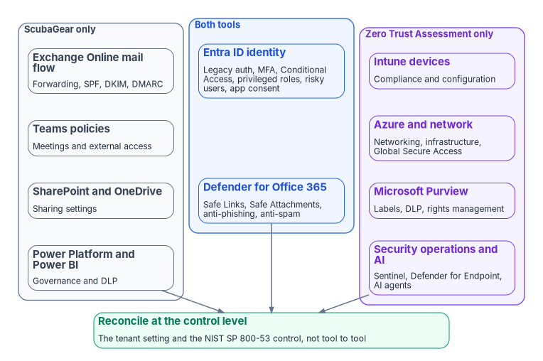

# Chapter 05 — ScubaGear and Microsoft's Zero Trust Assessment

*One tool asks whether a tenant meets the federal baseline, the other asks how far the environment is from Zero Trust; an agency needs both answers, and neither tool closes a finding.*

::: {.callout-note}
## In this chapter
What CISA's ScubaGear and Microsoft's Zero Trust Assessment each check, how they run and what they need to run. Where they overlap (mostly Entra ID identity, and now part of email and collaboration threat protection) and where each covers ground the other doesn't. Why their findings should be reconciled at the control level, and why the output of both is sensitive.
:::

Agencies routinely run two free assessments of their Microsoft cloud and then ask whether they need both, or drop one because "it covers identity." They answer different questions. ScubaGear answers a compliance question: does this Microsoft 365 tenant meet CISA's secure configuration baselines, and the BOD 25-01 mandatory policies among them ([Chapter 04](04-scuba-and-bod-25-01.md))? The Zero Trust Assessment answers a maturity question: how close is this Microsoft cloud environment, across identity, devices, network and data, to Microsoft's Zero Trust guidance? The two tools intersect heavily on one surface, Entra ID identity, and each covers a large area the other doesn't.

The program's recommendation is to run both: ScubaGear to demonstrate and keep the federal baseline for Microsoft 365, the Zero Trust Assessment to drive maturity across the wider Microsoft estate. Reconcile them at the control level, never tool to tool. And treat both as what this book calls them throughout: evidence inputs to a whole-agency picture, not verdicts on it.

{#fig-ch05-two-tools-overlap fig-alt="Three columns of cards. On the left, a slate group labeled ScubaGear only holds Exchange Online mail flow, external forwarding, SPF, DKIM and DMARC; Teams meeting and external-access policies; SharePoint and OneDrive sharing; and Power Platform and Power BI governance. In the middle, a blue group labeled both tools holds Entra ID identity (legacy authentication, MFA, Conditional Access, privileged roles, risky users, application consent) and Defender for Office 365 threat policies (Safe Links, Safe Attachments, anti-phishing, anti-spam). On the right, a violet group labeled Zero Trust Assessment only holds Intune device compliance and configuration; Azure networking, Global Secure Access and infrastructure; Microsoft Purview labels and data loss prevention; and security operations and AI-agent checks. A green card below all three reads: reconcile at the control level, the tenant setting and the NIST SP 800-53 control, not tool to tool."}

## The two tools at a glance

| | ScubaGear (CISA) | Zero Trust Assessment (Microsoft) |
|---|---|---|
| Question it answers | Does the tenant meet the federal baseline? | How mature is the environment against Zero Trust guidance? |
| Authority behind it | CISA's SCuBA secure configuration baselines; BOD 25-01 requires agencies to deploy it[^c05-bod2501] | Microsoft's Zero Trust and Secure Future Initiative guidance, drawing on NIST, CISA and CIS standards and Microsoft's internal baselines[^c05-zta-overview] |
| Current version | 1.8.0, May 7, 2026; 2.0.0 in prerelease[^c05-scubagear-gallery] | 3.1.0, October 20, 2026[^c05-zta-release] |
| Scope | Microsoft 365: Entra ID, Defender, Exchange Online, Power BI, Power Platform, SharePoint and OneDrive, Teams[^c05-scubagear] | Entra ID, Intune, Azure, Exchange Online, SharePoint and Microsoft Purview, organized by Zero Trust pillar[^c05-zta-start][^c05-zta-code] |
| How it runs | PowerShell queries the Microsoft 365 APIs; Open Policy Agent evaluates the settings against Rego policies[^c05-scubagear] | PowerShell 7 module (`ZeroTrustAssessment`) connecting to Microsoft Graph, Azure, Exchange, SharePoint and Azure Information Protection[^c05-zta-start] |
| Output | HTML, JSON and CSV[^c05-scubagear] | HTML report, with the collected data in a local export folder[^c05-zta-start] |
| Finding identifier | Policy ID, for example `MS.AAD.1.1v1`[^c05-aad] | Numeric test ID, for example `41039`[^c05-zta-code] |
| Severity model | SHALL or SHOULD in the baseline; BOD 25-01 mandatory or not[^c05-required] | Risk level High, Medium or Low[^c05-zta-code] |
| Changes the tenant? | No; it reads configuration[^c05-scubagear] | No; Microsoft describes it as read-only and keeping all data on the local machine[^c05-zta-start] |

## ScubaGear

ScubaGear is CISA's assessment tool for Microsoft 365. It runs in Windows PowerShell 5, installs from the PowerShell Gallery, and is invoked with `Invoke-SCuBA`.[^c05-scubagear] By default it assesses Entra ID, Defender for Office 365, Exchange Online, SharePoint and OneDrive, and Teams; Power Platform is added with `-ProductNames`. The `-M365Environment` parameter selects the cloud (`commercial`, `gcc`, `gcchigh` or `dod`) and is required for Power Platform and for GCC High and DoD tenants.[^c05-params]

"Read-only" describes what ScubaGear does, not the roles it needs. Global Reader is enough for Entra ID, the security suite, Exchange Online, SharePoint and Teams, but Power Platform needs the Power Platform Administrator role with a Power Apps for Office 365 license, and Power BI needs a Fabric Administrator (or Global Administrator) with a Power BI or Fabric license. The first run also asks an administrator to consent to a set of Microsoft Graph read permissions.[^c05-perms] Plan the run account accordingly, and keep it under the same privileged-access controls as any administrator ([Book 04](../b04-access/index.md)).

For BOD 25-01 reporting, CISA wants results from the most recent version of the tool.[^c05-guidance] That matters now: the 2.0.0 prerelease carries baseline documents with new Entra ID policies, and its development-branch baselines mark more policies with a BOD 25-01 indicator than CISA's Required Configurations page currently lists.[^c05-aad][^c05-required] Pin the version and the baseline you assess against, record both with every result, and expect the score to move when the version changes even though the tenant didn't.

## The Zero Trust Assessment

Microsoft's Zero Trust Assessment is a PowerShell module, `ZeroTrustAssessment`, that tests a tenant against hundreds of configuration items aligned with Microsoft's Secure Future Initiative and the Zero Trust pillars, and then guides remediation.[^c05-zta-overview] It is open source, maintained on GitHub, and it is also the assessment component of Microsoft's Zero Trust Workshop.[^c05-zta-workshop] ("ZTTT" in some program documents is internal shorthand, not a Microsoft name.)

Running it takes more privilege than its read-only behavior suggests. Microsoft's instructions require PowerShell 7 (release 3.1.0 asks for 7.6 or later), a Global Administrator for the first connection and consent, and for later runs Global Reader, Security Reader, Exchange Administrator and SharePoint Administrator; the same page also says later runs can be performed as a Global Reader.[^c05-zta-start][^c05-zta-release] Test which applies in your tenant before you write the run book. `Connect-ZtAssessment` requests 21 Microsoft Graph read permissions, then signs in separately to Azure, Exchange and SharePoint; `Invoke-ZtAssessment` writes `ZeroTrustAssessmentReport.html` to a local folder. A large tenant can take more than 24 hours.[^c05-zta-start]

Microsoft's documentation doesn't discuss government clouds. The 3.1.0 source code does: `Connect-ZtAssessment` takes an `-Environment` parameter (`Global`, `USGov`, `USGovDoD` and others) and an `-ExchangeEnvironmentName` parameter for GCC High and DoD.[^c05-zta-code] A GCC tenant uses the commercial endpoints. Confirm the run in your own cloud before relying on it.

The tool grows quickly. Release 3.1.0 holds 364 tests. By the pillar each test declares, Identity is the largest group at 135, followed by Network (70), Security Operations (57) and Devices (43), with smaller groups for Data, AI and Infrastructure.[^c05-zta-code] Microsoft's get-started page still describes the report's tabs as Identity, Devices, Network and Data.[^c05-zta-start]

## Where they overlap, and where they don't

| ScubaGear only | Both | Zero Trust Assessment only |
|---|---|---|
| Exchange Online mail flow: external forwarding, SPF, DKIM, DMARC, SMTP AUTH | Entra ID identity: legacy authentication, MFA, Conditional Access, privileged roles, risky users, application consent | Intune device compliance and configuration |
| Teams meeting and external-access policies | Defender for Office 365 threat policies: Safe Links, Safe Attachments, anti-phishing, anti-spam (in the Zero Trust Assessment's Security Operations tests in 3.1.0) | Azure networking and infrastructure; Global Secure Access |
| SharePoint and OneDrive sharing | | Microsoft Purview labels, data loss prevention, rights management |
| Power Platform and Power BI governance | | Security operations (Sentinel, Defender for Endpoint) and AI agents |

The left column is the content of the SCuBA baselines that has no Zero Trust Assessment test in 3.1.0: none of its tests checks SPF, DKIM, external forwarding, SharePoint sharing settings or Power Platform governance.[^c05-baselines][^c05-zta-code] The middle row on threat policies is new. The source paper for this chapter said SCuBA's Defender baseline had essentially no Zero Trust Assessment counterpart; release 3.1.0 tests Safe Links, Safe Attachments, anti-phishing and anti-spam policies and Teams protection policies.[^c05-zta-release][^c05-zta-code] The overlap will keep moving as both tools release.

::: {.callout-warning}
## ILLUSTRATIVE — replace before external release
An earlier analysis of Microsoft's public demo report, with 295 checks, put about 47% of the Zero Trust Assessment's checks (140) in an area a SCuBA baseline also covers, almost all of it Identity, and about 53% (155) in areas with no SCuBA baseline. Those figures predate release 3.1.0, which has 364 tests and adds threat-protection checks that change the split. Your tenant's split comes from running both tools against it; [Chapter 09](09-running-the-assessment.md) shows how the program ingests both reports and computes it.
:::

Two caveats matter more than any percentage.

1. **Shared surface isn't duplicate checks.** SCuBA's Entra ID baseline has 30 policies in ScubaGear 1.8.0, and 20 of them are BOD 25-01 mandatory; the Zero Trust Assessment has 135 identity tests.[^c05-aad][^c05-required][^c05-zta-code] "Shared" means the same area, not the same check. Only a subset have a true one-to-one counterpart (legacy authentication, MFA, Conditional Access basics, privileged-role hygiene, risky users, application consent). The rest is the Zero Trust Assessment going deeper than the federal baseline.
2. **The inverse gap.** SCuBA's Exchange Online, Teams, SharePoint and Power Platform baselines still have no Zero Trust Assessment counterpart, and 22 of BOD 25-01's 50 mandatory Microsoft 365 policies sit in those four products.[^c05-required] Dropping ScubaGear because "the Zero Trust Assessment covers identity" would leave mandatory policies unassessed, and it would stop the reporting BOD 25-01 requires. The Zero Trust Assessment isn't a BOD 25-01 tool; the directive names CISA's SCuBA assessment tools.[^c05-bod2501]

## What this means for an agency

- **Keep ScubaGear for BOD 25-01.** It is the tool aligned to the federal Microsoft 365 baseline, including the workloads the Zero Trust Assessment doesn't touch, and its JSON output is what CISA receives.[^c05-guidance]
- **Add the Zero Trust Assessment for breadth.** It extends coverage to devices, Azure infrastructure, network, data and security operations, and its risk levels help put the findings in order.
- **Reconcile at the control level.** The two tools use different identifiers and different frameworks, so match their findings through a common spine: the tenant setting itself, and the NIST SP 800-53 control it supports. CISA maps each SCuBA policy to NIST SP 800-53 Rev. 5 controls, "limited to controls found within the FedRAMP High baseline."[^c05-scuba-mappings] The program holds that mapping as data, SCuBA policy ID to control to typed remediation task; the operating model is in [Vol VII Book 02 of the Federal Compliance series](../../compliance/Vol_VII_Book_02_M365_Control_Compliance_Automation.md), and [Appendix A](appendix-a-requirements-mapping.md) maps pillars to controls.
- **Treat all output as sensitive.** Each report is a map of where the tenant is weak. Microsoft warns that the report and export folder contain information attackers could use and should be shared only with authorized staff, and advises deleting the local folder once the report is stored securely.[^c05-zta-start] Keep both tools' output inside the authorization boundary and remediate through normal change control.

## What neither tool does

Both tools read configuration and score it, against a prescriptive baseline in ScubaGear's case and against a maturity-oriented test set in the Zero Trust Assessment's. Neither writes to the tenant, and neither can design the Conditional Access set, the legacy-authentication retirement or the device-identity layer that a finding depends on. A score is a reading, not a treatment plan. [Chapter 08](08-close-before-you-assess.md) puts the two tools where they belong in the sequence, and [Chapter 10](10-evidence-not-verdicts.md) turns their findings into a program.

::: {.callout-tip}
## Continue the book
[← Previous: Chapter 04 — SCuBA and BOD 25-01](04-scuba-and-bod-25-01.md) · [Book index](index.md) · [Next: Chapter 06 — Beyond Microsoft 365: Networks, Other Clouds and Virtualized Estates →](06-beyond-microsoft-365.md)
:::

[^c05-bod2501]: Cybersecurity and Infrastructure Security Agency, Binding Operational Directive 25-01, *Implementing Secure Practices for Cloud Services*, December 17, 2024, <https://www.cisa.gov/news-events/directives/bod-25-01-implementing-secure-practices-cloud-services> (accessed Oct 21, 2026).
[^c05-zta-overview]: Microsoft Learn, "What is the Zero Trust Assessment?," <https://learn.microsoft.com/security/zero-trust/assessment/overview> (accessed Oct 21, 2026).
[^c05-scubagear-gallery]: PowerShell Gallery, "ScubaGear," version history, <https://www.powershellgallery.com/packages/ScubaGear> (accessed Oct 21, 2026).
[^c05-zta-release]: Microsoft, Zero Trust Assessment release 3.1.0, published October 20, 2026 (release notes: PowerShell 7.6 or later; new Security Operations tests for directory, email and collaboration, endpoint protection and Sentinel), <https://github.com/microsoft/zerotrustassessment/releases> (accessed Oct 21, 2026).
[^c05-scubagear]: Cybersecurity and Infrastructure Security Agency, ScubaGear README, release v1.8.0, <https://github.com/cisagov/ScubaGear/blob/v1.8.0/README.md> (accessed Oct 21, 2026).

[^c05-scuba-mappings]: Cybersecurity and Infrastructure Security Agency, ScubaGear v1.8.0 documentation, "Mappings," <https://github.com/cisagov/ScubaGear/blob/v1.8.0/docs/misc/mappings.md> (accessed Oct 21, 2026).
[^c05-zta-start]: Microsoft Learn, "Get started with the Zero Trust Assessment," <https://learn.microsoft.com/security/zero-trust/assessment/get-started> (accessed Oct 21, 2026).
[^c05-zta-code]: Microsoft, Zero Trust Assessment source code, tag 3.1.0: test definitions in `src/powershell/tests/` (364 `Test-Assessment.*.ps1` files; `Pillar`, `RiskLevel`, `Service` and `TestId` attributes counted by the writer) and `src/powershell/public/Connect-ZtAssessment.ps1` (`-Environment`, `-ExchangeEnvironmentName`), <https://github.com/microsoft/zerotrustassessment/tree/3.1.0/src/powershell> (accessed Oct 21, 2026).
[^c05-aad]: Cybersecurity and Infrastructure Security Agency, ScubaGear, *Microsoft Entra ID secure configuration baseline* (`aad.md`), release v1.8.0 <https://github.com/cisagov/ScubaGear/blob/v1.8.0/PowerShell/ScubaGear/baselines/aad.md> and development branch <https://github.com/cisagov/ScubaGear/blob/main/PowerShell/ScubaGear/baselines/aad.md> (both accessed Oct 21, 2026).
[^c05-required]: Cybersecurity and Infrastructure Security Agency, "BOD 25-01: Implementing Secure Practices for Cloud Services Required Configurations," <https://www.cisa.gov/resources-tools/services/bod-25-01-implementing-secure-practices-cloud-services-required-configurations> (accessed Oct 21, 2026).
[^c05-params]: Cybersecurity and Infrastructure Security Agency, ScubaGear, "Parameters" (`M365Environment`, `ProductNames`), release v1.8.0, <https://github.com/cisagov/ScubaGear/blob/v1.8.0/docs/configuration/parameters.md> (accessed Oct 21, 2026).
[^c05-perms]: Cybersecurity and Infrastructure Security Agency, ScubaGear, "Interactive Permissions," <https://github.com/cisagov/ScubaGear/blob/main/docs/prerequisites/interactive.md> (accessed Oct 21, 2026).
[^c05-guidance]: Cybersecurity and Infrastructure Security Agency, "BOD 25-01 Implementation Guidance: Implementing Secure Practices for Cloud Services," updated July 27, 2026, <https://www.cisa.gov/news-events/directives/bod-25-01-implementation-guidance-implementing-secure-practices-cloud-services> (accessed Oct 21, 2026).
[^c05-zta-workshop]: Microsoft Learn, "The Microsoft Zero Trust Workshop," <https://learn.microsoft.com/security/zero-trust/workshop-zero-trust-overview> (accessed Oct 21, 2026).
[^c05-baselines]: Cybersecurity and Infrastructure Security Agency, ScubaGear baseline documents, release v1.8.0, <https://github.com/cisagov/ScubaGear/tree/v1.8.0/PowerShell/ScubaGear/baselines> (accessed Oct 21, 2026).
