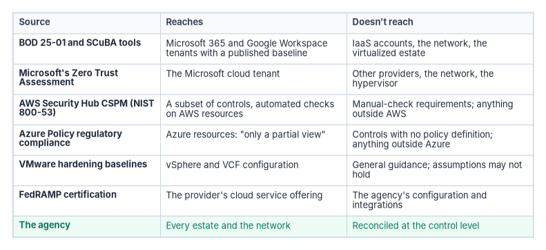
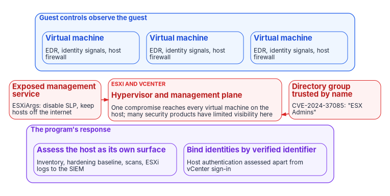

# Chapter 06 — Beyond Microsoft 365: Networks, Other Clouds and Virtualized Estates

*Three assessments stapled together are three partial answers, unless all three estates resolve to the same records first.*

::: {.callout-note}
## In this chapter
Why assessing the network, each cloud service provider and the virtualized estate as separate exercises can't produce a whole-agency Zero Trust score. What the federal documents say about scope, and where the Microsoft 365 baseline stops. The three things an agency has to reconcile before it assesses (one inventory, one naming authority and no implicit trust from any boundary), why the hypervisor is a distinct threat class, why the unification layer becomes the most valuable target in the estate, and why each provider's own tooling answers only for its own platform.
:::

Most agencies assess their infrastructure in three separate exercises. The network team reviews the boundary against TIC 3.0. The cloud security team runs each provider's posture scanner against that provider's accounts or subscriptions. The virtualization team works through a hypervisor hardening checklist. Each exercise produces its own report, on its own schedule, for its own owner. When a "whole-agency" Zero Trust maturity figure is needed, the three reports are combined.

That figure isn't a whole-agency assessment. It is three partial assessments under one cover page. The reason is architectural, not organizational. A zero trust policy decision evaluates a subject, a device and a resource against policy, and it can only do that consistently if every platform describes those things the same way. When the network, each cloud and the virtualized estate keep their own inventories, their own names and their own identity sources, the same workload appears as three different objects to three different assessors, and no score computed across them measures one architecture. A scan can confirm that an architecture is unified. It can't substitute for unifying it.

This chapter is the infrastructure half of the argument [Chapter 01](01-a-whole-agency-property.md) opens. [Chapter 04](04-scuba-and-bod-25-01.md) and [Chapter 05](05-two-assessment-tools.md) cover the Microsoft 365 baseline and the two Microsoft-ecosystem assessment tools; this chapter covers everything they don't reach.

{#fig-ch06-who-answers fig-alt="A table with four columns: source, what it reaches, what it doesn't reach, and kind. Row one, BOD 25-01 and SCuBA tools: Microsoft 365 and Google Workspace tenants with a published baseline; not infrastructure-as-a-service accounts, the network or the virtualized estate; binding baseline. Row two, Microsoft's Zero Trust Assessment: the Microsoft cloud tenant; not other providers, the network or the hypervisor; vendor guidance. Row three, AWS Security Hub CSPM NIST SP 800-53 standard: a subset of controls with automated checks on AWS resources; not manual-check requirements or anything outside AWS; vendor tool. Row four, Azure Policy regulatory compliance: Azure resources, a partial view by Microsoft's own description; not controls without policy definitions or anything outside Azure; vendor tool. Row five, VMware hardening baselines: vSphere and VMware Cloud Foundation configuration; general guidance whose assumptions may not hold; vendor guidance. Row six, FedRAMP certification: the provider's cloud service offering; not the agency's configuration or integrations; certification. Final row, highlighted in green: the agency, which reaches every estate and the network, reconciled at the control level."}

## What the federal documents say about scope

None of the federal Zero Trust documents limits Zero Trust to one platform. Read together, they describe a property of the agency's whole infrastructure.

- **Executive Order 14028** defines zero trust architecture as embedding monitoring, risk-based access control and automation "throughout all aspects of the infrastructure."[^c06-eo14028]
- **OMB M-22-09** "frequently references cloud services, but also addresses on-premise and hybrid systems," and requires a complete inventory of every device authorized and operated for official business.[^c06-m2209]
- **CISA's Zero Trust Maturity Model** defines a device as any asset that can connect to a network, including servers and networking equipment, and extends device management to cloud and virtual assets: virtual machines, containers, storage, platform services and virtual networks, VPNs, gateways and DNS services. At Optimal the agency has "a comprehensive, at- or near-real-time view of all assets across vendors and service providers."[^c06-ztmm] The model is generally aligned to one administrative domain or accreditation boundary, but tells agencies to assess how their reliance on service providers factors into their architecture.[^c06-ztmm]
- **NIST SP 800-207** assumes that "not all enterprise resources are on enterprise-owned infrastructure" and that assets and workloads moving between enterprise and non-enterprise infrastructure "should have a consistent security policy and posture."[^c06-sp207] In its multi-cloud use case it states the principle directly: there "should be no difference between enterprise-owned and -operated network infrastructure and infrastructure owned and operated by any other service provider," with enforcement points at each application and data source. It also names the cost: "different cloud providers have unique ways of implementing similar functionality," and architects must work out how to implement the agency's architecture with each one.[^c06-sp207]

SP 800-207 also explains why fragmented records break the architecture rather than just the report. Migrating to zero trust "requires an organization to have detailed knowledge of its assets (physical and virtual), subjects (including user privileges), and business processes," and incomplete knowledge "will most often lead to a business process failure where the PE denies requests due to insufficient information."[^c06-sp207] A policy engine can't evaluate a workload that three platforms describe three ways.

## Where the Microsoft 365 baseline stops

BOD 25-01 is the binding baseline for cloud tenant configuration, and it's narrower than the Zero Trust target. It applies to production cloud tenants of products for which CISA has published a final SCuBA Secure Configuration Baseline.[^c06-bod2501] CISA's current list of required configurations covers Microsoft 365 (Entra ID, Defender, Exchange Online, Power Platform, SharePoint Online and OneDrive, and Teams) and Google Workspace, whose required policies carry a due date of December 1, 2026.[^c06-bod2501-rc] Nothing on that list covers infrastructure-as-a-service accounts or subscriptions, the agency network or a virtualized estate. BOD 25-01 also doesn't reach on-premises Active Directory ([Chapter 04](04-scuba-and-bod-25-01.md)).

The argument in this chapter therefore doesn't rest on the directive. It rests on the Zero Trust documents above and on the NIST SP 800-53 controls every system security plan asserts, which apply to whatever infrastructure the system runs on.

## Three things to reconcile before assessing

### One authoritative asset inventory

SP 800-53 CM-8 requires a system component inventory that "accurately reflects the system," "includes all components within the system," and "does not include duplicate accounting of components or components assigned to any other system."[^c06-sp80053] M-22-09 requires reliable asset inventories through CISA's CDM program, and says CISA will work toward a CDM program that better supports a cloud-oriented architecture, possibly through automated asset discovery over the technical interfaces cloud infrastructure providers offer.[^c06-m2209] BOD 23-01 makes discovery operational: automated asset discovery every 7 days, vulnerability enumeration every 14 days across all discovered assets, and results in the CDM Agency Dashboard within 72 hours; its scope includes cloud-operated virtual machines alongside on-premises and roaming assets.[^c06-bod2301]

None of those instruments says "one inventory" in so many words. The program reads them together that way: an inventory that must not double-count components can't be the network team's list, the cloud team's tag taxonomy and the virtualization team's inventory reconciled by hand at audit time. Every cloud account and every hypervisor cluster has to resolve to the asset identity the rest of the estate already uses. [Book 08, Chapter 07](../b08-ddi/07-cloud-private-endpoints-and-ipam.md) covers keeping cloud and VMware NSX address records consistent with the agency IPAM, and [Book 05](../b05-devices/index.md) covers bringing servers into one device inventory.

### One naming and address-resolution authority

SC-20 and SC-21 require integrity and data-origin authentication for the name resolution a system serves and receives, and SC-22 requires that the systems collectively providing name and address resolution for an organization be fault-tolerant and separate internal and external roles.[^c06-sp80053] Each cloud provider and VMware ships its own private DNS, with its own console, zone model and failure behavior ([Book 08, Chapter 07](../b08-ddi/07-cloud-private-endpoints-and-ipam.md)). An agency can run them all, but the controls apply to the organization's resolution service as a whole, and a workload's name is one of the attributes a policy decision depends on. The program's position is that names are authoritative from one source before the fact, not reconciled after the fact. Per-platform naming reconciled at audit time is the pattern that produces reactive remediation instead of continuous evidence ([Chapter 02](02-governance-principles.md)).

### No implicit trust from any boundary

The maturity model puts "large perimeter/macro-segmentation with minimal restrictions on reachability within network segments" and "bulk traffic VPN tunnels" at the Traditional stage of the Networks pillar.[^c06-ztmm] M-22-09 requires agencies to "move away from the practice of maintaining a broad enterprise-wide network that allows enhanced visibility or access to many distinct applications."[^c06-m2209] SP 800-207's first network assumption is that "the entire enterprise private network is not considered an implicit trust zone."[^c06-sp207]

A site-to-site VPN, a cloud provider's default virtual-network boundary and a flat virtualized network segment are, architecturally, the same mistake: each extends trust to whatever is already inside it. Segmentation and policy enforcement have to apply the same way whether the workload is on premises, in any cloud or on a hypervisor cluster. An agency that segments its cloud workloads but leaves its virtualized estate on a flat, VPN-reachable network hasn't removed implicit trust; it has moved it. [Book 09](../b09-network/index.md) carries the network design.

## The hypervisor is a distinct threat class

The virtualized estate isn't only a naming problem. A hypervisor sits beneath every guest workload's own telemetry, so a compromise there can bypass the controls the rest of the program builds. [Chapter 01](01-a-whole-agency-property.md#two-incidents-that-sat-beneath-any-single-tool) recounts the two incidents that show it: the ESXiArgs campaign of February 2023, which CISA and the FBI reported had compromised over 3,800 ESXi servers by encrypting virtual machine configuration files,[^c06-esxiargs] and CVE-2024-37085 in July 2024, an authentication bypass in ESXi hosts joined to Active Directory that ransomware operators used to take over hypervisors and that CISA added to its Known Exploited Vulnerabilities catalog on July 30, 2024.[^c06-ms-esxi][^c06-nvd-37085]

{#fig-ch06-beneath-the-guest fig-alt="A layered diagram. At the top, in blue, three guest virtual machines, each containing its own EDR agent, identity signals and host firewall, labeled guest controls observe the guest. Below them, in red, the ESXi hypervisor and vCenter management plane, labeled one compromise reaches every virtual machine on the host. Two red arrows enter the hypervisor layer from the side: one labeled exposed management service, such as SLP, and one labeled directory group trusted by name, ESX Admins. At the bottom, in violet, the program's response: assess the hypervisor management plane as its own surface, forward hypervisor logs to the SIEM, bind identities by verified identifier, and authenticate hosts separately from vCenter sign-in."}

For this chapter, two consequences matter. The first is assessment scope. Microsoft's own description of the visibility problem is that "many security products have limited visibility and protection for an ESXi hypervisor," and its mitigations include forwarding ESXi logs to a SIEM.[^c06-ms-esxi] Guest-level EDR, identity and network controls run inside the guests, so guest posture says little about the host beneath them. The program therefore assesses the hypervisor management plane as its own surface, with its own inventory entries, hardening baseline, vulnerability scans and log stream, rather than inferring it from the posture of the workloads it hosts.

The second is identity. CVE-2024-37085 shows why unifying the hypervisor's identity with the agency's isn't a low-risk configuration change. The weakness was a trust relationship with Active Directory that relied on a group's name rather than a verified, non-recreatable identity: the NVD entry describes recreating the configured group after it was deleted, and Microsoft adds that the group didn't need to exist beforehand at all.[^c06-nvd-37085][^c06-ms-esxi] vCenter keeps its own single sign-on with a local identity source, and supports only one external identity provider alongside it; federation with Microsoft Entra ID over OpenID Connect, with SCIM provisioning, is available from vSphere 8.0 Update 2.[^c06-vcenter-entra][^c06-vcenter-one] The federation documentation covers sign-in to vCenter; it doesn't describe ESXi host authentication.[^c06-vcenter-entra] Bringing the virtualized estate into the agency identity plane is the right target, and [Book 04, Chapter 04](../b04-access/04-privileged-roles-and-tiers.md) places vSphere roles in the program's privilege tiers. The program treats each such integration as a project with its own risk: identities bound by verified identifiers, privileged groups that can't be recreated by a directory user, and host-level authentication assessed separately from vCenter sign-in.

## The unification layer becomes the target

Reconciling the network, every cloud and the virtualized estate to one plane creates something new: a complete map of the agency's attack surface and, if it also holds reconciliation privileges across those domains, a privileged-access broker. SP 800-207 describes the same risk for the components that make access decisions. The policy engine and policy administrator "are the key components of the entire enterprise"; an administrator with configuration access to the engine's rules "may be able to perform unapproved changes"; and the mitigation is that they "must be properly configured and monitored, and any configuration changes must be logged and subject to audit."[^c06-sp207] The maturity model warns agencies not to "create new opportunities for exploitation" as they mature.[^c06-ztmm]

An agency that builds the unification layer and doesn't harden it separately has built the most attractive target in its own architecture. The program's minimum for that layer:

- **Tier 0 administration.** Administrative access follows the privileged-identity controls of [Book 04](../b04-access/index.md): time-bound, independently approved and never standing.
- **Its own telemetry.** A high-priority log stream for the layer itself, monitored separately from the domains it reconciles.
- **A blast-radius design.** The layer is designed on the assumption that it will be attacked directly, not only reached through one of the estates it unifies: writes to the estates are scoped and logged, and loss of the layer degrades reconciliation rather than access.
- **Open formats where possible.** SP 800-207 warns that reliance on proprietary data formats can lock an enterprise into a subset of providers and make migration costly.[^c06-sp207] The layer's records should be exportable without the tool that built them.

## Each provider's tool answers for its own platform

Every cloud provider offers native posture and compliance tooling, and each describes its own limits.

- **AWS.** Security Hub CSPM's NIST SP 800-53 Rev. 5 standard "support[s] a subset" of the framework's requirements through automated checks on certain AWS services and resources, and doesn't support requirements that need manual checks.[^c06-aws]
- **Microsoft Azure.** In Azure Policy's NIST SP 800-53 Rev. 5 regulatory compliance initiative, "Compliant" refers only to the policy definitions, "this doesn't ensure you're fully compliant with all requirements of a control," and "compliance in Azure Policy is only a partial view of your overall compliance status."[^c06-azure]
- **VMware.** Broadcom publishes security configuration and hardening baselines and regulatory compliance guidance for VMware Cloud Foundation and vSphere Foundation, with a disclaimer that the material is general guidance whose assumptions "may not be valid in your environment."[^c06-vcf]

FedRAMP draws the same line from the other side. FedRAMP "certifies the cloud service offering," while "each agency still authorizes its own federal information systems," and the authorizing official accepts risk for the agency's specific use of the service, "including the information processed, the configuration selected, the integrations enabled." Agencies are told to configure and integrate the service securely, "including identity, logging, monitoring."[^c06-fedramp] A provider's certification covers the provider. The agency's configuration of it, and how it connects to everything else the agency runs, are the agency's to assess.

The conclusion follows. A provider assessing its own platform is necessarily scoped to that platform and has no view of the other providers, the network or the virtualized estate. Running every vendor's native tool produces as many reports as there are vendors, not one agency-level answer. The agency is the only party positioned to hold one Zero Trust posture across all of them. The program reconciles each tool's output at the control level, NIST SP 800-53 as tailored by the FedRAMP baselines, because the tools use different finding identifiers and severity models and none was built to substitute for another. [Chapter 05](05-two-assessment-tools.md) applies this to ScubaGear and Microsoft's Zero Trust Assessment inside one vendor's ecosystem, and [Chapter 09](09-running-the-assessment.md) and [Chapter 10](10-evidence-not-verdicts.md) build the ingestion and the finding-to-program path.

## What a whole-agency score requires

The practical test is short. An agency can claim a whole-agency Zero Trust maturity figure only when it can show:

1. **One inventory.** Every network device, cloud account resource and hypervisor host resolves to one authoritative asset record, with no component counted twice (CM-8).
2. **One naming and identity plane.** Names and identities come from one authoritative source per kind, and every platform's identity source is either that source or federated to it with verified identifiers.
3. **No implicit trust anywhere.** No VPN, default virtual network or flat virtualized segment confers access on its own.
4. **A hardened unification layer.** The plane that reconciles the estates is a Tier 0 asset, with its own privileged access, telemetry and blast-radius design.
5. **An agency-level owner.** One owner of the Zero Trust posture who sits above every provider relationship ([Chapter 07](07-who-owns-zero-trust.md)).
6. **Control-level reconciliation.** Each provider's and each tool's findings mapped to the same controls before any figure is computed.

A figure that can't point to that unified record is three partial assessments, and the program reports it that way. Unify first; then let assessment confirm it.

::: {.callout-tip}
## Continue the book
[← Previous: Chapter 05 — ScubaGear and Microsoft's Zero Trust Assessment](05-two-assessment-tools.md) · [Book index](index.md) · [Next: Chapter 07 — Who Owns Zero Trust →](07-who-owns-zero-trust.md)
:::

[^c06-eo14028]: Executive Order 14028, *Improving the Nation's Cybersecurity*, May 12, 2021, 86 Fed. Reg. 26633, §10(k), <https://www.govinfo.gov/content/pkg/FR-2021-05-17/pdf/2021-10460.pdf> (accessed Oct 21, 2026).
[^c06-m2209]: Office of Management and Budget, M-22-09, *Moving the U.S. Government Toward Zero Trust Cybersecurity Principles*, January 26, 2022, §III (introduction), §III.B.1 (Inventorying assets) and §III.C.5 (Enterprise-wide architecture and isolation strategy), <https://www.whitehouse.gov/wp-content/uploads/2022/01/M-22-09.pdf> (accessed Oct 21, 2026).
[^c06-ztmm]: Cybersecurity and Infrastructure Security Agency, *Zero Trust Maturity Model*, Version 2.0, April 2023, §5 (scope and limitations), §5.2 (Devices, Table 3) and §5.3 (Networks, Table 4), <https://www.cisa.gov/sites/default/files/2023-04/zero_trust_maturity_model_v2_508.pdf> (accessed Oct 21, 2026).
[^c06-sp207]: National Institute of Standards and Technology, SP 800-207, *Zero Trust Architecture*, August 2020, §2.2, §4.2 (Multi-cloud/Cloud-to-Cloud Enterprise), §5.1 (Subversion of ZTA Decision Process), §5.6 (Reliance on Proprietary Data Formats or Solutions) and §7.3, <https://csrc.nist.gov/pubs/sp/800/207/final> (accessed Oct 21, 2026).
[^c06-bod2501]: Cybersecurity and Infrastructure Security Agency, Binding Operational Directive 25-01, *Implementing Secure Practices for Cloud Services*, December 17, 2024, <https://www.cisa.gov/news-events/directives/bod-25-01-implementing-secure-practices-cloud-services> (accessed Oct 21, 2026).
[^c06-bod2501-rc]: Cybersecurity and Infrastructure Security Agency, "BOD 25-01: Implementing Secure Practices for Cloud Services Required Configurations," <https://www.cisa.gov/resources-tools/services/bod-25-01-implementing-secure-practices-cloud-services-required-configurations> (accessed Oct 21, 2026).
[^c06-sp80053]: National Institute of Standards and Technology, SP 800-53 Rev. 5, *Security and Privacy Controls for Information Systems and Organizations*, release 5.2.0, controls CM-8, SC-20, SC-21 and SC-22, OSCAL catalog, <https://github.com/usnistgov/oscal-content/tree/main/nist.gov/SP800-53/rev5> (accessed Oct 21, 2026).
[^c06-bod2301]: Cybersecurity and Infrastructure Security Agency, Binding Operational Directive 23-01, *Improving Asset Visibility and Vulnerability Detection on Federal Networks*, October 3, 2022, <https://www.cisa.gov/news-events/directives/bod-23-01-improving-asset-visibility-and-vulnerability-detection-federal-networks> (accessed Oct 21, 2026).
[^c06-esxiargs]: Cybersecurity and Infrastructure Security Agency and Federal Bureau of Investigation, Cybersecurity Advisory AA23-039A, *ESXiArgs Ransomware Virtual Machine Recovery Guidance*, February 8, 2023, <https://www.cisa.gov/news-events/cybersecurity-advisories/aa23-039a> (accessed Oct 21, 2026).
[^c06-nvd-37085]: National Institute of Standards and Technology, National Vulnerability Database, CVE-2024-37085 (published June 25, 2024; CISA KEV date added July 30, 2024), retrieved through the NVD CVE API, <https://services.nvd.nist.gov/rest/json/cves/2.0?cveId=CVE-2024-37085> (accessed Oct 21, 2026).
[^c06-ms-esxi]: Microsoft Threat Intelligence, "Ransomware operators exploit ESXi hypervisor vulnerability for mass encryption," *Microsoft Security Blog*, July 29, 2024, <https://www.microsoft.com/en-us/security/blog/2024/07/29/ransomware-operators-exploit-esxi-hypervisor-vulnerability-for-mass-encryption/> (accessed Oct 21, 2026).
[^c06-vcenter-entra]: Broadcom, "Configure vCenter Identity Provider Federation for Microsoft Entra ID," *vSphere Authentication* (vSphere 9.0), <https://techdocs.broadcom.com/us/en/vmware-cis/vsphere/vsphere/9-0/vsphere-authentication/vsphere-authentication-with-vcenter-single-sign-on/configuring-vcenter-server-identity-provider-federation/configure-vcenter-server-identity-provider-federation-for-azure-ad.html> (accessed Oct 21, 2026).
[^c06-vcenter-one]: Broadcom Knowledge Base, article 406895, "Changing the vCenter Server identity source," <https://knowledge.broadcom.com/external/article/406895/changing-the-vcenter-server-identity-sou.html> (accessed Oct 21, 2026).
[^c06-aws]: Amazon Web Services, "NIST SP 800-53 Revision 5 in Security Hub CSPM," *AWS Security Hub User Guide*, <https://docs.aws.amazon.com/securityhub/latest/userguide/standards-reference-nist-800-53.html> (accessed Oct 21, 2026).
[^c06-azure]: Microsoft Learn, "Details of the NIST SP 800-53 Rev. 5 Regulatory Compliance built-in initiative," <https://learn.microsoft.com/azure/governance/policy/samples/nist-sp-800-53-r5> (accessed Oct 21, 2026).
[^c06-vcf]: Broadcom, "VMware Cloud Foundation Security and Compliance Guidelines" (repository README and disclaimer), <https://github.com/vmware/vcf-security-and-compliance-guidelines> (accessed Oct 21, 2026).
[^c06-fedramp]: FedRAMP, "Using a FedRAMP Certified Cloud Service," *FedRAMP Consolidated Rules for 2026*, <https://www.fedramp.gov/2026/agencies/use/> (accessed Oct 21, 2026).
