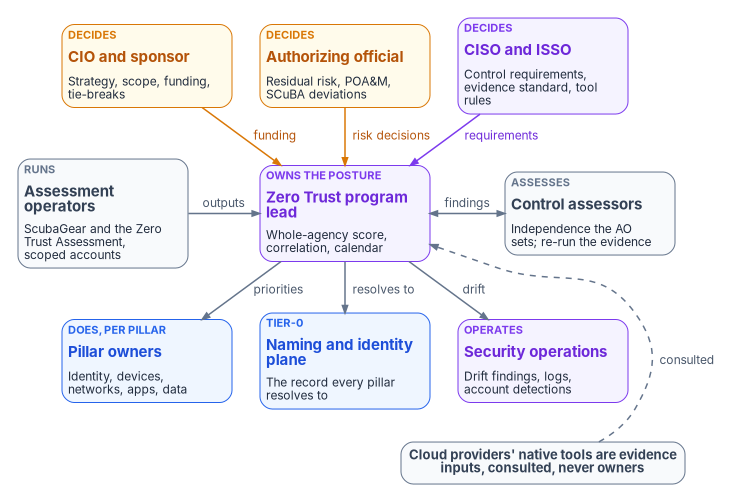
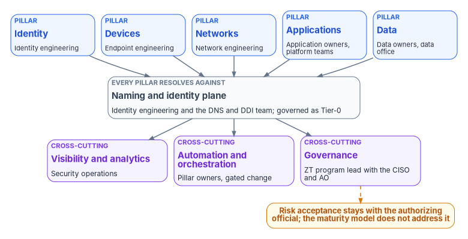

# Chapter 07 — Who Owns Zero Trust

*Every pillar of a Zero Trust program already has an owner; what most agencies lack is an owner for the posture itself, the one person who can say what the whole-agency score covers, and that person can't sit inside any cloud provider's relationship or any single pillar.*

::: {.callout-note}
## In this chapter
The people who decide, do and advise when an agency sets a Zero Trust target, assesses against it and acts on what it finds: the CIO and executive sponsor, the Zero Trust program lead, the CISO and ISSO, the authorizing official, the five pillar owners and the owner of the naming and identity plane, security operations, the assessment operators, control assessors, and the privacy and records offices. A responsibility matrix covers each decision, a table maps each pillar to its owner and its book, and a role map shows the access each team needs in the assessment tools.
:::

Zero Trust programs don't usually fail for lack of owners. They fail because every owner is a pillar owner. Identity engineering owns Conditional Access, endpoint engineering owns Intune, network engineering owns the edge, application owners own their applications, and the data office owns classification. Each runs its own tool, reports on its own schedule, and can truthfully say its pillar is improving. Nobody owns the question this book keeps asking: what is the agency's posture, across all five pillars and every estate it runs, and what does the number on the cover page actually measure?

[Chapter 01](01-a-whole-agency-property.md) argues that Zero Trust maturity is a property of the whole agency and that three assessments stapled together are not one assessment. [Chapter 02](02-governance-principles.md) names Governance as the cross-cutting capability programs invest in least. This chapter turns both arguments into names. CISA's Zero Trust Maturity Model makes the same point about people: adoption needs engagement from senior leadership, IT staff, data and system owners and users, and it requires agencies to move stove-piped IT services and staff into a coordinated strategy with agency-wide buy-in for a common architecture and governance policies.[^c07-ztmm] OMB M-22-09 says agency leadership and the whole "C-suite" should be aligned behind the overhaul, and it required each agency to designate a zero trust strategy implementation lead within 30 days.[^c07-m2209] What neither document says is who decides when a ScubaGear omission expires, or who can declare that a Zero Trust Assessment score covers the agency. That is the program's recommended model, set out below as design.

[Book 01, Chapter 09](../b01-transformation-arc/09-who-leads-the-transformation.md) sets out the program-wide model and the Risk Management Framework roles. [Book 04, Chapter 06](../b04-access/06-who-decides-access.md), [Book 05, Chapter 06](../b05-devices/06-who-owns-the-endpoint.md) and [Book 09, Chapter 09](../b09-network/09-who-owns-the-network.md) apply it to access, endpoints and the network. This chapter applies it to the posture that sits across all of them. Adapt the roles to the agency's governance, but keep one decider per row.

{#fig-ch07-zero-trust-owners fig-alt="Three rows of cards. Top row, decision makers: the CIO and executive sponsor in amber, who own strategy, funding and tie-breaks; the authorizing official in amber, who accepts residual risk, approves plans of action and milestones and accepts SCuBA deviations; and the CISO and ISSO in violet, who set control requirements, evidence standards and assessment rules. Arrows labeled funding, risk decisions and requirements run from each to a violet card in the middle row, the Zero Trust program lead, who owns the whole-agency score, cross-pillar correlation and the assessment calendar. Beside the program lead in the middle row are the assessment operators in slate, who run ScubaGear and the Zero Trust Assessment under scoped accounts, and the control assessors in slate, who assess with the independence the authorizing official sets. The program lead sends findings and priorities down to the bottom row: the pillar owners in blue, who own identity, devices, networks, applications and data and remediate through change control; the owner of the naming and identity plane in blue, which is governed as a Tier-0 asset; and security operations in violet, which receives drift findings and logs. A slate pill reads: cloud providers' native tools are evidence inputs and are consulted, never owners, with a dashed arrow to the program lead."}

## Why the posture needs its own owner

Three facts from earlier chapters make the posture a separate thing to own.

The first is scope. CISA's ScubaGear and Microsoft's Zero Trust Assessment overlap mainly on Microsoft Entra ID and, as of version 3.1.0, on Defender threat policies ([Chapter 05](05-two-assessment-tools.md)), and both stop at the edge of Microsoft's platform. Every other cloud provider offers its own native posture tooling, and the on-premises virtualization estate has none of theirs ([Chapter 06](06-beyond-microsoft-365.md)). A provider assessing its own platform is scoped to that platform. It has no view of the other providers, the network layer or the hypervisors, and no reason to reconcile against them. The agency is the only party that can hold one posture across all of them, so the agency, not any provider's tool or account team, has to own it. The governance principles paper puts this as an ask: assign agency-level Zero Trust ownership separately from any cloud service provider relationship.

The second is correlation. A finding about a stale service-principal credential matters to the identity pillar, the applications pillar and whichever data the principal can reach. If those three pillars resolve objects through three naming systems, someone has to correlate the finding by hand, and in most programs nobody is assigned to. The governance principles paper asks agencies to name a cross-pillar correlation owner. In the program's model that is the Zero Trust program lead.

The third is risk. CISA's maturity model is explicit that it does not address risk acceptance, among other things,[^c07-ztmm] and it describes itself as a general guide, not a strict set of requirements.[^c07-ztmm] Risk acceptance sits where it always has, with the authorizing official under the Risk Management Framework. The authorizing official is the only organizational official who can accept security and privacy risk on the organization's behalf, approves plans of action and milestones, and decides whether a significant change needs reauthorization.[^c07-sp80037] A maturity target, a tool score and a risk decision are three different things owned by three different people. Programs that blur them end up with a tool vendor's dashboard quietly standing in for an authorization decision.

## Decision rights and work are different things

The program separates three kinds of involvement, as Book 01 does. A role *decides* when it is accountable for the outcome and can say no. A role *does* the work when it builds, configures, runs or remediates. A role is *consulted* when the decision can't be made well without its input, even though the decision isn't its to make.

The split matters for Zero Trust because many assessment decisions are risk decisions that look like configuration. Marking a ScubaGear policy as omitted removes it from the report. Marking a result incorrect changes what the tool says about the tenant. Treating a skipped Zero Trust Assessment check as a pass, because the license for it isn't in the agency's boundary, overstates the posture. ScubaGear's own documentation warns that omitting policies or marking results incorrect can introduce blind spots, and says omissions must only be made if approved within the organization's security risk management process.[^c07-scuba-config] CISA's BOD 25-01 says the same thing at the directive level: authorizing officials may accept risk for deviations from the mandatory SCuBA policies to meet operational needs, under agency policy, and agencies must identify and explain those deviations when they report.[^c07-bod2501] The decision behind an edit to a configuration file therefore belongs to the authorizing official, even though an engineer types it.

## The roles

The **CIO and executive sponsor** set the Zero Trust strategy, its scope and its funding, and they break ties. Under the Risk Management Framework the CIO designates the senior agency information security officer, maintains security policy and reports to the head of the agency on the security program's effectiveness, and, with authorizing officials, allocates the resources that protect the agency's systems.[^c07-sp80037] For this book that means three decisions. The scope decision: which estates the whole-agency score covers (every tenant, every cloud, the network, the virtualization estate), stated in writing so the score can't quietly shrink to the estates that assess well. The sequence decision: [Chapter 08](08-close-before-you-assess.md) closes BOD 25-01 findings before the maturity assessment, and that order competes for the same engineers as every other deadline. And the tie-break: identity engineering, endpoint engineering and network engineering can each reasonably claim a cross-pillar control, such as device posture in a token, and the CIO decides which team owns it.

The **Zero Trust program lead** owns the posture. Many agencies will give this role to the zero trust strategy implementation lead M-22-09 required them to designate.[^c07-m2209] In the program's model the lead owns four things. The definition of the whole-agency score: what it covers, what it excludes, and the unified record each assessed object resolves to; a score that can't point to that record is reported as partial assessments, not one. The cross-pillar correlation: when one finding touches several pillars, the lead's team routes it and makes sure it isn't closed in one pillar while open in another. The assessment calendar: which tool runs against which estate, when, with which pinned version, and when results are re-run after remediation. And the prioritized program in [Chapter 10](10-evidence-not-verdicts.md): turning findings into a ranked worklist that each pillar owner executes. The lead decides priority and sequence. The lead doesn't accept risk; that goes to the authorizing official. The lead's independence from any cloud provider relationship is the point of the role, so the lead shouldn't also be the agency's account owner for its largest cloud vendor.

The **CISO and ISSO** decide what the posture has to meet. The CISO, as the senior agency information security officer, carries out the CIO's security responsibilities and is the CIO's primary liaison to authorizing officials, system owners, common control providers and system security officers.[^c07-sp80037] In the program's model the CISO sets the control requirements for each pillar, the evidence standard (what makes an assessment output acceptable as evidence: a pinned tool version, a recorded run time, an unaltered output file, a hash), which assessment tools the agency may run against production tenants, and the rules for the accounts that run them. The CISO also owns the requirement that assessment outputs are handled as sensitive data, because Microsoft warns that the Zero Trust Assessment report and its export folder contain sensitive tenant information that threat actors could use, and should be shared only with authorized personnel.[^c07-zta-start] A ScubaGear report describes the same weaknesses from a different angle and gets the same handling. The ISSO for each system assembles the evidence, keeps the system's plan of action and milestones current and reviews the security impact of each remediation change, as the system security officer role does under the RMF.[^c07-sp80037]

The **authorizing official** accepts residual risk. For this book that covers four kinds of decision. Deviations from a mandatory SCuBA policy, which BOD 25-01 lets authorizing officials accept under agency policy.[^c07-bod2501] Omissions and incorrect-result markings in the ScubaGear configuration file that have no expiration date, since a standing omission is a standing risk acceptance. The plan of action and milestones for each system, which the authorizing official approves.[^c07-sp80037] And the degree of assessor independence, which the authorizing official determines explicitly when an assessment supports an authorization or ongoing authorization.[^c07-sp80037] Most agencies have several authorizing officials, so the whole-agency posture spans more than one of them. The program lead aggregates; each authorizing official accepts risk only for the systems and common controls they authorize. The authorizing official can delegate day-to-day work to a designated representative, but not the acceptance of risk itself.[^c07-sp80037]

The **pillar owners** do the remediation and own their pillar's maturity. The program maps each pillar of CISA's model, which M-22-09 also uses to organize its goals,[^c07-m2209] to the team that owns it after modernization, and each team's book assigns it decisions in detail (see the table below). Pillar owners triage findings in their pillar, remediate through their normal change control, and record the closure evidence that lets the finding be re-tested. Many of them are also common control providers in RMF terms: the identity platform, for example, provides controls that every application inherits. A common control provider is responsible for implementing, assessing and monitoring those controls and for producing plans of action and milestones for any that are deficient.[^c07-sp80037] A pillar owner decides how to fix a finding. A pillar owner doesn't decide that a finding doesn't need fixing.

The **owner of the naming and identity plane** holds the unified record the score depends on. [Chapter 06](06-beyond-microsoft-365.md) explains why Network, every cloud and the virtualization estate have to resolve objects against one authoritative naming and identity plane before their assessments mean the same thing, and why that plane, once it exists, is the most valuable target in the estate: a complete asset map that may also carry reconciliation privileges across every domain. In the program's model identity engineering owns the identity half and the DNS/DDI team ([Book 08](../b08-ddi/09-who-owns-dns.md)) owns naming and addressing. Whoever owns it, the plane is governed as a Tier-0 asset: administrative access is eligible rather than standing and time-boxed, it has its own monitored telemetry stream, and its design assumes it will be attacked directly.

**Security operations** receives what the posture emits. OMB M-26-14, which rescinded M-21-31, requires that logs be readily available to the agency's top-level security operations center for continuous event monitoring and for threat hunting, investigation, response and forensics, and that the logs collected identify the identity used for each operation and every change to privilege levels.[^c07-m2614] For this book that means three duties. Security operations consumes drift findings (a control that passed last interval and fails this one), because some of them are the first sign of an intrusion rather than an administrative slip. It monitors the assessment accounts themselves, which hold broad read access to every tenant they assess. And it is consulted on every omission and every exception, because it is the team that finds out when one is used.

The **assessment operators** run the tools. In most agencies this is a security engineering or compliance team inside the CISO's organization. They run ScubaGear and the Zero Trust Assessment on the calendar the program lead sets, under accounts the CISO approves, on hosts inside the authorization boundary, and they deliver unaltered outputs to the evidence repository. BOD 25-01 required agencies to deploy the SCuBA assessment tools for in-scope tenants and report results to CISA, either continuously through CISA's monitoring integration or quarterly in a CISA-approved machine-readable format.[^c07-bod2501] CISA's implementation guidance offers four routes: CISA-hosted ScubaConnect, self-hosted ScubaConnect, an agency-hosted integration through CLAW or TALON, and manual quarterly upload through CyberScope ([Chapter 04](04-scuba-and-bod-25-01.md)).[^c07-bod2501-guide] Whichever route the agency picks, the operators own it. They don't edit results, and they don't decide omissions.

**Control assessors** assess with the independence the authorizing official sets. Under the RMF the assessor determines whether controls are implemented correctly, operating as intended and producing the desired outcome, reports deficiencies and their severity, and can recommend corrective actions.[^c07-sp80037] SP 800-53 provides for independent assessors both for point-in-time assessments and for ongoing monitoring.[^c07-sp80053] In the program's model a ScubaGear or Zero Trust Assessment run is evidence the assessor reads, not an assessment the tool performs. The assessor can re-run the evidence assembly, compare hashes and walk a finding back to its raw output ([Chapter 09](09-running-the-assessment.md)), and that is what makes the tool output assessable rather than merely archived.

The **privacy and records offices** are consulted. The Zero Trust Assessment's own guide warns that reports, exports and diagnostics can contain tenant configuration and personal information.[^c07-zta-guide] The senior agency official for privacy is consulted before assessment outputs are retained, shared outside the security organization or loaded into a reporting tool. The records officer sets how long each output is kept. That retention is a records decision, not a tool default.

## The responsibility matrix

D = decides (accountable) · R = does the work · C = consulted · blank = informed at most.

| Decision or work item | CIO / sponsor | ZT program lead | CISO / ISSO | AO | Pillar owners | Identity-plane owner | SecOps | Assessment operators | Assessors | Privacy / records |
|---|---|---|---|---|---|---|---|---|---|---|
| Zero Trust strategy, scope and funding | D | R | C | C | C | | | | | |
| Designate the zero trust strategy implementation lead | D | | C | | | | | | | |
| Definition of the whole-agency score: what it covers and excludes | C | D, R | C | C | C | C | | | C | |
| The unified naming and identity record that assessments resolve to | C | C | C | | C | D, R | C | | | |
| Cross-pillar correlation and routing of findings | | D, R | C | | R | C | C | | | |
| Control requirements and evidence standard per pillar | | C | D | C | C | C | C | C | C | |
| Maturity target per pillar (program design, not a mandate) | C | D | C | C | R | | | | | |
| Approved assessment tools and pinned versions | | C | D | | | | C | R | C | |
| Assessment accounts, consent grants and their scope | | | D | | | R | C | R | | |
| Assessment calendar and re-runs after remediation | | D | C | | C | | C | R | C | |
| BOD 25-01 tenant inventory and reporting route to CISA | C | C | D | | | | | R | | |
| ScubaGear annotations (comments, remediation dates) | | C | D | | R | | | R | | |
| Omission or incorrect-result marking with an expiration date | | C | D | C | R | | C | R | | |
| Omission, deviation or incorrect-result marking with no end date | | C | R | D | C | | C | R | | |
| Finding priority and sequence | | D | C | C | R | C | C | | | |
| Remediation through change control | | C | C | | D, R | R | C | | | |
| Plan of action and milestones per system | | C | R | D | R | | | | C | |
| Degree of assessor independence | | | C | D | | | | | R | |
| Drift findings surfaced to the authorizing official | | R | R | D | C | | R | | | |
| Logs and detections for assessment accounts and drift | | | D | | | C | R | C | | |
| Agency Logging Plan coverage of Zero Trust telemetry | C | C | D | | R | R | R | | | |
| Handling, retention and sharing of assessment outputs | | C | D | | | | | R | | C |
| Cloud provider native-tool findings admitted as evidence | | D | C | | R | | | R | C | |

Six rows need comment.

The **score** row gives the program lead the decision because the definition of "whole agency" is the thing every other role has an incentive to narrow. A pillar owner whose estate assesses badly would prefer it excluded; a cloud account team would prefer its own tool's score to stand in for the whole. The lead decides, the authorizing official and the assessors are consulted, and the exclusions are written down.

The **identity-plane** row gives that decision to the plane's owner rather than the program lead, because the plane is infrastructure with its own privileged access and blast radius, not a reporting artifact. The program lead depends on it and is consulted.

The **omission** rows split on time, as the exception rows do in Books 05, 08 and 09. The CISO can approve an omission that expires, because it is a bounded, reviewable decision recorded in the configuration file itself. An omission, deviation or incorrect-result marking with no end date is a standing risk acceptance and goes to the authorizing official, which matches BOD 25-01's assignment of deviation risk to authorizing officials.[^c07-bod2501]

The **priority** row gives the program lead priority and sequence, while the **remediation** row gives each pillar owner the decision about how to fix. The lead can say a finding is first; only the pillar owner can say how it is closed, and the closure evidence has to satisfy the CISO's standard.

The **drift** row gives the authorizing official the decision because drift is change to an authorized system. A control that passed every interval and failed the last one is a different finding from one that has always failed, and the authorizing official decides whether it amounts to a significant change.[^c07-sp80037] The program lead and security operations prepare it; the ScubaGear integration paper's adoption step is to treat these findings as artifacts the authorizing official sees, not only security operations.

The **native-tool** row is the governance principle in one line. A cloud provider's native posture tool is admitted as evidence for its own platform, by the program lead, under the CISO's evidence standard. It is never admitted as the agency's score.

## Who owns each pillar

{#fig-ch07-pillars-and-owners fig-alt="Top row, five blue cards for CISA's Zero Trust pillars and their owners: Identity, owned by identity engineering; Devices, owned by endpoint engineering; Networks, owned by network engineering; Applications and workloads, owned by application owners and platform teams; and Data, owned by the data owners and the data office. Below them, a slate card for the naming and identity plane, which every pillar resolves its objects against, owned by identity engineering and the DNS and DDI team. Below that, three violet cards for the cross-cutting capabilities: Visibility and analytics, owned by security operations; Automation and orchestration, owned by the pillar owners under gated change; and Governance, owned by the Zero Trust program lead with the CISO and the authorizing official. An amber pill at the bottom reads: risk acceptance stays with the authorizing official; the maturity model does not address it."}

| ZTMM pillar or capability | Owner in the program's model | Decides | Where the book assigns it |
|---|---|---|---|
| Identity | Identity engineering | Authentication methods, Conditional Access design, privileged identity model, within the CISO's requirements | [Book 02](../b02-identity/index.md), [Book 04](../b04-access/index.md) |
| Devices | Endpoint engineering | Compliance policies, enrollment paths, device posture signals | [Book 05](../b05-devices/index.md) |
| Networks | Network engineering, with security architecture | Transport, enforcement points, segmentation phasing | [Book 09](../b09-network/index.md) |
| Applications and workloads | Application owners, with the platform teams | Application dependencies, workload identities, cutover windows | [Book 04, Chapter 05](../b04-access/05-applications-and-workload-identities.md), [Book 06](../b06-data-platform/index.md) |
| Data | Data owners and the data office | Categorization and labeling, access to sensitive data | No book of its own yet; M-22-09's data actions are mapped in [Book 01, Appendix A](../b01-transformation-arc/appendix-a-requirements-mapping.md) |
| Naming and identity plane | Identity engineering and the DNS/DDI team | The authoritative record every pillar resolves to | [Book 08](../b08-ddi/index.md), [Chapter 06](06-beyond-microsoft-365.md) |
| Other clouds and virtualization | The platform team for each estate | Native configuration of each estate, reconciled to the plane | [Book 10](../b10-cloud-boundary/index.md), [Chapter 06](06-beyond-microsoft-365.md) |
| Visibility and analytics | Security operations | Detections, alert tuning, log coverage | M-26-14 Agency Logging Plan |
| Automation and orchestration | Pillar owners, under gated change | Which corrective actions run, and with whose approval | [Book 01, Chapter 03](../b01-transformation-arc/03-platform-foundation.md) |
| Governance | Zero Trust program lead, with the CISO and the authorizing official | Policies and their enforcement across pillars | This chapter |

CISA defines Governance in the model as the definition and enforcement of agency cybersecurity policies, procedures and processes within and across pillars.[^c07-ztmm] "Across pillars" is the part no pillar owner can deliver alone, which is why the program puts it with the program lead rather than distributing it.

## Roles in each system

Decision rights don't change what a console lets someone do. Roles do, and the assessment tools need broad read access to the tenants they assess. The program maps each team to the least-privileged role in each system it touches.

| Team | ScubaGear run | Zero Trust Assessment run | CISA reporting | Evidence repository | SIEM |
|---|---|---|---|---|---|
| Assessment operators | Global Reader for most products; Power Platform Administrator with the required license only if Power Platform is assessed[^c07-scuba-perms] | Global Reader for the Graph context; Security Reader for protection-policy checks; SharePoint Administrator for SharePoint tenant commands; Azure Reader on in-scope subscriptions[^c07-zta-guide] | Upload or operate ScubaConnect | Write unaltered outputs | Read own account activity |
| Identity engineering | Grants the one-time application consent | Grants the one-time consent through an authorized consent role; doesn't run the assessment under that account[^c07-zta-guide] | None | Read | Read |
| ZT program lead and team | None | None | Read | Read; maintain the score definition | Read |
| CISO and ISSO | None | None | Approve | Read; approve evidence | Read |
| Pillar owners | None | None | None | Read own pillar's findings; write closure evidence | Read |
| Control assessors | None | None | Read | Read; re-run evidence assembly | Read |
| Security operations | None | None | None | Read drift findings | Detections on assessment accounts |

Three notes. The Zero Trust Assessment's guide is explicit that a highly privileged administrator should be used for the initial consent only, and that consent doesn't assign runtime roles: the assessment account should be a reader.[^c07-zta-guide] Microsoft's get-started page still describes a Global Administrator granting first-run consent and later runs as Global Reader;[^c07-zta-start] the program follows the narrower guide in the tool's own repository. The assessment accounts are among the most sensitive identities in the design, because between them they can read the configuration of every tenant the agency runs; they are eligible rather than standing where the platform allows, and their sign-ins are logged to the top-level SOC as M-26-14 requires for privileged operations.[^c07-m2614] And the Zero Trust Assessment sends a telemetry event by default that carries the tenant ID; it can be disabled with `-DisableTelemetry`.[^c07-zta-guide] Whether to disable it is a CISO decision recorded with the tool approval, not an operator's choice on the day.

## What changes, in one table

| Old habit | What replaces it |
|---|---|
| Each pillar reports its own maturity | The program lead owns one posture, with a written definition of what the score covers |
| The cloud provider's tool score is the Zero Trust score | Native tools are evidence for their own platform, admitted under the CISO's evidence standard |
| Whoever runs ScubaGear decides what to omit | Expiring omissions are a CISO decision; standing ones go to the authorizing official |
| Exceptions live in a Word document | Exceptions live in the versioned configuration file, with a rationale and an expiration date |
| A skipped check is quietly scored as a pass | A skipped check is recorded as absence of evidence, a different claim |
| The assessment runs before audits | The program lead runs a calendar, and re-runs after remediation |
| Drift findings go to security operations only | Drift findings reach the authorizing official as changes to an authorized system |
| Assessment output is shared freely | Output is handled as sensitive, kept inside the boundary and retained on a records decision |
| The unified identity plane is just plumbing | It is a Tier-0 asset with its own owner, privileged controls and telemetry |

::: {.callout-tip}
## Continue the book
[← Previous: Chapter 06 — Beyond Microsoft 365: Networks, Other Clouds and Virtualized Estates](06-beyond-microsoft-365.md) · [Book index](index.md) · [Next: Chapter 08 — Close Before You Assess →](08-close-before-you-assess.md)
:::

[^c07-ztmm]: Cybersecurity and Infrastructure Security Agency, *Zero Trust Maturity Model*, Version 2.0, April 2023, §4 (Challenges in Zero Trust Adoption) and §5 (Zero Trust Maturity Model: cross-cutting capability definitions, scope limits, and "general guide" statement), <https://www.cisa.gov/sites/default/files/2023-04/zero_trust_maturity_model_v2_508.pdf> (accessed Oct 21, 2026).
[^c07-m2209]: Office of Management and Budget, M-22-09, *Moving the U.S. Government Toward Zero Trust Cybersecurity Principles*, January 26, 2022, §II and §III (introduction), <https://www.whitehouse.gov/wp-content/uploads/2022/01/M-22-09.pdf> (accessed Oct 21, 2026).
[^c07-sp80037]: National Institute of Standards and Technology, SP 800-37 Rev. 2, *Risk Management Framework for Information Systems and Organizations: A System Life Cycle Approach for Security and Privacy*, December 2018, Appendix D (Roles and Responsibilities), <https://nvlpubs.nist.gov/nistpubs/SpecialPublications/NIST.SP.800-37r2.pdf> (accessed Oct 21, 2026).
[^c07-scuba-config]: Cybersecurity and Infrastructure Security Agency, ScubaGear v1.8.0 documentation, "Configuration File," sections "Annotate Policies" and "Omit Policies," <https://github.com/cisagov/ScubaGear/blob/v1.8.0/docs/configuration/configuration.md> (accessed Oct 21, 2026).
[^c07-bod2501]: Cybersecurity and Infrastructure Security Agency, BOD 25-01, *Implementing Secure Practices for Cloud Services*, December 17, 2024, "Required Actions" and "Implementation Guidance and Clarifications," <https://www.cisa.gov/news-events/directives/bod-25-01-implementing-secure-practices-cloud-services> (accessed Oct 21, 2026).
[^c07-zta-start]: Microsoft Learn, "Get started with the Zero Trust Assessment," sections "Prerequisites" and "Run the assessment," <https://learn.microsoft.com/security/zero-trust/assessment/get-started> (accessed Oct 21, 2026).
[^c07-m2614]: Office of Management and Budget, M-26-14, *Ensuring Effective and Efficient Agency Logging and Network Visibility to Defend Against Evolving Cyber Threats*, May 22, 2026, rescission of M-21-31, "Prioritization," and Appendix B (Minimum Logging Baseline Requirements, items 2 and 5), <https://www.whitehouse.gov/wp-content/uploads/2026/05/M-26-14-Ensuring-Effective-and-Efficient-Agency-Logging-and-Network-Visibility-to-Defend-Against-Evolving-Cyber-Threats.pdf> (accessed Oct 21, 2026).
[^c07-bod2501-guide]: Cybersecurity and Infrastructure Security Agency, *BOD 25-01 Implementation Guidance: Implementing Secure Practices for Cloud Services*, reporting options and deviations, <https://www.cisa.gov/news-events/directives/bod-25-01-implementation-guidance-implementing-secure-practices-cloud-services> (accessed Oct 21, 2026).
[^c07-sp80053]: National Institute of Standards and Technology, SP 800-53 Rev. 5, *Security and Privacy Controls for Information Systems and Organizations*, controls CA-2(1) and CA-7(1), checked against the release 5.2.0 OSCAL catalog, <https://github.com/usnistgov/oscal-content/blob/main/nist.gov/SP800-53/rev5/json/NIST_SP-800-53_rev5_catalog.json> (accessed Oct 21, 2026).
[^c07-zta-guide]: Microsoft, Zero Trust Assessment repository, "Run the Zero Trust Assessment" (PowerShell guide), sections "Data handling and telemetry" and "Permissions and roles," <https://github.com/microsoft/zerotrustassessment/blob/main/src/powershell/doc/readme.md> (accessed Oct 21, 2026).
[^c07-scuba-perms]: Cybersecurity and Infrastructure Security Agency, ScubaGear v1.8.0 documentation, "Interactive Permissions," section "User Permissions," <https://github.com/cisagov/ScubaGear/blob/v1.8.0/docs/prerequisites/interactive.md> (accessed Oct 21, 2026).
