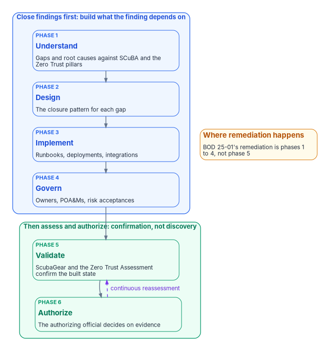
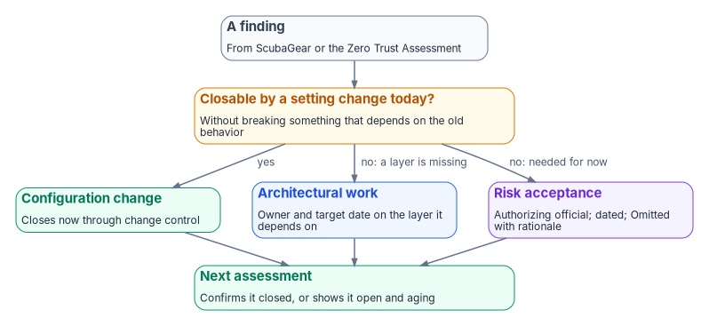

# Chapter 08 — Close Before You Assess

*Run the assessor before the architecture exists and you get an accurate list that never shrinks; build the architecture first and the same assessor becomes proof that it holds.*

::: {.callout-note}
## In this chapter
What ScubaGear and the Zero Trust Assessment can't do, and why "remediate deviations" collapses into re-scanning when the architecture beneath a finding is missing. The six-phase sequence that puts assessment at the fifth step, the four layers to build before it, and the three responses every finding is routed to. How continuous reassessment then keeps each open deviation owned, dated and aging, and where this argument stops.
:::

Agencies met BOD 25-01's early dates: tenants were inventoried by February 21, 2025, and ScubaGear was deployed and reporting by April 25, 2025.[^c08-bod2501] Many now treat "ScubaGear is running and reporting" as the answer. It isn't one. ScubaGear measures deviation from a baseline; it doesn't close any. Neither does Microsoft's Zero Trust Assessment, which Microsoft describes as read-only.[^c08-zta-start] Both are diagnostic instruments, in the same category as a thermometer. A thermometer that reports a fever every day for a year isn't a treatment plan, and an agency that runs ScubaGear on a schedule without an architecture to close what it finds is reading the same thermometer on a loop.

The program's discipline is the reverse order: close the architectural gap first, then assess, and keep assessing afterward, because continuous reporting is itself a BOD 25-01 obligation. Run in the wrong order, both tools produce an accurate, growing list of findings and no way to act on it coherently. Run in the right order, they become what the directive intends: confirmation that a built architecture is holding, in evidence an assessor can trust.

{#fig-ch08-close-then-assess fig-alt="Six cards in a vertical sequence. Inside a blue group labeled close findings first, build what the finding depends on, are four cards: 1 Understand, gaps and root causes against the SCuBA baselines and Zero Trust pillars; 2 Design, the closure pattern for each gap; 3 Implement, runbooks, deployments and integrations; and 4 Govern, owners, plans of action and milestones, and risk acceptances. Below them, inside a green group labeled then assess and authorize, confirmation not discovery, are 5 Validate, ScubaGear and the Zero Trust Assessment confirm the built state, and 6 Authorize, the authorizing official decides on evidence. A dashed violet arrow labeled continuous reassessment loops from Authorize back to Validate. An amber note beside the sequence reads: BOD 25-01's remediation is phases 1 to 4, not phase 5."}

## What the assessors can't do

ScubaGear and the Zero Trust Assessment both read configuration and score it, ScubaGear against SCuBA's SHALL and SHOULD policies and the Zero Trust Assessment against Microsoft's pillar-organized tests ([Chapter 05](05-two-assessment-tools.md)). The question this chapter turns on isn't which tool to run. The answer there is both, for different questions. It is what either tool is structurally able to do once it runs. Neither can:

- **Design the Conditional Access set, the legacy-authentication retirement and the device and workload identity chain** that move a tenant's identity pillar toward the Advanced stage of CISA's maturity model ([Chapter 03](03-what-the-mandates-require.md)). The Zero Trust Assessment can score the gap; it can't close it.
- **Build the naming and addressing plane** underneath the DNS records the baselines check. ScubaGear's Exchange Online baseline requires an SPF policy for every domain and a DMARC policy at `p=reject` for every second-level domain, and ScubaGear checks the published records.[^c08-exo] It can tell you a record is missing; it can't give the agency an authoritative DNS service with an owner for every zone ([Book 08](../b08-ddi/index.md)). (The source paper said ScubaGear reports DNSSEC; none of the 1.8.0 Microsoft 365 baselines mentions DNSSEC.[^c08-baselines])
- **Resolve a conflict between obligations.** Where TIC 3.0, Zero Trust and FedRAMP pull in different directions on a boundary ([Book 09](../b09-network/index.md), [Book 10](../b10-cloud-boundary/index.md)), both assessors report the symptoms as separate findings. Neither identifies the conflict as structural, because that isn't what a conformance check does.

BOD 25-01 asks agencies to "remediate deviations from the secure configuration baselines."[^c08-bod2501] That presumes an agency can: that there is an architecture able to absorb the fix. Where it doesn't exist yet, "remediate" collapses into "re-run the scan and file another plan-of-action line," which is compliance theater dressed as continuous monitoring.

## Two kinds of finding

Some SCuBA deviations are one-line configuration changes an administrator can make today. Others can't be closed without architecture beneath them. Legacy authentication stays reachable because nobody has a plan to move the applications, devices and service accounts that still use it. Conditional Access gaps trace back to devices that carry no verifiable identity. Treating both kinds the same way, as "ScubaGear says fix it," is how a remediation backlog becomes permanent instead of shrinking.

The same shape appears at the authorization level. The Federal Compliance series breaks its control set into 29 internal rules and finds that 10 of them reduce to Microsoft 365 tenant configuration, the surface ScubaGear measures, while the other 19 exist as evaluable rules only because architecture was built under them: supply-chain evidence, privacy data-flow mapping, training records, incident response and continuity ([Book 00 of the Federal Compliance series](../../compliance/Vol_0_Book_00_Executive_Summary.md)). That 10-of-29 split is the series' own decomposition, not a FedRAMP figure. FedRAMP's 2026 Key Security Indicators, which apply to cloud service providers, run to 46 indicators across ten themes, and the pattern holds there too: an indicator such as automated configuration management reviewed for drift can be evidenced by conformance tooling, while supply-chain monitoring or recovery planning can't.[^c08-ksi] No amount of running ScubaGear more often produces evidence for work that hasn't been built.

::: {.callout-warning}
## ILLUSTRATIVE — replace before external release
For example, an `MS.AAD.1.1v1` ("Legacy authentication SHALL be blocked") finding flagged in month `[N]` remained open for `[X]` months under scan-only operation, with repeated re-scans and no remediation owner, before being closed in `[Y]` weeks once routed through the sequence below.
:::

## The sequence: architecture before assessment

The program's modernization sequence has six phases, and it puts the assessment tools at the fifth step, not the first:

| Phase | What happens | Where the assessment tools fit |
|---|---|---|
| 1 — Understand | Identify gaps and root causes against the target control set, including the SCuBA baselines and the Zero Trust pillars | Not run as an operating loop yet. A first read-only run can inform the gap list, but running the assessor as the program here only produces an unowned findings list |
| 2 — Design | Choose the pattern that closes each gap with continuous evidence: DNS and PKI, network access control, certificate-based authentication, the Conditional Access design | Not yet |
| 3 — Implement | Run the runbooks, deploy the infrastructure, configure the integrations | Not yet |
| 4 — Govern | Put owners, plans of action and milestones, risk acceptances and a responsibility matrix around what has been built | Not yet |
| **5 — Validate** | Confirm the built architecture produces the state it was designed to produce | **ScubaGear and the Zero Trust Assessment run here, as confirmation, not discovery** |
| 6 — Authorize | The authorizing official decides on the evidence; continuous monitoring follows | Continuous ScubaGear and Zero Trust Assessment evidence feeds the authorization package and BOD 25-01 reporting |

This isn't an idiosyncratic order. NIST's Risk Management Framework runs Implement, then Assess, then Authorize, then Monitor.[^c08-sp80037] BOD 25-01 makes the same point for new tenants: the mandatory baselines are implemented, and continuous monitoring begins, before the authorizing official grants the ATO.[^c08-bod2501] (The source paper described phase 6 as submitting KSI-ready evidence to FedRAMP 20x evaluators. FedRAMP authorizes cloud service offerings; an agency's own Microsoft 365 tenant is authorized by the agency's authorizing official, so phase 6 here is the agency's decision.[^c08-ksi])

An agency that runs ScubaGear as its program before phase 2 is reading a thermometer before the treatment plan exists. The findings are accurate. There's no framework yet to act on them coherently, so they pile up as point fixes that never add up to a defensible, integrated posture, and the continuous-reporting feed reports that pile to CISA faithfully, on schedule, indefinitely.

## Closing findings first: what "architecture" means here

For the surface BOD 25-01 governs, closing findings before assessing means building, in this order, the layers a SCuBA deviation or a Zero Trust Assessment gap actually depends on:

1. **Naming and addressing, and certificates.** Authoritative DNS with owned zones makes the SPF and DMARC records the Exchange Online baseline requires something an agency publishes deliberately rather than discovers missing; a governed certificate lifecycle underpins certificate-based authentication and device identity. See [Book 08](../b08-ddi/index.md) and [Book 07](../b07-pki/index.md).
2. **Device and workload identity.** The Conditional Access policies that answer the mandatory Entra ID items, and the identity-pillar maturity the Zero Trust Assessment scores, assume that devices and workloads carry verifiable identity: managed, compliant devices ([Book 05](../b05-devices/index.md)), device certificates ([Book 07, Chapter 06](../b07-pki/06-device-and-user-certificates.md)), network access control ([Book 09, Chapter 07](../b09-network/07-network-access-control.md)) and managed identities for workloads.
3. **Legacy-authentication elimination.** A phased retirement of legacy protocols, not a single Conditional Access toggle, is what closes the findings that reference them. Book 04's CA001 meets MS.AAD.1.1v1 only after every remaining legacy client has moved to modern authentication ([Book 04, Chapter 07](../b04-access/07-the-conditional-access-policy-library.md)); on-premises, NTLM goes the same way in phases ([Book 06, Chapter 15](../b06-data-platform/15-the-three-phases-of-ntlm-elimination.md)). Flipping the toggle without the plan just breaks whatever still depends on the old path.
4. **Governance of exceptions.** Remediation under BOD 25-01 doesn't mean zero deviations at all times. The directive lets an authorizing official accept risk for a deviation under agency policy, and requires agencies to explain deviations when they report.[^c08-bod2501] CISA's guidance has operationally required deviations appear in the tool output as "Omitted" with a rationale, approved through the organization's risk management process, and supplies a template for tracking planned fixes and dates.[^c08-guidance] The program's rule is that every open deviation is either being remediated on a date or is a documented, dated, owned risk acceptance, never a silent gap.

Only once these layers exist does "remediate deviations" become a bounded task that can be finished, instead of an open-ended chase.

## Route every finding to one of three responses

Not every finding waits for architecture. The program routes each current ScubaGear and Zero Trust Assessment finding to exactly one response, and records which:

{#fig-ch08-finding-triage fig-alt="A slate card at the top, a finding from ScubaGear or the Zero Trust Assessment, leads to an amber decision card: can it be closed by a setting change today without breaking a dependency? Three arrows lead from the decision to three response cards. A green card, configuration change, closes now through normal change control. A blue card, architectural work, goes to the layer the finding depends on, with an owner and a target date. A violet card, risk acceptance, is documented, dated and owned by the authorizing official and marked Omitted with a rationale in the tool output. All three response cards lead to a green card at the bottom: the next assessment confirms the finding closed, or shows it still open and aging."}

| Response | When | What it produces |
|---|---|---|
| Configuration change | The fix is a setting and nothing depends on the old behavior | A change record and, at the next run, a passing result |
| Architectural work | The fix depends on a layer that doesn't exist yet | An owner, a target date and a link to the work item for that layer |
| Risk acceptance | The deviation is operationally required for now | An authorizing-official decision with a review date, reflected as "Omitted" with a rationale in the tool output |

A finding with no response recorded is the only state the program treats as a failure. Routing is also what stops the two kinds of finding from being worked as one queue.

## Then assess, continuously

BOD 25-01's reporting obligation can be met by continuous integration with CISA's monitoring or by quarterly manual reports.[^c08-bod2501] Either satisfies the directive. What a point-in-time scan doesn't give the program on its own is a durable run-to-run record, aging of each open deviation against a remediation target, and a clean signal for "this deviation is new" versus "this is a known, governed exception."

The program builds that layer on top of the assessors' output without reimplementing either assessor. For ScubaGear it layers drift detection, exception lifecycle and a continuous-monitoring gate over the pass and fail verdicts. For Zero Trust Assessment results, and for maturity self-assessments against CISA's model, it sorts every below-target finding into one of three dispositions: actionable new drift, a lapsed acceptance, or a governed exception. It flags acceptances that can be retired, computes drift between runs, and fails the pipeline only when something is genuinely unowned. The layer is explicit about what it isn't: not an assessor, not a maturity model, not a remediator. It stands on the tool's own output and doesn't guess at its format. [Chapter 09](09-running-the-assessment.md) covers running the tools and ingesting their output, and [Chapter 10](10-evidence-not-verdicts.md) turns the dispositions into a program; the Microsoft 365 operating model, SCuBA drift as typed remediation tasks with closure evidence, is in [Vol VII Book 02 of the Federal Compliance series](../../compliance/Vol_VII_Book_02_M365_Control_Compliance_Automation.md).

That is what turns "remediate deviations" and "continuous reporting" from a narrative claim into something an assessor or CISA can check independently: a re-runnable disposition of every open finding, dated, owned and aging against a target.

## Where this argument stops

- **It doesn't replace the directive's deadlines.** The inventory and deployment dates have passed; for Google Workspace tenants the inventory is due November 2, 2026, and tool deployment December 1, 2026.[^c08-guidance] The sequence is about how an agency spends its ongoing remediation effort, not about whether it deploys ScubaGear in the first place.
- **Some findings really are one-line fixes.** The point isn't to fix nothing until the architecture is done. It's not to mistake the scan for the fix, and to route each finding to the right response.
- **The Zero Trust Assessment isn't a BOD 25-01 requirement.** The directive names CISA's SCuBA tools.[^c08-bod2501] Assuming the Zero Trust Assessment substitutes for the federal baseline, or the reverse, reintroduces the gap [Chapter 05](05-two-assessment-tools.md) exists to close.
- **The 10-of-29 figure is internal.** It is the Federal Compliance series' decomposition, a useful proxy for how much of a control set reduces to configuration a conformance tool can see. It isn't a FedRAMP figure or a claim about any agency's control catalog, which will vary.

BOD 25-01 asks agencies to do two structurally different things: run an assessor, and remediate what it finds. ScubaGear and the Zero Trust Assessment do the first job well. Neither does, or is designed to do, the second. The order that satisfies the directive is architecture, then assessment, then continuous reassessment: build what closes the gap, measure that it's closed, and keep measuring.

::: {.callout-tip}
## Continue the book
[← Previous: Chapter 07 — Who Owns Zero Trust](07-who-owns-zero-trust.md) · [Book index](index.md) · [Next: Chapter 09 — Running the Assessment and Ingesting the Evidence →](09-running-the-assessment.md)
:::

[^c08-bod2501]: Cybersecurity and Infrastructure Security Agency, Binding Operational Directive 25-01, *Implementing Secure Practices for Cloud Services*, December 17, 2024, <https://www.cisa.gov/news-events/directives/bod-25-01-implementing-secure-practices-cloud-services> (accessed Oct 21, 2026).
[^c08-zta-start]: Microsoft Learn, "Get started with the Zero Trust Assessment," <https://learn.microsoft.com/security/zero-trust/assessment/get-started> (accessed Oct 21, 2026).
[^c08-exo]: Cybersecurity and Infrastructure Security Agency, ScubaGear, *Exchange Online secure configuration baseline* (MS.EXO.2.2v2, MS.EXO.4.1v1, MS.EXO.4.2v1), release v1.8.0, <https://github.com/cisagov/ScubaGear/blob/v1.8.0/PowerShell/ScubaGear/baselines/exo.md> (accessed Oct 21, 2026).
[^c08-baselines]: Cybersecurity and Infrastructure Security Agency, ScubaGear baseline documents, release v1.8.0 (searched for "DNSSEC": no matches in any of the seven documents), <https://github.com/cisagov/ScubaGear/tree/v1.8.0/PowerShell/ScubaGear/baselines> (accessed Oct 21, 2026).
[^c08-ksi]: FedRAMP, "Key Security Indicators," FedRAMP Consolidated Rules for 2026, <https://fedramp.gov/2026/reference/key-security-indicators/> (accessed Oct 21, 2026). 46 indicators across ten themes, including KSI-SVC-ACM (configuration management automated and reviewed for drift), KSI-SCR-MON and the Recovery Planning theme.
[^c08-sp80037]: National Institute of Standards and Technology, SP 800-37 Rev. 2, *Risk Management Framework for Information Systems and Organizations: A System Life Cycle Approach for Security and Privacy*, December 2018, <https://csrc.nist.gov/pubs/sp/800/37/r2/final> (accessed Oct 21, 2026).
[^c08-guidance]: Cybersecurity and Infrastructure Security Agency, "BOD 25-01 Implementation Guidance: Implementing Secure Practices for Cloud Services," updated July 27, 2026, <https://www.cisa.gov/news-events/directives/bod-25-01-implementation-guidance-implementing-secure-practices-cloud-services> (accessed Oct 21, 2026).
