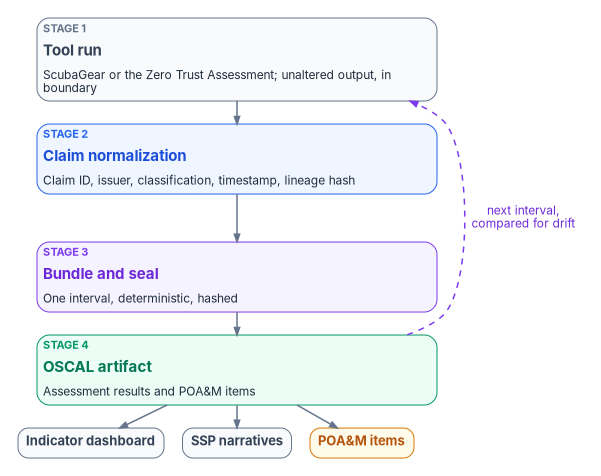
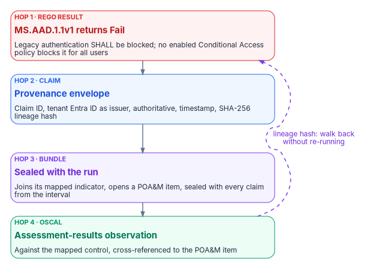

# Chapter 09 — Running the Assessment and Ingesting the Evidence

*A ScubaGear report that someone archives and rereads at audit time is a point-in-time opinion; the same output, wrapped with its provenance and sealed into a bundle an assessor can rebuild months later, is evidence.*

::: {.callout-note}
## In this chapter
How to prepare for an assessment run, run ScubaGear and the Zero Trust Assessment against a federal tenant, and handle their outputs. It then follows the outputs into the program's evidence chain: ScubaGear as a registered adapter, the claim each result becomes, the four-stage pipeline, interval evidence, the government-cloud boundary case and the drift classes a finding can raise, with one worked trace from a policy result to an OSCAL observation.
:::

[Chapter 05](05-two-assessment-tools.md) explains what the two tools measure and why an agency needs both. [Chapter 08](08-close-before-you-assess.md) explains why the BOD 25-01 findings are closed before the maturity assessment runs. This chapter is the run itself, and what happens to the output afterwards.

Most agencies already run ScubaGear. The usual pattern is that someone runs it, saves the HTML report, and opens it again when an assessor asks. The report is accurate on the day it is produced. What it lacks is everything an authorization package needs: a record of which tool version and which baseline version produced it, a link from each finding to the control it bears on, a way to show whether the finding is new or has been failing for a year, and a way for an assessor to confirm months later that the file in the package is the file the tool wrote. The program's answer is to treat each tool as an *adapter*, an input to one evidence chain, rather than as a freestanding report. The tools stay exactly as their publishers ship them. What changes is what happens to their output.

{#fig-ch09-evidence-pipeline fig-alt="Top to bottom, four cards joined by arrows. Stage 1, slate: the tool run, ScubaGear or the Zero Trust Assessment, writing its own unaltered output inside the boundary. Stage 2, blue: claim normalization, where each result is wrapped in a provenance envelope with a claim ID, issuer identity, source classification, extraction timestamp and lineage hash. Stage 3, violet: bundle assembly and seal, where claims from one run interval are assembled deterministically and hashed. Stage 4, green: the OSCAL artifact, assessment-results observations and plan of action and milestones items. Below stage 4, three outputs fan out: the dashboard of indicators, system security plan narratives, and POA&M items. A dashed violet arrow loops from stage 4 back to stage 1, labeled next interval, compared for drift."}

## Before the first run

Five things are decided before either tool touches a production tenant. Each is owned in [Chapter 07](07-who-owns-zero-trust.md).

**Scope.** BOD 25-01 required agencies to inventory their in-scope cloud tenants, with the tenant name and the owning agency or component, and to update the inventory in the first quarter of each fiscal year.[^c09-bod2501] That inventory is the scope list for ScubaGear. The Zero Trust Assessment's scope is wider (Microsoft Entra, Intune, Azure, Purview and more) and its coverage depends on connections, permissions and licenses, so its scope is written down per run, including which Azure subscriptions are tagged for its Infrastructure pillar.[^c09-zta-repo]

**The host.** ScubaGear runs only on Windows, because at least one of the Microsoft libraries it depends on is tied to Windows PowerShell 5.[^c09-scuba-deps] The Zero Trust Assessment needs PowerShell 7 and, for full coverage, Windows: on other platforms its SharePoint Online and Azure Information Protection checks are skipped.[^c09-zta-guide] Both tools pull tenant configuration onto the host that runs them. The program runs them on dedicated Windows hosts inside the authorization boundary, a separate clean host or session for each tool, because their PowerShell dependencies conflict and because the Zero Trust Assessment's guide recommends a dedicated virtual machine for that reason.[^c09-zta-guide] A shared, internet-hosted build runner is the wrong place for a file that maps a federal tenant's weaknesses.

**Accounts.** Each tool gets a dedicated reader account, approved by the CISO, with the roles in the table in Chapter 07. Consent for the tools' Microsoft Graph permissions is a separate, one-time act by an administrator authorized to grant it, and that administrator doesn't run the assessment.

**Output handling.** Microsoft warns that the Zero Trust Assessment's report and export folder contain sensitive tenant information that threat actors could use, and recommends storing the report securely and deleting the generated folder from the local drive once the assessment is complete.[^c09-zta-start] The program treats every output of both tools as Controlled data: written to a protected directory on the assessment host, moved to the evidence repository unaltered, and deleted from the host. Raw findings aren't published, and remediation guidance from either tool is advisory: changes go through normal change control.

**Logging.** The assessment accounts read every tenant they touch. OMB M-26-14 requires agencies to collect logs that identify the identity used for operations and every change to privilege levels, and to make logs readily available to the agency's top-level security operations center; retained logs must be searchable for at least six months and retrievable for a year.[^c09-m2614] The assessment accounts' sign-ins and consent grants are in that scope. CISA published the Logging Reference Architecture that M-26-14 called for on August 20, 2026,[^c09-cisa-lra] and the memo gives agencies 90 days from its release for the first Agency Logging Plan,[^c09-m2614] so the assessment hosts and accounts belong in that plan now.

## Running ScubaGear

ScubaGear is CISA's PowerShell assessor for Microsoft 365. It collects tenant configuration through Microsoft's APIs and evaluates it with Open Policy Agent against Rego policies written from the SCuBA secure configuration baseline documents. It is released under the CC0 license.[^c09-scuba-repo] The current release is v1.8.0, published May 7, 2026.[^c09-scuba-release] At that release it assesses Microsoft Entra ID, Defender for Office 365, Exchange Online, Power BI, Power Platform, SharePoint Online and OneDrive, and Microsoft Teams.[^c09-scuba-params]

::: {.callout-warning}
## Illustrative code
The commands in this chapter are illustrative. They haven't been tested against a production tenant. Check them against the documentation for the tool version you have pinned, and run them first against a test tenant with the narrow roles described in Chapter 07.
:::

Install from the PowerShell Gallery in a Windows PowerShell 5.1 session, then install the dependencies, which include OPA.[^c09-scuba-deps] At v1.8.0 the dependency command is `Initialize-SCuBA`; the development branch renames it `Install-ScubaDependencies` and keeps the old name as an alias.[^c09-scuba-deps]

```powershell
# Windows PowerShell 5.1, on the dedicated assessment host
Install-Module -Name ScubaGear
Initialize-SCuBA                      # installs module dependencies and OPA
Invoke-SCuBA -Version                 # record the version in the run log
```

For BOD 25-01 submissions, CISA's documentation calls for a configuration file and the organization's tenant name; other runs can silence the BOD warnings instead.[^c09-scuba-readme] A tenant in Microsoft 365 GCC uses the `gcc` environment value; `gcchigh` and `dod` cover the other government clouds.[^c09-scuba-params]

```powershell
# Assess all products against the agency's reviewed configuration file
Invoke-SCuBA -ConfigFilePath .\config\scuba-tenant01.yaml `
             -Organization 'agency.onmicrosoft.com' `
             -M365Environment gcc `
             -OutPath D:\Assessments\ScubaGear
```

The configuration file is where the agency's decisions about the baseline live: annotations that document an action plan for a failing control, omissions with a rationale and an optional expiration date, and exclusions for accounts such as emergency access accounts.[^c09-scuba-config] [Chapter 10](10-evidence-not-verdicts.md) covers who approves each kind of entry. Here the point is mechanical: the configuration file is an input to the run, so it is versioned in the program's repository and its hash is recorded with each run, exactly like the tool version.

Each run writes a new time-stamped directory.[^c09-scuba-reports]

| Output | What it is | How the program uses it |
|---|---|---|
| `BaselineReports.html` | Summary report, opened in a browser after the run | Human review only |
| `IndividualReports` | Detailed report per product | Human review only |
| `ScubaResults_{UUID}.json` | Run and tenant metadata, summary counts, every result and the raw provider output, in a format meant for downstream parsing | The evidence source the adapter reads |
| `ScubaResults.csv` | Results only, without metadata or raw output | Convenience copy |
| `ActionPlan.csv` | Failing SHALL controls only, with fields for failure reasons and remediation timelines | Seed for the plan of action and milestones ([Chapter 10](10-evidence-not-verdicts.md)) |

The JSON file is the one that matters. It carries each control's ID, requirement text, result, criticality and details, and, for annotated or omitted controls, the original result and the comments.[^c09-scuba-schema] CISA's implementation guidance asks agencies that report manually through CyberScope to submit this file without changing the file name ScubaGear produced.[^c09-bod2501-guide] The program applies the same rule to its own evidence: the file is never edited, renamed or regenerated, only hashed and copied.

**Reporting to CISA.** BOD 25-01 required agencies to deploy the SCuBA assessment tools and report results to CISA, either through integration with CISA's continuous monitoring solution or quarterly in a CISA-approved machine-readable format.[^c09-bod2501] The implementation guidance describes four routes: CISA-hosted ScubaConnect, self-hosted ScubaConnect, an agency-hosted integration through CLAW or TALON, and manual quarterly upload through CyberScope ([Chapter 04](04-scuba-and-bod-25-01.md)).[^c09-bod2501-guide] ScubaConnect is CISA's cloud-native infrastructure, provided as Terraform, that automates ScubaGear and its Google Workspace counterpart across many tenants.[^c09-scubaconnect] The evidence chain in this chapter is separate from that reporting and doesn't replace it. Both read the same output.

**Google Workspace.** SCuBA isn't only Microsoft 365. CISA's BOD 25-01 Required Configurations page now lists Google Workspace baselines, with a due date of December 1, 2026,[^c09-bod2501-rc] and ScubaGoggles, the Workspace assessor, reached version 1.0.0 on July 24, 2026.[^c09-scubagoggles] The program's adapter registry has no ScubaGoggles entry. That is a real coverage gap for any agency with a Workspace tenant in BOD 25-01 scope, and the program states it rather than registering an adapter that hasn't been built.

## Running the Zero Trust Assessment

Microsoft's Zero Trust Assessment checks hundreds of configuration items, drawn from Microsoft's published guidance for Entra, Intune, Azure networking and Purview, against the Secure Future Initiative and the Zero Trust pillars.[^c09-zta-overview] Two facts about it shape how the program uses it. It is a community project maintained by Microsoft employees, not an official Microsoft product, and it isn't supported through any Microsoft support program.[^c09-zta-repo] And it changes quickly: release 2.6.0 introduced a redesigned report and seven default pillars (Identity, Devices, Network, Data, Infrastructure, SecOps and AI), and release 3.1.0 shipped on October 20, 2026.[^c09-zta-guide][^c09-zta-release] Its source tracks the newest dependencies: the current guide asks for PowerShell 7.6 or later, while published packages can differ.[^c09-zta-guide] The version is pinned per run, and a version change is reviewed before the score is compared with an earlier one.

```powershell
# PowerShell 7, on a separate clean session or host from ScubaGear
Install-PSResource -Name ZeroTrustAssessment -Scope CurrentUser
Connect-ZtAssessment -Tenant agency.onmicrosoft.com
Invoke-ZtAssessment -Path D:\Assessments\ZTA\2026-10-21 -DisableTelemetry
```

Microsoft Learn shows `Install-Module` for the same package and the default output path `.\ZeroTrustReport\ZeroTrustAssessmentReport.html`; `-Path` sets a custom location.[^c09-zta-start] `Connect-ZtAssessment` connects separately to Microsoft Graph, Azure, Exchange Online, Security & Compliance, SharePoint Online and Azure Information Protection, and a successful Graph connection doesn't grant access to the others.[^c09-zta-guide] A Microsoft 365 GCC tenant uses the default `Global` environment, because GCC uses the worldwide Microsoft Graph and Azure portal endpoints; GCC High and DoD tenants use their own.[^c09-graph-clouds][^c09-zta-connect] `-DisableTelemetry` suppresses a telemetry event that otherwise carries the tenant ID;[^c09-zta-guide] whether to use it is the CISO's decision when approving the tool ([Chapter 07](07-who-owns-zero-trust.md)).

Microsoft warns that the assessment can take more than 24 hours on a large tenant and shouldn't be stopped even if it logs warnings or errors.[^c09-zta-start] Its outputs are:[^c09-zta-guide]

| Output | What it is | How the program uses it |
|---|---|---|
| `ZeroTrustAssessmentReport.html` | Redesigned report with an overview and one tab per pillar | Human review; the program's dashboard reads the report data inside it |
| `ZeroTrustAssessmentReport-classic.html` | Classic report | Human review |
| `zt-export\ZeroTrustAssessmentReport.json` | Report data | The evidence source the adapter reads |
| `zt-export\ZeroTrustWorkshop.json` | Experimental import for Microsoft's Zero Trust Workshop | Optional planning input |
| `zt-export\` (database, exported entities, logs) | Assessment data, not just logs | Retained only as the records decision allows; contains sensitive tenant data |

Each result carries a status (Passed, Failed, Investigate, Skipped, Planned or Error) and a risk rating.[^c09-zta-status] [Chapter 10](10-evidence-not-verdicts.md) explains which of those are findings. The one rule that matters at ingestion is that a skipped check is not a pass. The tool's own guide says that missing prerequisites can produce skipped checks, "not evidence that the tenant meets a recommendation."[^c09-zta-guide]

## ScubaGear as a registered adapter

In the program's substrate, ScubaGear is the registered conformance and policy adapter for Microsoft 365. Its declaration in the adapter registry (excerpt; the full entry adds the policy-engine pin, scope, outputs, controls and invariants) reads:

```yaml
- id: scubagear
  name: CISA ScubaGear (M365 SCuBA Assessor)
  class: conformance
  mission-class: policy
  status: active
  phase: phase-1
  vendor: CISA
  license: CC0-1.0
  runtime: windows-powershell-5.1
  runtime-version: "1.8.0"
  runner-class: github-hosted
  tenancy: per-customer
  evidence-class: interval
  retention-years: 3
```

The `runtime` value is not cosmetic: a Linux runner can't execute ScubaGear at all, so the runner is Windows. The program's reading of `runner-class: github-hosted` is "a Windows runner driven by the repository's workflow," and for a production federal tenant that runner is one the agency controls inside its boundary, for the output-handling reasons above.

Five properties of the declaration matter to an authorizing official.

1. **`class: conformance`.** ScubaGear observes; it doesn't change tenant state. Its evidence is read-only.
2. **`mission-class: policy`.** It evaluates state against policies, the SCuBA Rego baselines, which distinguishes it from adapters that only collect telemetry.
3. **`gcc-boundary: gcc-moderate`** (a registry invariant). The adapter is designed to run against a tenant in the GCC Moderate boundary, and treats the boundary's effect on what it can see explicitly.
4. **`evidence-class: interval`.** Findings carry a time interval, not a single instant, and the claim preserves it.
5. **`retention-years: 3`.** Retention is set in the registry, not by an operator. It is the program's default; the records officer's schedule governs where it differs.

Registration means the substrate's drift engine governs the adapter itself: a ScubaGear configuration that emits outside its declared envelope raises `DRIFT-AUTHZ`, and a registry edit that breaks the schema raises `DRIFT-SCHEMA` in continuous integration.

## From policy results to claims

ScubaGear's results per policy are Pass, Fail, Warning (a failed SHOULD policy), N/A (typically a manual check), Omitted, Incorrect Result and Error, each with a criticality of SHALL or SHOULD.[^c09-scuba-schema] The adapter wraps each result in the program's provenance envelope and maps it to the program's control and indicator rules through the mapping table held in the program's canon. Three properties follow.

**Every result is a claim.** Each result carries `claim_id`, `issuer_identity`, `source_classification`, `extraction_timestamp` and `lineage_hash`. No raw ScubaGear result floats outside the chain: Pass, Fail, Warning and N/A results all become claims, so the record shows what passed as well as what failed.

**The mapping lives in canon, not in adapter code.** Which control a SCuBA policy bears on is a reviewed, schema-validated registry entry. An adapter author can't silently remap a policy. CISA publishes its own mapping of every SCuBA policy to NIST SP 800-53 Rev. 5 controls in the FedRAMP High baseline,[^c09-scuba-mappings] and the program's table starts from it.

**The interval is preserved.** ScubaGear runs on an interval: on demand, on a schedule or on a dispatched event. Each run's claims carry the interval, and the bundle respects it. `evidence-class: interval` is an attribute the OSCAL emission consumes, not a hint.

## The four-stage pipeline

```text
tool run  ->  claim normalization  ->  bundle assembly and seal  ->  OSCAL artifact
```

ScubaGear is one of the inputs at stage 1 for a Microsoft 365 deployment. Its claims feed four things downstream: the indicator dashboard for the Microsoft 365 controls SCuBA covers; the system security plan narratives for Microsoft 365 control implementation; plan of action and milestones items when a result fails outside an accepted exception; and component definition evidence for Microsoft 365 components. OSCAL, NIST's machine-readable assessment format, has models for each: assessment results record when an assessment ran, its scope, the evidence and the findings, for periodic or continuous assessments, and the plan of action and milestones model tracks the findings the system owner must address.[^c09-oscal]

The bundle is deterministic. The same tenant state, the same SCuBA policy version and the same canon version produce a byte-identical bundle, so an assessor can re-run the assembly months after the original audit and check the bundle hash. That property is the difference between evidence and an assertion: per-tool evidence that can't be re-executed is a claim someone made once.

**What ScubaGear sees, and what it doesn't.** ScubaGear evaluates configuration in the Microsoft 365 tenant, the cloud half of the identity picture. The on-premises half comes from the program's Active Directory survey adapter, which produces the readiness bundle and its phase-tagged service principal name inventory ([Book 02, Chapter 08](../b02-identity/08-assessing-the-forest.md)). Both emit into the same evidence bundle, so together they describe the identity posture the agency carries through the move from Active Directory to Microsoft Entra ID, not just the cloud baseline on one day. The bounded claim is the honest one: ScubaGear is the configuration-conformance evidence source for the Microsoft 365 components in the boundary. Detecting and investigating intrusions needs more than configuration evidence, which is why its claims meet the drift engine and the logs security operations holds.

## Interval evidence

An adapter declared `evidence-class: interval` behaves differently from a point-in-time one.

- The bundle can state windowed conformance: for example, that a policy passed in every interval of the quarter except one week, which is tracked as a plan of action and milestones item.
- Drift findings detect trend changes, not just point changes. A control that passed every interval and fails one is a different finding from one that has always failed.
- Determinism holds per interval: re-running a given interval reproduces that interval's bundle.

This is what lets a package built on ScubaGear carry continuous-conformance language honestly. It doesn't make ScubaGear continuous. It runs on an interval, and continuous event-time capture across every adapter is target-state maturity for the substrate.

## The government-cloud boundary case

ScubaGear reads tenant state through the APIs the tenant's own cloud exposes, which has four consequences in the program's boundary model.

- **Telemetry fidelity.** ScubaGear reads the configuration state the boundary exposes, which is most of what its policies evaluate, since the SCuBA baselines target configuration rather than cloud-only telemetry features.
- **Identity authority.** The issuer identity for SCuBA claims is the tenant's identity plane, resolved in the boundary.
- **Enforcement responsibility.** ScubaGear observes; it doesn't enforce. Where enforcement is needed, a compensating-enforcement adapter is a separate registry entry with its own evidence.
- **Provenance classification.** SCuBA claims are `authoritative` for configuration state and `derived` for any value computed from tenant data.

The Zero Trust Assessment is a different case. Many of its checks depend on premium licenses and features, and feature availability in Microsoft's government clouds is defined as differences from the commercial service descriptions.[^c09-gcc] A check that is skipped because a feature isn't available or authorized in the boundary is recorded as a boundary finding, not as a failed control and not as a pass. [Book 10](../b10-cloud-boundary/index.md) covers the boundary model in full.

## Drift: what a finding can raise

ScubaGear claims map onto the substrate's drift classes as follows. The classes and severities are the program's drift standard.

| SCuBA finding pattern | Drift class | Default severity |
|---|---|---|
| Tenant configuration drifts from a baseline that previously passed | `DRIFT-SCHEMA` or `DRIFT-SEMANTIC`, depending on whether the structure or the value drifted | P3; P2 if the drift affects a live indicator |
| A SCuBA claim emitted without a complete provenance envelope | `DRIFT-PROVENANCE` | P1: claim integrity is load-bearing |
| Conditional Access state contradicts the authentication assurance recorded for the user population | `DRIFT-AUTHZ` | P1: authorization integrity is load-bearing |
| A principal named in a SCuBA finding can't be resolved in the identity plane | `DRIFT-IDENTITY` | P1: identity attribution is load-bearing |

The same standard catalogs four drift conditions specific to service principal names that surface when the Active Directory inventory is compared across migration phases. ScubaGear evidence and that inventory join in the same bundle the assessor reads. Neither alone describes the identity posture; together they can be compared interval by interval.

## A worked trace: one finding, four hops

The claim abstraction is easier to trust with a concrete walk-through. What follows is an **illustrative worked example**, not a historical finding: a representative SCuBA check traced through the four stages.

{#fig-ch09-worked-trace fig-alt="Top to bottom, four numbered cards joined by arrows. Hop 1, red: the Rego policy result, MS.AAD.1.1v1, legacy authentication shall be blocked, returns Fail because no enabled Conditional Access policy blocks legacy authentication for all users. Hop 2, blue: the canonical claim, with a claim ID, the tenant's Entra ID as issuer identity, source classification authoritative, an extraction timestamp and a SHA-256 lineage hash over the raw result. Hop 3, violet: the evidence bundle, where the claim lands in the run's findings, joins the indicator its control maps to, opens a POA&M item and is sealed with every other claim from the run. Hop 4, green: the OSCAL artifact, an assessment-results observation against the mapped control, cross-referenced to the POA&M item. A dashed arrow from hop 4 back to hop 1 is labeled lineage hash: walk back without re-running the tool."}

1. **Rego policy result.** A ScubaGear run evaluates `MS.AAD.1.1v1`, "Legacy authentication SHALL be blocked," a SHALL policy that CISA maps to NIST SP 800-53 control CM-7.[^c09-scuba-aad] The check reads the tenant's Conditional Access policies. Say it returns `Fail` because no enabled policy blocks legacy authentication for all users.
2. **Claim.** The adapter wraps the raw result in the provenance envelope: a `claim_id` of the form `urn:fmp:claim:m365:scuba-policy:{uuid}`, `issuer_identity` resolved to the tenant's Microsoft Entra ID identity plane, `source_classification: authoritative` (SCuBA claims are authoritative for configuration state), an `extraction_timestamp` for the run, and a `lineage_hash`, a SHA-256 hash over the raw result, so the claim traces back to the exact output it came from.
3. **Evidence bundle.** The claim lands in the run's findings for that interval, joins the indicator entry its control maps to, and, because it fails outside any accepted exception, opens a plan of action and milestones item. Bundle assembly seals it with every other claim from the run.
4. **OSCAL artifact.** The sealed bundle emits an OSCAL assessment-results observation against the mapped control, cross-referenced to the open plan of action and milestones item. An assessor reviewing the package months later can re-run the assembly for that interval and get the same bundle hash, and can use the lineage hash to walk back from the observation to the raw result without re-running ScubaGear.

Every result in a real run, whether Pass, Fail, Warning or N/A, takes the same four hops. `MS.AAD.1.1v1` is a stand-in for the class. It is also on CISA's list of mandatory BOD 25-01 configurations,[^c09-bod2501-rc] which is why [Chapter 08](08-close-before-you-assess.md) expects it closed before the maturity assessment, and why a `Fail` here, in a real run, is a directive gap before it is a maturity finding.

## Ingesting the Zero Trust Assessment

The program's toolkit reads the report data inside the Zero Trust Assessment's HTML report, or its JSON export, so no separate export step is needed, and produces three kinds of output: a dashboard workbook and a Power BI-ready CSV, a set of lighter digests, and a remediation playbook with a tracker. [Chapter 10](10-evidence-not-verdicts.md) explains how the dashboard scores and ranks findings. This section is how to produce them.

::: {.callout-important}
## Install the toolkit from the program's repository, not from PyPI
The toolkit provides the `fmp` command and needs Python 3.11 or later, PowerShell 7 and the `openpyxl` and `matplotlib` packages. Install it from the program's own repository. A package named `fmp` on the public Python Package Index is an unrelated third-party project, a Python import formatter,[^c09-pypi-fmp] so a plain `pip install fmp` against the public index installs someone else's code on a host that holds tenant data. Verify any downloaded script against its published SHA-256 hash before running it.
:::

```powershell
# Confirm the program toolkit is the one on PATH
fmp --version
fmp zta --help

# Dashboard workbook, chart images and Power BI CSV
fmp zta dashboard --input D:\Assessments\ZTA\2026-10-21\ZeroTrustAssessmentReport.html `
                  --out-dir D:\Assessments\ZTA\2026-10-21\dashboard

# Executive summary, Markdown and worklist digests
fmp zta digest --input D:\Assessments\ZTA\2026-10-21\ZeroTrustAssessmentReport.html `
               --out-dir D:\Assessments\ZTA\2026-10-21\digest

# Per-finding remediation playbook and tracker
fmp zta remediate --input D:\Assessments\ZTA\2026-10-21\ZeroTrustAssessmentReport.html `
                  --out-dir D:\Assessments\ZTA\2026-10-21\remediation
```

The program's wrapper script, `Invoke-ZtDashboard.ps1`, calls the same toolkit and falls back to `python -m fmp.cli.app` when the `fmp` command isn't on the path.

| Parameter | Type | Default | Purpose |
|---|---|---|---|
| `-ReportPath` | string | required | The `ZeroTrustAssessmentReport.html` or JSON export; falls back to the `FMP_REPORTPATH` environment variable |
| `-OutputDirectory` | string | `./zt-dashboard` | Where the workbook, charts and CSV go; falls back to `FMP_OUTPUT` |
| `-CheckPrereqs` | switch | off | Checks PowerShell 7, Python 3.11, the toolkit and the Microsoft Graph context, if the program's `FMP.ConfigTools` module is installed |
| `-EnableLogging` | switch | off | Writes a timestamped transcript under the output directory's `logs` folder, if `FMP.ConfigTools` is installed |

```powershell
# Install the shared module from the program's kit, then run with checks and logging
$dest = "$env:USERPROFILE\Documents\PowerShell\Modules\FMP.ConfigTools"
Copy-Item .\fmp-cli\scripts\FMP.ConfigTools $dest -Recurse -Force

.\Invoke-ZtDashboard.ps1 -ReportPath D:\Assessments\ZTA\2026-10-21\ZeroTrustAssessmentReport.html `
    -CheckPrereqs -EnableLogging

Get-FileHash .\Invoke-ZtDashboard.ps1 -Algorithm SHA256   # compare with the published hash
```

| Symptom | Fix |
|---|---|
| `fmp: command not found` | The toolkit isn't installed or active; install it from the program's repository, or let the wrapper fall back to `python -m fmp.cli.app` |
| Unicode or `cp1252` errors in the console | Set `$env:PYTHONUTF8 = 1` before running, or use PowerShell 7 |
| `could not locate an embedded reportData object` | The input isn't a Zero Trust Assessment report; point `-ReportPath` at the real report HTML or a JSON export |

The playbook gives portal steps and Microsoft Learn links only, no scripts. For each failed check it names the admin console the fix lives in, the check's remediation steps, its Microsoft Learn references and deep links to the failing objects; `--status Investigate` adds manual-review items. The tracker has blank `Status`, `Owner` and `Notes` columns for the pillar owners to work.

The dashboard and digests are working views. The evidence is the unaltered report and its JSON export, wrapped and sealed through the same four stages as ScubaGear's output, with the tool version, run time and scope recorded.

## Honest limits

- ScubaGear's coverage is per policy. It evaluates the SCuBA baselines, not every Microsoft 365 control. The program's adapter taxonomy has other slots (vulnerability scanning, STIG compliance, patch state) for the rest; ScubaGear is the policy adapter, not the universal one.
- Both tools run on an interval. Continuous capture across every adapter is target-state maturity.
- The mapping from SCuBA policies to the program's rules is curated. Mapping a new SCuBA policy is a canon change, not an adapter edit.
- Google Workspace isn't covered: the registry has no ScubaGoggles adapter.
- The Zero Trust Assessment is a community project that changes fast. A score from one version isn't directly comparable with a score from another without review.

::: {.callout-tip}
## Continue the book
[← Previous: Chapter 08 — Close Before You Assess](08-close-before-you-assess.md) · [Book index](index.md) · [Next: Chapter 10 — Evidence, Not Verdicts: From Findings to a Program →](10-evidence-not-verdicts.md)
:::

[^c09-bod2501]: Cybersecurity and Infrastructure Security Agency, BOD 25-01, *Implementing Secure Practices for Cloud Services*, December 17, 2024, "Required Actions," <https://www.cisa.gov/news-events/directives/bod-25-01-implementing-secure-practices-cloud-services> (accessed Oct 21, 2026).
[^c09-zta-repo]: Microsoft, Zero Trust Assessment repository, README, sections "What the assessment covers" and "Infrastructure Pillar Scope," <https://github.com/microsoft/zerotrustassessment> (accessed Oct 21, 2026).
[^c09-scuba-deps]: Cybersecurity and Infrastructure Security Agency, ScubaGear documentation, "Dependencies," v1.8.0 <https://github.com/cisagov/ScubaGear/blob/v1.8.0/docs/prerequisites/dependencies.md> and development branch <https://github.com/cisagov/ScubaGear/blob/main/docs/prerequisites/dependencies.md> (accessed Oct 21, 2026).
[^c09-zta-guide]: Microsoft, Zero Trust Assessment repository, "Run the Zero Trust Assessment" (PowerShell guide), sections "Prerequisites," "Data handling and telemetry," "Connect to Microsoft 365 and Azure services" and "Review assessment results," <https://github.com/microsoft/zerotrustassessment/blob/main/src/powershell/doc/readme.md> (accessed Oct 21, 2026).
[^c09-zta-start]: Microsoft Learn, "Get started with the Zero Trust Assessment," sections "Install the PowerShell modules" and "Run the assessment," <https://learn.microsoft.com/security/zero-trust/assessment/get-started> (accessed Oct 21, 2026).
[^c09-m2614]: Office of Management and Budget, M-26-14, *Ensuring Effective and Efficient Agency Logging and Network Visibility to Defend Against Evolving Cyber Threats*, May 22, 2026, "Agency Logging Plan," "Agency Actions" and Appendix B (Minimum Logging Baseline Requirements, items 1, 2 and 5), <https://www.whitehouse.gov/wp-content/uploads/2026/05/M-26-14-Ensuring-Effective-and-Efficient-Agency-Logging-and-Network-Visibility-to-Defend-Against-Evolving-Cyber-Threats.pdf> (accessed Oct 21, 2026).
[^c09-cisa-lra]: Cybersecurity and Infrastructure Security Agency, "Logging Reference Architecture," <https://www.cisa.gov/logging> (accessed Oct 21, 2026).
[^c09-scuba-repo]: Cybersecurity and Infrastructure Security Agency, ScubaGear repository, README, <https://github.com/cisagov/ScubaGear> (accessed Oct 21, 2026).
[^c09-scuba-release]: Cybersecurity and Infrastructure Security Agency, ScubaGear release v1.8.0, May 7, 2026, <https://github.com/cisagov/ScubaGear/releases/tag/v1.8.0> (accessed Oct 21, 2026).
[^c09-scuba-params]: Cybersecurity and Infrastructure Security Agency, ScubaGear v1.8.0 documentation, "Parameters," sections "M365Environment" and "ProductNames," <https://github.com/cisagov/ScubaGear/blob/v1.8.0/docs/configuration/parameters.md> (accessed Oct 21, 2026).
[^c09-scuba-readme]: Cybersecurity and Infrastructure Security Agency, ScubaGear v1.8.0 README, "Run with a configuration file," <https://github.com/cisagov/ScubaGear/blob/v1.8.0/README.md> (accessed Oct 21, 2026).
[^c09-scuba-config]: Cybersecurity and Infrastructure Security Agency, ScubaGear v1.8.0 documentation, "Configuration File," sections "Annotate Policies," "Omit Policies" and "Entra ID Configuration," <https://github.com/cisagov/ScubaGear/blob/v1.8.0/docs/configuration/configuration.md> (accessed Oct 21, 2026).
[^c09-scuba-reports]: Cybersecurity and Infrastructure Security Agency, ScubaGear v1.8.0 documentation, "Reports," <https://github.com/cisagov/ScubaGear/blob/v1.8.0/docs/execution/reports.md> (accessed Oct 21, 2026).
[^c09-scuba-schema]: Cybersecurity and Infrastructure Security Agency, ScubaGear documentation, "Tool Output Schema," Summary, Annotation and Control objects, <https://github.com/cisagov/ScubaGear/blob/main/docs/misc/tooloutputschema.md> (accessed Oct 21, 2026).
[^c09-bod2501-guide]: Cybersecurity and Infrastructure Security Agency, *BOD 25-01 Implementation Guidance: Implementing Secure Practices for Cloud Services*, reporting options and CyberScope submission, <https://www.cisa.gov/news-events/directives/bod-25-01-implementation-guidance-implementing-secure-practices-cloud-services> (accessed Oct 21, 2026).
[^c09-scubaconnect]: Cybersecurity and Infrastructure Security Agency, ScubaConnect repository, README, <https://github.com/cisagov/ScubaConnect> (accessed Oct 21, 2026).
[^c09-bod2501-rc]: Cybersecurity and Infrastructure Security Agency, "BOD 25-01: Implementing Secure Practices for Cloud Services — Required Configurations," Microsoft 365 and Google Workspace tables, <https://www.cisa.gov/resources-tools/services/bod-25-01-implementing-secure-practices-cloud-services-required-configurations> (accessed Oct 21, 2026).
[^c09-scubagoggles]: Cybersecurity and Infrastructure Security Agency, ScubaGoggles release v1.0.0, July 24, 2026, <https://github.com/cisagov/ScubaGoggles/releases/tag/v1.0.0> (accessed Oct 21, 2026).
[^c09-zta-overview]: Microsoft Learn, "What is the Zero Trust Assessment?," <https://learn.microsoft.com/security/zero-trust/assessment/overview> (accessed Oct 21, 2026).
[^c09-zta-release]: Microsoft, Zero Trust Assessment release 3.1.0, October 20, 2026, <https://github.com/microsoft/zerotrustassessment/releases/tag/3.1.0> (accessed Oct 21, 2026).
[^c09-graph-clouds]: Microsoft Learn, "Microsoft Graph national cloud deployments," section "Microsoft Graph and Graph Explorer service root endpoints," <https://learn.microsoft.com/graph/deployments> (accessed Oct 21, 2026).
[^c09-zta-connect]: Microsoft, Zero Trust Assessment repository, `Connect-ZtAssessment.ps1`, `-Environment` parameter values, <https://github.com/microsoft/zerotrustassessment/blob/main/src/powershell/public/Connect-ZtAssessment.ps1> (accessed Oct 21, 2026).
[^c09-zta-status]: Microsoft, Zero Trust Assessment repository, `Get-ZtTestResultStatus.ps1` and `Add-ZtTestResultDetail.ps1`, <https://github.com/microsoft/zerotrustassessment/tree/main/src/powershell/private/core> (accessed Oct 21, 2026).
[^c09-scuba-mappings]: Cybersecurity and Infrastructure Security Agency, ScubaGear v1.8.0 documentation, "Mappings," and `scuba-to-nist-sp-800-53-r5-fedramp-high.csv`, <https://github.com/cisagov/ScubaGear/blob/v1.8.0/docs/misc/mappings.md> (accessed Oct 21, 2026).
[^c09-oscal]: National Institute of Standards and Technology, OSCAL, "Layers and Models Reference," Assessment layer, <https://pages.nist.gov/OSCAL/learn/concepts/layer/> (accessed Oct 21, 2026).
[^c09-gcc]: Microsoft Learn, "Office 365 GCC," section "How to use this service description," <https://learn.microsoft.com/office365/servicedescriptions/office-365-platform-service-description/office-365-us-government/gcc> (accessed Oct 21, 2026).
[^c09-scuba-aad]: Cybersecurity and Infrastructure Security Agency, ScubaGear v1.8.0, *Microsoft Entra ID Secure Configuration Baseline*, policy MS.AAD.1.1v1, <https://github.com/cisagov/ScubaGear/blob/v1.8.0/PowerShell/ScubaGear/baselines/aad.md> (accessed Oct 21, 2026).
[^c09-pypi-fmp]: Python Package Index, "fmp" project page, <https://pypi.org/project/fmp/> (accessed Oct 21, 2026).
