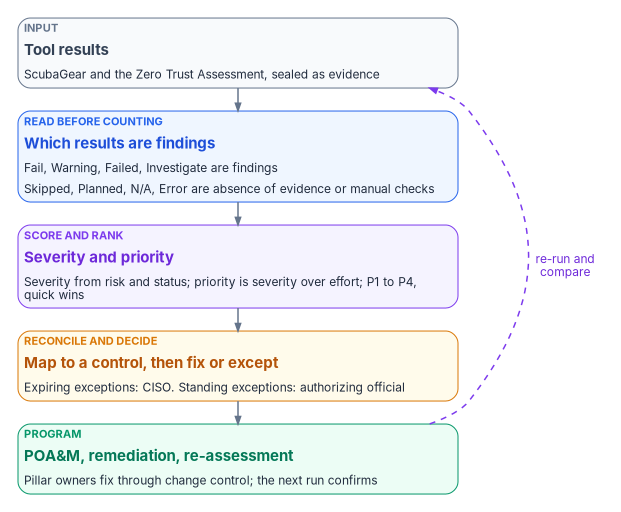
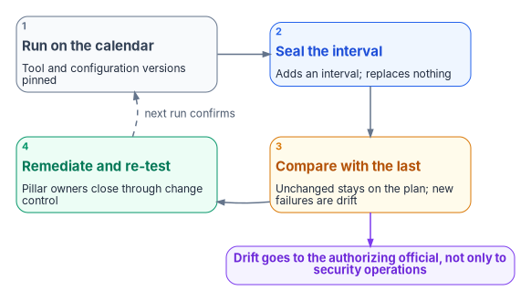

# Chapter 10 — Evidence, Not Verdicts: From Findings to a Program

*An assessment tool can tell an agency what its configuration looked like on the day it ran; only the agency can decide what that means, what to fix first, and what risk it is willing to carry, and a program that lets the score make those decisions has handed its governance to a report.*

::: {.callout-note}
## In this chapter
How to read the two tools' results before counting them, which results are findings and which are absence of evidence, how the program scores and ranks findings, and where exceptions belong. It then turns the worklist into a program: plans of action and milestones, the pillar-by-pillar contribution of a shared evidence substrate, the evidence properties Advanced and Optimal maturity need, drift as continuous verification, re-assessment, and what an agency can do this quarter.
:::

[Chapter 09](09-running-the-assessment.md) ends with sealed evidence: each tool's unaltered output wrapped in provenance and emitted as OSCAL. This chapter is what the agency does with it. The book's argument shapes the answer. Zero Trust maturity is a property of the whole agency ([Chapter 01](01-a-whole-agency-property.md)); Governance is the cross-cutting capability programs shortchange ([Chapter 02](02-governance-principles.md)); and each tool is an evidence input reconciled at the control level, not a verdict ([Chapter 05](05-two-assessment-tools.md)). A Zero Trust Assessment overview isn't a maturity stage, and a clean ScubaGear report isn't an authorization. Both are inputs to decisions that belong to named people ([Chapter 07](07-who-owns-zero-trust.md)).

The program's assessment method has five steps, whatever tools feed it:

1. Collect signals from directory, endpoint, network and application telemetry, and from the assessment tools.
2. Map each signal to a pillar and a maturity stage.
3. Identify gaps where evidence is missing or contradictory.
4. Prioritize remediation by residual risk and dependency.
5. Re-assess on a defined cadence.

The value is in the evidence trail, not the score alone.

{#fig-ch10-finding-to-program fig-alt="Top to bottom, five cards joined by arrows. First, slate: tool results from ScubaGear and the Zero Trust Assessment. Second, blue: read before counting; only Fail, Warning, Failed and Investigate are findings, while Skipped, Planned and N/A are recorded as absence of evidence or manual checks. Third, violet: score and rank, with severity from risk and status and priority from severity divided by effort, giving P1 to P4 and quick wins. Fourth, amber: reconcile and decide, mapping each finding to a control, and either remediating it or recording an exception in the configuration file, with expiring exceptions approved by the CISO and standing ones by the authorizing official. Fifth, green: the program, plans of action and milestones per system, pillar owners remediating through change control, and re-assessment. A dashed violet arrow loops from the program back to the tool results, labeled re-run and compare."}

## Read the result before counting it

The two tools use different words for the same outcomes, and some of their outcomes aren't findings at all.

**ScubaGear.** Each policy result is one of Pass, Fail, Warning, N/A, Omitted, Incorrect Result or Error, and each policy's criticality is SHALL or SHOULD, with variants for policies that can be met by a third-party service or aren't yet implemented in the tool.[^c10-scuba-schema] The summary counts make the split explicit: *Failures* counts failed SHALL policies, *Warnings* counts failed SHOULD policies, and *Manual* counts checks the tool couldn't assess automatically.[^c10-scuba-schema]

| ScubaGear result | What it means | How the program treats it |
|---|---|---|
| Fail | A SHALL policy isn't met | A finding; if the policy is on BOD 25-01's mandatory list, a directive gap first ([Chapter 08](08-close-before-you-assess.md)) |
| Warning | A SHOULD policy isn't met | A finding at lower default priority |
| N/A | Typically a manual check | A work item for the pillar owner to verify by hand; not a pass |
| Omitted | Excluded by the configuration file | Not a finding, but the omission itself is a decision with an owner and an expiry |
| Incorrect Result | Marked wrong by the configuration file | Not a finding, but a reviewed claim that the tool is wrong, with the original result kept |
| Error | The tool couldn't evaluate the policy | Absence of evidence; fix the run and re-run |
| Pass | The policy is met | Evidence of conformance for that interval |

**Zero Trust Assessment.** Each check returns Passed, Failed, Investigate, Skipped, Planned or Error.[^c10-zta-status] Skipped covers checks that couldn't run because a service wasn't connected, a license wasn't present, a feature wasn't supported, the check didn't apply or it timed out; Planned is a check marked as still under construction.[^c10-zta-status]

| Zero Trust Assessment status | How the program treats it |
|---|---|
| Failed | A finding |
| Investigate | A finding that needs manual review before it is confirmed or dismissed |
| Skipped | Not a gap and not a pass: absence of evidence, recorded with the reason |
| Planned | A check Microsoft hasn't implemented yet; ignored |
| Error | Absence of evidence; fix the connection or permission and re-run |
| Passed | Evidence of conformance for that run |

The program's dashboard recomputes outcomes from the per-check results rather than reading the report's own summary block, because in the program's testing the summary didn't reconcile with the checks beneath it.

### Absence of evidence is a different claim

A skipped check is the easiest result to misread. The Zero Trust Assessment's guide says that missing prerequisites can produce skipped checks, not evidence that the tenant meets a recommendation, and that permission errors should be investigated rather than treated as security failures.[^c10-zta-guide] Many checks need premium licenses, flagged in the dashboard's applicability column. In a government-cloud tenant some of those capabilities may not be available or authorized, since feature availability there is defined by its differences from the commercial service.[^c10-gcc] So a "skipped" or "failed" premium check may not be a real gap. Confirm the license applies in the boundary before scoring it as one.

The same discipline applies when results go into any authorization package. Scoring an unavailable capability as a failed control overstates the gap; scoring it as a pass overstates the posture. The program records it as what it is: absence of evidence, with the boundary or licensing reason attached, which is a boundary finding for [Book 10](../b10-cloud-boundary/index.md) rather than a control failure.

## Score and rank the findings

Only the findings (ScubaGear Fail and Warning; Zero Trust Assessment Failed and Investigate) get scored. The scoring is the program's method, documented on the dashboard's Methodology sheet so anyone can check it.

- **Severity, 0 to 100**, is the check's risk weighted by its status, so a failed high-risk check outranks an Investigate item of the same risk.
- **Priority** is severity divided by effort, so a high-severity, low-effort check (a quick win) outranks a high-severity, high-effort one.
- **Buckets** are P1 at 50 or above, P2 at 30 or above, P3 at 15 or above, and P4 above zero.

The Zero Trust Assessment supplies the inputs. Microsoft rates each recommendation on three scales: Risk Level (High means potential environment-wide exposure until mitigated; Low means defense in depth or an operational optimization), User Impact (how many non-privileged users have to act or be told) and Implementation Cost (from targeted actions to programs that need ongoing commitment).[^c10-zta-glossary] The program uses Risk Level for severity and Implementation Cost for effort. User Impact doesn't change the rank; it changes the communications plan and the change window.

The dashboard workbook lays the worklist out for a team:

| Sheet or output | What it holds |
|---|---|
| Dashboard | Four charts: status, findings by pillar, a pillar-by-risk heatmap, and a severity-by-effort remediation quadrant |
| Findings | The worklist, sorted P1 first, color-scaled by severity |
| By Pillar | Findings grouped by pillar |
| All Tests | Every check, including passes and skips |
| Methodology | The scoring, written out |
| Power BI CSV | One row per check with severity, priority, applicability and license columns |

The remediation quadrant splits findings into quick wins (high severity, low effort, top left) and major projects (high severity, high effort, top right). Quick wins go into the next change window. Major projects go into a pillar owner's roadmap with a funded milestone.

**Power BI.** In Power BI Desktop, choose Get Data, then Text/CSV, and select the CSV. It is already one row per check, so visuals build directly: a matrix of `Pillar` by `Status`, a bar of `PriorityBucket`, or a card counting rows where `IsFinding` is `yes`. Useful measures are the count of findings, average `SeverityScore` by `Pillar`, and P1 count by `Pillar`. The CSV is assessment output and gets the same Controlled handling as the report.

## Reconcile at the control, not tool to tool

The two tools use different identifiers (ScubaGear policy IDs such as `MS.AAD.1.1v1`; Zero Trust Assessment numeric test IDs) and different severity models (SHALL and SHOULD; risk levels). Matching one tool's output to the other's directly doesn't work. The program reconciles both against a common spine: the specific tenant setting and the NIST SP 800-53 control. CISA publishes a mapping of every SCuBA policy to SP 800-53 Rev. 5 controls in the FedRAMP High baseline,[^c10-scuba-mappings] and the program's mapping table carries the Zero Trust Assessment checks onto the same controls. When a ScubaGear Fail and a Zero Trust Assessment Failed land on the same control and setting, they are one finding with two pieces of evidence, routed to one pillar owner. [Chapter 05](05-two-assessment-tools.md) covers where the two tools overlap and where they don't.

## Exceptions belong in the configuration file, with an owner

Some findings won't be fixed on the schedule the worklist implies, and a few won't be fixed at all. The program's rule is that an exception is a governed artifact, not a sentence in a Word document.

ScubaGear already provides the mechanism. Its configuration file can **annotate** a policy with a comment and a remediation date, and ScubaGear warns about any failing control that isn't documented this way unless the warning is silenced; it can mark a result **incorrect**, with a comment; and it can **omit** a policy with a rationale and an optional expiration date, after which the policy returns to the report.[^c10-scuba-config] CISA's BOD 25-01 implementation guidance treats this as the federal mechanism: operationally required deviations appear as Omitted in the output with their rationale, omissions must be approved within the organization's security risk management process, and agencies coordinate deviations with CISA.[^c10-bod2501-guide] The directive lets authorizing officials accept risk for deviations from mandatory policies under agency policy, and agencies explain deviations when they report.[^c10-bod2501]

The program adds three rules on top.

- **The configuration file is canon.** It lives in the program's repository, changes by reviewed pull request, and its hash is recorded with every run. A schema check catches an omission whose policy no longer exists or whose expiration has passed.
- **Time decides the approver.** An omission or incorrect-result marking with an expiration date is a CISO decision. One without an end date is a standing risk acceptance and goes to the authorizing official ([Chapter 07](07-who-owns-zero-trust.md)).
- **Observation isn't enforcement.** ScubaGear observes; it doesn't enforce. Where a finding is accepted because a compensating control covers it, that control is registered as its own adapter and its evidence flows beside ScubaGear's, so the exception points at evidence rather than at a promise.

ScubaGear's documentation warns that both omitting policies and marking results incorrect can introduce blind spots.[^c10-scuba-config] The Zero Trust Assessment has no equivalent exception file, so the program records accepted Zero Trust Assessment findings in the same repository, against the same control spine, with the same approval rule.

## From findings to plans of action and milestones

Every finding that isn't fixed in the next change window and isn't covered by an approved exception becomes a plan of action and milestones item. SP 800-53 requires a plan of action and milestones for each system that documents planned remediation of weaknesses found in control assessments, updated from assessments, audits and continuous monitoring,[^c10-sp80053] and the authorizing official approves it.[^c10-sp80037] RA-7 asks organizations to respond to assessment and monitoring findings in accordance with their risk tolerance,[^c10-sp80053] which is the decision the worklist exists to inform.

Three outputs seed it. ScubaGear's `ActionPlan.csv` lists only failing SHALL controls, with fields for the reason and the remediation timeline.[^c10-scuba-reports] The Zero Trust Assessment playbook's tracker has blank status, owner and notes columns for each failed check. And the OSCAL bundle from Chapter 09 can emit plan of action and milestones items directly, since OSCAL's POA&M model exists to track findings from periodic or continuous assessments that the system owner must address.[^c10-oscal] Each item names the pillar owner who will fix it, the control it bears on, the evidence that will show it closed, and the re-assessment that will test that evidence.

Microsoft's Zero Trust Workshop is an optional planning aid. The Zero Trust Assessment writes a `ZeroTrustWorkshop.json` file that imports mapped findings into the workshop's task notes; the integration is experimental, skipped checks are left out, and imported tasks start as not reviewed, so the import doesn't mark anything complete.[^c10-zta-guide]

## From a worklist to a pillar program

A ranked worklist is still a list of tool findings. A Zero Trust program has to answer a different question: why do most programs stall below Advanced maturity, and what moves them? [Chapter 02](02-governance-principles.md) gives the governance answer. Pillars are administered rather than governed; evidence is shaped by each tool rather than by the claim it supports; and drift is found at audit time rather than continuously. CISA's maturity model describes Zero Trust as five pillars operated through three cross-cutting capabilities, Visibility and Analytics, Automation and Orchestration, and Governance, and says each pillar can mature in those capabilities and each capability can mature independently of the pillars.[^c10-ztmm] None of the three failures is fixed by buying another pillar tool.

The program doesn't replace pillar tooling. It supplies the shared fabric beneath all five pillars: one authoritative record per object, a provenance envelope on every claim, the drift taxonomy as continuous verification, and OSCAL-native evidence. Each pillar keeps its tools; the fabric is what makes their output verifiable in one form an assessor can read.

| ZTMM pillar | What the shared fabric contributes | In practice |
|---|---|---|
| Identity | One identity record that the other pillars resolve against | A stale service-principal credential is one finding visible to every pillar that uses the principal, not two findings someone correlates by hand |
| Devices | Device claims in the same provenance envelope, keyed to the identity plane | Intune compliance and the Conditional Access device signal arrive from two adapters but filter by device, identity or pillar without re-querying either tool |
| Networks | Addressing computed from identity context rather than administered in parallel | Access and path decisions can be emitted as claims with provenance ([Book 09](../b09-network/index.md)) |
| Applications and workloads | Workload controls mapped onto the program's control rules | Application findings join the same plan of action and milestones as identity findings |
| Data | The same hashed provenance chain as identity and device claims | Confirming that a sensitivity label hasn't drifted since the last package uses the same bundle re-execution as any other claim |

The program's own status per pillar, stated plainly:

| Pillar | Substrate posture today |
|---|---|
| Identity | Identity as the root namespace ships; the identity-plane record is enforced by schema gates |
| Devices | Device claims in the provenance envelope and cross-pillar correlation ship; per-device runtime drift is target state |
| Networks | The addressing-plane record ships; identity-derived addressing is canonical and partly shipped |
| Applications and workloads | The adapter taxonomy and control mapping ship; workload-side enforcement runtime is library-only |
| Data | The provenance envelope and deterministic evidence chain ship; continuous event-time capture is target state |

For each pillar the structural floor is in place. The gap to Optimal is engineering at the runtime layer, not an architectural redesign.

## What Advanced and Optimal evidence looks like

CISA describes the Optimal stage as fully automated, with dynamic policies driven by automated or observed triggers, cross-pillar interoperability with continuous monitoring, and centralized visibility.[^c10-ztmm] In the program's reading, getting to Advanced and Optimal requires evidence with three properties.

1. **Continuous.** Emitted as state changes, not periodically.
2. **Cross-pillar.** One evidence record carries identity, device and workload context.
3. **Reproducible.** An assessor can re-execute it without the operator's help.

The program's evidence chain delivers the second and third today. Cross-pillar evidence is structural, because every claim carries the full provenance envelope, so a bundle spans pillars. Reproducibility is structural, because the same canon and the same inputs produce a byte-identical bundle. Continuous emission is target state: the envelope and bundle lifecycle support it, and the remaining work is wiring every adapter for continuous capture.

Neither maturity stage is mandatory. CISA calls the model a general guide rather than a strict set of requirements,[^c10-ztmm] and the program's targets per pillar are its own design choices ([Chapter 03](03-what-the-mandates-require.md)).

## Drift is continuous verification

The program detects drift in six classes, each mapped to a Zero Trust concern.

| Drift class | Zero Trust concern |
|---|---|
| `DRIFT-IDENTITY` | An identity assertion no longer resolves. A P1 finding routed for governed remediation; the provider's own enforcement plane denies access, and the program is the governing record |
| `DRIFT-AUTHZ` | An action was emitted outside its consent envelope. It alerts and suspends autonomous remediation; enforcement stays with the provider's data plane |
| `DRIFT-PROVENANCE` | A claim chain is broken, so that pillar's evidence is no longer trustworthy |
| `DRIFT-SCHEMA` | Declared and observed state don't match structurally |
| `DRIFT-SEMANTIC` | State is structurally valid but stale |
| `DRIFT-SSOT-CONTENTION` | A write went to an instance demoted after the authoritative-source roster was ratified: the stewardship decision exists and is being bypassed |

Schema and provenance drift run in continuous integration today. Runtime detection of identity, authorization and semantic drift is defined in the program's drift standard and partly implemented, for the adapters that implement the runtime contract.

Drift findings go to the authorizing official, not only to security operations. A control that passed every interval and fails one is a change to an authorized system, and the authorizing official decides whether it is significant.[^c10-sp80037] Treating interval-to-interval drift as an artifact the authorizing official sees is the cheapest adoption step in this chapter.

One distinction keeps this honest. Drift detection is continuity of evidence and posture, not of sessions or tokens. Revoking a session within seconds of a risk signal is the job of Microsoft Entra's Continuous Access Evaluation and token protection ([Book 04](../b04-access/index.md), [Book 09, Chapter 06](../b09-network/06-legacy-protocols-on-re-routed-paths.md)), and how well that works inside a given government cloud is a separate question from anything an assessment tool reports.

## Re-assess on a cadence

The program re-runs both tools on a calendar the program lead owns, and after each remediation wave, so that a closed finding is closed by evidence rather than by a ticket status. BOD 25-01's reporting routes set the floor for ScubaGear: at least quarterly for manual and agency-hosted reporting,[^c10-bod2501-guide] and new tenants must meet the mandatory baselines and begin continuous monitoring before they receive an authorization to operate.[^c10-bod2501] SP 800-53's continuous monitoring control asks for a system-level strategy with defined monitoring and assessment frequencies, ongoing assessments, correlation and analysis of the results, response actions, and reporting.[^c10-sp80053]

Because ScubaGear's adapter is interval-class ([Chapter 09](09-running-the-assessment.md)), each re-run adds an interval rather than replacing a report, and the bundle can state windowed conformance: a policy passed in every interval of the quarter but one, and that interval is tracked as a plan of action and milestones item. CISA's development branch adds `Invoke-SCuBADiff`, an offline command that compares two `ScubaResults` JSON files and writes a delta as JSON, CSV and HTML;[^c10-scuba-diff] it isn't in the v1.8.0 release, so the program's drift engine does the comparison until it ships. A Zero Trust Assessment score is compared across runs only when the tool version is the same, or after a review of what changed between versions.

{#fig-ch10-reassessment-loop fig-alt="A loop of four cards. Top left, slate: run on the calendar, with the tool and configuration versions pinned. Top right, blue: seal the interval, adding a new interval to the evidence rather than replacing a report. Bottom right, amber: compare with the last interval; unchanged findings stay on the plan, new failures are drift. Bottom left, green: remediate and re-test, with pillar owners closing items through change control and the next run confirming. Arrows run clockwise. From the compare card a violet arrow leads to a violet pill reading: drift goes to the authorizing official, not only to security operations."}

## The boundary as a governed finding

Programs in government clouds meet one more structural constraint. Some platform signals that commercial tenants use for Zero Trust analytics aren't available, or aren't authorized, inside a given government boundary. The program handles this as a governed object rather than an assumption. A boundary probe records which features work on each side of the boundary. In-boundary telemetry adapters emit claims marked `source_classification: derived` where they substitute for an unavailable feature. Compensating-enforcement adapters provide agency-side enforcement for controls the platform can't deliver. And the authorization documentation treats the boundary as a first-class object. The operational work of inventorying boundary impacts and building compensating mechanisms is per agency. [Book 10](../b10-cloud-boundary/index.md) covers it.

## What an agency can do this quarter

None of these is a procurement. Each is a decision with an owner from [Chapter 07](07-who-owns-zero-trust.md).

1. **Inventory which pillar evidence is reproducible.** For each pillar, ask whether the evidence pipeline can be re-run without the operator's help. Where it can't, that is the adoption boundary. (Program lead.)
2. **Name a cross-pillar correlation owner** and an agency-level owner of the Zero Trust posture separate from any cloud provider relationship. (CIO.)
3. **Bring one adapter under the canonical taxonomy.** Pick the highest-leverage tool in any pillar, declare it in the registry, and emit its findings as OSCAL beside the existing evidence. ScubaGear is the usual first choice. (Program lead, with the pillar owner.)
4. **Move exceptions into the configuration file** and the repository, with expirations, and route every standing one to the authorizing official. (CISO.)
5. **Stand up drift detection as a governance function.** Run the substrate's schema and provenance checks in continuous integration, and surface interval-to-interval drift to the authorizing official. (Program lead and security operations.)
6. **Model the cloud boundary explicitly.** In a government cloud, record platform feature gaps as governed findings rather than implicit constraints. (System owner and ISSO.)
7. **Reconcile asset identity first.** Reconcile Network, every cloud and the virtualization estate to one authoritative source before scoring any of them ([Chapter 06](06-beyond-microsoft-365.md)). (Identity-plane owner.)
8. **Convert one detective control to preventive, and time-box privileged access**, including the assessment accounts. (CISO, with identity engineering.)

None needs a year-long program. Each is a structural step that compounds.

## Honest limits

- Optimal maturity needs continuous, automated, cross-pillar policy evaluation. The program supplies the substrate that makes it tractable; it doesn't supply every pillar's runtime today.
- Identity, authorization and semantic drift are detected at runtime only by adapters that implement the runtime contract. Coverage is growing, not complete.
- The scoring method is the program's. It is documented and repeatable, but it isn't a federal standard, and a P1 is a priority, not a risk acceptance.
- The boundary model is structural; inventorying a particular agency's boundary impacts is that agency's work.
- No tool, and no number of tools, certifies Zero Trust maturity. The evidence supports the decisions; named people make them.

::: {.callout-tip}
## Continue the book
[← Previous: Chapter 09 — Running the Assessment and Ingesting the Evidence](09-running-the-assessment.md) · [Book index](index.md) · [Next: Appendix A — Requirements Mapping: Pillars, Controls and Books →](appendix-a-requirements-mapping.md)
:::

[^c10-scuba-schema]: Cybersecurity and Infrastructure Security Agency, ScubaGear documentation, "Tool Output Schema," Summary and Control objects, <https://github.com/cisagov/ScubaGear/blob/main/docs/misc/tooloutputschema.md> (accessed Oct 21, 2026).
[^c10-zta-status]: Microsoft, Zero Trust Assessment repository, `Get-ZtTestResultStatus.ps1`, `Get-ZtTestStatus.ps1` and `Add-ZtTestResultDetail.ps1` (status values and skip reasons), <https://github.com/microsoft/zerotrustassessment/tree/main/src/powershell/private/core> (accessed Oct 21, 2026).
[^c10-zta-guide]: Microsoft, Zero Trust Assessment repository, "Run the Zero Trust Assessment" (PowerShell guide), sections "Prerequisites," "Permissions and roles" and "Import Zero Trust Assessment results into Zero Trust Workshop," <https://github.com/microsoft/zerotrustassessment/blob/main/src/powershell/doc/readme.md> (accessed Oct 21, 2026).
[^c10-gcc]: Microsoft Learn, "Office 365 GCC," section "How to use this service description," <https://learn.microsoft.com/office365/servicedescriptions/office-365-platform-service-description/office-365-us-government/gcc> (accessed Oct 21, 2026).
[^c10-zta-glossary]: Microsoft Learn, "Zero Trust assessment terminology," <https://learn.microsoft.com/security/zero-trust/assessment/glossary> (accessed Oct 21, 2026).
[^c10-scuba-mappings]: Cybersecurity and Infrastructure Security Agency, ScubaGear v1.8.0 documentation, "Mappings," <https://github.com/cisagov/ScubaGear/blob/v1.8.0/docs/misc/mappings.md> (accessed Oct 21, 2026).
[^c10-scuba-config]: Cybersecurity and Infrastructure Security Agency, ScubaGear v1.8.0 documentation, "Configuration File," sections "Annotate Policies" and "Omit Policies," <https://github.com/cisagov/ScubaGear/blob/v1.8.0/docs/configuration/configuration.md> (accessed Oct 21, 2026).
[^c10-bod2501-guide]: Cybersecurity and Infrastructure Security Agency, *BOD 25-01 Implementation Guidance: Implementing Secure Practices for Cloud Services*, reporting options and deviations, <https://www.cisa.gov/news-events/directives/bod-25-01-implementation-guidance-implementing-secure-practices-cloud-services> (accessed Oct 21, 2026).
[^c10-bod2501]: Cybersecurity and Infrastructure Security Agency, BOD 25-01, *Implementing Secure Practices for Cloud Services*, December 17, 2024, "Required Actions" and "Implementation Guidance and Clarifications," <https://www.cisa.gov/news-events/directives/bod-25-01-implementing-secure-practices-cloud-services> (accessed Oct 21, 2026).
[^c10-sp80053]: National Institute of Standards and Technology, SP 800-53 Rev. 5, *Security and Privacy Controls for Information Systems and Organizations*, controls CA-5, CA-7 and RA-7, checked against the release 5.2.0 OSCAL catalog, <https://github.com/usnistgov/oscal-content/blob/main/nist.gov/SP800-53/rev5/json/NIST_SP-800-53_rev5_catalog.json> (accessed Oct 21, 2026).
[^c10-sp80037]: National Institute of Standards and Technology, SP 800-37 Rev. 2, *Risk Management Framework for Information Systems and Organizations: A System Life Cycle Approach for Security and Privacy*, December 2018, Appendix D, "Authorizing Official," <https://nvlpubs.nist.gov/nistpubs/SpecialPublications/NIST.SP.800-37r2.pdf> (accessed Oct 21, 2026).
[^c10-scuba-reports]: Cybersecurity and Infrastructure Security Agency, ScubaGear v1.8.0 documentation, "Reports," <https://github.com/cisagov/ScubaGear/blob/v1.8.0/docs/execution/reports.md> (accessed Oct 21, 2026).
[^c10-oscal]: National Institute of Standards and Technology, OSCAL, "Layers and Models Reference," Assessment layer, <https://pages.nist.gov/OSCAL/learn/concepts/layer/> (accessed Oct 21, 2026).
[^c10-ztmm]: Cybersecurity and Infrastructure Security Agency, *Zero Trust Maturity Model*, Version 2.0, April 2023, §4, §5 (maturity stages and "general guide" statement) and §5.6 (Cross-Cutting Capabilities), <https://www.cisa.gov/sites/default/files/2023-04/zero_trust_maturity_model_v2_508.pdf> (accessed Oct 21, 2026).
[^c10-scuba-diff]: Cybersecurity and Infrastructure Security Agency, ScubaGear documentation (development branch), "Invoke-SCuBADiff," <https://github.com/cisagov/ScubaGear/blob/main/docs/execution/diff.md> (accessed Oct 21, 2026).
