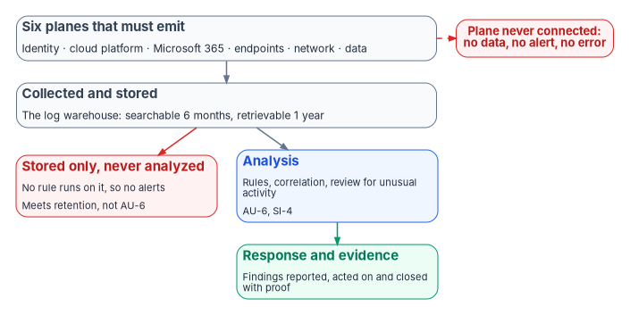
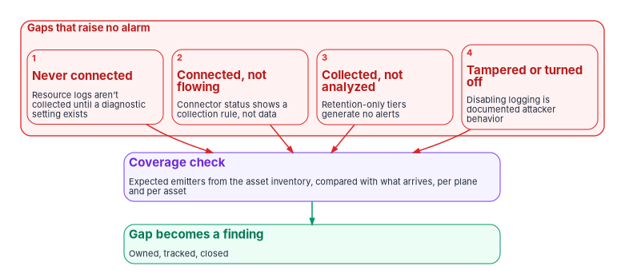

# Chapter 01 — You Can't Defend What You Can't See

*A security operations center can only analyze what reaches it, and the parts of the estate that send nothing look exactly like the parts where nothing happened.*

::: {.callout-note}
## In this chapter
The question Book 12 answers and the case in one paragraph. Why a log warehouse isn't a detection engine, and what NIST SP 800-53 and OMB M-26-14 say about the difference. The six planes that must emit telemetry, mapped to the activities M-26-14's minimum baseline requires logs to support. Four ways a coverage gap stays silent, with the vendor documentation that shows each one. The federal drivers, each read from the source: M-26-14, BOD 25-01 and its reporting path through CISA's Comprehensive Log Aggregation Warehouse, BOD 23-01, CDM and the FedRAMP 20x indicators.
:::

## The question this book answers

Book 12 asks one question: why can't you defend what you can't see? The answer sounds obvious, and most agencies would say they already act on it. They run a SIEM, they pay for log storage, and they can show an auditor a dashboard with millions of events a day. The trouble is that each of those things measures what arrived. None of them measures what didn't.

Detection and response are only as good as the telemetry that reaches them. A sign-in that was never logged can't trigger a rule. A virtual machine that never got a diagnostic setting doesn't appear in a query that returns no rows. A firewall that stopped forwarding syslog three weeks ago produces the same dashboard as a quiet firewall. Security operations fail most often not because an analyst missed an alert but because the evidence never arrived, and nothing said so.

This book's argument runs in five steps. Visibility has to be designed, not assumed: every plane of the estate must emit telemetry deliberately. Collected telemetry has to be analyzed, not just stored, because a warehouse isn't a detection engine. Everything that is collected has to share one evidence contract, with one join key, so that records from different stacks describe the same asset ([Chapter 02](02-the-evidence-contract.md)). Vulnerability, patch, configuration, posture and data-protection findings feed the same queue as threat detections ([Chapters 06 to 09](06-vulnerability-management.md)). And detections need rules, rules need response, and both need evidence an assessor can verify ([Chapters 11 and 12](11-detection-engineering-and-response.md)). Underneath all five is one rule the book doesn't relax: remediation has no substitute. A finding closes when the thing is fixed, with proof.

::: {.callout-important}
## The case in one paragraph
**Problem.** Agencies collect large volumes of logs and still can't answer basic questions after an incident, because some planes never emit, some sources stop without anyone noticing, and much of what is stored is never analyzed. Coverage gaps don't raise alerts; they look like quiet.

**Solution.** Treat telemetry as a designed control. Require every plane (identity, cloud platform, Microsoft 365, endpoints, network and data) to emit under one evidence contract keyed to authoritative asset identity and time; measure coverage against the asset inventory rather than against what arrived; put the data where rules can run on it; and route every kind of finding to one queue that ends in verified remediation.

**Ask.** Name the planes and assets that are expected to emit, and check each against what actually arrives. Count a log source as covered only when a detection runs on it and someone responds to what it finds. Fund the Agency Logging Plan that M-26-14 requires as the program's visibility plan, not as a storage purchase.
:::

{#fig-ch01-warehouse-not-detection fig-alt="Top to bottom. A slate card at the top lists the six planes that must emit: identity, cloud platform, Microsoft 365, endpoints, network and data. An arrow leads to a slate card, collected and stored, the log warehouse, kept searchable for six months and retrievable for a year. From there the diagram splits into two branches. One branch ends in a red card: stored only, never analyzed; data that sits where no rule can run on it produces no alerts, which meets retention but not AU-6. The other branch leads to a blue card: analysis, meaning rules, correlation and review of the records for unusual activity, AU-6 and SI-4. The blue card leads to a green card: response and evidence, findings reported, acted on and closed with proof. A separate red pill at the side, joined to the top card by a dashed red line, reads: plane never connected, no data, no alert, no error."}

## For decision makers

- **Storage isn't detection.** NIST's audit review control requires an organization to review and analyze audit records for indications of inappropriate or unusual activity and report the findings.[^c01-sp80053] Holding the records satisfies none of that by itself.
- **M-26-14 measures alerts, not volume.** The memorandum that replaced M-21-31 scores each system partly on the share of its minimum logging baseline that generates actionable alerts, and a system's overall maturity is its lowest-scoring element.[^c01-m2614]
- **Gaps are silent by construction.** A source that never connects sends nothing to complain about; a connector can show healthy while no data arrives; and logs kept in a low-cost tier don't generate alerts at all.[^c01-aws-trouble][^c01-lake]
- **Coverage is checked against inventory.** M-26-14 tells agencies to use CDM and hardware and software asset data to confirm that log coverage spans all of their information technology.[^c01-m2614] BOD 23-01 calls continuous and comprehensive asset visibility "a basic pre-condition" for managing cybersecurity risk.[^c01-bod2301]
- **CISA is a consumer of the same telemetry.** Agencies report SCuBA results through CDM, either by CISA-hosted collection or through CISA's Comprehensive Log Aggregation Warehouse,[^c01-bod2501-guidance] and CISA has used that warehouse to require specific device logs in an emergency.[^c01-ed2603]

## A warehouse is not a detection engine

The distinction this book rests on is between two things that are easy to buy as one: a place where logs are kept, and a capability that looks at them.

NIST SP 800-53 Rev. 5 keeps them in separate controls. AU-12 requires the system to generate audit records for the selected event types, with the content AU-3 defines. AU-6 is a different obligation: review and analyze the records, at a frequency the organization sets, "for indications of" inappropriate or unusual activity and its potential impact; report the findings; and adjust the level of review when risk changes. SI-4 adds the monitoring side: detect attacks and indicators of attack, identify unauthorized use, and analyze detected events and anomalies.[^c01-sp80053] An agency can satisfy AU-12 completely and still fail AU-6 and SI-4, if the records it generates are never read by anything that would notice an attack.

OMB M-26-14 makes the same distinction in federal policy. It directs agencies to organize logging around two objectives: continuous event monitoring, meaning logs that let the agency monitor activity in real time, flag anomalies and respond, typically in a security operations center; and threat hunting, investigation, response and forensics, meaning logs that support investigation after a known or suspected compromise.[^c01-m2614] Its minimum baseline defines the difference precisely. Logs must be actively *searchable* for six months, which the memorandum defines as data that "can be immediately used for cyber defense," with detections and analytics applied without preparation; and *retrievable* for a year, meaning usable after one or more steps such as moving it out of an archive.[^c01-m2614] The last item in the baseline's list of activities logs must support is "generating appropriate automated alerts for all of the above."[^c01-m2614]

The maturity model in M-26-14's Appendix C turns that into a measurement. Five levels run from Ineffective (Level 0) to Optimal (Level 4) across five elements: inventory visibility, collection coverage, collection operations, data retention and log management. The collection operations element is scored by alerting, not by collection. At Level 1 logs generate actionable alerts covering less than half of the minimum baseline; at Level 3, at least 70 percent, with detections routinely evaluated and tuned; at Level 4, at least 95 percent.[^c01-m2614] (The memorandum's table calls Level 1 "Initial" and its action timeline calls it "Basic"; it is the same level.) Agencies must reach Level 3 across all elements within 320 days of CISA's Logging Reference Architecture, which CISA published on August 20, 2026.[^c01-m2614][^c01-lra] [Book 00, Chapter 01](../b00-orientation/01-why-modernize-now.md) works out the calendar dates.

Vendor architecture now makes the distinction concrete. Microsoft Sentinel stores data in an analytics tier, built for real-time detection and alerting, and a lower-cost data lake tier built for long-term retention and hunting. Microsoft's guidance is unambiguous: "You can't run analytics rules or custom detections on data in the data lake tier. If you ingest logs only into the data lake tier, those logs don't generate alerts."[^c01-lake] Tiering is a sound cost decision for high-volume, low-signal sources. It becomes a visibility failure when a source with detection value is routed to the lake to save money and nobody records that it now has no detection coverage. In the program's reading, such a source may meet M-26-14's retention baseline while contributing nothing to its alerting measure.

## The six planes that must emit

Telemetry is emitted by a plane only when someone has designed it to be. The program treats the estate as six planes, each with its own native logging, its own defaults and its own ways of going quiet. The planes are the program's design; the baseline activities in the third column are quoted from M-26-14's Appendix B, item 5.[^c01-m2614]

| Plane | What it must emit (examples) | M-26-14 baseline activities it supports | Where this book covers it |
|---|---|---|---|
| Identity | Sign-ins, directory and role changes, privileged activation, risk detections | (a) the identity used for operations; (d) changes to privilege levels | [Chapter 03](03-identity-telemetry.md) |
| Cloud platform | Control-plane activity, resource (data-plane) logs, policy and posture state | (c) object and resource events; (e) infrastructure changes | [Chapter 04](04-platform-and-m365-telemetry.md), [Chapter 08](08-cloud-native-posture.md) |
| Microsoft 365 | Unified audit events, mailbox and file access, administrative actions | (a), (c), (i) the quantity and types of data affected | [Chapter 04](04-platform-and-m365-telemetry.md) |
| Endpoints | Process, file, network and sign-in events from clients and servers; security-tool alerts | (f) suspicious activity identified by security tooling; (h) anomalous activity; (j) attack vectors and lateral movement | [Chapter 05](05-from-log-warehouse-to-detection.md), [Chapter 07](07-patch-configuration-and-baselines.md) |
| Network | Flow and session records, firewall and proxy decisions, DNS queries, remote-access sessions | (b) source and destination addresses, protocols, ports and session attributes; (g) known indicators of compromise | [Chapter 05](05-from-log-warehouse-to-detection.md); [Book 08](../b08-ddi/index.md) for DNS; [Book 09](../b09-network/index.md) for transport |
| Data | Classification and labeling events, data loss prevention matches, access to sensitive stores | (c) accessed, modified or destroyed items; (i) data affected | [Chapter 09](09-data-protection-and-classification.md) |

Two properties of the table matter more than its rows. First, no plane covers the baseline alone. Identity tells you who; the network tells you from where and to where; the endpoint tells you what ran; the data plane tells you what was touched. An investigation that needs all four, which most do, fails if any one plane is dark. Second, every row applies to every system the agency owns or operates, including those run by third parties on its behalf and any Internet of Things or operational technology that is part of them.[^c01-m2614] A plane that exists only in the cloud provider's console, or only in a contractor's tenant, is still in scope.

## Why gaps stay silent

The hardest part of visibility isn't collecting what you know about. It is noticing what you don't. Coverage gaps don't announce themselves, and the vendor documentation shows four distinct ways they stay quiet.

{#fig-ch01-silent-gaps fig-alt="Four numbered red cards in a row across the top, grouped as gaps that raise no alarm. One, never connected: resource logs aren't collected until a diagnostic setting exists, so the source never sends anything. Two, connected but not flowing: a connector status can show a collection rule exists while no data arrives. Three, collected but not analyzed: data in a retention-only tier generates no alerts. Four, tampered or turned off: disabling or altering logging is documented attacker behavior. All four point down to one violet card, coverage check: expected emitters from the asset inventory, compared with what actually arrives, per plane and per asset. Below it, a green card: the gap becomes a finding, owned, tracked and closed."}

**Some sources are never connected.** Many logs don't exist until someone turns them on. Azure records control-plane activity in the activity log by default, but resource logs, which capture operations inside a resource such as reading a secret from a key vault, "aren't collected by default" and need a diagnostic setting for each resource. The activity log itself is kept for 90 days and then deleted unless it is exported.[^c01-resource-logs] A resource created without a diagnostic setting sends nothing. There is nothing for a rule to fire on and nothing to show as an error.

**Some connected sources aren't flowing.** A connector can look healthy while delivering nothing. Microsoft's troubleshooting guidance for the Sentinel connector for Amazon Web Services says the connector's status "indicates that a collection rule exists; it doesn't indicate that data was ingested," and that a green status can coexist with no data.[^c01-aws-trouble] Sentinel's own health monitoring helps, but only where it is turned on, and the health table is supported for a named set of connectors rather than for every source.[^c01-health]

**Some collected data is never analyzed.** Data routed only to a retention tier generates no alerts, as Microsoft states for the Sentinel data lake.[^c01-lake] The same is true of logs that land in an analytics workspace with no rule written against them. The data is present; the detection isn't.

**Some sources are switched off on purpose.** CISA's Microsoft expanded cloud logs playbook warns that "tampering with or disabling logging capabilities is a well-documented threat actor behavior," and gives commands for verifying that audit logging is still enabled.[^c01-playbook] A source that goes quiet during an intrusion is evidence, but only to a program that expected it to be talking.

The 2023 intrusion into Exchange Online mailboxes, which reached senior federal officials, shows what is at stake. It was first detected not by the provider but by a federal victim, using an in-house alert built on mailbox-access events that, at the time, were available only with a premium audit license; Microsoft later used the same events to identify other victims, and in response extended those logs to lower license tiers and lengthened default audit retention for standard customers from 90 to 180 days.[^c01-playbook] The organizations that didn't have the events weren't warned by their absence. They simply had nothing to look at.

None of these four gaps can be found by looking at what arrived. They can only be found by comparing what arrived with what was expected. That is why M-26-14 directs agencies to use CDM, hardware asset management and software asset management data "to determine whether log coverage encompasses all information technology" in their systems,[^c01-m2614] and why the inventory visibility element of its maturity model starts at 70 percent of a system's assets captured in a centralized inventory at Level 1.[^c01-m2614] It is also why [Chapter 02](02-the-evidence-contract.md) makes authoritative asset identity the join key of the evidence contract: the inventory defines the denominator, and coverage is measured against it.

## What the federal drivers actually require

Several federal instruments land on security telemetry. Each is narrower, or different, from what is often said about it, so this section reads each from the source.

### OMB M-26-14: logging and network visibility

M-26-14, issued May 22, 2026, rescinded M-21-31 "effective immediately." OMB's stated reason was that some M-21-31 requirements, "such as the retention of vast quantities of logging data without clear utility," proved neither operationally feasible nor cost-effective; the new memorandum directs a risk-based, prioritized approach instead.[^c01-m2614] The obligations that matter for this book are:

- **The two objectives.** Continuous event monitoring and threat hunting, investigation, response and forensics, pursued for every information system the agency owns or operates or that a third party operates on its behalf.[^c01-m2614]
- **The Logging Reference Architecture and Agency Logging Plan.** CISA's architecture, published August 20, 2026, is the core guidance; each agency submits a plan to OMB and CISA within 90 days of it, describing how it will meet the minimum baseline and its monitoring and investigation objectives.[^c01-m2614][^c01-lra]
- **The minimum baseline.** Searchable for six months and retrievable for a year; storage may be decentralized, but logs must be readily available to the agency's top-level security operations center; timestamps synchronized to a traceable time source; coverage checked against CDM and asset data; and logs that support eleven listed activities, the ones in the table above plus automated alerts for all of them.[^c01-m2614]
- **The maturity model and its clock.** Level 1, 2 and 3 across all elements within 120, 180 and 320 days of the reference architecture, scored at the lowest element.[^c01-m2614]
- **Log access.** After a known or suspected compromise, agencies provide logs and other relevant data to CISA and the FBI on request, to the extent consistent with law.[^c01-m2614]

M-26-14 doesn't name a product, a schema or a SIEM. It sets outcomes and leaves the architecture to the agency's plan, which is why this book treats the Agency Logging Plan as the place where the evidence contract in [Chapter 02](02-the-evidence-contract.md) is written down. [Book 08](../b08-ddi/index.md) and [Book 02](../b02-identity/index.md) apply the same memorandum to DNS and identity logging.

### BOD 25-01 and SCuBA: configuration evidence, reported to CISA

Binding Operational Directive 25-01, issued December 17, 2024, is a configuration directive, not a logging directive. It requires agencies to inventory in-scope cloud tenants, deploy CISA's SCuBA assessment tools, implement the mandatory SCuBA policies by June 20, 2025, and report results either by integrating the tool results feeds "with CISA's continuous monitoring solution" or by quarterly manual submission in a CISA-approved, machine-readable format.[^c01-bod2501] [Book 11, Chapter 04](../b11-zero-trust/04-scuba-and-bod-25-01.md) covers the obligations in full.

The reporting path is where BOD 25-01 meets this book. CISA's implementation guidance, updated July 27, 2026, describes two automated routes for Microsoft 365 tenants: a CISA-hosted ScubaConnect, with results returned to the agency through the CDM dashboard, and an agency-hosted ScubaConnect integrated with CDM through "CLAW (Comprehensive Log Aggregation Warehouse) TALON (Transfer at Location Optimized Node)," run at least quarterly.[^c01-bod2501-guidance] Either way, the configuration assessment becomes one more evidence stream that leaves the agency on a schedule. In this book's design it is also one more input to the same queue as every other finding ([Chapter 02](02-the-evidence-contract.md)); [Book 11, Chapter 09](../b11-zero-trust/09-running-the-assessment.md) covers ingesting ScubaGear output as evidence.

### CISA's Comprehensive Log Aggregation Warehouse

CLAW is CISA's cloud-based architecture "that collects and analyzes agency cloud security data." CISA built it because traffic that moves to the cloud no longer passes the EINSTEIN sensors, and it points agencies to the CISA Cloud Interface Reference Architecture (formerly the NCPS Cloud Interface Reference Architecture) for how to send cloud-generated security information.[^c01-tic] The TIC 3.0 Program Guidebook is explicit that TIC "does not replace or negate" agencies' telemetry and logging requirements, "to include requirements for telemetry to be collected and shared with CISA," and that its Security Capabilities Catalog doesn't detail the telemetry agencies owe CISA.[^c01-tic] Its information cycle includes, as a standing step, agencies providing telemetry of their operating environments to CISA.[^c01-tic]

CLAW is also the channel CISA uses when it needs specific logs quickly. Version 1 of Emergency Directive 26-03 (March 11, 2026) required agencies running affected Cisco SD-WAN systems to provide all syslog for those devices, past, current and future, through CISA's CLAW program by March 23, 2026, and to send other applicable cloud logs the same way.[^c01-ed2603] (The directive uses the older expansion, "Cloud Logging Aggregation Warehouse"; the TIC guidebook's July 2025 revision changed "Cloud" to "Comprehensive."[^c01-tic]) The lesson for planning is that a log source the agency can't forward on demand is a gap even if the agency itself analyzes it. [Book 09, Chapter 03](../b09-network/03-what-tic-3-requires.md) covers CLAW from the network side, including keeping CISA's visibility intact when branches leave managed TIC services.

### BOD 23-01 and CDM: the asset denominator

BOD 23-01 (October 3, 2022) requires automated asset discovery every 7 days across at least the agency's IPv4 space, vulnerability enumeration of all discovered assets, including roaming devices, every 14 days, and automated ingestion of enumeration results into the CDM Agency Dashboard within 72 hours of discovery completing.[^c01-bod2301] Its premise is the one this chapter argues from: "Continuous and comprehensive asset visibility is a basic pre-condition for any organization to effectively manage cybersecurity risk."[^c01-bod2301] CDM supplies the tools, integration services and dashboards; agency dashboards receive information from CDM tools and push summarized information onward.[^c01-cdm] For this book, BOD 23-01 and CDM provide the inventory against which telemetry coverage is measured. [Chapter 06](06-vulnerability-management.md) covers the vulnerability side.

### NIST continuous monitoring and FedRAMP's indicators

NIST SP 800-137 defines information security continuous monitoring as "maintaining ongoing awareness of information security, vulnerabilities, and threats to support organizational risk management decisions."[^c01-sp800137] The definition is about awareness, which is to say analysis, not collection. FedRAMP's 2026 Key Security Indicators for cloud service providers say the same thing in their monitoring, logging and auditing theme: KSI-MLA-OSM asks for a SIEM or similar system used and persistently reviewed for centralized, tamper-resistant logging, and KSI-MLA-RVL is one line, "Logs are persistently reviewed and audited."[^c01-ksi] The indicators bind cloud service providers seeking FedRAMP certification, not agencies, but the program uses the same distinction for its own estate: review is the indicator, and storage is a means to it.

## What the program adds

Agencies already own most of the tools this book discusses. What the Federal Modernization Program adds is a way of running them as one visibility system. Its design position, set out in the Federal Compliance volume's [Security Operations overview](https://github.com/WhalerMike/modernization-workbook/blob/main/docs/compliance/Vol_III_Book_00_Security_Operations_Overview.md), splits the work in two. Actuation stays platform-native: each platform's own tools patch, harden, grant privileged access and enforce posture. Governance and evidence are unified: every one of those tools emits into one machine-readable evidence contract, which flows to CDM and to the authorization package. The program doesn't ask which single console runs everything. It asks which native stack acts, and how its evidence joins the one picture.

That design depends on two things that come before any SIEM. The first is the naming plane: one authoritative identity for every asset, so that five stacks don't produce five inventories that can't be reconciled ([Book 08, Chapter 07](../b08-ddi/07-cloud-private-endpoints-and-ipam.md) and [Book 10, Chapter 06](../b10-cloud-boundary/06-ipam-and-network-as-code.md)). The second is the evidence contract itself, which is the subject of [Chapter 02](02-the-evidence-contract.md). The compliance volume's book on the [Authorization Package and ConMon](https://github.com/WhalerMike/modernization-workbook/blob/main/docs/compliance/Vol_IV_Book_06_Authorization_Package_ConMon.md) takes the contract's output and freezes it into the package an authorizing official signs; Book 14, Federal Compliance & Authorization (planned, see the [workbook index](../index.md)), will carry that part.

## How the rest of the book is organized

- **Why** (this chapter and [Chapter 02](02-the-evidence-contract.md)): why visibility comes first, and the evidence contract every source emits into.
- **What** (Chapters 03 to 09): identity telemetry from Entra ID; Azure platform and Microsoft 365 audit telemetry; turning a log warehouse into detection with SIEM and XDR; and the finding streams that share the queue: vulnerability management, patch and configuration baselines, cloud-native posture, and data protection.
- **Who** ([Chapter 10](10-who-runs-security-operations.md)): who runs security operations and who decides.
- **How** (Chapters [11](11-detection-engineering-and-response.md) and [12](12-evidence-metrics-and-continuous-monitoring.md)): detection engineering and response automation, then evidence, metrics and continuous monitoring.
- **[Appendix A](appendix-a-requirements-mapping.md)**: controls, mandates and books mapped together.

::: {.callout-note}
## What this chapter establishes
1. Generating and storing audit records (AU-12) is not reviewing and analyzing them (AU-6, SI-4). M-26-14 measures logging maturity partly by the share of the baseline that produces actionable alerts.
2. Six planes must emit by design: identity, cloud platform, Microsoft 365, endpoints, network and data. No one plane covers the minimum baseline, and third-party-operated systems are in scope.
3. Coverage gaps are silent: sources never connected, connected but not flowing, collected but not analyzed, or switched off. They are found only by comparing what arrives with an authoritative inventory of what should.
4. The federal drivers are specific: M-26-14 for logging outcomes and maturity, BOD 25-01 for configuration evidence reported through CDM or CISA's warehouse, BOD 23-01 and CDM for the asset denominator, and SP 800-137 and FedRAMP's indicators for review over storage.
:::

::: {.callout-tip}
## Continue the book
[← Previous: Book 12 index](index.md) · [Book index](index.md) · [Next: Chapter 02 — Telemetry Is the Precondition: The Evidence Contract →](02-the-evidence-contract.md)
:::

[^c01-sp80053]: National Institute of Standards and Technology, SP 800-53 Rev. 5 (release 5.2.0), *Security and Privacy Controls for Information Systems and Organizations*, controls AU-3, AU-6, AU-12 and SI-4, OSCAL catalog, <https://github.com/usnistgov/oscal-content/blob/main/nist.gov/SP800-53/rev5/json/NIST_SP-800-53_rev5_catalog.json> (accessed Oct 21, 2026).
[^c01-m2614]: Office of Management and Budget, M-26-14, *Ensuring Effective and Efficient Agency Logging and Network Visibility to Defend Against Evolving Cyber Threats*, May 22, 2026 (rescission of M-21-31; "Prioritization"; "Agency Logging Plan"; "Measuring Maturity"; "Log Access Requirements"; "Agency Actions"; Appendix B, Minimum Logging Baseline Requirements and Objectives, items 1–5 and notes 6–7; Appendix C, Logging Maturity Model, and note 8), <https://www.whitehouse.gov/wp-content/uploads/2026/05/M-26-14-Ensuring-Effective-and-Efficient-Agency-Logging-and-Network-Visibility-to-Defend-Against-Evolving-Cyber-Threats.pdf> (accessed Oct 21, 2026).
[^c01-lra]: Cybersecurity and Infrastructure Security Agency, "Logging Reference Architecture" (publish date August 20, 2026; developed in alignment with M-26-14 to support the Agency Logging Plan), <https://www.cisa.gov/Logging> (accessed Oct 21, 2026).
[^c01-lake]: Microsoft Learn, "Microsoft Sentinel data lake direct ingestion guidance," section "Analytics rules and custom detections," <https://learn.microsoft.com/azure/sentinel/datalake/sentinel-lake-log-ingestion-guidance> (accessed Oct 21, 2026).
[^c01-aws-trouble]: Microsoft Learn, "Troubleshoot AWS S3 connector issues," <https://learn.microsoft.com/azure/sentinel/aws-s3-troubleshoot> (accessed Oct 21, 2026).
[^c01-bod2301]: Cybersecurity and Infrastructure Security Agency, Binding Operational Directive 23-01, *Improving Asset Visibility and Vulnerability Detection on Federal Networks*, October 3, 2022, <https://www.cisa.gov/news-events/directives/bod-23-01-improving-asset-visibility-and-vulnerability-detection-federal-networks> (accessed Oct 21, 2026).
[^c01-bod2501-guidance]: Cybersecurity and Infrastructure Security Agency, "BOD 25-01 Implementation Guidance: Implementing Secure Practices for Cloud Services," updated July 27, 2026 (automated reporting through CISA-hosted ScubaConnect or agency-hosted ScubaConnect with CLAW/TALON integration), <https://www.cisa.gov/news-events/directives/bod-25-01-implementation-guidance-implementing-secure-practices-cloud-services> (accessed Oct 21, 2026).
[^c01-ed2603]: Cybersecurity and Infrastructure Security Agency, "V1: ED 26-03: Mitigate Vulnerabilities in Cisco SD-WAN Systems," March 11, 2026 (supersedes the required actions of the original directive of February 25, 2026), <https://www.cisa.gov/news-events/directives/v1-ed-26-03-mitigate-vulnerabilities-cisco-sd-wan-systems> (accessed Oct 21, 2026).
[^c01-resource-logs]: Microsoft Learn, "Activity log in Azure Monitor" (resource logs aren't collected by default; activity log retained for 90 days), <https://learn.microsoft.com/azure/azure-monitor/fundamentals/activity-log>; and "Resource logs in Azure Monitor," <https://learn.microsoft.com/azure/azure-monitor/logs/resource-logs> (both accessed Oct 21, 2026).
[^c01-health]: Microsoft Learn, "Monitor the health of your data connectors" (the health feature must be turned on; the SentinelHealth table is supported only for listed connectors), <https://learn.microsoft.com/azure/sentinel/monitor-data-connector-health> (accessed Oct 21, 2026).
[^c01-playbook]: Cybersecurity and Infrastructure Security Agency, *Microsoft Expanded Cloud Logs Implementation Playbook*, updated May 2026 (background on the summer 2023 Exchange Online intrusion; detection relying on Purview Audit (Premium) logs; expansion to E3/G3 and above; Audit Standard retention raised from 90 to 180 days; note on tampering with or disabling logging), <https://www.cisa.gov/resources-tools/resources/microsoft-expanded-cloud-logs-implementation-playbook>, PDF <https://www.cisa.gov/sites/default/files/2026-09/MS_Expanded_Cloud_Logging_Playbook-Updated-FINAL-May2026.pdf> (accessed Oct 21, 2026).
[^c01-bod2501]: Cybersecurity and Infrastructure Security Agency, Binding Operational Directive 25-01, *Implementing Secure Practices for Cloud Services*, December 17, 2024, <https://www.cisa.gov/news-events/directives/bod-25-01-implementing-secure-practices-cloud-services> (accessed Oct 21, 2026).
[^c01-tic]: Cybersecurity and Infrastructure Security Agency, *Trusted Internet Connections 3.0, TIC Core Guidance Volume 1: Program Guidebook*, Version 1.2, September 2026 (revision history; §10, Telemetry Requirements; §10.1, TIC Information Cycle; §13, TIC and EINSTEIN; Appendix C, definition of CLAW), <https://www.cisa.gov/sites/default/files/2026-09/TIC_3.0_Program_Guidebook_September_2026_47.pdf> (accessed Oct 21, 2026).
[^c01-cdm]: Cybersecurity and Infrastructure Security Agency, "Continuous Diagnostics and Mitigation (CDM) Program," <https://www.cisa.gov/resources-tools/programs/continuous-diagnostics-and-mitigation-cdm-program> (accessed Oct 21, 2026).
[^c01-sp800137]: National Institute of Standards and Technology, SP 800-137, *Information Security Continuous Monitoring (ISCM) for Federal Information Systems and Organizations*, September 2011, §1 and §2, <https://nvlpubs.nist.gov/nistpubs/Legacy/SP/nistspecialpublication800-137.pdf> (accessed Oct 21, 2026).
[^c01-ksi]: FedRAMP, "Monitoring, Logging, and Auditing," Key Security Indicators, FedRAMP Consolidated Rules for 2026 (KSI-MLA-OSM, Operating SIEM Capability; KSI-MLA-RVL, Reviewing Logs; page updated October 13, 2026), <https://fedramp.gov/2026/providers/20x/key-security-indicators/monitoring-logging-and-auditing/> (accessed Oct 21, 2026).
