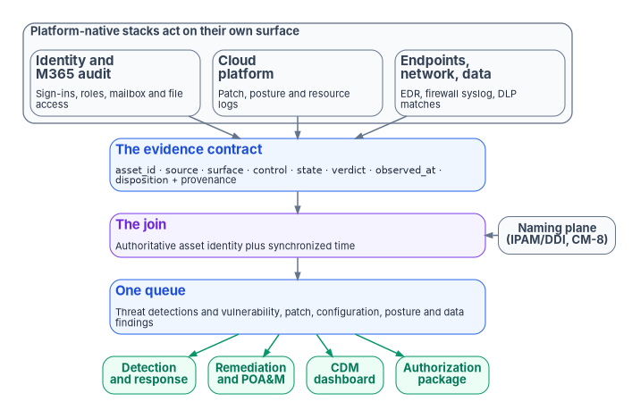
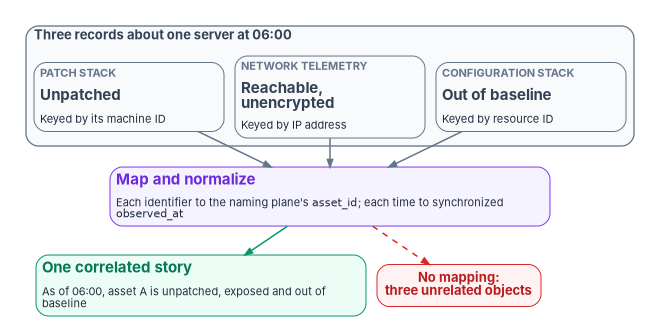

# Chapter 02 — Telemetry Is the Precondition: The Evidence Contract

*Five stacks can't produce one compliance picture by being put on one dashboard; they produce it by agreeing, in advance, what a record says and which asset it is about.*

::: {.callout-note}
## In this chapter
The problem the evidence contract solves and the case in one paragraph. The contract's fields and how they meet AU-3. The join key, authoritative asset identity plus time, and why AU-12(1)'s system-wide, time-correlated audit trail depends on the naming plane. How vulnerability, patch, configuration, posture and data-protection findings become records in one queue, and what closes them. The roles that realize the contract, the continuous-monitoring pipeline CA-7 describes, the controls this chapter closes and where they sit in the FedRAMP baselines, and an illustrative coverage query.
:::

## Five stacks, five inventories

A multi-cloud agency runs several management stacks, and each produces its own telemetry in its own schema. Azure Update Manager reports patch state one way, AWS Systems Manager another, the virtualization platform's lifecycle manager a third, a firewall's syslog a fourth, a Linux host's agent a fifth. Five stacks, five inventories, five log formats. When an assessor asks "is this vulnerability remediated across the whole estate, and prove it," five partial views that don't reconcile can't answer.

[Chapter 01](01-you-cant-defend-what-you-cant-see.md) argued that visibility has to be designed. This chapter is the design. The Federal Modernization Program's answer is an **evidence contract**: one normalized record shape that every source emits, correlated on one authoritative asset identity and on time, and delivered to the consumers an agency owes, CISA's Continuous Diagnostics and Mitigation (CDM) program first among them. The contract is program design. The controls it closes, and the federal requirements that make it necessary, are external and cited below.

The contract has a clear boundary. It isn't detection engineering: rules, correlation logic, user and entity behavior analytics and playbooks find threats in the data, and they belong to [Chapter 05](05-from-log-warehouse-to-detection.md) and [Chapter 11](11-detection-engineering-and-response.md). It isn't the authorization package either: the package is assembled from the contract's output, and Book 14, Federal Compliance & Authorization (planned, see the [workbook index](../index.md)), will carry it. The contract sits beneath both. Detection analyzes what it carries; the authorization package attests to it.

::: {.callout-important}
## The case in one paragraph
**Problem.** Every platform's own tools patch, scan, harden and alert, and each reports in its own schema against its own inventory. Records from different stacks can be stored together but can't be joined, so no one can say what is true about one asset across all of them, and an assessor gets five partial answers.

**Solution.** Define one evidence contract that every source emits, with fields fixed in advance; key it to the authoritative asset identity from the naming plane and to synchronized time; route every finding, from threat alerts to missing patches to data-loss matches, into one queue as a record of that contract; and close a record only when the measured state changes, with the proof attached.

**Ask.** Stand up the naming plane before the evidence pipeline, and reconcile every stack's inventory to it. Write the contract into the Agency Logging Plan. Fund the normalization work for each source as part of onboarding that source, not as a later dashboard project.
:::

{#fig-ch02-evidence-contract fig-alt="Top to bottom. A row of three slate cards, grouped as platform-native stacks that act on their own surface: identity and Microsoft 365 audit; cloud platform, with patch, posture and resource logs; and endpoints, network and data, with EDR, firewall syslog and DLP matches. All three point to a blue card, the evidence contract, one record shape with the fields asset_id, source, surface, control, state, verdict, observed_at and disposition, plus provenance. A violet card beneath it, the join, keys every record to authoritative asset identity plus synchronized time; a slate pill beside it, the naming plane (IPAM and DDI, CM-8), feeds it with a dashed arrow. The join leads to a blue card, one queue, where threat detections and vulnerability, patch, configuration, posture and data findings are all records of the same contract. Four green pills fan out from the queue: detection and response, remediation and POA&M, CDM dashboard, and authorization package."}

## For decision makers

- **The contract is the coordination mechanism, not a console.** NIST's AU-3 requires every audit record to establish what happened, when, where, from what source, with what outcome and involving whom.[^c02-sp80053] The program raises that to a cross-stack rule: every source emits the same fields, so records are comparable, joinable and countable.
- **Aggregating isn't correlating.** Two records describe the same asset only if they carry the same identifier. AU-12(1) asks for a system-wide audit trail "time-correlated" to a set tolerance,[^c02-sp80053] and M-26-14 requires timestamps synchronized to a traceable time source.[^c02-m2614]
- **Each vendor has its own device identifier.** Even Microsoft's normalization model lists separate device ID types for Defender for Endpoint, Azure resources, AWS and others, and calls a hostname used as an ID a last resort.[^c02-asim-fields] The join key has to come from an authority outside every stack: the naming plane.
- **Findings and detections share one queue.** Posture, patch and vulnerability findings can be exported as records alongside security alerts,[^c02-mdc-export] and a vendor default can still move a finding type out of the queue without notice.[^c02-dlp]
- **The baselines differ.** FedRAMP's Moderate baseline includes cross-source correlation (SI-4(16)) and automated review integration (AU-6(1)), but not AU-12(1), which NIST and FedRAMP place in the High baseline.[^c02-fedramp-baseline][^c02-sp80053b] At Moderate, the program selects AU-12(1) as its own design choice.

## The contract: one record, every source

Coordination across stacks that don't share a vendor isn't achieved with a console. It is achieved with a contract that fixes, before any data flows, what every record must say. The program's record has eight fields.

| Field | Meaning | AU-3 element it carries |
|---|---|---|
| `asset_id` | The authoritative name or address of the asset, from the naming plane (IPAM and DDI). This is the join key. | Where the event occurred; identity of the object or entity |
| `source` | The stack, appliance or agent that produced the record | Source of the event |
| `surface` | The kind of surface: cloud service provider, network enforcement, operating system, identity, data | Where the event occurred |
| `control` | The NIST SP 800-53 control the record is evidence for (for example SI-2, CM-6, SC-8) | What type of event occurred, stated in control terms |
| `state` | The measured value: patch level, baseline conformance, cipher, posture, label | What occurred |
| `verdict` | Pass, warn or fail against the intended state | Outcome of the event |
| `observed_at` | When the state was measured, in synchronized time | When the event occurred |
| `disposition` | Applied, accepted risk (with its POA&M reference) or open | Not an AU-3 element; the record's remediation status |

AU-3 requires audit records to contain information establishing six things: the type of event, when it occurred, where, its source, its outcome, and the identity of any individuals, subjects, objects or entities associated with it.[^c02-sp80053] The contract's fields carry each one. What the contract adds is uniformity across stacks: the *content* is standardized, so a record from a patch stack and a record from a firewall can be compared, joined and rolled up. The program treats the contract as a closure necessity: without a schema the sources agreed on in advance, no dashboard built afterward can recover one.

The program's telemetry design adds a provenance envelope to every record: the issuer, the classification of the source, the chain of transformations applied between the source and the contract, and a lineage hash. Its rules are that telemetry is a control input rather than after-the-fact reporting, that evidence bundles are assembled and sealed deterministically, that the combination is reproducible from raw telemetry plus the authoritative source, and that drift findings are first-class artifacts of the authorization package rather than a parallel log. These are design positions. One external anchor sits close to them: M-26-14's maturity model, at Level 3 for log management, calls for logs "encrypted in transit and at rest, and regularly hashed for veracity."[^c02-m2614]

The contract doesn't require one vendor's schema. Microsoft Sentinel's Advanced Security Information Model (ASIM) is an example of the same idea inside one SIEM: a normalization layer between diverse sources and the analyst, with schemas for authentication, network sessions, DNS, DHCP, file, process, audit and other events, so that one analytics rule "work[s] across sources, on-premises and cloud."[^c02-asim] An agency using Sentinel can implement much of the contract by normalizing to ASIM and adding the fields ASIM doesn't carry, such as `control`, `verdict` and `disposition`. What ASIM can't supply is the authoritative asset identity, which is the subject of the next section.

## The join key: authoritative asset identity plus time

Putting records in one place isn't the same as correlating them. Two records describe the same asset only if they carry the same `asset_id`, and every stack has its own idea of what that is. ASIM shows the problem plainly. Its device fields allow a `DvcId` whose type may be a Defender for Endpoint ID, an Azure resource ID, a Defender for IoT ID, a VM Insights connection ID, an AWS VPC ID or several vendor-specific IDs; when an event carries several, the others go in separate fields; and using the hostname as the device ID "implies reusing the hostname. Use it only as a last resort."[^c02-asim-fields] Each stack's identifier is correct inside that stack and meaningless outside it.

The program's join key is therefore the naming plane's authoritative name or address, not any stack's local inventory ID. NIST's component inventory control, CM-8, already asks for an inventory that accurately reflects the system, includes all components, and "does not include duplicate accounting of components or components assigned to any other system."[^c02-sp80053] An inventory that meets CM-8 across stacks is the naming plane. [Book 08, Chapter 07](../b08-ddi/07-cloud-private-endpoints-and-ipam.md) and [Book 10, Chapter 06](../b10-cloud-boundary/06-ipam-and-network-as-code.md) describe how IPAM and DDI become that authority across clouds. An IT service management CMDB has a role here too, as the workflow and correlation hub, but in the program's design the CMDB reconciles *to* the naming plane; it doesn't replace the join key.

{#fig-ch02-one-asset-one-story fig-alt="Top, three slate cards side by side, grouped as three records about one server at 06:00: the patch stack reports it unpatched, keyed by its machine ID; network telemetry reports it reachable and unencrypted, keyed by IP address; and the configuration stack reports it out of baseline, keyed by resource ID. Each points to a violet card, map and normalize: each identifier to the naming plane's asset_id and each time to synchronized observed_at. That leads to a green card, one correlated story: as of 06:00 asset A is unpatched, exposed and out of baseline, assembled from three surfaces. A red pill beside the green card, joined by a dashed red line from the violet card, reads: no mapping, three unrelated objects."}

Add time and the contract produces what AU-12(1) describes: audit records from system components compiled "into a system-wide (logical or physical) audit trail that is time-correlated to within" a tolerance the organization sets.[^c02-sp80053] AU-8 requires time stamps that use Coordinated Universal Time or carry a fixed or recorded offset from it, and M-26-14 requires network time synchronized to a traceable source the agency designates, encouraging sources traceable to the U.S. Naval Observatory or NIST.[^c02-sp80053][^c02-m2614] The result is one story about one asset, assembled from several surfaces: as of 06:00, asset A was unpatched for a given vulnerability (from the patch stack), reachable on an unencrypted segment (from network telemetry) and out of baseline (from the configuration stack).

Time is easier to get wrong than it looks, because "when" has more than one meaning in a pipeline. Two examples from one connector show why the contract carries `observed_at` explicitly. When Microsoft Sentinel ingests AWS VPC flow logs in a customized format, the format must include the *start* attribute, because it maps to `TimeGenerated`; otherwise `TimeGenerated` is the ingestion time, "which doesn't accurately describe the log event." GuardDuty findings, by default, are exported to the S3 bucket the connector reads from every six hours, and their `TimeGenerated` is the finding's update time.[^c02-aws-setup] A pipeline that correlates on arrival time instead of observation time will join the wrong records, or miss the right ones, without any error.

AU-12(1) is downstream of the naming plane and of the federal asset-visibility directive. BOD 23-01 requires automated asset discovery every 7 days and vulnerability enumeration every 14 days, with results in the CDM Agency Dashboard within 72 hours.[^c02-bod2301] The patch and vulnerability chapters of this book ([Chapter 06](06-vulnerability-management.md) and [Chapter 07](07-patch-configuration-and-baselines.md)) use the same key for SI-2 at scale: the evidence contract and the patch plane share it.

## One queue for every finding

Detection is only one kind of finding. A missing patch, a known exploited vulnerability, a configuration that drifted from its baseline, a storage account open to the internet and a file that left the agency with a sensitive label are all statements about an asset's state, against an intended state, at a time. In the program's design they are all records of the same contract, and they land in the same queue as threat detections.

| Finding stream | Typical source | `control` | Example `state` and `verdict` | Book 12 chapter |
|---|---|---|---|---|
| Threat detection | SIEM analytics, XDR | SI-4, AU-6 | Rule matched on the asset; fail | [05](05-from-log-warehouse-to-detection.md), [11](11-detection-engineering-and-response.md) |
| Vulnerability | Scanner, vulnerability management | RA-5 | Vulnerability present; fail | [06](06-vulnerability-management.md) |
| Patch | Update and patch management | SI-2 | Update missing past its due date; fail | [07](07-patch-configuration-and-baselines.md) |
| Configuration baseline | Machine configuration, SCuBA, hardening checks | CM-6 | Setting differs from baseline; warn or fail | [07](07-patch-configuration-and-baselines.md) |
| Cloud posture | Cloud security posture management | CM-6, CM-7, AC-3 | Resource exposed; fail | [08](08-cloud-native-posture.md) |
| Data protection | Data loss prevention, classification | AC-4, SC-28 | Policy match on labeled content; warn or fail | [09](09-data-protection-and-classification.md) |

The control assignments are the program's mapping, not a published crosswalk; each chapter refines its own. The product capability underneath is documented. Microsoft Defender for Cloud's continuous export streams security recommendations, secure score, security alerts, regulatory compliance and attack paths to a Log Analytics workspace or an event hub whenever they change. Recommendations carry sub-recommendations: the system-updates recommendations carry one per outstanding update, and "Machines should have vulnerability findings resolved" carries one per vulnerability the scanner finds. In a workspace they land in the `SecurityRecommendation` and `SecurityAlert` tables.[^c02-mdc-export] Patch, vulnerability, posture and alert data can therefore sit side by side, which is the precondition for one queue. Two cautions apply. Streaming export sends an assessment only when a resource's health state changes ("if no updates occur, no data is sent"),[^c02-mdc-export] so the absence of new records doesn't prove the absence of open findings. And the records still carry the stack's own resource identifiers until they are mapped to `asset_id`.

Data-protection findings show how a queue can lose a finding type silently. Microsoft Purview data loss prevention alerts have been routed to the Microsoft Defender XDR incident queue, where they can be correlated with alerts from Defender for Endpoint, Defender for Office 365 and Sentinel. Microsoft's documentation now notes that a built-in alert tuning rule for DLP signals "took effect in early October 2026": it sets those signals as behaviors instead of alerts, so they no longer generate alerts or appear in the incident queue, though they remain available for advanced hunting. To keep seeing them as alerts, an administrator disables the rule.[^c02-dlp] Whatever the merits of the default, it is exactly the kind of change [Chapter 01](01-you-cant-defend-what-you-cant-see.md) warns about: a finding stream left the queue and nothing failed. [Chapter 09](09-data-protection-and-classification.md) covers the decision; the general lesson is that queue membership is part of the contract and has to be checked, not assumed.

The `disposition` field is where the book's last rule lives. A record is **applied** when the measured state matches the intended state, with the observation that shows it; **accepted risk** when the authorizing official has accepted the residual risk, with the POA&M reference that records it; and **open** otherwise. Only the authorizing official accepts residual risk ([Book 01, Chapter 09](../b01-transformation-arc/09-who-leads-the-transformation.md)). Nothing else closes a record: not a ticket marked resolved, not a suppressed alert, not an expired scan. Remediation has no substitute, and a finding closes only when a later observation of the same `asset_id` shows the fixed state.

## Realizing the contract

Because the fabric is a contract, more than one product can fill each role. The program states the roles and a default for each; the defaults are design choices, not requirements, and every authorization and feature should be checked against the agency's cloud and the FedRAMP Marketplace at procurement ([Book 10](../b10-cloud-boundary/index.md)).

| Role | What it does | Program default and notes |
|---|---|---|
| Aggregation and analytics | Ingests the multi-surface record set; runs analytics | Microsoft Sentinel, by breadth of native ingestion: AWS service logs (CloudTrail, VPC flow logs, GuardDuty and CloudWatch through the S3 connector)[^c02-aws] and syslog or CEF from network and security appliances through a log forwarder running the Azure Monitor Agent.[^c02-cef] An agency running a second SIEM can run the same contract in parallel for continuity. |
| Workflow and correlation hub | Tickets, ownership, CMDB | The agency's IT service management platform. Its CMDB reconciles to the naming plane; it doesn't replace the join key. |
| Federal rollup | Agency and federal visibility | CDM's Agency and Federal Dashboards; agency dashboards receive information from CDM tools and push summarized information onward[^c02-cdm] |
| Attestation | Machine-readable assessment evidence | OSCAL assessment results and POA&M, assembled for the authorization package[^c02-oscal] |

The guardrail is the same in every row: the program mandates the contract, never the vendor. Any lake that ingests the record set, any hub that correlates on the authoritative `asset_id`, and any pipeline that emits the assessment evidence is admissible. The one product position the program holds firmly is negative: no stack's own inventory is the join key.

## The continuous-monitoring pipeline

The contract is the continuous-monitoring evidence pipeline. Sources emit on their own cadence; records are normalized to the contract; they are correlated on asset identity and time; they are aggregated in the lake; they roll up to CDM; and they are attested in the authorization package. CA-7 describes the same loop in control terms. A system-level continuous monitoring strategy includes ongoing monitoring of the metrics the organization sets, "correlation and analysis of information generated by control assessments and monitoring," response actions to address the results, and reporting security status to designated roles at a set frequency.[^c02-sp80053] NIST SP 800-137 supplies the purpose: ongoing awareness of security, vulnerabilities and threats in support of risk decisions.[^c02-sp800137]

Three enhancements describe what automation adds. AU-6(1) integrates audit review, analysis and reporting with automated mechanisms; AU-6(3) analyzes and correlates audit records across repositories "to gain organization-wide situational awareness"; and SI-4(16) correlates information from monitoring tools throughout the system.[^c02-sp80053] The contract is what makes those correlations possible across vendors: records that share fields and a join key can be correlated; records that don't, can't.

On the attestation side, NIST's OSCAL defines an assessment layer with three models, assessment plan, assessment results and plan of action and milestones,[^c02-oscal] which is where the contract's records go when the authorization package is assembled. FedRAMP's 2026 indicators show the same chain from the cloud service provider's side: the related controls for KSI-MLA-OSM, operating a SIEM capability, include AU-3, AU-6(1), AU-6(3), AU-8, AU-12(1) and SI-4(16).[^c02-ksi] Those indicators bind cloud service providers rather than agencies, but the program uses the same control set for its own estate, so that an agency's evidence and its providers' evidence describe monitoring in the same terms. [Chapter 12](12-evidence-metrics-and-continuous-monitoring.md) covers metrics and the ongoing reporting cycle.

## Controls this chapter closes

| Control | Title | How the contract closes it | FedRAMP Rev. 5 Moderate baseline |
|---|---|---|---|
| AU-3 | Content of Audit Records | One record shape every source emits | Included |
| AU-8 | Time Stamps | `observed_at` in synchronized UTC time | Included |
| AU-12 | Audit Record Generation | Every plane emits by design ([Chapter 01](01-you-cant-defend-what-you-cant-see.md)) | Included |
| AU-12(1) | System-wide and Time-correlated Audit Trail | Correlation on authoritative `asset_id` plus time | Not included (High baseline); selected by program design |
| AU-6(1) | Automated Process Integration | Automated aggregation and analysis in one lake | Included |
| AU-6(3) | Correlate Audit Record Repositories | Cross-repository correlation on the join key | Included |
| SI-4(16) | Correlate Monitoring Information | Correlation across vendor and surface boundaries | Included |
| CA-7 | Continuous Monitoring | The emit, normalize, correlate, aggregate, roll up, attest pipeline | Included |

The baseline column is read from FedRAMP's Rev. 5 baseline workbook, which FedRAMP marked as a legacy document on June 23, 2026 while it is replaced by the Consolidated Rules for 2026;[^c02-fedramp-baseline] NIST's own SP 800-53B profiles agree for AU-12(1), which appears in the High baseline only, and they don't select SI-4(16) at either level, which FedRAMP adds at Moderate.[^c02-sp80053b] (The source volume listed all of these as FedRAMP Moderate controls; AU-12(1) isn't one.) For the control-level depth, including the authorities each row draws on, see the Federal Compliance volume's [Multi-Cloud Evidence Fabric](https://github.com/WhalerMike/modernization-workbook/blob/main/docs/compliance/Vol_III_Book_07_Multi_Cloud_Evidence_Fabric.md); [Appendix A](appendix-a-requirements-mapping.md) maps them across the book. None of these controls can be shown by a scan of a single tenant: the evidence is the aggregated, correlated record set, which a per-tenant tool can't produce.

## Checking coverage against the inventory

The contract makes the coverage check in [Chapter 01](01-you-cant-defend-what-you-cant-see.md) concrete. With the naming plane's inventory loaded into the SIEM, the question "which assets should be emitting and aren't" is a query rather than an audit finding.

::: {.callout-warning}
## Illustrative, not tested against production
The query below is illustrative. It hasn't been tested against a production workspace. The watchlist name `FMP-AssetInventory` and its columns are the program's own example, not a Microsoft default. Review it and adapt the tables and time windows before relying on it.
:::

The query assumes a Microsoft Sentinel watchlist exported from the naming plane, with the authoritative host name as its `SearchKey`, and uses the `Heartbeat` table, which monitoring agents write once a minute, as the simplest evidence that a machine is reporting.[^c02-heartbeat] Watchlists are queried with `_GetWatchlist()` and joined on `SearchKey`.[^c02-watchlist] The `Computer` column holds the computer name as the agent reports it, so the mapping to `asset_id` (short name or fully qualified) has to match the naming plane's convention.

```kusto
// Assets the naming plane says exist, with no agent heartbeat in the last 24 hours
let expected = _GetWatchlist('FMP-AssetInventory')
    | project asset_id = tolower(SearchKey);
let reporting = Heartbeat
    | where TimeGenerated > ago(24h)
    | summarize LastSeen = max(TimeGenerated) by asset_id = tolower(Computer);
expected
| join kind=leftanti reporting on asset_id
| project asset_id
```

A heartbeat proves only that an agent is talking, not that every plane is. The same pattern extends per plane: join the inventory to each source's table on the mapped `asset_id`, and treat every asset with no record in a window as a coverage finding in the same queue as everything else. Agentless sources, such as appliances that send syslog through a forwarder, need their own expected-source list, because a forwarder's heartbeat says nothing about the devices behind it.

::: {.callout-note}
## What this chapter establishes
1. Coordination across stacks is a contract, not a console: every source emits the same fields, which carry AU-3's six elements plus control, verdict and disposition.
2. The join key is authoritative asset identity plus synchronized time. Every stack has its own identifier, so the key must come from the naming plane, and the naming plane must exist before the pipeline.
3. Threat detections and vulnerability, patch, configuration, posture and data findings are all records of the same contract in one queue. Queue membership has to be checked, because vendor defaults can remove a finding type silently.
4. A record closes only when a later observation of the same asset shows the fixed state, or the authorizing official accepts the risk with a POA&M reference.
5. AU-12(1) is in the High baseline, not FedRAMP Moderate; at Moderate the program selects it by design, alongside the Moderate controls AU-3, AU-6(1), AU-6(3), SI-4(16) and CA-7.
:::

::: {.callout-tip}
## Continue the book
[← Previous: Chapter 01 — You Can't Defend What You Can't See](01-you-cant-defend-what-you-cant-see.md) · [Book index](index.md) · [Next: Chapter 03 — Identity Telemetry from Entra ID →](03-identity-telemetry.md)
:::

[^c02-sp80053]: National Institute of Standards and Technology, SP 800-53 Rev. 5 (release 5.2.0), *Security and Privacy Controls for Information Systems and Organizations*, controls AU-3, AU-6(1), AU-6(3), AU-8, AU-12(1), CA-7, CM-8 and SI-4(16), OSCAL catalog, <https://github.com/usnistgov/oscal-content/blob/main/nist.gov/SP800-53/rev5/json/NIST_SP-800-53_rev5_catalog.json> (accessed Oct 21, 2026).
[^c02-m2614]: Office of Management and Budget, M-26-14, *Ensuring Effective and Efficient Agency Logging and Network Visibility to Defend Against Evolving Cyber Threats*, May 22, 2026, Appendix B item 3 (timestamps synchronized to a traceable time source) and Appendix C (Log Management element, Level 3), <https://www.whitehouse.gov/wp-content/uploads/2026/05/M-26-14-Ensuring-Effective-and-Efficient-Agency-Logging-and-Network-Visibility-to-Defend-Against-Evolving-Cyber-Threats.pdf> (accessed Oct 21, 2026).
[^c02-asim-fields]: Microsoft Learn, "The Advanced Security Information Model (ASIM) common schema fields reference" (DvcId and DvcIdType), <https://learn.microsoft.com/azure/sentinel/normalization-common-fields>; and "The Advanced Security Information Model (ASIM) Device Entity," <https://learn.microsoft.com/azure/sentinel/normalization-entity-device> (both accessed Oct 21, 2026).
[^c02-mdc-export]: Microsoft Learn, "Export alerts and recommendations with continuous export" (exportable data types; SecurityAlert and SecurityRecommendation tables), <https://learn.microsoft.com/azure/defender-for-cloud/benefits-of-continuous-export>; and "Set up continuous export in the Azure portal" (streaming versus weekly snapshots), <https://learn.microsoft.com/azure/defender-for-cloud/continuous-export> (both accessed Oct 21, 2026).
[^c02-dlp]: Microsoft Learn, "Investigate data loss prevention alerts with Microsoft Defender XDR" (note on the built-in DLP alert tuning rule, early October 2026), <https://learn.microsoft.com/defender-xdr/dlp-investigate-alerts-defender> (accessed Oct 21, 2026).
[^c02-fedramp-baseline]: FedRAMP, *FedRAMP Security Controls Baseline* (Rev. 5 workbook; "Moderate Baseline" and "High Baseline" sheets; legacy notice dated June 23, 2026), <https://github.com/FedRAMP/docs-legacy/blob/main/overrides/assets/LEGACY%20FedRAMP_Security_Controls_Baseline.xlsx> (accessed Oct 21, 2026).
[^c02-sp80053b]: National Institute of Standards and Technology, SP 800-53B Rev. 5 (release 5.2.0) Moderate and High baseline profiles, OSCAL, <https://github.com/usnistgov/oscal-content/blob/main/nist.gov/SP800-53/rev5/json/NIST_SP-800-53_rev5_MODERATE-baseline_profile.json> and <https://github.com/usnistgov/oscal-content/blob/main/nist.gov/SP800-53/rev5/json/NIST_SP-800-53_rev5_HIGH-baseline_profile.json> (both accessed Oct 21, 2026).
[^c02-asim]: Microsoft Learn, "Normalization and the Advanced Security Information Model (ASIM)," <https://learn.microsoft.com/azure/sentinel/normalization> (accessed Oct 21, 2026).
[^c02-aws-setup]: Microsoft Learn, "Set up your Amazon Web Services (AWS) environment to collect AWS logs to Microsoft Sentinel" (VPC flow log *start* attribute and TimeGenerated; GuardDuty export frequency), <https://learn.microsoft.com/azure/sentinel/connect-aws-configure-environment> (accessed Oct 21, 2026).
[^c02-bod2301]: Cybersecurity and Infrastructure Security Agency, Binding Operational Directive 23-01, *Improving Asset Visibility and Vulnerability Detection on Federal Networks*, October 3, 2022, <https://www.cisa.gov/news-events/directives/bod-23-01-improving-asset-visibility-and-vulnerability-detection-federal-networks> (accessed Oct 21, 2026).
[^c02-aws]: Microsoft Learn, "Connect Microsoft Sentinel to Amazon Web Services to ingest AWS service log data," <https://learn.microsoft.com/azure/sentinel/connect-aws> (accessed Oct 21, 2026).
[^c02-cef]: Microsoft Learn, "Syslog and Common Event Format (CEF) via AMA connectors for Microsoft Sentinel," <https://learn.microsoft.com/azure/sentinel/cef-syslog-ama-overview> (accessed Oct 21, 2026).
[^c02-cdm]: Cybersecurity and Infrastructure Security Agency, "Continuous Diagnostics and Mitigation (CDM) Program" (CDM Agency and Federal Dashboards), <https://www.cisa.gov/resources-tools/programs/continuous-diagnostics-and-mitigation-cdm-program> (accessed Oct 21, 2026).
[^c02-oscal]: National Institute of Standards and Technology, "OSCAL Layers and Models," Open Security Controls Assessment Language, <https://pages.nist.gov/OSCAL/learn/concepts/layer/> (accessed Oct 21, 2026).
[^c02-sp800137]: National Institute of Standards and Technology, SP 800-137, *Information Security Continuous Monitoring (ISCM) for Federal Information Systems and Organizations*, September 2011, §2, <https://nvlpubs.nist.gov/nistpubs/Legacy/SP/nistspecialpublication800-137.pdf> (accessed Oct 21, 2026).
[^c02-ksi]: FedRAMP, "Monitoring, Logging, and Auditing," Key Security Indicators, FedRAMP Consolidated Rules for 2026 (KSI-MLA-OSM related controls), <https://fedramp.gov/2026/providers/20x/key-security-indicators/monitoring-logging-and-auditing/> (accessed Oct 21, 2026).
[^c02-heartbeat]: Microsoft Learn, "Heartbeat" (Azure Monitor Logs table reference: records logged by agents once per minute; Computer and TimeGenerated columns), <https://learn.microsoft.com/azure/azure-monitor/reference/tables/heartbeat> (accessed Oct 21, 2026).
[^c02-watchlist]: Microsoft Learn, "Build queries or detection rules with watchlists in Microsoft Sentinel," <https://learn.microsoft.com/azure/sentinel/watchlists-queries> (accessed Oct 21, 2026).
