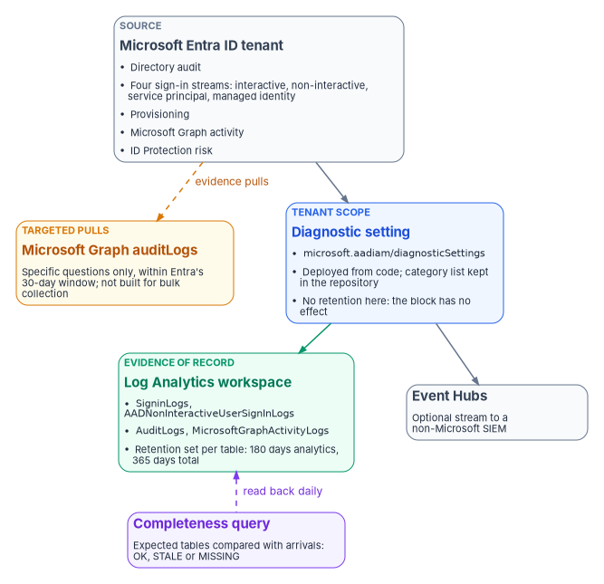

# Chapter 03 — Identity Telemetry from Entra ID

*Identity is the first plane an attacker touches and the first one a defender loses sight of, because Entra ID keeps its own logs for only a month unless someone deliberately sends them somewhere.*

::: {.callout-note}
## In this chapter
Which Microsoft Entra ID log categories exist, which Log Analytics table each lands in, and which ones the program enables in every tenant. How to deploy the tenant-scope diagnostic setting by portal, Bicep or `az rest`, why the retention block on that setting does nothing, and how to prove emission is working. It closes with the endpoint changes for GCC High and DoD, and with Microsoft Graph's audit APIs as a tool for pulling specific evidence, not for feeding a SIEM.
:::

[Chapter 02](02-the-evidence-contract.md) set the rule that every plane emits deliberately, under one evidence contract. Identity comes first because it is the join key for almost everything else: a mailbox read, a Key Vault secret retrieval and a role assignment all trace back to a sign-in. It is also the plane where the default is most misleading. Entra ID records audit and sign-in activity whether or not anyone configures anything, and the admin center shows it. That makes the tenant look instrumented. But with Entra ID P1 or P2, audit and sign-in data is kept for 30 days (seven days on the Free tier), Microsoft Graph activity logs aren't kept at all unless they are routed somewhere, and an upgrade never recovers data that already expired.[^c03-retention] An agency that hasn't created a diagnostic setting has a rolling 30-day window of identity history and nothing older.

The mechanism that fixes this is the Entra *diagnostic setting*: a tenant-level object that streams selected log categories to a Log Analytics workspace, an Event Hubs namespace, a storage account or a partner solution.[^c03-configure] This chapter is about getting that one object right, keeping it right, and proving it works.

{#fig-ch03-identity-emission-paths fig-alt="Top to bottom. At the top, a slate card for the Microsoft Entra ID tenant lists the log families: directory audit, four sign-in streams (interactive, non-interactive, service principal, managed identity), provisioning, Microsoft Graph activity and ID Protection risk. An arrow leads down to a blue card for the tenant-scope diagnostic setting, resource type microsoft.aadiam/diagnosticSettings, deployed from code. From it, a green arrow leads down to a green card for the Log Analytics workspace with table names such as SigninLogs, AADNonInteractiveUserSignInLogs, AuditLogs and MicrosoftGraphActivityLogs, retention set per table; a second arrow leads to a slate card beside it for Event Hubs feeding a non-Microsoft SIEM. Beside the diagnostic setting, an amber card for Microsoft Graph auditLogs APIs is joined to the tenant by a dashed arrow labeled targeted evidence pulls, within the 30-day window. A violet card below the workspace, the completeness query, reads back from it."}

## Before you start

| Requirement | Detail |
|---|---|
| Role | **Security Administrator** on the tenant, to create or edit a diagnostic setting.[^c03-log-options] |
| Custom security attributes | The `CustomSecurityAttributeAuditLogs` category is configured separately, on the **Custom security attributes** tab, and needs **Attribute Log Administrator** as well as Security Administrator.[^c03-log-options] |
| Destination | The workspace, event hub or storage account must exist before the setting is created.[^c03-configure] |
| Event Hubs tenancy | The subscription and Event Hubs namespace must both be associated with the Entra tenant whose logs are streamed.[^c03-event-hub] |
| Licensing | Microsoft Graph activity logs need Entra ID P1 or P2.[^c03-graph-activity] Microsoft Sentinel's Entra ID connector needs P1 or P2 to ingest sign-in logs, and Workload ID Premium for the two service-principal risk tables.[^c03-sentinel-entra] |

## The log categories and their tables

The category name you tick in the diagnostic setting is not always the table name you query. Microsoft says so directly in the ID Protection export guidance: the names in diagnostic settings "are not the same as the table names" used in KQL, and most of the tables carry an `AAD` prefix.[^c03-risk-export] The mapping isn't mechanical (`SignInLogs` lands in `SigninLogs`, with a lowercase *i*), so detection rules and retention settings must name the table, not the category.

The tier column is the program's design: **Core** categories carry the event-logging, record-content and record-generation evidence (NIST SP 800-53 AU-2, AU-3 and AU-12)[^c03-nist] for every tenant regardless of which features it uses; **High value** categories need ID Protection licensing; **Conditional** categories produce data only when a feature is deployed.

| Category (diagnostic setting) | Log Analytics table | Tier | What it captures |
|---|---|---|---|
| `AuditLogs` | `AuditLogs` | Core | Changes to applications, groups, users and licenses |
| `SignInLogs` | `SigninLogs` | Core | Interactive sign-ins: password entered or MFA challenge passed |
| `NonInteractiveUserSignInLogs` | `AADNonInteractiveUserSignInLogs` | Core | Sign-ins a client performs on a user's behalf with a token or code |
| `ServicePrincipalSignInLogs` | `AADServicePrincipalSignInLogs` | Core | Apps and service principals authenticating with certificates or client secrets |
| `ManagedIdentitySignInLogs` | `AADManagedIdentitySignInLogs` | Core | Managed identities, where Azure manages the secret |
| `ProvisioningLogs` | `AADProvisioningLogs` | Core | Users, groups and roles provisioned by the Entra provisioning service |
| `MicrosoftGraphActivityLogs` | `MicrosoftGraphActivityLogs` | Core | Every HTTP request against the tenant's resources through Microsoft Graph |
| `RiskyUsers` | `AADRiskyUsers` | High value | Users ID Protection assesses as at risk |
| `UserRiskEvents` | `AADUserRiskEvents` | High value | Individual user risk detections |
| `RiskyServicePrincipals` | `AADRiskyServicePrincipals` | High value | Workload identities assessed as risky |
| `ServicePrincipalRiskEvents` | `AADServicePrincipalRiskEvents` | High value | Workload identity risk detections |
| `RiskyAgents` | `AADRiskyAgents` | Conditional | Agent identities assessed as risky |
| `AgentRiskEvents` | `AADAgentRiskEvents` | Conditional | Agent identity risk detections |
| `ADFSSignInLogs` | `ADFSSignInLogs` | Conditional | AD FS application sign-ins; keep it while federation remains |
| `CustomSecurityAttributeAuditLogs` | `AADCustomSecurityAttributeAuditLogs` | Conditional | Changes to custom security attribute definitions and assignments |
| `NetworkAccessTrafficLogs` | `NetworkAccessTraffic` | Conditional | Global Secure Access traffic; no data without Internet or Private Access |
| `RemoteNetworkHealthLogs` | `RemoteNetworkHealthLogs` | Conditional | Global Secure Access remote-network health |
| `EnrichedOffice365AuditLogs` | `EnrichedMicrosoft365AuditLogs` | Conditional | Global Secure Access enriched Microsoft 365 logs; needs Internet Access and enrichment turned on |
| `MicrosoftServicePrincipalSignInLogs` | — | Not enabled | Microsoft first-party service-to-service sign-ins (preview) |

Category names and descriptions are from Microsoft's list of identity logs that can be streamed;[^c03-log-options] table names from the Sentinel Entra ID connector reference,[^c03-sentinel-entra] the ID Protection export mapping (including the agent risk tables)[^c03-risk-export] and the Azure Monitor table reference for custom security attributes.[^c03-csa-table] Microsoft recommends sending custom security attribute logs to a different destination from the directory audit logs, so attribute assignments aren't revealed by accident, and only Attribute Log Reader or Attribute Log Administrator can read them.[^c03-csa-manage] The program routes them to a separate workspace with narrower access.

::: {.callout-warning}
## Leave `MicrosoftServicePrincipalSignInLogs` off
Microsoft describes these preview logs as complex and high in volume, says they are "not essential for security investigations," and strongly advises against acting on them, for example by disabling applications, because that can cause misconfiguration and even tenant lock-out.[^c03-log-options] They cost money to ingest and invite exactly the wrong response. The program doesn't enable them.
:::

### Why all four sign-in streams are core

`SignInLogs` covers only interactive human sign-ins. It doesn't see a client app refreshing a token for a user, a service principal authenticating with a client secret, or a managed identity reading from Key Vault. Those are the other three sign-in categories, and they are where unattended credentials (the ones nobody is watching) do their work. A tenant that streams only `SignInLogs` is blind to every non-human authentication in the estate while appearing, on the sign-ins blade, to be fully instrumented.

The cost argument against them is real but doesn't change the answer. Microsoft notes that non-interactive and service-principal sign-ins can be five to ten times larger than interactive ones.[^c03-event-hub] Graph activity logs are larger again: Microsoft's own planning estimate is about 15 GiB a month of Azure Monitor Logs data for a 1,000-user tenant and about 1,200 GiB for 100,000 users, and diagnostic settings can't filter them, although a workspace transformation or the Basic table plan can reduce cost.[^c03-graph-activity] The program's position is that volume is managed with table plans and transformations, never by leaving a sign-in stream off. Microsoft Graph activity logs are what show what a compromised account or app actually *did* with its token, and Microsoft recommends routing them to the same workspace as the sign-in logs so the two can be joined.[^c03-log-options]

## Path A: the portal

For a one-time setup in a lab or a first tenant:

1. Sign in to the Microsoft Entra admin center as at least a Security Administrator.
2. Browse to **Entra ID** > **Monitoring & health** > **Diagnostic settings**. (**Export Settings** on the **Audit Logs** or **Sign-ins** page reaches the same place.)[^c03-event-hub]
3. Select **Add diagnostic setting**.
4. Enter a name. The name can't be changed when the setting is edited later,[^c03-event-hub] so choose one an assessor will recognize, such as `fmp-siem-emission-core`.
5. Select the Core categories, plus the High value categories if ID Protection is licensed.
6. Under **Destination details**, choose **Send to Log Analytics workspace** (and, for a non-Microsoft SIEM, **Stream to an event hub**), then the subscription and destination.
7. Select **Save**.[^c03-configure]

Don't judge success in the first hour. Microsoft's general guidance is that logs can take up to three days to start appearing in the destination; its ID Protection guidance suggests around 15 minutes for the risk tables.[^c03-configure][^c03-risk-export] Graph activity logs usually arrive within 30 minutes and occasionally take up to two hours.[^c03-graph-activity] The verification query later in this chapter is run at 24 hours and again at 72.

::: {.callout-note}
## The portal is right for the first tenant and wrong for the fleet
A setting someone clicked once has no source of truth, no review trail and no drift detection. FedRAMP's Consolidated Rules for 2026 include KSI-MLA-EVC, *Evaluating Configurations*, which expects the configuration of machine-based information resources, especially infrastructure as code, to be continuously evaluated and tested, and KSI-MLA-LET, which expects a current list of the event types that will be logged.[^c03-ksi-mla] The program deploys the Entra setting from code (Path B or C), keeps the category list in the repository as that list, and compares the deployed setting against it on a schedule.
:::

## Path B: tenant-scope Bicep

Entra diagnostic settings are the Azure Resource Manager resource type `microsoft.aadiam/diagnosticSettings`, API version `2017-04-01`, and they deploy only at **tenant** scope.[^c03-arm-aadiam] That is why the usual resource-scope tooling doesn't reach them.

::: {.callout-warning}
## Illustrative code
The templates, scripts and queries in this chapter are illustrative. They haven't been tested against a production tenant. Check every resource type, API version, category and table name against the Microsoft Learn pages cited, run them first in a test tenant, and put them through the program's change control before they touch a production identity system.
:::

```bicep
// entra-diagnostics.bicep
// Deploy with:
//   az deployment tenant create --location <region> \
//     --template-file entra-diagnostics.bicep \
//     --parameters workspaceId=<log-analytics-workspace-resource-id>
targetScope = 'tenant'

@description('Full resource ID of the destination Log Analytics workspace.')
param workspaceId string

@description('Diagnostic setting name. It cannot be changed after creation.')
param settingName string = 'fmp-siem-emission-core'

// Core and High value tiers. Keep this list in the repository; it is the
// program's record of which identity event types are logged.
var categories = [
  'AuditLogs'
  'SignInLogs'
  'NonInteractiveUserSignInLogs'
  'ServicePrincipalSignInLogs'
  'ManagedIdentitySignInLogs'
  'ProvisioningLogs'
  'MicrosoftGraphActivityLogs'
  'RiskyUsers'
  'UserRiskEvents'
  'RiskyServicePrincipals'
  'ServicePrincipalRiskEvents'
]

resource entraDiagnostics 'microsoft.aadiam/diagnosticSettings@2017-04-01' = {
  name: settingName
  properties: {
    workspaceId: workspaceId
    logs: [for category in categories: {
      category: category
      enabled: true
    }]
  }
}
```

The resource schema still includes a `retentionPolicy` block on each log entry,[^c03-arm-aadiam] and the source template this chapter replaces set it. It is left out on purpose.

::: {.callout-important}
## The retention block on a diagnostic setting does nothing
Diagnostic-settings storage retention is deprecated, and Microsoft disabled all of its retention functionality on September 30, 2025; any value left on a setting no longer has any effect. Storage retention is now set with an Azure Storage lifecycle management policy on the storage account, and Log Analytics retention is set per table in the workspace.[^c03-storage-retention] Setting `days: 3650` here and recording it as the agency's retention control is a finding waiting to happen.
:::

## Path C: `az rest`

`az monitor diagnostic-settings create` creates a setting on a resource identified by its resource ID,[^c03-azmon-diag] and the Entra setting is not a resource inside a subscription. The direct route is `az rest` against the tenant-scope Resource Manager path:

```bash
#!/usr/bin/env bash
# Create or update the Entra tenant diagnostic setting.
# Requires: Security Administrator on the tenant.
set -euo pipefail

ARM="https://management.azure.com"   # Azure Government: https://management.usgovcloudapi.net
SETTING_NAME="fmp-siem-emission-core"
WORKSPACE_ID="/subscriptions/${SUBSCRIPTION_ID}/resourceGroups/${RG}/providers/Microsoft.OperationalInsights/workspaces/${WORKSPACE}"

CATEGORIES=(
  AuditLogs SignInLogs NonInteractiveUserSignInLogs
  ServicePrincipalSignInLogs ManagedIdentitySignInLogs
  ProvisioningLogs MicrosoftGraphActivityLogs
  RiskyUsers UserRiskEvents
  RiskyServicePrincipals ServicePrincipalRiskEvents
)

LOGS_JSON=$(printf '%s\n' "${CATEGORIES[@]}" \
  | jq -R . | jq -s 'map({category: ., enabled: true})')

az rest --method PUT \
  --uri "${ARM}/providers/microsoft.aadiam/diagnosticSettings/${SETTING_NAME}?api-version=2017-04-01" \
  --headers "Content-Type=application/json" \
  --body "$(jq -n --arg ws "$WORKSPACE_ID" --argjson logs "$LOGS_JSON" \
      '{properties: {workspaceId: $ws, logs: $logs}}')"
```

Read the state back. This is also the way to see which categories a given tenant offers, because Microsoft's reference says to perform a GET on diagnostic settings to obtain the category list for a resource.[^c03-arm-aadiam]

```bash
az rest --method GET \
  --uri "${ARM}/providers/microsoft.aadiam/diagnosticSettings?api-version=2017-04-01" \
  --query "value[].{name:name, workspace:properties.workspaceId, categories:properties.logs[?enabled].category}" \
  -o jsonc
```

The program commits the output of that GET with each change, so the evidence package carries the deployed setting itself, not just the template that was meant to produce it.

## Retention: what the logging baseline asks for

OMB M-26-14 rescinded M-21-31 and set a minimum baseline: retained logs must be *searchable* for at least six months after creation and *retrievable* for a year. The memo defines the two words. Searchable data "can be immediately used for cyber defense," with no preparation step; retrievable data can be used after one or more intermediate steps, such as replaying it from long-term storage.[^c03-m2614] The baseline also lists the activities logs must support, including "determining the identity used for performing operations" and "identifying actions that affect changes to privilege levels."[^c03-m2614] Entra audit and sign-in logs are the primary evidence for both.

A Log Analytics workspace maps onto those definitions cleanly. Tables on the Analytics plan keep data in *analytics retention*, where it can be queried immediately, for up to two years; *total retention*, which adds low-cost long-term retention, can run to 12 years, and data in the long-term portion is reached through a search job.[^c03-la-retention] The default for most tables is 30 days.[^c03-la-retention] The program's design for every identity table above:

| Setting | Value | Why |
|---|---|---|
| Analytics retention | At least 180 days | Immediately queryable: M-26-14's *searchable* |
| Total retention | At least 365 days, longer where a records schedule requires it | Long-term retention reached by search job: *retrievable* |
| Table plan | Analytics for tables that detections query; Basic considered only for high-volume tables (Graph activity) that are hunted rather than alerted on | Cost managed by plan, not by leaving categories off |

Retention is set per table, by portal, `az monitor log-analytics workspace table update` with `--retention-time` and `--total-retention-time`, or `Update-AzOperationalInsightsTable`.[^c03-la-retention] Shortening a table's total retention takes effect only after a 30-day wait, which protects against mistakes; lengthening it applies to data already in the table.[^c03-la-retention] The Entra admin center's own 30-day window is no substitute: it is a viewing convenience, not evidence storage.

## Sovereign clouds

The endpoint you deploy to depends on which Entra cloud the tenant lives in, and that follows the Microsoft 365 environment. Office 365 GCC is paired with Microsoft Entra ID in commercial Azure; GCC High and DoD are paired with Entra ID in Azure Government.[^c03-feature-avail]

| Microsoft 365 environment | Resource Manager (diagnostic setting) | Microsoft Graph | Sign-in authority |
|---|---|---|---|
| GCC | `management.azure.com` | `https://graph.microsoft.com` | `login.microsoftonline.com` |
| GCC High | `management.usgovcloudapi.net` | `https://graph.microsoft.us` | `login.microsoftonline.us` |
| DoD | `management.usgovcloudapi.net` | `https://dod-graph.microsoft.us` | `login.microsoftonline.us` |

Graph endpoints and the GCC rule (keep using the worldwide endpoints) are from Microsoft's national cloud deployment page;[^c03-graph-deployments] Resource Manager endpoints from the Azure Government comparison.[^c03-azgov-compare] Microsoft Graph activity logs and the Graph audit log APIs are available in the US Government L4 and L5 (DoD) deployments.[^c03-graph-activity][^c03-signin-list] Microsoft Sentinel's Entra ID connector is generally available in both commercial Azure and Azure Government.[^c03-sentinel-feature] Feature availability still differs by cloud in places, and [Book 10](../b10-cloud-boundary/index.md) is the place to check each capability against the agency's boundary.

## Microsoft Graph: targeted evidence, not the feed

Graph's `auditLogs` APIs answer the question *show me this specific thing*: who granted this role, which sign-ins this app made last Tuesday. They are the wrong tool for continuous collection, and Microsoft says so: the API "isn't designed for pulling large amounts of activity data," and doing so "might lead to issues with pagination and performance."[^c03-graph-analyze] Graph also returns only what Entra still holds, which is the 30-day default window with P1 or P2.[^c03-signin-list][^c03-retention] The diagnostic setting is the feed; Graph is the magnifying glass.

| Endpoint | Returns |
|---|---|
| `GET /v1.0/auditLogs/directoryAudits` | Directory audit history: user, group, app and device management, PIM, access reviews, password resets and more[^c03-directoryaudit] |
| `GET /v1.0/auditLogs/signIns` | Interactive sign-ins and successful federated sign-ins; up to 1,000 per page, newest first[^c03-signin-list] |
| `GET /beta/auditLogs/signIns` with `signInEventTypes` | Non-interactive, service-principal and managed-identity sign-ins (beta; not for production use)[^c03-graph-analyze] |
| `GET /v1.0/auditLogs/provisioning` | Provisioning service activity[^c03-graph-analyze] |

The v1.0 `signIns` endpoint does not return the three non-human sign-in streams; Microsoft's examples reach them only through the beta endpoint with a `signInEventTypes` filter.[^c03-signin-list][^c03-graph-analyze] That is one more reason the evidence of record is the workspace, where all four streams are first-class tables.

### Permissions

`AuditLog.Read.All` is the least-privileged permission, delegated or application, for listing both directory audits and sign-ins; getting a single directory audit item needs `AuditLog.Read.All` *and* `Directory.Read.All`.[^c03-directoryaudit] For delegated access the signed-in user also needs a supporting role: Reports Reader, Security Reader or Security Administrator for directory audits, with Global Reader and Security Operator also supported for sign-ins.[^c03-directoryaudit][^c03-signin-list]

::: {.callout-warning}
## Conditional Access results are separately gated, and silently omitted
The `appliedConditionalAccessPolicies` property is left out of a `signIns` response unless the caller can read Conditional Access data: for an app, `Policy.Read.All`, `Policy.Read.ConditionalAccess` or `Policy.ReadWrite.ConditionalAccess`; for a user, a role such as Global Reader, Security Reader, Security Administrator or Conditional Access Administrator.[^c03-signin-list] Nothing in the response says the property was dropped. An evidence pull built without one of those permissions produces sign-in records that look complete and contain no Conditional Access evaluation, which is exactly what account management and least-privilege assessment (AC-2 and AC-6) turn on.[^c03-nist] Grant the narrowest of the three, `Policy.Read.ConditionalAccess`, to every evidence-collection app that reads sign-ins.
:::

### Examples

Always bound the time range; Microsoft advises a `createdDateTime` filter so the request doesn't time out.[^c03-signin-list] Conditional Access failures in one week:

```http
GET https://graph.microsoft.com/v1.0/auditLogs/signIns?$filter=conditionalAccessStatus eq 'failure' and createdDateTime ge 2026-10-01T00:00:00Z and createdDateTime lt 2026-10-08T00:00:00Z&$top=999
Authorization: Bearer {token}
```

Role-management changes since a date, with the Microsoft Graph PowerShell SDK (`Get-MgAuditLogDirectoryAudit` and `Get-MgAuditLogSignIn` are the audit and sign-in cmdlets[^c03-graph-analyze]):

```powershell
Connect-MgGraph -Scopes 'AuditLog.Read.All', 'Policy.Read.ConditionalAccess'

Get-MgAuditLogDirectoryAudit -All `
  -Filter "category eq 'RoleManagement' and activityDateTime ge 2026-10-01T00:00:00Z"
```

In GCC High, the app registration must be created in the Azure Government Entra admin center, and a scope that names the Graph domain must use the national-cloud domain; for app-only access the correct value is `https://graph.microsoft.us/.default`.[^c03-graph-sdk-clouds] In PowerShell that is `Connect-MgGraph -Environment USGov`, as in Microsoft's example.[^c03-graph-sdk-clouds] For DoD, use the `dod-graph.microsoft.us` domain from the table above.[^c03-graph-deployments]

## Verify emission

A setting that saved without error is not proof that logs are arriving. The program runs the query below against the destination workspace 24 and 72 hours after any change, and daily thereafter. It compares an explicit list of expected tables with what actually arrived, so a table that never received data shows up as a row marked `MISSING` instead of silently disappearing from the results. It uses `union isfuzzy=true`, which lets the query run when some of the named tables don't exist yet; without it, a single missing table makes the whole query fail.[^c03-kql-union]

```kusto
// Entra diagnostic-setting completeness.
// Pass: every expected table returns Status == "OK".
let expected = datatable(TableName: string) [
    "SigninLogs", "AADNonInteractiveUserSignInLogs",
    "AADServicePrincipalSignInLogs", "AADManagedIdentitySignInLogs",
    "AuditLogs", "AADProvisioningLogs", "MicrosoftGraphActivityLogs",
    "AADRiskyUsers", "AADUserRiskEvents"
];
let observed = union isfuzzy=true withsource=TableName
    SigninLogs, AADNonInteractiveUserSignInLogs,
    AADServicePrincipalSignInLogs, AADManagedIdentitySignInLogs,
    AuditLogs, AADProvisioningLogs, MicrosoftGraphActivityLogs,
    AADRiskyUsers, AADUserRiskEvents
    | where TimeGenerated > ago(7d)
    | summarize RecordCount = count(), LastRecord = max(TimeGenerated) by TableName;
expected
| join kind=leftouter observed on TableName
| project TableName, RecordCount, LastRecord,
    Status = case(isnull(LastRecord), "MISSING",
                  LastRecord < ago(24h), "STALE",
                  "OK")
| order by Status asc, TableName asc
```

`MISSING` means the category was never enabled, was enabled against a different workspace, or (for the risk tables) has had nothing to report; check the GET output from Path C before concluding anything. `STALE` is the more dangerous result: emission worked and then stopped, and any query over a wide time range will keep returning the old data and hide the gap. Some tenants legitimately produce no provisioning or risk events in a quiet week, so the program records an expected-quiet exception for those tables rather than lowering the bar for the sign-in tables.

Where the workspace is Microsoft Sentinel, its **Microsoft Entra ID** data connector writes these same categories to these same tables, and needs read and write permission on the Entra diagnostic settings to show its status.[^c03-sentinel-entra] The program still treats the tenant diagnostic setting, deployed from code, as the control of record, and checks for duplicate settings sending the same categories to the same workspace. How the tables become detections is [Chapter 05](05-from-log-warehouse-to-detection.md), and the control-level detail is in the compliance volume [Vol III Book 06, SIEM, XDR and Detection](https://github.com/WhalerMike/modernization-workbook/blob/main/docs/compliance/Vol_III_Book_06_SIEM_XDR_Detection.md).

## What this chapter doesn't cover

Entra diagnostic settings emit identity events. They don't emit Azure control-plane or resource activity, and they don't emit the Microsoft 365 unified audit log; both are [Chapter 04](04-platform-and-m365-telemetry.md). Conditional Access and PIM policy design, which produce many of the events logged here, is [Book 04](../b04-access/index.md). Telemetry that the authorization boundary itself blocks, and its compensating controls, is a boundary question for [Book 10](../b10-cloud-boundary/index.md).

::: {.callout-tip}
## Continue the book
[← Previous: Chapter 02 — Telemetry Is the Precondition: The Evidence Contract](02-the-evidence-contract.md) · [Book index](index.md) · [Next: Chapter 04 — Azure Platform and Microsoft 365 Audit Telemetry →](04-platform-and-m365-telemetry.md)
:::

[^c03-retention]: Microsoft Learn, "Microsoft Entra data retention," sections "How long does Microsoft Entra ID store the data?" and "Can I see last month's data after getting a premium license?," <https://learn.microsoft.com/entra/identity/monitoring-health/reference-reports-data-retention> (accessed Oct 21, 2026).
[^c03-configure]: Microsoft Learn, "Configure Microsoft Entra diagnostic settings for activity logs," sections "Prerequisites," "Select the logs and destination" and "Basic process," <https://learn.microsoft.com/entra/identity/monitoring-health/howto-configure-diagnostic-settings> (accessed Oct 21, 2026).
[^c03-log-options]: Microsoft Learn, "What are the identity logs you can stream to an endpoint?," sections "Log streaming requirements and options" and "Activity log options," <https://learn.microsoft.com/entra/identity/monitoring-health/concept-diagnostic-settings-logs-options> (accessed Oct 21, 2026).
[^c03-event-hub]: Microsoft Learn, "How to stream activity logs to an event hub," sections "Stream logs to an event hub" and "Activity log integration options and considerations," <https://learn.microsoft.com/entra/identity/monitoring-health/howto-stream-logs-to-event-hub> (accessed Oct 21, 2026).
[^c03-graph-activity]: Microsoft Learn, "Access Microsoft Graph activity logs," sections "Prerequisites," "Cost planning estimates," "Cost reduction for Log Analytics" and "Limitations," and the national cloud availability table, <https://learn.microsoft.com/graph/microsoft-graph-activity-logs-overview> (accessed Oct 21, 2026).
[^c03-sentinel-entra]: Microsoft Learn, "Send data to Microsoft Sentinel using the Microsoft Entra ID data connector," sections "Prerequisites" and "Microsoft Entra ID data connector data types," <https://learn.microsoft.com/azure/sentinel/connect-azure-active-directory> (accessed Oct 21, 2026).
[^c03-risk-export]: Microsoft Learn, "How To: Export risk data," sections "Diagnostic settings" and "Log Analytics" (category-to-table mapping), <https://learn.microsoft.com/entra/id-protection/howto-export-risk-data> (accessed Oct 21, 2026).
[^c03-nist]: National Institute of Standards and Technology, SP 800-53 Rev. 5, *Security and Privacy Controls for Information Systems and Organizations*, controls AC-2, AC-6, AU-2, AU-3, AU-11 and AU-12 (OSCAL catalog release 5.2.0), <https://csrc.nist.gov/pubs/sp/800/53/r5/upd1/final> and <https://github.com/usnistgov/oscal-content/tree/main/nist.gov/SP800-53/rev5> (accessed Oct 21, 2026).
[^c03-csa-table]: Microsoft Learn, Azure Monitor Logs table reference, "AADCustomSecurityAttributeAuditLogs," <https://learn.microsoft.com/azure/azure-monitor/reference/tables/aadcustomsecurityattributeauditlogs> (accessed Oct 21, 2026).
[^c03-csa-manage]: Microsoft Learn, "Manage access to custom security attributes in Microsoft Entra ID," section "Custom security attribute audit logs," <https://learn.microsoft.com/entra/fundamentals/custom-security-attributes-manage> (accessed Oct 21, 2026).
[^c03-ksi-mla]: FedRAMP, *FedRAMP Consolidated Rules for 2026*, Key Security Indicators, "Monitoring, Logging, and Auditing" (KSI-MLA-EVC, KSI-MLA-LET, KSI-MLA-OSM, KSI-MLA-RVL), <https://www.fedramp.gov/2026/providers/20x/key-security-indicators/monitoring-logging-and-auditing/> (accessed Oct 21, 2026).
[^c03-arm-aadiam]: Microsoft Learn, Azure Resource Manager template reference, "microsoft.aadiam diagnosticSettings 2017-04-01," Bicep resource definition and property values, <https://learn.microsoft.com/azure/templates/microsoft.aadiam/2017-04-01/diagnosticsettings> (accessed Oct 21, 2026).
[^c03-storage-retention]: Microsoft Learn, "Migrate from diagnostic settings storage retention to Azure Storage lifecycle management," <https://learn.microsoft.com/azure/azure-monitor/essentials/migrate-to-azure-storage-lifecycle-policy> (accessed Oct 21, 2026).
[^c03-azmon-diag]: Microsoft Learn, "Diagnostic settings in Azure Monitor," section "Methods for creating a diagnostic setting" (CLI tab), <https://learn.microsoft.com/azure/azure-monitor/platform/diagnostic-settings> (accessed Oct 21, 2026).
[^c03-m2614]: Office of Management and Budget, M-26-14, *Ensuring Effective and Efficient Agency Logging and Network Visibility to Defend Against Evolving Cyber Threats*, May 22, 2026, rescission of M-21-31 and Appendix B (Minimum Logging Baseline Requirements and Objectives, items 1 and 5, notes 6 and 7), <https://www.whitehouse.gov/wp-content/uploads/2026/05/M-26-14-Ensuring-Effective-and-Efficient-Agency-Logging-and-Network-Visibility-to-Defend-Against-Evolving-Cyber-Threats.pdf> (accessed Oct 21, 2026).
[^c03-la-retention]: Microsoft Learn, "Manage data retention in a Log Analytics workspace," sections "Analytics, long-term, and total retention," "How retention modifications work" and "Configure table-level retention," <https://learn.microsoft.com/azure/azure-monitor/logs/data-retention-configure> (accessed Oct 21, 2026).
[^c03-feature-avail]: Microsoft Learn, "Cloud feature availability for US Government customers," section "Microsoft 365 integration," <https://learn.microsoft.com/azure/security/fundamentals/feature-availability> (accessed Oct 21, 2026).
[^c03-graph-deployments]: Microsoft Learn, "Microsoft Graph national cloud deployments," sections "App registration and token service root endpoints" and "Microsoft Graph and Graph Explorer service root endpoints," <https://learn.microsoft.com/graph/deployments> (accessed Oct 21, 2026).
[^c03-azgov-compare]: Microsoft Learn, "Compare Azure Government and global Azure," section "Guidance for developers" (Azure Resource Manager endpoint), <https://learn.microsoft.com/azure/azure-government/compare-azure-government-global-azure> (accessed Oct 21, 2026).
[^c03-signin-list]: Microsoft Learn, Microsoft Graph v1.0 reference, "List signIns," sections "Permissions" and "Optional query parameters," and national cloud availability table, <https://learn.microsoft.com/graph/api/signin-list?view=graph-rest-1.0> (accessed Oct 21, 2026).
[^c03-sentinel-feature]: Microsoft Learn, "Microsoft Sentinel feature support for Azure commercial/other clouds," section "Data collection," <https://learn.microsoft.com/azure/sentinel/feature-availability> (accessed Oct 21, 2026).
[^c03-graph-analyze]: Microsoft Learn, "How to analyze activity logs with Microsoft Graph," sections "Access reports using Microsoft Graph Explorer," "Sample sign-in queries" and "Access reports using Microsoft Graph PowerShell," <https://learn.microsoft.com/entra/identity/monitoring-health/howto-analyze-activity-logs-with-microsoft-graph> (accessed Oct 21, 2026).
[^c03-directoryaudit]: Microsoft Learn, Microsoft Graph v1.0 reference, "List directoryAudits," <https://learn.microsoft.com/graph/api/directoryaudit-list?view=graph-rest-1.0>, and "Get directoryAudit," <https://learn.microsoft.com/graph/api/directoryaudit-get?view=graph-rest-1.0>, sections "Permissions" (accessed Oct 21, 2026).
[^c03-graph-sdk-clouds]: Microsoft Learn, "Access national cloud deployments with the Microsoft Graph SDKs," sections "Prerequisites," "Permission scopes" and "Examples" (PowerShell tab), <https://learn.microsoft.com/graph/sdks/national-clouds> (accessed Oct 21, 2026).
[^c03-kql-union]: Microsoft Learn, Kusto Query Language reference, "union operator," parameter `isfuzzy`, <https://learn.microsoft.com/kusto/query/union-operator> (accessed Oct 21, 2026).
