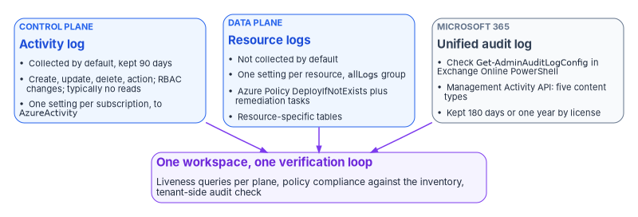
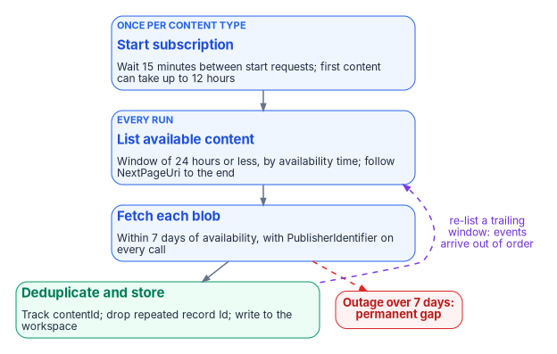

# Chapter 04 — Azure Platform and Microsoft 365 Audit Telemetry

*An agency that exports only the activity log can prove a key vault was created and can't prove who read its secrets; one that never checks its unified audit log may have no Microsoft 365 history at all.*

::: {.callout-note}
## In this chapter
The two Azure planes, the activity log (control plane) and resource logs (data plane), and how to export each by CLI and Bicep. Why the program sends resource logs to resource-specific tables, and how Azure Policy's DeployIfNotExists enforces emission on new resources, with the limits that leave gaps if nobody runs a remediation task. Then the third plane, the Microsoft 365 unified audit log: confirming it is on, registering for the Office 365 Management Activity API, the subscription and content rules that break first-time collectors, the GCC endpoints, and the license tiers that decide how long the evidence survives.
:::

[Chapter 03](03-identity-telemetry.md) covered identity. Neither of the two pipelines in this chapter is touched by the Entra diagnostic setting: Azure resource activity has its own diagnostic settings, and Microsoft 365 workload activity (Exchange, SharePoint, OneDrive, Teams, Power Platform, Purview) lives in the unified audit log, read through its own API. An agency can have perfect identity telemetry and still be blind to what happened inside its subscriptions and its mailboxes.

{#fig-ch04-three-planes fig-alt="Three columns, each a stack of cards. Left, blue: Azure control plane, the activity log, collected by default and kept 90 days, exported by one diagnostic setting per subscription to the AzureActivity table; it records create, update, delete and action operations and RBAC changes but typically not reads. Middle, blue: Azure resource plane, resource logs, not collected by default, one diagnostic setting per resource, enforced by Azure Policy DeployIfNotExists plus remediation tasks, landing in resource-specific tables. Right, slate: Microsoft 365 unified audit log, verified with Get-AdminAuditLogConfig in Exchange Online PowerShell, collected through Office 365 Management Activity API subscriptions to five content types, retained 180 days or one year by license. All three columns point down to a violet card: one workspace, one verification loop."}

## Part 1: the Azure activity log

The activity log records control-plane operations: creating a virtual machine, changing a key vault access policy, a failed deployment. Azure collects it by default, keeps it for 90 days and then deletes it, and doesn't charge for it during that time.[^c04-activity-log] It "doesn't typically capture read operations."[^c04-activity-log] Exporting it to a Log Analytics workspace incurs no ingestion charge, only retention beyond 90 days, and the data lands in the `AzureActivity` table.[^c04-activity-log] One more reason to export it: the activity log is the only place Azure records who created a resource, and that record expires with the 90-day window.[^c04-activity-log]

### Categories

| Category | Contains |
|---|---|
| `Administrative` | Every create, update, delete and action operation through Resource Manager, including all Azure RBAC changes in the subscription |
| `Security` | Alerts generated by Microsoft Defender for Cloud |
| `Policy` | Every effect action Azure Policy performs, such as audit and deny |
| `ServiceHealth` | Azure service health incidents affecting the subscription's resources |
| `ResourceHealth` | Resource health changes: Available, Unavailable, Degraded, Unknown |
| `Alert` | Azure alert activations |
| `Autoscale` | Autoscale engine operations |
| `Recommendation` | Azure Advisor recommendations |

Definitions are from the activity log schema.[^c04-activity-schema] `Administrative`, `Security` and `Policy` are the core of the evidence: `Administrative` is where Azure RBAC changes are recorded,[^c04-activity-schema] which makes it the account-management and least-privilege evidence (AC-2, AC-6) for the Azure estate.[^c04-nist] The program enables all eight. The volume is small next to resource logs and there is no ingestion charge, and the two health categories are what lets an incident team rule out a platform outage before blaming an attacker.

### Export by CLI

The activity log needs the **subscription** form of the command. Microsoft's guidance is to use `az monitor diagnostic-settings subscription create` or `update`; the plain `az monitor diagnostic-settings create` is resource-scoped.[^c04-azmon-diag]

::: {.callout-warning}
## Illustrative code
The commands, templates and queries in this chapter are illustrative. They haven't been tested against a production subscription or tenant. Check each command, parameter, table and endpoint against the Microsoft Learn pages cited, run it first in a test environment, and put it through the program's change control before production.
:::

```bash
az monitor diagnostic-settings subscription create \
  --name "fmp-activity-log-export" \
  --location "<region>" \
  --workspace "/subscriptions/${SUBSCRIPTION_ID}/resourceGroups/${RG}/providers/Microsoft.OperationalInsights/workspaces/${WORKSPACE}" \
  --logs '[
    {"category": "Administrative", "enabled": true},
    {"category": "Security",       "enabled": true},
    {"category": "Policy",         "enabled": true},
    {"category": "ServiceHealth",  "enabled": true},
    {"category": "ResourceHealth", "enabled": true},
    {"category": "Alert",          "enabled": true},
    {"category": "Autoscale",      "enabled": true},
    {"category": "Recommendation", "enabled": true}
  ]'
```

The command's parameters (`--name`, `--location`, `--workspace`, `--logs`) and the eight category names match Microsoft's CLI reference and its example.[^c04-cli-sub]

::: {.callout-important}
## `New-AzDiagnosticSetting` can't export the activity log
Microsoft's PowerShell guidance for diagnostic settings is explicit: "You can't use this method for an activity log." It directs PowerShell users to deploy a Resource Manager template instead.[^c04-azmon-diag] Teams that standardize on PowerShell sometimes conclude from a failed `New-AzDiagnosticSetting` call that the activity log can't be exported. It can; use the subscription CLI command or the template below.
:::

### Export by Bicep at subscription scope

```bicep
// activity-log-export.bicep
// Deploy with: az deployment sub create --location <region> --template-file activity-log-export.bicep
targetScope = 'subscription'

param workspaceId string
param settingName string = 'fmp-activity-log-export'

var categories = [
  'Administrative'
  'Security'
  'Policy'
  'ServiceHealth'
  'ResourceHealth'
  'Alert'
  'Autoscale'
  'Recommendation'
]

resource activityLogExport 'Microsoft.Insights/diagnosticSettings@2021-05-01-preview' = {
  name: settingName
  properties: {
    workspaceId: workspaceId
    logs: [for category in categories: {
      category: category
      enabled: true
    }]
  }
}
```

### Management groups don't replace subscription settings

The source pages for this chapter suggested setting the activity log export once at the top management group instead of on every subscription. Microsoft's guidance doesn't support that. A management-group diagnostic setting exports activity log events for that management group and all management groups beneath it, but it "doesn't capture every subscription-level activity log event." Resource Manager writes a `hierarchy` property on its events, resource providers outside Resource Manager don't, and events without it never propagate upward, not even to the root management group.[^c04-activity-log] Microsoft's answer is a subscription-level setting on every subscription, with all categories selected, kept even when a management group also exports.[^c04-activity-log]

The program does both: a management-group setting for management-group events (policy assignments, hierarchy changes) and a subscription setting everywhere, enforced by policy (Part 3). That produces some duplicate events, which Microsoft accepts as the price of not missing any, and removes at query time with a hash of all fields:[^c04-activity-log]

```kusto
AzureActivity
| extend Hash = hash(dynamic_to_json(pack_all()))
| summarize arg_max(TimeGenerated, *) by Hash
```

An assessor accepts a deduplicated stream. Nobody accepts a gap.

## Part 2: resource logs

Resource logs record data-plane operations inside a resource, such as getting a secret from a key vault or making a request to a database. They aren't collected by default, and each resource needs its own diagnostic setting.[^c04-activity-log][^c04-resource-logs] Each resource can carry up to five diagnostic settings, and a single setting can send to at most one destination of each type.[^c04-azmon-diag] Microsoft also notes that resource logs "aren't completely lossless": the pipeline retries but doesn't give transactional guarantees,[^c04-resource-logs] which is one reason the program's verification checks for liveness rather than assuming delivery.

Categories vary by resource type. Discover what a resource supports before writing its setting:

```bash
az monitor diagnostic-settings categories list \
  --resource "${RESOURCE_ID}" \
  --query "value[].{name:name, type:categoryType, groups:categoryGroups}" -o table
```

Then create the setting with a category group. `allLogs` means every category the resource has, and `audit` means the logs that record customer interactions with data or the service's settings; if Microsoft adds a category to a group later, collection picks it up automatically.[^c04-azmon-diag] The program uses `allLogs` as the baseline because it survives new categories:

```bash
az monitor diagnostic-settings create \
  --name "fmp-resource-logs" \
  --resource "${RESOURCE_ID}" \
  --workspace "${WORKSPACE_RESOURCE_ID}" \
  --logs '[{"categoryGroup": "allLogs", "enabled": true}]' \
  --metrics '[{"category": "AllMetrics", "enabled": true}]' \
  --export-to-resource-specific true
```

Two notes from Microsoft's guidance apply. Not every service offers category groups, and where it doesn't, the option isn't there.[^c04-azmon-diag] And enabling the `audit` category for Azure SQL Database doesn't turn on database auditing; that is configured on the database's auditing pane.[^c04-azmon-diag] A diagnostic setting routes logs; it doesn't make a service generate them.

### Resource-specific tables, not `AzureDiagnostics`

`--export-to-resource-specific true` sends logs to a dedicated table per category instead of the shared `AzureDiagnostics` table. Microsoft lists the advantages (easier queries, discoverable schemas, better ingestion and query performance, and RBAC on a specific table), says all Azure services will eventually use resource-specific mode, and recommends it for any new diagnostic setting where a choice is offered.[^c04-resource-logs] Most resources don't offer a choice; they write in one mode or the other.[^c04-resource-logs]

For compliance work the deciding issue is the column limit. Every Log Analytics table is limited to 500 columns, and `AzureDiagnostics`, which collects the superset of every resource type's fields, is the table most likely to hit it.[^c04-azurediagnostics] Data isn't lost when that happens, as the source page claimed; it is moved into a dynamic property bag column called `AdditionalFields`.[^c04-azurediagnostics] The effect on detection is nearly as bad, though: a rule written against a named column silently stops matching once that field starts arriving inside `AdditionalFields`, and every query has to typecast what it extracts.[^c04-azurediagnostics] Resource-specific tables have their own schema and can't be crowded out. The trade-off is that rules must name the specific table. The program decides once, resource-specific wherever offered, and applies it everywhere, because a fleet that mixes modes is the hardest to write detections for. Switching an existing setting to resource-specific mode leaves earlier data in `AzureDiagnostics` until retention removes it, so queries need a `union` across both tables for the transition period.[^c04-resource-logs]

::: {.callout-warning}
## The self-reference loop and the rename trap
A storage account or Event Hubs namespace can't be selected as the destination for its own resource logs in the portal, because writing logs about writing logs would loop forever. Microsoft notes that this block exists only in the portal: PowerShell, the CLI, the REST API and Resource Manager templates will create the loop if told to.[^c04-azmon-diag] Any script that applies a setting to every resource in a subscription must exclude the logging storage accounts and event hubs explicitly.

Microsoft also warns to delete a resource's diagnostic settings when the resource is deleted, renamed or moved; otherwise a resource re-created with the same identity can inherit the old setting.[^c04-azmon-diag] Decommissioning runbooks include that step.
:::

## Part 3: enforce emission with Azure Policy

Everything above configures what exists today. A resource created tomorrow is born silent unless policy makes emission a property of the platform rather than a checklist item. Azure Policy's built-in definitions cover both planes:

| Built-in | Effect | Scope |
|---|---|---|
| *Configure Azure Activity logs to stream to specified Log Analytics workspace* | DeployIfNotExists | Subscription activity log[^c04-policy-azmon] |
| *Enable allLogs category group resource logging for supported resources to Log Analytics* (initiative, 140 policies) | DeployIfNotExists per resource type | Resource logs[^c04-policy-initiatives] |
| *Enable audit category group resource logging for supported resources to Log Analytics* (initiative, 69 policies) | DeployIfNotExists per resource type | Resource logs, `audit` group only[^c04-policy-initiatives] |
| *Enable logging by category group for `<resource type>` to Log Analytics* | DeployIfNotExists, AuditIfNotExists or Disabled | One resource type[^c04-policy-builtins] |

The program assigns the activity log policy and the `allLogs` initiative at the top management group, with an AuditIfNotExists assignment where an assessment-only view is wanted first. The initiatives cover "supported resources," a list of resource types, not every resource type in Azure, so a resource type outside the list needs its own definition or a documented exception.

::: {.callout-important}
## Where DeployIfNotExists stops
A DeployIfNotExists policy acts when a resource provider handles a create or update request and returns success; it then waits a configurable delay (10 minutes by default) and deploys its template if the related resource, here the diagnostic setting, doesn't exist or doesn't meet the existence condition.[^c04-dine] During a regular compliance evaluation it only *marks* matching resources non-compliant and takes no action; existing resources are fixed only by a **remediation task**.[^c04-dine] The common failure: the initiative is assigned, new resources comply, the dashboard trends green, and every resource that predates the assignment goes on emitting nothing.

Remediation tasks have limits of their own. One task remediates one DeployIfNotExists policy at a time, so an initiative of 140 policies needs a task per non-compliant policy. A task remediates 500 resources by default, up to 50,000. A remediation task can be created during assignment only for subscription-level assignments; for management-group assignments it is created after evaluation has determined compliance.[^c04-remediate]

The assignment's managed identity does the deployment and needs the roles in the definition's `roleDefinitionIds`. Built-in definitions carry those roles already, and the portal grants them automatically; an assignment created by SDK, template or pipeline must grant them by hand, or every remediation deployment fails.[^c04-remediate] Changing a definition doesn't update the identity's roles.[^c04-remediate]
:::

The PowerShell and CLI forms are `Start-AzPolicyRemediation -Name <name> -PolicyAssignmentId <id>` and `az policy remediation create --name <name> --policy-assignment <id>`, with `-ResourceCount` and `-ParallelDeploymentCount` to size the run.[^c04-remediate] The program's sequence is: assign, wait for the first evaluation, run a remediation task per policy, then compare the compliant count with the resource inventory.

That comparison is also the program's answer to FedRAMP's KSI-MLA-EVC (configurations, especially infrastructure as code, continuously evaluated and tested) and KSI-MLA-LET (a current list of the event types logged).[^c04-ksi-mla] A policy assignment that evaluates continuously against the full inventory is that evaluation; a spreadsheet of resources somebody checked once is not. Servers outside Azure are governed through Azure Arc and machine configuration, covered in [Book 05](../b05-devices/index.md).

### Verify Azure emission

Control-plane liveness, by subscription and category:

```kusto
// Azure control-plane emission health.
AzureActivity
| where TimeGenerated > ago(24h)
| summarize Events = count(), LastEvent = max(TimeGenerated)
    by SubscriptionId, CategoryValue
| extend Stale = LastEvent < ago(6h)
| order by Stale desc, SubscriptionId asc, CategoryValue asc
```

`CategoryValue` and `SubscriptionId` are the documented `AzureActivity` columns for category and subscription.[^c04-azureactivity] Microsoft notes that string values in this table can vary in case, so comparisons should use case-insensitive operators such as `=~`.[^c04-activity-log] A quiet category, such as `Autoscale` in a subscription with no autoscale settings, is normal; a quiet `Administrative` category in a working subscription is not.

The query can't show a subscription that has never sent an event, which is precisely the one to find. Check the settings directly against the subscription list:

```bash
# Subscriptions with no activity-log diagnostic setting.
for sub in $(az account list --query "[].id" -o tsv); do
  count=$(az monitor diagnostic-settings subscription list \
            --subscription "$sub" --query "length(value)" -o tsv 2>/dev/null || echo 0)
  [ "${count:-0}" -eq 0 ] && echo "NO ACTIVITY LOG EXPORT: $sub"
done
```

Resource types still arriving in the shared table are the migration backlog for resource-specific mode:

```kusto
AzureDiagnostics
| where TimeGenerated > ago(24h)
| summarize Events = count(), LastEvent = max(TimeGenerated) by ResourceType, ResourceProvider
| order by Events desc
```

None of these queries proves *completeness*; they prove that something is arriving. Only the policy compliance state, evaluated against the full resource inventory, shows coverage. The program reports the compliance percentage as the coverage metric and treats the queries as liveness checks on top of it.

## Part 4: the Microsoft 365 unified audit log

The unified audit log covers Exchange Online, SharePoint, OneDrive, Microsoft Entra ID, Teams, Power BI and other Microsoft 365 services.[^c04-sual] It is the plane most often assumed rather than checked.

### Step 1: confirm auditing is on

Microsoft says audit logging is on by default for Microsoft 365 organizations but tells administrators to verify it. It isn't on by default for Small and Medium Business licenses (Business Basic, Standard and Premium) or for unmanaged tenants on enterprise free trials.[^c04-audit-enable] Check in **Exchange Online PowerShell**:

```powershell
Connect-ExchangeOnline
Get-AdminAuditLogConfig | Format-List UnifiedAuditLogIngestionEnabled
```

`True` means auditing is on.[^c04-audit-enable]

::: {.callout-warning}
## Run it in Exchange Online PowerShell, not Security & Compliance PowerShell
`Get-AdminAuditLogConfig` exists in both modules, but in Security & Compliance PowerShell the `UnifiedAuditLogIngestionEnabled` property "is always `False`, even when auditing is turned on."[^c04-audit-enable] An operator or an automated check that runs it in the wrong session records a finding against a compliant tenant. The program's check script connects with `Connect-ExchangeOnline` and records the module in its output.
:::

### Step 2: turn it on if needed

In the Microsoft Purview portal, open the **Audit** solution and select the **Start recording user and admin activity** banner; or, in Exchange Online PowerShell:

```powershell
Connect-ExchangeOnline
Set-AdminAuditLogConfig -UnifiedAuditLogIngestionEnabled $true
```

The change can take up to 60 minutes to take effect, and events can take several more hours to become searchable. The operator needs the **Audit Logs** role in Exchange Online, which the Compliance Management and Organization Management role groups hold by default.[^c04-audit-enable]

::: {.callout-important}
## Turning auditing off blinds everything downstream
With auditing off, neither the Office 365 Management Activity API nor Microsoft Sentinel can reach audit data, Purview audit searches return nothing, and `Search-UnifiedAuditLog` returns nothing.[^c04-audit-enable] Changes to the auditing status are themselves recorded, with the time, the administrator and the IP address,[^c04-audit-enable] and the program treats `Set-AdminAuditLogConfig` as a high-severity detection: disabling tenant auditing is one of the few actions that destroys the record of everything after it. The tenant-side check:

```powershell
Search-UnifiedAuditLog -Operations Set-AdminAuditLogConfig `
  -StartDate (Get-Date).AddDays(-90) -EndDate (Get-Date) `
  -SessionCommand ReturnLargeSet
```
:::

`Search-UnifiedAuditLog` returns 100 records by default, so an investigation that needs more uses `-SessionCommand ReturnLargeSet`, which pages to 50,000 unsorted results.[^c04-sual] Microsoft recommends the Management Activity API, not this cmdlet, for programmatic download of audit data.[^c04-sual]

### Step 3: register the collector

The Management Activity API relies on Entra ID and OAuth2; the collector is an app registered in the tenant with the Office 365 Management APIs permission *Read activity data for your organization*, which grants the `ActivityFeed.Read` claim every call must carry.[^c04-mgmt-api][^c04-mgmt-faq] Most collectors use the client-credentials flow.[^c04-mgmt-faq] The API host depends on the Microsoft 365 plan:[^c04-mgmt-api]

| Plan | API root | Entra ID authority |
|---|---|---|
| Enterprise (commercial) | `https://manage.office.com` | `login.microsoftonline.com` |
| GCC | `https://manage-gcc.office.com` | `login.microsoftonline.com` |
| GCC High | `https://manage.office365.us` | `login.microsoftonline.us` |
| DoD | `https://manage.protection.apps.mil` | `login.microsoftonline.us` |

GCC tenants sit in commercial Entra ID and GCC High and DoD tenants in Azure Government's,[^c04-feature-avail] which is where the authority column comes from.[^c04-graph-deployments] The source page listed `login.windows.net` for GCC; the program uses `login.microsoftonline.com`, the commercial authority Microsoft documents.

::: {.callout-note}
## GCC differs here even though it matches worldwide elsewhere
In GCC, Microsoft Graph and the Azure portal use the worldwide endpoints.[^c04-graph-deployments] The Management Activity API does not: GCC has its own `manage-gcc.office.com` host.[^c04-mgmt-api] A collector that authenticates and calls Graph successfully, and then points at `manage.office.com`, fails on this API, and because the Graph calls worked, the cloud mismatch is the last thing anyone suspects.
:::

### Step 4: subscribe to the content types

The API has no per-event selection. A collector subscribes, per tenant, to content types:[^c04-mgmt-api]

| Content type | Contents |
|---|---|
| `Audit.AzureActiveDirectory` | Entra ID events as recorded in the unified audit log |
| `Audit.Exchange` | Exchange events |
| `Audit.SharePoint` | SharePoint (and OneDrive) events |
| `Audit.General` | All other workloads, including Teams[^c04-teams-general] |
| `DLP.All` | Data loss prevention events for all workloads |

DLP sensitive data in the feed is visible only to callers granted the *Read DLP sensitive data* permission.[^c04-mgmt-api]

```powershell
# $headerParams holds an Authorization header with a token for the API root.
$tenantGuid = '<tenant-guid>'
$publisher  = '<tenant-guid>'                     # in-house collector: the agency's own tenant GUID
$resource   = 'https://manage-gcc.office.com'     # GCC; see the endpoint table

foreach ($contentType in 'Audit.AzureActiveDirectory', 'Audit.Exchange',
                         'Audit.SharePoint', 'Audit.General', 'DLP.All') {
    Invoke-RestMethod -Method Post -Headers $headerParams `
      -Uri "$resource/api/v1.0/$tenantGuid/activity/feed/subscriptions/start?contentType=$contentType&PublisherIdentifier=$publisher"
    Start-Sleep -Seconds 900   # 15-minute wait between start requests
}

# Confirm what is subscribed.
Invoke-RestMethod -Method Get -Headers $headerParams `
  -Uri "$resource/api/v1.0/$tenantGuid/activity/feed/subscriptions/list?PublisherIdentifier=$publisher"
```

`PublisherIdentifier` is the tenant GUID of the organization that wrote the collector, not the app ID. For an agency's own collector that is its own tenant GUID; for a vendor product it is the vendor's. Requests without it share one global throttling quota with every other caller who omitted it, and Microsoft says it belongs on every production call, including the GET for each content blob.[^c04-mgmt-api][^c04-mgmt-faq]

### Step 5: list and retrieve content

```powershell
Invoke-RestMethod -Method Get -Headers $headerParams `
  -Uri "$resource/api/v1.0/$tenantGuid/activity/feed/subscriptions/content?contentType=Audit.AzureActiveDirectory&startTime=2026-10-20T00:00&endTime=2026-10-21T00:00&PublisherIdentifier=$publisher"
```

The rules, all from Microsoft's API reference and FAQ:[^c04-mgmt-api][^c04-mgmt-faq]

- `startTime` and `endTime` must both be given or both omitted, no more than 24 hours apart, with the start no more than seven days in the past. Results for a longer span "could be partial results and should not be taken into account."
- The times select content by when it **became available** (`contentCreated`), not by when the events happened. There is no way to ask the API for events that occurred in a given period.
- Results are paged. Keep following the `NextPageUri` response header until a response arrives without one.
- Content can be fetched for seven days after it becomes available. A collector outage longer than that is a permanent gap.
- Stopping a subscription loses whatever became available while it was stopped; restarting doesn't recover it.
- Webhooks are optional and Microsoft is de-emphasizing them; polling the `/content` operation is the simpler design, and Microsoft reports that webhook notifications have lately been slower than polling.

{#fig-ch04-audit-collector-loop fig-alt="Top to bottom, four cards joined by arrows. First, blue, once per content type: start subscription, waiting 15 minutes between start requests, with first content possibly taking up to 12 hours. Second, blue, every run: list available content in a window of 24 hours or less by availability time, following NextPageUri to the end. Third, blue: fetch each blob within 7 days of availability, with PublisherIdentifier on every call. Fourth, green: deduplicate on contentId and record Id and write to the workspace. A dashed violet arrow loops from the fourth card back to the listing step, labeled re-list a trailing window because events arrive out of order. A dashed red arrow from the fetch step leads to a red pill: outage over 7 days is a permanent gap."}

::: {.callout-warning}
## Two timing rules that break first-time collectors
After a subscription-start request, wait 15 minutes before making another; stopping a subscription isn't throttled. And after a subscription is created, "it can take up to 12 hours for the first content blobs to become available."[^c04-mgmt-api] A team that starts all five subscriptions in a tight loop and declares failure an hour later has hit both rules at once.

Once flowing, there is still no latency guarantee. Microsoft says most notifications go out within an hour, core services (Exchange, SharePoint, OneDrive, Teams) typically appear in 60 to 90 minutes, and it prioritizes completeness over latency without committing to a delivery time.[^c04-mgmt-faq]
:::

::: {.callout-important}
## Events are not in order, and duplicates are by design
Content blobs are aggregated across many servers and datacenters, so events "will not necessarily appear in the order in which they occurred," and a blob can contain events older than those in an earlier blob.[^c04-mgmt-api] Separately, the audit service may write the same event twice when it retries after an error, and the API, unlike the Purview export, doesn't remove the duplicates; Microsoft makes that the SIEM's job.[^c04-mgmt-faq]

A collector that uses "last blob retrieved" or "latest event time" as its high-water mark will drop events. The program's collector tracks each `contentId` it has fetched, deduplicates records on the audit record `Id`,[^c04-mgmt-schema] and re-lists a trailing window of content on every run.
:::

### Retention: the tier that decides the evidence

Turning on the unified audit log doesn't by itself meet M-26-14's baseline of six months searchable and a year retrievable.[^c04-m2614] How long Microsoft keeps each record depends on the license of the user who performed the activity and on audit retention policies:

| Tier | Retention |
|---|---|
| Audit (Standard) | 180 days for records generated on or after October 17, 2023 (90 days for older records)[^c04-retention-policies] |
| Audit (Premium), default policy | One year for records whose workload is Microsoft Entra ID, Exchange, OneDrive or SharePoint; the policy can't be modified[^c04-retention-policies] |
| Audit (Premium), other workloads | 180 days unless a custom audit retention policy sets longer[^c04-retention-policies] |
| Audit (Premium) plus the 10-Year Audit Log Retention add-on | Up to 10 years, per licensed user, under a policy that selects it[^c04-retention-policies][^c04-audit-solutions] |
| Non-user entities (service principals, system events, application activity) | A fixed one year, not configurable; custom policies don't apply[^c04-audit-solutions] |

Audit (Premium) comes with Microsoft 365 or Office 365 E5 and G5, the Microsoft Purview Suite, and the E5/G5 eDiscovery and Audit add-ons.[^c04-purview-sd] In GCC and GCC High, Microsoft lists Audit (Standard), Audit (Premium), one-year log retention, the 10-year retention option and increased Management Activity API bandwidth as available.[^c04-purview-gcc][^c04-purview-gcch]

::: {.callout-warning}
## Retention follows the user's license, not the tenant's
The one-year default applies only to activity by users with an E5-level license (Office 365 or Microsoft 365 E5, Microsoft Purview Suite, or the E5 eDiscovery and Audit add-on): "If you have non-E5 users or guest users in your organization, their corresponding audit records are retained for 180 days."[^c04-retention-policies] Federal tenants are rarely uniformly licensed, so most have a split retention horizon that no dashboard shows: licensed users at a year, everyone else, including every guest, at 180 days.

Three more rules from the same page. Custom policies take priority over the default, so a custom policy with a *shorter* duration for a workload shortens retention for licensed users too. Retaining a record longer than 180 days requires the acting user to hold the license; without it, the highest-priority policy that does apply wins. And changes aren't retroactive: a policy created today doesn't extend records already committed.[^c04-retention-policies]

The program's position is that the Purview retention tier is not the evidence store. The Management Activity API collector writes every record to the agency's own workspace, where table retention is set to the M-26-14 baseline as in [Chapter 03](03-identity-telemetry.md), and the licensing map is recorded in the system security plan as a known split rather than discovered during an incident.
:::

### Microsoft Sentinel ingestion

For Microsoft Sentinel, the **Microsoft 365** (formerly Office 365) connector ingests Exchange, SharePoint and Teams activity into the `OfficeActivity` table, with no custom client.[^c04-officeactivity] Those three data types are free to ingest.[^c04-sentinel-billing] The connector is generally available for GCC (on commercial Azure) and for GCC High and DoD (on Azure Government).[^c04-feature-avail] It doesn't cover every workload in the unified audit log, so the program runs both: the connector for SOC detections on the three core workloads, and a Management Activity API collector for the full feed, including `Audit.General` and `DLP.All`, with the provenance the evidence contract in [Chapter 02](02-the-evidence-contract.md) requires.

### Verify Microsoft 365 emission

In the workspace:

```kusto
// Unified audit emission health by workload.
OfficeActivity
| where TimeGenerated > ago(24h)
| summarize Events = count(), LastEvent = max(TimeGenerated) by OfficeWorkload, RecordType
| extend Stale = LastEvent < ago(6h)
| order by Stale desc, Events desc
```

`OfficeWorkload` and `RecordType` are documented `OfficeActivity` columns.[^c04-officeactivity] In the tenant, independent of any SIEM:

```powershell
# Does the unified audit log itself hold recent records for each record type?
Connect-ExchangeOnline
foreach ($rt in 'AzureActiveDirectory', 'ExchangeAdmin', 'ExchangeItem',
                'SharePointFileOperation', 'MicrosoftTeams') {
    $n = @(Search-UnifiedAuditLog -StartDate (Get-Date).AddDays(-1) -EndDate (Get-Date) `
             -RecordType $rt -ResultSize 1).Count
    '{0,-24} {1}' -f $rt, $(if ($n -gt 0) { 'OK' } else { 'NO RECORDS' })
}
```

The record types are values of `AuditLogRecordType`.[^c04-mgmt-schema] The source script used `Exchange` and `SharePoint`; `Exchange` isn't a record type (Exchange activity is `ExchangeAdmin`, `ExchangeItem` or `ExchangeItemGroup`), and file activity is `SharePointFileOperation`. Run both checks. The workspace query shows the SIEM is receiving; the tenant check shows the tenant is recording. Only the second one can tell "nothing happened" from "nothing is being captured."

## Where the evidence goes next

All three planes now land in one workspace, with one verification loop and retention set to the baseline. [Chapter 05](05-from-log-warehouse-to-detection.md) turns these tables into detections, and [Chapter 12](12-evidence-metrics-and-continuous-monitoring.md) turns the coverage and liveness checks into continuous-monitoring evidence. The control-level detail for SIEM and detection is in [Vol III Book 06](https://github.com/WhalerMike/modernization-workbook/blob/main/docs/compliance/Vol_III_Book_06_SIEM_XDR_Detection.md).

::: {.callout-tip}
## Continue the book
[← Previous: Chapter 03 — Identity Telemetry from Entra ID](03-identity-telemetry.md) · [Book index](index.md) · [Next: Chapter 05 — From Log Warehouse to Detection: SIEM and XDR →](05-from-log-warehouse-to-detection.md)
:::

[^c04-activity-log]: Microsoft Learn, "Activity log in Azure Monitor," sections "Activity log entries," "Retention period," "Export activity log," "Export management group activity logs" and "Identify resource creation," <https://learn.microsoft.com/azure/azure-monitor/platform/activity-log> (accessed Oct 21, 2026).
[^c04-activity-schema]: Microsoft Learn, "Azure Activity Log event schema," section "Categories," <https://learn.microsoft.com/azure/azure-monitor/platform/activity-log-schema> (accessed Oct 21, 2026).
[^c04-nist]: National Institute of Standards and Technology, SP 800-53 Rev. 5, *Security and Privacy Controls for Information Systems and Organizations*, controls AC-2 and AC-6 (OSCAL catalog release 5.2.0), <https://csrc.nist.gov/pubs/sp/800/53/r5/upd1/final> (accessed Oct 21, 2026).
[^c04-azmon-diag]: Microsoft Learn, "Diagnostic settings in Azure Monitor," sections "Destinations," "Methods for creating a diagnostic setting" (PowerShell and CLI tabs, and the self-reference warning) and "Category groups," and the opening warning on deleted or moved resources, <https://learn.microsoft.com/azure/azure-monitor/platform/diagnostic-settings> (accessed Oct 21, 2026).
[^c04-cli-sub]: Microsoft Learn, Azure CLI reference, "az monitor diagnostic-settings subscription," <https://learn.microsoft.com/cli/azure/monitor/diagnostic-settings/subscription> (accessed Oct 21, 2026).
[^c04-resource-logs]: Microsoft Learn, "Resource logs in Azure Monitor," sections "Collecting resource logs" and "Collection mode," <https://learn.microsoft.com/azure/azure-monitor/logs/resource-logs> (accessed Oct 21, 2026).
[^c04-azurediagnostics]: Microsoft Learn, Azure Monitor Logs table reference, "AzureDiagnostics," section "AdditionalFields column," <https://learn.microsoft.com/azure/azure-monitor/reference/tables/azurediagnostics> (accessed Oct 21, 2026).
[^c04-policy-azmon]: Microsoft Learn, "Azure Policy built-in definitions for Azure Monitor," <https://learn.microsoft.com/azure/azure-monitor/fundamentals/policy-reference> (accessed Oct 21, 2026).
[^c04-policy-initiatives]: Microsoft Learn, "Azure Policy built-in initiative definitions," section "Monitoring," <https://learn.microsoft.com/azure/governance/policy/samples/built-in-initiatives> (accessed Oct 21, 2026).
[^c04-policy-builtins]: Microsoft Learn, "Azure Policy built-in policy definitions," section "Monitoring," <https://learn.microsoft.com/azure/governance/policy/samples/built-in-policies> (accessed Oct 21, 2026).
[^c04-dine]: Microsoft Learn, "Azure Policy definitions deployIfNotExists effect," sections "DeployIfNotExists evaluation" and "DeployIfNotExists properties" (`evaluationDelay`, `roleDefinitionIds`), <https://learn.microsoft.com/azure/governance/policy/concepts/effect-deploy-if-not-exists> (accessed Oct 21, 2026).
[^c04-remediate]: Microsoft Learn, "Remediate non-compliant resources with Azure Policy," sections "How remediation access control works," "Grant permissions to the managed identity through defined roles" and "Create a remediation task," <https://learn.microsoft.com/azure/governance/policy/how-to/remediate-resources> (accessed Oct 21, 2026).
[^c04-ksi-mla]: FedRAMP, *FedRAMP Consolidated Rules for 2026*, Key Security Indicators, "Monitoring, Logging, and Auditing" (KSI-MLA-EVC, KSI-MLA-LET), <https://www.fedramp.gov/2026/providers/20x/key-security-indicators/monitoring-logging-and-auditing/> (accessed Oct 21, 2026).
[^c04-azureactivity]: Microsoft Learn, Azure Monitor Logs table reference, "AzureActivity," section "Columns," <https://learn.microsoft.com/azure/azure-monitor/reference/tables/azureactivity> (accessed Oct 21, 2026).
[^c04-sual]: Microsoft Learn, Exchange PowerShell reference, "Search-UnifiedAuditLog," description and parameters `ResultSize` and `SessionCommand`, <https://learn.microsoft.com/powershell/module/exchangepowershell/search-unifiedauditlog> (accessed Oct 21, 2026).
[^c04-audit-enable]: Microsoft Learn, "Turn auditing on or off," sections "Before you turn auditing on or off," "Verify the auditing status for your organization," "Turn on auditing" and "Audit records when auditing status is changed," <https://learn.microsoft.com/purview/audit-log-enable-disable> (accessed Oct 21, 2026).
[^c04-mgmt-api]: Microsoft Learn, "Office 365 Management Activity API reference," sections "Working with the Office 365 Management Activity API," "Activity API operations," "Start a subscription," "Stop a subscription," "List available content" and "Pagination," <https://learn.microsoft.com/office/office-365-management-api/office-365-management-activity-api-reference> (accessed Oct 21, 2026).
[^c04-mgmt-faq]: Microsoft Learn, "Office 365 Management Activity API FAQs and troubleshooting," frequently asked questions (latency, content availability, duplicates) and sections "Connect to the API," "Check content availability," "Use webhooks" and "Request content blobs and throttling," <https://learn.microsoft.com/office/office-365-management-api/troubleshooting-the-office-365-management-activity-api> (accessed Oct 21, 2026).
[^c04-feature-avail]: Microsoft Learn, "Cloud feature availability for US Government customers," sections "Microsoft 365 integration" and "Microsoft Sentinel" (Office 365 connector), <https://learn.microsoft.com/azure/security/fundamentals/feature-availability> (accessed Oct 21, 2026).
[^c04-graph-deployments]: Microsoft Learn, "Microsoft Graph national cloud deployments," sections "App registration and token service root endpoints" and "Microsoft Graph and Graph Explorer service root endpoints," <https://learn.microsoft.com/graph/deployments> (accessed Oct 21, 2026).
[^c04-teams-general]: Microsoft Learn, "Microsoft Sentinel and Microsoft Teams," step 1 ("Teams data is collected in the Microsoft 365 audit under *Audit.General*"), <https://learn.microsoft.com/microsoftteams/teams-sentinel-guide> (accessed Oct 21, 2026).
[^c04-mgmt-schema]: Microsoft Learn, "Office 365 Management Activity API schema," section "Common schema" (`Id` property and `AuditLogRecordType` enumeration), <https://learn.microsoft.com/office/office-365-management-api/office-365-management-activity-api-schema> (accessed Oct 21, 2026).
[^c04-m2614]: Office of Management and Budget, M-26-14, *Ensuring Effective and Efficient Agency Logging and Network Visibility to Defend Against Evolving Cyber Threats*, May 22, 2026, Appendix B, item 1, <https://www.whitehouse.gov/wp-content/uploads/2026/05/M-26-14-Ensuring-Effective-and-Efficient-Agency-Logging-and-Network-Visibility-to-Defend-Against-Evolving-Cyber-Threats.pdf> (accessed Oct 21, 2026).
[^c04-retention-policies]: Microsoft Learn, "Manage audit log retention policies," sections "Default audit log retention policy in Audit (Premium)" and "Before you create an audit log retention policy," <https://learn.microsoft.com/purview/audit-log-retention-policies> (accessed Oct 21, 2026).
[^c04-audit-solutions]: Microsoft Learn, "Learn about auditing solutions in Microsoft Purview," sections "Comparison of key capabilities" (note 2) and "Audit (Premium)," <https://learn.microsoft.com/purview/audit-solutions-overview> (accessed Oct 21, 2026).
[^c04-purview-sd]: Microsoft Learn, "Microsoft Purview service description," section "Microsoft Purview Audit (Premium)," <https://learn.microsoft.com/office365/servicedescriptions/microsoft-365-service-descriptions/microsoft-365-tenantlevel-services-licensing-guidance/microsoft-purview-service-description> (accessed Oct 21, 2026).
[^c04-purview-gcc]: Microsoft Learn, "Plan for Microsoft Purview compliance and risk management solutions – GCC deployments," step 4 (Audit (Standard) and Audit (Premium) rows), <https://learn.microsoft.com/office365/servicedescriptions/microsoft-365-service-descriptions/microsoft-365-tenantlevel-services-licensing-guidance/plan-for-microsoft-purview-gcc-deployments> (accessed Oct 21, 2026).
[^c04-purview-gcch]: Microsoft Learn, "Plan for Microsoft Purview compliance and risk management solutions – GCC High deployments," step 4 (Audit (Standard) and Audit (Premium) rows), <https://learn.microsoft.com/office365/servicedescriptions/microsoft-365-service-descriptions/microsoft-365-tenantlevel-services-licensing-guidance/plan-for-microsoft-purview-gcc-high-deployments> (accessed Oct 21, 2026).
[^c04-officeactivity]: Microsoft Learn, Azure Monitor Logs table reference, "OfficeActivity," <https://learn.microsoft.com/azure/azure-monitor/reference/tables/officeactivity> (accessed Oct 21, 2026).
[^c04-sentinel-billing]: Microsoft Learn, "Plan costs and understand Microsoft Sentinel pricing and billing," section "Free data sources," <https://learn.microsoft.com/azure/sentinel/billing> (accessed Oct 21, 2026).
