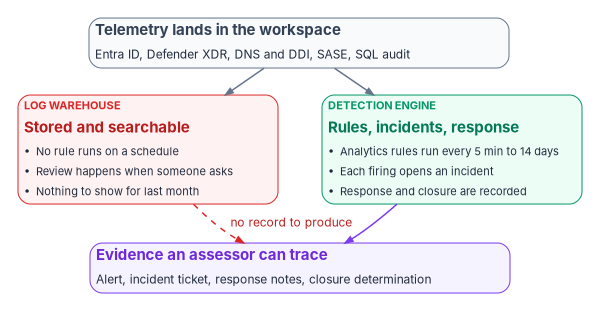
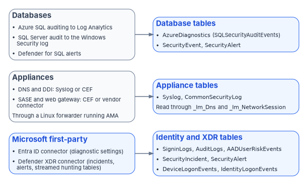
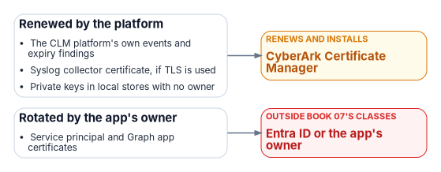

# Chapter 05 — From Log Warehouse to Detection: SIEM and XDR

*Logs that nobody's rules read are a record of what happened to you, not a defense against it; the control is the rule that fires, the incident it opens and the closure someone can show.*

::: {.callout-note}
## In this chapter
What NIST SP 800-53 AU-6 and its enhancements ask for, and why storage alone does not meet it. The difference between a log warehouse and a detection engine, what bounds mean time to detect, and the four-part evidence record the program prepares for every assessment. Then the Microsoft Sentinel connector architecture for the program's main sources (Entra ID, Defender XDR, DNS and DDI appliances, SASE, SQL audit), the health-check queries that prove each connector is still delivering, availability in GCC and GCC High, and the role Defender XDR plays alongside Sentinel.
:::

[Chapter 03](03-identity-telemetry.md) and [Chapter 04](04-platform-and-m365-telemetry.md) set out how identity, platform and Microsoft 365 telemetry is emitted deliberately and lands under the evidence contract of [Chapter 02](02-the-evidence-contract.md). Most agencies that have done that work reach the same uncomfortable place. The DNS service logs every query and policy hit. The SASE platform records every outbound session with the user, the device and the bytes moved. Entra ID exports sign-ins with location, authentication method and Conditional Access results. SQL Server writes its audit trail. Defender for Endpoint watches every enrolled device. And none of it matters if nothing reads it on a schedule and nothing fires when the pattern of an attack appears.

The clearest federal illustration runs the other way. In June 2023 a civilian agency noticed `MailItemsAccessed` events in its Microsoft 365 audit log with an application ID that did not normally touch mailboxes, and reported it. That observation, made against a baseline of normal Outlook activity, exposed an intrusion that used forged tokens to read Exchange Online mail. CISA and the FBI wrote that they were "not aware of other audit logs or events that would have detected this activity."[^c05-aa23193a] The log existed because the agency had the licensing and configuration to emit it; the detection existed because someone was looking for the anomaly. Either half alone would have produced nothing.

{#fig-ch05-warehouse-vs-engine fig-alt="Top to bottom. A slate card: telemetry lands in the workspace from Entra ID, Defender XDR, DNS and DDI, SASE and SQL audit. Two arrows lead down to two cards side by side. Left, red, labeled log warehouse: stored and searchable; no rule runs on a schedule; review happens when someone asks; nothing to show for last month. Right, green, labeled detection engine: analytics rules run every 5 minutes to 14 days; each firing opens an incident; response and closure are recorded. A solid violet arrow leads from the detection engine to a violet card at the bottom: evidence an assessor can trace, meaning the alert, the incident ticket, the response notes and the closure determination. A dashed red arrow from the warehouse to the same card is labeled no record to produce."}

## What AU-6 requires

AU-6, Audit Record Review, Analysis, and Reporting, has three parts. The organization must review and analyze system audit records at a frequency it defines "for indications of" inappropriate or unusual activity "and the potential impact" of that activity; report findings to defined personnel or roles; and adjust the level of review "when there is a change in risk."[^c05-nist] All three are continuing activities. A log store that is never queried performs none of them.

The enhancements make the expectation more concrete. AU-6(1) asks the organization to integrate review, analysis and reporting processes using automated mechanisms it defines. AU-6(3) asks it to analyze and correlate audit records "across different repositories" for organization-wide situational awareness. AU-6(4) asks for the capability to "centrally review and analyze audit records from multiple components within the system."[^c05-nist] System monitoring says the same from the other side: SI-4 requires the organization to "analyze detected events and anomalies," SI-4(2) to employ automated tools for "near real-time analysis of events," SI-4(4) to define criteria for unusual inbound and outbound traffic and monitor for it, and SI-4(5) to alert defined personnel when system-generated indications of compromise occur.[^c05-nist]

None of these texts names a product, and none says in words that a log aggregator fails. The source volume for this chapter put it more strongly than the controls do. What the controls do say is that review and analysis are activities with a frequency, an output and a recipient, and that the organization has to be able to show them happening. A workspace with no enabled analytics rules, or with every rule disabled pending tuning, can show storage. It cannot show analysis.

OMB M-26-14, which rescinded M-21-31 in May 2026, points the same way for logging generally. Its minimum logging baseline lists the activities agency logs must support, from determining the identity behind an operation to "monitoring, detecting, and hunting for anomalous system or user activity," and ends with "generating appropriate automated alerts for all of the above." Its maturity model scores an information system's collection operations by whether "logs generate actionable alerts" and by how much of the baseline those alerts cover, from under half at the initial level to at least 95 percent, with detections "routinely evaluated and tuned," at the optimal level.[^c05-m2614] FedRAMP's 2026 key security indicators for monitoring, logging and auditing ask, among other things, that logs be persistently reviewed and that a SIEM or similar system be used and persistently reviewed for centralized, tamper-resistant logging.[^c05-ksi-mla] Retention and the federal logging requirements in full are covered in [Book 02](../b02-identity/index.md) and [Book 08](../b08-ddi/index.md); [Chapter 12](12-evidence-metrics-and-continuous-monitoring.md) turns them into metrics.

## Warehouse versus detection engine

The distinction is about behavior, not about which product an agency bought. Microsoft Sentinel stores its data in a Log Analytics workspace; the workspace alone is a warehouse, and Sentinel's analytics rules, incidents and automation are what make it a detection engine. The same is true of any SIEM.

| Property | Log warehouse | Detection engine |
|---|---|---|
| What runs on a schedule | Nothing, or only ingestion | Analytics rules over defined lookback windows |
| What happens when an attack pattern appears | Nothing until someone queries | A rule fires, an alert is created, an incident opens |
| Who decides what to look for | Whoever happens to query | The rule library, version-controlled and reviewed ([Chapter 11](11-detection-engineering-and-response.md)) |
| Cross-source correlation | Manual joins, if anyone writes them | Normalized schemas and rules that span sources |
| Record of review | Query history, if retained | Incident record: rule, evidence, owner, actions, closure |
| What an assessor can be shown | That logs exist | That analysis happened, when, and what it led to |

The program's design rule follows from the table: no source counts as monitored until at least one enabled rule reads it, and no rule counts as enabled until its output reaches an incident queue someone owns. [Chapter 10](10-who-runs-security-operations.md) names who owns that queue.

## Mean time to detect

Mean time to detect (MTTD) is the interval between the first malicious activity the logs record and the moment the detection engine raises an incident about it. Without a detection engine it is undefined in the worst way: detection happens when someone looks, which may be weeks later or never. The source volume estimated detection without a SIEM at "days to weeks" or "days to never" for patterns such as DNS beaconing, password attacks against Entra ID and off-hours privileged-role activation. Those are the program's planning estimates, not measurements, and this chapter keeps them as that.

What can be stated precisely is the floor a detection engine imposes. A Sentinel scheduled rule runs at an interval and looks back over a period, both between 5 minutes and 14 days, and Sentinel runs scheduled rules on a five-minute delay from their scheduled time to allow for ingestion latency.[^c05-scheduled] A near-real-time (NRT) rule runs every minute over the preceding minute's ingested events, on a two-minute delay; a workspace may enable at most 50 NRT rules, and they work properly only on sources whose ingestion delay is under 12 hours.[^c05-nrt] So the fastest a scheduled rule can raise an alert is roughly its interval plus five minutes plus the source's own delivery latency, and an NRT rule roughly three minutes plus latency. Behavioral detections that compare activity to a baseline are slower by design, because the baseline has to exist first.

| Pattern | Primary table | Rule type the program uses | What bounds detection time |
|---|---|---|---|
| DNS beaconing from one host | `Syslog` or `CommonSecurityLog`, read through `_Im_Dns` | Scheduled, hourly | Rule interval and the hour of data the pattern needs |
| Password spray or credential stuffing | `SigninLogs`, `AADNonInteractiveUserSignInLogs` | Scheduled, 15 to 60 minutes | Rule interval plus Entra ID log delivery |
| Repeated MFA prompts the user declines | `SigninLogs` | Scheduled, 15 minutes | Rule interval plus delivery |
| Privileged role activation outside hours | `AuditLogs` | NRT or scheduled, 5 minutes | NRT cadence or the five-minute minimum |
| A sensitive role assigned outside PIM | `AuditLogs` | NRT | NRT cadence |
| Endpoint exploitation or credential theft | Defender XDR alerts | Defender's own detections | The XDR pipeline, not a Sentinel rule |
| Unusual upload volume through SASE | `CommonSecurityLog` or vendor table | Scheduled, daily, against a 30-day baseline | The baseline window |

MTTD is measurable once incidents exist, because each incident records when its first activity occurred and when the incident was created. The query below computes it by severity over the last 30 days. Treat the result as a lower bound: the first activity is the earliest event the logs captured, not necessarily when the intrusion began.

::: {.callout-warning}
## Illustrative code
The queries and scripts in this chapter are illustrative. They have not been tested against a production workspace. Check table and column names against the schema in your own workspace and cloud, and run them first in a test workspace with read-only permissions.
:::

```kql
// Detection latency and closure discipline by severity, last 30 days
SecurityIncident
| where CreatedTime > ago(30d)
| summarize arg_max(TimeGenerated, *) by IncidentNumber   // latest state of each incident
| extend DetectMinutes = datetime_diff('minute', CreatedTime, FirstActivityTime)
| summarize
    Incidents        = count(),
    MedianMTTDMin    = percentile(DetectMinutes, 50),
    P90MTTDMin       = percentile(DetectMinutes, 90),
    Closed           = countif(Status == "Closed"),
    ClosedClassified = countif(Status == "Closed" and isnotempty(Classification))
    by Severity
| order by Severity asc
```

The `SecurityIncident` table records a row each time an incident changes, with `CreatedTime`, `FirstActivityTime`, `ClosedTime`, `Status`, `Classification`, `Owner` and the IDs of the analytics rules behind it, which is why the query keeps only the latest row per incident number.[^c05-secincident]

## The assessor evidence standard

The practical test of AU-6 in an assessment is whether the program can produce the chain from detection to response for a real event. The source volume described the request an assessor typically makes: show an alert that fired in the last 30 days, the incident it generated and what was done about it. That wording is practitioner experience rather than a published FedRAMP procedure, but it is the right standard to prepare for, and the program adopts it as its own. If no alert fired in 30 days, one of three things is true: the environment had no suspicious activity, which is unlikely; the rules are misconfigured and produce nothing; or there are no rules. The second and third are findings.

The program's evidence record for any incident has four parts:

1. **Alert record.** The Sentinel or Defender incident: which rule fired, what evidence triggered it, which entities it names and when.
2. **Incident ticket.** The ticket in the agency's service-management system, linked to the incident by ID.
3. **Response documentation.** Timestamped notes on what the analyst checked, decided and did, including every automated action a playbook took.
4. **Closure record.** A determination (true positive, benign positive or false positive), and for a true positive the remediation and the verification that it worked.

Sentinel produces the first part natively and can produce the second through a ticketing integration. The third and fourth depend on analyst discipline and on playbooks that write their own actions into the incident, which [Chapter 11](11-detection-engineering-and-response.md) builds in. The query below lists every incident closed in the last 30 days with the fields an assessor will ask about; exported, it is the sampling frame for the evidence request.

```kql
// Sampling frame for the "show me an alert from last month" request
SecurityIncident
| where CreatedTime > ago(30d)
| summarize arg_max(TimeGenerated, *) by IncidentNumber
| where Status == "Closed"
| project IncidentNumber, Title, Severity, CreatedTime, ClosedTime,
          Owner = tostring(Owner.assignedTo), Classification, ClassificationReason,
          RuleIds = RelatedAnalyticRuleIds, IncidentUrl
| order by CreatedTime desc
```

## Microsoft Sentinel connector architecture

Microsoft Sentinel connects to sources through named data connectors, most of them installed as solutions from the Content hub. Each connector authenticates to its source, lands events in documented tables, and in many cases ships parsers into the Advanced Security Information Model (ASIM), so that one rule can read DNS events from several vendors through a single schema.[^c05-asimdns] The figure below shows the paths this chapter covers.

{#fig-ch05-connector-fabric fig-alt="Left to right, three source cards each joined by an arrow to a table card. Top: Microsoft first-party, blue, the Entra ID connector through diagnostic settings and the Defender XDR connector for incidents, alerts and streamed hunting tables, leading to identity and XDR tables: SigninLogs, AuditLogs, AADUserRiskEvents, SecurityIncident, SecurityAlert, DeviceLogonEvents and IdentityLogonEvents. Middle: appliances, slate, DNS and DDI over Syslog or CEF and SASE or web gateway over CEF or a vendor connector, through a Linux forwarder running the Azure Monitor Agent, leading to appliance tables Syslog and CommonSecurityLog, read through the ASIM parsers _Im_Dns and _Im_NetworkSession. Bottom: databases, slate, Azure SQL auditing to Log Analytics, SQL Server audit to the Windows Security log, and Defender for SQL alerts, leading to database tables AzureDiagnostics with the SQLSecurityAuditEvents category, SecurityEvent and SecurityAlert."}

### Where Sentinel runs, and which cloud's table to read

Two platform facts shape every deployment decision in this chapter. First, Sentinel is moving into the Microsoft Defender portal. Microsoft has announced that after March 31, 2027 Sentinel will be supported only there, not in the Azure portal, and it is already generally available in the Defender portal with or without Defender XDR licensing.[^c05-portal] In the Defender portal, Microsoft states that all generally available Sentinel features are available in the commercial, GCC, GCC High and DoD clouds, while preview features are available only in the commercial cloud.[^c05-feature] Plan new work in the Defender portal.

Second, the cloud a workspace lives in decides which availability column applies. Office 365 GCC is paired with Microsoft Entra ID in commercial Azure, and GCC High and DoD with Entra ID in Azure Government.[^c05-govfeat] Microsoft's Sentinel availability page compares Azure commercial with Azure Government; several capabilities this book relies on differ. ASIM is in public preview in both; the Repositories feature for detections as code and the peer and blast-radius UEBA enrichments are not available in Azure Government; and the Entra ID, Entra ID Protection, Defender XDR, CEF via AMA, Syslog via AMA, Windows Security Events via AMA, TAXII threat intelligence, automation rules, NRT rules and UEBA anomalies are generally available in both.[^c05-feature] For connectors that pair with Microsoft 365, Microsoft's government availability page lists the Defender XDR connector as generally available for GCC in Azure and for GCC High in Azure Government, and not available for DoD.[^c05-govfeat] That conflicts with the Defender-portal statement above that all generally available Sentinel features reach DoD; until Microsoft reconciles the two pages, a DoD tenant should confirm the connector in its own portal before designing on it. Every capability named below should be checked against the column for the agency's own cloud before it goes into a design; [Book 10](../b10-cloud-boundary/index.md) explains why feature availability is a separate question from authorization.

### Microsoft Entra ID

The Microsoft Entra ID connector streams the directory's logs through Entra diagnostic settings into the workspace. The program enables, at minimum, interactive sign-ins (`SigninLogs`), audit logs (`AuditLogs`), non-interactive user sign-ins (`AADNonInteractiveUserSignInLogs`), service principal and managed identity sign-ins (`AADServicePrincipalSignInLogs`, `AADManagedIdentitySignInLogs`), provisioning logs (`AADProvisioningLogs`), Microsoft Graph activity logs (`MicrosoftGraphActivityLogs`), and the ID Protection tables for user risk events and risky users (`AADUserRiskEvents`, `AADRiskyUsers`). Where Global Secure Access is the agency's secure service edge, its traffic lands in `NetworkAccessTraffic` through the same connector. Ingesting sign-in logs requires a Microsoft Entra ID P1 or P2 license, and the risky service principal tables require Workload ID Premium.[^c05-entra] What each category contains, and why non-interactive sign-ins matter as much as interactive ones, is [Chapter 03](03-identity-telemetry.md).

Two column facts trip up rules copied from older material. In `SigninLogs`, `ResultType` is a string holding the error code, with "0" for success, and `MfaDetail` is deprecated; authentication step results live in `AuthenticationDetails`.[^c05-signinlogs] [Chapter 11](11-detection-engineering-and-response.md) uses both.

### Microsoft Defender XDR

The Defender XDR connector brings Defender incidents and alerts into Sentinel, keeps incidents synchronized between the two, and can stream raw advanced hunting tables. When Sentinel is onboarded to the Defender portal the connector is enabled automatically.[^c05-xdrconn] The streamable tables include `AlertInfo`, `AlertEvidence`, `DeviceEvents`, `DeviceProcessEvents`, `DeviceNetworkEvents`, `DeviceLogonEvents`, `DeviceFileEvents`, `DeviceRegistryEvents`, `DeviceInfo`, the email tables, `IdentityLogonEvents`, `IdentityQueryEvents`, `IdentityDirectoryEvents`, `CloudAppEvents` and `UrlClickEvents`, all generally available in GCC, GCC High and DoD.[^c05-streaming]

The source volume listed two tables that do not exist in this form, `DeviceAlertEvents` and `DeviceVulnerabilityAssessmentEvent`, and built a vulnerability-exploitation rule on the second. Neither appears in Microsoft's list of streamable tables, and no vulnerability management table does.[^c05-streaming] Vulnerability and exposure data stays in Defender, where advanced hunting can query it; [Chapter 06](06-vulnerability-management.md) carries the vulnerability program and the CISA Known Exploited Vulnerabilities catalog, and actual exploitation of a vulnerability surfaces as a Defender alert, which arrives through this connector.

Streaming every raw table is a cost decision, not a default. The program streams the device and identity tables its own Sentinel rules join to non-Microsoft sources, and relies on the incident integration for the rest.

### DNS and DDI appliances

Appliances that speak Syslog or Common Event Format (CEF) reach Sentinel through a Linux log forwarder running the Azure Monitor Agent (AMA). The appliance sends to the forwarder's syslog daemon (rsyslog or syslog-ng, usually on port 514); the daemon hands messages to the agent; the **Syslog via AMA** and **CEF via AMA** connectors, driven by data collection rules, land plain syslog in the `Syslog` table and CEF in `CommonSecurityLog`. Microsoft notes that sending the same facility as both formats duplicates data across the two tables, and that `TimeGenerated` on forwarded records reflects when the forwarder processed the message while `EventTime` comes from the syslog header converted with the forwarder's time zone, so the two can disagree if the forwarder and the device are in different zones.[^c05-cefama] That second point matters to the evidence contract's join on identity plus time; M-26-14 separately requires logs to carry a consistently accurate timestamp synchronized to a traceable time source.[^c05-m2614]

For the DDI platform [Book 08](../b08-ddi/index.md) uses as its example, Infoblox, there are two paths. NIOS appliances send syslog, which lands in `Syslog` and is parsed by a function the Infoblox NIOS solution installs; Microsoft notes the solution still references the deprecated Log Analytics agent but works with the Syslog via AMA connector.[^c05-infoblox] Infoblox's cloud service has its own Cloud Data Connector via AMA, which lands in `CommonSecurityLog`.[^c05-tablesconn] Other DNS sources follow the same pattern or have their own connectors: Windows DNS servers through the Windows DNS Events via AMA connector, which [Book 08, Chapter 11](../b08-ddi/11-operating-the-control-plane.md) covers. Whatever the vendor, the program writes DNS rules against the ASIM unifying parser `_Im_Dns`, not against a vendor table. Microsoft ships built-in ASIM DNS parsers for Infoblox NIOS (which also handles BIND and BlueCat), Infoblox BloxOne, Zscaler ZIA and others, and the schema's key fields are `DnsQuery`, `SrcIpAddr` and `EventResultDetails`.[^c05-asimlist] [^c05-asimdns] A rule written that way keeps working when the DNS platform changes.

### SASE and secure web gateway

SASE platforms reach Sentinel either over CEF through the same forwarder or through the vendor's own connector. Zscaler, the example the source volume used, documents CEF over TCP 514 to the syslog agent, and its Internet Access data also has Cloud NSS push connectors for web, firewall, DNS, tunnel and DLP logs, all landing in `CommonSecurityLog`.[^c05-zscalercef] [^c05-tablesconn] Netskope's connectors land in custom tables such as `NetskopeAlerts_CL`; the source volume's table names for Netskope were not the current ones, and the right names come from the connector reference at deployment time.[^c05-tablesconn] Microsoft's own secure service edge, Global Secure Access, uses the Entra ID connector described above. Write rules against the ASIM network session and web session parsers where a parser exists for the vendor, so the rule library does not depend on which SASE contract the agency holds.

The SI-4(4) row of the control table at the end of this chapter depends on this source. Router flow logs record addresses, ports and byte counts; the per-session fields that SASE rules need (user identity, URL, device posture, transfer volume) exist only because an application-aware enforcement point decoded the traffic and emitted them. Without that point in the path, no connector can recover them. [Book 09](../b09-network/index.md) covers the network side.

### SQL audit

SQL audit data takes different paths depending on where the database runs, and the source volume merged them. For Azure SQL Database, auditing can write directly to a Log Analytics workspace, where events land in `AzureDiagnostics` with the category `SQLSecurityAuditEvents`.[^c05-sqlaudit] For SQL Server on Windows, including instances enabled by Azure Arc, the audit target can be the Windows Security log, which Microsoft describes as the appropriate location in a high-security environment because other targets are more subject to tampering; it requires the "application generated" audit subcategory and the generate-security-audits right for the service account.[^c05-sqlseclog] From there the **Windows Security Events via AMA** connector carries the events to the `SecurityEvent` table. The Database Engine's message catalog defines event 33205 as "Audit event," which is how SQL Server audit records appear in the Windows logs; confirm the event ID on a test instance before writing rules against it.[^c05-sql33205] Separately, Microsoft Defender for SQL Servers on Machines raises threat alerts for suspicious database activity, SQL injection and anomalous access on Arc-enabled and Azure-hosted instances, and those alerts reach Sentinel as `SecurityAlert` records.[^c05-dfsql]

### Threat intelligence

The Threat Intelligence - TAXII connector imports STIX indicators from TAXII 2.0 and 2.1 servers, which is how most commercial and government feeds, including DDI vendors' feeds, reach Sentinel. Indicators now land in `ThreatIntelIndicators` and `ThreatIntelObjects`. Microsoft stopped writing to the legacy `ThreatIntelligenceIndicator` table after July 31, 2025, so rules and workbooks written against it, as the source volume's were, need migration.[^c05-ti] The TAXII connector is generally available in Azure Government; Microsoft's own threat intelligence matching analytics rule is in preview in commercial Azure and not available in Azure Government.[^c05-feature]

## Proving the connectors still deliver

A connector that silently stops is worse than one that was never configured, because the program believes it is monitored. Detection rot is the subject of [Chapter 11](11-detection-engineering-and-response.md); the first defense is a freshness check on every table the rule library reads.

Sentinel's own `SentinelHealth` table records connector health events, but only for a subset of connectors, among them AWS, Office 365, Defender for Endpoint, the TAXII and threat intelligence platform connectors, and any connector built on the Codeless Connector Framework. It does not cover the Entra ID diagnostic-settings path or the syslog and CEF forwarders.[^c05-health] Where it applies, use Microsoft's query for each connector's latest failure:

```kql
// Latest failure per supported connector (requires health monitoring turned on)
SentinelHealth
| where TimeGenerated > ago(3d)
| where OperationName == 'Data fetch status change'
| where Status in ('Success', 'Failure')
| summarize TimeGenerated = arg_max(TimeGenerated, *) by SentinelResourceName, SentinelResourceId
| where Status == 'Failure'
```

For everything else, the program checks the data itself. The query below compares the last event in each dependent table with the longest silence that table is allowed. The thresholds are program design and belong in the rule library next to the rules that depend on each table.

```kql
// Freshness of every table the rule library depends on
let Expected = datatable(TableName:string, MaxSilence:timespan) [
    "SigninLogs",                      1h,
    "AADNonInteractiveUserSignInLogs", 1h,
    "AuditLogs",                       4h,
    "AADUserRiskEvents",               24h,
    "SecurityIncident",                24h,
    "DeviceLogonEvents",               1h,
    "Syslog",                          30m,
    "CommonSecurityLog",               30m,
    "SecurityEvent",                   1h
];
union withsource = TableName isfuzzy = true
    SigninLogs, AADNonInteractiveUserSignInLogs, AuditLogs, AADUserRiskEvents,
    SecurityIncident, DeviceLogonEvents, Syslog, CommonSecurityLog, SecurityEvent
| where TimeGenerated > ago(7d)
| summarize LastEvent = max(TimeGenerated), Events24h = countif(TimeGenerated > ago(24h)) by TableName
| join kind = rightouter Expected on TableName
| extend TableName = coalesce(TableName, TableName1), Silence = now() - LastEvent
| extend Status = case(isnull(LastEvent), "NO DATA IN 7 DAYS",
                       Silence > MaxSilence, "STALE",
                       "OK")
| project TableName, Status, LastEvent, Silence, MaxSilence, Events24h
| order by Status asc, TableName asc
```

A table can be fresh while one appliance behind it has gone quiet, so the appliance tables need a per-device view as well. These two queries show the last event from each reporting device and each DNS product the ASIM parser sees:

```kql
// Per-device freshness for forwarded appliances
CommonSecurityLog
| where TimeGenerated > ago(24h)
| summarize LastEvent = max(TimeGenerated), Events = count()
    by DeviceVendor, DeviceProduct, Forwarder = Computer
| order by LastEvent asc
```

```kql
// DNS sources visible through the ASIM unifying parser, last hour
_Im_Dns(starttime = ago(1h), endtime = now())
| summarize Queries = count(), LastEvent = max(TimeGenerated) by EventVendor, EventProduct, Dvc
| order by LastEvent asc
```

The freshness query can run as a scheduled analytics rule that opens an incident when any row is stale, which puts connector failure into the same queue as everything else; Microsoft suggests Azure Monitor alert rules on `SentinelHealth` for immediate notification.[^c05-health] For evidence packages, the same query runs from PowerShell with `Invoke-AzOperationalInsightsQuery`, whose results are in the returned object's `Results` property:[^c05-invoke]

```powershell
# Export the connector freshness check as dated evidence
# Requires Az.OperationalInsights and Log Analytics Reader on the workspace
$WorkspaceId = '<log-analytics-workspace-id>'
$Query       = Get-Content -Raw -Path '.\queries\fmp-table-freshness.kql'

$Response = Invoke-AzOperationalInsightsQuery -WorkspaceId $WorkspaceId -Query $Query -Wait 120
$Rows     = [System.Linq.Enumerable]::ToArray($Response.Results)

$Stamp = (Get-Date).ToUniversalTime().ToString('yyyyMMddTHHmmssZ')
$Rows | Export-Csv -Path ".\evidence\FMP-table-freshness-$Stamp.csv" -NoTypeInformation

$Stale = $Rows | Where-Object { $_.Status -ne 'OK' }
if ($Stale) {
    Write-Warning ("{0} table(s) stale or empty: {1}" -f $Stale.Count, (($Stale.TableName) -join ', '))
}
```

## User and entity behavior analytics

Threshold rules find the patterns someone anticipated. Sentinel's user and entity behavior analytics (UEBA) builds behavioral baselines for users, hosts, IP addresses and applications and flags deviations. Its output lands in the `BehaviorAnalytics` table, whose `InvestigationPriority` field scores how unusual a single event is on a 0 to 10 scale, and in the `Anomalies` table, whose `AnomalyScore` (0 to 1) reflects machine-learning analysis across many events; `IdentityInfo` and `UserPeerAnalytics` hold the entity profiles and peer groups.[^c05-ueba] The source volume described the priority score as a continuously updated per-user score fed by Entra ID Protection risk and recommended reviewing every user above 7 daily. Microsoft documents it as a per-event score, so the program's review practice (design, not a Microsoft recommendation) is to hunt daily over high-priority `BehaviorAnalytics` events for privileged and sensitive-data users, not to rank users by a single number.

UEBA's data sources are Entra sign-in and audit logs, Azure Activity and Windows security events from either portal, and, from the Defender portal only, managed identity and service principal sign-ins, device logon events, several cloud platforms and supported `CommonSecurityLog` events from Check Point, Fortinet and Zscaler; on-premises Active Directory users sync through Microsoft Defender for Identity.[^c05-ueba-enable] During the transition from Active Directory, Defender for Identity is how Sentinel and Defender see on-premises Kerberos and NTLM behavior at all. The peer and blast-radius enrichments are not available in Azure Government.[^c05-feature] UEBA anomalies feed hunting and the enrichment of incidents; they are not a substitute for the rule library.

## What Defender XDR contributes

Defender XDR and Sentinel overlap, and a program that does not decide the division of labor pays twice and triages everything twice. The facts that decide it are these.

Defender XDR detects with its own sensors and correlates signals from endpoints, identities, email and collaboration tools, and SaaS applications into single incidents.[^c05-disruption] When Sentinel is onboarded to the Defender portal, Defender becomes responsible for creating incidents from Sentinel's alerts as well, the "Microsoft security" analytics rules that used to create Sentinel incidents from Defender alerts are disabled automatically, and an analytics rule's incident-creation setting must stay enabled for Defender to turn its alerts into incidents.[^c05-scheduled] One queue, in one portal, is the result.

Defender XDR can also act on its own. Automatic attack disruption correlates signals into a high-confidence incident, identifies attacker-controlled assets and contains them, for example by revoking user sessions, suspending users in Entra ID, containing devices and users at the endpoint layer, and acting on compromised OAuth applications; every action is logged in the Action Center, can be undone, and specific users, device groups and IP ranges can be excluded.[^c05-disruption] That is autonomous response by the vendor, and it has to be reconciled with the program's actuation ladder, which [Chapter 11](11-detection-engineering-and-response.md) does.

The program's division of labor, which is design:

- **Defender XDR detects what its sensors see**: endpoint behavior, on-premises identity attacks through Defender for Identity, email threats and cloud-app activity. Sentinel does not re-implement those detections.
- **Sentinel rules cover what Defender cannot see**: DNS and DDI, SASE, SQL audit, non-Microsoft clouds and appliances, and correlations across them and the Microsoft sources.
- **Detection logic for Defender data is written once.** Microsoft now recommends Defender custom detections as the preferred way to create new rules across Sentinel and Defender XDR.[^c05-nrt] Where a rule reads only Defender tables, write it as a custom detection; where it joins non-Microsoft sources, write it as a Sentinel analytics rule. Confirm custom detection availability in the agency's cloud first.
- **Raw streaming is selective.** Stream the Defender hunting tables that Sentinel rules join; leave the rest in Defender.

## Retention, briefly

Detection needs recent data at hand; investigation needs older data retrievable. M-26-14 sets the federal floor: logs searchable for at least 6 months after creation, meaning analytics can run on them without preparation, and retrievable for a year, meaning they can be restored to an analytics tier after intermediary steps; it adds that these minimums do not relieve agencies of records schedules.[^c05-m2614] The source volume cited M-26-14 as setting "12 months of active storage plus 18 months of cold storage." Those were M-21-31's figures, and M-21-31 is rescinded. Set retention per table in the workspace so the tables the rule library reads meet the searchable floor; [Chapter 12](12-evidence-metrics-and-continuous-monitoring.md) covers the tiers and the evidence that retention is configured as designed.

## Controls this chapter makes assessable

| Control | What the program implements | Evidence it produces |
|---|---|---|
| AU-6 | Enabled analytics rules over every source; incidents reviewed within the queue's service level | Incident records with rule, evidence, owner, actions and closure |
| AU-6(1) | Automation rules and playbooks link incidents to ticketing and enrichment | Ticket IDs on incidents; playbook run history |
| AU-6(3) | ASIM parsers and cross-source rules | Rules that read more than one table; their firings |
| AU-6(4) | One workspace, one incident queue in the Defender portal | Workspace configuration; connector inventory |
| SI-4, SI-4(2) | Scheduled and NRT rules, UEBA anomalies, Defender XDR detections | Rule inventory with cadence; alert history |
| SI-4(4) | DNS and SASE telemetry read through `_Im_Dns` and session parsers | DNS and egress rules and their firings |
| SI-4(5) | Incidents routed to named personnel with severity | Assignment and notification records |
| AU-11 (in part) | Per-table retention meeting M-26-14's floor | Retention configuration export ([Chapter 12](12-evidence-metrics-and-continuous-monitoring.md)) |

The control-by-control treatment, including the incident-response controls, is in the Federal Compliance volume [Vol III Book 06, SIEM, XDR, and Detection Engineering](https://github.com/WhalerMike/modernization-workbook/blob/main/docs/compliance/Vol_III_Book_06_SIEM_XDR_Detection.md). [Chapter 11](11-detection-engineering-and-response.md) builds the rule library and the response that these connectors feed.

## Certificates in this book and the CLM platform {#certificates-and-the-clm-platform}

[Book 07](../b07-pki/index.md) gives each class of certificate one issuer and one renewal engine, and makes CyberArk Certificate Manager, Self-Hosted the system of record for every certificate that Intune and the PIV system don't manage ([Chapter 04](../b07-pki/04-the-target-pki.md), [Chapter 05](../b07-pki/05-who-owns-the-certificate-estate.md)). The certificates this book's systems depend on map to it as follows; [Book 07, Appendix C](../b07-pki/appendix-c-anatomy-of-the-clm-platform.md) describes the platform itself.

| Certificate | Book 07 class | Issued by | Renewed by | What the CLM platform does |
|---|---|---|---|---|
| The CLM platform's own events and expiry findings | - | - | CyberArk Certificate Manager | Sends them to the SIEM over syslog with TLS |
| Syslog collector certificate, if TLS is used | Internal server TLS | Retained AD CS | CyberArk Certificate Manager | Renews it; it needs the collector's IP address in the SAN |
| Private keys in local stores with no owner | Internal server TLS | Mixed | CyberArk Certificate Manager | Network and agent discovery find them |
| Service principal and Graph app certificates | Not a Book 07 class | The app's owner | Entra ID or the app's owner | Nothing |

{fig-alt="The CLM platform's own events and expiry findings, Syslog collector certificate, if TLS is used, Private keys in local stores with no owner go to CyberArk Certificate Manager (renews and installs); Service principal and Graph app certificates go to Entra ID or the app's owner (outside book 07's classes)."}

Book 07 gives security operations the certificate alerts ([Chapter 05](../b07-pki/05-who-owns-the-certificate-estate.md)), so the CLM platform is a SIEM source like any other. Its syslog channel sends BSD, CEF or JSON over TCP with TLS, and the receiving collector's certificate must carry an IP-address subject alternative name.[^clm-syslog]


::: {.callout-tip}
## Continue the book
[← Previous: Chapter 04 — Azure Platform and Microsoft 365 Audit Telemetry](04-platform-and-m365-telemetry.md) · [Book index](index.md) · [Next: Chapter 06 — Vulnerability Management →](06-vulnerability-management.md)
:::

[^c05-aa23193a]: Cybersecurity and Infrastructure Security Agency and Federal Bureau of Investigation, AA23-193A, *Enhanced Monitoring to Detect APT Activity Targeting Outlook Online*, July 12, 2023 (updated July 14, 2023), <https://www.cisa.gov/news-events/cybersecurity-advisories/aa23-193a> (accessed Oct 21, 2026). Detection by an FCEB agency in June 2023 from `MailItemsAccessed` events with an unexpected `ClientAppID` and `AppID`, against a baseline of normal activity.
[^c05-nist]: National Institute of Standards and Technology, SP 800-53 Rev. 5, *Security and Privacy Controls for Information Systems and Organizations*, controls AU-6, AU-6(1), AU-6(3), AU-6(4), SI-4, SI-4(2), SI-4(4) and SI-4(5), from NIST's OSCAL catalog, <https://raw.githubusercontent.com/usnistgov/oscal-content/main/nist.gov/SP800-53/rev5/json/NIST_SP-800-53_rev5_catalog.json> (accessed Oct 21, 2026).
[^c05-m2614]: Office of Management and Budget, M-26-14, *Ensuring Effective and Efficient Agency Logging and Network Visibility to Defend Against Evolving Cyber Threats*, May 22, 2026, Appendix B (minimum logging baseline: 6 months searchable, 1 year retrievable, accurate timestamps, activities a through k including "Generating appropriate automated alerts for all of the above") and Appendix C (maturity model, Collection Operations and Data Retention), <https://www.whitehouse.gov/wp-content/uploads/2026/05/M-26-14-Ensuring-Effective-and-Efficient-Agency-Logging-and-Network-Visibility-to-Defend-Against-Evolving-Cyber-Threats.pdf> (accessed Oct 21, 2026).
[^c05-ksi-mla]: FedRAMP, "Monitoring, Logging, and Auditing," FedRAMP Consolidated Rules for 2026 (KSI-MLA-LET, KSI-MLA-OSM, KSI-MLA-RVL and others), <https://www.fedramp.gov/2026/providers/20x/key-security-indicators/monitoring-logging-and-auditing/> (accessed Oct 21, 2026).
[^c05-scheduled]: Microsoft Learn, "Scheduled analytics rules in Microsoft Sentinel," <https://learn.microsoft.com/azure/sentinel/scheduled-rules-overview> (accessed Oct 21, 2026). Interval and lookback 5 minutes to 14 days; five-minute ingestion delay; results simulation; incident settings and the Defender portal note on incident creation and Microsoft security rules.
[^c05-nrt]: Microsoft Learn, "Quick threat detection with near-real-time (NRT) analytics rules in Microsoft Sentinel," <https://learn.microsoft.com/azure/sentinel/near-real-time-rules>, and "Work with near-real-time (NRT) detection analytics rules in Microsoft Sentinel," <https://learn.microsoft.com/azure/sentinel/create-nrt-rules> (both accessed Oct 21, 2026). One-minute cadence, two-minute delay, 50-rule limit, under-12-hour ingestion delay; the second page carries the statement on custom detections.
[^c05-secincident]: Microsoft Learn, "Azure Monitor Logs reference - SecurityIncident," <https://learn.microsoft.com/azure/azure-monitor/reference/tables/securityincident> (accessed Oct 21, 2026).
[^c05-portal]: Microsoft Learn, "Microsoft Sentinel in the Microsoft Defender portal," <https://learn.microsoft.com/azure/sentinel/microsoft-sentinel-defender-portal> (accessed Oct 21, 2026).
[^c05-feature]: Microsoft Learn, "Microsoft Sentinel feature support for Azure commercial/other clouds," <https://learn.microsoft.com/azure/sentinel/feature-availability> (accessed Oct 21, 2026).
[^c05-govfeat]: Microsoft Learn, "Cloud feature availability for US Government customers," <https://learn.microsoft.com/azure/security/fundamentals/feature-availability> (accessed Oct 21, 2026). Office 365 GCC pairs with Entra ID in commercial Azure, GCC High and DoD with Entra ID in Azure Government; Microsoft Sentinel connector table (Defender XDR: GCC GA, GCC High GA, DoD not available).
[^c05-entra]: Microsoft Learn, "Send data to Microsoft Sentinel using the Microsoft Entra ID data connector," <https://learn.microsoft.com/azure/sentinel/connect-azure-active-directory> (accessed Oct 21, 2026).
[^c05-signinlogs]: Microsoft Learn, "Azure Monitor Logs reference - SigninLogs," <https://learn.microsoft.com/azure/azure-monitor/reference/tables/signinlogs> (accessed Oct 21, 2026).
[^c05-xdrconn]: Microsoft Learn, "Stream data from Microsoft Defender XDR to Microsoft Sentinel in the Azure portal," <https://learn.microsoft.com/azure/sentinel/connect-microsoft-365-defender> (accessed Oct 21, 2026).
[^c05-streaming]: Microsoft Learn, "Supported Microsoft Defender XDR streaming event types in event streaming API," <https://learn.microsoft.com/defender-xdr/supported-event-types> (accessed Oct 21, 2026).
[^c05-cefama]: Microsoft Learn, "Syslog and Common Event Format (CEF) via AMA connectors for Microsoft Sentinel," <https://learn.microsoft.com/azure/sentinel/cef-syslog-ama-overview> (accessed Oct 21, 2026).
[^c05-infoblox]: Microsoft Learn, "Syslog via AMA data connector - Configure specific appliance or device for Microsoft Sentinel data ingestion," section "Infoblox Network Identity Operating System (NIOS)," <https://learn.microsoft.com/azure/sentinel/unified-connector-syslog-device#infoblox-network-identity-operating-system-nios> (accessed Oct 21, 2026).
[^c05-tablesconn]: Microsoft Learn, "Microsoft Sentinel tables and associated connectors," <https://learn.microsoft.com/azure/sentinel/sentinel-tables-connectors-reference> (accessed Oct 21, 2026). `CommonSecurityLog` connectors include the Infoblox Cloud Data Connector via AMA and the Zscaler Internet Access Cloud NSS push connectors; Netskope connectors land in custom tables such as `NetskopeAlerts_CL`.
[^c05-asimlist]: Microsoft Learn, "List of Microsoft Sentinel Advanced Security Information Model (ASIM) parsers," DNS parsers, <https://learn.microsoft.com/azure/sentinel/normalization-parsers-list#dns-parsers> (accessed Oct 21, 2026).
[^c05-asimdns]: Microsoft Learn, "The Advanced Security Information Model (ASIM) DNS normalization schema reference," <https://learn.microsoft.com/azure/sentinel/normalization-schema-dns> (accessed Oct 21, 2026). `_Im_Dns` unifying parser, filtering parameters, `DnsQuery`, `SrcIpAddr`, `EventResultDetails`.
[^c05-zscalercef]: Microsoft Learn, "CEF via AMA data connector - Configure specific appliance or device for Microsoft Sentinel data ingestion," section "Zscaler," <https://learn.microsoft.com/azure/sentinel/unified-connector-cef-device> (accessed Oct 21, 2026).
[^c05-sqlaudit]: Microsoft Learn, "SQL Database audit log format," Log Analytics, <https://learn.microsoft.com/azure/azure-sql/database/audit-log-format> (accessed Oct 21, 2026).
[^c05-sqlseclog]: Microsoft Learn, "Write SQL Server Audit events to the Security log," <https://learn.microsoft.com/sql/relational-databases/security/auditing/write-sql-server-audit-events-to-the-security-log> (accessed Oct 21, 2026).
[^c05-sql33205]: Microsoft Learn, "Database Engine events and errors (31000 to 41399)," <https://learn.microsoft.com/sql/relational-databases/errors-events/database-engine-events-and-errors-31000-to-41399> (accessed Oct 21, 2026).
[^c05-dfsql]: Microsoft Learn, "Microsoft Defender for SQL Servers on Machines overview," <https://learn.microsoft.com/azure/defender-for-cloud/defender-for-sql-on-machines-overview> (accessed Oct 21, 2026).
[^c05-ti]: Microsoft Learn, "Threat intelligence in Microsoft Sentinel," <https://learn.microsoft.com/azure/sentinel/understand-threat-intelligence> (accessed Oct 21, 2026).
[^c05-health]: Microsoft Learn, "Monitor the health of your data connectors," <https://learn.microsoft.com/azure/sentinel/monitor-data-connector-health> (accessed Oct 21, 2026).
[^c05-invoke]: Microsoft Learn, "Invoke-AzOperationalInsightsQuery," Az.OperationalInsights module, <https://learn.microsoft.com/powershell/module/az.operationalinsights/invoke-azoperationalinsightsquery> (accessed Oct 21, 2026).
[^c05-ueba]: Microsoft Learn, "Advanced threat detection with User and Entity Behavior Analytics (UEBA) in Microsoft Sentinel," <https://learn.microsoft.com/azure/sentinel/identify-threats-with-entity-behavior-analytics> (accessed Oct 21, 2026).
[^c05-ueba-enable]: Microsoft Learn, "Enable User and Entity Behavior Analytics (UEBA) in Microsoft Sentinel," <https://learn.microsoft.com/azure/sentinel/enable-entity-behavior-analytics> (accessed Oct 21, 2026).
[^c05-disruption]: Microsoft Learn, "Automatic attack disruption in Microsoft Defender," <https://learn.microsoft.com/defender-xdr/automatic-attack-disruption>, and "Exclude assets from automated responses in automatic attack disruption," <https://learn.microsoft.com/defender-xdr/automatic-attack-disruption-exclusions> (both accessed Oct 21, 2026).
[^clm-syslog]: CyberArk, 26.1, "Syslog channel" (TCP with TLS; the receiver certificate needs an iPAddress subject alternative name), <https://docs.venafi.com/Docs/current/TopNav/Content/Logging/c-logging-sysLogChannelConfig-tpp.php> (accessed Oct 23, 2026).
