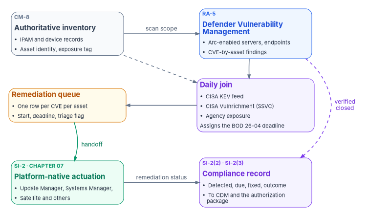
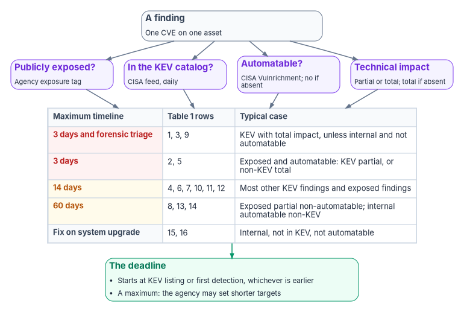

# Chapter 06 — Vulnerability Management

*A vulnerability program is judged by one record: which flaw, on which asset, found when, due when, fixed when, and whether the fix beat the clock.*

::: {.callout-note}
## In this chapter
The three places federal vulnerability programs fail, and the record an assessor asks for under NIST SP 800-53 RA-5 and SI-2. The directive that now governs known exploited vulnerabilities: CISA BOD 26-04, which revoked BOD 22-01 and BOD 19-02 on June 10, 2026 and replaced severity buckets with a four-factor remediation clock. How Microsoft Defender Vulnerability Management reaches Azure Arc-enabled servers, what it covers, and how to prove every enrolled server is actually reporting. A daily queue that joins scanner findings to the KEV catalog, CISA's exploitation metadata and the agency's own exposure record. SQL Server's servicing branches, the shared-responsibility line for software as a service, and the handoff to [Chapter 07](07-patch-configuration-and-baselines.md), because a scanner measures a gap and never closes one.
:::

Federal vulnerability management fails at three points, and assessors probe all three.

The first is enumeration. An assessor asks for the asset inventory and finds a list produced months ago by a one-time network scan. It misses cloud-hosted workloads and everything added since the scan. A scanner can only report on what answers it, so a stale inventory produces a clean-looking report on a partial estate. [Book 08](../b08-ddi/index.md) and [Book 05](../b05-devices/index.md) close that gap with an authoritative address and device record; this chapter assumes it.

The second is prioritization. Findings arrive ranked by CVSS score and land in generic buckets: Critical in so many days, High in so many more. That ordering ignores the one fact that matters most, whether anyone is exploiting the flaw. A medium-scored vulnerability on an internet-facing appliance that criminals are using today is more urgent than a critical-scored one nobody can reach. Since June 2026, the federal rule says so explicitly.

The third is evidence. The assessor picks one CVE on one server and asks when it was found, when it was due, when it was fixed and whether the fix met the deadline. Most agencies can show a scan report and a policy document but not that record. They assemble it by hand from the scanner, the patch tool and the change tickets, every assessment cycle.

This chapter covers the second and third failures for the Microsoft side of the estate, and defines the record that every other platform must also produce ([Chapter 07](07-patch-configuration-and-baselines.md)). It's the program's reference implementation, not the only one: the mechanism is an inventory-bound continuous scan, a daily join to CISA's exploitation data, a deadline per finding and a machine-readable record. Products can change; that contract doesn't.

{#fig-ch06-scan-to-record fig-alt="Three rows of two cards, read as a zigzag. Top row, left: a slate card, authoritative inventory, CM-8, IPAM and device records keyed by asset identity, with exposure tags; right: a blue card, Defender Vulnerability Management on Arc-enabled servers and endpoints, producing CVE-by-asset findings. An arrow from inventory to the Defender card is labelled scan scope. Middle row, right, below the Defender card: a violet card, daily join, combining findings with the CISA KEV catalog, CISA Vulnrichment exploitation metadata and the asset's exposure, and assigning a BOD 26-04 deadline. Middle row, left: an amber card, remediation queue, one row per CVE and asset with start date, deadline and forensic-triage flag. Bottom row, left: a green card, platform-native actuation, Chapter 07, Update Manager, Systems Manager, Satellite and others; right: a violet card, compliance record, detected, due, fixed and outcome per finding, feeding the CDM dashboard and the authorization package. Arrows run from the scanner down to the join, from the join left to the queue, from the queue down to actuation labelled handoff, from actuation across to the record labelled remediation status, and a dashed arrow from the scanner down to the record labelled verified closed."}

## What assessors check: RA-5 and SI-2

Two NIST SP 800-53 controls carry the work, and they split it cleanly.

RA-5, Vulnerability Monitoring and Scanning, requires the organization to monitor and scan for vulnerabilities in the system and hosted applications on a defined frequency and when new vulnerabilities are reported; to use tools that automate parts of the process through standards for enumerating platforms and flaws and measuring impact; to analyze the results; to "remediate legitimate vulnerabilities" within organization-defined response times "in accordance with an organizational assessment of risk"; and to use tools that can readily update the vulnerabilities they scan for.[^c06-sp80053] RA-5(2) requires updating the vulnerabilities to be scanned on a defined frequency, and RA-5(5) requires implementing privileged access authorization to selected system components for selected scanning activities.[^c06-sp80053]

SI-2, Flaw Remediation, requires the organization to "identify, report, and correct system flaws," test updates before installation, install security-relevant updates within a defined period of their release, and fold flaw remediation into configuration management.[^c06-sp80053] Two enhancements turn the policy into a measurement. SI-2(2) requires determining, with automated mechanisms, whether components have the applicable security-relevant updates installed. SI-2(3) requires measuring "the time between flaw identification and flaw remediation" and setting benchmarks for corrective action.[^c06-sp80053]

Read together, the controls produce the assessor's three questions, in order:

1. **Is there a scanner, and does it run continuously over the whole system?** A quarterly scan answers the letter of RA-5 and invites the next question about continuous monitoring.
2. **Is there a documented remediation deadline for each class of finding?** Most agencies have one in a policy document.
3. **Is the deadline being met, and can the agency show it as a record?** This is where assessments stall. SI-2(3) asks for a measured interval, and a measured interval needs two timestamps per finding and a deadline to compare them with.

The architecture in this chapter produces that record every day, so the third question becomes a query against a file that already exists.

## The directive that governs KEV: BOD 26-04

::: {.callout-important}
## Correction: BOD 22-01 is revoked
CISA issued Binding Operational Directive 26-04, *Prioritizing Security Updates Based on Risk*, on June 10, 2026. It revokes BOD 19-02 (*Vulnerability Remediation Requirements for Internet-Accessible Systems*) and BOD 22-01 (*Reducing the Significant Risk of Known Exploited Vulnerabilities*) and consolidates their remediation requirements.[^c06-bod2604] CISA's BOD 22-01 page now states that the directive "has been revoked" and is superseded by BOD 26-04.[^c06-bod2201] The source volume's directive number is right. Its remediation tiers (14 and 28 days for KEV findings, 15 and 30 days for non-KEV critical and high) are not BOD 26-04's timelines and are replaced below.
:::

BOD 22-01, issued November 3, 2021, made the Known Exploited Vulnerabilities (KEV) catalog binding: remediate each listed vulnerability within two weeks, or within six months for CVEs assigned before 2021, unless CISA set a different date.[^c06-bod2201] It said nothing about exposure. BOD 19-02 had set severity-based clocks for internet-accessible systems. BOD 26-04 replaces both with one model built on four questions about each vulnerable asset:[^c06-bod2604]

| Factor | The question | Values |
|---|---|---|
| Asset exposure | Is the vulnerable asset publicly exposed, reachable by unauthenticated or untrusted entities over public networks such as the internet? | Yes or no |
| KEV status | Is the CVE in CISA's KEV catalog? | Yes or no |
| Exploit automation | Can an adversary automate every step needed to exploit it? | Yes or no |
| Technical impact | Does exploitation give the adversary partial or total control of the asset? | Partial or total (total includes exploits that reliably reveal sign-in credentials) |

The directive's Appendix A sets the maximum remediation timeline, in calendar days, for every combination:[^c06-bod2604-table]

| Row | Publicly exposed | In KEV | Automatable | Technical impact | Timeline |
|---|---|---|---|---|---|
| 1 | Yes | Yes | Yes | Total | 3 days and forensic triage |
| 2 | Yes | Yes | Yes | Partial | 3 days |
| 3 | Yes | Yes | No | Total | 3 days and forensic triage |
| 4 | Yes | Yes | No | Partial | 14 days |
| 5 | Yes | No | Yes | Total | 3 days |
| 6 | Yes | No | Yes | Partial | 14 days |
| 7 | Yes | No | No | Total | 14 days |
| 8 | Yes | No | No | Partial | 60 days |
| 9 | No | Yes | Yes | Total | 3 days and forensic triage |
| 10 | No | Yes | Yes | Partial | 14 days |
| 11 | No | Yes | No | Total | 14 days |
| 12 | No | Yes | No | Partial | 14 days |
| 13 | No | No | Yes | Total | 60 days |
| 14 | No | No | Yes | Partial | 60 days |
| 15 | No | No | No | Total | Fix on system upgrade |
| 16 | No | No | No | Partial | Fix on system upgrade |

Five rules govern how the table is applied:[^c06-bod2604]

- **The clock starts early.** A timeline starts when CISA adds the vulnerability to the KEV catalog or when the agency identifies it on an asset and updates the CDM dashboard, whichever comes first.
- **"And forensic triage" means more than a patch.** Those rows require remediation or mitigation within three days plus a forensic triage of the asset. CISA's announcement gives the reason: "Applying a patch generally does not evict a threat actor."[^c06-cisa-news] The implementation guidance lays out a recommended, not mandatory, sequence from scoping in the first two hours to an escalation decision by 72 hours, and confirmed compromises are reported through CISA's incident reporting system.[^c06-bod2604-ig]
- **"Fix on system upgrade" means the next scheduled major upgrade or rebuild**, unless conditions change. Agencies don't need to prioritize those findings.[^c06-bod2604-ig]
- **Timelines are dynamic and are maximums.** Removing an asset from the internet changes its exposure value and can lengthen its clock; agencies with a lower risk tolerance may set shorter ones.[^c06-bod2604-ig]
- **There are no waivers.** CISA doesn't grant exceptions to directive actions; if an action can't be met in time, the guidance's alternative is to remove the asset from the agency network.[^c06-bod2604-ig]

By revoking BOD 19-02, CISA also ended the requirement to use CVSS for federal vulnerability prioritization.[^c06-bod2604-ig] CVSS can still order work inside a timeline; it no longer sets one.

### What the directive requires, and by when

The required actions come in three phases.[^c06-bod2604] Phase I took effect on issuance: update the vulnerability management policy to cover KEV remediation, roles, response procedures, validation, enforcement and reporting; monitor the catalog and mitigate on its timelines; automate KEV status reporting through the CDM dashboard (agencies not yet fully automated report manually every two weeks); keep CISA's Cyber Hygiene scanning unblocked; and attest to publicly exposed IP addresses and domains quarterly. Phase II, within 60 days (August 9, 2026), moves vulnerability management onto the CVE database or an equivalent service and the KEV catalog. Phase III, within 180 days (December 7, 2026), requires remediation no later than the Table 1 timelines, continuous tagging of every asset reachable from outside the agency network by organization, environment, exposure and asset type (reported every seven days in a machine-readable format where CDM isn't fully automated), and CDM records that include each asset's private as well as public addresses.

Exposure is the agency's call. CISA computes each KEV entry's due date from the exposure, automation and impact data it has, but "the final determination for asset exposure is determined by the agency," asset by asset. Where an agency hasn't supplied exposure, CISA's fallback marks an asset public if it has a public routable address, if its asset type is network, or if the software is KEV-listed and generally public-facing.[^c06-bod2604-ig] For CVEs with no automation or impact metadata, CISA treats automation as no and impact as total until metadata arrives.[^c06-bod2604-ig] An agency without an exposure tag on every asset therefore gets CISA's conservative default. That's one more reason the inventory comes first.

BOD 23-01 remains in force alongside it: automated asset discovery every 7 days and vulnerability enumeration across all discovered assets every 14 days, with results in the CDM dashboard within 72 hours of discovery completing.[^c06-bod2301] BOD 26-02 adds a separate obligation for end-of-support edge devices: inventory listed devices within three months, decommission those with an end-of-support date inside 12 months, and remove all identified end-of-support edge devices within 18 months.[^c06-bod2602] Edge appliances matter here because no host patch tool reaches them ([Book 09](../b09-network/index.md)).

### What it means for cloud services

BOD 26-04's guidance draws the shared-responsibility line explicitly. For on-premises systems and infrastructure as a service, the agency "retains full responsibility for managing vulnerabilities." For platform and software services the provider takes the layers it operates, and a commercial provider "must report the status of outstanding vulnerabilities to the agency receiving the service." CISA strongly recommends writing remediation timelines into the service-level agreement.[^c06-bod2604-ig] FedRAMP's response makes its Vulnerability Detection and Response (VDR) and Vulnerability Evaluation and Reporting (VER) rules mandatory for every certified offering on December 7, 2026, with a corrective-action grace period to March 7, 2027, and says that following both meets BOD 26-04's timelines and approach; it also calls the legacy monthly scanning process insufficient.[^c06-fedramp-ntc14] The VDR rules tell providers to remediate KEVs by the catalog due date even when the vulnerability is fully mitigated, and not to deploy new machine-based resources that carry KEVs.[^c06-fedramp-vdr] [Chapter 07](07-patch-configuration-and-baselines.md) turns that line into a scoping rule.

{#fig-ch06-remediation-clock fig-alt="Top to bottom. A slate card, a finding: one CVE on one asset. It leads to four violet question cards side by side: publicly exposed, from the agency exposure tag; in the KEV catalog, from the CISA feed; automatable, from CISA Vulnrichment, no when absent; technical impact partial or total, from CISA Vulnrichment, total when absent. All four feed a table of the five outcomes in BOD 26-04 Appendix A: 3 days and forensic triage, rows 1, 3 and 9, KEV with total impact unless internal and not automatable; 3 days, rows 2 and 5; 14 days, rows 4, 6, 7, 10, 11 and 12; 60 days, rows 8, 13 and 14; fix on system upgrade, rows 15 and 16, internal, not in KEV and not automatable. Below it a green card, the deadline: starts at KEV listing or first detection, whichever is earlier, and is a maximum the agency may shorten."}

## The KEV catalog is data, not a newsletter

CISA publishes the catalog as a JSON feed at `https://www.cisa.gov/sites/default/files/feeds/known_exploited_vulnerabilities.json`, with no authentication. On October 21, 2026 the feed reported catalog version `2026.10.21` and 1,754 entries, 270 of them added since January 1, 2026.[^c06-kev-feed] Each entry carries `cveID`, `vendorProject`, `product`, `vulnerabilityName`, `dateAdded`, `shortDescription`, `requiredAction`, `dueDate`, `knownRansomwareCampaignUse`, `notes` and `cwes`, and since BOD 26-04 a `forensicTriage` field that marks the entries requiring triage. New entries' required action now cites BOD 26-04 and its forensic triage guidance, and tells stakeholders to evaluate each asset's internet exposure.[^c06-kev-feed]

Three practical consequences follow for the daily job:

- **Use `dueDate`, not a computed window.** CISA calculates it from the exposure, automation and impact data available to it.[^c06-bod2604-ig] An entry added October 20, 2026 with forensic triage required showed a due date of October 23.[^c06-kev-feed] Old entries keep the due dates BOD 22-01 gave them, many of them years past.
- **Pull before the morning review.** The catalog changes daily; a pull scheduled before the operations stand-up means overnight additions are already in the day's queue.
- **The KEV join is the agency's job.** Defender's vulnerability resource carries `cvssV3`, `publicExploit`, `exploitVerified`, `exploitInKit` and an EPSS probability, but no KEV flag.[^c06-mde-vuln-api] Some products do tag KEV status, and Microsoft's own firmware analysis notes that its KEV value is a static snapshot from scan time and points to CISA's catalog as authoritative.[^c06-fw-kev] Treat any tool's KEV tag as a convenience and the CISA feed as the record.

The automation and impact factors come from the same place CISA gets them. CISA publishes them as SSVC decision points in its "Vulnrichment" container on CVE records; the record for CVE-2024-37085, for example, carries `Exploitation: active`, `Automatable: no` and `Technical Impact: total`, plus the KEV date added.[^c06-cve-record] BOD 26-04 commits CISA to supplying this metadata to the CVE database, and the program reads it from there.[^c06-bod2604]

## The program's remediation clock

The source volume used six priority tiers, P0 to P5, keyed to KEV status, an internet-facing flag and CVSS bands. BOD 26-04 makes that model obsolete for the federal deadline, and the program replaces it. The program's design is:

| Input | Source of truth | When it's missing |
|---|---|---|
| Asset identity | The authoritative inventory (CM-8), keyed the way [Chapter 02](02-the-evidence-contract.md) defines | The finding can't be attributed; it's an inventory defect, raised as its own finding |
| Exposure | The agency's exposure tag on the asset record, which Phase III requires for every externally reachable asset | Treat as publicly exposed (stricter than CISA's fallback, by design) |
| KEV status, KEV date added, catalog due date, forensic triage flag | CISA KEV feed, pulled daily | Not in KEV |
| Automatable, technical impact | CISA Vulnrichment SSVC on the CVE record | Automatable no, impact total, as CISA's guidance specifies |
| First detected | The program's own finding history (first time this CVE was seen on this asset) | Today, and the history starts now |
| Deadline | BOD 26-04 Table 1 from the start date; for KEV findings, the earlier of that date and the catalog due date | — |

Two design choices are deliberate. The program uses the agency's exposure tag rather than a sensor's guess, because the directive makes exposure the agency's determination and requires the tag anyway; Defender's own internet-facing flag currently identifies only Windows devices,[^c06-mde-internet] so it's a useful cross-check, not the record. And for KEV findings the program takes the earlier of its own calculation and CISA's due date, so neither a missing exposure tag nor a generous catalog date can extend the clock. An agency may set internal targets shorter than Table 1, and many will for Tier 0 assets; the table is the ceiling, not the goal.[^c06-bod2604-ig]

The source's script computed non-KEV deadlines from "today" on every run, which quietly reset every clock each morning. SI-2(3) measures from identification,[^c06-sp80053] so the program persists the first-detected date per asset and CVE and never recalculates it.

## Defender Vulnerability Management on Arc-enabled servers

Microsoft Defender Vulnerability Management is the vulnerability assessment capability of Microsoft Defender for Endpoint. It gathers device vulnerability information regularly from devices onboarded to Defender for Endpoint, whether Defender Antivirus runs in active or passive mode.[^c06-tvm-os] It's the program's scanner for servers and endpoints because the sensor follows the inventory: a server enrolled in Azure Arc, in a subscription with Defender for Servers enabled, is onboarded automatically.

::: {.callout-important}
## Correction: the scanner doesn't ride the Azure Monitor Agent
The source described the vulnerability scanner as riding the Azure Monitor Agent installed at Arc enrollment, with Windows Server 2012 R2 falling back to the Microsoft Monitoring Agent. Neither is how it works today. Defender for Cloud deploys the Defender for Endpoint extension (`MDE.Windows` or `MDE.Linux`) to Arc-connected machines, including machines in AWS and Google Cloud; the extension wraps the Defender for Endpoint installer and reports status to the Azure management plane.[^c06-mde-migrate] Windows Server 2016 and 2012 R2 use the modern unified solution, which removed the Microsoft Monitoring Agent dependency in April 2022; Defender for Cloud migrates legacy MMA-based machines to it and disables the old process.[^c06-mde-onboard][^c06-mde-migrate] The Azure Monitor Agent still matters for other Defender for Servers features, such as file integrity monitoring on AWS and Google Cloud machines.[^c06-dfc-multicloud]
:::

The architectural point survives the correction. Arc enrollment is still the single gate: a server added to the Arc inventory in a covered subscription is scanned, and a server removed from Arc leaves the scan scope. The inventory and the scan scope remain one list, which is what RA-5's "the system" needs.

Licensing and plan choice are covered in [Book 05, Chapter 09](../b05-devices/09-servers-under-azure-arc.md): Plan 2 of Defender for Servers adds premium Defender Vulnerability Management capabilities and OS configuration assessment, and Microsoft recommends it for most organizations.[^c06-mde-onboard] Two boundary facts belong here. Microsoft states that server endpoint monitoring through the Defender for Cloud integration "isn't currently available for Office 365 GCC customers,"[^c06-mde-onboard] and US Government customers call Defender for Endpoint's APIs at government endpoints (`api-gcc.securitycenter.microsoft.us` for GCC, `api-gov.securitycenter.microsoft.us` for GCC High and DoD), with Defender Vulnerability Management core and premium capabilities available in all three but without the report-inaccuracy and request-CVE-support functions.[^c06-mde-gov] Confirm the tenant's actual path with [Book 10, Chapter 04](../b10-cloud-boundary/04-gcc-and-the-feature-gap.md) before designing around the integration.

### Coverage matrix

| Platform | OS and software vulnerabilities | Configuration assessment | Lifecycle status, October 21, 2026 |
|---|---|---|---|
| Windows Server 2025, 2022, 2019 | Yes | Yes | Supported. Windows Server 2022 moved to extended support on October 13, 2026.[^c06-eos2026] |
| Windows Server 2016 | Yes | Yes | End of support January 12, 2027; Extended Security Updates through Arc available[^c06-esu] |
| Windows Server 2012 R2 | Yes | Yes | Extended Security Updates ended October 13, 2026; Arc ESU licenses deactivated October 14.[^c06-esu] A scanner can still list its flaws; nothing can fix them. |
| Windows 10 (1709 or later) and Windows 11 | Yes | Yes | Client lane, managed through Intune ([Book 05](../b05-devices/index.md)) |
| Red Hat Enterprise Linux 7.2 or later, Oracle Linux 7.2 or later, Ubuntu 16.04 LTS or later, SUSE Linux Enterprise Server 12 or later, Debian 9 or later, Amazon Linux 2 and 2023, Alma Linux 8.4 or later, Rocky Linux 8.7 or later | Yes | Yes | Per distribution. Red Hat data is supplied "as is" from Red Hat; Ubuntu Pro and RHEL Extended Life Support are excluded.[^c06-tvm-os] |
| macOS 12 or later | Yes | Yes | Client lane |

Source: Microsoft's supported-platform table for Defender Vulnerability Management, which also limits Windows Server support to Long-Term Servicing Channel builds.[^c06-tvm-os] Defender for Servers lists the Defender for Endpoint integration for Windows Server 2025, 2022, 2019, 2016 and 2012 R2 on Arc-enabled servers.[^c06-dfs-support] Network appliances, container images and firmware aren't in this matrix and need their own assessment sources (below).

### Verifying that every enrolled server is reporting

Enrollment isn't coverage. A server can be connected to Arc and missing from Defender because the extension failed, the sensor is unhealthy, or the machine belongs to another Defender tenant. Microsoft's troubleshooting sequence starts with the extension's detailed status and the Client Analyzer, and allows up to 12 hours for the first subscription in a tenant and about an hour for later machines before a device appears in the Defender portal.[^c06-dfc-mde] The program runs a coverage check daily and after every onboarding wave, a few hours after the last machine connects, and treats every enrolled server that isn't reporting as an RA-5 finding.

::: {.callout-warning}
## Illustrative, not tested against a production estate
The scripts in this chapter are examples. They haven't been run against a production tenant or subscription. Read each one, run it first against a test scope, and review the output before relying on it. They read data only; none of them changes a machine.
:::

The check compares the Arc machine list with Defender's device inventory. It joins on the Azure resource ID that Defender records for Azure and Arc devices in the advanced hunting `DeviceInfo` table, and falls back to the host name.[^c06-deviceinfo] It uses the Microsoft Graph security API's `runHuntingQuery`, which needs the `ThreatHunting.Read.All` permission;[^c06-hunting] the older Defender for Endpoint advanced hunting endpoints are being retired and stop returning data on February 1, 2027.[^c06-graph-security]

```powershell
# Daily coverage check: every Arc-enabled server should appear in Defender
# with an active sensor. Requires Az.ConnectedMachine and Microsoft.Graph.Authentication.
# Permissions: Azure Connected Machine Resource reader rights on the scope;
# Microsoft Graph ThreatHunting.Read.All (delegated or application).

param(
    [Parameter(Mandatory)] [string]   $SubscriptionId,
    [string]                          $ResourceGroupName,
    [string]                          $OutputPath = '.\arc-defender-coverage.csv'
)

Connect-AzAccount -Subscription $SubscriptionId | Out-Null
Connect-MgGraph -Scopes 'ThreatHunting.Read.All' -NoWelcome   # or app-only with a certificate

$arc = if ($ResourceGroupName) {
    Get-AzConnectedMachine -ResourceGroupName $ResourceGroupName
} else {
    Get-AzConnectedMachine
}

# Latest DeviceInfo row per device, excluding merged records
$kql = @'
DeviceInfo
| summarize arg_max(Timestamp, *) by DeviceId
| where isempty(MergedToDeviceId)
| project DeviceId, DeviceName, AzureResourceId, OnboardingStatus, SensorHealthState, OSPlatform, Timestamp
'@

$resp = Invoke-MgGraphRequest -Method POST `
    -Uri 'https://graph.microsoft.com/v1.0/security/runHuntingQuery' `
    -Body (@{ Query = $kql } | ConvertTo-Json)

$byResourceId = @{}
$byShortName  = @{}
foreach ($row in $resp.results) {
    if ($row.AzureResourceId) { $byResourceId[$row.AzureResourceId.ToLower()] = $row }
    if ($row.DeviceName)      { $byShortName[$row.DeviceName.Split('.')[0].ToLower()] = $row }
}

$report = foreach ($m in $arc) {
    $hit = $byResourceId[$m.Id.ToLower()]
    $matchedOn = 'AzureResourceId'
    if (-not $hit) { $hit = $byShortName[$m.Name.ToLower()]; $matchedOn = 'HostName' }

    [pscustomobject]@{
        ArcResourceId     = $m.Id
        MachineName       = $m.Name
        ArcStatus         = $m.Status
        OS                = $m.OSName
        InDefender        = [bool]$hit
        MatchedOn         = if ($hit) { $matchedOn } else { '' }
        OnboardingStatus  = if ($hit) { $hit.OnboardingStatus } else { 'NotFound' }
        SensorHealthState = if ($hit) { $hit.SensorHealthState } else { '' }
        LastSeenUtc       = if ($hit) { $hit.Timestamp } else { '' }
        CheckedUtc        = (Get-Date).ToUniversalTime().ToString('o')
    }
}

$gaps = $report | Where-Object { -not $_.InDefender -or $_.OnboardingStatus -ne 'Onboarded' }
Write-Host ("Arc machines: {0}  In Defender: {1}  Coverage gaps: {2}" -f `
    $report.Count, ($report | Where-Object InDefender).Count, $gaps.Count)
$gaps | ForEach-Object { Write-Warning "Not reporting to Defender: $($_.MachineName) ($($_.ArcStatus))" }

$report | Export-Csv -Path $OutputPath -NoTypeInformation
```

A host-name match is weaker evidence than a resource-ID match, and the report says which one it used. Advanced hunting returns at most 100,000 rows and 30 days of data per query,[^c06-graph-security] which is enough for a device inventory; very large estates page the query by platform.

## Building the daily queue

The queue is one row per CVE per asset, each with a start date, a deadline and an outcome. The job runs once a day, before the operations review:

1. Pull the KEV feed.
2. Pull current findings. The program reads Defender's `DeviceTvmSoftwareVulnerabilities` table through `runHuntingQuery`; it carries the device, software, CVE ID, severity and recommended security update for each finding.[^c06-tvm-table] The REST export `GET /api/machines/SoftwareVulnerabilitiesByMachine` returns the same snapshot at larger page sizes, and the delta export adds change events.[^c06-tvm-export] Both are current-state snapshots: Microsoft notes they contain no history, so the program keeps its own.[^c06-tvm-export] A hunting query returns at most 100,000 rows,[^c06-graph-security] so an estate with more open findings than that uses the export API instead.
3. Join each device to the authoritative asset record, which carries the asset ID and the exposure tag.
4. Look up CISA's automation and impact metadata for each distinct CVE, cached so each CVE is fetched once.
5. Apply Table 1, record the first-detected date if the pair is new, and compute the deadline.
6. Write the queue and a summary, and archive both.

One limit shapes the evidence design. The Defender vulnerability management tables aren't ingested into Microsoft Sentinel; Sentinel shows their schema, but queries against them return nothing there.[^c06-tvm-table] A workspace-based evidence record therefore needs its own ingestion path, which is what the queue files provide.

```powershell
# Daily remediation queue: Defender findings + CISA KEV + CISA Vulnrichment + agency exposure.
# Applies BOD 26-04 Appendix A Table 1. Run daily before the operations review.
# Inputs: an asset register exported from the authoritative inventory (CSV with
#   AssetId, AzureResourceId, HostName, Exposure [public|internal], Environment, Owner).
# Requires Microsoft.Graph.Authentication with ThreatHunting.Read.All.

param(
    [Parameter(Mandatory)] [string] $AssetRegisterPath,
    [string] $KevFeedUrl  = 'https://www.cisa.gov/sites/default/files/feeds/known_exploited_vulnerabilities.json',
    [string] $StateDir    = '.\vuln-state',      # first-detected history and CVE metadata cache
    [string] $OutputDir   = '.\vuln-queue'
)

foreach ($d in @($StateDir, $OutputDir)) { if (-not (Test-Path $d)) { New-Item -ItemType Directory -Path $d | Out-Null } }
$today = [datetime]::UtcNow.Date

# 1. KEV catalog
$kev = Invoke-RestMethod -Uri $KevFeedUrl -TimeoutSec 60
$kevById = @{}
foreach ($e in $kev.vulnerabilities) { $kevById[$e.cveID] = $e }

# 2. Current findings joined to device identity
Connect-MgGraph -Scopes 'ThreatHunting.Read.All' -NoWelcome
$kql = @'
DeviceTvmSoftwareVulnerabilities
| join kind=leftouter (
    DeviceInfo | summarize arg_max(Timestamp, AzureResourceId) by DeviceId
  ) on DeviceId
| project DeviceId, DeviceName, AzureResourceId, OSPlatform, SoftwareVendor, SoftwareName,
          SoftwareVersion, CveId, VulnerabilitySeverityLevel, RecommendedSecurityUpdate
'@
$findings = (Invoke-MgGraphRequest -Method POST `
    -Uri 'https://graph.microsoft.com/v1.0/security/runHuntingQuery' `
    -Body (@{ Query = $kql } | ConvertTo-Json)).results

# 3. Authoritative asset record
$assets = Import-Csv $AssetRegisterPath
$assetByRid  = @{}; $assetByName = @{}
foreach ($a in $assets) {
    if ($a.AzureResourceId) { $assetByRid[$a.AzureResourceId.ToLower()] = $a }
    if ($a.HostName)        { $assetByName[$a.HostName.Split('.')[0].ToLower()] = $a }
}

# 4. CISA Vulnrichment SSVC (Automatable, Technical Impact), cached per CVE
$cachePath = Join-Path $StateDir 'ssvc-cache.json'
$ssvc = @{}
if (Test-Path $cachePath) {
    (Get-Content $cachePath -Raw | ConvertFrom-Json).PSObject.Properties | ForEach-Object { $ssvc[$_.Name] = $_.Value }
}
function Get-Ssvc([string]$CveId) {
    if ($ssvc.ContainsKey($CveId)) { return $ssvc[$CveId] }
    $result = [pscustomobject]@{ Automatable = $null; TechnicalImpact = $null }
    try {
        $rec = Invoke-RestMethod -Uri "https://cveawg.mitre.org/api/cve/$CveId" -TimeoutSec 30
        foreach ($adp in $rec.containers.adp) {
            foreach ($m in $adp.metrics) {
                if ($m.other.type -eq 'ssvc') {
                    foreach ($o in $m.other.content.options) {
                        if ($o.Automatable)          { $result.Automatable     = $o.Automatable }
                        if ($o.'Technical Impact')   { $result.TechnicalImpact = $o.'Technical Impact' }
                    }
                }
            }
        }
    } catch { }   # leave nulls; defaults apply below
    $ssvc[$CveId] = $result
    return $result
}

# 5. BOD 26-04 Appendix A, Table 1. Key: Exposed, InKEV, Automatable (Y/N) + Impact (T/P)
$table1 = @{
    'YYYT' = @(3,$true);  'YYYP' = @(3,$false);  'YYNT' = @(3,$true);  'YYNP' = @(14,$false)
    'YNYT' = @(3,$false); 'YNYP' = @(14,$false); 'YNNT' = @(14,$false); 'YNNP' = @(60,$false)
    'NYYT' = @(3,$true);  'NYYP' = @(14,$false); 'NYNT' = @(14,$false); 'NYNP' = @(14,$false)
    'NNYT' = @(60,$false);'NNYP' = @(60,$false); 'NNNT' = @($null,$false); 'NNNP' = @($null,$false)
}

# First-detected history: key "AssetId|CVE" -> yyyy-MM-dd. Never recalculated.
$histPath = Join-Path $StateDir 'first-detected.json'
$firstSeen = @{}
if (Test-Path $histPath) {
    (Get-Content $histPath -Raw | ConvertFrom-Json).PSObject.Properties | ForEach-Object { $firstSeen[$_.Name] = $_.Value }
}

$queue = foreach ($f in $findings) {
    $asset = $null
    if ($f.AzureResourceId) { $asset = $assetByRid[$f.AzureResourceId.ToLower()] }
    if (-not $asset -and $f.DeviceName) { $asset = $assetByName[$f.DeviceName.Split('.')[0].ToLower()] }
    $assetId = if ($asset) { $asset.AssetId } else { "UNATTRIBUTED:$($f.DeviceId)" }

    $exposed = if ($asset -and $asset.Exposure -eq 'internal') { 'N' } else { 'Y' }  # missing tag = public, by design
    $k       = $kevById[$f.CveId]
    $inKev   = if ($k) { 'Y' } else { 'N' }
    $s       = Get-Ssvc $f.CveId
    $auto    = if ($s.Automatable -eq 'yes') { 'Y' } else { 'N' }            # absent = no (CISA guidance)
    $impact  = if ($s.TechnicalImpact -eq 'partial') { 'P' } else { 'T' }    # absent = total (CISA guidance)

    $key = "$assetId|$($f.CveId)"
    if (-not $firstSeen.ContainsKey($key)) { $firstSeen[$key] = $today.ToString('yyyy-MM-dd') }
    $detected = [datetime]$firstSeen[$key]

    $start = $detected
    if ($k -and ([datetime]$k.dateAdded) -lt $start) { $start = [datetime]$k.dateAdded }

    $rule  = $table1["$exposed$inKev$auto$impact"]
    $due   = if ($null -ne $rule[0]) { $start.AddDays($rule[0]) } else { $null }
    if ($k -and $k.dueDate) {
        $catalogDue = [datetime]$k.dueDate
        if (-not $due -or $catalogDue -lt $due) { $due = $catalogDue }   # earlier of the two, by design
    }
    $triage = $rule[1] -or ($k -and $k.forensicTriage -eq 'Yes')

    [pscustomobject]@{
        AssetId          = $assetId
        DeviceName       = $f.DeviceName
        CveId            = $f.CveId
        Software         = "$($f.SoftwareVendor) $($f.SoftwareName) $($f.SoftwareVersion)"
        Severity         = $f.VulnerabilitySeverityLevel
        FixReference     = $f.RecommendedSecurityUpdate
        Exposed          = $exposed
        InKev            = $inKev
        Automatable      = $auto
        TechnicalImpact  = $impact
        Bod2604Row       = "$exposed$inKev$auto$impact"
        FirstDetected    = $detected.ToString('yyyy-MM-dd')
        ClockStart       = $start.ToString('yyyy-MM-dd')
        DueDate          = if ($due) { $due.ToString('yyyy-MM-dd') } else { 'next-system-upgrade' }
        DaysRemaining    = if ($due) { ($due - $today).Days } else { $null }
        PastDue          = [bool]($due -and $due -lt $today)
        ForensicTriage   = [bool]$triage
        AsOf             = $today.ToString('yyyy-MM-dd')
    }
}

$queue = $queue | Sort-Object @{ Expression = { if ($_.PastDue) { 0 } elseif ($_.ForensicTriage) { 1 } else { 2 } } },
                                @{ Expression = { if ($null -eq $_.DaysRemaining) { 99999 } else { $_.DaysRemaining } } }

$summary = [ordered]@{
    AsOf                 = $today.ToString('yyyy-MM-dd')
    Findings             = $queue.Count
    Assets               = ($queue.AssetId | Sort-Object -Unique).Count
    Unattributed         = ($queue | Where-Object { $_.AssetId -like 'UNATTRIBUTED:*' }).Count
    KevFindings          = ($queue | Where-Object InKev -eq 'Y').Count
    ForensicTriageOpen   = ($queue | Where-Object ForensicTriage).Count
    PastDue              = ($queue | Where-Object PastDue).Count
    PastDueKev           = ($queue | Where-Object { $_.PastDue -and $_.InKev -eq 'Y' }).Count
    WithinDeadlinePct    = if ($queue.Count) { [math]::Round(100 * (($queue | Where-Object { -not $_.PastDue }).Count / $queue.Count), 1) } else { 100 }
    KevCatalogVersion    = $kev.catalogVersion
    KevCatalogCount      = $kev.count
}

$queue   | ConvertTo-Json -Depth 4 | Set-Content (Join-Path $OutputDir "queue-$($summary.AsOf).json")   -Encoding utf8
$summary | ConvertTo-Json -Depth 2 | Set-Content (Join-Path $OutputDir "summary-$($summary.AsOf).json") -Encoding utf8
$firstSeen | ConvertTo-Json | Set-Content $histPath  -Encoding utf8
$ssvc      | ConvertTo-Json | Set-Content $cachePath -Encoding utf8

if ($summary.PastDueKev -gt 0) { Write-Warning "$($summary.PastDueKev) KEV findings are past their BOD 26-04 deadline." }
```

The summary answers the assessor's third question for the whole estate. Two fields matter most. `PastDueKev` is the count of KEV findings past their deadline, which the directive's Phase III makes a compliance failure, not a metric.[^c06-bod2604] `WithinDeadlinePct` is the share of open findings still inside their clock. It is a working signal for the queue's owners only, never the reported measure: an open-queue share improves whenever new findings arrive, so the program reports remediation as closures within their timeline plus open items past it ([Chapter 12](12-evidence-metrics-and-continuous-monitoring.md)), and nothing is allowed to hide a past-due KEV row. `Unattributed` counts findings on devices the inventory doesn't know, which are inventory defects ([Chapter 02](02-the-evidence-contract.md)).

The record also feeds the CDM reporting the directive requires. Phase I asks for automated KEV status reporting through the CDM dashboard, or manual reports every two weeks until that's automated;[^c06-bod2604] coordinate the field mapping with the agency's CDM integrator rather than inventing a format.

### Keeping the history

Defender's exports are current-state snapshots, so the history is the program's. The daily queue and summary files are archived to immutable storage, and the summary is also sent to a Log Analytics custom table for dashboards and the trend an assessor asks for (typically 90 or 180 days). The source sent it through the HTTP Data Collector API with a workspace shared key. That API reached end of support on September 14, 2026; ingestion still works for TLS-compliant clients, but Microsoft directs customers to the Logs Ingestion API, which uses Microsoft Entra authentication scoped to a data collection rule instead of a shared key.[^c06-dce-migrate]

```powershell
# Archive the daily files and send the summary to a Log Analytics custom table
# through the Logs Ingestion API (data collection rule + Entra token; no shared key).
param(
    [Parameter(Mandatory)] [string] $StorageAccountName,
    [Parameter(Mandatory)] [string] $ContainerName,          # immutability policy set on the container
    [Parameter(Mandatory)] [string] $SummaryFilePath,
    [Parameter(Mandatory)] [string] $IngestionEndpoint,      # DCR or DCE logs ingestion endpoint, https://...
    [Parameter(Mandatory)] [string] $DcrImmutableId,
    [string] $StreamName = 'Custom-VulnComplianceSummary_CL'
)

$ctx = New-AzStorageContext -StorageAccountName $StorageAccountName -UseConnectedAccount
Set-AzStorageBlobContent -File $SummaryFilePath -Container $ContainerName `
    -Blob ("vulnerability-compliance/" + (Split-Path $SummaryFilePath -Leaf)) -Context $ctx | Out-Null

$summary = Get-Content $SummaryFilePath -Raw | ConvertFrom-Json
$summary | Add-Member -NotePropertyName TimeGenerated -NotePropertyValue ([datetime]::UtcNow.ToString('o'))
$body = ConvertTo-Json @($summary) -Depth 3          # the API takes a JSON array

$secure = (Get-AzAccessToken -ResourceUrl 'https://monitor.azure.com' -AsSecureString).Token   # monitor.azure.us in Azure Government
$token  = [System.Net.NetworkCredential]::new('', $secure).Password

Invoke-RestMethod -Method POST `
    -Uri "$IngestionEndpoint/dataCollectionRules/$DcrImmutableId/streams/${StreamName}?api-version=2023-01-01" `
    -Headers @{ Authorization = "Bearer $token" } -ContentType 'application/json' -Body $body
```

The ingestion call is a POST to `{endpoint}/dataCollectionRules/{dcrImmutableId}/streams/{streamName}` with a bearer token for `https://monitor.azure.com` (or `https://monitor.azure.us` in Azure Government); the body is a JSON array that matches the stream declared in the rule, and custom table names end in `_CL`.[^c06-logs-ingestion] Check the current API version on Microsoft Learn before deploying.

## SQL Server: two servicing branches

SQL Server needs its own lane because its updates follow a different model. Each servicing baseline branches in two: a General Distribution Release (GDR) branch with only security and other critical fixes, and a cumulative update (CU) branch with the same fixes plus every other fix for the baseline.[^c06-sql-mu] Once an instance takes a CU it's on the CU branch, and from then on its security fixes arrive as the CU-branch version of each security release (a `CU<nn>-GDR` build), not as the RTM GDR; a later CU includes the earlier GDR fixes, and Microsoft recommends the latest CU for the version.[^c06-sql-servicing]

The source suggested applying a GDR to a CU-branch instance as a stopgap while CU testing finished. That isn't how the branches work: a CU-branch instance can only take CU-branch updates.[^c06-sql-cu] The stopgap for a CU-branch instance is the `CU<nn>-GDR` for the CU it already runs, where one exists.

Two Arc facts set the delivery lane:

- **Automatic updates for SQL Server enabled by Azure Arc** set a maintenance window and configure Windows Update and Microsoft Update on the host. They work only on Windows hosts, apply only updates marked Important or Critical, and require Software Assurance or pay-as-you-go licensing; cumulative updates not marked Important or Critical must be installed some other way.[^c06-sql-arc-update]
- **Azure Update Manager** patches hybrid machines, including SQL Server enabled by Azure Arc, and Microsoft documents that it installs SQL Server cumulative updates (unlike the older Automated Patching for Azure virtual machines). Use one mechanism per instance, not both.[^c06-aum-overview][^c06-aum-sql]

The source's `Update-AzConnectedMachineExtension` script with an `enableAutoPatching` settings block isn't a documented configuration and isn't carried; configure automatic updates through the portal, the Update Manager REST API or Azure Policy, as Microsoft documents.[^c06-sql-arc-update] The SQL Server inventory itself, including which instances Arc discovered and what they run, belongs to [Book 06, Chapter 10](../b06-data-platform/10-arc-deployment-sequencing.md).

Lifecycle sets the hard edge. As of today:

| Version | Status on October 21, 2026 |
|---|---|
| SQL Server 2014 | Extended support ended July 9, 2024; Extended Security Updates year 3 runs to July 12, 2027[^c06-sql2014][^c06-eos2027] |
| SQL Server 2016 | End of support July 14, 2026[^c06-eos2026]; Extended Security Updates available ([Book 05, Chapter 09](../b05-devices/09-servers-under-azure-arc.md)) |
| SQL Server 2017 | End of support October 12, 2027[^c06-eos2027] |
| SQL Server 2019 | End of support January 8, 2030[^c06-eos2030] |
| SQL Server 2022 | Mainstream support ends January 11, 2028[^c06-eos2028] |

An instance past end of support with no ESU coverage produces findings no patch will close. It's an upgrade, isolation or risk-acceptance decision for the authorizing official, recorded as a POA&M item, not a queue row that ages forever.

## Remediation beyond the server queue

The scanning half is operating-system neutral: a Linux CVE flows through the same KEV join, the same Table 1 and the same record as a Windows one. What changes by platform is delivery, which is [Chapter 07](07-patch-configuration-and-baselines.md)'s subject. Four surfaces never enter a host patch tool and need their own assessment sources feeding the same queue:

- **Network devices and edge appliances.** Firewalls, VPN concentrators, load balancers and similar devices are patched on vendor firmware cadences outside every host tool. They're also where BOD 26-02's end-of-support deadlines apply.[^c06-bod2602] [Book 09](../b09-network/index.md) owns them; their findings still enter this queue keyed to the same asset identity.
- **Container images.** Remediated by rebuilding the image from a fixed base and redeploying, not by patching running hosts; registry scanning is the assessment source.
- **Firmware and BIOS.** Vendor tooling on its own cadence ([Chapter 07](07-patch-configuration-and-baselines.md) covers the hypervisor and host firmware column).
- **macOS and mobile.** Intune and the Defender sensor ([Book 05](../b05-devices/index.md)).

## Software as a service and the shared-responsibility line

The architecture above governs assets the agency operates. Forcing a software-as-a-service product into the server model is a category error. Under shared responsibility the provider patches the platform; the agency can't reach those CVEs and shouldn't put them in its patch queue. The provider's open findings are the agency's inherited risk, and BOD 26-04's guidance requires a commercial provider to report the status of outstanding vulnerabilities to the receiving agency.[^c06-bod2604-ig] For FedRAMP-certified offerings that reporting runs through the VDR and VER rules from December 7, 2026.[^c06-fedramp-ntc14]

The agency's obligation for software as a service is configuration posture and consumption of the provider's evidence. For Microsoft 365 that's the SCuBA baselines under BOD 25-01 and continuous assessment with ScubaGear ([Book 11, Chapter 04](../b11-zero-trust/04-scuba-and-bod-25-01.md)); for cloud resource posture it's [Chapter 08](08-cloud-native-posture.md). The two failure modes are symmetric: treating a service like a server the agency patches, or ignoring it because the vendor handles it.

## Mechanism, not product

The Microsoft tools here are the program's deployed example, chosen because the sensor already follows the Arc inventory. The contract is the mechanism, and each layer has alternatives:

| Layer | Deployed example | Other examples | What must not change |
|---|---|---|---|
| Continuous scanning (RA-5) | Defender Vulnerability Management | Tenable, Qualys, Rapid7; Amazon Inspector on AWS ([Chapter 07](07-patch-configuration-and-baselines.md)) | Scan scope equals the authoritative inventory |
| Exploitation data (SI-5) | CISA KEV feed and Vulnrichment, pulled daily | The same sources; no substitute | The catalog due date and Table 1 set the clock |
| Remediation (SI-2) | Azure Update Manager, Intune | Platform-native stacks ([Chapter 07](07-patch-configuration-and-baselines.md)) | Every closure emits a status record |
| Evidence (CA-7, SI-2(2), SI-2(3)) | Daily JSON, immutable archive, Log Analytics | Any SIEM or data lake | One row per CVE per asset with start, due and fixed dates |

Verify each candidate product's current FedRAMP status on the Marketplace at procurement; the table names examples, not authorizations ([Book 10](../b10-cloud-boundary/index.md)).

## The scanner is not remediation

A scanner authors no state. It measures the distance between what a machine runs and what it should run, and it measures that only for machines it can see. It never applies a patch, never changes a setting and never proves that a fix stayed in place. The queue in this chapter is therefore an input, not a result: it hands each row, keyed to the asset's authoritative identity and carrying its deadline, to the platform that can act on it, and it waits for that platform's remediation-status record to come back. A finding closes when the next scan no longer sees it on that asset and the actuation record says what fixed it. Until both are true, it's open. [Chapter 07](07-patch-configuration-and-baselines.md) is the other half: who acts on each platform, and the record every platform must return.

The full control-level treatment, including the closure table this chapter summarizes, is in the Federal Compliance volume [Vulnerability Management](https://github.com/WhalerMike/modernization-workbook/blob/main/docs/compliance/Vol_III_Book_02_Vulnerability_Management.md); note that its directive tiers predate the corrections above.

::: {.callout-tip}
## Continue the book
[← Previous: Chapter 05 — From Log Warehouse to Detection: SIEM and XDR](05-from-log-warehouse-to-detection.md) · [Book index](index.md) · [Next: Chapter 07 — Patch, Configuration and Hardening Baselines →](07-patch-configuration-and-baselines.md)
:::

[^c06-sp80053]: National Institute of Standards and Technology, SP 800-53 Rev. 5, *Security and Privacy Controls for Information Systems and Organizations*, release 5.2.0, controls RA-5, RA-5(2), RA-5(5), SI-2, SI-2(2), SI-2(3), OSCAL catalog, <https://github.com/usnistgov/oscal-content/tree/main/nist.gov/SP800-53/rev5> (accessed Oct 21, 2026).
[^c06-bod2604]: Cybersecurity and Infrastructure Security Agency, Binding Operational Directive 26-04, *Prioritizing Security Updates Based on Risk*, June 10, 2026, required actions and definitions, <https://www.cisa.gov/news-events/directives/bod-26-04-prioritizing-security-updates-based-risk> (accessed Oct 21, 2026).
[^c06-bod2604-table]: Cybersecurity and Infrastructure Security Agency, BOD 26-04, Appendix A, "Table 1: Remediation Timelines" (published on the directive page as an image), <https://www.cisa.gov/sites/default/files/2026-06/BOD_26-04_Table_1_Remediation_Timelines_0.png> (accessed Oct 21, 2026).
[^c06-bod2604-ig]: Cybersecurity and Infrastructure Security Agency, *BOD 26-04: Implementation Guidance for Prioritizing Security Updates Based on Risk*, June 10, 2026, <https://www.cisa.gov/news-events/directives/bod-26-04-implementation-guidance-prioritizing-security-updates-based-risk> (accessed Oct 21, 2026).
[^c06-bod2201]: Cybersecurity and Infrastructure Security Agency, "BOD 22-01: Reducing the Significant Risk of Known Exploited Vulnerabilities (Revoked)," November 3, 2021, <https://www.cisa.gov/news-events/directives/bod-22-01-reducing-significant-risk-known-exploited-vulnerabilities-revoked> (accessed Oct 21, 2026).
[^c06-cisa-news]: Cybersecurity and Infrastructure Security Agency, "CISA Issues New Directive Improving How Federal Agencies Prioritize the Mitigation of Cyber Vulnerabilities," June 10, 2026, <https://www.cisa.gov/news-events/news/cisa-issues-new-directive-improving-how-federal-agencies-prioritize-mitigation-cyber-vulnerabilities> (accessed Oct 21, 2026).
[^c06-bod2301]: Cybersecurity and Infrastructure Security Agency, Binding Operational Directive 23-01, *Improving Asset Visibility and Vulnerability Detection on Federal Networks*, October 3, 2022, <https://www.cisa.gov/news-events/directives/bod-23-01-improving-asset-visibility-and-vulnerability-detection-federal-networks> (accessed Oct 21, 2026).
[^c06-bod2602]: Cybersecurity and Infrastructure Security Agency, Binding Operational Directive 26-02, *Mitigating Risk From End-of-Support Edge Devices*, February 5, 2026, <https://www.cisa.gov/news-events/directives/bod-26-02-mitigating-risk-end-support-edge-devices> (accessed Oct 21, 2026).
[^c06-fedramp-ntc14]: FedRAMP, NTC-0014, "FedRAMP Response to CISA BOD 26-04 (Prioritizing Security Updates Based on Risk)," June 16, 2026, <https://www.fedramp.gov/notices/0014/> (accessed Oct 21, 2026).
[^c06-fedramp-vdr]: FedRAMP, "Vulnerability Detection and Response," *FedRAMP Consolidated Rules for 2026*, rules VDR-TFR-KEV and VDR-CSO-AKE, <https://www.fedramp.gov/2026/reference/vulnerability-detection-and-response/> (accessed Oct 21, 2026).
[^c06-kev-feed]: Cybersecurity and Infrastructure Security Agency, Known Exploited Vulnerabilities Catalog, JSON feed, catalog version 2026.10.21 (1,754 entries), <https://www.cisa.gov/sites/default/files/feeds/known_exploited_vulnerabilities.json> (accessed Oct 21, 2026).
[^c06-cve-record]: CVE Program, CVE Services API record for CVE-2024-37085, CISA ADP "Vulnrichment" container (SSVC and KEV metrics), <https://cveawg.mitre.org/api/cve/CVE-2024-37085> (accessed Oct 21, 2026).
[^c06-mde-vuln-api]: Microsoft Learn, "Vulnerability resource type," Microsoft Defender for Endpoint API, <https://learn.microsoft.com/defender-endpoint/api/vulnerability> (accessed Oct 21, 2026).
[^c06-fw-kev]: Microsoft Learn, "Understand and prioritize weaknesses data in firmware analysis," <https://learn.microsoft.com/azure/firmware-analysis/understand-weaknesses-data> (accessed Oct 21, 2026).
[^c06-mde-internet]: Microsoft Learn, "Investigate devices in Microsoft Defender for Endpoint: Investigate internet-facing devices," <https://learn.microsoft.com/defender-endpoint/investigate-machines> (accessed Oct 21, 2026).
[^c06-tvm-os]: Microsoft Learn, "Supported operating systems, platforms, and capabilities," Microsoft Defender Vulnerability Management, <https://learn.microsoft.com/defender-vulnerability-management/tvm-supported-os> (accessed Oct 21, 2026).
[^c06-mde-migrate]: Microsoft Learn, "Migrate servers from Microsoft Defender for Endpoint to Microsoft Defender for Servers," <https://learn.microsoft.com/defender-endpoint/migrating-mde-server-to-cloud> (accessed Oct 21, 2026).
[^c06-mde-onboard]: Microsoft Learn, "Onboard servers to Microsoft Defender," <https://learn.microsoft.com/defender-endpoint/onboard-server> (accessed Oct 21, 2026).
[^c06-dfc-multicloud]: Microsoft Learn, "Multicloud workload protection support matrix for Microsoft Defender for Cloud," <https://learn.microsoft.com/azure/defender-for-cloud/multicloud-support-matrix> (accessed Oct 21, 2026).
[^c06-mde-gov]: Microsoft Learn, "Microsoft Defender for Endpoint for US Government customers," <https://learn.microsoft.com/defender-endpoint/gov> (accessed Oct 21, 2026).
[^c06-eos2026]: Microsoft Learn, "Ending Support in 2026," Microsoft Lifecycle, <https://learn.microsoft.com/lifecycle/end-of-support/end-of-support-2026> (accessed Oct 21, 2026).
[^c06-esu]: Microsoft Learn, "Cloud-native licensing and cost management with Azure Arc-enabled servers: Extended Security Updates," and "Deliver Extended Security Updates for Windows Server," <https://learn.microsoft.com/azure/azure-arc/servers/cloud-native/licensing-cost-management> and <https://learn.microsoft.com/azure/azure-arc/servers/deliver-extended-security-updates> (accessed Oct 21, 2026).
[^c06-dfs-support]: Microsoft Learn, "Defender for Servers support," Windows machine support, <https://learn.microsoft.com/azure/defender-for-cloud/support-matrix-defender-for-servers> (accessed Oct 21, 2026).
[^c06-dfc-mde]: Microsoft Learn, "Enable Defender for Endpoint integration in Microsoft Defender for Cloud: Troubleshoot extension deployment," <https://learn.microsoft.com/azure/defender-for-cloud/enable-defender-for-endpoint> (accessed Oct 21, 2026).
[^c06-deviceinfo]: Microsoft Learn, "DeviceInfo," advanced hunting schema, <https://learn.microsoft.com/defender-xdr/advanced-hunting-deviceinfo-table> (accessed Oct 21, 2026).
[^c06-hunting]: Microsoft Learn, "security: runHuntingQuery," Microsoft Graph v1.0, <https://learn.microsoft.com/graph/api/security-security-runhuntingquery?view=graph-rest-1.0> (accessed Oct 21, 2026).
[^c06-graph-security]: Microsoft Learn, "Use the Microsoft Graph security API: Advanced hunting," <https://learn.microsoft.com/graph/api/resources/security-api-overview?view=graph-rest-1.0> (accessed Oct 21, 2026).
[^c06-tvm-table]: Microsoft Learn, "DeviceTvmSoftwareVulnerabilities," advanced hunting schema, <https://learn.microsoft.com/defender-xdr/advanced-hunting-devicetvmsoftwarevulnerabilities-table> (accessed Oct 21, 2026).
[^c06-tvm-export]: Microsoft Learn, "Export software vulnerabilities assessment per device," <https://learn.microsoft.com/defender-endpoint/api/get-assessment-software-vulnerabilities> (accessed Oct 21, 2026).
[^c06-dce-migrate]: Microsoft Learn, "Migrate from the HTTP Data Collector API to the Logs ingestion API," <https://learn.microsoft.com/azure/azure-monitor/logs/custom-logs-migrate> (accessed Oct 21, 2026).
[^c06-logs-ingestion]: Microsoft Learn, "Logs Ingestion API in Azure Monitor: REST API call," <https://learn.microsoft.com/azure/azure-monitor/logs/logs-ingestion-api-overview> (accessed Oct 21, 2026).
[^c06-sql-mu]: Microsoft Learn, "Updates to the Microsoft Update detection logic for SQL Server servicing," <https://learn.microsoft.com/troubleshoot/sql/releases/new-mu-servicing-model> (accessed Oct 21, 2026).
[^c06-sql-servicing]: Microsoft Learn, "Servicing models for SQL Server," <https://learn.microsoft.com/troubleshoot/sql/releases/servicing-models-sql-server> (accessed Oct 21, 2026).
[^c06-sql-cu]: Microsoft Learn, "Non-applicable SQL Server CUs are listed in WSUS, MU, or ConfMgr," <https://learn.microsoft.com/troubleshoot/sql/database-engine/install/windows/cu-apply-installation> (accessed Oct 21, 2026).
[^c06-sql-arc-update]: Microsoft Learn, "Configure automatic updates for SQL Server enabled by Azure Arc," <https://learn.microsoft.com/sql/sql-server/azure-arc/update> (accessed Oct 21, 2026).
[^c06-aum-overview]: Microsoft Learn, "What is Azure Update Manager?: Features," <https://learn.microsoft.com/azure/update-manager/overview> (accessed Oct 21, 2026).
[^c06-aum-sql]: Microsoft Learn, "Azure Update Manager for SQL Server on Azure VMs," <https://learn.microsoft.com/azure/azure-sql/virtual-machines/azure-update-manager-sql-vm> (accessed Oct 21, 2026).
[^c06-eos2027]: Microsoft Learn, "Ending Support in 2027," Microsoft Lifecycle, <https://learn.microsoft.com/lifecycle/end-of-support/end-of-support-2027> (accessed Oct 21, 2026).
[^c06-sql2014]: Microsoft Learn, "SQL Server 2014," Microsoft Lifecycle (extended end date 7/10/2024 6:59:59 AM PT; ESU Year 3 to 7/13/2027 6:59:59 AM PT), <https://learn.microsoft.com/lifecycle/products/sql-server-2014> (accessed Oct 21, 2026).
[^c06-eos2028]: Microsoft Learn, "Ending Support in 2028," Microsoft Lifecycle, <https://learn.microsoft.com/lifecycle/end-of-support/end-of-support-2028> (accessed Oct 21, 2026).
[^c06-eos2030]: Microsoft Learn, "Ending Support in 2030," Microsoft Lifecycle, <https://learn.microsoft.com/lifecycle/end-of-support/end-of-support-2030> (accessed Oct 21, 2026).
