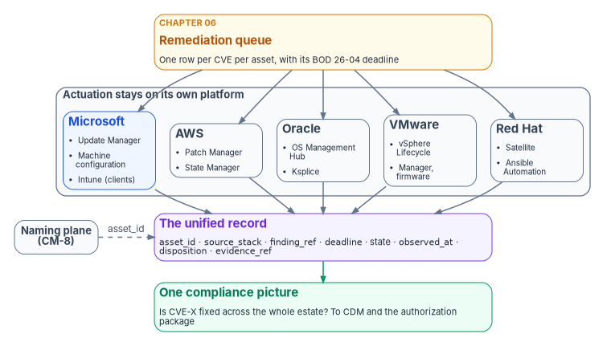
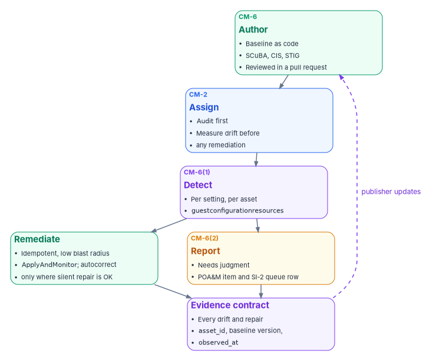

# Chapter 07 — Patch, Configuration and Hardening Baselines

*Only the platform that runs a workload can fix it; only a record that every platform emits in the same shape can prove the whole estate is fixed.*

::: {.callout-note}
## In this chapter
The remediation half of the vulnerability plane. How the shared-responsibility line decides where SI-2 applies; why the program lets each platform patch with its own stack but governs every stack through one record; why that record only works if every row carries the same authoritative asset identity (CM-8); why configuration state matters as much as patch level; when a single cross-cloud management overlay is worth its cost; how a hardening baseline moves from document to enforced, measured control, worked with Azure machine configuration and a drift export; how management agents that cross a boundary are documented; and how the same contract extends to Red Hat workloads on AWS.
:::

[Chapter 06](06-vulnerability-management.md) built the assessment half on one stack: Defender Vulnerability Management finds the flaws, the daily join to CISA's data gives each one a deadline, and the queue says what must be fixed by when. That's a complete reference implementation for the Microsoft side of the estate. It isn't the whole estate.

An agency at FedRAMP Moderate typically runs compute on more than one platform at once: Microsoft 365 and Azure, often AWS, sometimes Oracle Cloud Infrastructure, usually an on-premises VMware estate, and Red Hat Enterprise Linux across several of them. Each platform ships its own patch and systems-management stack. Each stack spans Windows and Linux guests, and below the guest there are hypervisors, firmware and managed services that no single vendor's tool reaches.

So the question is the one [Chapter 02](02-the-evidence-contract.md) poses for every plane: is flaw remediation closed by forcing every workload under one management plane, or by each platform's native stack coordinated through a common contract? The program's answer is a design position, and this chapter is its justification: **actuation is platform-native; governance is unified.** Each platform patches and configures with the stack its support model expects. Every stack emits the same remediation record, keyed to the same asset identity, into the same queue.

{#fig-ch07-native-actuation-one-record fig-alt="Top to bottom. An amber card at the top, the remediation queue from Chapter 06, one row per CVE per asset with its BOD 26-04 deadline. It fans out to a row of platform-native stacks, grouped as actuation that stays on its own platform: a blue card, Microsoft, Azure Update Manager and machine configuration for servers, Intune for clients; a slate card, AWS, Systems Manager Patch Manager and State Manager; a slate card, Oracle, OS Management Hub and Ksplice; a slate card, VMware, vSphere Lifecycle Manager for hosts and firmware; and a slate card, Red Hat, Satellite and Ansible Automation Platform. Each stack points down to one violet card, the unified record: asset_id, source stack, finding reference, deadline, patch and baseline state, observed_at, disposition and evidence pointer. A slate pill, the naming plane CM-8, feeds asset_id with a dashed arrow. The record leads to a green card, one compliance picture, answering whether a CVE is fixed across the whole estate, feeding CDM and the authorization package."}

## The shared-responsibility line is the SI-2 scoping rule

SI-2 requires the organization to "identify, report, and correct system flaws," test updates before installing them, install security-relevant updates within a defined period, and fold flaw remediation into configuration management.[^c07-sp80053] It doesn't apply uniformly to every layer of a cloud service. It applies to the layers the agency operates, and the shared-responsibility line moves with the service model.

CISA's implementation guidance for BOD 26-04 draws the line for vulnerability management directly. For on-premises systems and infrastructure as a service, the agency "retains full responsibility for managing vulnerabilities." For platform as a service, the agency oversees security, identity, access, guest operating system, data and content, and audit logging, while the provider handles network security. For software as a service, the provider handles web application security, identity, operations and network protection, and the agency handles access, authentication, guest data and content, and audit logging. Commercial providers must report the status of outstanding vulnerabilities to the receiving agency.[^c07-bod2604-ig]

| Service model | Who patches the guest OS | Who patches the platform | Agency SI-2 scope |
|---|---|---|---|
| Infrastructure as a service (a VM on any provider) | Agency | Provider (hypervisor, host) | Full guest remediation: OS, middleware, applications |
| Platform as a service (managed database, functions) | Provider | Provider | Only the application and configuration layers the agency controls |
| Software as a service (Microsoft 365, managed applications) | Provider | Provider | Tenant configuration and consumption of the provider's vulnerability reporting, not patching |

The scoping rule, as program design: **enumerate the estate by service model first, and place SI-2 obligations only where the agency operates the operating system or the application.** Two assessment errors are common and opposite. One claims SI-2 evidence for a fully managed database the provider patches. The other fails to claim it for an IaaS virtual machine because "it's in the cloud," when the agency patches every byte above the hypervisor. The line, not the location, decides. For software as a service the agency's work is configuration posture ([Chapter 06](06-vulnerability-management.md), [Chapter 08](08-cloud-native-posture.md)) and the provider's reporting, which for FedRAMP-certified offerings runs through the Vulnerability Detection and Response and Vulnerability Evaluation and Reporting rules from December 7, 2026.[^c07-fedramp-ntc14]

## CM-8 is the precondition for SI-2 at scale

Five platforms produce five inventories: Azure resource IDs, EC2 instance IDs, OCI OCIDs, vCenter managed object IDs and Satellite host records. Each is correct inside its own stack and meaningless outside it. They become one compliance picture only if every remediation record carries the same authoritative identity for the asset it describes. Without that join key the agency can answer "is CVE-X fixed?" one stack at a time, which isn't asset visibility.

CM-8 requires a component inventory that "accurately reflects the system," "includes all components within the system," and "does not include duplicate accounting of components or components assigned to any other system."[^c07-sp80053] BOD 23-01 makes discovery and enumeration operational, with automated asset discovery every 7 days and vulnerability enumeration across all discovered assets every 14 days.[^c07-bod2301] FedRAMP's 2026 Key Security Indicators ask the same of providers: "Authoritative sources are used to automatically generate real-time inventories of all information resources when needed" (KSI-PIY-GIV, mapped to CM-8 and its enhancements).[^c07-ksi]

The program reads these together as one requirement, which is a design position: the authoritative `asset_id` comes from the naming plane ([Book 08](../b08-ddi/index.md), [Chapter 02](02-the-evidence-contract.md)), every platform's native identifier is mapped to it before any compliance claim is made, and a remediation record that can't be mapped proves nothing about any real asset. Multi-platform flaw remediation is therefore a consequence of the inventory problem, not a separate one.

## The scanner is not remediation: the handoff

A scanner authors no state. It measures drift from one. Closing the gap is platform-specific work done by a patch orchestration stack, not by the scanner.

The handoff between [Chapter 06](06-vulnerability-management.md) and this chapter is a contract, not a merge, and neither side duplicates the other:

- **Assessment emits** one queue row per CVE per asset, keyed to `asset_id`, with the KEV flag, the BOD 26-04 row, the clock start, the deadline and the forensic-triage flag. There is one priority queue for the estate. A platform's own scanner, such as Amazon Inspector, is an assessment *source* feeding that queue, never a second prioritization authority.
- **Actuation consumes** the rows for its platform, schedules or applies the fix in its own maintenance model, and emits a remediation-status record back.
- **Closure** happens only when both are true: the actuation record says what was applied, and a later assessment of the same `asset_id` no longer sees the finding ([Chapter 02](02-the-evidence-contract.md) defines the `disposition` rule).

## Actuation is platform-native

Each platform patches with the stack its support model expects. Forcing an overlay past that boundary breaks support and often breaks physics: a guest-OS agent can't patch the hypervisor underneath it.

| Platform | Windows guests | Linux guests | Hypervisor, host firmware | Managed services |
|---|---|---|---|---|
| Microsoft | Azure Update Manager for Azure and Arc-enabled servers; Intune for Windows clients | Azure Update Manager | Azure Local instances through Update Manager[^c07-aum-new] | Provider-patched |
| AWS | Systems Manager Patch Manager | Systems Manager Patch Manager | Provider (EC2) | Provider-patched (for example RDS, Lambda) |
| Oracle Cloud Infrastructure | OS Management Hub | OS Management Hub; Ksplice | Provider | Provider-patched |
| On-premises VMware | Guest stack of choice (for example Update Manager through Arc) | Guest stack of choice | vSphere Lifecycle Manager | — |
| Red Hat (any platform) | — | Red Hat Satellite; Ansible Automation Platform | — | — |
| Cross-platform overlay (optional) | Tanium, BigFix, Ivanti and similar, on any platform above | Same | Not reachable from the OS | — |

What each native stack does, from its own documentation:

- **Azure Update Manager** manages and governs updates for Windows and Linux machines in Azure, on-premises and other clouds from one service. It offers scheduled patching in customer-defined maintenance windows, on-demand updates, periodic assessment every 24 hours, dynamic scoping, and patching for Arc-enabled servers, SQL Server enabled by Arc and VMware machines connected through Arc.[^c07-aum] On Arc-enabled Windows Server 2025 Datacenter and Standard, Update Manager delivers hotpatches that install certain security updates without a restart; a reboot is needed only for the baseline cumulative update, typically every three months.[^c07-arc-patch] Microsoft made Arc-enabled hotpatch for Windows Server 2025 available at no extra cost.[^c07-hotpatch] Servers are covered in depth in [Book 05, Chapter 09](../b05-devices/09-servers-under-azure-arc.md).
- **Intune** handles the Windows client lane. Windows Update ring policies support the Pro, Pro Education, Enterprise, Education and IoT Enterprise editions, not Windows Server,[^c07-rings] and expedite policies push a specific security update past deferral settings when the monthly cadence is too slow for a KEV deadline.[^c07-expedite] The source's server "production ring" for domain controllers and database servers was a category error; servers use Update Manager. Rings, deadlines and Autopatch are in [Book 05, Chapter 10](../b05-devices/10-operating-and-evidencing-the-fleet.md).
- **AWS Systems Manager Patch Manager** patches EC2 instances, edge devices, on-premises servers and virtual machines running Windows Server, supported Linux distributions and macOS. It runs a `Scan` (report only) or `Scan and install` operation against a patch baseline the customer defines, through patch policies, maintenance windows or on-demand "Patch now." It doesn't upgrade major OS versions, doesn't test patches before making them available, and uses the publisher's severity rather than CVSS. Its compliance data is "a point-in-time snapshot from the latest successful patching operation," and compliance with a baseline "doesn't mean that a managed node is necessarily secure."[^c07-ssm-patch] Patch compliance can be sent to Security Hub.[^c07-ssm-patch]
- **Oracle OS Management Hub** manages updates and patches for instances in OCI, private data centers and supported third-party clouds from one console.[^c07-osmh] **Ksplice** applies critical security patches to Linux kernels on OCI instances in memory, without a reboot, and on Oracle Linux also patches the glibc and OpenSSL user-space libraries. It doesn't replace package maintenance: on-disk packages still have to be updated so the system starts from the current release after its next reboot.[^c07-ksplice]
- **vSphere Lifecycle Manager** images update both the software and the firmware on an ESXi host in a single operation. Firmware comes from a hardware support manager, a vendor-supplied plug-in that registers with vCenter, lists available firmware and applies the firmware specified in the image's add-on.[^c07-vlcm]
- **Red Hat Satellite** imports content from Red Hat and custom sources, manages it across lifecycle environments, manages packages on hosts and provisions physical and virtual machines.[^c07-satellite]

Two properties of the matrix carry weight.

**The hypervisor and firmware column has no cross-platform tool.** ESXi is patched by vSphere Lifecycle Manager, server firmware through the vendor's hardware support manager, and network appliance firmware through vendor tooling ([Book 09](../b09-network/index.md)). "Everything under one agent" can't reach this column, which is where some of the most damaging exploitation of recent years has landed ([Book 11, Chapter 06](../b11-zero-trust/06-beyond-microsoft-365.md)).

**Live patching changes the remediation math, but doesn't end it.** The source presented Ksplice as a capability unique to Oracle. Reboot-free patching now exists on several platforms: Ksplice on Oracle Linux, hotpatch on Windows Server 2025 through Arc, and Kernel Live Patching on Amazon Linux 2 through Systems Manager.[^c07-ksplice][^c07-arc-patch][^c07-ssm-patch] Each shrinks the maintenance window that gates most patching, which matters when BOD 26-04 allows three days. None removes the periodic baseline: Ksplice still needs on-disk updates and hotpatch still needs the quarterly baseline reboot. The program schedules both, and counts a live patch as remediation only when the stack records it against the finding.

## Governance is unified: the record

Coordination isn't a console. It's a record every stack must emit. The program's unified remediation record is the patch-and-configuration specialization of the evidence contract in [Chapter 02](02-the-evidence-contract.md); the field names below are program design:

| Field | Meaning | Chapter 02 contract field |
|---|---|---|
| `asset_id` | Authoritative name or address from the naming plane; the join key | `asset_id` |
| `source_stack` | The stack that produced the record: `update-manager`, `ssm`, `osmh`, `vlcm`, `satellite`, `aap`, `machine-config` | `source` |
| `surface` | Guest OS, application, hypervisor, firmware or appliance class | `surface` |
| `control` | SI-2 for a patch record, CM-6 for a baseline record | `control` |
| `finding_ref` | CVE or advisory ID, KEV flag, and the queue row it closes | — (links to the assessment record) |
| `deadline` | The BOD 26-04 deadline assigned at assessment | — (carried from the queue) |
| `patch_state` / `baseline_conformance` | Current against required patch level; pass or fail against the CM-2 baseline | `state`, `verdict` |
| `observed_at` | When the state was measured, in synchronized UTC | `observed_at` |
| `disposition` | Applied, scheduled, failed, or accepted risk with its POA&M reference | `disposition` |
| `evidence_ref` | The stack's job, run or association ID, so an assessor can trace the record to its source | provenance |

Every native stack can produce these fields; the program writes the mapping once per stack. The native outputs that carry them are documented:

- **Azure Update Manager** writes assessment and installation results to Azure Resource Graph, in the `PatchAssessmentResources` and `PatchInstallationResources` tables, for both Azure VMs and Arc-enabled machines.[^c07-arg-tables]
- **Azure machine configuration** writes guest assignment compliance to the `guestconfigurationresources` table, with the per-setting reasons for noncompliance.[^c07-mc-compliance]
- **Systems Manager** emits a `Configuration Compliance State Change` event to EventBridge when a managed node's patch or association compliance changes between `compliant` and `non_compliant`, and State Manager emits association state changes;[^c07-ssm-events] Patch Manager also writes scheduled compliance reports to S3.[^c07-ssm-patch]
- **Amazon Inspector** publishes findings to EventBridge and to Security Hub, and automatically closes a finding when it detects the remediation.[^c07-inspector]

The record lands in the program's evidence store and the same queue as everything else ([Chapter 02](02-the-evidence-contract.md), [Chapter 12](12-evidence-metrics-and-continuous-monitoring.md)). It's the SI-2(2) evidence, because SI-2(2) requires determining with automated mechanisms whether components have the applicable updates installed, and the SI-2(3) evidence, because SI-2(3) requires measuring the time between identification and remediation.[^c07-sp80053] The program mandates the record, never a single vendor's tool.

## Configuration state, not just patch level

SI-2 closes flaws. CM-2 and CM-6 hold the configuration that keeps them closed. CM-2 requires a current baseline configuration maintained under configuration control and reviewed when components are installed or upgraded; CM-6 requires configuration settings that "reflect the most restrictive mode consistent with operational requirements," implemented, with approved deviations documented and changes monitored and controlled.[^c07-sp80053] A patch applied to a host that then drifts out of its hardened baseline hasn't stayed remediated: an SMBv1 client re-enabled, a local administrator account switched back on or a firewall rule widened reopens the exposure the patch closed.

Each platform has a desired-state mechanism that is the configuration analogue of a patch baseline:

- **Azure machine configuration** (formerly Azure Policy Guest Configuration) audits or sets OS settings inside Azure VMs and Arc-enabled servers through Desired State Configuration, scoped by Azure resource scope rather than OU ([Book 05, Chapter 09](../b05-devices/09-servers-under-azure-arc.md)).[^c07-mc-remediation]
- **AWS Systems Manager State Manager** keeps managed nodes and other AWS resources "in a state that you define" through associations that specify the configuration, the schedule and the targets; it can run SSM documents, MOF files, Ansible playbooks or Chef recipes.[^c07-ssm-state]
- **Red Hat Ansible Automation Platform** expresses the desired state as versioned playbooks.

The discipline is the same on all of them: declare a baseline, detect drift, reconcile or report, and emit a `baseline_conformance` record into the same contract. FedRAMP's 2026 indicators describe the target for providers in the same terms: configuration "managed using automation and persistently reviewed for drift" (KSI-SVC-ACM) and "persistently evaluated and tested" (KSI-MLA-EVC).[^c07-ksi]

## The baseline lifecycle

A baseline that no pipeline enforces is a document, not a control. Conformance tooling measures drift from an intended state; it can't author one. The program authors the intended state as machine-enforced policy, detects drift continuously and reconciles or reports it. That's CM-6 base, operationalized through CM-6(1), which requires managing, applying and verifying configuration settings with automated mechanisms, and CM-6(2), which requires defined actions in response to unauthorized changes.[^c07-sp80053]

Each baseline moves through four stages. The last two are what turn a one-time hardening into a standing control.

| Stage | Artifact | Control |
|---|---|---|
| Author | Baseline definition: agency CM-6 settings drawn from SCuBA, a CIS Benchmark or the vendor's hardening guide, mapped to policy, versioned in the governance repository | CM-6 settings |
| Assign | Policy assignment to the target scope, audit-only first | CM-2 baseline |
| Detect | Continuous compliance evaluation producing a drift record per setting per asset | CM-3, CM-6, CM-6(1) |
| Reconcile or report | Automatic remediation where safe; a POA&M item and an SI-2 queue row where not | CM-6(2), SI-2 |

{#fig-ch07-baseline-lifecycle fig-alt="Top to bottom. A green card, author: baseline as code, SCuBA, CIS or agency CM-6 settings mapped to policy, reviewed in a pull request. An arrow down to a blue card, assign: Audit first, measure the drift population before enabling any remediation. An arrow down to a violet card, detect: per setting, per asset drift records from guestconfigurationresources. The violet card splits into two side by side: a green card, remediate, for idempotent low-blast-radius settings, ApplyAndMonitor or ApplyAndAutoCorrect; and an amber card, report, for settings needing judgment, raised as a POA&M item and an SI-2 queue row. Both lead to a violet card, evidence contract: every drift and every reconciliation is a record with asset_id, baseline version and observed_at. A dashed arrow runs back up from evidence to author, labelled publisher updates."}

Baselines come from their publishing authorities, and the agency chooses which. CM-6 asks for settings drawn from organization-defined common secure configurations, and its discussion says those can come from product developers, vendors, federal agencies, consortia and others.[^c07-sp80053] CISA's SCuBA baselines cover two products, Microsoft 365 and Google Workspace, and are binding for those tenants under BOD 25-01 ([Book 11, Chapter 04](../b11-zero-trust/04-scuba-and-bod-25-01.md)).[^c07-scuba] They don't cover servers, network devices, hypervisors or cloud accounts. For those, NIST's National Checklist Program maintains a public repository of security configuration checklists, hosting some (mainly federal ones) and linking to others;[^c07-ncp] NIST's guidance for checklist users notes that checklists are typically created by IT vendors for their own products.[^c07-sp80070] The usual sources for a Moderate civilian agency are CIS Benchmarks, which cover operating systems such as Red Hat Enterprise Linux 9 and Windows Server 2022 and 2025, network devices and cloud accounts,[^c07-cis] and the vendor's own hardening guide. Some civilian agencies borrow a DISA STIG where it is the only published checklist for a product (High only); it is an optional reference, not the baseline a civilian ATO expects.

*High only* marks material that applies to FedRAMP High or Defense environments, such as DISA STIGs and DoD Impact Levels, not to the Moderate civilian baseline this workbook targets. It's kept as an optional reference.

Microsoft's built-in Azure compute security baselines for Windows and Linux are a practical starting point on Azure and Arc ([Book 05, Chapter 09](../b05-devices/09-servers-under-azure-arc.md)). Every baseline is point-in-time and must track its publisher's updates, or it silently ages out of currency.

### Azure machine configuration and the drift export

Machine configuration has three assignment types, set by the `assignmentType` property:[^c07-mc-assignments]

| Assignment type | Behavior | Evidence consequence |
|---|---|---|
| `Audit` | Reports compliance; never changes the machine | Every drift is visible as `NonCompliant` |
| `ApplyAndMonitor` (the default) | Applies the configuration, then reports `NonCompliant` if the machine drifts, without correcting it | Drift is visible; remediation is a separate, recorded action |
| `ApplyAndAutoCorrect` | Applies the configuration and corrects drift at the next evaluation | The machine always reports `Compliant` unless an error occurs; Microsoft states there's "no way to report when a drift was automatically corrected"[^c07-mc-remediation] |

::: {.callout-important}
## Correction: there is no "audit then remediate" mode, and autocorrect hides drift
The source's illustrative baseline used an `AuditThenRemediate` enforcement mode. Machine configuration has no such mode; the three types are `Audit`, `ApplyAndMonitor` and `ApplyAndAutoCorrect`.[^c07-mc-assignments] "Audit first, then remediate" is a rollout sequence, done by assigning in `Audit` and changing the assignment later. The more important point for evidence: `ApplyAndAutoCorrect` corrects drift without recording that drift happened.[^c07-mc-remediation] A setting under autocorrect can be reversed by an attacker and silently restored at the next evaluation, and the record shows only compliance. The program's design is to use `ApplyAndMonitor` or `Audit` for every setting whose drift must be evidenced (anything a CM-6(2) response depends on), reserve `ApplyAndAutoCorrect` for idempotent, low-risk settings where silent correction is acceptable, and say which is which in the baseline file.
:::

The baseline file below is the program's own baseline-as-code format, not a Microsoft schema. A pipeline translates it into machine configuration packages and Azure Policy assignments, or into State Manager associations and Ansible roles on other platforms. Its job is to declare the desired setting, the response to drift and the evidence destination in one reviewed artifact.

::: {.callout-warning}
## Illustrative, not tested against a production estate
The baseline file and query in this chapter are examples. They haven't been run against a production subscription. The rule identifiers follow the CIS Windows Server benchmark's numbering pattern and must be checked against the benchmark version the agency adopts. Assign in `Audit` first and review the drift population before enabling any remediation.
:::

```yaml
# Program baseline-as-code (not a Microsoft schema). CM-2 / CM-6.
# Translated by the pipeline into machine configuration packages and
# Azure Policy assignments for Azure and Arc-enabled servers.
baseline: cis-l1-windows-server
version: 2026.10.1                 # every drift record carries this version
source: CIS Microsoft Windows Server Benchmark (adopted version recorded in the repo)
scope:
  - /subscriptions/<subscription-id>/resourceGroups/<arc-servers-prod>
rollout:
  phase: audit                     # audit -> monitor; changed by pull request only
rules:
  - id: 2.3.1.x                    # verify against the adopted benchmark version
    setting: "Accounts: Administrator account status"
    desired: Disabled
    onDrift: remediate             # assignmentType ApplyAndMonitor; remediation is a recorded action
  - id: 18.x.x                     # verify against the adopted benchmark version
    setting: "Configure SMB v1 client driver"
    desired: "Disable driver"
    onDrift: report                # needs judgment: may break a legacy dependency
evidence:
  export: evidence-contract        # every drift and reconciliation is a record (Chapter 02)
  poam_on: report                  # unremediated drift opens a POA&M item and an SI-2 queue row
```

The drift export reads machine configuration results from Azure Resource Graph, one row per noncompliant setting per machine, and maps each to the evidence contract. The query follows Microsoft's published sample for finding every reason a machine is noncompliant.[^c07-arg-gc]

```kusto
// Drift export: every noncompliant machine configuration setting, per machine.
// Source: Azure Resource Graph, guestconfigurationresources.
guestconfigurationresources
| where type =~ 'microsoft.guestconfiguration/guestconfigurationassignments'
| extend machine = tostring(split(properties.targetResourceId, '/')[-1]),
         targetResourceId = tostring(properties.targetResourceId),
         assignment = name
| extend resources = properties.latestAssignmentReport.resources
| extend resources = iff(isnull(resources[0]), dynamic([{}]), resources)
| mv-expand resources
| extend reasons = resources.reasons
| extend reasons = iff(isnull(reasons[0]), dynamic([{}]), reasons)
| mv-expand reasons
| extend settingCompliant = tobool(resources.complianceStatus)
| where settingCompliant == false
| project targetResourceId, machine, assignment,
          setting = tostring(resources.resourceId),
          reason = tostring(reasons.phrase),
          exportedAtUtc = now()
```

Each row becomes a contract record: `asset_id` mapped from `targetResourceId`, `control` CM-6, `verdict` fail, `observed_at` from the export run (the evaluation itself recurs on the machine's own cycle), `disposition` open until a later evaluation shows the setting compliant or the authorizing official accepts the risk. If an Arc-enabled server disconnects, its guest assignments are kept locally for 14 days and then deleted ([Book 05, Chapter 09](../b05-devices/09-servers-under-azure-arc.md)), so a server that stops appearing in this export is a coverage finding, not a clean result.

### Deployment sequence

The program's deployment sequence for any baseline, on any platform:

1. **Assign in audit mode first** and measure the drift population before enabling remediation. A baseline that auto-remediates a setting the estate depends on is an availability incident.
2. **Split every rule into `remediate` and `report`.** Remediate only idempotent, low-blast-radius settings; anything that needs judgment is reported. The split is reviewed in the pull request that changes the baseline.
3. **Wire drift and reconciliation records to the evidence contract**, so CM-6 is evidenced continuously, not at assessment time.
4. **Feed unremediated drift into the SI-2 queue and the POA&M.** A governed exception is a documented deviation under CM-6, backed by an approval, not a silent gap.

For SCuBA, the same pattern applies to the cloud business applications: the ScubaGear output is compared with the intended SCuBA baseline, and each governed exception is carried as a documented deviation, so the assessor sees a decision rather than an open drift ([Book 11, Chapter 09](../b11-zero-trust/09-running-the-assessment.md)).

### Honest limits

- Automatic remediation is safe only for idempotent, low-blast-radius settings. The `report` path exists because not every drift can be closed without human judgment.
- SCuBA, CIS and vendor baselines are point-in-time and must follow their publishers' revisions.
- Cloud posture findings across several providers need a pack per provider. The mechanism is uniform; the pack content isn't ([Chapter 08](08-cloud-native-posture.md)).

## The cross-cloud overlay decision

An agency may choose one OS-agnostic management plane, such as Tanium, BigFix or Ivanti, on top of every platform instead of stitching the native stacks together. The trade is explicit:

| Option | Gains | Costs |
|---|---|---|
| Native per-platform stacks | No extra product; each stack inherits its provider's support model and authorization boundary | The evidence contract must normalize five or more outputs |
| Single overlay | One console and one normalized output | One more product in the boundary to authorize and operate, an agent on every host, and a support seam with each platform's own tooling |

Neither is required by the program; both satisfy it as long as every stack, or the overlay, emits the record. The overlay doesn't replace the hypervisor and firmware column: vSphere Lifecycle Manager and vendor firmware tooling remain, because an OS-level agent can't patch below the OS. If an overlay is chosen, verify its FedRAMP status on the Marketplace at procurement and treat it as a high-value target in its own right, because a tool that can push software to every host is a path to every host ([Chapter 11](11-detection-engineering-and-response.md)).

## Accreditation and the boundary

Most stacks in the matrix are cloud provider services (Update Manager, Systems Manager, OS Management Hub), so their gate is the provider's FedRAMP certification; verify each one's status and the cloud it's available in, and don't claim above the system's baseline ([Book 10](../b10-cloud-boundary/index.md)). Others are customer-operated: vSphere Lifecycle Manager on on-premises VMware and Red Hat Satellite or Ansible Automation Platform on agency infrastructure carry no provider certification. The authorization boundary documents them as agency-operated components, hardened and evidenced like any other, rather than inherited services.

One boundary nuance recurs. A hybrid management agent, such as the Arc agent on an on-premises or AWS host or the Systems Manager agent on a non-AWS host, creates a connection the boundary must document, because the management channel crosses a boundary edge. CA-3 requires approving and managing information exchange between the system and other systems, and documenting the interface characteristics, security requirements, controls and responsibilities in each exchange agreement.[^c07-sp80053] The program's position is to record each such channel as an external connection with its own agreement, and never to treat a reached host as silently in-boundary because a management agent touches it.

## Extending the contract to a second cloud: Red Hat on AWS

A common next estate is Red Hat Enterprise Linux virtual machines in AWS. The program's design extends the existing contract in place rather than building an AWS-specific program, under three invariants:

1. **Same queues.** Satellite, Ansible Automation Platform and Systems Manager results land in the same SI-2 remediation queue as the rest of the estate, as updates to the open rows they close, not as a new record type.
2. **Same join key.** AWS assets reconcile to the authoritative naming plane before any compliance claim is made about them ([Book 08, Chapter 07](../b08-ddi/07-cloud-private-endpoints-and-ipam.md)).
3. **Same evidence path.** AWS control state feeds the same attestation and continuous-monitoring loop ([Chapter 12](12-evidence-metrics-and-continuous-monitoring.md)); there's no separate AWS compliance narrative.

The emission contract for this estate is deliberately small, the same shape every other stack emits:

| Field | Content | Why it matters |
|---|---|---|
| Join key | The asset's authoritative identity from the naming plane | An unreconciled record proves nothing about a real asset; reconciliation runs first |
| Source stack | `satellite`, `aap` or `ssm` | Which platform-native orchestrator acted |
| Finding reference | Erratum or patch ID, CVE, KEV flag | Joins the record to the queue row it closes |
| Deadline | The BOD 26-04 deadline assigned at assessment | Whether the fix beat its clock is a fact, not a recollection |
| Status and evidence pointer | Success, failed or deferred, with the job or association ID | The pointer the evidence contract carries into attestation |

The emitters are existing capabilities. Systems Manager patch compliance changes surface as EventBridge `Configuration Compliance State Change` events;[^c07-ssm-events] Satellite and Ansible Automation Platform job results are posted to the coordination layer's inbound integration (program design). The baseline artifacts that define the estate's desired state, the State Manager association and the Ansible playbook version, are recorded as CM-2 baseline versions, so drift is judged against a versioned baseline and not a console's memory.

The companion guide [Ansible for Configuration Automation](../guides/ansible-configuration-automation.md#evidence-to-the-program) works this through for Ansible: playbook versions as CM-2 baselines, pull requests as CM-3 change control, job results to the evidence store, with [example playbooks](../../../downloads/ansible-examples.zip).

The assessment side stays in [Chapter 06](06-vulnerability-management.md). Amazon Inspector discovers and continually scans EC2 instances, ECR container images and Lambda functions, publishes findings to EventBridge and Security Hub, and closes a finding when it detects the remediation.[^c07-inspector] Its findings enter the one KEV-weighted queue, keyed to the same `asset_id`, alongside Defender's, through the same evidence path as every other source ([Chapter 02](02-the-evidence-contract.md)). Red Hat Insights, a software-as-a-service analytics service, is excluded from the boundary by default until an authorization review admits it; Satellite and Ansible Automation Platform carry the full contract without it.

## Closure necessity: remediation has no substitute

No conformance scan, policy document or single-vendor console closes SI-2 on a multi-platform estate. The flaw is closed only when the platform-native stack applies the fix on its own platform, and the estate is provably closed only when each stack emits a remediation record keyed to authoritative asset identity and a later assessment confirms it. Remove the actuation and SI-2 is open. Remove the join key and SI-2 is unprovable. The same holds for configuration: an unenforced baseline closes nothing, and a scanner with no authored baseline has nothing to measure against.

## Controls and indicators

| Control | Title | How this chapter closes it |
|---|---|---|
| CM-8 | System Component Inventory | Authoritative `asset_id` from the naming plane as the join key across every native inventory (precondition; [Chapter 02](02-the-evidence-contract.md)) |
| RA-5 | Vulnerability Monitoring and Scanning | Handoff from [Chapter 06](06-vulnerability-management.md); per-platform scanners feed the one queue |
| SI-2 | Flaw Remediation | Platform-native patch orchestration per platform and layer |
| SI-2(2) | Automated Flaw Remediation Status | The unified remediation record emitted by every stack |
| SI-2(3) | Time to Remediate Flaws and Benchmarks for Corrective Actions | Detected, deadline and fixed dates per finding; BOD 26-04 Table 1 as the benchmark |
| CM-2 | Baseline Configuration | Versioned baseline-as-code per platform |
| CM-3 | Configuration Change Control | Baseline changes by pull request; drift and reconciliation records |
| CM-6, CM-6(1), CM-6(2) | Configuration Settings; Automated Management, Application, and Verification; Respond to Unauthorized Changes | Machine configuration, State Manager and Ansible enforcement, drift export, defined response per rule |
| CA-3 | Information Exchange | Hybrid management channels documented as external connections |

The control mapping is the program's. FedRAMP's 2026 Key Security Indicators are written for cloud service providers, not agency systems, but they describe the same evidence and the program uses them as a model. The ones that touch this chapter are KSI-SVC-ACM (configuration managed with automation and reviewed for drift), KSI-MLA-EVC (configuration persistently evaluated and tested), KSI-PIY-GIV (inventories generated from authoritative sources), KSI-CMT-VTD (automated testing and validation of changes, mapped among others to SI-2 and CM-6(2)) and KSI-SVC-EIS (persistent security improvement, mapped among others to SI-2(2)).[^c07-ksi] Vulnerability timeframes for providers sit in the separate Vulnerability Detection and Response rules, not in an indicator.[^c07-fedramp-vdr] The source volume's mapping (SI-2 to KSI-SVC and KSI-MLA, CM-2 and CM-6 to KSI-CMT) predates the 2026 rules and isn't carried.

Control-level depth for the multi-platform remediation plane and the baseline deployment pattern is in the Federal Compliance volumes [Patch & Systems Management](https://github.com/WhalerMike/modernization-workbook/blob/main/docs/compliance/Vol_III_Book_03_Patch_Systems_Management.md) and [Configuration Baselines & Hardening](https://github.com/WhalerMike/modernization-workbook/blob/main/docs/compliance/Vol_VI_Book_06_Configuration_Baselines_Hardening.md).

::: {.callout-tip}
## Continue the book
[← Previous: Chapter 06 — Vulnerability Management](06-vulnerability-management.md) · [Book index](index.md) · [Next: Chapter 08 — Cloud-Native Posture →](08-cloud-native-posture.md)
:::

[^c07-sp80053]: National Institute of Standards and Technology, SP 800-53 Rev. 5, *Security and Privacy Controls for Information Systems and Organizations*, release 5.2.0, controls CA-3, CM-2, CM-3, CM-6, CM-6(1), CM-6(2), CM-8, SI-2, SI-2(2), SI-2(3), OSCAL catalog, <https://github.com/usnistgov/oscal-content/tree/main/nist.gov/SP800-53/rev5> (accessed Oct 21, 2026).
[^c07-bod2604-ig]: Cybersecurity and Infrastructure Security Agency, *BOD 26-04: Implementation Guidance for Prioritizing Security Updates Based on Risk*, June 10, 2026, third-party and cloud service responsibilities, <https://www.cisa.gov/news-events/directives/bod-26-04-implementation-guidance-prioritizing-security-updates-based-risk> (accessed Oct 21, 2026).
[^c07-fedramp-ntc14]: FedRAMP, NTC-0014, "FedRAMP Response to CISA BOD 26-04 (Prioritizing Security Updates Based on Risk)," June 16, 2026, <https://www.fedramp.gov/notices/0014/> (accessed Oct 21, 2026).
[^c07-fedramp-vdr]: FedRAMP, "Vulnerability Detection and Response," *FedRAMP Consolidated Rules for 2026*, <https://www.fedramp.gov/2026/reference/vulnerability-detection-and-response/> (accessed Oct 21, 2026).
[^c07-bod2301]: Cybersecurity and Infrastructure Security Agency, Binding Operational Directive 23-01, *Improving Asset Visibility and Vulnerability Detection on Federal Networks*, October 3, 2022, <https://www.cisa.gov/news-events/directives/bod-23-01-improving-asset-visibility-and-vulnerability-detection-federal-networks> (accessed Oct 21, 2026).
[^c07-ksi]: FedRAMP, "Key Security Indicators," *FedRAMP Consolidated Rules for 2026*, 20x Class C, indicators KSI-PIY-GIV, KSI-SVC-ACM, KSI-MLA-EVC, KSI-CMT-VTD and KSI-SVC-EIS (control mappings as updated October 13, 2026), <https://www.fedramp.gov/2026/reference/20x/c/key-security-indicators/> (accessed Oct 21, 2026).
[^c07-aum]: Microsoft Learn, "What is Azure Update Manager?: Features," <https://learn.microsoft.com/azure/update-manager/overview> (accessed Oct 21, 2026).
[^c07-aum-new]: Microsoft Learn, "What's new in Azure Update Manager: November 2023, Azure Local patching," <https://learn.microsoft.com/azure/update-manager/whats-new> (accessed Oct 21, 2026).
[^c07-arc-patch]: Microsoft Learn, "Cloud-native patch management with Azure Arc-enabled servers: Hotpatching," <https://learn.microsoft.com/azure/azure-arc/servers/cloud-native/patch-management> (accessed Oct 21, 2026).
[^c07-hotpatch]: Microsoft Learn, "Enable Hotpatch for Azure Arc-enabled servers," <https://learn.microsoft.com/windows-server/get-started/enable-hotpatch-azure-arc-enabled-servers> (accessed Oct 21, 2026).
[^c07-rings]: Microsoft Learn, "Manage Windows Update ring policies: Prerequisites," Microsoft Intune, <https://learn.microsoft.com/intune/device-updates/windows/manage-update-rings> (accessed Oct 21, 2026).
[^c07-expedite]: Microsoft Learn, "Expedite policies for Windows quality updates," Microsoft Intune, <https://learn.microsoft.com/intune/device-updates/windows/configure-expedite-policy> (accessed Oct 21, 2026).
[^c07-ssm-patch]: Amazon Web Services, "AWS Systems Manager Patch Manager," *AWS Systems Manager User Guide*, <https://docs.aws.amazon.com/systems-manager/latest/userguide/patch-manager.html> (accessed Oct 21, 2026).
[^c07-ssm-state]: Amazon Web Services, "AWS Systems Manager State Manager," *AWS Systems Manager User Guide*, <https://docs.aws.amazon.com/systems-manager/latest/userguide/systems-manager-state.html> (accessed Oct 21, 2026).
[^c07-ssm-events]: Amazon Web Services, "Reference: Amazon EventBridge event patterns and types for Systems Manager," *AWS Systems Manager User Guide*, <https://docs.aws.amazon.com/systems-manager/latest/userguide/reference-eventbridge-events.html> (accessed Oct 21, 2026).
[^c07-inspector]: Amazon Web Services, "What is Amazon Inspector?," *Amazon Inspector User Guide*, <https://docs.aws.amazon.com/inspector/latest/user/what-is-inspector.html> (accessed Oct 21, 2026).
[^c07-osmh]: Oracle, "OS Management Hub," *Oracle Cloud Infrastructure Documentation*, <https://docs.oracle.com/en-us/iaas/osmh/doc/home.htm> (accessed Oct 21, 2026).
[^c07-ksplice]: Oracle, "Ksplice," *Oracle Cloud Infrastructure Documentation*, <https://docs.oracle.com/en-us/iaas/oracle-linux/ksplice/index.htm> (accessed Oct 21, 2026).
[^c07-vlcm]: Broadcom, "Firmware Updates with vSphere Lifecycle Manager," *Managing Host and Cluster Lifecycle* (vSphere 8.0), <https://techdocs.broadcom.com/us/en/vmware-cis/vsphere/vsphere/8-0/managing-host-and-cluster-lifecycle/using-images-to-install-and-update-esxi-hosts-and-clusters/firmware-updates.html> (accessed Oct 21, 2026).
[^c07-satellite]: Red Hat, "Red Hat Satellite 6.19," product documentation, <https://docs.redhat.com/en/documentation/red_hat_satellite> (accessed Oct 21, 2026).
[^c07-arg-tables]: Microsoft Learn, "Understanding the Azure Resource Graph query language: Resource Graph tables," <https://learn.microsoft.com/azure/governance/resource-graph/concepts/query-language> (accessed Oct 21, 2026).
[^c07-mc-compliance]: Microsoft Learn, "View Machine Configuration Compliance Reporting: Azure Resource Graph," <https://learn.microsoft.com/azure/governance/machine-configuration/how-to/view-compliance> (accessed Oct 21, 2026).
[^c07-mc-remediation]: Microsoft Learn, "Remediation options for machine configuration," <https://learn.microsoft.com/azure/governance/machine-configuration/concepts/remediation-options> (accessed Oct 21, 2026).
[^c07-mc-assignments]: Microsoft Learn, "Understand machine configuration assignment resources," <https://learn.microsoft.com/azure/governance/machine-configuration/concepts/assignments> (accessed Oct 21, 2026).
[^c07-arg-gc]: Microsoft Learn, "Azure Resource Graph sample queries for Azure Policy guest configuration: Find all reasons a machine is non-compliant for guest configuration assignments," <https://learn.microsoft.com/azure/governance/policy/samples/resource-graph-samples-guest-configuration> (accessed Oct 21, 2026).
[^c07-scuba]: Cybersecurity and Infrastructure Security Agency, "Secure Cloud Business Applications (SCuBA) Project" (baselines for Microsoft 365 and Google Workspace; ScubaGear and ScubaGoggles assessment tools), <https://www.cisa.gov/resources-tools/services/secure-cloud-business-applications-scuba-project> (accessed Oct 29, 2026).
[^c07-sp80070]: National Institute of Standards and Technology, SP 800-70 Rev. 5, *National Checklist Program for IT Products: Guidelines for Checklist Users and Developers*, May 2026, <https://csrc.nist.gov/pubs/sp/800/70/r5/final>; and NIST, "National Checklist Program," <https://csrc.nist.gov/projects/national-checklist-program> (repository at <https://ncp.nist.gov/>) (accessed Oct 29, 2026).
[^c07-cis]: Center for Internet Security, "CIS Benchmarks" (benchmark list, including Red Hat Enterprise Linux 9 3.0.0, Microsoft Windows Server 2022 5.1.0 and 2025 2.1.0, Cisco IOS XE 17.x 2.2.1 and Amazon Web Services Foundations 7.1.0), <https://www.cisecurity.org/cis-benchmarks> (accessed Oct 29, 2026).
[^c07-ncp]: National Institute of Standards and Technology, "National Checklist Program," Computer Security Resource Center, <https://csrc.nist.gov/projects/national-checklist-program> (accessed Oct 21, 2026).
