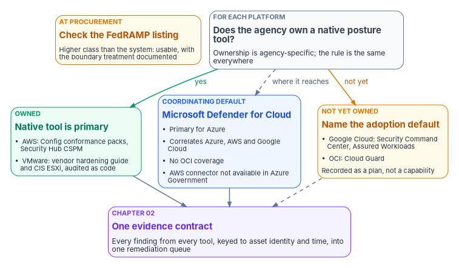
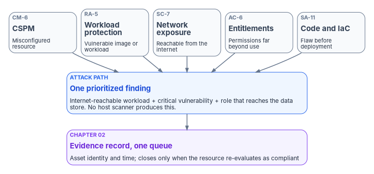

# Chapter 08 — Cloud-Native Posture

*A storage account open to the internet has no missing patch, so a vulnerability scanner will never report it; the cloud control plane needs its own sensor.*

::: {.callout-note}
## In this chapter
Why misconfiguration, excessive entitlement and exposure in the cloud control plane need a sensor of their own, and how cloud security posture management (CSPM) applies CM-6 to cloud resources. The program's owned-tool-first rule for choosing a posture mechanism on each platform, with each platform's FedRAMP listing checked as of today. The overlapping views of a cloud-native application protection platform (CNAPP), Kubernetes admission control and runtime detection, and how every posture finding enters the same evidence contract and lines up with FedRAMP's current Key Security Indicators.
:::

[Chapter 06](06-vulnerability-management.md) finds the known vulnerabilities on hosts, and [Chapter 07](07-patch-configuration-and-baselines.md) patches them and holds operating systems to a hardening baseline. Neither one looks at the layer where many cloud failures start. A host scanner answers "which CVEs are on this virtual machine." It doesn't answer "is this storage bucket public," "can this workload reach the internet," "does this role grant far more than it uses" or "was this container image scanned before it ran." Those are questions about the cloud control plane and the container layer. On an estate that spans Azure, AWS, Google Cloud, Oracle Cloud Infrastructure, a VMware private cloud and Kubernetes clusters on several of them, the answers come from each provider's API, not from an agent on a guest.

This chapter covers three overlapping disciplines that answer those questions:

- **Cloud security posture management (CSPM):** continuous detection of cloud resource misconfiguration against a secure baseline, on every provider (CM-6).
- **Cloud-native application protection (CNAPP):** one platform that combines workload vulnerability scanning, network exposure and attack-path analysis, entitlement analysis and pre-deployment code and infrastructure-as-code scanning.
- **Kubernetes and container security:** image scanning, admission control that refuses non-compliant workloads (CM-7), and runtime threat detection (SI-3).

The argument is the book's argument. A posture tool isn't a dashboard to look at. It is one more emitter on the evidence contract that [Chapter 02](02-the-evidence-contract.md) defines, and its findings go into the same queue as everything else.

## CSPM: CM-6 applied to cloud resources

NIST SP 800-53 CM-6 asks an organization to establish and document configuration settings that "reflect the most restrictive mode consistent with operational requirements," implement them, approve and document deviations, and "monitor and control changes to the configuration settings."[^c08-sp80053] [Chapter 07](07-patch-configuration-and-baselines.md) applies that control to operating systems. In the cloud, the same control covers a different kind of setting: whether a storage account allows public access, what a network security group admits, whether a key vault has purge protection, whether resource logs are on, and whether an identity's role assignment has grown since it was granted. CSPM reads those settings continuously through each provider's API and compares them with a baseline.

Same control, different layer. The program treats the two as separate contributions to CM-6: Chapter 07's operating-system baseline and this chapter's cloud-resource baseline. An assessor who sees only one of them hasn't seen CM-6 closed.

## The owned-tool-first decision across a multi-cloud estate

No single posture tool sees every provider equally well, and every provider ships its own. The program's rule for choosing is a design position, not a vendor requirement:

1. **A Microsoft product is the default only where it coordinates the multi-vendor surface.** The preference has to be earned by actually reaching the other platforms, not assumed.
2. **Where the agency already owns a platform-native posture mechanism, that tool is primary for its own platform's evidence.** The coordinating tool's role there narrows to cross-account correlation, not sole source.
3. **Where nothing is owned yet, the chapter names an adoption default:** the specific mechanism to stand up the day the agency procures that platform, recorded as a plan, not as a capability in place.
4. **Every mechanism's FedRAMP status is checked on the Marketplace at procurement, and a mechanism certified at a higher class than the system's impact level is usable when the boundary treatment is documented.** FedRAMP's 2026 rules say each agency "still authorizes its own federal information systems," and the authorizing official accepts risk for "the configuration selected, the integrations enabled."[^c08-fedramp-use] [Book 10, Chapter 03](../b10-cloud-boundary/03-what-changed-at-fedramp.md) covers certification classes and how an agency uses them.

{#fig-ch08-owned-tool-first fig-alt="A decision diagram. At the top, a slate card asks for each platform whether the agency already owns a platform-native posture mechanism. A green branch labeled owned leads to a card saying the native tool is primary for that platform's posture evidence, with examples: AWS Config conformance packs and Security Hub CSPM for AWS, and Broadcom's hardening guide with the CIS ESXi benchmark, audited as code, for the virtualized estate. An amber branch labeled not yet owned leads to a card naming the adoption default to stand up at procurement: Security Command Center and Assured Workloads for Google Cloud, and Cloud Guard for Oracle Cloud Infrastructure. A blue card in the middle says Microsoft Defender for Cloud is primary for Azure and correlates across Azure, AWS and Google Cloud where its connectors reach, and notes that it doesn't cover Oracle Cloud and that its AWS connector isn't available in Azure Government. Beside the question card at the top, an amber note says to check each mechanism's FedRAMP listing at procurement and document the boundary treatment when its class is above the system's impact level. A violet card at the bottom says every finding, from every mechanism, is emitted to the evidence contract keyed to authoritative asset identity and time."}

### Per-platform mechanisms

The table below gives the mechanism for each platform and what the FedRAMP Marketplace lists for the offering that includes it, as of the dataset published October 21, 2026.[^c08-marketplace] Whether a platform is "owned" is agency-specific; the right-hand column states the program's treatment either way.

*High only* marks material that applies to FedRAMP High or Defense environments, such as DISA STIGs and DoD Impact Levels, not to the Moderate civilian baseline this workbook targets. It's kept as an optional reference.

| Platform | Posture mechanism | FedRAMP listing of the offering that includes it | Program treatment |
|---|---|---|---|
| Azure | Microsoft Defender for Cloud: Foundational CSPM (free) and the Defender CSPM plan[^c08-mdc-clouds] | Defender for Cloud is in the FedRAMP High audit scope of both Azure and Azure Government;[^c08-azure-scope] both offerings are FedRAMP Certified at Class D (High) | Primary for Azure and the coordinating default where its connectors reach |
| AWS | AWS Config conformance packs (including the NIST SP 800-53 Rev. 5 pack) and AWS Security Hub CSPM, including its CIS AWS Foundations Benchmark standard[^c08-aws-config][^c08-aws-shub][^c08-aws-cis] | Both services are listed under AWS US East/West (Class C, Moderate) and AWS GovCloud (Class D, High); either is a valid location for a Moderate system | Primary for AWS where owned, ahead of routing AWS evidence through Defender for Cloud |
| Google Cloud | Security Command Center for posture; Assured Workloads for data-boundary control packages[^c08-gcp-scc][^c08-gcp-aw] | Both sit within the Google Services offering, FedRAMP Certified at Class D (High) | Adoption default; until then, Defender for Cloud's Google Cloud connector is the only mechanism |
| Oracle Cloud Infrastructure | Cloud Guard[^c08-oci-cg] | Listed in the Oracle Cloud Infrastructure-Government Cloud offering, Class D (High) | Adoption default and the only posture mechanism for OCI and its Kubernetes clusters; Defender for Cloud doesn't cover OCI[^c08-mdc-multicloud] |
| VMware private cloud | Broadcom's *VMware Cloud Foundation Security Configuration and Hardening Guide*, measured by Security Posture Management in VCF Operations, with the CIS VMware ESXi benchmarks as a cross-check;[^c08-vcf-spm][^c08-cis] Broadcom's STIG readiness content is an optional reference (High only)[^c08-vcf-stig] | Customer-operated software has no FedRAMP certification of its own | Inherits the agency system's own authorization; posture evidence is the agency's to produce |

: Posture mechanism, FedRAMP listing and program treatment per platform {.striped .hover}

Three corrections to the program's earlier drafts come out of checking those listings:

- **Defender for Cloud is an Azure service, not a Microsoft 365 GCC one.** It is in the FedRAMP High scope of Azure and Azure Government.[^c08-azure-scope] Microsoft 365 GCC tenants pair with Microsoft Entra ID in commercial Azure, which is where most GCC agencies' Defender for Cloud subscriptions live.[^c08-azure-feature-avail]
- **AWS's posture services aren't High-only.** AWS Config and Security Hub CSPM appear in the certified-services lists of both the Moderate commercial-region offering and the High GovCloud offering.[^c08-marketplace] GovCloud (US) isn't High-only either: AWS lists FedRAMP scope per service and per Region, and a High baseline includes the Moderate controls, so a Moderate system can run there *(inference)*.[^c08-aws-fedramp] An agency may run most AWS workloads in GovCloud (US) at Moderate and a contact center in a commercial Region; the posture mechanism is the same in both.
- **Prisma Cloud isn't High-only.** Palo Alto Networks lists Prisma Cloud and Cortex Cloud in both its Government Cloud Services offering (Class C, Moderate) and GCS-HIGH (Class D, High). Wiz for U.S. Government is certified at Class D (High); a separate Wiz Moderate package that was listed as FedRAMP In Process on October 21, 2026 no longer appeared in the Marketplace data on October 26, 2026.[^c08-marketplace] Either platform is a legitimate whole-estate CNAPP alternative to Defender for Cloud. Choosing one is a procurement and boundary decision for the authorizing official, recorded with the listing it relied on.

### Where Defender for Cloud does and doesn't reach

Defender for Cloud's multicloud plans cover Azure, AWS and Google Cloud: Defender CSPM, Defender for Servers and Defender for Containers are generally available on all three.[^c08-mdc-multicloud] Two limits matter for a federal estate:

- **No Oracle Cloud coverage.** The plan-availability table lists Azure, AWS and Google Cloud only, so OCI posture comes from Cloud Guard or a third-party CNAPP.[^c08-mdc-multicloud]
- **Azure Government is a different feature set.** Microsoft's own quickstart says the AWS connector "isn't available on the national government clouds," including Azure Government.[^c08-mdc-aws] The cloud support matrix marks Cloud Infrastructure Entitlement Management (CIEM), DevOps security, code-to-runtime mapping and the data and AI security dashboard as not available in Azure Government, while agentless VM scanning, internet exposure analysis, regulatory compliance and Defender for Containers are generally available there.[^c08-mdc-clouds] The same matrix lists attack path once as unavailable and once as generally available in Azure Government. Treat attack path in Azure Government as unconfirmed until a test subscription shows it, and record the result in the feature register [Book 10, Chapter 09](../b10-cloud-boundary/09-equivalents-and-exceptions.md) describes.

An agency whose AWS accounts are governed from an Azure Government subscription therefore can't use Defender for Cloud as its AWS posture source at all. That is one more reason the owned native tool is primary on its own platform.

## CNAPP: one platform, overlapping views

A CNAPP combines tools that used to be bought separately. Each view answers a different question and supports a different control.

| CNAPP view | Question it answers | NIST SP 800-53 control | Where the workbook covers it |
|---|---|---|---|
| CSPM | Is the cloud resource misconfigured? | CM-6 | This chapter |
| Workload protection (CWPP) | Is the workload or image vulnerable? | RA-5 | This chapter for images and cloud workloads; [Chapter 06](06-vulnerability-management.md) owns host RA-5 and [Chapter 07](07-patch-configuration-and-baselines.md) the SI-2 fix |
| Network exposure and attack path | Can this workload be reached, and what can it reach? | SC-7 | This chapter for the cloud plane; [Book 09](../b09-network/index.md) for the network edge |
| Entitlement management (CIEM) | Does this identity hold far more access than it uses? | AC-6 | Cross-reference to [Book 04](../b04-access/index.md), which carries privileged access |
| Code and infrastructure-as-code scanning | Is the flaw or misconfiguration present before deployment? | SA-11 | This chapter; NIST's Secure Software Development Framework[^c08-ssdf] |

: CNAPP views, the question each answers and the control it supports {.striped .hover}

{#fig-ch08-cnapp-views fig-alt="Five cards in a row, each a CNAPP view with its control: CSPM, misconfiguration, CM-6; workload protection, vulnerable image or workload, RA-5; network exposure, internet reachability, SC-7; entitlement management, unused permissions, AC-6; code and infrastructure-as-code scanning, flaw before deployment, SA-11. Arrows from all five run down to a blue card titled attack path, which reads: internet-reachable workload plus critical vulnerability plus over-permissioned role to the data store equals one prioritized finding no host scanner produces. Below it, a violet card says the finding is emitted to the evidence contract with asset identity and time, and goes to the same queue as every other finding."}

The attack-path view is the capability a host scanner can't reproduce. It joins misconfiguration, exposure, vulnerability and entitlement into one statement: this internet-reachable workload has a critical vulnerability and a role that reaches the data store. Microsoft describes Defender for Cloud's version as an algorithm over a "cloud security graph" of assets, connections, internet exposure, permissions and vulnerabilities, starting from "an external entry point, such as an internet-exposed vulnerable resource" and following lateral movement "until the attacker reaches a critical target."[^c08-mdc-attackpath] In the program's control map it is a cloud-plane SC-7 contribution, distinct from the customer-edge SC-7 that [Book 09](../b09-network/index.md) closes on network equipment.

## Kubernetes and container security (CM-7, SI-3)

Containers add a layer that host tools don't reach. NIST's container security guide was written for exactly this layer and is still the federal reference for it.[^c08-sp800190] Three mechanisms close it.

**Image scanning in the registry.** A container image is scanned for vulnerabilities and secrets when it is built and while it sits in the registry, so remediation is a rebuild and redeploy, not a patch on a running host as in [Chapter 07](07-patch-configuration-and-baselines.md). Defender for Containers scans images in Azure Container Registry, Amazon ECR and Google's registries and, in preview, running containers across clouds.[^c08-mdc-containers]

**Admission control (CM-7).** CM-7 asks the system to provide only essential capabilities and to prohibit or restrict the functions and services the organization names.[^c08-sp80053] In Kubernetes the enforcement point is the admission step, where a request to create a workload is accepted or refused before it runs:

- **Kubernetes' built-in Pod Security Admission** enforces the Pod Security Standards per namespace. Its Baseline and Restricted levels disallow privileged pods, which "disable most security mechanisms," and in `enforce` mode a violation "will cause the pod to be rejected."[^c08-k8s-psa][^c08-k8s-pss]
- **Policy engines** cover what the standards don't, such as registry allowlists or a ban on mutable `latest` tags. Azure Policy for Kubernetes extends Gatekeeper, "an admission controller webhook for Open Policy Agent," on AKS and on Azure Arc-enabled clusters; Microsoft lists EKS and GKE as supported for the Arc extension but not yet conformance-validated.[^c08-azpolicy-k8s][^c08-arc-ext]
- **Gated deployment** ties admission to vulnerability findings. Defender for Containers can "audit or block deployments when images don't meet your organization's vulnerability policy."[^c08-mdc-containers]

The program's admission baseline is a design choice: no privileged pods, no images from outside the approved registries, no unscanned images and no mutable tags, enforced at the gate rather than discovered afterward.

**Runtime threat detection (SI-3).** SI-3 asks for malicious code protection at system entry and exit points, with real-time scanning and alerting.[^c08-sp80053] For containers that means behavioral detection inside running workloads: an unexpected process, drift from the image, or a container reaching somewhere it never has. Defender for Containers' sensor detects binary drift and can block it, adds antimalware and DNS detection, and maps its alerts to MITRE ATT&CK for Containers.[^c08-mdc-containers] Runtime alerts go to the SIEM like any other detection; [Chapter 05](05-from-log-warehouse-to-detection.md) covers that path.

## Feeding the evidence contract

Every finding in this chapter is an evidence record: a CSPM misconfiguration verdict, a workload or image vulnerability, an attack-path alert, an admission denial or a runtime detection. Each is emitted under the evidence contract in [Chapter 02](02-the-evidence-contract.md), keyed to authoritative asset identity and time, so a misconfigured storage account in AWS and the host that reads it in Azure resolve to the same records the rest of the estate uses.

That has three practical consequences:

1. **Export, don't screenshot.** Defender for Cloud's continuous export to Log Analytics or Event Hubs is generally available in both Azure and Azure Government.[^c08-mdc-clouds] AWS Security Hub CSPM, Security Command Center and Cloud Guard each have their own export paths. Each one is configured as an emitter, not left as a console someone checks.
2. **One queue.** Posture findings join vulnerability, patch, configuration and data-protection findings in the same remediation queue, with the same owners and due dates ([Chapter 06](06-vulnerability-management.md)).
3. **A finding closes when the resource is fixed.** A suppressed recommendation, an exemption or a lowered secure-score target isn't a closure. The record shows the resource re-evaluated as compliant ([Chapter 12](12-evidence-metrics-and-continuous-monitoring.md)).

## Alignment with FedRAMP's Key Security Indicators

FedRAMP's Consolidated Rules for 2026 launched on June 25, 2026 (the date of FedRAMP's launch announcement; its changelog counts changes from June 23). Their Key Security Indicators are grouped in themes (Change Management `KSI-CMT`, Cloud Native Architecture `KSI-CNA`, Service Configuration `KSI-SVC`, Monitoring, Logging, and Auditing `KSI-MLA` and others), and each theme holds individually named indicators such as `KSI-SVC-ACM`; FedRAMP last updated their control mappings on October 13, 2026.[^c08-ksi] Evidence should be mapped to an individual indicator, not only to a theme. The indicators are written for cloud service providers: they describe what a provider demonstrates about its cloud service offering. An agency system isn't certified against them. The program uses them as a shared vocabulary for its own continuous evidence, so a provider's evidence and the agency's evidence can be compared indicator by indicator. That mapping is the program's design; the indicator text is FedRAMP's.

| Posture evidence | Current indicator and FedRAMP's wording | Related controls FedRAMP lists |
|---|---|---|
| CSPM drift verdicts on cloud resources | **KSI-SVC-ACM** Automating Configuration Management: configuration "is managed using automation and persistently reviewed for drift" | CM-2, CM-6, CM-7(1) |
| Policy that corrects drift automatically | **KSI-CNA-EIS** Enforcing Intended State: automated services "automatically enforce their intended operational state" | CM-6(2), SI-7 |
| Infrastructure-as-code and template scanning | **KSI-MLA-EVC** Evaluating Configurations: configuration, "especially infrastructure as code, is persistently evaluated and tested" | CM-6, CM-6(1), RA-3 |
| Internet exposure and attack-path findings | **KSI-CNA-MAT** Minimizing Attack Surface; **KSI-CNA-RNT** Restricting Network Traffic | SC-7 enhancements, CM-7(1) |
| Admission control and redeploy-not-modify for containers | **KSI-CMT-RMV** Redeploying vs Modifying: changes are made "through the redeployment of version controlled resources rather than direct modification" | CM-2, CM-7, SI-3 |
| Entitlement findings | **KSI-IAM-ELP** Ensuring Least Privilege | AC-6 |
| Runtime detections reaching the SIEM | **KSI-MLA-OSM** Operating SIEM Capability: "centralized, tamper-resistant logging of events, activities, and changes" | AU-2, AU-9, AU-6 and SI-4 enhancements |

: Posture evidence mapped to FedRAMP's 2026 Key Security Indicators {.striped .hover}

Vulnerability findings from image and workload scanning don't sit in the KSI set. The 2026 rules carry them in separate Vulnerability Detection and Response and Vulnerability Evaluation and Reporting rulesets, which [Chapter 06](06-vulnerability-management.md) covers.[^c08-20x-c]

None of these indicators is satisfied by a single-account conformance scan. The evidence is the cross-account, cross-cloud finding set delivered through the evidence contract, with its closure history.

## The control map for this chapter

| Control | Closing mechanism (function, not product) | Layer distinction |
|---|---|---|
| CM-6 | Cloud resource misconfiguration detection on every provider (CSPM) | Cloud resources; [Chapter 07](07-patch-configuration-and-baselines.md) closes the operating-system baseline |
| CM-7 | Container hardening and Kubernetes admission control | Container workloads |
| RA-5 | Agentless cloud-workload and container-image scanning | Images and cloud workloads; [Chapter 06](06-vulnerability-management.md) owns host scanning |
| SC-7 | Network exposure and attack-path analysis | Cloud plane; [Book 09](../b09-network/index.md) closes the edge |
| SA-11 | Code, image and infrastructure-as-code scanning in the pipeline | Before deployment |
| SI-3 | Container and workload runtime threat detection | Running workloads |

: Controls this chapter contributes to, by layer {.striped .hover}

The full control-level treatment, including the per-platform rationale, is in the Federal Compliance volume [Cloud-Native Security Posture and Containers](https://github.com/WhalerMike/modernization-workbook/blob/main/docs/compliance/Vol_III_Book_04_Cloud_Native_Posture.md). [Appendix A](appendix-a-requirements-mapping.md) maps all of this book's controls together.

## What to take from this chapter

1. Cloud misconfiguration, exposure and excess entitlement are invisible to a host scanner. CSPM is the sensor for them, and it closes the cloud-resource half of CM-6.
2. Choose posture tools platform by platform. An owned native tool is primary for its own platform; a coordinating tool earns that role only where it actually reaches.
3. Check every mechanism on the FedRAMP Marketplace, not from memory. AWS Config and Security Hub CSPM are listed at Moderate and High, Prisma Cloud at Moderate and High, and Wiz at High.
4. Defender for Cloud doesn't cover Oracle Cloud, and its AWS connector isn't available in Azure Government. Plan the gap before an assessor finds it.
5. Admission control is where CM-7 is enforced for containers. Refuse the privileged, unscanned or untrusted workload at the gate.
6. Every posture finding is an evidence record in one queue, and it closes only when the resource re-evaluates as compliant.

::: {.callout-tip}
## Continue the book
[← Previous: Chapter 07 — Patch, Configuration and Hardening Baselines](07-patch-configuration-and-baselines.md) · [Book index](index.md) · [Next: Chapter 09 — Data Protection and Classification →](09-data-protection-and-classification.md)
:::

[^c08-sp80053]: National Institute of Standards and Technology, SP 800-53 Rev. 5, *Security and Privacy Controls for Information Systems and Organizations*, release 5.2.0, controls CM-6, CM-7 and SI-3, OSCAL catalog, <https://github.com/usnistgov/oscal-content/tree/main/nist.gov/SP800-53/rev5> (accessed Oct 21, 2026).
[^c08-fedramp-use]: FedRAMP, "Using a FedRAMP Certified Cloud Service," *FedRAMP Consolidated Rules for 2026*, <https://www.fedramp.gov/2026/agencies/use/> (accessed Oct 21, 2026).
[^c08-marketplace]: FedRAMP Marketplace product data, <https://www.fedramp.gov/marketplace/products.json>, dataset last changed October 21, 2026 (accessed Oct 21, 2026). Entries consulted: Azure Commercial Cloud (F1209051525) and Azure Government (F1603087869), Class D; AWS US East/West (AGENCYAMAZONEW), Class C, and AWS GovCloud (F1603047866), Class D, both listing AWS Config and AWS Security Hub CSPM among certified services; Google Services (FR1805751477), Class D; Oracle Cloud Infrastructure-Government Cloud (FR1900048743), Class D; Palo Alto Networks Government Cloud Services (FR1913470600), Class C, and GCS-HIGH (FR2317253567), Class D, both describing Prisma Cloud and Cortex Cloud; Wiz for U.S. Government (FR2308034636A), FedRAMP Certified, Class D; Wiz Moderate for U.S. Government (FR2308034636), FedRAMP In Process, Class C, on October 21, 2026, and not in the dataset last changed October 26, 2026 (accessed Oct 26, 2026).
[^c08-mdc-clouds]: Microsoft Learn, "Support matrices for Defender for Cloud" (cloud support table), <https://learn.microsoft.com/azure/defender-for-cloud/support-matrix-cloud-environment> (accessed Oct 21, 2026).
[^c08-azure-scope]: Microsoft Learn, "Azure, Dynamics 365, Microsoft 365, and Power Platform services compliance scope," <https://learn.microsoft.com/azure/azure-government/compliance/azure-services-in-fedramp-auditscope> (accessed Oct 21, 2026).
[^c08-azure-feature-avail]: Microsoft Learn, "Cloud feature availability for US Government customers," section "Azure Information Protection," note 1, <https://learn.microsoft.com/azure/security/fundamentals/feature-availability#azure-information-protection> (accessed Oct 21, 2026).
[^c08-aws-config]: Amazon Web Services, "Operational Best Practices for NIST 800-53 rev 5," *AWS Config Developer Guide*, <https://docs.aws.amazon.com/config/latest/developerguide/operational-best-practices-for-nist-800-53_rev_5.html> (accessed Oct 21, 2026). AWS notes that conformance packs, as sample templates, "are not designed to fully ensure compliance."
[^c08-aws-shub]: Amazon Web Services, "Introduction to AWS Security Hub CSPM," *AWS Security Hub User Guide*, <https://docs.aws.amazon.com/securityhub/latest/userguide/what-is-securityhub.html> (accessed Oct 21, 2026).
[^c08-gcp-scc]: Google Cloud, "Security Command Center overview," <https://cloud.google.com/security-command-center/docs/security-command-center-overview> (accessed Oct 21, 2026).
[^c08-gcp-aw]: Google Cloud, "Assured Workloads control packages" (Data Boundary for FedRAMP Moderate and FedRAMP High), <https://cloud.google.com/assured-workloads/docs/control-packages> (accessed Oct 21, 2026).
[^c08-oci-cg]: Oracle, "Cloud Guard," *Oracle Cloud Infrastructure Documentation*, <https://docs.oracle.com/en-us/iaas/cloud-guard/using/index.htm> (accessed Oct 21, 2026).
[^c08-mdc-multicloud]: Microsoft Learn, "Multicloud workload protection support matrix for Microsoft Defender for Cloud," section "Plan availability by cloud," <https://learn.microsoft.com/azure/defender-for-cloud/multicloud-support-matrix> (accessed Oct 21, 2026).
[^c08-aws-cis]: AWS documentation, "CIS AWS Foundations Benchmark in Security Hub CSPM" (versions 5.0.0, 3.0.0, 1.4.0 and 1.2.0; 5.0.0 recommended), <https://docs.aws.amazon.com/securityhub/latest/userguide/cis-aws-foundations-benchmark.html>; and "Regional limits for Security Hub CSPM" (availability of standards by Region), <https://docs.aws.amazon.com/securityhub/latest/userguide/securityhub-regions.html> (accessed Oct 29, 2026).
[^c08-aws-fedramp]: Amazon Web Services, "FedRAMP" (US East/West FedRAMP Certified Class C, formerly Moderate; GovCloud (US) Class D, formerly High), <https://aws.amazon.com/compliance/fedramp/>; and "FedRAMP — Services in Scope" (per-service, per-Region columns), <https://aws.amazon.com/compliance/services-in-scope/FedRAMP/> (accessed Oct 29, 2026).
[^c08-vcf-spm]: Broadcom TechDocs, "Compliance Assessment and Reporting using Security Posture Management," VMware Cloud Foundation 9.1 (benchmarks include the VMware Cloud Foundation Security Configuration and Hardening Guide), <https://techdocs.broadcom.com/us/en/vmware-cis/vcf/vcf-9-0-and-later/9-1/security-and-compliance/security-posture-management/compliance-assessment-and-reporting-using-security-posture-management.html> (accessed Oct 29, 2026).
[^c08-cis]: Center for Internet Security, "CIS Benchmarks" (benchmark list, including VMware ESXi 8.0 1.4.0 and VMware ESXi 9.0 1.0.0), <https://www.cisecurity.org/cis-benchmarks> (accessed Oct 29, 2026).
[^c08-vcf-stig]: Broadcom, "Securing the Foundation: VMware Cloud Foundation 9.1 STIG Compliance," *VMware Cloud Foundation Blog*, July 14, 2026, <https://blogs.vmware.com/cloud-foundation/2026/07/14/securing-the-foundation-vmware-cloud-foundation-9-1-stig-compliance/> (accessed Oct 21, 2026).
[^c08-mdc-aws]: Microsoft Learn, "Connect AWS accounts to Microsoft Defender for Cloud," section "Prerequisites," <https://learn.microsoft.com/azure/defender-for-cloud/quickstart-onboard-aws> (accessed Oct 21, 2026).
[^c08-ssdf]: National Institute of Standards and Technology, SP 800-218, *Secure Software Development Framework (SSDF) Version 1.1*, February 2022, <https://csrc.nist.gov/pubs/sp/800/218/final> (accessed Oct 21, 2026). A Version 1.2 draft, SP 800-218 Rev. 1, was published for comment on December 17, 2025, <https://csrc.nist.gov/pubs/sp/800/218/r1/ipd> (accessed Oct 21, 2026).
[^c08-mdc-attackpath]: Microsoft Learn, "Security explorer and attack paths in Microsoft Defender for Cloud," <https://learn.microsoft.com/azure/defender-for-cloud/concept-attack-path> (accessed Oct 21, 2026).
[^c08-sp800190]: National Institute of Standards and Technology, SP 800-190, *Application Container Security Guide*, September 2017, <https://csrc.nist.gov/pubs/sp/800/190/final> (accessed Oct 21, 2026).
[^c08-mdc-containers]: Microsoft Learn, "Introduction to Microsoft Defender for Containers," <https://learn.microsoft.com/azure/defender-for-cloud/defender-for-containers-introduction> (accessed Oct 21, 2026).
[^c08-k8s-psa]: The Kubernetes Authors, "Pod Security Admission," *Kubernetes Documentation*, <https://kubernetes.io/docs/concepts/security/pod-security-admission/> (accessed Oct 21, 2026).
[^c08-k8s-pss]: The Kubernetes Authors, "Pod Security Standards," *Kubernetes Documentation*, <https://kubernetes.io/docs/concepts/security/pod-security-standards/> (accessed Oct 21, 2026).
[^c08-azpolicy-k8s]: Microsoft Learn, "Understand Azure Policy for Kubernetes clusters," <https://learn.microsoft.com/azure/governance/policy/concepts/policy-for-kubernetes> (accessed Oct 21, 2026).
[^c08-arc-ext]: Microsoft Learn, "Available extensions for Azure Arc-enabled Kubernetes clusters," section "Azure Policy," <https://learn.microsoft.com/azure/azure-arc/kubernetes/extensions-release#azure-policy> (accessed Oct 21, 2026).
[^c08-ksi]: FedRAMP, "Key Security Indicators," *FedRAMP Consolidated Rules for 2026*, changelog entries dated June 24 and October 13, 2026, <https://fedramp.gov/2026/reference/key-security-indicators/> (accessed Oct 21, 2026).
[^c08-20x-c]: FedRAMP, "20x Class C Ruleset Reference," *FedRAMP Consolidated Rules for 2026*, <https://fedramp.gov/2026/reference/20x/c/> (accessed Oct 21, 2026).
