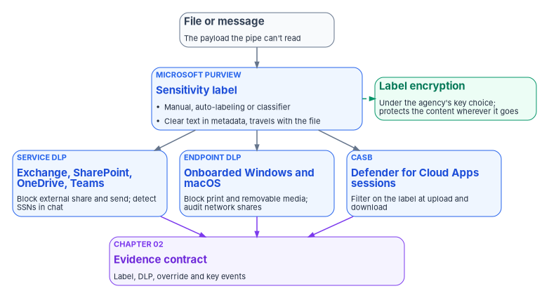
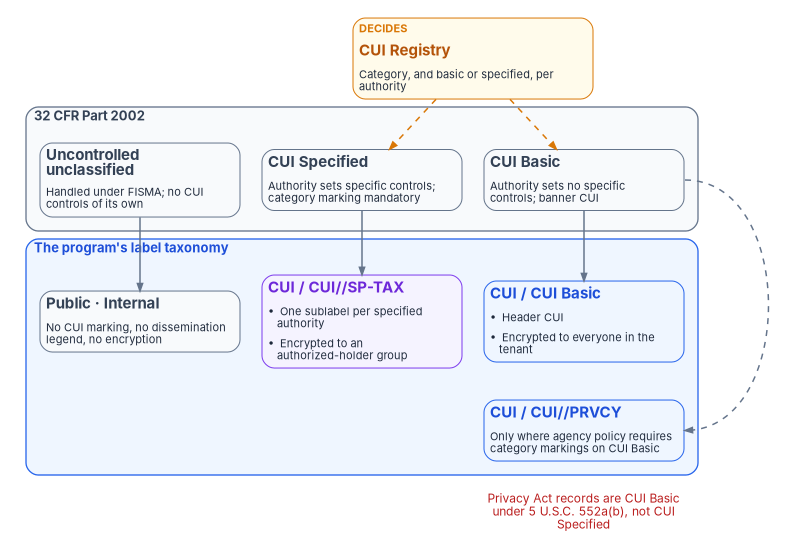

# Chapter 09 — Data Protection and Classification

*Every control in the pipe can be satisfied while the payload leaves, because nothing upstream ever said what the payload was.*

::: {.callout-note}
## In this chapter
The classification gap that remains after network and identity hardening, and why a cloud access security broker (CASB) can't close it alone. What the federal CUI framework in 32 CFR Part 2002 and the CUI Registry actually define, and how the program maps CUI Basic and CUI Specified to Microsoft Purview sensitivity labels, deployed as code. Automatic labeling, DLP on three enforcement surfaces, and the three different things "customer-managed key" can mean in Microsoft 365, with each feature's availability in GCC and GCC High checked on Microsoft Learn.
:::

Network controls decide which paths traffic can take. Authentication decides who is asserting an identity, Conditional Access decides whether that identity may reach a workload from a given device, and privileged access management decides how long an administrator holds elevated scope. [Book 09](../b09-network/index.md), [Book 02](../b02-identity/index.md) and [Book 04](../b04-access/index.md) build those controls. None of them answers a different question: what is in the file?

A user who is legitimately authenticated, on a compliant device, sending a file to an approved destination passes every one of those controls. If the file holds a Social Security number list extracted for a workflow, it leaves anyway, because nothing upstream identified it as sensitive before it moved. This chapter closes that gap with three coordinated mechanisms: a classification taxonomy enforced through sensitivity labels, DLP policies that act on the label and on content inspection, and encryption under keys the agency controls. They are the data-layer contributions to AC-4, the AC-16 attribute controls, MP-3, SC-12, SC-13 and SC-28.

{#fig-ch09-label-signal-surfaces fig-alt="A top-to-bottom flow. A slate card for a file or message, the payload the pipe can't read, leads to a blue card titled sensitivity label from Microsoft Purview, applied manually, by auto-labeling or by a classifier and stored in clear text in metadata so it travels with the file. Beside the label a green card says label encryption, under the agency's key choice, protects the content wherever it goes. From the label, three arrows go down to three blue cards side by side: service DLP in Exchange, SharePoint, OneDrive and Teams, which blocks external sharing and sending and detects Social Security numbers in chat; endpoint DLP on onboarded Windows and macOS devices, which blocks print and removable media and audits network shares; and the CASB, Defender for Cloud Apps sessions, which filter on the label at upload and download. All three send arrows to a violet card at the bottom: the evidence contract, receiving label, DLP, override and key events."}

## The classification gap

An assessment of a Microsoft 365 tenant that has finished network and identity hardening, but has no classification program, finds the same structural gaps from agency to agency. They are framing patterns drawn from the program's assessments, not findings from a named engagement.

- **No classification scheme.** Documents carry no labels. Sensitivity, where it's recorded at all, lives in a file name, a free-text metadata field or a folder name, none of which a control can read or enforce.
- **Sharing is set per container, not per document.** SharePoint external sharing is configured for a site or library, so a CUI document and a public document in the same library get the same policy.
- **No DLP on Teams.** A Social Security number pasted into a Teams chat reaches the service without any rule looking for it.
- **Keys without an owner.** Database encryption keys, certificate private keys and application secrets sit in configuration files, local certificate stores or individual subscriptions, with no central inventory, rotation policy or access audit. Nobody can show whether keys were rotated after an administrator with access left.
- **Access is granted to containers.** Read access to a site is read access to everything in it, whatever its sensitivity.

### Why CASB alone is insufficient

A CASB sees the application, the user, the device's compliance state, the destination and the volume. It enforces access policy on those signals ([Book 09, Chapter 05](../b09-network/05-sd-wan-sase-and-governed-transport.md) places it in the SASE design). What it can't do by itself is tell a released press statement from a Privacy Act record. Without a classification on the file it can apply only coarse policies, such as blocking all uploads to consumer storage or all downloads above a size, and it can't enforce "block external sharing of CUI" because it can't tell which files are CUI.

The sensitivity label supplies that signal. Microsoft describes the label as stored "in clear text in the metadata for files and emails," so third-party apps and services can read it, and as persistent: it "stays with the content, no matter where you save or store it."[^c09-labels] (An earlier draft of this program said the label travels as an encrypted property; that is wrong. The label is readable; the content is what label encryption protects.) Defender for Cloud Apps session policies can filter on the label: block the download of labeled files to unmanaged devices, or block the upload of a file that contains sensitive data and doesn't carry the right label.[^c09-mdca-session] Purview classifies; the CASB enforces on the classification. They work on different layers, and neither substitutes for the other.

## The federal CUI framework

The framework for unclassified federal information that needs protection is Executive Order 13556, which designates the National Archives and Records Administration as the CUI Executive Agent; NARA's Information Security Oversight Office issued 32 CFR Part 2002 to implement it.[^c09-nara-about] Four provisions shape any label design:

1. **CUI is the only lawful category of controlled unclassified information.** "All unclassified information throughout the executive branch that requires any safeguarding or dissemination control is CUI," and agencies "may not implement safeguarding or dissemination controls for any unclassified information other than those controls consistent with the CUI Program."[^c09-cfr2002]
2. **There are two control levels, not four.** *CUI Basic* is CUI whose authorizing law, regulation or policy "does not set out specific handling or dissemination controls." *CUI Specified* is CUI whose authority "contains specific handling controls that it requires or permits agencies to use that differ from those for CUI Basic."[^c09-cfr2002] Everything else is *uncontrolled unclassified information*, which "agencies must still handle … in accordance with" FISMA.[^c09-cfr2002]
3. **CUI sets a confidentiality floor.** Systems that process, store or transmit CUI Basic are categorized at "no less than the moderate confidentiality impact level," with NIST SP 800-53 controls applied.[^c09-cfr2002] NIST SP 800-171 is the requirement set for CUI on non-federal systems.[^c09-cfr2002]
4. **Marking is prescribed.** Every CUI item carries a banner marking whose control marking is "CUI" (or "CONTROLLED"); category markings are mandatory for CUI Specified and optional for CUI Basic unless agency policy requires them; and "authorized holders who designate CUI may not use alternative markings."[^c09-cfr2002]

The CUI Registry decides which category a record falls in and whether its authority is Basic or Specified. Three examples from the registry correct the program's earlier drafts:

| Information | Registry category | Basic or Specified | Banner marking |
|---|---|---|---|
| Privacy Act records (5 U.S.C. 552a(b)) | Privacy (`PRVCY`) | Basic | `CUI`, or `CUI//PRVCY` where agency policy requires category markings[^c09-reg-privacy] |
| Federal taxpayer information (26 U.S.C. 6103) | Federal Taxpayer Information (`TAX`) | Specified | `CUI//SP-TAX`[^c09-reg-tax] |
| Health information | Health Information (`HLTH`) | Specified or Basic, depending on the authority | `CUI//SP-HLTH` for specified authorities, `CUI` for basic ones[^c09-reg-health] |
| Law enforcement techniques and procedures | General Law Enforcement (`LEI`) | Basic for the authorities listed | `CUI` or `CUI//LEI`[^c09-reg-lei] |

: CUI Registry entries that drive the label design {.striped .hover}

Two of the program's earlier assumptions don't survive that reading. Privacy Act records aren't CUI Specified: the registry lists 5 U.S.C. 552a(b) as a Basic authority, so a "CUI Specified — Privacy Act" label with a `CUI//SP-PRVCY` banner would mark them wrongly. And "Internal" and "Law Enforcement Sensitive" aren't CUI categories. "Internal" is the program's name for uncontrolled unclassified information that isn't cleared for release; it may not carry a dissemination control of its own.

## Mapping CUI to sensitivity labels

The program's label taxonomy is a design built on that framework. The parent and sublabel structure follows Purview: a parent label groups sublabels, and the sublabel carries the protection.[^c09-new-label]

| Tier | Label (parent / sublabel) | Content marking | Encryption | Who can open it |
|---|---|---|---|---|
| Public | `Public` | None | None | Anyone |
| Uncontrolled, not for release | `Internal` | None (no CUI or dissemination legend) | None | Not restricted by the label |
| CUI Basic | `CUI` / `CUI Basic` | Header `CUI` | Yes, tenant key | Everyone in the agency's tenant |
| CUI Basic with category marking (where agency policy requires it) | `CUI` / `CUI//PRVCY` | Header `CUI//PRVCY` | Yes, tenant key | Everyone in the agency's tenant |
| CUI Specified | `CUI` / `CUI//SP-TAX` (one sublabel per specified authority the agency holds) | Header with the category marking | Yes, tenant key; Double Key Encryption for the narrowest set | A named, mail-enabled security group of authorized holders |

: The program's CUI label taxonomy (design) {.striped .hover}

{#fig-ch09-cui-to-labels fig-alt="A mapping diagram, top to bottom. At the top, an amber card says the CUI Registry decides the category and whether each authority is basic or specified, with dashed arrows to CUI Basic and CUI Specified. Below it, the 32 CFR Part 2002 framework in slate, in a row: uncontrolled unclassified information handled under FISMA, CUI Specified and CUI Basic. Below that, the label taxonomy, each label under its source: Public and Internal labels in slate for uncontrolled information, with no CUI marking and no dissemination legend; a blue CUI parent label with a CUI Basic sublabel, header CUI, encrypted to everyone in the tenant, and an optional CUI slash slash PRVCY sublabel where agency policy requires category markings; and a violet CUI Specified sublabel such as CUI slash slash SP-TAX, header with the category marking, encrypted to a named authorized-holder group. A red note at the bottom says Privacy Act records are CUI Basic under 5 U.S.C. 552a(b), not CUI Specified."}

Three rules come with the taxonomy:

- **Use groups, not people.** Encryption permissions can be granted to "any specific user or email-enabled security group, distribution group, or Microsoft 365 group," but not to a security group that isn't email-enabled.[^c09-encryption] Holders of a specified category are a group whose membership the identity lifecycle maintains ([Book 03](../b03-hr-identity/index.md)).
- **Don't let records expire by default.** A label can set encrypted content to expire after a number of days.[^c09-new-label] For federal records under a retention schedule, an expiry date is a decision for the records officer, not a default.
- **The label carries the banner.** The header marking is how the program applies the CUI banner on screen and on paper. Content markings are inserted by Office apps, while labels applied by services such as SharePoint auto-labeling apply the metadata and encryption without inserting the marking until the file is relabeled in an Office app.[^c09-office-marking]

## The label taxonomy as code

The taxonomy is declared, reviewed and deployed from source control, not clicked into the portal, so that the protection settings at each tier are visible in review and identical across environments. The same applies to label policies, auto-labeling and DLP. The program's pipeline treats each as a versioned artifact, and a change goes through review like any other configuration ([Chapter 07](07-patch-configuration-and-baselines.md)).

::: {.callout-warning}
## Illustrative code
The PowerShell in this chapter is illustrative. It hasn't been tested against a production tenant or subscription. Cmdlet and parameter names were checked against Microsoft Learn on October 21, 2026; review every value, the agency's own CUI categories and its authorized-holder groups before running anything, and run against a test tenant first.
:::

```powershell
# Security & Compliance PowerShell (ExchangeOnlineManagement module).
# GCC: no extra parameters. GCC High: add
#   -ConnectionUri 'https://ps.compliance.protection.office365.us/powershell-liveid/'
#   -AzureADAuthorizationEndpointUri 'https://login.microsoftonline.us/organizations'
Connect-IPPSSession -UserPrincipalName 'labels-admin@example.gov'

# Rights granted to everyone in the tenant for CUI Basic.
$tenantRights = 'example.gov:VIEW,VIEWRIGHTSDATA,DOCEDIT,EDIT,PRINT,EXTRACT,REPLY,REPLYALL,FORWARD,OBJMODEL'

# Uncontrolled tiers: no marking, no encryption.
New-Label -Name 'Public' -DisplayName 'Public' -ContentType 'File, Email' `
  -Tooltip 'Cleared for public release.'
New-Label -Name 'Internal' -DisplayName 'Internal' -ContentType 'File, Email' `
  -Tooltip 'Not cleared for public release. Not CUI.'

# CUI parent. The sublabels carry marking and encryption.
New-Label -Name 'CUI' -DisplayName 'CUI' -ContentType 'File, Email' `
  -Tooltip 'Controlled Unclassified Information. Choose the sublabel for the authority.'

New-Label -Name 'CUI-Basic' -DisplayName 'CUI Basic' -ParentId 'CUI' -ContentType 'File, Email' `
  -Tooltip 'CUI Basic. Banner marking: CUI.' `
  -ApplyContentMarkingHeaderEnabled $true -ApplyContentMarkingHeaderText 'CUI' `
  -EncryptionEnabled $true -EncryptionProtectionType 'Template' `
  -EncryptionRightsDefinitions $tenantRights `
  -EncryptionContentExpiredOnDateInDaysOrNever 'Never'

# One sublabel per CUI Specified authority the agency holds.
# The rights go to a mail-enabled security group of authorized holders.
New-Label -Name 'CUI-SP-TAX' -DisplayName 'CUI//SP-TAX' -ParentId 'CUI' -ContentType 'File, Email' `
  -Tooltip 'Federal taxpayer information, 26 U.S.C. 6103. Banner marking: CUI//SP-TAX.' `
  -ApplyContentMarkingHeaderEnabled $true -ApplyContentMarkingHeaderText 'CUI//SP-TAX' `
  -EncryptionEnabled $true -EncryptionProtectionType 'Template' `
  -EncryptionRightsDefinitions 'fti-holders@example.gov:VIEW,VIEWRIGHTSDATA,DOCEDIT,EDIT,REPLY,REPLYALL,OBJMODEL' `
  -EncryptionContentExpiredOnDateInDaysOrNever 'Never'

# Publish to a pilot group first, then widen to All.
New-LabelPolicy -Name 'FMP-CUI-Labels-Pilot' `
  -Labels 'Public','Internal','CUI','CUI-Basic','CUI-SP-TAX' `
  -ExchangeLocation 'label-pilot@example.gov'
```

Four corrections to the program's earlier scripts are built into that block. `-LabelActions` is "reserved for internal Microsoft use," so content marking uses the `-ApplyContentMarking*` parameters instead.[^c09-new-label] `New-Label` requires `-Tooltip` as well as `-Name` and `-DisplayName`.[^c09-new-label] `-ParentId` accepts the parent label's name, so the parent's GUID isn't needed.[^c09-new-label] And a label policy is scoped to users through `-ExchangeLocation` (mailboxes, or `All`); its `-SharePointLocation` parameter is "reserved for internal Microsoft use" and there is no Teams location on a label policy.[^c09-new-labelpolicy] Labels appear in SharePoint, OneDrive and Teams for the users the policy covers.

## Automatic labeling

Manual labeling puts the classification decision on the author. Authors label the obviously sensitive document correctly and miss the routine one: a spreadsheet of Social Security numbers extracted for a workflow, or a chat message with a taxpayer number sent while answering a question. Automatic labeling classifies on content, whether or not the author recognized it as sensitive.

### Sensitive information types

Sensitive information types (SITs) are pattern classifiers. The built-in U.S. types include U.S. social security number (SSN), U.S. individual taxpayer identification number (ITIN), U.S. bank account number, U.S. driver's license number and U.S./U.K. passport number, plus Drug Enforcement Agency (DEA) number and IP address.[^c09-sit-list] There is no built-in U.S. employer identification number (EIN) type, so EINs need a custom SIT, as do agency identifiers such as case or claim numbers. Custom SITs are defined as XML rule packages and imported with `New-DlpSensitiveInformationTypeRulePackage -FileData`.[^c09-sit-rulepack] An earlier program script built the rule package as a PowerShell hashtable converted to JSON; that format isn't accepted.

### Trainable classifiers

For categories that have no pattern, such as case notes, budget working papers or policy drafts, trainable classifiers use machine learning. Microsoft provides pretrained classifiers. A custom classifier needs "at least 50 positive samples (up to 500) and at least 150 negative samples (up to 1,500)," supports English only and is seeded from dedicated SharePoint folders.[^c09-classifier] Draw the samples from the real document population, informal documents included; a classifier trained only on formally formatted documents will miss the rest.

### Auto-labeling policies

Service-side auto-labeling labels content at rest in SharePoint and OneDrive and messages in Exchange. Client-side labeling in Office apps recommends or applies a label as the author works. Both are available in GCC and GCC High, along with machine learning classifiers for client-side auto-labeling.[^c09-gcc][^c09-gcch]

```powershell
# Service-side auto-labeling for SharePoint and OneDrive, in simulation first.
New-AutoSensitivityLabelPolicy -Name 'FMP-Auto-CUI-Basic' `
  -ApplySensitivityLabel 'CUI-Basic' `
  -SharePointLocation 'All' -OneDriveLocation 'All' `
  -Mode 'TestWithoutNotifications'

# One rule per workload; -Workload is required.
$ssn = @(@{ Name = 'U.S. Social Security Number (SSN)'; minCount = '1'; minConfidence = '85' })

New-AutoSensitivityLabelRule -Policy 'FMP-Auto-CUI-Basic' -Name 'SSN in SharePoint' `
  -Workload 'SharePoint' -ContentContainsSensitiveInformation $ssn
New-AutoSensitivityLabelRule -Policy 'FMP-Auto-CUI-Basic' -Name 'SSN in OneDrive' `
  -Workload 'OneDriveForBusiness' -ContentContainsSensitiveInformation $ssn

# After the simulation results are reviewed and false positives resolved:
Set-AutoSensitivityLabelPolicy -Identity 'FMP-Auto-CUI-Basic' -Mode 'Enable'
```

`TestWithoutNotifications` is "an audit mode where no actions are taken, and no notifications are sent"; `TestWithNotifications` sends notifications without acting; `Enable` applies the label.[^c09-autolabel-policy] The rule's `-Workload` parameter is required and takes `Exchange`, `SharePoint` or `OneDriveForBusiness`.[^c09-autolabel-rule] Run every policy in simulation first and review what it would label. A false-positive spike that stamps CUI Specified on routine documents becomes a help desk event across the agency.

## DLP on three enforcement surfaces

DLP acts at three points in the data's life, each with a different reach. All three are available in GCC and GCC High: DLP for files and email, Teams chat and channel messages, endpoint DLP, the on-premises scanner and the Defender for Cloud Apps integration.[^c09-gcc][^c09-gcch]

| Surface | Where it's enforced | What it catches | Prerequisite |
|---|---|---|---|
| Microsoft 365 service DLP | Server-side in Exchange, SharePoint, OneDrive and Teams | External sharing, external send, sensitive data in chat | None beyond licensing; independent of the device's state |
| Endpoint DLP | On the device | Print, removable media, network share, copy and paste of labeled or sensitive content | Device onboarded; onboarding is shared with Defender for Endpoint, so devices already onboarded there need no further step[^c09-device-onboarding] |
| CASB | At the session, through Defender for Cloud Apps | Upload and download of labeled files to and from cloud apps | Apps routed through Conditional Access app control[^c09-mdca-session] |

: The three DLP enforcement surfaces {.striped .hover}

Endpoint DLP covers onboarded Windows 10 and 11 and macOS devices, and Windows Server 2019 and later, where it's off until turned on for servers.[^c09-device-onboarding][^c09-edlp] A device excluded from onboarding receives no endpoint policy, so check onboarding coverage before relying on endpoint DLP ([Book 05](../b05-devices/index.md)).

### The minimum policy baseline

The program's baseline for a Moderate system is a design, named by surface, tier and action:

| Policy | Surface | Condition | Action |
|---|---|---|---|
| Block external sharing of CUI | SharePoint, OneDrive | Label is any CUI sublabel | Block for external users, policy tip, incident report |
| Block external send of CUI | Exchange | Label is any CUI sublabel and the recipient is external | Block, policy tip |
| Block print and removable media for CUI Specified | Endpoint | Label is a CUI Specified sublabel | Block, audit event |
| Audit copy to network shares for CUI | Endpoint | Label is any CUI sublabel | Audit |
| Block CUI upload to unapproved cloud apps | CASB | Label is any CUI sublabel; app not on the approved list | Block, alert |
| Alert on bulk download | SharePoint, CASB | Unusual volume in a short window | Alert to security operations |
| Detect Social Security numbers in Teams | Teams | SSN SIT, high confidence | Block, policy tip, alert |

: The program's minimum DLP baseline (design) {.striped .hover}

```powershell
# Labels are matched through ContentContainsSensitiveInformation groups.
$cuiLabels = @(@{
  operator = 'And'
  groups   = @(@{
    operator = 'Or'; name = 'CUI labels'
    labels   = @(
      @{ name = 'CUI-Basic';  type = 'Sensitivity' },
      @{ name = 'CUI-SP-TAX'; type = 'Sensitivity' }
    )
  })
})

# 1. Block external sharing of CUI in SharePoint and OneDrive.
New-DlpCompliancePolicy -Name 'FMP-DLP-CUI-ExternalShare' `
  -SharePointLocation 'All' -OneDriveLocation 'All' -Mode 'TestWithNotifications'
New-DlpComplianceRule -Policy 'FMP-DLP-CUI-ExternalShare' -Name 'Block external access to CUI' `
  -ContentContainsSensitiveInformation $cuiLabels `
  -AccessScope 'NotInOrganization' -BlockAccess $true -BlockAccessScope 'PerUser' `
  -NotifyUser 'Owner' `
  -NotifyPolicyTipCustomText 'This file is labeled CUI and cannot be shared outside the agency.' `
  -GenerateIncidentReport 'secops-dlp@example.gov' -ReportSeverityLevel 'High'

# 2. Block external email of CUI.
New-DlpCompliancePolicy -Name 'FMP-DLP-CUI-ExternalEmail' -ExchangeLocation 'All' -Mode 'TestWithNotifications'
New-DlpComplianceRule -Policy 'FMP-DLP-CUI-ExternalEmail' -Name 'Block external send of CUI' `
  -ContentContainsSensitiveInformation $cuiLabels `
  -AccessScope 'NotInOrganization' -BlockAccess $true `
  -NotifyUser 'Owner' `
  -NotifyPolicyTipCustomText 'This message is labeled CUI and cannot be sent outside the agency.'

# 3. Social Security numbers in Teams chat and channel messages.
New-DlpCompliancePolicy -Name 'FMP-DLP-SSN-Teams' -TeamsLocation 'All' -Mode 'TestWithNotifications'
New-DlpComplianceRule -Policy 'FMP-DLP-SSN-Teams' -Name 'SSN in Teams' `
  -ContentContainsSensitiveInformation @(@{ Name = 'U.S. Social Security Number (SSN)'; minCount = '1'; minConfidence = '85' }) `
  -BlockAccess $true -NotifyUser 'LastModifier' `
  -NotifyPolicyTipCustomText 'This message appears to contain a Social Security number. Use the approved secure transfer service.' `
  -GenerateAlert 'secops-dlp@example.gov' -ReportSeverityLevel 'Medium'

# 4. Endpoint: block print and removable media for CUI Specified; audit network shares.
$cuiSpecified = @(@{
  operator = 'And'
  groups   = @(@{ operator = 'Or'; name = 'CUI Specified'
                  labels = @(@{ name = 'CUI-SP-TAX'; type = 'Sensitivity' }) })
})
New-DlpCompliancePolicy -Name 'FMP-DLP-Endpoint-CUI-SP' -EndpointDlpLocation 'All' -Mode 'TestWithNotifications'
New-DlpComplianceRule -Policy 'FMP-DLP-Endpoint-CUI-SP' -Name 'Restrict CUI Specified on devices' `
  -ContentContainsSensitiveInformation $cuiSpecified `
  -EndpointDlpRestrictions @(
    @{ Setting = 'Print';          Value = 'Block' },
    @{ Setting = 'RemovableMedia'; Value = 'Block' },
    @{ Setting = 'NetworkShare';   Value = 'Audit' }
  ) `
  -NotifyUser 'Owner' -GenerateAlert 'secops-dlp@example.gov' -ReportSeverityLevel 'High'
```

The program's earlier DLP scripts used parameters that don't exist. There is no `-ContentContainsSensitivityLabel`; labels are matched inside `-ContentContainsSensitiveInformation` with a group whose `labels` entries have `type = "Sensitivity"`.[^c09-dlp-rule] Severity is `-ReportSeverityLevel`, not `-Severity`. `-GenerateAlert` takes an email address or `SiteAdmin`, not a role name such as `SecurityManager`. Endpoint restriction settings are names like `Print`, `RemovableMedia`, `NetworkShare` and `CopyPaste`, with values `Audit`, `Block`, `Ignore` or `Warn`, and `Block` or `Warn` also needs `-NotifyUser`.[^c09-dlp-rule] `-BlockAccessScope PerUser` blocks external users while leaving the owner's access intact.[^c09-dlp-rule] A DLP policy's `Mode` takes the same simulation values as auto-labeling, so every policy here starts in `TestWithNotifications`.[^c09-dlp-policy]

Once DLP is enforcing, the override path becomes something to watch. A user who overrides a policy tip repeatedly, or a sudden removal or downgrade of labels across many files, is a detection, not a report line. [Chapter 11](11-detection-engineering-and-response.md) carries those rules as FMP-DET-05 (mass label removal or decryption) and FMP-DET-06 (DLP override pattern).

## Keys the agency controls

"Bring your own key" means three different things in Microsoft 365, and an assessor will ask which one the system security plan means. All three are listed as available in GCC and GCC High.[^c09-gcc][^c09-gcch]

| Option | What it protects | Where the key lives | What the agency gives up |
|---|---|---|---|
| BYOK for the Azure Rights Management root key | Every item protected by label encryption, tenant-wide. The tenant key is "your organization's root key" for that encryption service, and other keys chain to it.[^c09-rms-key] | An RSA 2048-bit key in the agency's Azure Key Vault (Premium for HSM protection), ideally a dedicated vault; the service needs `get`, `decrypt` and `sign` on it[^c09-byok] | Nothing functional; it adds a key the agency must keep available |
| Microsoft Purview Customer Key | Service encryption at rest for Exchange, SharePoint and OneDrive, and multiple workloads, through data encryption policies | Two keys in two Azure Key Vaults in two separate subscriptions, per workload[^c09-customer-key] | Nothing functional; it adds two vaults per workload and strict key hygiene |
| Double Key Encryption (DKE) | Only the content labeled with a DKE label | One key in the agency's own DKE service, one in Azure; "viewing data protected with Double Key Encryption requires access to both keys"[^c09-dke] | eDiscovery, search and indexing, Office for the web and coauthoring, and Copilot for that content[^c09-dke] |

: Three meanings of "customer-managed key" in Microsoft 365 {.striped .hover}

That table corrects the program's earlier label mapping, which showed "AIP BYOK" as a per-tier encryption setting. BYOK replaces the tenant root key for every encrypted label at once; it doesn't distinguish CUI Basic from CUI Specified. The per-label key choice is DKE, and Microsoft positions it for the small set of "highly sensitive" content that justifies losing those services.[^c09-dke] The program's design is BYOK or Microsoft-managed for the tenant key, Customer Key where the authorizing official requires agency-held keys for service encryption at rest, and DKE only for the narrowest CUI Specified categories whose authority demands it.

Customer Key has rules that an ordinary key-rotation policy would break:

- Each vault must have soft delete and purge protection enabled at creation with a 90-day retention period.[^c09-customer-key]
- Keys must be RSA (up to 4,096 bits), and Customer Key "can't use expired keys": the onboarding service "only accepts keys without an expiration date," and Microsoft cautions against setting one.[^c09-customer-key]
- Microsoft keeps an availability key that lets the service recover if both customer keys are lost; its use is logged in the unified audit log as `CustomerKeyServiceEncryption` with the activity "Fallback to availability key."[^c09-availability-key]

A rotation policy that sets an expiry, appropriate for an Azure SQL protector, will cause an outage if applied to a Customer Key key.

### Azure workloads: Key Vault and TDE with a customer-managed key

For Azure workloads, the customer-managed key sits in Key Vault Premium or Managed HSM. Microsoft states that Premium HSM-protected keys are "generated and protected by FIPS 140-3 Level 3 validated Marvell LiquidSecurity HSMs," and Managed HSM is a single-tenant FIPS 140-3 Level 3 service whose security domain the customer holds.[^c09-akv][^c09-mhsm] SC-13 is a property of the validated module, so check the CMVP certificate for each one. FIPS 140-2 certificates moved to the CMVP Historical List in September 2026; NIST says the CMVP "supports the purchase and use of these modules for existing systems," so a 140-2 module in an existing system isn't automatically noncompliant, but new procurements should rely on 140-3 modules.[^c09-fips]

```powershell
# Azure PowerShell. Azure Government: Connect-AzAccount -Environment AzureUSGovernment
Connect-AzAccount
Set-AzContext -Subscription '<key-management-subscription-id>'

New-AzResourceGroup -Name 'rg-fmp-keys' -Location '<region>'

# Premium for HSM-protected keys. Soft delete is on by default for new vaults;
# purge protection must be requested. Azure RBAC is the default access model.
New-AzKeyVault -Name 'kv-fmp-sql-01' -ResourceGroupName 'rg-fmp-keys' -Location '<region>' `
  -Sku 'Premium' -EnablePurgeProtection -SoftDeleteRetentionInDays 90

# An HSM-protected RSA key for the Azure SQL TDE protector.
$key = Add-AzKeyVaultKey -VaultName 'kv-fmp-sql-01' -Name 'cmk-sql-tde' `
  -Destination 'HSM' -KeyType 'RSA' -Size 3072

# Rotation policy as a reviewed file (see the JSON below), not inline values.
Set-AzKeyVaultKeyRotationPolicy -VaultName 'kv-fmp-sql-01' -Name 'cmk-sql-tde' `
  -PolicyPath '.\policies\cmk-sql-tde.rotation.json'

# Grant the SQL server's managed identity the data-plane role it needs.
$sql = Get-AzSqlServer -ResourceGroupName 'rg-fmp-data' -ServerName 'sql-fmp-01'
New-AzRoleAssignment -ObjectId $sql.Identity.PrincipalId `
  -RoleDefinitionName 'Key Vault Crypto Service Encryption User' `
  -Scope (Get-AzKeyVault -VaultName 'kv-fmp-sql-01').ResourceId

# Make the key the TDE protector and let SQL follow new key versions.
Add-AzSqlServerKeyVaultKey -ResourceGroupName 'rg-fmp-data' -ServerName 'sql-fmp-01' -KeyId $key.Id
Set-AzSqlServerTransparentDataEncryptionProtector -ResourceGroupName 'rg-fmp-data' -ServerName 'sql-fmp-01' `
  -Type 'AzureKeyVault' -KeyId $key.Id -AutoRotationEnabled $true
```

```json
{
  "lifetimeActions": [
    { "trigger": { "timeAfterCreate": "P12M" }, "action": { "type": "Rotate" } },
    { "trigger": { "timeBeforeExpiry": "P30D" }, "action": { "type": "Notify" } }
  ],
  "attributes": { "expiryTime": "P14M" }
}
```

The program's earlier scripts used `-EnableSoftDelete` and `-EnableRbacAuthorization`, which `New-AzKeyVault` doesn't have; soft delete is on by default, and RBAC is the default access model unless `-DisableRbacAuthorization` is used.[^c09-new-akv] They also granted the SQL identity "Key Vault Crypto User." Microsoft's TDE guidance names Key Vault Crypto Service Encryption User for the server identity under RBAC, or `get`, `wrapKey` and `unwrapKey` under an access policy.[^c09-tde-cmk] With automatic rotation on, the TDE protector moves to a new key version "within 24 hours" of its creation.[^c09-tde-rotate] The 12-month cryptoperiod in the JSON is the program's choice; the rotation-policy file format follows Microsoft's example.[^c09-rotation-policy] SQL Server instances on premises and on Azure Arc are covered in [Book 06](../b06-data-platform/index.md).

### Keys on other clouds

Key custody is per platform. Each provider runs its own key management service, and a key in one doesn't protect data in another. AWS Key Management Service and AWS CloudHSM, for example, appear in the certified-services lists of both AWS FedRAMP offerings.[^c09-marketplace] The program's position is that classification and DLP policy can coordinate across the estate, while key custody stays native to each platform and is unified only at the governance layer: an inventory of which keys protect which classified data, emitted under the evidence contract. Purview's labeling for multicloud data sources through the Data Map is in preview, so the program doesn't yet rely on it for evidence.[^c09-datamap]

## Non-repudiation is a separate question

The program's earlier drafts argued that Purview Audit (Premium) satisfies AU-10's irrefutability standard through signed records in storage tenant administrators can't reach. Microsoft doesn't describe the product that way. It documents Audit (Premium) as audit log retention policies, longer retention (one year by default for some workloads, up to ten years with an add-on), intelligent insights such as `MailItemsAccessed` and search events, and higher bandwidth to the Management Activity API.[^c09-audit] None of those is a non-repudiation mechanism, and the claim has been removed.

AU-10 is in the NIST SP 800-53B High baseline and not the Moderate baseline.[^c09-baselines] An agency that adopts it above the Moderate floor needs a design for it: exporting the high-value events this chapter and [Chapter 04](04-platform-and-m365-telemetry.md) name into write-once storage that tenant administrators can't alter, with the export itself evidenced. That is program design. Chapter 04 carries audit retention and the license that decides it.

The certificate practice statement the source volume pairs with SC-17 belongs to the PKI: [Book 07, Chapter 05](../b07-pki/05-who-owns-the-certificate-estate.md) covers the certificate policy and trust anchors, and the full RFC 3647 outline stays in the Federal Compliance volume linked below.

## Deployment sequence

The order matters because each step depends on the one before it. It is the program's design:

1. **Decide the key options first.** Choose Microsoft-managed or BYOK for the tenant key, whether Customer Key applies, and which categories, if any, need DKE, before labels encrypt production content.
2. **Deploy the taxonomy as code to a pilot.** Publish labels to a pilot group, confirm markings and encryption in Office apps and in SharePoint, then widen the policy.
3. **Run auto-labeling and DLP in simulation, then enforce.** Measure false positives against real content before any policy acts.
4. **Turn on the detections.** Label downgrade, mass label removal and DLP override patterns (FMP-DET-05 and FMP-DET-06) go to the SIEM before enforcement begins ([Chapter 11](11-detection-engineering-and-response.md)).
5. **Set audit retention to the requirement.** Licenses and retention policies decide how long label and DLP events survive ([Chapter 04](04-platform-and-m365-telemetry.md)).

## Honest limits

- Auto-labeling is only as accurate as its classifiers. Manual labeling discipline and the label-removal detection compensate for mislabeled or stripped content.
- Agency-held keys move the burden of custody to the agency. Rotation, backup and recovery become the agency's job, and a deleted key without a backup is unrecoverable data.[^c09-customer-key]
- DLP restricts the movement of content it matches. It doesn't model behavior; insider risk and detection engineering cover what pattern matching misses.

## The control map for this chapter

| Control | How this chapter contributes | Note |
|---|---|---|
| AC-4 | Label-derived DLP on the service, the endpoint and the CASB | The primary data-layer flow control |
| AC-16 | Labels as security attributes associated with the information and retained with it | AC-16 isn't in any NIST SP 800-53B baseline; adopt it explicitly if the SSP relies on it[^c09-baselines] |
| MP-3 | Label content markings as electronic CUI marking | MP-2, MP-4 and MP-5 govern system media; claim them only for removable media and print, which endpoint DLP controls |
| SC-12 | Key Vault, Customer Key and BYOK with inventory, rotation and access audit | SC-12(1) is in the High baseline only[^c09-baselines] |
| SC-13 | FIPS 140-3 validated modules | Check each module's CMVP certificate |
| SC-28 | TDE with a customer-managed key; label encryption beyond the database boundary | Label encryption follows the file wherever it's stored |

: Controls this chapter contributes to {.striped .hover}

A 3PAO may prefer label-based attribute control anchored to AC-16 and AC-4, with MP claims reserved for physical and removable media. Read the MP row as supporting evidence for the data-layer intent, not the sole closure of the media controls.

## Alignment with FedRAMP's Key Security Indicators

As in [Chapter 08](08-cloud-native-posture.md), FedRAMP's 2026 indicators are written for cloud service providers, and the program borrows them as a vocabulary for its own evidence.[^c09-ksi] The mapping is the program's design.

| Data-protection evidence | Indicator and FedRAMP's wording |
|---|---|
| Label encryption, TDE with customer-managed keys, DLP enforcement logs | **KSI-SVC-SIN** Securing Information: "Information is encrypted or otherwise secured from unwanted access or modification" (related controls include SC-13, SC-28 and AC-21) |
| Key inventory, rotation policy compliance, access reviews | **KSI-SVC-ASM** Automating Secret Management: "Management, protection, and regular rotation of digital keys, certificates, and other secrets is automated and persistently reviewed" (SC-12, SC-12(1), SC-17) |
| Spill response for CUI placed where it doesn't belong | **KSI-SVC-RUD** Removing Unwanted Data, which names spills explicitly |
| Label and DLP events in the event-type list | **KSI-MLA-LET** Logging Event Types (related controls include AU-2, AU-10 and AU-12) |

: Data-protection evidence mapped to FedRAMP's 2026 Key Security Indicators {.striped .hover}

The earlier drafts mapped classification to `KSI-CNA`. The current Cloud Native Architecture indicators are about privileges, intended state, attack surface, network traffic and availability, so the program now maps data protection to the Service Configuration indicators above.[^c09-ksi]

The control-level depth for this chapter is in two Federal Compliance volumes: [Data Protection: Microsoft Purview and Cryptographic Key Management](https://github.com/WhalerMike/modernization-workbook/blob/main/docs/compliance/Vol_III_Book_05_Data_Protection_Purview.md) and [Data Protection Deployment](https://github.com/WhalerMike/modernization-workbook/blob/main/docs/compliance/Vol_VI_Book_05_Data_Protection_Deployment.md). [Appendix A](appendix-a-requirements-mapping.md) maps all of this book's controls together.

## What to take from this chapter

1. Network and identity controls regulate the pipe. Only classification tells any control what the payload is, and a CASB can enforce on it only once the label is there.
2. The CUI framework has two control levels. Basic or Specified is decided by the authority in the CUI Registry, not by how sensitive the content feels: Privacy Act records are CUI Basic, federal taxpayer information is CUI Specified.
3. Non-CUI information can't carry a dissemination control of its own. "Internal" is a label for uncontrolled information, not a fifth control level.
4. Deploy labels, auto-labeling and DLP as code, simulate before enforcing, and watch the override path once enforcement starts.
5. BYOK, Customer Key and Double Key Encryption are three different choices. Only DKE is per label, and it costs search, eDiscovery, coauthoring and Copilot for that content.
6. Customer Key keys must never expire. A rotation policy written for an Azure SQL key will break Microsoft 365 if applied to them.

::: {.callout-tip}
## Continue the book
[← Previous: Chapter 08 — Cloud-Native Posture](08-cloud-native-posture.md) · [Book index](index.md) · [Next: Chapter 10 — Who Runs Security Operations →](10-who-runs-security-operations.md)
:::

[^c09-labels]: Microsoft Learn, "Learn about sensitivity labels," section "What a sensitivity label is," <https://learn.microsoft.com/purview/sensitivity-labels> (accessed Oct 21, 2026).
[^c09-mdca-session]: Microsoft Learn, "Create Microsoft Defender for Cloud Apps session policies," <https://learn.microsoft.com/defender-cloud-apps/session-policy-aad> (accessed Oct 21, 2026); and "Commonly used Microsoft Defender for Cloud Apps information protection policies," <https://learn.microsoft.com/defender-cloud-apps/policies-information-protection> (accessed Oct 21, 2026).
[^c09-nara-about]: National Archives and Records Administration, "About Controlled Unclassified Information (CUI)," <https://www.archives.gov/cui/about> (accessed Oct 21, 2026).
[^c09-cfr2002]: 32 CFR Part 2002, *Controlled Unclassified Information*, §§ 2002.1(c), 2002.4(j), (r) and (ss), 2002.14(g) and (h), and 2002.20(b), electronic Code of Federal Regulations, as in effect October 1, 2026, retrieved through the eCFR versioner API, <https://www.ecfr.gov/api/versioner/v1/full/2026-10-01/title-32.xml?part=2002> (accessed Oct 21, 2026).
[^c09-reg-privacy]: National Archives and Records Administration, CUI Registry, "Privacy" (category detail: General Privacy, authority 5 USC 552a(b), Basic), page last reviewed July 20, 2026, <https://www.archives.gov/cui/registry/category-detail/privacy> (accessed Oct 21, 2026).
[^c09-reg-tax]: National Archives and Records Administration, CUI Registry, "Federal Taxpayer Information," banner marking CUI//SP-TAX, authority 26 USC 6103 Specified, <https://www.archives.gov/cui/registry/category-detail/federal-taxpayer-info> (accessed Oct 21, 2026).
[^c09-reg-health]: National Archives and Records Administration, CUI Registry, "Health Information," <https://www.archives.gov/cui/registry/category-detail/health-info> (accessed Oct 21, 2026).
[^c09-reg-lei]: National Archives and Records Administration, CUI Registry, "General Law Enforcement," page last reviewed July 29, 2025, <https://www.archives.gov/cui/registry/category-detail/general-law-enforcement> (accessed Oct 21, 2026).
[^c09-new-label]: Microsoft Learn, "New-Label" (parameters ContentType, EncryptionContentExpiredOnDateInDaysOrNever, EncryptionProtectionType, EncryptionRightsDefinitions, LabelActions and ParentId), source <https://github.com/MicrosoftDocs/office-docs-powershell/blob/main/exchange/exchange-ps/ExchangePowerShell/New-Label.md>, published at <https://learn.microsoft.com/powershell/module/exchangepowershell/new-label> (accessed Oct 21, 2026).
[^c09-encryption]: Microsoft Learn, "Restrict access to content by using sensitivity labels to apply encryption," section "Assign permissions now," <https://learn.microsoft.com/purview/encryption-sensitivity-labels> (accessed Oct 21, 2026).
[^c09-office-marking]: Microsoft Learn, "Manage sensitivity labels in Office apps," section "When Office apps apply content marking and encryption," <https://learn.microsoft.com/purview/sensitivity-labels-office-apps> (accessed Oct 21, 2026).
[^c09-new-labelpolicy]: Microsoft Learn, "New-LabelPolicy" (parameters ExchangeLocation, ExchangeLocationException and SharePointLocation), source <https://github.com/MicrosoftDocs/office-docs-powershell/blob/main/exchange/exchange-ps/ExchangePowerShell/New-LabelPolicy.md>, published at <https://learn.microsoft.com/powershell/module/exchangepowershell/new-labelpolicy> (accessed Oct 21, 2026).
[^c09-sit-list]: Microsoft Learn, "Sensitive information type entity definitions," <https://learn.microsoft.com/purview/sit-sensitive-information-type-entity-definitions> (accessed Oct 21, 2026).
[^c09-sit-rulepack]: Microsoft Learn, "New-DlpSensitiveInformationTypeRulePackage," source <https://github.com/MicrosoftDocs/office-docs-powershell/blob/main/exchange/exchange-ps/ExchangePowerShell/New-DlpSensitiveInformationTypeRulePackage.md>, published at <https://learn.microsoft.com/powershell/module/exchangepowershell/new-dlpsensitiveinformationtyperulepackage> (accessed Oct 21, 2026).
[^c09-classifier]: Microsoft Learn, "Get started with trainable classifiers," <https://learn.microsoft.com/purview/trainable-classifiers-get-started-with>, and "Learn about trainable classifiers," <https://learn.microsoft.com/purview/trainable-classifiers-learn-about> (accessed Oct 21, 2026).
[^c09-gcc]: Microsoft Learn, "Plan for Microsoft Purview compliance and risk management solutions – GCC deployments," Step 4, <https://learn.microsoft.com/office365/servicedescriptions/microsoft-365-service-descriptions/microsoft-365-tenantlevel-services-licensing-guidance/plan-for-microsoft-purview-gcc-deployments> (accessed Oct 21, 2026).
[^c09-gcch]: Microsoft Learn, "Plan for Microsoft Purview compliance and risk management solutions – GCC High deployments," Step 4, <https://learn.microsoft.com/office365/servicedescriptions/microsoft-365-service-descriptions/microsoft-365-tenantlevel-services-licensing-guidance/plan-for-microsoft-purview-gcc-high-deployments> (accessed Oct 21, 2026).
[^c09-autolabel-policy]: Microsoft Learn, "New-AutoSensitivityLabelPolicy" (parameter Mode), source <https://github.com/MicrosoftDocs/office-docs-powershell/blob/main/exchange/exchange-ps/ExchangePowerShell/New-AutoSensitivityLabelPolicy.md>, published at <https://learn.microsoft.com/powershell/module/exchangepowershell/new-autosensitivitylabelpolicy> (accessed Oct 21, 2026).
[^c09-autolabel-rule]: Microsoft Learn, "New-AutoSensitivityLabelRule" (parameters Workload and ContentContainsSensitiveInformation), source <https://github.com/MicrosoftDocs/office-docs-powershell/blob/main/exchange/exchange-ps/ExchangePowerShell/New-AutoSensitivityLabelRule.md>, published at <https://learn.microsoft.com/powershell/module/exchangepowershell/new-autosensitivitylabelrule> (accessed Oct 21, 2026).
[^c09-device-onboarding]: Microsoft Learn, "Onboard Windows devices into Microsoft 365 overview," <https://learn.microsoft.com/purview/device-onboarding-overview> (accessed Oct 21, 2026).
[^c09-edlp]: Microsoft Learn, "Get started with endpoint data loss prevention," <https://learn.microsoft.com/purview/endpoint-dlp-getting-started> (accessed Oct 21, 2026).
[^c09-dlp-rule]: Microsoft Learn, "New-DlpComplianceRule" (parameters AccessScope, BlockAccessScope, ContentContainsSensitiveInformation, EndpointDlpRestrictions, GenerateAlert, NotifyUser and ReportSeverityLevel), source <https://github.com/MicrosoftDocs/office-docs-powershell/blob/main/exchange/exchange-ps/ExchangePowerShell/New-DlpComplianceRule.md>, published at <https://learn.microsoft.com/powershell/module/exchangepowershell/new-dlpcompliancerule> (accessed Oct 21, 2026).
[^c09-dlp-policy]: Microsoft Learn, "New-DlpCompliancePolicy" (parameter Mode), source <https://github.com/MicrosoftDocs/office-docs-powershell/blob/main/exchange/exchange-ps/ExchangePowerShell/New-DlpCompliancePolicy.md>, published at <https://learn.microsoft.com/powershell/module/exchangepowershell/new-dlpcompliancepolicy> (accessed Oct 21, 2026).
[^c09-rms-key]: Microsoft Learn, "Managing the root key for your Azure Rights Management service," <https://learn.microsoft.com/purview/rights-management-tenant-key> (accessed Oct 21, 2026).
[^c09-byok]: Microsoft Learn, "Bring your own key for the Azure Rights Management service root key," <https://learn.microsoft.com/purview/rights-management-byok> (accessed Oct 21, 2026).
[^c09-customer-key]: Microsoft Learn, "Set up Customer Key," <https://learn.microsoft.com/purview/customer-key-set-up> (accessed Oct 21, 2026).
[^c09-dke]: Microsoft Learn, "What is Double Key Encryption (DKE)?," <https://learn.microsoft.com/purview/double-key-encryption> (accessed Oct 21, 2026).
[^c09-availability-key]: Microsoft Learn, "Learn about the availability key for Customer Key," <https://learn.microsoft.com/purview/customer-key-availability-key-understand> (accessed Oct 21, 2026).
[^c09-akv]: Microsoft Learn, "About Azure Key Vault," <https://learn.microsoft.com/azure/key-vault/general/overview> (accessed Oct 21, 2026).
[^c09-mhsm]: Microsoft Learn, "Control your data in the cloud by using Managed HSM," <https://learn.microsoft.com/azure/key-vault/managed-hsm/mhsm-control-data> (accessed Oct 21, 2026).
[^c09-fips]: National Institute of Standards and Technology, "FIPS 140-3 Transition Effort," Computer Security Resource Center, updated April 13, 2026, <https://csrc.nist.gov/projects/fips-140-3-transition-effort> (accessed Oct 21, 2026). The page gives September 21, 2026 as the date FIPS 140-2 validations move to the Historical List and, in its timeline, September 22, 2026.
[^c09-new-akv]: Microsoft Learn, "New-AzKeyVault," source <https://github.com/Azure/azure-powershell/blob/main/src/KeyVault/KeyVault/help/New-AzKeyVault.md>, published at <https://learn.microsoft.com/powershell/module/az.keyvault/new-azkeyvault> (accessed Oct 21, 2026).
[^c09-tde-cmk]: Microsoft Learn, "Azure SQL Transparent Data Encryption with customer-managed key," section "Permissions to configure customer-managed TDE," <https://learn.microsoft.com/azure/azure-sql/database/transparent-data-encryption-byok-overview> (accessed Oct 21, 2026).
[^c09-tde-rotate]: Microsoft Learn, "Rotate the Transparent data encryption (TDE) protector," section "Automatic key rotation," <https://learn.microsoft.com/azure/azure-sql/database/transparent-data-encryption-byok-key-rotation> (accessed Oct 21, 2026).
[^c09-rotation-policy]: Microsoft Learn, "Set-AzKeyVaultKeyRotationPolicy," example 1, source <https://github.com/Azure/azure-powershell/blob/main/src/KeyVault/KeyVault/help/Set-AzKeyVaultKeyRotationPolicy.md>, published at <https://learn.microsoft.com/powershell/module/az.keyvault/set-azkeyvaultkeyrotationpolicy> (accessed Oct 21, 2026).
[^c09-marketplace]: FedRAMP Marketplace product data, <https://www.fedramp.gov/marketplace/products.json>, dataset last changed October 21, 2026 (accessed Oct 21, 2026): AWS US East/West (AGENCYAMAZONEW) and AWS GovCloud (F1603047866) both list AWS Key Management Service (KMS) and AWS CloudHSM among certified services.
[^c09-datamap]: Microsoft Learn, "Learn about sensitivity labels in Data Map (preview)," <https://learn.microsoft.com/purview/data-map-sensitivity-labels> (accessed Oct 21, 2026).
[^c09-audit]: Microsoft Learn, "Learn about auditing solutions in Microsoft Purview," section "Audit (Premium)," <https://learn.microsoft.com/purview/audit-solutions-overview> (accessed Oct 21, 2026).
[^c09-baselines]: National Institute of Standards and Technology, SP 800-53B, *Control Baselines for Information Systems and Organizations*, Moderate and High baseline profiles, release 5.2.0, OSCAL content, <https://github.com/usnistgov/oscal-content/tree/main/nist.gov/SP800-53/rev5> (accessed Oct 21, 2026). AU-10 and SC-12(1) appear in the High profile only; AC-16 appears in neither.
[^c09-ksi]: FedRAMP, "Key Security Indicators," *FedRAMP Consolidated Rules for 2026*, <https://fedramp.gov/2026/reference/key-security-indicators/> (accessed Oct 21, 2026).
