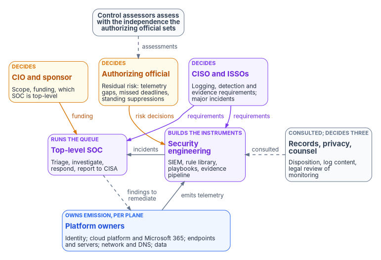
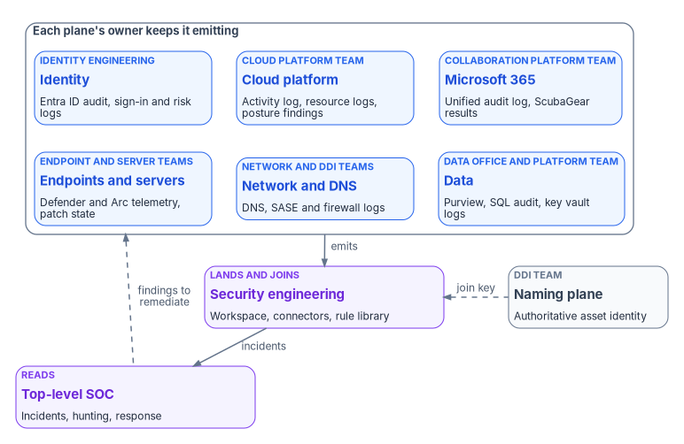

# Chapter 10 — Who Runs Security Operations

*The security operations center runs the queue, but it doesn't decide what reaches the queue, how long the evidence lasts or which blind spots the agency can live with; those decisions belong to other people, and a SOC that makes them by default is carrying risk nobody signed for.*

::: {.callout-note}
## In this chapter
Why "the SOC owns security operations" is the wrong model, and where the federal roles come from: NIST SP 800-37, OMB M-26-14, CISA's incident notification guidelines, BOD 26-04 and the TIC 3.0 program guidebook. The people who decide, do and advise: the CIO, the CISO, the authorizing official, system owners and ISSOs, the top-level SOC, security engineering, the owner of each telemetry plane, the records officer, the privacy office and counsel, and control assessors. Three questions get one owner each: what is collected and kept, who owns each detection and playbook, and who accepts the risk of a gap. A responsibility matrix, an ownership record for every rule, the roles each team needs in Microsoft Sentinel, and the separations that keep the evidence honest.
:::

Most agencies can name their SOC. Fewer can say who decided that a given log source is collected, who decided how long its records are kept, who owns the analytics rule that reads it, or who accepted the risk when the source went quiet for three weeks. In practice those decisions get made by whoever holds the console: an engineer sets a table's retention to the default, an analyst disables a noisy rule, a platform team turns off a diagnostic setting to save cost. Each choice looks operational. Each one changes what the agency can see, and [Chapter 01](01-you-cant-defend-what-you-cant-see.md) argues that a gap in visibility raises no alarm on its own.

This chapter assigns those decisions. It applies the program-wide model in [Book 01, Chapter 09](../b01-transformation-arc/09-who-leads-the-transformation.md) and the running mechanics in [Book 00, Chapter 07](../b00-orientation/07-who-runs-the-program.md) to security operations, and it agrees with the Who chapters that touch the same ground: [Book 10, Chapter 08](../b10-cloud-boundary/08-who-owns-the-boundary.md) for the boundary and [Book 11, Chapter 07](../b11-zero-trust/07-who-owns-zero-trust.md) for the Zero Trust posture. Where those chapters go deeper for their domain, they govern. The model below is the program's recommended design. Adapt it to the agency's structure, but keep one decider per row.

{#fig-ch10-who-runs-security-operations fig-alt="Three rows of cards, with a slate pill above the top row. Top row, decision makers: the CIO and sponsor in amber, who own scope, funding and which SOC is top-level; the authorizing official in amber, who accepts residual risk, including telemetry gaps, missed deadlines and standing suppressions; and the CISO and ISSOs in violet, who set logging, detection and evidence requirements and decide major incidents. An amber arrow labeled funding runs from the CIO to the top-level SOC; an amber arrow labeled risk decisions runs from the authorizing official to security engineering; violet arrows labeled requirements run from the CISO to both. Middle row: the top-level SOC in violet, which triages, investigates, responds and reports to CISA; security engineering in violet, which owns the SIEM, rule library, playbooks and evidence pipeline and sends incidents to the SOC; and a slate card for records, privacy and counsel, which decide disposition, log content and legal review of monitoring and are consulted by security engineering. Bottom row: one wide blue card for the platform owners of identity, cloud platform and Microsoft 365, endpoints and servers, network and DNS, and data, with an arrow labeled emits telemetry up to security engineering and a dashed arrow labeled findings to remediate coming back from the SOC. The slate pill above the authorizing official reads: control assessors assess with the independence the authorizing official sets, with a dashed arrow labeled assessments down to the authorizing official."}

## Where the roles come from

Five sources supply the roles. None of them uses the program's vocabulary, and only one of them uses the word SOC.

The **Risk Management Framework** supplies the decision rights. NIST SP 800-37 Rev. 2 defines the authorizing official as "the only organizational official who can accept the security and privacy risk to organizational operations, organizational assets, and individuals," says the role is an inherent U.S. Government function assigned only to government personnel, and allows a designated representative to do everything except make and sign the authorization decision.[^c10-sp80037] The same publication gives continuous monitoring its own step. Monitoring the system for changes (task M-1) belongs to the system owner or common control provider with the senior agency information security officer; ongoing assessments (M-2) to the control assessor; risk response (M-3) to the authorizing official, system owner and common control provider; updates to the plans and plans of action and milestones (M-4) to the system owner and common control provider; posture reporting (M-5) to the system owner, common control provider and senior agency information security officer; and the ongoing authorization decision (M-6) to the authorizing official alone.[^c10-sp80037-monitor] SP 800-37 also warns organizations to make sure there are no conflicts of interest when one person holds several risk management roles.[^c10-sp80037]

**OMB M-26-14** supplies the security operations center. It directs agencies to organize logging around two objectives, continuous event monitoring and threat hunting, investigation, response and forensics, and notes that the first kind of log is "typically ingested and monitored by a Security Operations Center (SOC)."[^c10-m2614] Its minimum baseline lets log storage be decentralized, but logs "must be readily available to the top-level agency security operations center (SOC)."[^c10-m2614] It requires an Agency Logging Plan, due to OMB and CISA within 90 days of CISA's Logging Reference Architecture, and it requires agencies to give logs to CISA and the FBI on request after a known or suspected compromise.[^c10-m2614] The memo assigns these obligations to the agency, not to a named official. Deciding who inside the agency owns them is the work of this chapter.

**CISA's incident notification guidelines** supply the clock. Federal civilian agencies must notify CISA of an incident within one hour of its identification by the agency's top-level Computer Security Incident Response Team.[^c10-cisa-notify] That phrase names a function, the top-level CSIRT, and the program puts it inside the top-level SOC so that the one-hour clock starts in the same place the queue does.

**BOD 26-04** supplies an explicit instruction to name owners. Issued June 10, 2026, it revoked BOD 22-01 and BOD 19-02 and requires agency vulnerability management policies to, among other things, "assign roles and responsibilities for executing agency actions as required by this Directive" and to set internal tracking, validation and enforcement procedures.[^c10-bod2604] Remediation timelines are the subject of [Chapter 06](06-vulnerability-management.md); the role assignment it requires appears in the matrix below.

The **TIC 3.0 Program Guidebook** supplies one more role and one more shift. OMB M-19-26 moved responsibility for TIC capabilities to the agency, replacing the old DHS TIC Compliance Validation assessments, and the guidebook says agencies keep responsibility for implementing TIC use cases and overlays.[^c10-tic] It also names TIC delegates, the technical points of contact who represent the agency to CISA, coordinate the views of the CIO, CISO, risk and other offices, and act as liaison between the CIO's office and CISA.[^c10-tic] [Book 09, Chapter 03](../b09-network/03-what-tic-3-requires.md) covers what TIC requires of the network; this chapter gives the delegate a row in the matrix.

## Decision rights and work are different things

The program separates three kinds of involvement, as Book 01 does. A role *decides* when it is accountable for the outcome and can say no. A role *does* the work when it builds, configures, runs or remediates. A role is *consulted* when the decision can't be made well without its input, even though the decision isn't its to make.

The split matters more in security operations than almost anywhere else, because nearly every consequential decision looks like an operational setting. Lowering a table's retention is a slider in a portal. Suppressing an analytics rule is a toggle. Excluding a subscription from a diagnostic-settings policy is one line in a template. Each is an edit an engineer can make in a minute, and each can remove evidence an assessor, an investigator or a court will later ask for. The program's rule is that the person whose role lets them make the change is rarely the person who decides it, and that every decision that narrows what the agency can see is recorded with its decider.

## The SOC is a common control provider

SP 800-37 has no SOC role. The closest fit is the **common control provider**: an individual, group or organization responsible for implementing, assessing and monitoring controls that systems inherit, documenting them, making sure they are assessed by qualified assessors with appropriate independence, and producing plans of action and milestones for controls that are deficient.[^c10-sp80037] An agency's top-level SOC provides monitoring and incident handling to every system that sends it logs. In the program's model, that makes the SOC, together with the security engineering team that runs its platform, the common control provider for the monitoring, audit review and incident response controls those systems inherit.

The framing has three consequences.

- **The SOC's controls get assessed like anyone else's.** If every system's security plan says "monitoring is inherited from the enterprise SOC," the SOC owes those systems an assessed control, a current plan and a plan of action and milestones when the control falls short. A SOC that can't produce them is an unassessed dependency in every package that cites it.
- **Most of these controls are hybrid.** AU-6 asks the organization to review and analyze audit records "for indications of" organization-defined inappropriate or unusual activity and to report findings to organization-defined personnel.[^c10-sp80053] The SOC does the review. The system owner knows what unusual looks like in a particular application and who must hear about it. A control inherited without that system-specific part is half a control.
- **The system owner stays accountable for the system.** Inheriting monitoring doesn't move the system owner's monitoring task (M-1) onto the SOC. It means the system owner relies on the SOC for part of it, and needs evidence that the reliance is justified.

## The roles

The **CIO and executive sponsor** decide the scope and funding of security operations, designate which organization is the agency's top-level SOC, and break ties between teams. Under the RMF the CIO designates the senior agency information security officer, maintains security policy, oversees personnel with significant security responsibilities and reports to the head of the agency on the security program's effectiveness; with authorizing officials, the CIO allocates the resources that protect the agency's systems.[^c10-sp80037] For this book that means three decisions. Which SOC is top-level, so that M-26-14's availability requirement points at one place. How the SOC is staffed and sourced: an agency SOC, a departmental SOC serving several components, or a managed service under agency direction, all of which work if the next role is clear. And the funding line for ingestion and retention, which is where most visibility gaps are actually decided.

The **CISO**, as the senior agency information security officer, carries out the CIO's security responsibilities and is the primary liaison to authorizing officials, system owners, common control providers and system security officers.[^c10-sp80037] In the program's model the CISO decides the requirements security operations runs against: what each telemetry plane must emit, the minimum retention for security purposes, the detection coverage priorities, the evidence standard an artifact must meet to count, who may read log data, and the approval of automated containment that acts on production. The CISO also owns the Agency Logging Plan. M-26-14 asks the plan to describe the operational steps for continuous event monitoring and for threat hunting, investigation, response and forensics, with consideration of the agency's threat environment, risk profile and mission.[^c10-m2614] That is a requirements document, and requirements are the CISO's. Finally, the CISO decides whether an incident is major. CISA's guidelines defer to the most recent OMB guidance for that determination,[^c10-cisa-notify] and the decision has reporting consequences beyond the SOC.

The **authorizing official** accepts residual risk, and for this book that includes the risk of not seeing. Four kinds of decision reach the authorizing official. A telemetry gap the agency carries rather than closes: a system that doesn't emit what the CISO's requirement says, or a plane whose logs don't reach the top-level SOC. A remediation deadline the agency will miss, including a BOD 26-04 timeline, since a deferred fix is a risk acceptance recorded in a plan of action and milestones, which the authorizing official approves.[^c10-sp80037] A suppression or disabled rule with no end date, which leaves a monitored source unanalyzed indefinitely. And the ongoing authorization decision itself (M-6), made from the posture reports [Chapter 12](12-evidence-metrics-and-continuous-monitoring.md) describes. Most agencies have several authorizing officials. Each accepts risk only for the systems and common controls they authorize, so the SOC's common controls need an authorizing official of their own.

**System owners and ISSOs** own their systems' part of security operations. The system owner is responsible for the system's procurement, development, integration, modification, operation, maintenance and disposal, and for its security and privacy plans.[^c10-sp80037] The system security officer maintains the system's security posture, advises on its controls, often runs its day-to-day security operations, and may be responsible for incident handling; SP 800-37 also describes the role managing changes to the system and assessing their security impact.[^c10-sp80037] In the program's model the system owner decides how a finding on the system is remediated and on what schedule within the required timeline, and owns the system-level continuous monitoring strategy (SP 800-37 task S-5, which supplements the organizational strategy).[^c10-sp80037-monitor] The ISSO is the SOC's counterpart for the system: the person the SOC calls when an incident touches it, the person who keeps its plan of action and milestones current, and the person who confirms that the system's logs meet the CISO's requirement.

The **top-level SOC** runs the queue. It monitors, triages, investigates, contains within approved playbooks, hunts, and reports. Inside it sits the top-level CSIRT whose identification of an incident starts CISA's one-hour clock.[^c10-cisa-notify] The SOC manager decides incident severity, assignment and closure, and declares an incident; the CISO decides whether it is major. The SOC is consulted on almost every other row in the matrix because it is the team that finds out when a decision about collection, retention or suppression was wrong. What the SOC doesn't do is decide those things on its own. A SOC that lowers retention to fit a budget, or permanently silences a rule that pages too often, has made a risk acceptance it has no authority to make.

**Security engineering** builds and runs the instruments the SOC uses. In the program's model it owns the SIEM and its workspaces, the data connectors and data collection rules, the detection rule library, the playbooks, the evidence pipeline that [Chapter 12](12-evidence-metrics-and-continuous-monitoring.md) describes, and the health checks that prove each source is still delivering ([Chapter 05](05-from-log-warehouse-to-detection.md)). In the program's model it also holds the TIC delegate role, because the delegate needs to understand the agency's network, email, security and cloud architecture.[^c10-tic] Detection engineering, the subject of [Chapter 11](11-detection-engineering-and-response.md), is a function inside security engineering in this model, with each rule owned by a named engineer. Security engineering decides how a requirement is met in the platform. It doesn't decide the requirement.

The **platform owners** own their planes. Telemetry is emitted, not collected: the setting that makes a source emit lives in that source's platform, and the team that owns the platform owns the setting.

{#fig-ch10-plane-owners fig-alt="Six blue cards in two rows, grouped in a box labeled each plane's owner keeps it emitting, one per telemetry plane and its owner: identity, owned by identity engineering, emitting Entra ID audit, sign-in and risk logs; cloud platform, owned by the cloud platform team, emitting the Azure activity log, resource logs and posture findings; Microsoft 365, owned by the collaboration platform team, emitting the unified audit log and ScubaGear results; endpoints and servers, owned by endpoint engineering and server infrastructure, emitting Defender and Arc telemetry and patch state; network and DNS, owned by network engineering and the DNS and DDI team, emitting DNS, SASE and firewall logs; and data, owned by the data office and data platform team, emitting Purview, SQL audit and key vault logs. One arrow labeled emits runs from the whole group down to a violet card, security engineering, which owns the workspace, connectors and rule library. A slate card to its right for the naming plane, the authoritative asset identity, sends a dashed arrow labeled join key to security engineering. Security engineering sends an arrow labeled incidents to a violet card for the top-level SOC, which sends a dashed arrow labeled findings to remediate back up to the platform owners."}

| Plane | Owner in the program's model | Owns the emission of | Where it's built |
|---|---|---|---|
| Identity | Identity engineering | Entra ID audit, sign-in, provisioning and risk logs; PIM activity | [Chapter 03](03-identity-telemetry.md); [Book 02](../b02-identity/index.md), [Book 04](../b04-access/index.md) |
| Cloud platform | Cloud platform team | Azure activity log, resource logs, the policy that keeps new resources emitting, posture findings | [Chapter 04](04-platform-and-m365-telemetry.md), [Chapter 08](08-cloud-native-posture.md); [Book 10](../b10-cloud-boundary/index.md) |
| Microsoft 365 | Collaboration platform team | Unified audit log, its retention tier, ScubaGear runs | [Chapter 04](04-platform-and-m365-telemetry.md); [Book 11](../b11-zero-trust/index.md) |
| Endpoints and servers | Endpoint engineering; server infrastructure | Defender telemetry, onboarding coverage, patch and configuration state for workstations in Intune and servers under Azure Arc | [Chapters 06](06-vulnerability-management.md) and [07](07-patch-configuration-and-baselines.md); [Book 05](../b05-devices/index.md) |
| Network and DNS | Network engineering; the DNS and DDI team | DNS query and Protective DNS logs, SASE and firewall logs, TIC telemetry | [Chapter 05](05-from-log-warehouse-to-detection.md); [Book 08](../b08-ddi/index.md), [Book 09](../b09-network/index.md) |
| Data | Data owners and the data office; the data platform team | Purview audit and DLP events, SQL audit, key vault logs | [Chapter 09](09-data-protection-and-classification.md); [Book 06](../b06-data-platform/index.md) |
| Naming plane | The DNS and DDI team, with identity engineering | The authoritative asset identity every record joins on | [Chapter 02](02-the-evidence-contract.md); [Book 08](../b08-ddi/index.md) |

Each platform owner decides how its platform meets the CISO's emission requirement, keeps the emission on through change, and remediates the findings the SOC and the vulnerability, posture and configuration feeds raise on its platform. The naming-plane row is there because every other row depends on it: without one authoritative asset identity, five stacks produce five inventories that can't be joined ([Chapter 02](02-the-evidence-contract.md)).

The **records officer, the privacy office and counsel** are consulted on most rows and decide three. The records officer decides disposition: how long each class of log is kept beyond the security minimum, and when it may be destroyed. M-26-14 says its retention minimums don't relieve agencies of records schedules,[^c10-m2614] and the General Records Schedule is where those obligations sit. GRS 3.2 schedules system access records, including log-in files and audit trail files, for six years after the password is altered or the account is terminated where the system requires special accountability for access, and it has two cybersecurity logging items, 035 for full packet capture and 036 for cybersecurity event logs, whose legal citation is the rescinded M-21-31.[^c10-grs32] NARA's status page lists a revision of items 035 and 036, tied to the rescission of M-21-31 and the issuance of M-26-14, in drafting as of October 2026.[^c10-grs-status] Until it lands, how those items apply is a records decision, not an engineering default. The privacy office decides whether a log source's content is acceptable to collect and who may see it; M-26-14 directs the Logging Reference Architecture to include guidance that logs not capture or expose data in contravention of law.[^c10-m2614] And counsel advises on monitoring itself: SI-4 asks organizations to "obtain legal opinion regarding system monitoring activities."[^c10-sp80053]

**Control assessors** assess with the independence the authorizing official sets. The assessor determines whether controls are implemented correctly, operating as intended and producing the desired outcome; for ongoing assessments the assessor has the degree of independence the authorizing official determines.[^c10-sp80037] [Chapter 12](12-evidence-metrics-and-continuous-monitoring.md) sets out what an assessor verifies about security operations. In the program's model the assessor reads the SOC's and security engineering's evidence and can re-run it, but never edits it.

## Three questions, one owner each

### Who decides what is collected and how long it is kept

Collection is decided in three layers. The CISO decides **what** must be emitted, plane by plane and system by system, in the Agency Logging Plan: the event types M-26-14's baseline lists, from the identity behind each operation to changes in privilege levels and infrastructure,[^c10-m2614] plus what the agency's own threat model adds. Each platform owner decides **how** its platform emits it and keeps it emitting. Security engineering decides **where** it lands and how it is parsed. The SOC is consulted on all three, because it knows which sources its detections actually read.

Retention splits in two. The CISO sets the security minimum: at least M-26-14's floor of 6 months actively searchable and 1 year retrievable,[^c10-m2614] and longer for classes the investigation function needs. The records officer decides disposition above that floor. Security engineering configures both. Because a shorter retention setting can destroy evidence once it takes effect, the program treats any reduction as a records decision as well as a cost one: the change needs the records officer's concurrence, and the CISO is consulted.

### Who owns each detection and playbook

Every analytics rule and every playbook has exactly one owner, a named engineer in security engineering, recorded in the rule library next to the rule. The CISO decides coverage priorities; the owner decides how the rule is written, tested, tuned and retired; the SOC is consulted on every tuning change because it lives with the result. The ownership record is program design:

| Field | What it holds |
|---|---|
| Rule or playbook ID | The identifier in the SIEM and in the repository |
| Owner | One named engineer, and a backup |
| Purpose | The activity it detects, mapped to M-26-14's baseline activity or the agency's threat model |
| Source tables | Every table it reads, so a silent table can be traced to the rules it blinds ([Chapter 05](05-from-log-warehouse-to-detection.md)) |
| Response | The playbook or runbook it hands to, and whether that response acts automatically |
| Test | The known-good event that should trigger it, and the date it last did ([Chapter 11](11-detection-engineering-and-response.md)) |
| Review date | When the owner next confirms it still works and still matters |
| Exceptions | Any suppression, with its approver and end date |

Playbooks add one more decision. A playbook that only enriches an incident is the owner's to ship. A playbook that **acts** on production, isolating a device, disabling an account or revoking sessions, needs the CISO's approval of the action and its conditions, with the affected platform owner consulted, because the playbook is exercising authority on someone else's platform. The program's posture for automated change is gated actuation ([Book 01, Chapter 09](../b01-transformation-arc/09-who-leads-the-transformation.md#the-ciso-and-the-authorizing-official)): high-blast-radius actions stay behind a human approval permanently.

### Who accepts the risk of what isn't seen

The authorizing official, and only the authorizing official, accepts residual risk.[^c10-sp80037] Security operations generates four kinds of residual risk that tend to be accepted silently by whoever is closest to them: a source that isn't collected or doesn't reach the top-level SOC, a rule suppressed without an end date, a retention period below the requirement, and a remediation deadline that will be missed. Each one is written up by the role that found it, recommended by the CISO, and decided by the authorizing official for the affected system, with an end date and a plan of action and milestones entry. The time split matches Books 05, 08, 09 and 11: a bounded exception with an end date is the CISO's to approve; one without an end date goes to the authorizing official.

## The responsibility matrix

D = decides (accountable) · R = does the work · C = consulted · blank = informed at most.

| Decision or work item | CIO / sponsor | CISO | AO | System owner / ISSO | Top-level SOC | Security engineering | Platform owners | Records / privacy / counsel | Assessors |
|---|---|---|---|---|---|---|---|---|---|
| Security operations scope, funding and the top-level SOC designation | D | R | C | | C | C | | | |
| Agency Logging Plan: content, coverage and submission | C | D | C | C | R | R | R | C | |
| What each plane and system must emit (event types) | | D | | C | C | R | R | C | |
| How each platform emits, and keeping it on through change | | C | | C | C | C | D, R | | |
| Where telemetry lands, how it is parsed and joined | | C | | | C | D, R | C | | |
| Minimum security retention per log class | | D | C | | C | R | | C | |
| Disposition above the minimum; any shortening of retention | | C | | | C | R | | D (records) | |
| Privacy review of log content and access to it | | C | | C | C | R | | D (privacy) | |
| Legal review of monitoring activities | | C | | | C | | | D (counsel) | |
| Who may read log data, and how (least privilege, just in time) | | D | | C | C | R | | C | |
| Detection coverage priorities | | D | C | C | R | R | C | | |
| Each analytics rule: build, test, tune, retire | | C | | | C | D, R | C | | |
| Rule suppression with an end date | | D | | C | R | R | | | |
| Rule suppression or disabled rule with no end date | | R | D | C | C | R | | | |
| Playbook that enriches or notifies | | C | | | C | D, R | | | |
| Playbook that acts on production (isolate, disable, revoke) | | D | C | C | C | R | C | | |
| Incident triage, severity, handling and closure | | C | | C | D, R | C | R | | |
| Major incident determination | C | D | C | C | R | | | C (counsel) | |
| Notification to CISA within one hour | | C | | C | D, R | | | | |
| Logs for CISA or the FBI on request after a compromise | C | D | | C | R | R | C | C | |
| TIC delegate and CISA telemetry coordination (CLAW, Protective DNS) | | D | | | C | R | R | | |
| Remediation of a finding within its required timeline | | C | | D | C | | R | | |
| Missed or deferred remediation, including a BOD 26-04 timeline | | R | D | R | C | | C | | C |
| Telemetry gap carried rather than closed | | R | D | C | C | R | C | | C |
| Organization-level security metrics and reporting frequencies | C | D | C | C | R | R | C | | C |
| System-level continuous monitoring strategy | | C | C | D, R | C | C | C | | C |
| Ongoing control assessments | | C | C | C | C | C | C | | D, R |
| Posture reports to the authorizing official | | R | C | D, R | R | R | | | |
| Ongoing authorization decision | C | C | D | R | | | | | C |
| Assessor independence for ongoing assessments | | C | D | | | | | | R |

Seven rows need comment.

The **Agency Logging Plan** row gives the decision to the CISO, as [Book 11, Chapter 07](../b11-zero-trust/07-who-owns-zero-trust.md#the-responsibility-matrix) does for the plan's Zero Trust coverage. M-26-14 assigns the plan to the agency; inside the agency it is a requirements document, and requirements are the CISO's in the program-wide matrix ([Book 01, Chapter 09](../b01-transformation-arc/09-who-leads-the-transformation.md#decision-rights-across-the-program)).

The **emission** rows split the decision three ways on purpose. The CISO decides what; the platform owner decides how; security engineering decides where. That keeps the CISO from configuring platforms and keeps platform teams from deciding, alone, that a category isn't worth emitting.

The **retention** rows separate the security floor from disposition. The CISO's floor answers M-26-14; the records officer's disposition answers the records schedule, and M-26-14 is explicit that the first doesn't satisfy the second.[^c10-m2614] Shortening retention sits with the records officer for the reason [Book 01, Chapter 09](../b01-transformation-arc/09-who-leads-the-transformation.md#decision-rights-across-the-program) gives for AD-era logs: once the data is gone it can't be recovered for an investigation, an audit or a legal hold.

The **suppression** rows split on time. A suppression with an end date is a bounded, reviewable decision the CISO can make. One without an end date leaves a monitored source unanalyzed indefinitely, which is a standing risk acceptance and goes to the authorizing official.

The **acting playbook** row gives the CISO the decision and consults the platform owner. A playbook that disables an account exercises identity engineering's authority; a playbook that isolates a server exercises server infrastructure's. The platform owner needs to know the conditions under which that happens before it happens.

The **notification** row gives the SOC the decision and the work. CISA's clock starts when the top-level CSIRT identifies the incident,[^c10-cisa-notify] and an hour leaves no time for a decision to travel up and back. The CISO's major-incident determination, which can take longer, runs alongside it.

The **missed remediation** row matches [Book 00, Chapter 07](../b00-orientation/07-who-runs-the-program.md#who-decides-what): risk acceptance belongs to the authorizing official, with the CISO and the system owner preparing and recommending. The program's continuous-monitoring row in Book 01, where the CISO decides on evidence and drift findings, still holds; this row is what happens when a finding can't be closed in time.

## An owner for the evidence

Security operations produces evidence for every other book's controls, and evidence has owners too. In the program's model security engineering owns the pipeline that assembles it ([Chapter 12](12-evidence-metrics-and-continuous-monitoring.md)), the CISO owns the evidence standard (what makes an artifact acceptable: a recorded run time, an unaltered output, a hash, a stated scope), each ISSO owns the system's use of it in the authorization package, and assessors are the people it is for. [Book 11, Chapter 07](../b11-zero-trust/07-who-owns-zero-trust.md#the-roles) applies the same split to ScubaGear and the Zero Trust Assessment; the same evidence standard covers both books, so an assessor reading a Book 11 claim and a Book 12 claim is reading artifacts made to one rule.

## Roles in each system

Decision rights don't change what a console lets someone do. Roles do. Microsoft Sentinel uses Azure role-based access control: Microsoft Sentinel Reader views data, incidents and workbooks; Microsoft Sentinel Responder adds incident management; Microsoft Sentinel Contributor adds creating and editing analytics rules, workbooks and other resources and managing the content hub; Microsoft Sentinel Playbook Operator can list, view and manually run playbooks; and creating or editing playbooks needs Logic App Contributor. Microsoft recommends assigning these at the resource group that holds the workspace, and notes that role assignments are cumulative.[^c10-sentinel-roles] Changing a table's retention needs `Microsoft.OperationalInsights/workspaces/tables/write`, which the Log Analytics Contributor role provides.[^c10-retention] Microsoft has also announced that after March 31, 2027 Sentinel will no longer be supported in the Azure portal and will be available only in the Microsoft Defender portal, so the role model should be planned for the Defender portal as well.[^c10-sentinel-roles]

The program maps each team to the least-privileged role it needs.

| Team | Sentinel | Log Analytics workspace | Playbooks | Source platforms | Evidence repository |
|---|---|---|---|---|---|
| SOC analysts | Microsoft Sentinel Responder | Read through Sentinel | Playbook Operator, to run approved playbooks | None, or read-only investigation roles | Read |
| SOC manager | Microsoft Sentinel Responder | Read | Playbook Operator | Read-only investigation roles | Read; write incident closure records |
| Security engineering (detection) | Microsoft Sentinel Contributor, eligible rather than standing | Read | Logic App Contributor, eligible | None | Write rule library and test results |
| Security engineering (platform) | Contributor at the workspace's resource group, eligible | Log Analytics Contributor, eligible, for connectors and retention | Logic App Contributor, eligible | Diagnostic-settings rights granted per platform | Write pipeline outputs |
| Platform owners | Microsoft Sentinel Reader for their own plane's data, if any | None | None | Administrator of their own platform, eligible | Write closure evidence for their findings |
| CISO and ISSOs | Microsoft Sentinel Reader | None | None | Read | Read; approve evidence |
| Control assessors | Microsoft Sentinel Reader, time-bound, for the assessment | None | None | Read, time-bound | Read; re-run evidence assembly |

Three notes. The service identity that lets automation rules run playbooks needs explicit permissions on the playbooks' resource group, and once it has them any automation rule can run any playbook in that group,[^c10-sentinel-roles] so acting playbooks belong in a resource group of their own. "Eligible" means activated through Privileged Identity Management under the review cadence in [Book 04](../b04-access/index.md). And the retention row in the table is the reason for the next section.

## Keeping the roles apart

Security operations holds the record of what everyone else did, so its own separations matter more than most.

1. **No one can quietly shorten the record.** The rights to lower retention or delete tables sit with the platform side of security engineering, are eligible rather than standing, and are used only with the records officer's recorded concurrence. AU-9 is the control for protecting audit information;[^c10-sp80053] an engineer who can change retention without a record can do what an intruder would most like done.
2. **Platform owners can't silence their own plane.** A platform administrator can usually turn off the diagnostic setting that reports on that platform. The program detects that change through the platform's own activity log and the freshness checks in [Chapter 05](05-from-log-warehouse-to-detection.md), and treats an unexplained loss of emission as an incident, not a ticket.
3. **The rule's author doesn't close the rule's gap.** The engineer who owns a rule can tune it. Suppressing it past its end date, or deciding that a source it reads no longer needs analysis, goes to the CISO or the authorizing official as the matrix says.
4. **The SOC doesn't assess the SOC.** Monitoring and incident response controls inherited from the SOC are assessed by control assessors with the independence the authorizing official sets, not by the SOC's own quality review. SP 800-37's conflict-of-interest warning applies directly.[^c10-sp80037]
5. **The authorizing official stays outside security operations.** For federal agencies the role is assigned to government personnel only, and the acceptance of risk can't be delegated.[^c10-sp80037] A managed SOC or a contractor-staffed security engineering team can prepare every risk acceptance. It can't sign one.

## What changes, in one table

| Old habit | What replaces it |
|---|---|
| "The SOC owns security operations" | The SOC runs the queue; the CISO owns requirements, platform owners own emission, the records officer owns disposition, the authorizing official owns risk |
| Logs are collected from wherever they happen to be | The CISO's requirement says what each plane emits; each platform owner keeps it emitting; the Agency Logging Plan records both |
| Retention is a cost setting | The CISO sets a security floor at or above M-26-14's; the records officer decides disposition; shortening needs concurrence |
| Rules belong to the SIEM | Every rule and playbook has one named owner, a test and a review date |
| A noisy rule gets turned off | A suppression has an end date and an approver; one without an end date goes to the authorizing official |
| Playbooks act wherever they can | Playbooks that act on production carry the CISO's approval and the platform owner's knowledge |
| Monitoring is "inherited from the SOC" with no further detail | The SOC is a common control provider, with assessed controls, a plan and a plan of action and milestones |
| A blind spot is an engineering backlog item | A telemetry gap carried rather than closed is a risk acceptance with an end date |

::: {.callout-tip}
## Continue the book
[← Previous: Chapter 09 — Data Protection and Classification](09-data-protection-and-classification.md) · [Book index](index.md) · [Next: Chapter 11 — Detection Engineering and Response Automation →](11-detection-engineering-and-response.md)
:::

[^c10-sp80037]: National Institute of Standards and Technology, SP 800-37 Rev. 2, *Risk Management Framework for Information Systems and Organizations: A System Life Cycle Approach for Security and Privacy*, December 2018, Appendix D (Authorizing Official, Authorizing Official Designated Representative, Chief Information Officer, Common Control Provider, Control Assessor, Senior Agency Information Security Officer, System Owner, System Security or Privacy Officer) and footnote 113 (conflicts of interest), <https://nvlpubs.nist.gov/nistpubs/SpecialPublications/NIST.SP.800-37r2.pdf> (accessed Oct 21, 2026).
[^c10-sp80037-monitor]: National Institute of Standards and Technology, SP 800-37 Rev. 2, December 2018, §3.7 (Monitor step), tasks M-1 through M-6, primary responsibilities; and Task S-5 (Continuous Monitoring Strategy, System), <https://nvlpubs.nist.gov/nistpubs/SpecialPublications/NIST.SP.800-37r2.pdf> (accessed Oct 21, 2026).
[^c10-m2614]: Office of Management and Budget, M-26-14, *Ensuring Effective and Efficient Agency Logging and Network Visibility to Defend Against Evolving Cyber Threats*, May 22, 2026, "Prioritization," "Agency Logging Plan," "Log Access Requirements," Appendix A (Containing Risk of Incidental Sensitive Data Exposure) and Appendix B (Minimum Logging Baseline Requirements and Objectives, items 1, 2 and 5), <https://www.whitehouse.gov/wp-content/uploads/2026/05/M-26-14-Ensuring-Effective-and-Efficient-Agency-Logging-and-Network-Visibility-to-Defend-Against-Evolving-Cyber-Threats.pdf> (accessed Oct 21, 2026).
[^c10-cisa-notify]: Cybersecurity and Infrastructure Security Agency, "Federal Incident Notification Guidelines," effective April 1, 2017, <https://www.cisa.gov/federal-incident-notification-guidelines> (accessed Oct 21, 2026).
[^c10-bod2604]: Cybersecurity and Infrastructure Security Agency, BOD 26-04, *Prioritizing Security Updates Based on Risk*, June 10, 2026, Background and Required Actions, Phase I, <https://www.cisa.gov/news-events/directives/bod-26-04-prioritizing-security-updates-based-risk> (accessed Oct 21, 2026).
[^c10-tic]: Cybersecurity and Infrastructure Security Agency, *TIC 3.0 Core Guidance Volume 1: Program Guidebook*, Version 1.2, September 2026, §9 (Integrating TIC into a Risk Management Plan) and §11 (Agency Engagement), <https://www.cisa.gov/sites/default/files/2026-09/TIC_3.0_Program_Guidebook_September_2026_47.pdf> (accessed Oct 21, 2026).
[^c10-sp80053]: National Institute of Standards and Technology, SP 800-53 Rev. 5, *Security and Privacy Controls for Information Systems and Organizations*, controls AU-6, AU-9 and SI-4 (item f), <https://csrc.nist.gov/pubs/sp/800/53/r5/upd1/final>; control text checked against the release 5.2.0 OSCAL catalog, <https://github.com/usnistgov/oscal-content/blob/main/nist.gov/SP800-53/rev5/json/NIST_SP-800-53_rev5_catalog.json> (both accessed Oct 21, 2026).
[^c10-grs32]: National Archives and Records Administration, General Records Schedule 3.2, *Information Systems Security Records*, Transmittal No. 33, January 2023, items 030, 031, 035 and 036, <https://www.archives.gov/files/records-mgmt/grs/grs03-2.pdf> (accessed Oct 21, 2026).
[^c10-grs-status]: National Archives and Records Administration, "GRS Status Updates," GRS Transmittal 38, GRS 3.2 "Revision to items 035-036 (related to rescission of OMB Memo M-21-31 and issuance of OMB M-26-14)," status Drafting, as of October 2026, <https://www.archives.gov/records-mgmt/grs/grs-status-updates> (accessed Oct 21, 2026).
[^c10-sentinel-roles]: Microsoft Learn, "Roles and permissions in the Microsoft Sentinel platform," sections "Built-in Azure roles for Microsoft Sentinel," "Additional roles for specific tasks" and the Azure portal retirement notice, <https://learn.microsoft.com/azure/sentinel/roles> (accessed Oct 21, 2026).
[^c10-retention]: Microsoft Learn, "Manage data retention in a Log Analytics workspace," section "Permissions required," <https://learn.microsoft.com/azure/azure-monitor/logs/data-retention-configure> (accessed Oct 21, 2026).
