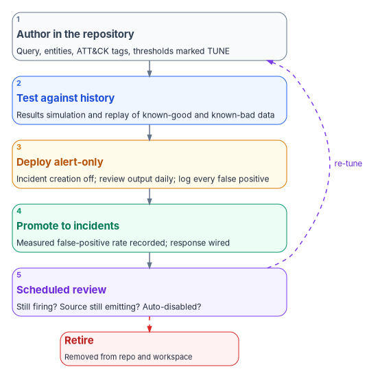
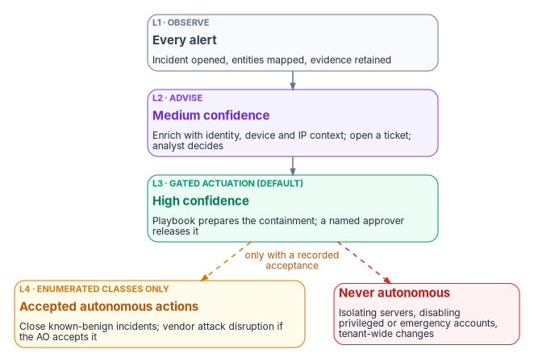

# Chapter 11 — Detection Engineering and Response Automation

*A rule that fires without a response shortens the time to know, not the time to contain; a response that acts without a gate turns a noisy rule into an outage.*

::: {.callout-note}
## In this chapter
The in-boundary principle that lets the program rebuild detections it cannot inherit, and the rule library that results, kept as code with example queries verified against current table schemas. How a rule moves from authoring through testing and an alert-only tuning window into production, and how the library is kept from rotting. Then response: the confidence-gated ladder mapped onto [Book 01](../b01-transformation-arc/11-analysis-plan-delivery.md)'s actuation rungs with gated actuation (L3) as the default, playbooks for session revocation, account disablement and device isolation, the approval gates around them, the incident response plan they sit inside, and the honest limits.
:::

[Chapter 05](05-from-log-warehouse-to-detection.md) built the connector fabric and argued that a workspace with no rules is a warehouse. This chapter carries the rules and the response. It consolidates two Federal Compliance volumes, [Vol VI Book 03, Detection Engineering](https://github.com/WhalerMike/modernization-workbook/blob/main/docs/compliance/Vol_VI_Book_03_Detection_Engineering.md) and [Vol VI Book 04, Response Automation](https://github.com/WhalerMike/modernization-workbook/blob/main/docs/compliance/Vol_VI_Book_04_Response_Automation_SOAR.md), with the detection and incident-handling parts of [Vol III Book 06](https://github.com/WhalerMike/modernization-workbook/blob/main/docs/compliance/Vol_III_Book_06_SIEM_XDR_Detection.md). The volumes stay in the repository for control-level depth.

## The in-boundary principle

Some of the richest detections a modern cloud offers are computed in the vendor's multi-tenant analytics: risk scoring trained on signals from many customers, travel and location anomalies, behavioral data-loss analytics. Microsoft describes Entra ID Protection, for example, as drawing on trillions of anonymized signals a day.[^c11-idp] An agency should use those detections wherever they are available in its cloud and within its authorization. But two things can put one out of reach. The capability may not exist in the agency's cloud: Microsoft lists Sentinel's peer and blast-radius UEBA enrichments, its threat intelligence matching analytics and SOC optimization as unavailable in Azure Government, for instance.[^c11-feature] Or the authorization decision may keep a given flow of identity-attributed telemetry from leaving the boundary for a service outside it. [Book 10](../b10-cloud-boundary/index.md) explains how to tell those cases apart.

The program's principle for both, which the source volume stated and this book keeps as design: the boundary constrains where raw telemetry may go, not whether it may be analyzed. Routing the same telemetry to the agency's own analytics workspace, inside its own authorized boundary, is exactly the in-boundary monitoring SI-4 contemplates. So where a vendor analytic is unavailable, the program reconstructs a deterministic equivalent: a rule, a baseline, a watchlist, running on telemetry the connector fabric already lands. Every component the rebuilt detection depends on, the workspace and any compute that trains a baseline, must itself be inside the boundary. The moment the telemetry is shipped somewhere out of scope for convenience, the library has recreated the flow the boundary was drawn to prevent.

Reconstruction is not parity. The rebuilt detections see one tenant, not many; they run at rule cadence, not continuously; and their thresholds are the agency's own guesses until tuned. The honest limits at the end of this chapter say so in the form an assessor can read.

## A rule library as code

The rule library is a version-controlled set of analytics rules, each with its query, schedule, entity mappings, MITRE ATT&CK tactics and techniques, severity, tuning notes and the controls it operationalizes. Microsoft's own rule templates use the same shape: a YAML file with an `id`, `name`, `description`, `severity`, `requiredDataConnectors`, `queryFrequency`, `queryPeriod`, `triggerOperator`, `triggerThreshold`, `tactics`, `relevantTechniques`, `query`, `entityMappings` and `version`.[^c11-template] Keeping the program's rules in that format means Microsoft's templates and the program's rules can be reviewed side by side, and a template Microsoft updates can be diffed against the program's tuned copy.

The library is the source of truth, not the portal. Sentinel's Repositories feature connects a workspace to a GitHub or Azure DevOps repository and deploys analytics rules, automation rules, hunting queries, parsers, playbooks, workbooks and (in preview) Defender custom detection rules from it; content deployed that way overwrites changes made in the portal.[^c11-repos] Repositories is in public preview and is not available in Azure Government.[^c11-feature] Where it is unavailable or not authorized, the program deploys the same content through its own change-controlled pipeline using the Azure Resource Manager templates that Sentinel's export feature produces, which Microsoft documents as the format for rules and automation rules managed as code.[^c11-repos] Either way, nobody edits a production rule in the portal; a change is a commit, reviewed and deployed.

### What the library holds

The library has two tiers. The first reconstructs vendor analytics in-boundary; it is the source volume's seven-rule set. The second is the priority set of detections over the program's own sources. Rules marked with a query below appear in full in the next section; the rest follow the same pattern and live in the library.

| ID | Rule | Reconstructs or detects | Primary tables | Controls |
|---|---|---|---|---|
| FMP-DET-01 | Impossible travel | Geo-velocity anomaly in successful sign-ins (query below) | `SigninLogs` | SI-4, AC-7, IA-2 |
| FMP-DET-02 | Atypical IP or ASN | Sign-in from an address or network never seen for the user | `SigninLogs`, `AADNonInteractiveUserSignInLogs` | SI-4, AC-2 |
| FMP-DET-03 | Low-and-slow password spray | Failures spread across many accounts and long windows, interactive and non-interactive | Both sign-in tables | SI-4, AC-7 |
| FMP-DET-04 | Session anomaly | Token replayed from a new device, address and user agent; drives the session-revocation playbook | Sign-in tables | SI-4, AC-12 |
| FMP-DET-05 | Mass label removal or decryption | Many sensitivity-label downgrades by one user ([Chapter 09](09-data-protection-and-classification.md)) | Purview activity tables | SI-4, AU-6, AC-4 |
| FMP-DET-06 | Data-loss policy override pattern | Repeated overrides or near misses ([Chapter 09](09-data-protection-and-classification.md)) | Purview activity tables | SI-4, AC-4 |
| FMP-DET-07 | Anomalous elevation | Endpoint privilege elevation outside the user's pattern | Endpoint privilege-management logs | SI-4, AC-6(9) |
| FMP-DET-10 | Repeated declined MFA prompts | MFA fatigue (query below) | `SigninLogs`, `AADUserRiskEvents` | SI-4, IA-2 |
| FMP-DET-11 | Privileged role activation outside hours | PIM activation off-schedule (query below) | `AuditLogs` | AC-2, AC-6 |
| FMP-DET-12 | Privileged role assigned outside PIM | Direct assignment to a sensitive role (query below) | `AuditLogs` | AC-2, AC-6 |
| FMP-DET-13 | Conditional Access policy disabled, deleted or set to report-only | Weakening of the access policy library in [Book 04](../b04-access/index.md) | `AuditLogs` | CM-5, AC-3 |
| FMP-DET-14 | New credential on an existing service principal | Persistence through an application | `AuditLogs` | AC-2, IA-5 |
| FMP-DET-15 | DNS beaconing | Regular-interval queries for one name from one host (query below) | `_Im_Dns` | SI-4, SI-4(4) |
| FMP-DET-16 | DNSSEC validation failure spike | Many validation failures from one resolver | `_Im_Dns` | SI-4, SC-20 |
| FMP-DET-17 | Database login from an unexpected address | SQL login outside the application subnets (query below) | `AzureDiagnostics`, `SecurityEvent` | SI-4, AC-3 |
| FMP-DET-18 | `sa` login re-enabled | A login that should stay disabled is turned back on | `SecurityEvent` | CM-6, AC-2 |
| FMP-DET-19 | NTLM after the block date | Any NTLM authentication once it is blocked; the query is in [Book 06](../b06-data-platform/r09-continuous-monitoring-and-closure.md) | `SecurityEvent` | IA-2, SI-4 |
| FMP-DET-20 | Unusual upload volume through SASE | Upload far above the user's 30-day baseline | SASE tables | SI-4(4), AC-4 |
| FMP-DET-21 | Threat intelligence match | Any source matching an active indicator | `ThreatIntelIndicators` and source tables | SI-4, SI-5 |

Two of the source volume's rules changed in consolidation. Its vulnerability-exploitation rule queried a table that Defender XDR does not stream, as [Chapter 05](05-from-log-warehouse-to-detection.md) shows; exploitation surfaces as a Defender alert, and the response to it is a Defender incident, not a Sentinel rule. And Microsoft already ships templates for several of these patterns, including an MFA-spamming rule, privileged role assignment outside PIM, Conditional Access changes and new service principal credentials.[^c11-templates] The program starts from Microsoft's template where one exists and records its own changes, rather than writing a parallel rule.

### Example rules

::: {.callout-warning}
## Illustrative code
The queries, payloads and scripts in this chapter are illustrative. They have not been tested against a production tenant or workspace. Every threshold marked `TUNE` is a starting point to calibrate against the agency's own data. Run response automation first against test identities and devices, with the narrowest permissions shown.
:::

**FMP-DET-01, impossible travel.** Successful sign-ins in time order per user, flagged when the implied speed between consecutive locations exceeds a commercial flight. In `SigninLogs`, `ResultType` is a string with "0" for success and `LocationDetails` is dynamic; `geo_distance_2points` takes longitude before latitude and returns meters.[^c11-signinlogs] [^c11-geo] The source volume's version compared `ResultType` to a number and used a self-join that compared every pair of sign-ins; this version compares only consecutive ones.

```kql
// FMP-DET-01 Impossible travel. Schedule: every 1h, lookback 1d.
let MaxKmPerHour = 900;   // TUNE: faster than a commercial flight
let MinKm        = 500;   // TUNE: ignore short hops and geolocation noise
let Egress = _GetWatchlist('FMP-ApprovedEgress') | project SearchKey;  // VPN and proxy exits
SigninLogs
| where TimeGenerated > ago(1d)
| where ResultType == "0"
| where IPAddress !in (Egress)
| extend Lat = todouble(LocationDetails.geoCoordinates.latitude),
         Lon = todouble(LocationDetails.geoCoordinates.longitude),
         Country = tostring(LocationDetails.countryOrRegion)
| where isnotnull(Lat) and isnotnull(Lon)
| project TimeGenerated, UserPrincipalName, IPAddress, Lat, Lon, Country, AppDisplayName
| sort by UserPrincipalName asc, TimeGenerated asc
| extend PrevUser = prev(UserPrincipalName), PrevTime = prev(TimeGenerated),
         PrevLat = prev(Lat), PrevLon = prev(Lon),
         PrevIP = prev(IPAddress), PrevCountry = prev(Country)
| where UserPrincipalName == PrevUser
| extend Km    = geo_distance_2points(PrevLon, PrevLat, Lon, Lat) / 1000.0,
         Hours = datetime_diff('second', TimeGenerated, PrevTime) / 3600.0
| where Km >= MinKm and Hours > 0 and Km / Hours > MaxKmPerHour
| project TimeGenerated, UserPrincipalName, PrevIP, PrevCountry, IPAddress, Country,
          Km = round(Km), Hours = round(Hours, 2), AppDisplayName
```

The watchlist of approved egress addresses is the exception list, maintained outside the rule so analysts can add a VPN exit without editing the query; Sentinel's `_GetWatchlist` function returns a watchlist's rows with its `SearchKey` column for joins.[^c11-watchlist] Travel that actually happened, split tunneling and mobile carriers that geolocate far from the user are the expected false positives.

**FMP-DET-10, repeated declined MFA prompts.** The source volume read `MfaDetail`, which is deprecated.[^c11-signinlogs] Authentication step results are in `AuthenticationDetails`, whose `authenticationStepResultDetail` explains why each step succeeded or failed.[^c11-authdetail] The result strings below are the ones Microsoft's own MFA-spamming template matches.[^c11-templates] CISA's guidance on push bombing is to move to phishing-resistant MFA and, until then, to use number matching, under which a flood of prompts no longer works on its own;[^c11-cisa-mfa] the rule still matters, because a burst of declined prompts means someone holds the user's password.

```kql
// FMP-DET-10 Repeated declined or unanswered MFA prompts. Schedule: every 15m, lookback 1h.
let Threshold = 5;   // TUNE
SigninLogs
| where TimeGenerated > ago(1h)
| where AuthenticationRequirement == "multiFactorAuthentication"
| mv-expand Step = todynamic(AuthenticationDetails)
| extend StepResult = tostring(Step.authenticationStepResultDetail)
| summarize
    Declined  = countif(StepResult in ("MFA denied; user declined the authentication",
                                       "MFA denied; user did not respond to mobile app notification")),
    Completed = countif(StepResult == "MFA successfully completed"),
    SourceIPs = make_set(IPAddress, 20),
    Apps      = make_set(AppDisplayName, 10),
    First     = min(TimeGenerated),
    Last      = max(TimeGenerated)
    by UserPrincipalName
| where Declined >= Threshold
| extend RuleSeverity = iff(Completed > 0, "High", "Medium")   // a completion after a burst is worse
```

Users can also report an unexpected prompt. With the Report suspicious activity setting turned on, a report sets the user to high risk and appears as the ID Protection detection `userReportedSuspiciousActivity`, which lands in `AADUserRiskEvents`; the program treats any such event as an incident.[^c11-reportsus] [^c11-riskevents]

```kql
// FMP-DET-10b User reported an MFA prompt as suspicious. NRT.
AADUserRiskEvents
| where RiskEventType == "userReportedSuspiciousActivity"
| project TimeGenerated, UserPrincipalName, IpAddress, RiskLevel, RiskState, Location
```

**FMP-DET-11, privileged role activation outside business hours.** PIM records an activation in the audit log as "Add member to role completed (PIM activation)," and Microsoft's guidance is to alert on elevations outside a user's standard pattern.[^c11-pimaudit] The source volume shifted the time by a fixed five hours and compared `dayofweek` to an integer; `datetime_utc_to_local` handles daylight saving, and `dayofweek` returns a timespan, so Sunday is `0d` and Saturday `6d`.[^c11-utc] [^c11-dow]

```kql
// FMP-DET-11 PIM activation outside business hours. NRT, or every 5m.
let Tz = "US/Eastern";              // the agency's primary time zone
let StartHour = 7; let EndHour = 19;  // TUNE: the agency's business day
AuditLogs
| where OperationName == "Add member to role completed (PIM activation)"
| extend Local = datetime_utc_to_local(TimeGenerated, Tz)
| extend LocalHour = hourofday(Local), LocalDay = dayofweek(Local)
| where LocalHour < StartHour or LocalHour >= EndHour or LocalDay in (0d, 6d)
| extend Initiator = tostring(InitiatedBy.user.userPrincipalName)
| mv-apply R = TargetResources on (
    where R.type =~ "Role"
    | extend RoleName = tostring(R.displayName))
| project TimeGenerated, Local, Initiator, RoleName, Result, CorrelationId
```

An off-hours activation is a signal to verify, not proof of compromise. Tier 0 activations ([Book 04](../b04-access/04-privileged-roles-and-tiers.md)) go to the queue as high severity; others as medium.

**FMP-DET-12, privileged role assigned outside PIM.** Any direct assignment to a sensitive role is suspect in a tenant where privileged roles are eligible-only. The query follows the structure of Microsoft's privileged-role template: role-management category, assignment operation types, and the role name from the target's modified properties.[^c11-templates] The audit activity "Add member to role outside of PIM (permanent)" is the PIM service's record of the same event.[^c11-auditact]

```kql
// FMP-DET-12 Sensitive role assigned outside PIM. NRT.
let Sensitive = dynamic(["Global Administrator", "Privileged Role Administrator",
                         "Privileged Authentication Administrator", "Security Administrator",
                         "Conditional Access Administrator", "Application Administrator"]);
AuditLogs
| where Category =~ "RoleManagement"
| where OperationName in ("Add member to role", "Add member to role outside of PIM (permanent)")
| mv-apply T = TargetResources on (
    where T.type in~ ("User", "ServicePrincipal")
    | extend Target = iff(T.type =~ "ServicePrincipal", tostring(T.displayName),
                          tostring(T.userPrincipalName)),
             Props = T.modifiedProperties)
| mv-apply P = Props on (
    where P.displayName =~ "Role.DisplayName"
    | extend RoleName = trim('"', tostring(P.newValue)))
| where RoleName in (Sensitive)
| extend Initiator = coalesce(tostring(InitiatedBy.user.userPrincipalName),
                              tostring(InitiatedBy.app.displayName))
| project TimeGenerated, OperationName, RoleName, Target, Initiator, Result, CorrelationId
```

**FMP-DET-15, DNS beaconing.** Command-and-control over DNS often looks like one host resolving one name at a regular interval. The source volume's rule claimed to test for regular timing but only counted queries; this one computes the spread of the gaps. It reads the ASIM unifying parser, so it runs unchanged over any DNS source [Chapter 05](05-from-log-warehouse-to-detection.md) connected.[^c11-asimdns]

```kql
// FMP-DET-15 DNS beaconing. Schedule: every 1h, lookback 1h.
let MinQueries   = 20;    // TUNE
let MaxJitterSec = 5.0;   // TUNE: standard deviation of the gap, in seconds
let Allow = _GetWatchlist('FMP-DnsBeaconAllow') | project SearchKey;  // monitoring and health-check hosts
_Im_Dns(starttime = ago(1h), endtime = now())
| where isnotempty(SrcIpAddr) and isnotempty(DnsQuery)
| where SrcIpAddr !in (Allow)
| summarize Times = make_list(TimeGenerated, 1000), Queries = count() by SrcIpAddr, DnsQuery
| where Queries >= MinQueries
| mv-apply T = Times to typeof(datetime) on (
    order by T asc
    | extend GapSec = datetime_diff('second', T, prev(T))
    | where isnotnull(GapSec)
    | summarize MeanGapSec = avg(GapSec), StdGapSec = stdev(GapSec))
| where StdGapSec <= MaxJitterSec
| project SrcIpAddr, DnsQuery, Queries, MeanGapSec = round(MeanGapSec, 1), StdGapSec = round(StdGapSec, 2)
```

Monitoring agents, load balancer probes and software update checks are regular too. They belong on the allow watchlist with a named owner and an expiry, not in the query.

**FMP-DET-17, database login from an unexpected address.** For Azure SQL, audit records in `AzureDiagnostics` carry `client_ip_s`, `server_principal_name_s`, `action_name_s` and `succeeded_s`.[^c11-sqlaudit] The expected application subnets are a watchlist; `ipv4_lookup` matches addresses against it.[^c11-fp]

```kql
// FMP-DET-17 Azure SQL login from outside the expected subnets. Schedule: every 15m, lookback 15m.
let Expected = _GetWatchlist('FMP-SqlClientSubnets') | project Network = SearchKey;  // CIDR ranges
AzureDiagnostics
| where TimeGenerated > ago(15m)
| where Category == "SQLSecurityAuditEvents"
| where action_name_s has "DATABASE AUTHENTICATION SUCCEEDED"
| evaluate ipv4_lookup(Expected, client_ip_s, Network, return_unmatched = true)
| where isempty(Network)
| summarize Logins = count(), First = min(TimeGenerated), Last = max(TimeGenerated)
    by client_ip_s, server_principal_name_s, database_name_s, application_name_s
```

For SQL Server on Windows, the same pattern runs against audit records in `SecurityEvent` ([Chapter 05](05-from-log-warehouse-to-detection.md)); the `sa` rule (FMP-DET-18) looks there for an `ALTER LOGIN` statement that enables the login. Confirm the action names and event layout on a test instance before enabling either.

## Rule lifecycle and testing

Every rule passes through the same lifecycle, and every step leaves a record in the repository or the tuning log. The lifecycle is the program's design; the Sentinel features it uses are Microsoft's.

{#fig-ch11-rule-lifecycle fig-alt="Top to bottom, five numbered cards joined by arrows. 1, slate: author in the repository, with the query, entities, ATT&CK tags and thresholds marked TUNE. 2, blue: test against history, with results simulation and replay of known-good and known-bad data. 3, amber: deploy alert-only, with incident creation off, output reviewed daily and every false positive logged. 4, green: promote to incidents, with the measured false-positive rate recorded and the response wired. 5, violet: scheduled review, asking whether the rule still fires, whether its source still emits and whether it was auto-disabled. A dashed violet arrow from review loops back to authoring, labeled re-tune. A dashed red arrow leads from review to a red card: retire, removed from the repository and the workspace."}

1. **Author.** The rule is written in the repository with its thresholds marked `TUNE`, its entity mappings and the reason it exists. Where Microsoft ships a template for the pattern, the rule starts from the template.
2. **Test against history.** The analytics rule wizard's results simulation shows how many results the query would have produced over its last 50 scheduled runs, so a rule that would fire constantly is caught before it ships.[^c11-scheduled] The program also replays a known-bad sample, from a tabletop exercise or a test tenant, to confirm the rule fires when it should. A rule that cannot be shown to fire on a true positive is not finished.
3. **Deploy alert-only.** The rule is enabled with incident creation turned off, so it produces alerts that analysts review daily without flooding the queue. Sentinel supports disabling incident creation per rule, and alert-triggered automation exists precisely for rules that do not create incidents.[^c11-scheduled] [^c11-autorules] The source volume set a two-week window; the program's rule is to stay alert-only until the false-positive patterns are documented and the thresholds adjusted, with two weeks as the minimum. One caution for workspaces onboarded to the Defender portal: there, Defender creates the incidents, and a rule's incident-creation setting must be enabled for its alerts to become incidents at all.[^c11-scheduled]
4. **Promote.** Incident creation is turned on, the measured false-positive rate is recorded in the rule's metadata, and the rule's response is wired (the next section). Promotion is a commit.
5. **Review on a schedule.** Each rule is reviewed at least quarterly (program design): is it still firing at the expected rate, is every table it reads still fresh ([Chapter 05](05-from-log-warehouse-to-detection.md)), has its template changed? Sentinel disables a scheduled rule after repeated permanent failures, such as a deleted table or a changed function, and prefixes its name with "AUTO DISABLED"; Microsoft advises SOC managers to check the rule list for them regularly.[^c11-autodisable] The program's review query checks for them every day. Sentinel's analytics rule health monitoring, in public preview in both commercial and government Azure, records rule runs in `SentinelHealth`.[^c11-feature]

Detections rot. Thresholds drift as the environment changes, sources stop emitting without an error, and a parser update can change a field name. The standing detection-engineering effort that reviews and re-tunes the library is the real cost of having one, and [Chapter 10](10-who-runs-security-operations.md) staffs it. Telemetry-completeness testing and detection-efficacy testing feed the metrics in [Chapter 12](12-evidence-metrics-and-continuous-monitoring.md). Sentinel's limits bound the library's size: 512 enabled scheduled rules per workspace by default and 50 enabled NRT rules.[^c11-limits]

## The response ladder

Detection without response shortens the investigation, not the exposure. The design rule for every playbook is confidence-gated action: high-confidence detections prepare containment, medium-confidence detections enrich and ticket for a human, and nothing low-confidence acts at all. Auto-containment on a noisy rule is its own denial of service.

The program places every response on the actuation ladder of [Book 01, Chapter 11](../b01-transformation-arc/11-analysis-plan-delivery.md). There, each operation class has a ceiling; gated actuation (L3), where a human authorizes a prepared action, is the default ceiling for anything with a large blast radius, and autonomous action (L4) is allowed only for enumerated low-blast-radius classes. NIST frames the same idea from the control side: SI-4(7) asks the organization to notify defined personnel of suspicious events and to take defined "least-disruptive actions" on detection.[^c11-nist]

{#fig-ch11-response-ladder fig-alt="Four stacked cards. L1 Observe, slate: every alert, with an incident opened, entities mapped and evidence retained. L2 Advise, violet: medium confidence, enrich with identity, device and IP context, open a ticket, analyst decides. L3 Gated actuation, the default, green: high confidence, the playbook prepares the containment and a named approver releases it. A dashed amber arrow labeled only with a recorded acceptance leads to L4, amber, enumerated classes only: accepted autonomous actions, such as closing known-benign incidents, or vendor attack disruption if the authorizing official accepts it. A dashed red arrow from L3 leads to a red card beside L4: never autonomous, isolating servers, disabling privileged or emergency accounts, tenant-wide changes."}

| Rung | Confidence | What happens | Human in the loop | Examples |
|---|---|---|---|---|
| L1 Observe | Any | Incident opened, entities mapped, evidence kept | Triage | Every promoted rule |
| L2 Advise | Medium | Enrichment playbook adds identity, device and IP context; ticket opened | Analyst decides | Off-hours PIM activation; database login from an unexpected address |
| L3 Gated actuation | High | Playbook evaluates preconditions and prepares the containment; a named approver releases it | Approver releases; analyst investigates | Session revocation; disabling a standard user; isolating a workstation |
| L4 Within guardrails | High, enumerated class | Runs without a person, logged, reversible | Reviewed after the fact | Closing incidents matching a known-benign watchlist; vendor attack disruption where the authorizing official has accepted it |
| Standing control | n/a | Configuration that bounds exposure if detection misses | n/a | Sign-in frequency and token policies ([Book 04](../b04-access/index.md)) |

The mapping is the program's design. Three operation classes stay at L3 or below permanently, whatever the program's maturity: isolating a server, disabling a privileged or emergency-access account, and any tenant-wide change. A false-positive isolation of a production database server is an outage, and a disabled emergency account during an incident is a lockout.

Defender XDR's automatic attack disruption is the case that tests the ladder. It contains assets on its own when Defender correlates a high-confidence attack, revoking sessions, suspending users and containing devices and users at the endpoint layer, with every action logged, reversible, and subject to exclusions for named users, device groups and IP ranges.[^c11-disruption] That is L4 by the vendor's design. The program does not leave it as a default nobody chose. The authorizing official either accepts attack disruption as an enumerated L4 class, with exclusions configured for emergency-access accounts and the server device groups the permanent-L3 rule protects, or the program records why it is limited. Either way the decision is written down, which is what the ladder exists to produce. Confirm attack disruption's availability in the agency's cloud before relying on it.

## Playbooks

Sentinel automation has two layers. Automation rules run inside Sentinel when an incident is created or updated or an alert is created; they can change status and severity, assign an owner, add tags and tasks, close incidents with a reason, and run playbooks, in a defined order, and they can carry an expiration date. Playbooks are Azure Logic Apps workflows that act on other systems, and Sentinel runs them under a dedicated service account that must be granted permission on the playbooks' resource group.[^c11-autorules] The program keeps automation rules for triage and suppression, and playbooks for anything that touches an identity, a device or a ticket.

Every playbook follows four rules (design): it uses a managed identity with only the permissions its actions need, never a client secret; it writes each action, with the approver and timestamp, back to the incident as a comment, which is the response documentation [Chapter 05](05-from-log-warehouse-to-detection.md)'s evidence record needs; it evaluates its preconditions and stops if they fail, which is the playbook's dry run; and it starts in alert-only mode, preparing its action without taking it, until the triggering rule's false-positive rate has been measured.

### Session revocation

The containment path for a high-confidence session anomaly (FMP-DET-04) or a confirmed compromise. Microsoft Graph's `revokeSignInSessions` invalidates the refresh tokens issued to a user's applications and their browser session cookies by resetting `signInSessionsValidFromDateTime`; Microsoft notes a delay of a few minutes before tokens are revoked, and that the call does not revoke sessions for external users. Its least-privileged permission is `User.RevokeSessions.All`.[^c11-revoke] Marking the user confirmed-compromised in ID Protection sets the user's risk to high, which risk-based Conditional Access can then act on; it is a `POST` to `/identityProtection/riskyUsers/confirmCompromised` with the user IDs, needs `IdentityRiskyUser.ReadWrite.All`, and requires Entra ID P2. The source volume showed it as a `PATCH`.[^c11-confirm]

```jsonc
// revoke-session playbook: logic as a Logic App would run it (pseudocode, not a deployable definition)
{
  "trigger": "Sentinel incident created by FMP-DET-04 or FMP-DET-01 with corroboration",
  "identity": "managed identity: User.RevokeSessions.All, IdentityRiskyUser.ReadWrite.All",
  "steps": [
    { "guard": "incident.severity == 'High' && entities.Account.count == 1" },          // confidence gate
    { "guard": "account not in watchlist FMP-EmergencyAccess and not privileged" },      // permanent-L3 classes go to a human
    { "prepare": "comment: proposed action, evidence, rollback (none needed: user re-authenticates)" },
    { "approve": "named approver from the on-call roster releases or rejects; timeout = reject" }, // L3 gate
    { "graph": "POST /users/{id}/revokeSignInSessions" },                                // AC-12
    { "graph": "POST /identityProtection/riskyUsers/confirmCompromised  { userIds: [id] }" },
    { "comment": "actions taken, approver, UTC timestamps" },                            // response record
    { "ticket": "link incident to the IR ticket" }                                       // IR-4
  ]
}
```

Revocation is not instant everywhere. Continuous access evaluation lets CAE-capable services such as Exchange Online, SharePoint Online and Teams act on critical events, including an administrator revoking a user's refresh tokens, account disablement and high user risk, in near real time, but Microsoft states that latency of up to 15 minutes can be observed because of event propagation.[^c11-cae] Clients and resources that are not CAE-aware keep an existing access token until it expires; the default access token lifetime is a random value between 60 and 90 minutes, and CAE-aware sessions can receive tokens that live up to 28 hours because they can be revoked.[^c11-tokens] So containment latency is the rule's cadence plus the approval plus revocation propagation, and for non-CAE applications the remaining token lifetime. The source volume called the in-boundary playbook a minutes-scale substitute for "sub-second" CAE revocation; CAE itself is not sub-second, and this playbook triggers it rather than replacing it.

The source volume's standing control, bounding token lifetime to 60 to 90 minutes, describes the platform default rather than a setting the program adds. Microsoft recommends Conditional Access session controls, such as sign-in frequency, over configurable token lifetimes, and notes that reduced token lifetimes degrade user experience and reliability without eliminating risk.[^c11-session] [^c11-cae] The program's standing controls are the Conditional Access policies in [Book 04](../b04-access/07-the-conditional-access-policy-library.md).

### Account disablement

For a high-confidence compromise of a standard user, the program disables the account as well as revoking sessions. In Graph, that is a `PATCH` to the user setting `accountEnabled` to false, and the least-privileged combination is `User.EnableDisableAccount.All` with `User.Read.All`.[^c11-userupdate] In a hybrid environment, though, the authoritative account is in Active Directory. Microsoft's procedure for revoking a hybrid user's access starts there, disabling the account and resetting the password twice to mitigate pass-the-hash, and then disables the user in Entra ID, revokes refresh tokens and disables the user's registered devices.[^c11-revokeaccess] A playbook that disables only the cloud object of a synchronized user is undone at the next synchronization, and leaves the on-premises account usable. The program's playbook therefore runs the Active Directory step through an on-premises runbook worker, inside the boundary, as part of the same approved action.

The cloud half looks like this with the Microsoft Graph PowerShell cmdlets Microsoft documents for the procedure, connecting with the automation account's managed identity:[^c11-revokeaccess] [^c11-connect]

```powershell
# disable-principal, cloud half: run by an automation account's managed identity after approval
# Graph permissions: User.EnableDisableAccount.All + User.Read.All, User.RevokeSessions.All,
# and device write permission for the device step
param(
    [Parameter(Mandatory)] [string] $UserId,             # Entra object ID from the incident entity
    [Parameter(Mandatory)] [string] $IncidentNumber,
    [Parameter(Mandatory)] [string] $ApprovedBy
)
Connect-MgGraph -Identity -NoWelcome

Update-MgUser -UserId $UserId -AccountEnabled:$false
Revoke-MgUserSignInSession -UserId $UserId

Get-MgUserRegisteredDevice -UserId $UserId -All | ForEach-Object {
    Update-MgDevice -DeviceId $_.Id -AccountEnabled:$false
}

# The playbook writes this line back to the incident as the response record
"{0:u} FMP disable-principal: user {1} disabled, sessions revoked, devices disabled; incident {2}; approved by {3}" -f `
    (Get-Date).ToUniversalTime(), $UserId, $IncidentNumber, $ApprovedBy
```

Re-enablement is a separate, recorded decision by the identity team after investigation: password reset, MFA re-registration and the account owner's manager confirming the person is who they say they are. A wrongly disabled person is restored through that process with a recorded exception, the same principle [Book 03](../b03-hr-identity/08-joiner-mover-leaver.md) applies to leavers.

### Device isolation

When Defender for Endpoint reports active exploitation or hands-on-keyboard activity on a device, isolation cuts the device off from the network while keeping its connection to the Defender service, preserving forensic state. The Defender for Endpoint API's isolate action takes a required comment and an isolation type of `Full`, `Selective` or `UnManagedDevice`; it needs the `Machine.Isolate` permission, is limited to 100 calls a minute, and, Microsoft warns, a device behind a full VPN tunnel may lose its connection to the Defender service once isolated.[^c11-isolate] The API host differs by cloud: Microsoft documents `api.security.microsoft.com` for commercial, and for the Defender for Endpoint API `api-gcc.securitycenter.microsoft.us` for GCC and `api-gov.securitycenter.microsoft.us` for GCC High and DoD, with sign-in through `login.microsoftonline.us` for the latter two.[^c11-isolate] [^c11-mdegov] The source volume used the older commercial host and a client secret.

The program's isolation playbook isolates workstations at L3 and never isolates a server without a human decision outside the playbook, per the permanent-L3 rule. The trigger is a Defender alert of active exploitation, not a vulnerability finding: a vulnerable package is a remediation item for [Chapter 06](06-vulnerability-management.md), not an incident.

### Enrich and ticket

For medium-confidence detections, the playbook gathers context and hands the decision to an analyst: the user's ID Protection risk level and recent risk events, their PIM eligibilities, the device's compliance and Defender exposure, recent sign-ins, and any watchlist the entities appear on. It writes the context to the incident as a comment, opens or updates the ticket in the agency's service-management system with the incident's ID, and tags the incident as enriched. This is L2: it changes nothing except the record.

### Suppression of known-benign incidents

Health-check hosts that trip the beaconing rule, scheduled penetration tests and maintenance windows produce incidents the SOC already understands. An automation rule closes them as they are created, with a closing reason and a comment, and can carry an expiration date so a time-limited exception cannot become permanent.[^c11-autorules] This is the one L4 class the program enables by default, because its blast radius is the incident queue, its condition is a watchlist with a named owner, and every closure is recorded. Better still is fixing the rule so it does not fire, which the lifecycle review does.

## The incident response plan

The playbooks operate inside an incident response plan, and the plan is assessed separately from the tooling. An agency can run a mature Sentinel deployment and still fail IR-8 for want of documents.

NIST SP 800-61 Rev. 3, published in April 2025, superseded Rev. 2 and recasts incident response recommendations as a CSF 2.0 Community Profile.[^c11-80061] The program keeps Rev. 2's familiar phase names as an internal operating convention, and maps them to the CSF 2.0 functions that Rev. 3 uses. IR-4 itself still names the activities: an incident handling capability that "includes preparation, detection and analysis, containment, eradication, and recovery," coordinated with contingency planning, with lessons learned fed back into procedures, training and testing.[^c11-nist]

| Phase (program convention) | Sentinel and Defender mechanism | Record kept |
|---|---|---|
| Preparation | Rule library deployed; playbooks configured; on-call roster and contacts as watchlists | Plan document; contact list; training records |
| Detection and analysis | Rule fires; incident opened; enrichment appended | Incident with timeline and evidence |
| Containment | Gated playbook action or manual containment | Action, approver and timestamps on the incident |
| Eradication | Patch, credential reset or policy fix; rescan confirms | Eradication record and verification output |
| Recovery | System returned to service; heightened monitoring | Recovery record; post-isolation validation |
| Post-incident activity | Lessons learned; plan updated; rule tuned | Lessons-learned record; tuning log entry |

IR-8 requires a plan that, among other things, provides a roadmap for the capability, defines reportable incidents, provides metrics for measuring the capability, addresses sharing of incident information, is reviewed and approved at a defined frequency, explicitly designates responsibility for incident response, and is distributed, updated and protected from unauthorized disclosure and modification. IR-3 requires the capability to be tested at a defined frequency.[^c11-nist] FedRAMP's 2026 incident response indicators ask that the effectiveness of incident response procedures and past incidents be persistently reviewed and that after-action reports feed lessons learned back in.[^c11-ksi-inr]

The program's plan carries seven artifacts, which are its own design built on those requirements: the plan itself, reviewed annually; a contact list reviewed at least quarterly, including the CISA reporting channel; notification templates; an evidence preservation procedure (incident export, query results exported to immutable storage, device forensic collection, chain of custody); a lessons-learned template used after every high-severity incident; a tabletop exercise record from the last 12 months; and the annual test record. CISA's Federal Incident Notification Guidelines, effective April 1, 2017, require agencies to report incidents to CISA within one hour of identification by the agency's top-level CSIRT, SOC or IT department, and the plan documents that path explicitly.[^c11-cisa-notify] The source volume tied the one-hour requirement to a particular year's FISMA guidance memo; the program cites the guidelines themselves and checks the current year's FISMA guidance for any change. A tabletop built from this book's own sources, a DNS beacon that leads to an off-hours privileged activation, exercises the rule library, the response ladder and the plan in one sitting. For testing response automation without a real attack, Defender for SQL Servers on Machines can simulate alerts that exercise downstream automation.[^c11-sqlsim]

## Honest limits

Carry these into every assessment. The library and the playbooks do not claim parity with what they replace.

- **Detection is minutes to hours.** Scheduled rules run no more often than every five minutes plus a five-minute ingestion delay, NRT rules about every minute, and baselines take as long as their windows.[^c11-scheduled] That is not the continuously tuned fidelity of a vendor's multi-tenant pipeline.
- **The library sees one tenant.** It has no global view; atypical-address and leaked-credential logic is only as good as the threat intelligence feeds the agency subscribes to.
- **Containment is bounded by cadence, approval and propagation.** Session revocation takes effect in minutes, up to about 15 for CAE-aware services, and non-CAE clients keep tokens until they expire. The gated design adds an approver's response time on purpose.
- **Hybrid identities need both halves.** Cloud-only containment of a synchronized user is incomplete and reversible by synchronization.
- **Automation amplifies a noisy rule.** The confidence gate, the alert-only ramp and the permanent-L3 classes are mandatory, not optional.
- **The playbooks act only on the agency's own tenant.** An identity federated from elsewhere, or an external guest, is outside their reach; revocation does not apply to external users.[^c11-revoke]
- **Detections rot.** Without the standing engineering effort that reviews and re-tunes the library, the maturity this chapter describes decays quietly, and the freshness and auto-disable checks are what reveal it.

## Controls this chapter operationalizes

| Control | How the program implements it |
|---|---|
| AU-6, SI-4 | The rule library over every connected source, promoted through the lifecycle |
| SI-4(2) | Scheduled and NRT rules running near real time |
| SI-4(5) | Incidents assigned to named roles by severity |
| SI-4(7) | Confidence-gated response; least-disruptive action first; permanent-L3 classes |
| IR-4, IR-4(1) | Incident queue, enrichment and gated containment playbooks with recorded actions |
| IR-5 | Incident records tracked from creation to classified closure |
| IR-6 | One-hour CISA notification path in the plan; templates |
| IR-3, IR-8 | Seven-artifact plan; annual test and tabletop |
| AC-12 | Session revocation, triggering continuous access evaluation |
| AC-2(13) | Account disablement on high-confidence compromise, both directory halves |

The incident records, rule inventory and playbook run history these controls produce feed the evidence pipeline and metrics of [Chapter 12](12-evidence-metrics-and-continuous-monitoring.md).

::: {.callout-tip}
## Continue the book
[← Previous: Chapter 10 — Who Runs Security Operations](10-who-runs-security-operations.md) · [Book index](index.md) · [Next: Chapter 12 — Evidence, Metrics and Continuous Monitoring →](12-evidence-metrics-and-continuous-monitoring.md)
:::

[^c11-idp]: Microsoft Learn, "Tutorial: Use risk detections for user sign-ins to trigger Microsoft Entra multifactor authentication or password changes," <https://learn.microsoft.com/entra/identity/authentication/tutorial-risk-based-sspr-mfa> (accessed Oct 21, 2026).
[^c11-feature]: Microsoft Learn, "Microsoft Sentinel feature support for Azure commercial/other clouds," <https://learn.microsoft.com/azure/sentinel/feature-availability> (accessed Oct 21, 2026).
[^c11-template]: Microsoft, Azure-Sentinel repository on GitHub, analytic rule template "PIM Elevation Request Rejected" (`Solutions/Microsoft Entra ID/Analytic Rules/PIMElevationRequestRejected.yaml`), <https://github.com/Azure/Azure-Sentinel/blob/master/Solutions/Microsoft%20Entra%20ID/Analytic%20Rules/PIMElevationRequestRejected.yaml> (accessed Oct 21, 2026).
[^c11-repos]: Microsoft Learn, "Manage content as code with Microsoft Sentinel repositories," <https://learn.microsoft.com/azure/sentinel/ci-cd-custom-content>, and "Deploy content as code from your repository," <https://learn.microsoft.com/azure/sentinel/ci-cd> (both accessed Oct 21, 2026).
[^c11-templates]: Microsoft, Azure-Sentinel repository on GitHub, Microsoft Entra ID solution analytic rules, including `MFASpammingfollowedbySuccessfullogin.yaml` (result strings for declined and unanswered prompts), `UserAssignedPrivilegedRole.yaml`, `PrivlegedRoleAssignedOutsidePIM.yaml`, the Conditional Access change rules and `NewAppOrServicePrincipalCredential.yaml`, <https://github.com/Azure/Azure-Sentinel/tree/master/Solutions/Microsoft%20Entra%20ID/Analytic%20Rules> (accessed Oct 21, 2026).
[^c11-signinlogs]: Microsoft Learn, "Azure Monitor Logs reference - SigninLogs," <https://learn.microsoft.com/azure/azure-monitor/reference/tables/signinlogs> (accessed Oct 21, 2026). `ResultType` string, "0" success; `LocationDetails` dynamic; `MfaDetail` deprecated.
[^c11-geo]: Microsoft Learn, "geo_distance_2points()," Kusto Query Language, <https://learn.microsoft.com/kusto/query/geo-distance-2points-function> (accessed Oct 21, 2026).
[^c11-watchlist]: Microsoft Learn, "Build queries or detection rules with watchlists in Microsoft Sentinel," <https://learn.microsoft.com/azure/sentinel/watchlists-queries> (accessed Oct 21, 2026).
[^c11-authdetail]: Microsoft Learn, "authenticationDetail resource type," Microsoft Graph, <https://learn.microsoft.com/graph/api/resources/authenticationdetail> (accessed Oct 21, 2026).
[^c11-cisa-mfa]: Cybersecurity and Infrastructure Security Agency, "CISA Releases Guidance on Phishing-Resistant and Numbers Matching Multifactor Authentication," October 31, 2022, <https://www.cisa.gov/news-events/alerts/2022/10/31/cisa-releases-guidance-phishing-resistant-and-numbers-matching-multifactor-authentication> (accessed Oct 21, 2026).
[^c11-reportsus]: Microsoft Learn, "Configure Microsoft Entra multifactor authentication settings," Report suspicious activity, <https://learn.microsoft.com/entra/identity/authentication/howto-mfa-mfasettings#report-suspicious-activity> (accessed Oct 21, 2026).
[^c11-riskevents]: Microsoft Learn, "What are risk detections?," <https://learn.microsoft.com/entra/id-protection/concept-identity-protection-risks>, and "Azure Monitor Logs reference - AADUserRiskEvents," <https://learn.microsoft.com/azure/azure-monitor/reference/tables/aaduserriskevents> (both accessed Oct 21, 2026).
[^c11-pimaudit]: Microsoft Learn, "Security operations for privileged accounts in Microsoft Entra ID," Assignment and elevation, <https://learn.microsoft.com/entra/architecture/security-operations-privileged-accounts#assignment-and-elevation> (accessed Oct 21, 2026).
[^c11-utc]: Microsoft Learn, "datetime_utc_to_local()," Kusto Query Language, <https://learn.microsoft.com/kusto/query/datetime-utc-to-local-function> (accessed Oct 21, 2026).
[^c11-dow]: Microsoft Learn, "dayofweek()," Kusto Query Language, <https://learn.microsoft.com/kusto/query/day-of-week-function> (accessed Oct 21, 2026).
[^c11-auditact]: Microsoft Learn, "Microsoft Entra audit log categories and activities," Privileged Identity Management, <https://learn.microsoft.com/entra/identity/monitoring-health/reference-audit-activities#privileged-identity-management-pim> (accessed Oct 21, 2026).
[^c11-asimdns]: Microsoft Learn, "The Advanced Security Information Model (ASIM) DNS normalization schema reference," <https://learn.microsoft.com/azure/sentinel/normalization-schema-dns> (accessed Oct 21, 2026).
[^c11-sqlaudit]: Microsoft Learn, "SQL Database audit log format," audit log fields, <https://learn.microsoft.com/azure/azure-sql/database/audit-log-format> (accessed Oct 21, 2026).
[^c11-fp]: Microsoft Learn, "Handle false positives in Microsoft Sentinel," <https://learn.microsoft.com/azure/sentinel/false-positives> (accessed Oct 21, 2026).
[^c11-scheduled]: Microsoft Learn, "Scheduled analytics rules in Microsoft Sentinel," <https://learn.microsoft.com/azure/sentinel/scheduled-rules-overview> (accessed Oct 21, 2026). Results simulation over the last 50 runs; incident settings; Defender portal incident creation; 5-minute to 14-day scheduling and five-minute delay.
[^c11-autorules]: Microsoft Learn, "Automate threat response in Microsoft Sentinel with automation rules," <https://learn.microsoft.com/azure/sentinel/automate-incident-handling-with-automation-rules> (accessed Oct 21, 2026).
[^c11-autodisable]: Microsoft Learn, "Troubleshooting analytics rules in Microsoft Sentinel," <https://learn.microsoft.com/azure/sentinel/troubleshoot-analytics-rules> (accessed Oct 21, 2026).
[^c11-limits]: Microsoft Learn, "Service limits for Microsoft Sentinel," <https://learn.microsoft.com/azure/sentinel/sentinel-service-limits> (accessed Oct 21, 2026).
[^c11-nist]: National Institute of Standards and Technology, SP 800-53 Rev. 5, controls SI-4(7), IR-3, IR-4, IR-8, AC-12 and AC-2(13), from NIST's OSCAL catalog, <https://raw.githubusercontent.com/usnistgov/oscal-content/main/nist.gov/SP800-53/rev5/json/NIST_SP-800-53_rev5_catalog.json> (accessed Oct 21, 2026).
[^c11-disruption]: Microsoft Learn, "Automatic attack disruption in Microsoft Defender," <https://learn.microsoft.com/defender-xdr/automatic-attack-disruption>, and "Exclude assets from automated responses in automatic attack disruption," <https://learn.microsoft.com/defender-xdr/automatic-attack-disruption-exclusions> (both accessed Oct 21, 2026).
[^c11-revoke]: Microsoft Learn, "user: revokeSignInSessions," Microsoft Graph v1.0, <https://learn.microsoft.com/graph/api/user-revokesigninsessions> (accessed Oct 21, 2026).
[^c11-confirm]: Microsoft Learn, "riskyUser: confirmCompromised," Microsoft Graph v1.0, <https://learn.microsoft.com/graph/api/riskyuser-confirmcompromised> (accessed Oct 21, 2026).
[^c11-cae]: Microsoft Learn, "Continuous access evaluation," <https://learn.microsoft.com/entra/identity/conditional-access/concept-continuous-access-evaluation> (accessed Oct 21, 2026). Critical events evaluated; near-real-time goal with latency of up to 15 minutes; reduced token lifetimes "degrade user experiences and reliability without eliminating risks."
[^c11-tokens]: Microsoft Learn, "Access tokens in the Microsoft identity platform," Token lifetime, <https://learn.microsoft.com/entra/identity-platform/access-tokens#token-lifetime>, and "Configurable token lifetimes in the Microsoft identity platform," <https://learn.microsoft.com/entra/identity-platform/configurable-token-lifetimes> (both accessed Oct 21, 2026).
[^c11-session]: Microsoft Learn, "Reauthentication prompts and session lifetime for Microsoft Entra multifactor authentication," <https://learn.microsoft.com/entra/identity/authentication/concepts-azure-multi-factor-authentication-prompts-session-lifetime> (accessed Oct 21, 2026).
[^c11-userupdate]: Microsoft Learn, "Update user," Microsoft Graph v1.0, permissions for `accountEnabled`, <https://learn.microsoft.com/graph/api/user-update> (accessed Oct 21, 2026).
[^c11-revokeaccess]: Microsoft Learn, "Revoke user access in Microsoft Entra ID," hybrid environment, <https://learn.microsoft.com/entra/identity/users/users-revoke-access> (accessed Oct 21, 2026).
[^c11-connect]: Microsoft Learn, "Connect-MgGraph," Microsoft.Graph.Authentication module (`-Identity` for managed identity, `-NoWelcome`), <https://learn.microsoft.com/powershell/module/microsoft.graph.authentication/connect-mggraph> (accessed Oct 21, 2026).
[^c11-isolate]: Microsoft Learn, "Isolate machine API," Microsoft Defender for Endpoint, <https://learn.microsoft.com/defender-endpoint/api/isolate-machine> (accessed Oct 21, 2026).
[^c11-mdegov]: Microsoft Learn, "Microsoft Defender for Endpoint for US Government customers," API, <https://learn.microsoft.com/defender-endpoint/gov> (accessed Oct 21, 2026).
[^c11-80061]: National Institute of Standards and Technology, SP 800-61 Rev. 3, *Incident Response Recommendations and Considerations for Cybersecurity Risk Management: A CSF 2.0 Community Profile*, April 2025 (supersedes SP 800-61 Rev. 2), <https://csrc.nist.gov/pubs/sp/800/61/r3/final> (accessed Oct 21, 2026).
[^c11-ksi-inr]: FedRAMP, "Incident Response," FedRAMP Consolidated Rules for 2026 (KSI-INR-RIR, KSI-INR-RPI, KSI-INR-AAR), <https://www.fedramp.gov/2026/providers/20x/key-security-indicators/incident-response/> (accessed Oct 21, 2026).
[^c11-cisa-notify]: Cybersecurity and Infrastructure Security Agency, "Federal Incident Notification Guidelines," effective April 1, 2017, <https://www.cisa.gov/federal-incident-notification-guidelines> (accessed Oct 21, 2026).
[^c11-sqlsim]: Microsoft Learn, "Simulate alerts for SQL servers on machines," <https://learn.microsoft.com/azure/defender-for-cloud/simulate-alerts-sql-machines> (accessed Oct 21, 2026).
