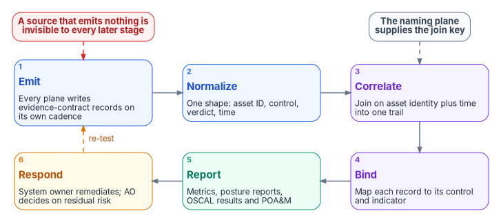

# Chapter 12 — Evidence, Metrics and Continuous Monitoring

*Continuous monitoring is not a claim that monitoring happens; it is a pipeline that keeps producing control-bound evidence, a small set of metrics that say whether the monitoring works, and a finding that stays open until the thing is fixed and the fix is proven.*

::: {.callout-note}
## In this chapter
What CA-7 and the RMF Monitor step ask for, and the continuous-monitoring pipeline that answers them: emit, normalize, correlate, bind, report and respond. What an assessor examines, asks and tests. A metric set built on OMB M-26-14's logging maturity model and BOD 26-04's remediation timelines, with queries for incident timing and a script for retention evidence. Which retention tier can hold which logs under M-26-14's searchable and retrievable floor, and how a tamper-protected copy fits. How ScubaGear's interval evidence from Book 11 and TIC 3.0's automated validation fit the same pipeline. What FedRAMP's 2026 Key Security Indicators are, who they bind, and how an agency uses them.
:::

Every earlier chapter in this book ends with something an assessor could ask for: a diagnostic setting, a freshness check, a fired alert, a patch queue, a drift record, a label policy. Scattered, that output proves little. A query someone ran once is a screenshot. A workbook nobody reads is decoration. The question this chapter answers is how the agency turns all of it into evidence that is continuously current, bound to the controls it supports, and in front of the people who decide on it, and how it knows, from week to week, whether its security operations are working.

[Chapter 02](02-the-evidence-contract.md) defines the evidence contract: one normalized record every source emits, joined on authoritative asset identity plus time. This chapter is what runs on top of it. The control-level depth is in the Federal Compliance volumes, which stay in the repository: the [Multi-Cloud Evidence Fabric](https://github.com/WhalerMike/modernization-workbook/blob/main/docs/compliance/Vol_III_Book_07_Multi_Cloud_Evidence_Fabric.md) and its deployment, the [Evidence and ConMon Pipeline](../b15-day2-operations/11-attestation-and-the-compliance-app.md), with the evidence sections of the [Vulnerability Management](https://github.com/WhalerMike/modernization-workbook/blob/main/docs/compliance/Vol_III_Book_02_Vulnerability_Management.md), [Patch and Systems Management](https://github.com/WhalerMike/modernization-workbook/blob/main/docs/compliance/Vol_III_Book_03_Patch_Systems_Management.md) and [SIEM and XDR Detection](https://github.com/WhalerMike/modernization-workbook/blob/main/docs/compliance/Vol_III_Book_06_SIEM_XDR_Detection.md) books.

## What continuous monitoring asks for

NIST SP 800-137 defines information security continuous monitoring as "maintaining ongoing awareness of information security, vulnerabilities, and threats to support organizational risk management decisions," and says organizational security status "is determined using metrics established by the organization."[^c12-sp800137] SP 800-53 turns that into a control. CA-7 asks for a system-level continuous monitoring strategy, implemented under the organization-level one, that includes:[^c12-sp80053]

- system-level metrics to be monitored;
- frequencies for monitoring and for assessing control effectiveness;
- ongoing control assessments;
- ongoing monitoring of the system- and organization-defined metrics;
- correlation and analysis of what assessments and monitoring produce;
- response actions to address the results; and
- reporting the security and privacy status of the system to defined people at a defined frequency.

PM-31 asks for the same things at the organization level.[^c12-sp80053] Three of CA-7's items are about metrics and three are about acting on what they show. None of them is about owning a tool.

The Risk Management Framework's Monitor step says who does each part. The system owner or common control provider monitors the system and its environment for changes, with the senior agency information security officer (task M-1); the control assessor runs ongoing assessments (M-2); the authorizing official, system owner and common control provider respond to the results (M-3); the system owner and common control provider update the plans, assessment reports and plans of action and milestones (M-4); the system owner, common control provider and senior agency information security officer report posture to the authorizing official (M-5); and the authorizing official decides whether the risk remains acceptable (M-6).[^c12-sp80037] SP 800-37 adds that a report generated from a security management tool can stand in for a formal assessment or posture report if it contains what the report must contain, and that metrics and dashboards help by consolidating data automatically for decision makers.[^c12-sp80037] That is the license for an automated pipeline: it can replace a document only if what it produces is the content the document would have held. [Chapter 10](10-who-runs-security-operations.md) maps these tasks onto the program's roles.

## The continuous-monitoring pipeline

{#fig-ch12-conmon-pipeline fig-alt="Six numbered cards in two rows. Top row, left to right: 1, emit, in blue, where every plane writes evidence-contract records on its own cadence; 2, normalize, in blue, one shape with the asset ID, control, verdict and time; 3, correlate, in violet, joining records on asset identity plus time into one trail. An arrow runs from correlate down to the second row, which runs right to left: 4, bind, in violet, mapping each record to its control and indicator; 5, report, in green, producing metrics, posture reports and OSCAL assessment results and POA&M; and 6, respond, in amber, where the system owner remediates and the authorizing official decides on residual risk. A dashed amber arrow labeled re-test runs from respond up to emit. A slate pill reading the naming plane supplies the join key points to correlate with a dashed arrow, and a red pill reading a source that emits nothing is invisible to every later stage points to emit."}

The program's pipeline has six stages. The first five come from the compliance volumes; the sixth is the part they assume.

| Stage | What happens | What it closes | Where it's built |
|---|---|---|---|
| Emit | Each plane writes records on its own cadence: diagnostic settings, data collection rules, scanner and posture exports, ScubaGear runs | AU-2, AU-12 | Chapters [03](03-identity-telemetry.md), [04](04-platform-and-m365-telemetry.md), [06](06-vulnerability-management.md)–[09](09-data-protection-and-classification.md) |
| Normalize | Records take the evidence-contract shape: asset ID, source, control, measured state, verdict, time, disposition | AU-3 | [Chapter 02](02-the-evidence-contract.md) |
| Correlate | Records join on the authoritative asset ID plus time into one system-wide trail | AU-12(1), AU-6(3), SI-4(16) | [Chapter 02](02-the-evidence-contract.md), [Chapter 05](05-from-log-warehouse-to-detection.md) |
| Bind | Each record maps to the control it evidences and the indicator it feeds | CA-7 (correlation and analysis) | This chapter |
| Report | Metrics, posture reports and machine-readable assessment results and plans of action and milestones, produced on a schedule | CA-7 (reporting), PM-31 | This chapter; [Book 10, Chapter 11](../b10-cloud-boundary/11-the-authorization-package.md) |
| Respond | Findings are remediated, accepted or escalated; nothing closes without re-test evidence | CA-7 (response actions), CA-5, RA-7 | This chapter; [Chapter 10](10-who-runs-security-operations.md) |

The control text supports each mapping. AU-12(1) asks for audit records from organization-defined components compiled into a "system-wide (logical or physical) audit trail that is time-correlated" to within a defined tolerance; SI-4(16) asks for correlation of monitoring information; CA-5 asks for a plan of action and milestones updated from control assessments, audits and continuous monitoring.[^c12-sp80053] For the report stage, NIST's OSCAL provides machine-readable models for assessment results and for the plan of action and milestones, which [Book 11, Chapter 09](../b11-zero-trust/09-running-the-assessment.md#the-four-stage-pipeline) uses for ScubaGear evidence and Book 14, Federal Compliance & Authorization (planned, see the [workbook index](../index.md)), will carry into the authorization package.

Three limits from the compliance volumes hold for every stage, and they are worth stating plainly. The pipeline is only as complete as its emitters: a mechanism that deploys but emits no record is invisible. Correlation depends on the authoritative asset ID: where a record carries only a stack's local identifier, it can't be joined and the trail fragments. And the package reflects the evidence present: it can't attest a control whose mechanism emits nothing. The first metric in this chapter exists because of the first limit.

### Who receives what

The pipeline feeds four audiences, each on its own clock.

- **The SOC** reads incidents continuously ([Chapter 05](05-from-log-warehouse-to-detection.md)).
- **The authorizing official** receives posture reports on the frequency the organization sets. SP 800-37 leaves the frequency to the organization, "not so frequently as to generate unnecessary work or expense," and says reports at a minimum summarize changes to the plans, assessment reports and plans of action and milestones since the last one.[^c12-sp80037]
- **CISA** receives what the directives require. BOD 26-04 requires agencies to automate reporting of the status of KEV-listed vulnerabilities through the CDM Dashboard, or to report manually every two weeks if they haven't; to tag internet-reachable assets; and to report that information every seven days in a CISA-approved machine-readable format if they haven't automated it through CDM.[^c12-bod2604] BOD 25-01 reporting runs through ScubaConnect, CLAW or TALON, or quarterly CyberScope uploads ([Book 11, Chapter 04](../b11-zero-trust/04-scuba-and-bod-25-01.md#how-agencies-report)). CISA telemetry after MTIPS goes to CLAW and Protective DNS ([Book 09, Chapter 03](../b09-network/03-what-tic-3-requires.md#logging-and-cisa-telemetry-after-mtips)).
- **Assessors** receive whatever they ask for, which is the subject of the next section.

## What an assessor verifies

SP 800-53A gives assessors three methods: examine, interview and test.[^c12-sp80053a] For CA-7, the objects it lists to examine include the organizational and system-level continuous monitoring strategies, control assessment reports, plans of action and milestones, system monitoring records, impact analyses and status reports; the people to interview are those with continuous monitoring and security responsibilities and system administrators; and the things to test are the mechanisms that implement continuous monitoring, support response actions and support status reporting.[^c12-sp80053a] For AU-6, the objects to examine include reports of audit findings and "records of actions taken in response to reviews/analyses of audit records."[^c12-sp80053a] That last phrase is the assessor's version of the argument in [Chapter 05](05-from-log-warehouse-to-detection.md): storage isn't review, and review without a recorded action isn't evidence of review.

The program prepares one artifact per question an assessor is likely to ask. The questions are the program's reading of the 800-53A objects, not a published assessor script.

| Control | What the assessor asks | The artifact | Produced by |
|---|---|---|---|
| CA-7, PM-31 | What do you monitor, how often, and against which metrics? | The continuous monitoring strategy and the metric definitions below, versioned | CISO; system owners ([Chapter 10](10-who-runs-security-operations.md)) |
| CA-7 | Show me the monitoring operating, not described | The dated metric series for the last 90 days, regenerated from the pipeline on request | Security engineering |
| AU-2, AU-12 | Which events does this system log, and does it still? | The Agency Logging Plan entry for the system, and the freshness check for its tables | CISO; platform owners; [Chapter 05](05-from-log-warehouse-to-detection.md) |
| AU-5 | What happens when logging fails? | The alert raised when a source went stale, and the incident it opened | Security engineering; SOC |
| AU-6 | Show an alert from last month, the incident and what was done | The incident sampling frame and the four-part incident record | SOC; [Chapter 05](05-from-log-warehouse-to-detection.md) |
| AU-11 | How long are records kept, and where is that configured? | The per-table retention export against the requirement | Security engineering (script below) |
| IR-4, IR-5, IR-8 | How are incidents handled, tracked and improved? | Incident timing metrics, closure classifications, after-action records | SOC; [Chapter 11](11-detection-engineering-and-response.md) |
| RA-5, SI-2(3) | Was each vulnerability fixed within your benchmark? | Remediation-within-timeline metrics and the patch queue history | Platform owners; [Chapter 06](06-vulnerability-management.md) |
| CM-6 | Do systems match their baselines, and what drifted? | Conformance results and drift records, interval by interval | Platform owners; [Chapter 07](07-patch-configuration-and-baselines.md), [Book 11](../b11-zero-trust/index.md) |
| CA-5 | What is open, since when, and who decided to carry it? | The plan of action and milestones, with ages and the authorizing official's decisions | ISSOs; [Chapter 10](10-who-runs-security-operations.md) |

The second row matters most. A dashboard is a picture of the evidence. What an assessor can rely on is the ability to regenerate the series from the stored records and get the same numbers, which is the reproducibility property [Book 11, Chapter 09](../b11-zero-trust/09-running-the-assessment.md#the-four-stage-pipeline) builds into ScubaGear bundles.

## The metric set

CA-7 leaves the metrics to the organization. The program starts from the one federal measurement scheme that already scores logging: M-26-14's maturity model. It defines levels 0 through 4 (Ineffective, Initial, Intermediate, Advanced, Optimal) across five elements, scores each information system, and says that overall maturity "is calculated based on the lowest watermark for each component in the maturity model"; agencies report progress as the percentage of systems at each level.[^c12-m2614] The memo's agency actions ask for at least Level 1 across all elements within 120 days of CISA's Logging Reference Architecture, Level 2 within 180 days and Level 3 within 320 days.[^c12-m2614] [Book 00, Chapter 01](../b00-orientation/01-why-modernize-now.md) works out those dates from the reference architecture's August 20, 2026 publication.

| Element | Level 1 | Level 2 | Level 3 | Level 4 |
|---|---|---|---|---|
| Inventory visibility | 70% of the system's IT, OT and IoT assets in a centralized HWAM/SWAM inventory | 80%, updated daily | 90%, updated daily | 95%, updated daily |
| Collection coverage | Required logs searchable and retrievable for 50% of the system's hardware and software assets | 80% | 90% | 95% |
| Collection operations | Actionable alerts cover less than 50% of the minimum baseline; alerts used ad hoc | 50–70%; detections periodically evaluated and tuned | At least 70%; routinely evaluated and tuned | At least 95%; tuned with advanced techniques |
| Data retention | Retained and retrievable 6 months | Retrievable 12 months | Searchable 3 months, retrievable 12 months | Searchable 6 months, retrievable 12 months |
| Log management | Stored | Encrypted at rest | Encrypted in transit and at rest, regularly hashed | Just-in-time access, monitored permissions, two-gate approval to retire logs |

Source: M-26-14, Appendix C, condensed.[^c12-m2614]

Two features of the model need care. First, the retention element doesn't line up with the memo's own minimum baseline. Appendix B says retained logs "must be actively searchable for a minimum of 6 months" and retrievable for a year,[^c12-m2614] but the maturity model reaches 6 months searchable only at Level 4. An agency can be scored Advanced while missing the Appendix B minimum. The program's design treats Appendix B as the floor at every level and the maturity model as the measure of everything else. Second, the memo calls Level 1 "Initial" in the model and "Basic" in its agency actions table.[^c12-m2614] They are the same level.

The program's metric set extends the model with the operational measures CA-7 and the other chapters need. Targets are the program's design unless a row cites otherwise.

| Metric | Definition | Source | Anchor |
|---|---|---|---|
| Inventory coverage | Assets in the authoritative inventory ÷ assets discovered by any source | Naming plane, CDM, scanner and EDR inventories | M-26-14 Inventory visibility; CM-8; BOD 23-01 discovery |
| Collection coverage | Inventory assets whose required logs are searchable and retrievable ÷ inventory assets | Evidence contract joined to inventory | M-26-14 Collection coverage; AU-12 |
| Telemetry completeness | Required tables and devices within their freshness limit ÷ required tables and devices | Freshness checks ([Chapter 05](05-from-log-warehouse-to-detection.md)) | AU-5; CA-7(3) |
| Detection coverage | M-26-14 baseline activities (Appendix B items a–k) with at least one enabled, tested rule ÷ 11 | Rule library ownership records ([Chapter 10](10-who-runs-security-operations.md)) | M-26-14 Collection operations; SI-4 |
| Detection efficacy | Rules whose known-good test fired in the last test cycle ÷ enabled rules | Test harness ([Chapter 11](11-detection-engineering-and-response.md)) | CA-2; SI-4 |
| Retention conformance | Tables whose analytics and total retention meet their requirement ÷ required tables | Retention export (below) | M-26-14 Appendix B item 1; AU-11 |
| Mean time to detect | Incident created − first recorded activity, median and 90th percentile, by severity | `SecurityIncident` ([Chapter 05](05-from-log-warehouse-to-detection.md)) | SI-4; IR-4 |
| Time to triage and to close | First modification − creation; closure − creation, by severity | `SecurityIncident` (below) | IR-4, IR-5 |
| KEV remediated within timeline | KEV findings closed within their BOD 26-04 timeline ÷ KEV findings closed in the period; and KEV findings open past their timeline | Patch queue and remediation records ([Chapter 06](06-vulnerability-management.md)) | BOD 26-04; SI-2(3) |
| Configuration conformance | Required baseline settings passing ÷ settings assessed, with omissions and exceptions counted separately | ScubaGear, machine configuration, posture tools | CM-6; BOD 25-01 |
| Plan of action and milestones age | Open items past their scheduled completion; items with no end date | Plan of action and milestones | CA-5 |

Four definitions need comment.

**Detection coverage is measured against the baseline, not the rule count.** M-26-14's Appendix B lists eleven activities logs must support, from determining the identity used for an operation to determining the attack vectors of an attack, and ends with "generating appropriate automated alerts for all of the above."[^c12-m2614] A library of two hundred rules that all watch sign-ins covers one item. The program counts an item as covered only when an enabled rule with a passing test reads a source that is within its freshness limit, which ties three metrics together: a rule over a stale table covers nothing.

**Telemetry completeness is a control, not a health statistic.** AU-5 asks the organization to alert defined people within a defined time "in the event of an audit logging process failure."[^c12-sp80053] A silent source is exactly that failure. The program routes a stale required source to the SOC as an incident and counts the minutes it stayed stale.

**KEV remediation is measured on closures and on overdue items, not on the open queue.** The source volume's daily summary computed a compliance rate as one minus the share of open findings past their deadline. That number improves whenever new findings arrive, because fresh findings aren't overdue yet. The program reports two numbers instead: of the KEV findings closed in the period, how many closed within their timeline; and how many open KEV findings are past it. SI-2(3) asks for exactly this, measuring "the time between flaw identification and flaw remediation" against established benchmarks.[^c12-sp80053] The timeline is BOD 26-04's, which depends on whether the asset is publicly exposed, whether the vulnerability is in the KEV catalog, whether exploitation is automatable and whether it gives partial or total control. For a KEV-listed vulnerability the timeline is 3 or 14 days depending on exposure, automatability and impact, and some combinations add forensic triage ([Chapter 06](06-vulnerability-management.md) reproduces the directive's full table); and the clock starts when CISA adds the vulnerability to the catalog or when the agency identifies it on an asset and updates the CDM dashboard, whichever comes first.[^c12-bod2604] Phase III of the directive, which requires remediation within the table's timelines, takes effect within 180 days of June 10, 2026,[^c12-bod2604] which by the program's arithmetic is December 7, 2026. [Chapter 06](06-vulnerability-management.md) builds the queue.

**Configuration conformance keeps exceptions visible.** A tenant whose failing policies are all omitted scores 100% if omissions are left out of the denominator. The program reports passing settings, failing settings and omitted or excepted settings as three numbers, so an exception never looks like a pass ([Book 11, Chapter 10](../b11-zero-trust/10-evidence-not-verdicts.md#read-the-result-before-counting-it)).

## Illustrative code

::: {.callout-warning}
## Illustrative code
The queries and scripts in this chapter are illustrative. They have not been tested against a production workspace. Check table, column and property names against your own workspace, cloud and module versions, and run them first with read-only permissions in a test workspace.
:::

[Chapter 05](05-from-log-warehouse-to-detection.md) provides the detection-latency and freshness queries. Two more complete the metric set: incident timing, and retention evidence.

The `SecurityIncident` table adds a row every time an incident is created or updated, so incident metrics keep only the latest row per incident. Microsoft's own examples measure time to triage as first modification minus creation and time to closure as closure minus creation.[^c12-incident-metrics]

```kql
// Time to triage and time to close, by severity, incidents created in the last 30 days
SecurityIncident
| where CreatedTime > ago(30d)
| summarize arg_max(TimeGenerated, *) by IncidentNumber      // latest state of each incident
| extend TriageMin  = datetime_diff('minute', FirstModifiedTime, CreatedTime),
         CloseHours = iff(Status == "Closed", datetime_diff('hour', ClosedTime, CreatedTime), long(null))
| summarize
    Incidents          = count(),
    MedianTriageMin    = percentile(TriageMin, 50),
    P90TriageMin       = percentile(TriageMin, 90),
    MedianCloseHours   = percentile(CloseHours, 50),
    P90CloseHours      = percentile(CloseHours, 90),
    OpenOver7Days      = countif(Status != "Closed" and CreatedTime < ago(7d)),
    ClosedUnclassified = countif(Status == "Closed" and isempty(Classification))
    by Severity
| order by Severity asc
```

The last column is a discipline check. A closed incident with no classification is a closure an assessor can't interpret, and the program counts it as a defect.

Retention evidence comes from the workspace configuration, not from the data. A Log Analytics table has an analytics retention period, during which it can be queried directly, up to two years, and a total retention period, up to 12 years; data past analytics retention is retrieved through search jobs.[^c12-retention] The program reads M-26-14's "searchable," which the memo defines as usable for cyber defense without preparation, as analytics retention, and "retrievable," usable after intermediary steps such as moving data out of an archive tier,[^c12-m2614] as total retention. That mapping is the program's interpretation. `Get-AzOperationalInsightsTable` lists a workspace's tables, and each returned object carries `RetentionInDays` and `TotalRetentionInDays`.[^c12-get-table]

```powershell
# Export per-table retention against the program's requirement, as dated evidence
# Requires Az.OperationalInsights and read access to the workspace's tables
$ResourceGroup = '<resource-group>'
$Workspace     = '<workspace-name>'

# Requirement per table: analytics (searchable) and total (retrievable) days.
# 183 and 366 days express M-26-14's 6-month and 1-year floor; longer values are agency choices.
$Required = @{
    'SigninLogs'                      = @{ Analytics = 183; Total = 366 }
    'AADNonInteractiveUserSignInLogs' = @{ Analytics = 183; Total = 366 }
    'AuditLogs'                       = @{ Analytics = 183; Total = 366 }
    'AzureActivity'                   = @{ Analytics = 183; Total = 366 }
    'OfficeActivity'                  = @{ Analytics = 183; Total = 366 }
    'SecurityEvent'                   = @{ Analytics = 183; Total = 366 }
    'CommonSecurityLog'               = @{ Analytics = 183; Total = 366 }
    'Syslog'                          = @{ Analytics = 183; Total = 366 }
    'SecurityIncident'                = @{ Analytics = 183; Total = 366 }
}

$Tables = Get-AzOperationalInsightsTable -ResourceGroupName $ResourceGroup -WorkspaceName $Workspace

$Report = foreach ($Name in $Required.Keys) {
    $Table = $Tables | Where-Object TableName -eq $Name
    $Need  = $Required[$Name]
    [pscustomobject]@{
        TableName        = $Name
        Present          = [bool]$Table
        Plan             = $Table.Plan
        AnalyticsDays    = $Table.RetentionInDays
        TotalDays        = $Table.TotalRetentionInDays
        RequiredAnalytic = $Need.Analytics
        RequiredTotal    = $Need.Total
        Conforms         = [bool]$Table -and
                           $Table.RetentionInDays -ge $Need.Analytics -and
                           $Table.TotalRetentionInDays -ge $Need.Total
    }
}

$Stamp = (Get-Date).ToUniversalTime().ToString('yyyyMMddTHHmmssZ')
$Report | Sort-Object TableName |
    Export-Csv -Path ".\evidence\FMP-retention-conformance-$Stamp.csv" -NoTypeInformation

$Gaps = $Report | Where-Object { -not $_.Conforms }
if ($Gaps) {
    Write-Warning ("{0} table(s) below the retention requirement: {1}" -f $Gaps.Count, (($Gaps.TableName) -join ', '))
}
```

The table list belongs in the Agency Logging Plan, not in the script; the script reads it from there in practice. Two cautions apply. Basic and Auxiliary plan tables have only a total retention setting,[^c12-retention] so the analytics comparison needs adjusting for them. And the export proves configuration, not content: a table configured for a year that started receiving data last month holds a month. The collection coverage metric catches that.

## Retention tiers and tamper-protected copies

The retention conformance metric checks a number. Which tier holds the data decides what that number means, and the tiers differ in ways that matter to both of M-26-14's objectives.

| Where the data sits | What it supports | Retention | What it doesn't do |
|---|---|---|---|
| Log Analytics, Analytics plan (Sentinel's analytics tier) | Continuous monitoring and real-time detection: analytics rules, alerts, hunting, workbooks | Analytics retention 30 days by default (90 days for Sentinel), extendable to two years; total retention up to 12 years | Data past analytics retention needs a search job before it can be queried |
| Log Analytics, Basic plan | Troubleshooting and incident response, with discounted ingestion and per-query charges | Queryable for 30 days; total retention up to 12 years | Older data needs a search job; personal data can't be purged |
| Log Analytics, Auxiliary plan, and the Sentinel data lake tier | Low-touch, high-volume and compliance data; KQL and Spark jobs, summary rules, search jobs | Queryable for the total retention period, up to 12 years | Alerts stop working when a table moves to this plan; in Sentinel, analytics rules, hunting queries, parsers, watchlists, workbooks and playbooks are limited; no data export; queries are slower |
| Storage account with an immutability policy, fed by data export | A tamper-protected copy for compliance and legal hold | As long as the time-based retention policy or legal hold requires | Not queryable from the SIEM; a copy for evidence, not a detection source |

Sources: Microsoft Learn, Azure Monitor table plans and Sentinel data tiers.[^c12-table-plans][^c12-sentinel-tiers]

Read against M-26-14, the table gives four design rules. They are the program's interpretation of the memo, not text from it.

1. **Detection sources stay in the analytics tier for at least six months.** The memo's "searchable" means detections and analytics can be applied without preparing the data.[^c12-m2614] Only the Analytics plan supports alerts and the full rule set. Microsoft says plainly that logs ingested only into the Sentinel data lake tier don't generate alerts, and advises keeping time-sensitive, high-fidelity sources in the analytics tier ([Chapter 01](01-you-cant-defend-what-you-cant-see.md#a-warehouse-is-not-a-detection-engine)),[^c12-lake] and that moving a table from Analytics to Auxiliary stops its alerts.[^c12-table-plans] A required detection source in the lake tier is a detection coverage gap, whatever its retention says.
2. **Lake-tier and Auxiliary data can meet "retrievable," and sometimes more.** "Retrievable" allows intermediary steps before use.[^c12-m2614] Data past analytics retention, reached through a search job, fits that definition. Auxiliary and lake-tier data is queryable for its whole retention, though slower and without real-time features, so it suits investigation and hunting over long windows for high-volume sources the SOC doesn't alert on.
3. **The tier choice is security engineering's decision, with the CISO and the SOC consulted.** Moving a table between plans changes what the SOC can detect, and plan changes are limited to one switch per table per week.[^c12-table-plans] [Chapter 10](10-who-runs-security-operations.md#the-responsibility-matrix) gives where telemetry lands to security engineering, so the SOC's view of detection coverage has to be heard before a table changes tier.
4. **Tamper protection is a separate copy.** Microsoft's guidance is that data in a Log Analytics workspace can't be altered after ingestion but can be purged, and that exporting it to a storage account with immutability policies keeps it tamper protected; data export rules send selected tables continuously, as data arrives.[^c12-export] Azure Blob immutable storage supports time-based retention policies, during which blobs can be created and read but not modified or deleted, and legal holds, which last until explicitly cleared.[^c12-immutable] The exported copy supports AU-9 and M-26-14's Level 3 and 4 log management criteria, which ask for logs "regularly hashed for veracity" and, at Level 4, two-gate approval before logs are retired.[^c12-m2614] It doesn't replace analytics retention, because nothing in it raises an alert.

Two cautions follow from the same sources. The lake tier and the Basic and Auxiliary plans can't purge individual records: the Sentinel data lake retains ingested data for its defined retention even if the data is deleted at the source or in the analytics tier, and personal data can't be purged from Basic and Auxiliary tables.[^c12-sentinel-connectors][^c12-basic-query] That is the right property for evidence and the wrong one for a source that shouldn't have been collected, so the privacy review in [Chapter 10](10-who-runs-security-operations.md) has to happen before a source is routed there, not after. And how long any tier keeps data beyond the security floor is a records decision: GRS 3.2's cybersecurity logging items are under revision following the rescission of M-21-31 ([Chapter 10](10-who-runs-security-operations.md#the-roles)).

## Where ScubaGear's evidence fits

[Book 11](../b11-zero-trust/index.md) runs CISA's ScubaGear against Microsoft 365 tenants and carries its results into the program's evidence chain. Three of its properties make it a model for the rest of this pipeline.

- **It is interval evidence.** Each run is a sealed interval rather than a replacement report, so the bundle can state windowed conformance, and a control that passed every interval and failed one is a different finding from one that has always failed ([Book 11, Chapter 09](../b11-zero-trust/09-running-the-assessment.md#interval-evidence)). The configuration conformance metric above is computed per interval for the same reason.
- **It is already bound to controls.** CISA publishes a mapping of SCuBA policies to NIST SP 800-53 Rev. 5 controls, limited to controls in the FedRAMP High baseline,[^c12-scuba-mappings] so a ScubaGear result arrives at the bind stage with its control attached.
- **It already has a federal reporting clock.** BOD 25-01's implementation guidance lets agencies report through CISA-hosted ScubaConnect, through a self-hosted ScubaConnect integrated with CLAW or TALON at a minimum of once a quarter, or by uploading results to CyberScope quarterly.[^c12-bod2501-guide] Whichever route the agency picks sets the minimum interval for the Microsoft 365 configuration metric.

ScubaGear evaluates configuration. It doesn't detect intrusions, and its results don't feed the detection metrics. Where a ScubaGear finding is drift in a previously passing control, [Book 11, Chapter 10](../b11-zero-trust/10-evidence-not-verdicts.md#drift-is-continuous-verification) sends it to the authorizing official as a change to an authorized system, and this book's SOC receives it too, because some drift is the first sign of an intrusion rather than an administrative slip.

## TIC: from point-in-time validation to continuous

The TIC program made the same move this chapter describes, from periodic validation to continuous evidence. CISA's TIC 3.0 Program Guidebook says the modernized initiative eliminates the TIC-related FISMA metrics and the manual TIC Compliance Validation process, "with the intent to replace both with an automated metric collection as applicable," leveraging the CDM program and other CISA programs, with the goal of continuous validation "in contrast to the point-in-time reviews."[^c12-tic] It also says that OMB M-19-26 shifted responsibility for compliance with TIC capabilities to the agency, and that TIC "does not replace or negate" agencies' telemetry and logging requirements, including telemetry collected and shared with CISA.[^c12-tic] Its information cycle ends with agencies providing telemetry of their operating environments to CISA, and it points agencies to CLAW and the CISA Cloud Interface Reference Architecture for how cloud-generated security information reaches CISA.[^c12-tic]

For this chapter that means the network plane's evidence has two consumers: the agency's own pipeline, which measures it with the metric set above, and CISA's, which receives it through CLAW. [Book 09, Chapter 03](../b09-network/03-what-tic-3-requires.md) covers what TIC asks of the network; the TIC delegate who coordinates with CISA is in [Chapter 10](10-who-runs-security-operations.md)'s matrix.

## FedRAMP's Key Security Indicators

FedRAMP's Consolidated Rules for 2026 launched on June 25, 2026 (the date of FedRAMP's launch announcement; its changelog counts changes from June 23), opened for early adoption on July 4 and take mandatory effect on January 1, 2027.[^c12-fedramp-timeline] They include 46 Key Security Indicators across ten themes: Cybersecurity Education, Change Management, Cloud Native Architecture, Identity and Access Management, Incident Response, Monitoring, Logging, and Auditing, Policy and Inventory, Recovery Planning, Supply Chain Risk and Service Configuration.[^c12-fedramp-ksi][^c12-fedramp-trigrams] Many indicators ask for an activity to be done "persistently," which FedRAMP defines as occurring in a firm, steady way repeated over a long period, with the status of persistent activities "always known."[^c12-fedramp-defs]

The indicators most relevant to this book are short enough to list.

| Indicator | What it asks, in FedRAMP's words | Related SP 800-53 controls FedRAMP lists include |
|---|---|---|
| KSI-MLA-OSM, Operating SIEM Capability | A SIEM or similar system is used and persistently reviewed for centralized, tamper-resistant logging of events, activities and changes | AU-2, AU-3, AU-5, AU-6(1), AU-6(3), AU-6(4), AU-11, AU-12(1), SI-4(16) |
| KSI-MLA-RVL, Reviewing Logs | Logs are persistently reviewed and audited | AU-6, AU-6(1), SI-4 |
| KSI-MLA-LET, Logging Event Types | A list of information resources and event types to be logged, monitored and audited is maintained and persistently reviewed | AU-2, AU-12, SI-4(4) |
| KSI-MLA-EVC, Evaluating Configurations | The configuration of machine-based information resources, especially infrastructure as code, is persistently evaluated and tested | CA-7, CM-2, CM-6 |
| KSI-MLA-ALA, Authorizing Log Access | A least-privileged, role- and attribute-based, just-in-time model is used and persistently reviewed for access to log data | AU-6(7), AU-12(3) |
| KSI-INR-RIR, Reviewing Incident Response Procedures | The effectiveness of documented incident response procedures is persistently reviewed | IR-4, IR-6, IR-8 |
| KSI-INR-RPI, Reviewing Past Incidents | Past incidents are persistently reviewed for patterns or vulnerabilities not previously apparent | IR-4, IR-5, IR-8 |
| KSI-INR-AAR, Generating After Action Reports | After action reports are generated and lessons learned persistently incorporated | IR-4, IR-8 |
| KSI-PIY-GIV, Generating Inventories | Authoritative sources are used to automatically generate real-time inventories of all information resources when needed | CM-8 |

Source: FedRAMP, Key Security Indicators, Consolidated Rules for 2026 (control lists abridged).[^c12-fedramp-ksi]

Three things follow, and the source volumes got two of them wrong.

**The indicators bind cloud service providers, not agencies.** They are the evidence a provider shows to earn and keep a FedRAMP certification. An agency's own systems are authorized by the agency under the RMF. The source volumes described the indicators as "the FedRAMP 20x KSI pipeline" an agency delivers its evidence to, and said FedRAMP's automation queries Sentinel's alert and incident tables and fails a workspace with no enabled rules. FedRAMP's published indicators say nothing of the kind; they state outcomes, not queries. The program uses the indicators in two ways instead. As a vocabulary: a metric set that would satisfy KSI-MLA-OSM, RVL and LET for a provider is a reasonable standard for the agency's own SOC, and the mapping is the program's design choice. And as an input: when a system includes a certified cloud service, the agency **must** review each Ongoing Certification Report to understand how changes to the service may affect the risk tolerance in the agency's authorization,[^c12-fedramp-ccm] and providers must supply those reports every three months, covering accepted vulnerabilities, transformative changes and reportable incidents among other things.[^c12-fedramp-ccm] That review is an agency continuous-monitoring task; [Book 10, Chapter 11](../b10-cloud-boundary/11-the-authorization-package.md#keeping-the-package-current) assigns it.

**The indicators are not a remediation clock for the agency.** FedRAMP's Vulnerability Detection and Response rules give providers graded timeframes by potential agency impact, internet reachability and likely exploitability, and say providers should not deploy new machine-based resources with known exploited vulnerabilities.[^c12-fedramp-vdr] They describe what to expect of a provider. The agency's own assets run on BOD 26-04's timelines.

**The control mappings are FedRAMP's, and they move.** Each indicator's page lists related controls and a changelog; several were updated on October 13, 2026.[^c12-fedramp-ksi] A mapping copied into a document in July is already stale. The program reads the mapping from FedRAMP's machine-readable rules when it needs it rather than carrying its own copy.

## Closing a finding

Continuous monitoring ends where this book's argument starts: a finding closes only when the thing is fixed, with proof. In the program's model, closure has three parts. The platform owner remediates through change control. The pipeline re-tests: the next scan, the next ScubaGear interval, the next freshness check or the rule's known-good test shows the condition gone. And the record links the two, so the plan of action and milestones item closes on evidence rather than on a ticket status. A finding that can't be closed in time is not closed by exception. It is carried, by the authorizing official's decision, with an end date ([Chapter 10](10-who-runs-security-operations.md#who-accepts-the-risk-of-what-isnt-seen)).

SP 800-37's ongoing authorization depends on this discipline. It describes the authorizing official reviewing posture on an ongoing basis to decide whether risk remains acceptable, using the results of continuous monitoring,[^c12-sp80037] which is only possible if the results mean what they say.

## The reporting rhythm

The metric set reaches each role on its own cadence. The frequencies are the program's design, chosen to sit between CA-7's "organization-defined" and the external clocks above.

| Audience | What they see | How often |
|---|---|---|
| SOC manager | Incident timing, open incidents past seven days, unclassified closures, stale sources | Daily |
| Security engineering | Telemetry completeness, detection coverage and efficacy, retention conformance | Daily for completeness; weekly for the rest |
| Platform owners | Findings on their plane, KEV items approaching or past their timeline, configuration conformance | Daily for KEV; weekly otherwise |
| ISSOs and system owners | The system's metrics, its plan of action and milestones, drift since the last interval | Weekly |
| CISO | The full metric set, M-26-14 maturity by system, overdue KEV items, open risk acceptances | Monthly, and on any overdue KEV item |
| Authorizing official | Posture report per system: changes to plans, assessments and plans of action and milestones; decisions needed | Monthly, or on a significant change |
| CISA | KEV status through CDM; BOD 25-01 results; CLAW telemetry | As each directive and the agency's chosen reporting route require |

## What changes, in one table

| Old habit | What replaces it |
|---|---|
| Continuous monitoring means a SIEM is running | A pipeline that emits, normalizes, correlates, binds, reports and responds, with each stage evidenced |
| Evidence is assembled for the assessment | The metric series is regenerated from stored records on request |
| Coverage is a rule count | Detection coverage is measured against M-26-14's eleven baseline activities, over sources that are fresh |
| A silent source is a health statistic | A stale required source is an AU-5 failure, routed to the SOC as an incident |
| Patch compliance is the share of the open queue not yet overdue | KEV remediation is measured on closures within BOD 26-04 timelines and on overdue items |
| Exceptions disappear from the score | Passing, failing and excepted settings are reported separately |
| FedRAMP KSIs are the agency's pipeline | KSIs bind providers; the agency uses them as vocabulary and reviews providers' quarterly reports |
| A finding closes when the ticket does | A finding closes on re-test evidence, or is carried by the authorizing official with an end date |

::: {.callout-tip}
## Continue the book
[← Previous: Chapter 11 — Detection Engineering and Response Automation](11-detection-engineering-and-response.md) · [Book index](index.md) · [Next: Appendix A — Requirements Mapping →](appendix-a-requirements-mapping.md)
:::

[^c12-sp800137]: National Institute of Standards and Technology, SP 800-137, *Information Security Continuous Monitoring (ISCM) for Federal Information Systems and Organizations*, September 2011, §1 (definition) and §3.2.1 (Determine Metrics), <https://nvlpubs.nist.gov/nistpubs/Legacy/SP/nistspecialpublication800-137.pdf> (accessed Oct 21, 2026).
[^c12-sp80053]: National Institute of Standards and Technology, SP 800-53 Rev. 5, *Security and Privacy Controls for Information Systems and Organizations*, controls AU-5, AU-12(1), CA-5, CA-7, PM-31, SI-2(3) and SI-4(16), <https://csrc.nist.gov/pubs/sp/800/53/r5/upd1/final>; control text checked against the release 5.2.0 OSCAL catalog, <https://github.com/usnistgov/oscal-content/blob/main/nist.gov/SP800-53/rev5/json/NIST_SP-800-53_rev5_catalog.json> (both accessed Oct 21, 2026).
[^c12-sp80037]: National Institute of Standards and Technology, SP 800-37 Rev. 2, *Risk Management Framework for Information Systems and Organizations: A System Life Cycle Approach for Security and Privacy*, December 2018, §3.7 (Monitor step), tasks M-1 through M-6, with footnotes 108 and 109 (tool-generated reports), <https://nvlpubs.nist.gov/nistpubs/SpecialPublications/NIST.SP.800-37r2.pdf> (accessed Oct 21, 2026).
[^c12-bod2604]: Cybersecurity and Infrastructure Security Agency, BOD 26-04, *Prioritizing Security Updates Based on Risk*, June 10, 2026, Required Actions (Phases I–III) and Appendix A, Table 1: Remediation Timelines, <https://www.cisa.gov/news-events/directives/bod-26-04-prioritizing-security-updates-based-risk> (accessed Oct 21, 2026).
[^c12-sp80053a]: National Institute of Standards and Technology, SP 800-53A Rev. 5, *Assessing Security and Privacy Controls in Information Systems and Organizations*, January 2022, §2 (assessment methods) and assessment procedures for AU-06 and CA-07, <https://nvlpubs.nist.gov/nistpubs/SpecialPublications/NIST.SP.800-53Ar5.pdf> (accessed Oct 21, 2026).
[^c12-m2614]: Office of Management and Budget, M-26-14, *Ensuring Effective and Efficient Agency Logging and Network Visibility to Defend Against Evolving Cyber Threats*, May 22, 2026, "Measuring Maturity," "Agency Actions," Appendix B (Minimum Logging Baseline Requirements and Objectives, items 1 and 5, with footnotes 6 and 7 defining "searchable" and "retrievable") and Appendix C (Logging Maturity Model, footnote 8), <https://www.whitehouse.gov/wp-content/uploads/2026/05/M-26-14-Ensuring-Effective-and-Efficient-Agency-Logging-and-Network-Visibility-to-Defend-Against-Evolving-Cyber-Threats.pdf> (accessed Oct 21, 2026).
[^c12-incident-metrics]: Microsoft Learn, "Use incident metrics in Microsoft Sentinel to measure SOC performance," sections "Use the security incidents table" and "Sample KQL queries for incident metrics," <https://learn.microsoft.com/azure/sentinel/manage-soc-with-incident-metrics> (accessed Oct 21, 2026).
[^c12-retention]: Microsoft Learn, "Manage data retention in a Log Analytics workspace," sections "Analytics, long-term, and total retention" and "Configure table-level retention," <https://learn.microsoft.com/azure/azure-monitor/logs/data-retention-configure> (accessed Oct 21, 2026).
[^c12-get-table]: Microsoft Learn, "Get-AzOperationalInsightsTable," Az.OperationalInsights module, <https://learn.microsoft.com/powershell/module/az.operationalinsights/get-azoperationalinsightstable>; and "PSTable.RetentionInDays Property" and "PSTable.TotalRetentionInDays Property," <https://learn.microsoft.com/dotnet/api/microsoft.azure.commands.operationalinsights.models.pstable.totalretentionindays?view=az-ps-latest> (both accessed Oct 21, 2026).
[^c12-table-plans]: Microsoft Learn, "Azure Monitor Logs overview," section "Table plans" (table feature comparison); "Tables in Azure Monitor Logs," sections "Table plans" and "Retention"; and "Configure a table plan in a Log Analytics workspace," section "Change the table plan," <https://learn.microsoft.com/azure/azure-monitor/logs/data-platform-logs>, <https://learn.microsoft.com/azure/azure-monitor/logs/logs-table-overview>, <https://learn.microsoft.com/azure/azure-monitor/logs/logs-table-plans> (all accessed Oct 21, 2026).
[^c12-sentinel-tiers]: Microsoft Learn, "Manage data tiers and retention in Microsoft Sentinel," sections "How data tiers and retention work" and "Compare the analytics and data lake tiers," <https://learn.microsoft.com/azure/sentinel/manage-data-overview> (accessed Oct 21, 2026).
[^c12-lake]: Microsoft Learn, "Microsoft Sentinel data lake direct ingestion guidance," section "Analytics rules and custom detections," <https://learn.microsoft.com/azure/sentinel/datalake/sentinel-lake-log-ingestion-guidance> (accessed Oct 21, 2026).
[^c12-export]: Microsoft Learn, "Log Analytics data export rules in Azure Monitor," section "Overview," <https://learn.microsoft.com/azure/azure-monitor/logs/logs-data-export>; and Azure Well-Architected Framework, "Architecture best practices for Log Analytics," section "Security," <https://learn.microsoft.com/azure/well-architected/service-guides/azure-log-analytics> (both accessed Oct 21, 2026).
[^c12-immutable]: Microsoft Learn, "Store business-critical blob data with immutable storage in a write once, read many (WORM) state," sections "About immutable storage for blobs" and "Legal holds," <https://learn.microsoft.com/azure/storage/blobs/immutable-storage-overview> (accessed Oct 21, 2026).
[^c12-sentinel-connectors]: Microsoft Learn, "Microsoft Sentinel data connectors," section "Data management considerations for Microsoft Sentinel data lake," <https://learn.microsoft.com/azure/sentinel/connect-data-sources> (accessed Oct 21, 2026).
[^c12-basic-query]: Microsoft Learn, "Query data in Basic and Auxiliary tables in Azure Monitor Logs," section "Considerations" (Purge), <https://learn.microsoft.com/azure/azure-monitor/logs/basic-logs-query> (accessed Oct 21, 2026).
[^c12-scuba-mappings]: Cybersecurity and Infrastructure Security Agency, ScubaGear v1.8.0 documentation, "Mappings," <https://github.com/cisagov/ScubaGear/blob/v1.8.0/docs/misc/mappings.md> (accessed Oct 21, 2026).
[^c12-bod2501-guide]: Cybersecurity and Infrastructure Security Agency, *BOD 25-01 Implementation Guidance: Implementing Secure Practices for Cloud Services*, reporting options, <https://www.cisa.gov/news-events/directives/bod-25-01-implementation-guidance-implementing-secure-practices-cloud-services> (accessed Oct 21, 2026).
[^c12-tic]: Cybersecurity and Infrastructure Security Agency, *TIC 3.0 Core Guidance Volume 1: Program Guidebook*, Version 1.2, September 2026, §4 (Strategic Program Goals, "Automated and Streamlined Verification"), §9, §10 and §10.1 (Telemetry Requirements; TIC Information Cycle) and §13 (TIC and EINSTEIN: CLAW and C-CIRA), <https://www.cisa.gov/sites/default/files/2026-09/TIC_3.0_Program_Guidebook_September_2026_47.pdf> (accessed Oct 21, 2026).
[^c12-fedramp-timeline]: FedRAMP, "Important Dates for the Consolidated Rules for 2026," <https://www.fedramp.gov/2026/timeline/> (accessed Oct 21, 2026).
[^c12-fedramp-ksi]: FedRAMP, "Key Security Indicators," *FedRAMP Consolidated Rules for 2026*, Ruleset Reference (46 indicators; changelog entries of June 24 and October 13, 2026), <https://www.fedramp.gov/2026/reference/key-security-indicators/> (accessed Oct 21, 2026).
[^c12-fedramp-trigrams]: FedRAMP, "FedRAMP Trigrams," *FedRAMP Consolidated Rules for 2026*, Key Security Indicator themes, <https://www.fedramp.gov/2026/trigrams/> (accessed Oct 21, 2026).
[^c12-fedramp-defs]: FedRAMP, "FedRAMP Definitions," *FedRAMP Consolidated Rules for 2026*, FRD-PER "Persistently," <https://www.fedramp.gov/2026/definitions/> (accessed Oct 21, 2026).
[^c12-fedramp-ccm]: FedRAMP, "Collaborative Continuous Monitoring," *FedRAMP Consolidated Rules for 2026*, rules CCM-AGM-ROR (Review Ongoing Reports) and the Ongoing Certification Report rule (every 3 months), <https://www.fedramp.gov/2026/reference/collaborative-continuous-monitoring/> (accessed Oct 21, 2026).
[^c12-fedramp-vdr]: FedRAMP, "Vulnerability Detection and Response," *FedRAMP Consolidated Rules for 2026*, rules VDR-CSO-AKE (Avoid KEVs) and VDR-TFR-PVR (Mitigation and Remediation Expectations), <https://www.fedramp.gov/2026/reference/vulnerability-detection-and-response/> (accessed Oct 21, 2026).
