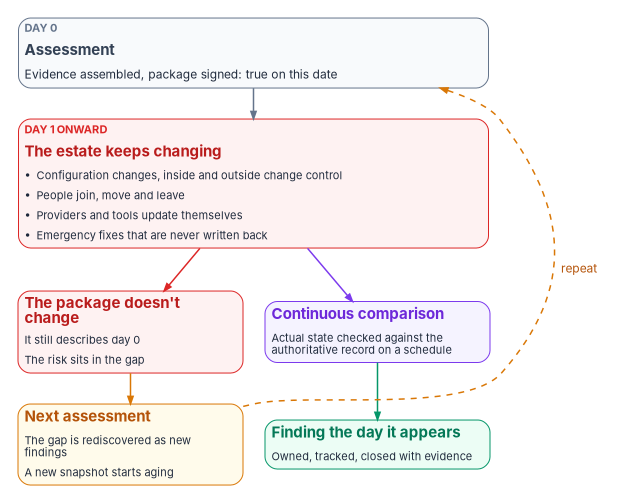
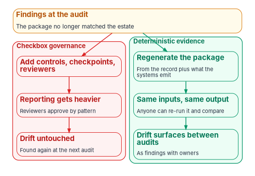

# Chapter 01 — Why Compliance Decays the Day After the Audit

*An assessment measures one day; the estate starts changing the next morning, so a package that is only ever assembled by hand is less true every day it sits on the shelf.*

::: {.callout-note}
## In this chapter
Four structural reasons governance fails even in capable, well-funded programs, and why none of them is fixed by buying another tool. The compliance paradox: point-in-time evidence against an estate in constant change, and why adding checkboxes makes it worse. What federal guidance already asks for (ongoing authorization fed by continuous monitoring) and why so few systems get there. The response this book builds: evidence that is regenerated from one authoritative record rather than reassembled by people, and what that changes for an authorizing official.
:::

Picture the week an authorization package is signed. The system security plan describes the system as it is. The assessment results match the configuration. The plan of action and milestones lists every known weakness. On that day the package is true.

The next morning an administrator changes a firewall rule to fix an outage. A contractor's role ends, but the account stays enabled until someone notices. A cloud provider ships a new default. A management agent updates itself. None of this is unusual, and most of it is authorized. But none of it reaches the package, which goes on describing the day it was signed. When the next assessment comes, the assessor finds the differences, records them as new findings, and the program writes a fresh package that starts aging the moment it's signed.

This book is about breaking that cycle. This chapter explains why it happens; [Chapter 02](02-drift-is-the-primary-threat.md) explains the mechanism, drift, and the rest of the book builds the response.

{#fig-ch01-point-in-time-gap fig-alt="A top-to-bottom flow. A slate card labeled Day 0, Assessment: evidence assembled, package signed, true on this date. It leads to a red card labeled Day 1 onward, The estate keeps changing, listing configuration changes inside and outside change control, people joining, moving and leaving, providers and tools updating themselves, and emergency fixes never written back. From there the flow splits. On the left, a red card, The package doesn't change: it still describes day 0 and the risk sits in the gap, leads to an amber card, Next assessment: the gap is rediscovered as new findings and a new snapshot starts aging, with a dashed amber arrow labeled repeat back to the assessment. On the right, a violet card, Continuous comparison: actual state checked against the authoritative record on a schedule, leads to a green card, Finding the day it appears: owned, tracked, closed with evidence."}

## Four structural failure modes

The teams running federal modernization programs are usually capable and well resourced. The failures below aren't failures of people. They are properties of an environment that has plenty of tools but no single place where the program's intent is recorded and checked. The program uses them as a diagnostic list: a program that recognizes all four in itself has a structural problem, not a staffing one.

### Fragmented identity context

Identity facts are mastered in a directory but consumed everywhere else: by network policy, address management, telemetry, security tooling and compliance reporting. Each consumer has its own idea of how fresh its copy is. The same person can be current in one system and stale in another at the same moment. When a decision crosses those systems, there is no single moment at which the answer is settled, so the decision falls back to the weakest available evidence: someone attests that it's right.

### Uncorrelated telemetry

Every tool emits telemetry in its own shape. Turning those streams into one account of how a control is performing is a manual exercise, repeated at every audit. The combined view can't be reproduced from the raw telemetry, because the work of combining it was done by people and never kept as an artifact in its own right. [Book 12](../b12-security-operations/index.md) treats this as a security operations problem and answers it with one evidence contract that every source emits into ([Book 12, Chapter 02](../b12-security-operations/02-the-evidence-contract.md)).

### Point-in-time evidence

System security plans, plans of action and milestones, and assessor evidence packages capture the estate when they are assembled. Between assemblies, change is invisible to the package. Reassembly is rebuilt by hand each time instead of regenerated from what the systems already record.

### Tool-shaped policy

Policy intent gets recorded inside the tool that enforces it. Move the tool and the policy goes with it. Replace the vendor and the policy has to be rewritten. Migrate to a new platform and someone has to rediscover the policy from a thousand configuration files. Because the intent never had a home of its own, it doesn't survive a platform change. The Active Directory to Entra ID migration is the clearest federal example: an organizational-unit tree that encoded delegation, policy scope and accountability has no equivalent in a flat cloud directory, and whatever intent the tree held implicitly has to be found and restated ([Book 02, Chapter 01](../b02-identity/01-why-identity-matters.md)).

### Where each fix actually lives

| Failure mode | Looks like a… | Actually needs |
|---|---|---|
| Fragmented identity context | Directory problem | Resolution rules that every consuming system follows, stated once |
| Uncorrelated telemetry | SIEM problem | One record shape that every source emits before the SIEM sees it |
| Point-in-time evidence | GRC-tool problem | Evidence regenerated from the authoritative record plus telemetry |
| Tool-shaped policy | Policy-engine problem | Intent, its mapping to each platform, and its enforcement kept separate |

: The four failure modes and where the fix lives {.striped .hover}

## Why more tooling doesn't fix it

Each failure mode looks like a gap in tooling, and none is. A better directory doesn't settle which copy of a fact wins when systems disagree; resolution rules that apply across all of them do. A better SIEM doesn't correlate telemetry that arrives in incompatible shapes; a common record shape, emitted by each source's adapter, does. A better governance, risk and compliance tool still stores a document someone assembled; evidence that can be regenerated from the record and the systems' own output doesn't depend on that assembly. A better policy engine is still a place where intent gets trapped; separating what the program intends from how each platform implements it is what lets the intent outlive the platform.

The common factor is that every fix sits underneath the tools, in how the program records what should be true and checks it. Without that layer, a program rebuilds the same fixes for each tool, each migration and each audit cycle. This chapter doesn't claim the program's design is the only way to build that layer. It claims some such layer is needed, and the four failure modes are how a program can tell whether the one it has is enough.

## The compliance paradox

Organizations that are driven by compliance often carry more operational risk over time, not less. The program's explanation is three observations that are each unremarkable on their own:

1. **Compliance reporting is point-in-time.** The package reflects the estate at the moment it was assembled.
2. **The estate changes continuously.** Configurations, identities, telemetry formats and tool versions change every day.
3. **Assessment cycles are slow.** Federal law sets a floor of annual testing, and authorizations run for periods the agency sets.

Put together, the truth the package describes and the truth the estate exhibits diverge between cycles, and risk accumulates in the divergence. Each assessment rediscovers it as findings, treats them as new, and produces a new snapshot that starts diverging as soon as it's signed.

NIST describes the same dynamic in plainer terms. In the Risk Management Framework's Monitor step, SP 800-37 Rev. 2 says that "systems and environments of operation are in a constant state of change": hardware, software and firmware upgrades, staff turnover, and changes to facilities and physical access. It adds that changes made by external providers "can be difficult to detect," and that unauthorized changes come both from adversaries and from "inadvertent errors by authorized personnel."[^c01-sp80037] SP 800-137 puts the consequence directly: an initial authorization "is based on evidence available at one point in time, but systems and environments of operation change."[^c01-sp800137]

### Why checkbox governance makes it worse

The natural response to findings is to add controls, checkpoints and reviewers. Each addition is well meant. Together, they make reporting heavier while leaving the underlying change untouched. The program sees three patterns emerge:

- **Reviewer fatigue.** As checklists lengthen, reviewers approve by pattern rather than by evaluation, and an approval stops carrying information.
- **The document becomes the artifact.** Teams produce documents that describe what should be true, with no link to anything that checks whether it is.
- **The findings backlog becomes permanent.** Long-running plan of action and milestones items become part of the furniture: tolerated, never closed, and treated as a cost of doing business.

Every checkbox added this way raises the cost of reporting and lowers the share of the evidence that reflects the estate as it is. That, in one line, is the paradox.

{#fig-ch01-two-responses fig-alt="An amber card at the top, Findings at the audit: the package no longer matched the estate, splits into two columns. The left column, a red group labeled checkbox governance, runs downward: add controls, checkpoints, reviewers; reporting gets heavier, reviewers approve by pattern; drift untouched, found again at the next audit. The right column, a green group labeled deterministic evidence, runs downward: regenerate the package from the record plus what the systems emit; same inputs, same output, anyone can re-run it and compare; drift surfaces between audits as findings with owners."}

## What federal guidance already asks for

None of this contradicts federal policy. The policy already points away from the snapshot. What lags is practice.

**The law sets a floor, not a ceiling.** FISMA requires each agency's security program to include periodic testing and evaluation of the effectiveness of its security policies, procedures and practices, "with a frequency depending on risk, but no less than annually," and requires that testing to include automated tools consistent with NIST standards.[^c01-fisma] Annual is the minimum, and automation is part of the requirement, not an optional extra.

**NIST defines continuous monitoring as awareness, not as a calendar.** SP 800-137 defines information security continuous monitoring as "maintaining ongoing awareness of information security, vulnerabilities, and threats to support organizational risk management decisions." It is careful about the words: "continuous" and "ongoing" mean controls and risks are assessed "at a frequency sufficient to support risk-based security decisions," and "data collection, no matter how frequent, is performed at discrete intervals."[^c01-sp800137] It describes what continuous monitoring is for: keeping the system security plan, risk assessment, assessment report and plan of action and milestones current, so that an assessment and risk determination process "otherwise static between authorizations" becomes a dynamic one.[^c01-sp800137] CA-7 turns that into a control: a system-level continuous monitoring strategy with defined metrics, monitoring and assessment frequencies, ongoing assessments, correlation and analysis, response actions, and status reporting.[^c01-sp80053] [Book 12, Chapter 12](../b12-security-operations/12-evidence-metrics-and-continuous-monitoring.md) builds the pipeline that answers CA-7; this book is the governance view of the same requirement.

**The Risk Management Framework expects ongoing authorization.** SP 800-37 Rev. 2's executive summary says organizations implementing the framework will be able to "make the transition to ongoing authorization a priority and use continuous monitoring approaches to reduce the cost and increase the efficiency of security and privacy programs."[^c01-sp80037] Its Monitor step ends in Task M-6, ongoing authorization: the authorizing official reviews the system's security and privacy posture "on an ongoing basis to determine whether the risk remains acceptable."[^c01-sp80037] Appendix F draws the distinction this book relies on. Reauthorization is "the static, single point-in-time risk determination and risk acceptance decision that occurs after initial authorization." Ongoing authorization is the follow-on risk determinations and acceptance decisions taken at agreed and documented frequencies, time-driven or event-driven, and "dependent on a robust continuous monitoring program."[^c01-sp80037]

**OMB makes it agency policy.** Circular A-130 directs agencies to transition systems and common controls to ongoing authorization when they're eligible and the authorizing official approves, and to reauthorize on a time- or event-driven basis according to their risk tolerance. It sets two conditions for leaving "a static, point-in-time authorization process": an initial authorization, and continuous monitoring programs that cover all implemented controls with appropriate rigor and frequency. Until the authorizing official formally approves the transition, systems "remain under a static authorization process with specific authorization termination dates enforced by the agency."[^c01-a130]

So the destination is settled. NIST also says why so few systems reach it: "if a substantial portion of monitoring is not accomplished via automation, it will not be feasible or practical to move from the current static authorization approach to an effective and efficient ongoing authorization approach."[^c01-sp80037] It suggests a phased path, starting with automated information and filling gaps with manual assessments, and starting with low-impact systems.[^c01-sp80037] The compliance paradox, read this way, is what happens when a program has the ongoing-authorization policy without the automation that makes it workable: the frequency goes up, and the cost of each manual reassembly goes up with it.

## The deterministic response

The fix isn't tighter reporting. It is evidence that's deterministic: the same authoritative record and the same inputs always produce the same evidence, and the package can be regenerated on demand without anyone coordinating the assembly. These are the program's design properties, not an external standard:

1. **No silent drops.** Every input is accepted, rejected with a reason, or queued. Nothing disappears.
2. **Append-only storage.** Evidence is never edited in place. A correction is a new record that supersedes the old one.
3. **Stable ordering.** Re-running the assembly produces records in the same order.
4. **Idempotent ingestion.** Ingesting the same source twice yields the same record, not two.

Together these remove the reason the gap between cycles matters. If an assessor can re-run the assembly months after the original assessment and get an identical bundle, the bundle stops being a document someone vouches for and becomes a result anyone can check. [Chapter 05](05-deterministic-governance.md) describes the rule model that makes this possible, and [Chapter 07](07-evidence-over-attestation.md) the evidence chain.

| | Checkbox governance | Deterministic evidence |
|---|---|---|
| Response to findings | Add controls, checkpoints and reviewers | Make evidence regenerable from the record |
| Effect on reporting | Heavier each cycle | Constant; assembled on demand |
| Effect on drift | Untouched | Surfaced continuously as findings |
| How it's verified | Re-read the document | Re-run the assembly and compare the result |

: Two responses to the same findings {.striped .hover}

### What changes for an authorizing official

A package built this way gives the authorizing official four things an attested package can't:

- **Independent re-execution.** The official, or an assessor working for them, can re-run the collection and the assembly without the operator's help.
- **Verifiable evidence.** Each record carries a cryptographic hash, and the bundle's hash is computed over them, so any change after the fact is detectable.
- **Findings between assessments.** Divergence from the record is reported as it is found, not discovered at the next assessment ([Chapter 02](02-drift-is-the-primary-threat.md)).
- **A source for every control's intent.** Each control's implementation points to an entry in the authoritative record that states what should be true, not to a paragraph of narrative.

The official's question changes from "is this document accurate today?" to "does the system keep proving that it is?" That is the question Task M-6 asks, and it's a question an official can only answer with evidence that keeps arriving. The authorizing official alone accepts residual risk ([Book 01, Chapter 09](../b01-transformation-arc/09-who-leads-the-transformation.md)); the design changes what that decision rests on, not who makes it.

## Governance has to lead the change, not follow it

A common federal pattern is to run a technical migration first and layer governance on top once the new platform is live. The program's position is that this fails for three reasons, and the identity migration shows each one.

- **Once the facts are wrong, every downstream decision is wrong.** In an attribute-driven directory, access is computed from attribute values. A tenant migrated without agreed definitions for those attributes works, but it doesn't govern, and tightening governance later means reclassifying every identity.
- **The systems that consume the facts drift first.** Network policy, address management and telemetry start using the new directory the day it goes live. If its facts aren't settled at cutover, every consumer inherits the inconsistency.
- **Evidence stops lining up.** A system security plan written against the old directory can't be regenerated against the new one if the definitions changed underneath it, so every authorization touchpoint becomes a reengineering exercise.

The response is to settle the record before the change: state the attribute model, the rules that compute group membership from it, and the provenance each value must carry, in the authoritative record, so the migration changes which system supplies a fact rather than what the fact means. [Book 01, Chapter 04](../b01-transformation-arc/04-identity-transformation.md) walks the identity sequence, and [Book 03](../b03-hr-identity/index.md) the HR source of those facts. The same pattern holds for every migration in this workbook. The platform is a consumer of the record; it isn't the record.

## Honest limits

- **Determinism covers the evidence, not the truth.** If the authoritative record is wrong, the platform will faithfully and reproducibly produce evidence of the wrong thing. Determinism doesn't replace getting the record right. It makes the record the one place where being right matters, which puts the pressure on how the record is changed and reviewed ([Chapter 04](04-change-control-and-provenance.md)).
- **It doesn't shorten the technical work.** Settling the record first shortens the governance timeline. A migration is still a multi-quarter program for a typical agency.
- **Automation comes in phases.** NIST's own transition guidance expects a period in which automated evidence and manual assessment coexist.[^c01-sp80037] A program that is partly automated is on the path, not off it.

::: {.callout-note}
## What this chapter establishes
1. Governance fails for structural reasons: fragmented identity context, uncorrelated telemetry, point-in-time evidence and tool-shaped policy. Each fix sits beneath the tools.
2. Point-in-time packages describe one day of an estate that changes constantly. Adding checkboxes makes reporting heavier without touching the change.
3. Federal guidance already points the other way: FISMA's annual floor with automated testing, SP 800-137's ongoing awareness, CA-7, SP 800-37's Task M-6 and A-130's transition to ongoing authorization. NIST says that transition isn't practical without substantial automation.
4. The program's response is evidence regenerated deterministically from one authoritative record, which an authorizing official can re-run and verify instead of trust.
:::

::: {.callout-tip}
## Continue the book
[← Previous: Book 13 index](index.md) · [Book index](index.md) · [Next: Chapter 02 — Drift Is the Primary Threat →](02-drift-is-the-primary-threat.md)
:::

[^c01-sp80037]: National Institute of Standards and Technology, SP 800-37 Rev. 2, *Risk Management Framework for Information Systems and Organizations: A System Life Cycle Approach for Security and Privacy*, December 2018, Executive Summary, §3.7 Task M-1 (System and Environment Changes) and Task M-6 (Ongoing Authorization), and Appendix F (definitions of ongoing authorization and reauthorization; "Conditions for Implementation of Ongoing Authorization"; "Transitioning from Static Authorization to Ongoing Authorization"), <https://nvlpubs.nist.gov/nistpubs/SpecialPublications/NIST.SP.800-37r2.pdf> (accessed Oct 21, 2026).
[^c01-sp800137]: National Institute of Standards and Technology, SP 800-137, *Information Security Continuous Monitoring (ISCM) for Federal Information Systems and Organizations*, September 2011, §1 (definition, with footnote 2 on "continuous" and "ongoing") and §2.2 (Ongoing System Authorizations), <https://nvlpubs.nist.gov/nistpubs/Legacy/SP/nistspecialpublication800-137.pdf> (accessed Oct 21, 2026).
[^c01-fisma]: Federal Information Security Modernization Act of 2014, 44 U.S.C. § 3554(b)(5), United States Code, 2023 edition, <https://www.govinfo.gov/content/pkg/USCODE-2023-title44/html/USCODE-2023-title44-chap35-subchapII-sec3554.htm> (accessed Oct 21, 2026).
[^c01-sp80053]: National Institute of Standards and Technology, SP 800-53 Rev. 5, *Security and Privacy Controls for Information Systems and Organizations*, control CA-7 (Continuous Monitoring), statement and discussion, <https://csrc.nist.gov/pubs/sp/800/53/r5/upd1/final>; control text checked against the release 5.2.0 OSCAL catalog, <https://github.com/usnistgov/oscal-content/blob/main/nist.gov/SP800-53/rev5/json/NIST_SP-800-53_rev5_catalog.json> (both accessed Oct 21, 2026).
[^c01-a130]: Office of Management and Budget, Circular A-130, *Managing Information as a Strategic Resource*, July 2016, Appendix I, §4.d (Authorization to Operate and Continuous Monitoring) and §5.h (Ongoing Authorization), <https://www.whitehouse.gov/wp-content/uploads/legacy_drupal_files/omb/circulars/A130/a130revised.pdf> (accessed Oct 21, 2026).
