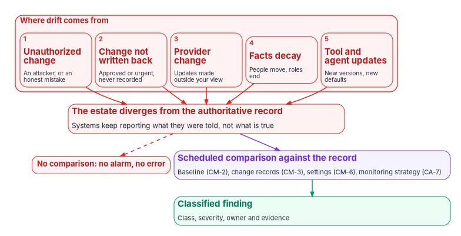
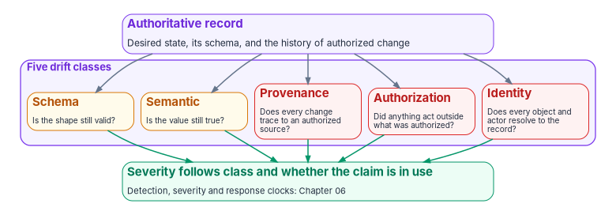

# Chapter 02 — Drift Is the Primary Threat

*Most controls don't fail on assessment day; they fail quietly in between, when the estate stops matching the record and nothing is comparing the two.*

::: {.callout-note}
## In this chapter
What drift is and why the program treats it as the primary governance threat rather than one concern among many. The five ways it gets into an estate, drawn from NIST's own description of how systems change. Why drift is silent, and why it is the opening other threats use. The configuration-management and continuous-monitoring controls (CM-2, CM-3, CM-6 and CA-7) that, read together, require it to be found. The program's five drift classes, and what treating drift findings as evidence changes for operations and for the authorizing official.
:::

[Chapter 01](01-why-governance-decays.md) ended with a package that's true on the day it's signed and less true every day after. This chapter names the mechanism. Drift is any difference between what the authoritative record says should be true and what the running estate actually does. A setting that was changed and never recorded is drift. So is an account that outlived the person it belonged to, a group rule that stopped evaluating, a policy that was assigned but never applied, and a change that happened with nothing to show who authorized it.

Phishing, supply-chain compromise and insider misuse are real threats, and the program helps surface them. But as a governance threat, drift comes first, because it's the one most programs track least and the one the others most often depend on.

## What drift is, in NIST's terms

NIST's control catalog doesn't use the word "drift." It describes the same thing from the other side: a documented baseline, controlled change against it, and detection of change that wasn't controlled.

- **CM-2, Baseline Configuration,** asks the organization to "develop, document, and maintain under configuration control, a current baseline configuration of the system," and to review and update it on a set frequency, when circumstances require, and when components are installed or upgraded. CM-2(2) asks for automated mechanisms to keep the baseline current, complete, accurate and available.[^c02-sp80053]
- **CM-3, Configuration Change Control,** asks the organization to decide which changes are configuration-controlled, review and approve or disapprove them with security and privacy impact in mind, document the decisions, implement only approved changes, retain the records, and "monitor and review activities associated with configuration-controlled changes." CM-3(5) asks for automatic security responses "if baseline configurations are changed in an unauthorized manner."[^c02-sp80053]
- **CM-6, Configuration Settings,** asks for documented settings in the most restrictive mode consistent with operations, implemented, with every deviation identified, documented and approved, and for the organization to "monitor and control changes to the configuration settings." CM-6(1) asks for automated mechanisms to manage, apply and verify the settings, and CM-6(2) for defined actions in response to unauthorized changes.[^c02-sp80053]
- **CA-7, Continuous Monitoring,** asks for a system-level continuous monitoring strategy with defined metrics and frequencies, ongoing assessments and monitoring, correlation and analysis of the results, response actions, and status reporting. CA-7(6) asks for automated mechanisms to keep monitoring results accurate, current and available.[^c02-sp80053]

Read together, these describe drift detection without naming it. CM-2 is the record of what should be true. CM-3 is the only legitimate way to change it. CM-6 says the running settings must match the record or carry an approved deviation. CA-7 says somebody has to keep checking, at a frequency that supports risk decisions, and act on what they find. Drift is what CM-6 calls an unapproved deviation and what CM-3(5) and CM-6(2) call an unauthorized change. The program's term is shorter, and it covers more than configuration settings: identity facts, group rules, role assignments and the evidence chain itself can all drift.

[Book 00, Chapter 04](../b00-orientation/04-the-principles.md#principle-11) states drift detection as one of the program's principles: the drift engine doesn't assume that systems still agree; it re-checks on a schedule and produces a structured finding when they don't. Drift is measured against the single source of truth, and against nothing else ([principle 1](../b00-orientation/04-the-principles.md#principle-1)).

## Where drift comes from

{#fig-ch02-drift-sources fig-alt="Five numbered red cards in a row, grouped as where drift comes from: 1, unauthorized change, an attacker or an honest mistake; 2, change not written back, approved or urgent but never recorded; 3, provider change, updates made outside your view; 4, facts decay, people move and roles end; 5, tool and agent updates, new versions and new defaults. All five point to a wide red card: the estate diverges from the authoritative record, and systems keep reporting what they were told, not what is true. From that card a dashed red arrow leads to a red pill reading no comparison: no alarm, no error. A violet arrow leads to a violet card, scheduled comparison against the record, naming the baseline (CM-2), change records (CM-3), settings (CM-6) and the monitoring strategy (CA-7), which leads to a green card, classified finding: class, severity, owner and evidence."}

SP 800-37 Rev. 2 opens its Monitor step by saying that systems and their environments "are in a constant state of change," across technology, people and facilities.[^c02-sp80037] Its discussion of Task M-1 gives the sources the program designs for:

1. **Unauthorized change.** NIST says unauthorized changes "may occur because of purposeful attacks by adversaries or inadvertent errors by authorized personnel," and asks organizations to monitor for them and find the root cause of each.[^c02-sp80037] The second half matters more than it looks. Most unauthorized change isn't malicious; it's an administrator fixing an outage at two in the morning.
2. **Authorized change that never reaches the record.** NIST's examples include configuration changes and patches installed "outside of the established configuration change control process."[^c02-sp80037] An emergency change that was approved by phone, applied, and never written back leaves the estate and the record disagreeing even though nobody did anything wrong.
3. **Provider change.** "Changes made by external providers can be difficult to detect."[^c02-sp80037] In a cloud estate, the provider ships features, changes defaults and retires settings on its own schedule. The tenant drifts from its baseline without anyone on the agency side touching it.
4. **Facts that decay.** NIST lists staff turnover among the human changes that affect posture.[^c02-sp80037] When a person moves or leaves and the record that drives their access isn't updated, their access stays where it was. [Book 03, Chapter 11](../b03-hr-identity/11-drift-metrics-and-evidence.md#drift-between-hr-and-the-directory) catalogs this class between the HR record and the directory.
5. **Tool and agent updates.** NIST names upgrades to hardware, software and firmware.[^c02-sp80037] An agent that updates itself, a schema that gains a field, or an adapter whose new version changes its output format moves the estate away from what the record expects, even when every individual change is benign.

Configuration is the most volatile part of this. SP 800-137 uses the configuration management family as its example of volatile controls: system configurations "typically experience high rates of change," and "unauthorized or unanalyzed changes in the system configuration often render the system vulnerable to exploits." For that reason it says CM-6 and CM-8 may need more frequent assessment and monitoring, preferably with automated tools that provide alerts and status on demand.[^c02-sp800137]

## Why drift is the primary threat

The program gives drift first place among governance threats for three reasons.

**It is continuous.** Other threats are events. Drift is a gradient that builds every time a configuration changes, an adapter updates, a schema evolves or an identity is provisioned. There's no single moment to catch it, so it can only be found by checking repeatedly.

**It is silent.** Without a deliberate comparison, drift produces no signal at all. The systems involved keep reporting what they were told: the directory reports the group rule as configured, the policy console reports the policy as assigned, the governance tool reports the control as implemented. None of them is lying. Each reports the declared state, and the declared state is exactly what drift has moved away from. [Book 02, Chapter 05](../b02-identity/05-delegation-without-ous.md#drift-detection) gives a concrete case: an administrative unit whose dynamic rule has been paused keeps its membership frozen while every other check passes. [Book 12, Chapter 01](../b12-security-operations/01-you-cant-defend-what-you-cant-see.md) makes the same point about telemetry: a log source that stops flowing raises no alarm.

**It is the opening other threats use.** In the program's reasoning, an attack that succeeds often succeeds through drift. A phishing campaign pays off because an account that should have been disabled wasn't, or a permission granted for a project was never removed. A compromised component spreads because no one noticed that the deployed version no longer matched the approved one. An insider acts beyond their role because their access stopped tracking their role. Federal red teams see the same ground. In a 2023 joint advisory, NSA and CISA listed the ten most common misconfigurations their red and blue teams found, among them default configurations, improper separation of user and administrator privilege, poor patch management, weak or misconfigured multifactor authentication, and poor credential hygiene, and called them "systemic weaknesses across many networks."[^c02-aa23278a] Not every misconfiguration is drift; some were wrong from the start. But a configuration that was right at assessment and wrong six months later is exactly what a point-in-time package can't see.

The conclusion the program draws: watching for the events isn't enough. Drift itself has to be a first-class signal, so the events have nowhere to hide.

## How the program names drift

Calling everything "configuration drift" loses the ability to respond correctly, because different kinds of divergence need different fixes and carry different risk. The program names five classes, each the question it asks of a record or a change.

{#fig-ch02-five-classes fig-alt="A violet card at the top, authoritative record: desired state, its schema, and the history of authorized change. Arrows lead to five cards in a row inside a violet group labeled five drift classes. Two amber cards: schema, is the shape still valid; semantic, is the value still true. Three red cards: provenance, does every change trace to an authorized source; authorization, did anything act outside what was authorized; identity, does every object and actor resolve to the record. All five lead to a green card at the bottom: severity follows class and whether the claim is in use; detection, severity and response clocks are in Chapter 06."}

| Class | What has diverged | Example |
|---|---|---|
| Schema | A record's structure no longer fits the declared schema | An attribute value that fails its expected format |
| Semantic | The structure is valid, but the meaning is stale or differs from the record | A department code that no longer matches HR; a group rule that has stopped evaluating |
| Provenance | A change or reference has no resolvable, authorized record behind it | A setting changed with no change record; an evidence chain with a missing link |
| Authorization | Something acted, or can act, outside what the record authorizes | A role assignment that isn't in the delegation matrix; a write to an HR-mastered attribute by the wrong principal |
| Identity | An object or issuer doesn't resolve to the record | An enabled account that matches no worker; a principal in the tenant with no counterpart in the registry |

: The program's five drift classes {.striped .hover}

The five classes are the program's design, not a NIST taxonomy. Each corresponds to a distinct failure and a distinct remediation. A schema finding is fixed by correcting the data or the schema. A semantic finding is fixed at the source of the fact, not in the copy. Provenance, authorization and identity findings can mean someone acted without authority, so they are investigated before anything is changed. Severity follows from the class and from whether the affected claim is in active use: the same divergence matters more on a live access path than on a dormant record.

Other books in the workbook name the drift checks for their own domains: attribute-value categories in [Book 00](../b00-orientation/04-the-principles.md#principle-11), identity categories in [Book 01, Chapter 04](../b01-transformation-arc/04-identity-transformation.md#drift-categories), administrative-unit checks in [Book 02, Chapter 05](../b02-identity/05-delegation-without-ous.md#drift-detection), migration findings in [Book 02, Chapter 11](../b02-identity/11-reference-deployment.md), and HR-to-directory drift in [Book 03, Chapter 11](../b03-hr-identity/11-drift-metrics-and-evidence.md#drift-between-hr-and-the-directory). Those checks are instances of these five classes, not a competing list. [Chapter 06](06-the-drift-engine.md) maps each of them to its class and describes the engine that detects, classifies and records drift, with its severity levels and response clocks.

## From naming to discipline

Naming the classes is only the start. The program's operating discipline has four steps:

1. **Detect deterministically.** The same record and the same observed state always produce the same findings. Structural and provenance checks run against the governed repository on every proposed change, before it merges. Runtime checks run as each adapter reads its platform.
2. **Classify deterministically.** Severity is a function of the class and whether the claim is in use. Operators don't triage by judgment, and the same finding gets the same severity every time.
3. **Remediate under contract.** Each finding produces a remediation record: when it was found, what action was taken, the evidence, and the escalation path. Routine, deterministic fixes run as gated machine actions; findings that need judgment go to a person ([Chapter 10](10-ticket-to-machine.md)).
4. **Treat findings as evidence.** Drift findings aren't a side log. They are records in the same evidence chain as everything else, and they flow into the plan of action and milestones and the posture reports ([Chapter 07](07-evidence-over-attestation.md)).

How far step 3 may go without a person is set by the program's actuation ladder in [Book 01, Chapter 11](../b01-transformation-arc/11-analysis-plan-delivery.md): detection is L1, a proposed fix is L2, and gated actuation, where a person authorizes and the engine executes after a dry run, is L3 and the default ceiling.

### What changes for security operations

In an attestation model, the security operations center finds drift through an outage, an incident or an audit. Here it receives drift as a structured stream with a class and severity already assigned. Most findings are routine and close through the gated path; what reaches an analyst is the subset that needs judgment. The center's work shifts from finding drift to tuning the classification and handling escalations. [Book 12](../b12-security-operations/index.md) covers the detection and response side; this book is the governance view.

### What changes for the authorizing official

For the authorizing official, drift handled this way provides:

- **Visibility between assessments.** Findings arrive continuously, not once a cycle.
- **Consistent severity.** The official can rely on the classification without re-evaluating each finding.
- **Evidence per finding.** Each finding carries its remediation record and its place in the evidence chain.
- **A trend.** Drift findings over time are a measurable property of the program's health, and a rising count is information before it is a failure.

That is what CA-7 asks for in correlation, analysis, response and reporting,[^c02-sp80053] and what SP 800-37's Task M-1 asks for in monitoring for unauthorized change.[^c02-sp80037] [Book 12, Chapter 12](../b12-security-operations/12-evidence-metrics-and-continuous-monitoring.md) builds the reporting pipeline. It also moves the official from periodic reauthorization toward the ongoing authorization described in [Chapter 01](01-why-governance-decays.md#what-federal-guidance-already-asks-for).

## Honest limits

- **Coverage is growing, not complete.** In the program's own tooling, schema and provenance checks run on every change today. Runtime detection of semantic, authorization and identity drift is partial or still in design across the adapters. Chapter 06 shows where each stands.
- **Automatic fixes are limited to deterministic ones.** Drift that needs human judgment escalates; it isn't fixed automatically.
- **Drift is measured against the record.** If the record itself is wrong, the engine will faithfully report that nothing has drifted. That is why changes to the record carry their own control and provenance ([Chapter 04](04-change-control-and-provenance.md)).

::: {.callout-note}
## What this chapter establishes
1. Drift is any difference between the authoritative record and the running estate. It is continuous, silent and the opening other threats use, which is why the program treats it as the primary governance threat.
2. It comes from five sources NIST itself names: unauthorized change, change outside change control, provider change, staff turnover and upgrades. SP 800-137 uses configuration management as its example of controls that change fastest.
3. CM-2, CM-3, CM-6 and CA-7 together require a baseline, controlled change, detection of unapproved deviation and ongoing checking. They describe drift detection without using the word.
4. The program names five classes (schema, semantic, provenance, authorization and identity), and the domain checks in other books are instances of them. Findings are classified, remediated under contract and kept as evidence.
:::

::: {.callout-tip}
## Continue the book
[← Previous: Chapter 01 — Why Compliance Decays the Day After the Audit](01-why-governance-decays.md) · [Book index](index.md) · [Next: Chapter 03 — One Authoritative Record →](03-one-authoritative-record.md)
:::

[^c02-sp80053]: National Institute of Standards and Technology, SP 800-53 Rev. 5, *Security and Privacy Controls for Information Systems and Organizations*, controls CA-7 and CA-7(6), CM-2 and CM-2(2), CM-3 and CM-3(5), and CM-6, CM-6(1) and CM-6(2), <https://csrc.nist.gov/pubs/sp/800/53/r5/upd1/final>; control text checked against the release 5.2.0 OSCAL catalog, <https://github.com/usnistgov/oscal-content/blob/main/nist.gov/SP800-53/rev5/json/NIST_SP-800-53_rev5_catalog.json> (both accessed Oct 21, 2026).
[^c02-sp80037]: National Institute of Standards and Technology, SP 800-37 Rev. 2, *Risk Management Framework for Information Systems and Organizations: A System Life Cycle Approach for Security and Privacy*, December 2018, §3.7, Task M-1 (System and Environment Changes), discussion, <https://nvlpubs.nist.gov/nistpubs/SpecialPublications/NIST.SP.800-37r2.pdf> (accessed Oct 21, 2026).
[^c02-sp800137]: National Institute of Standards and Technology, SP 800-137, *Information Security Continuous Monitoring (ISCM) for Federal Information Systems and Organizations*, September 2011, §3.2.2 (Establish Monitoring and Assessment Frequencies; security control volatility), <https://nvlpubs.nist.gov/nistpubs/Legacy/SP/nistspecialpublication800-137.pdf> (accessed Oct 21, 2026).
[^c02-aa23278a]: National Security Agency and Cybersecurity and Infrastructure Security Agency, Cybersecurity Advisory AA23-278A, "NSA and CISA Red and Blue Teams Share Top Ten Cybersecurity Misconfigurations," October 5, 2023, <https://www.cisa.gov/news-events/cybersecurity-advisories/aa23-278a> (accessed Oct 21, 2026).
