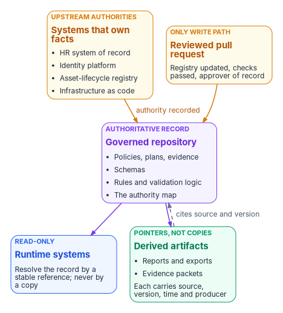
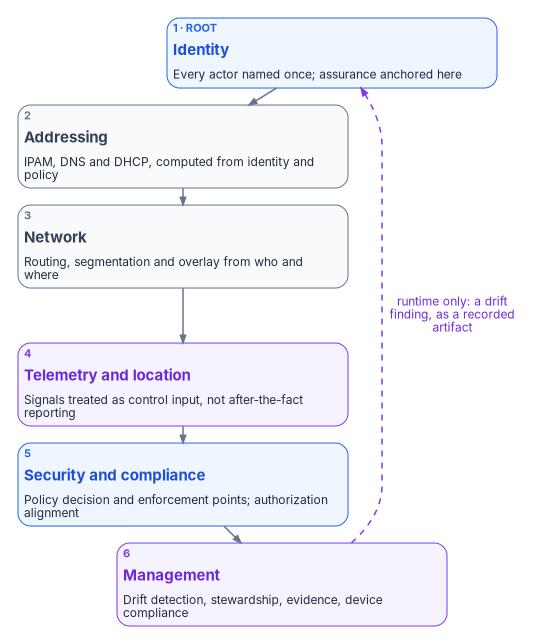

# Chapter 03 — One Authoritative Record: Single Source of Truth and the Six Planes

*Drift can only be measured against something. If every system holds its own copy of the truth, there is nothing to measure against, so the first thing governance needs is a single record that every other system points back to.*

::: {.callout-note}
## In this chapter
Why the estate needs one authoritative record, what that record holds, where it lives and the rules runtime systems follow to consume it. The provenance chain that ties every report, export and evidence packet back to the record version it came from. The six control planes, what each one is authoritative for and why the cut is six. How the record relates to the systems that own facts upstream of it, including the HR system of record and the attribute map in [Book 03](../b03-hr-identity/index.md). The governance platform's own principles, and what an authorizing official can expect from all of it.
:::

## The governance nobody wrote down

For twenty years many enterprises ran their governance without writing it down. Active Directory was more than an identity store. Placing a user or a computer in an organizational unit set delegation boundaries, Group Policy scope, group membership and an audit boundary in one move, and DNS, DHCP, certificate services, RADIUS and LDAP-bound applications all leaned on the same tree. The OU tree *was* the governance model. [Book 01, Chapter 02](../b01-transformation-arc/02-the-problem.md#the-ou-tree-was-the-governance-tree) sets out that coupling in full.

Microsoft has replaced the parts: Entra ID for the directory, Intune for Group Policy, Conditional Access for perimeter enforcement. What the replacements don't supply is the framework for deciding what each part should hold. Migrations that move users into a flat directory without one lose every relationship the hierarchy encoded. Delegation boundaries vanish, policy inheritance breaks, group membership turns into a spreadsheet, and the infrastructure services that depended on the directory lose their anchor. Every system then holds its own slightly different idea of who belongs where, and nobody can say which one is right.

The program's answer is to make the governance explicit and to keep it in one place: an authoritative record that defines structure, policy intent and authority exactly once, with every other representation treated as a pointer back to it.

{#fig-ch03-record-and-pointers fig-alt="Top to bottom. Two amber cards across the top: upstream authorities, the systems that own facts (HR system of record, identity platform, asset-lifecycle registry, infrastructure as code), with an arrow labeled authority recorded; and the only write path, a reviewed pull request with the registry updated, checks passed and an approver of record. Both point down to a violet card in the middle, the authoritative record, a governed repository holding policies, plans and evidence, schemas, rules and validation logic, and the authority map. From it, arrows lead down to a blue card, runtime systems, read-only, which resolve the record by a stable reference and never by a copy; and to a green card, derived artifacts, pointers not copies: reports, exports and evidence packets, each carrying source, version, time and producer. A dashed arrow labeled cites source and version runs from the derived artifacts back to the record."}

## What the record is

The single source of truth is the authoritative origin for every identity, addressing, enforcement, telemetry and governance claim the program handles. Every other representation of that claim is a **provenance-anchored pointer**: a copy that knows where it came from, can be checked against its origin, and can be refreshed or retired. That gives the record three jobs at once:

- **The foundation of governed operations.** Plans, rules and policy intent are read from it; nothing operational starts anywhere else ([Chapter 04](04-change-control-and-provenance.md)).
- **The root of the provenance chain.** Every artifact the program produces can be traced back to a specific version of the record.
- **The baseline for drift.** Every drift finding in [Chapter 06](06-the-drift-engine.md) is a statement that the estate, or some copy, no longer matches the record.

"Single" means logically single, not one server in one building. One authoritative source can be replicated across regions for durability and still be a single source of truth, because exactly one copy accepts authoritative writes and the others are explicitly subordinate. [Book 09, Chapter 04](../b09-network/04-logical-centralization-and-token-security.md#logical-and-physical-centralization) draws that line between logical and physical centralization, and explains why unofficial "just for performance" copies are where drift is born.

The idea matches how federal controls already describe configuration. SP 800-53's CM-2 requires an organization to "develop, document, and maintain under configuration control, a current baseline configuration of the system." CM-2 is in all three NIST baselines and in FedRAMP's Rev5 Class B, C and D baselines.[^c03-cm2][^c03-fedramp-cm] The authoritative record is that baseline, kept in a form machines can read and compare against, extended from system settings to the organizational facts the settings depend on.

## Where the record lives

The program keeps its governance artifacts in a version-controlled repository. In the worked example the repository runs on the platform host that [Book 01, Chapter 03](../b01-transformation-arc/03-platform-foundation.md#canonical-source-of-truth) describes, with signed commits, a standby replica and off-site backup. The repository holds three kinds of artifact:

| Surface | What it holds | Example |
|---|---|---|
| Governance documents | Policies, plans and evidence: the human-readable statement of intent and the record of what was done | The delegation matrix, an authorized migration plan, an evidence packet |
| Schemas | The authority for structure: what a valid object, attribute or plan looks like | The plan schema, the attribute schema, the administrative-unit tier structure |
| Rules | Consumer rules and validation logic: what the platform checks and how | Dynamic-group naming rules, plan validation checks, drift rules ([Chapter 05](05-deterministic-governance.md)) |

: What the authoritative repository holds {.striped .hover}

A document registry lists every artifact, what it is and whether it is an authoritative origin or derived from another document. The registry is itself part of the record, which is why the change process in [Chapter 04](04-change-control-and-provenance.md) starts by updating it.

### The consumer rule

Runtime systems read the record. They don't write to it, except through the governed change process (a reviewed pull request) or tooling explicitly designated to do so. The program's design adds three rules for how code consumes the record:

1. **Resolve by a stable reference.** Code looks up a governance artifact through a stable, package-relative mechanism, so it can be found from any working directory of the installed system and survives installation and deployment.
2. **Read-only at runtime.** A running service never edits the record it is enforcing. If it needs a different value, that is a change request, not a write.
3. **No private copies.** Hardcoded absolute paths, and fallbacks that look for a sibling checkout of the repository, are forbidden outside test fixtures. Each one is a quiet second source of truth.

The rules are simple, and they are where most real-world drift starts. A script that reads a local copy of the delegation matrix "because the repository was slow that day" is now enforcing a matrix nobody reviewed.

## The provenance chain

Every artifact the program produces cites the record it was derived from. Documents fall into two classes:

- **Authoritative origins** derive from nothing. They are the leaves of the chain: a policy, a schema, an authorized plan.
- **Derived artifacts** (reports, exports, evidence packets, dashboards) must carry a provenance block naming the source document, its version, when the artifact was derived and what derived it.

The block is anchored with a content hash over the claim it carries, so that a changed claim no longer matches its provenance.

::: {.callout-warning}
## Illustrative, not a production schema
The block below shows the shape of a provenance record. Field names and values are examples, not tested against a production pipeline; adapt them to your own schema and review them before use.
:::

```yaml
# Illustrative provenance block carried by a derived artifact
provenance:
  source: governance/delegation-matrix.yaml   # the authoritative document
  version: 7f3c2a9e                            # commit of the record it was derived from
  derived_at: 2026-10-21T14:05:00Z
  derived_by: fmp-report-generator 2.4.1       # the mechanism, not a person
  content_sha256: 9b1d...e04a                  # hash over the claim content
```

Git already works this way underneath. It is a content-addressable store: every object is filed under a hash computed from its content, so the version identifier of a file in the record is a checksum of what the file says.[^c03-git] Pinning a derived artifact to a commit pins it to exact content. That is what lets an auditor ask "what was the authoritative value on this date?" and receive a machine-readable answer instead of a recollection.

## The six control planes

The record covers the whole control surface of the estate, and the program divides that surface into six control planes. Each plane is authoritative for its domain, with its own source of truth, its own schemas and its own class of drift findings. All six operate as one system.

{#fig-ch03-six-planes fig-alt="A vertical chain of six cards connected by downward arrows. One, root, blue: Identity, every actor named once, assurance anchored here. Two, slate: Addressing, IPAM, DNS and DHCP computed from identity and policy. Three, slate: Network, routing, segmentation and overlay derived from who and where. Four, violet: Telemetry and location, signals treated as control input rather than after-the-fact reporting. Five, blue: Security and compliance, policy decision and enforcement points and authorization alignment. Six, violet: Management, drift detection, stewardship, evidence and device compliance. A dashed violet arrow runs from Management back up to Identity, labeled runtime only: a drift finding, as a recorded artifact."}

| Plane | Authoritative for | Consumes | Where the workbook carries it |
|---|---|---|---|
| Identity | The root namespace: every actor (person, service principal, device, workload) named exactly once, and the assurance level of each | The HR system of record and other upstream authorities for the facts about each actor | [Book 02](../b02-identity/index.md), [Book 03](../b03-hr-identity/index.md), [Book 04](../b04-access/index.md) |
| Addressing | Deterministic IP address management, DNS and DHCP: names and addresses derived from identity and policy, not assigned by a parallel administrative process | Identity | [Book 08](../b08-ddi/index.md) |
| Network | Routing, segmentation and overlay transport: path decisions that flow from who (identity) and where (addressing) | Identity and addressing | [Book 09](../b09-network/index.md) |
| Telemetry and location | Real-time signals in a common claim form. Drift findings, evidence claims and policy decisions all begin as telemetry events | Every plane's emissions | [Book 12](../b12-security-operations/index.md) |
| Security and compliance | Zero Trust enforcement and authorization alignment: the policy decision and enforcement points that evaluate access | Identity, addressing and telemetry | [Book 04](../b04-access/index.md), [Book 11](../b11-zero-trust/index.md) |
| Management | Governance and configuration management: drift detection, stewardship, evidence regeneration and device compliance reporting | All five planes | This book; [Book 05](../b05-devices/index.md) for devices |

: The six control planes {.striped .hover}

The security and compliance plane follows the federal reference model. NIST SP 800-207 describes access as granted through a policy decision point and a corresponding policy enforcement point, and requires the control plane those components use to be logically separate from the data plane that carries application traffic.[^c03-sp800207] The program keeps the record on the decision side of that line. [Book 00, Chapter 04](../b00-orientation/04-the-principles.md#principle-15) calls the same idea separating the record from the enforcer.

::: {.callout-note}
## Two different sixes
[Book 12, Chapter 01](../b12-security-operations/01-you-cant-defend-what-you-cant-see.md) also names six planes: identity, cloud platform, Microsoft 365, endpoints, network and data. Those are the *sources* that have to emit telemetry, cut by where logs come from. The six control planes here are cut by *authority*: who is allowed to say what is true. The two lists answer different questions and aren't meant to line up one to one. Book 12's six sources all feed the telemetry and location plane here.
:::

### Why six

The cut is the program's design, and it isn't arbitrary. Each plane corresponds to a distinct authority boundary: one source of truth, one set of authoritative schemas, one class of drift findings. Six is the smallest cut that does three things:

1. **It names every authoritative source** an authorizing official needs to evaluate during review.
2. **It maps cleanly to operational roles.** Every mission class lands inside exactly one plane, so every finding has one owning team.
3. **It avoids the "everything is identity" overload.** Folding addressing, telemetry and management into the identity plane would make them impossible to drift-check independently. A stale DNS record and a stale group membership are different failures with different owners, and the record should say so.

### How the planes interact

At the authoritative level, interaction runs one way: identity feeds addressing, addressing feeds network, network feeds telemetry, telemetry feeds security and compliance, and security and compliance feeds management. Every plane therefore has exactly one authoritative input, and any deviation surfaces as a drift finding rather than as a silent inconsistency.

Cycles exist only at runtime. A management-plane drift finding can trigger an identity re-evaluation, for example, when a device falls out of compliance and access has to be reassessed. Every such cycle passes through an explicit artifact (a finding, a plan, a closure record), never through ad hoc coupling between systems. That is what keeps the loop auditable: the runtime cycle leaves the same kind of record as everything else.

## Who is authoritative for what

The record doesn't master every fact itself. A person's employment status is created by a personnel action, not by a commit, and a credential is issued by the identity platform, not by a YAML file. What the record holds for those facts is the *authority*: which system owns each fact, which system receives a derived copy, how the copy is derived and who may write it. Facts flow in from their owners; desired state, rules and plans originate in the record.

| Class of fact | Authoritative source | What the record holds | Plane |
|---|---|---|---|
| Who a worker is and where they sit: existence, status, worker type, position, organization, supervisor | HR system of record ([Book 03, Chapter 04](../b03-hr-identity/04-attribute-authority.md)) | The authority map, the crosswalk to directory attributes and the derivation rules | Identity |
| Contractors and other workers outside the HR system | One authority per fact, under an accountable federal sponsor ([Book 03, Chapter 06](../b03-hr-identity/06-canonical-attribute-schema.md#one-fact-one-authority)) | Which register owns which fact | Identity |
| How identity is proven, and whether a request is permitted now | The identity platform | Conditional Access and authentication policy as code ([Book 04, Chapter 10](../b04-access/10-access-as-code-and-evidence.md)) | Identity; security and compliance |
| Which attribute slot means what | The record itself | The program attribute map: one assignment of each extension attribute for the whole workbook ([Book 03, Chapter 06](../b03-hr-identity/06-canonical-attribute-schema.md#program-attribute-map)) | Identity |
| Devices | The asset-lifecycle registry; device-management enrollment is enforcement, not truth ([Chapter 04](04-change-control-and-provenance.md#where-work-comes-from)) | Device classes, tiers and the device attribute map | Management |
| Declared infrastructure | The infrastructure-as-code repository | The reference to it, and the drift rules that compare it with the running estate | Network; addressing |
| Structure, delegation, policy intent, plans and evidence | The record itself | Everything: these are authoritative origins | All |

: Which system is authoritative for which fact {.striped .hover}

Two rules follow from the table. First, corrections flow upstream: when a directory attribute is wrong, the fix is a correction at the owning source or in the derivation rule, never a hand edit of the copy ([Book 03, Chapter 04](../b03-hr-identity/04-attribute-authority.md#authoritative-versus-derived-attributes)). Second, the platform decides where a write is accepted, not the program's preferences. For a user synchronized from on-premises Active Directory, Microsoft documents that the source of authority for the fifteen extension attributes is the on-premises directory and that the properties are read-only in Entra ID; for a cloud-only user they can be set directly.[^c03-extattr] The record has to say, for each attribute, which of those two worlds it lives in, and moving that boundary is a recorded change. That is why [Book 03's attribute map](../b03-hr-identity/06-canonical-attribute-schema.md#program-attribute-map) names a single writer for every slot, and why a write by any other principal is a drift finding.

[Book 00, Chapter 04](../b00-orientation/04-the-principles.md#principle-1) states the same rule as the program's first principle: every important claim has exactly one authoritative origin, and drift is evaluated against it and nothing else.

## Four layers inside the identity plane

Within the identity plane, where most of the directory-migration work happens, the program groups its artifacts in four layers. Each layer depends on the one below it, and every artifact names the layer it belongs to.

| Layer | Responsibility | Typical artifacts | Workbook home |
|---|---|---|---|
| Governance | Drift detection, telemetry, escalation, boundary impact, provenance and the error taxonomy | Drift rules, escalation playbooks, telemetry contracts | This book |
| Policy | Validation, enforcement tests, decision trees and service-level tracking | Validation cmdlets, decision trees, service-level heat maps | [Book 01, Chapter 11](../b01-transformation-arc/11-analysis-plan-delivery.md#plan-validation), [Book 04](../b04-access/index.md) |
| Structure | Administrative-unit delegation, the workflow catalog and the migration runbook | Delegation matrix, runbooks | [Book 02, Chapter 05](../b02-identity/05-delegation-without-ous.md) |
| Identity | The dynamic-group library, attribute mapping and extension attributes | Group rules, the attribute map | [Book 03, Chapter 06](../b03-hr-identity/06-canonical-attribute-schema.md) |

: The four layers of identity-plane artifacts {.striped .hover}

The layering is why a change to a group rule and a change to a drift rule go through different reviews ([Chapter 05](05-deterministic-governance.md)), even though both live in the same repository.

## The governance platform's own principles

[Book 00](../b00-orientation/04-the-principles.md) states fifteen principles for the whole program. The governance platform that holds and enforces the record rests on a narrower set: three that apply wherever the platform is used, and three that bind only once the platform does more than record and report. All six are the program's design.

The three that always apply:

1. **Single source of truth.** Governance artifacts define structure, policy intent and authority exactly once. Downstream systems resolve them by reference instead of duplicating the logic.
2. **Evidence that cites its source.** Every artifact the platform produces (a system security plan section, a plan of action and milestones, an indicator dashboard, a component definition) cites the record document and version it derives from, so a reviewer can trace a finding back to its requirement.
3. **Drift is explicit.** Structural and provenance mismatches are first-class findings in a fixed set of classes ([Chapter 02](02-drift-is-the-primary-threat.md), [Chapter 06](06-the-drift-engine.md)), not exception reports someone has to notice.

The three that bind later:

| Principle | Binds when | Why only then |
|---|---|---|
| Separation of governance and execution: the component that decides never acts, and the one that acts never decides | The platform begins writing to the estate (gated actuation, L3, on [the actuation ladder](../b01-transformation-arc/11-analysis-plan-delivery.md#how-far-automation-may-go)) | While the platform only records and advises, there is no runtime to split. [Chapter 04](04-change-control-and-provenance.md#two-identities-not-one) covers the mechanics |
| Boundary enforcement: no governance artifact reaches beyond the declared authorization boundary, and out-of-scope references are rejected at validation | The platform runs as a service inside the boundary | Before that, the boundary is a documented scope; afterwards it is an enforced runtime check ([Book 10](../b10-cloud-boundary/index.md)) |
| Tenant agnosticism: shipped artifacts carry no tenant-specific identifiers, user names or object IDs; environment values are injected at deployment | Artifacts are shipped to other tenants or organizations | A single agency's deployment may carry local context; anything reused elsewhere must be portable |

: The three principles that bind as the platform does more {.striped .hover}

Earlier framings listed seven principles. Four of those names (deterministic state, schema fixity, provenance traceability, drift resistance) were partial statements of the first three and have been folded into them. "Assessment before action" is an operating discipline that follows from the first and third, not a separate principle.

One more design position runs underneath all of them: the core of the record is not federal-specific. Federal compliance (FedRAMP, machine-readable control documentation, indicator reporting) is a layer on top of a general governance core, so the same record can serve an enterprise that has never heard of an authorization package. [Book 01, Chapter 02](../b01-transformation-arc/02-the-problem.md#what-the-program-provides) makes the same point about the program's vendor-neutral adapters.

## Changing the record, and measuring against it

Because the record is the baseline for everything else, changing it is the most consequential act in the program. Every modification to the repository has to update the document registry. Doctrinal changes (superseding a document, retiring one, shifting its scope) also need a reviewed decision record, and every change passes governance review before merge. A direct commit without a decision record behind it is itself a drift signal. [Chapter 04](04-change-control-and-provenance.md) sets out the full change path.

Drift is then evaluated against the record. [Chapter 06](06-the-drift-engine.md) presents the program's single drift model, with schema, semantic, provenance, authorization and identity classes, and maps the other books' drift checks onto it. One finding belongs to the record specifically: **contention**, a write directed at a copy that has been demoted after the roster of authoritative sources was ratified. It is an authorization finding in Chapter 06's model, since something acted on a copy it wasn't authorized to write. It also matters for a second reason. It is the signal that a second source of truth is trying to grow back. A continuous-integration gate on the repository fails on any critical finding against the record's own content, so the record can't drift from itself.

## What an authorizing official gets

Organized this way, an authorization package changes shape:

- **A control narrative for each plane** instead of one perimeter-centric narrative.
- **A citation for every policy intent**, pointing to a specific version of the record.
- **Drift findings scoped per plane.** Identity, addressing and telemetry drift each carry their own evidence trail instead of collapsing into a single "system drift" line item.
- **A machine-readable answer** to "what was the authoritative value on this date, and who changed it?"

Without one authoritative record, every system holds a slightly different copy of the same claim, the copies diverge, and nobody can say which is right. With one, every other system holds a pointer that can be validated, refreshed or retired. Drift becomes detectable, and provenance can be reconstructed.

::: {.callout-tip}
## Continue the book
[← Previous: Chapter 02 — Drift Is the Primary Threat](02-drift-is-the-primary-threat.md) · [Book index](index.md) · [Next: Chapter 04 — Change Control and Provenance →](04-change-control-and-provenance.md)
:::

[^c03-cm2]: National Institute of Standards and Technology, SP 800-53 Rev. 5 (release 5.2.0), *Security and Privacy Controls for Information Systems and Organizations*, control CM-2, Baseline Configuration (statement; security baselines Low, Moderate and High), Cybersecurity and Privacy Reference Tool, <https://csrc.nist.gov/projects/cprt/catalog#/cprt/framework/version/SP_800_53_5_2_0/home> (accessed Oct 21, 2026).
[^c03-fedramp-cm]: FedRAMP, "Configuration Management (CM)," Full Rev5 Control Reference, *FedRAMP Consolidated Rules for 2026* (CM-02: FedRAMP Rev5 Baselines Class B, Class C, Class D), <https://www.fedramp.gov/2026/reference/controls/configuration-management/> (accessed Oct 21, 2026).
[^c03-git]: Scott Chacon and Ben Straub, *Pro Git*, 2nd ed., §10.2 "Git Internals — Git Objects" ("Git is a content-addressable filesystem"; object keys are SHA-1 checksums of the content plus a header), <https://git-scm.com/book/en/v2/Git-Internals-Git-Objects> (accessed Oct 21, 2026).
[^c03-sp800207]: NIST, SP 800-207, *Zero Trust Architecture*, August 2020, §2 (access is granted through a policy decision point and a corresponding policy enforcement point) and §3.4.1, item 5 (the data plane and control plane are logically separate), <https://csrc.nist.gov/pubs/sp/800/207/final> (accessed Oct 21, 2026).
[^c03-extattr]: Microsoft Graph documentation, "onPremisesExtensionAttributes resource type" (for an onPremisesSyncEnabled user, the source of authority is on-premises Active Directory and the properties are read-only; for a cloud-only user they can be set on create or update; device extension attributes are managed only in Entra ID), <https://learn.microsoft.com/graph/api/resources/onpremisesextensionattributes?view=graph-rest-1.0> (accessed Oct 21, 2026).
