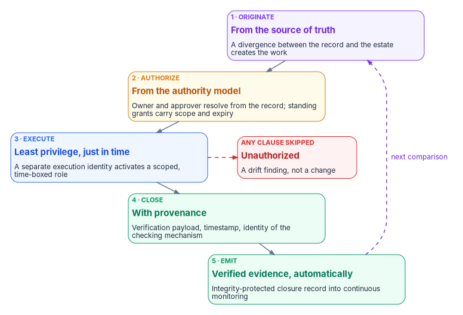
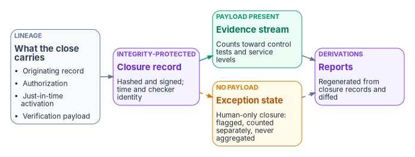

# Chapter 04 — Change Control and Provenance

*An authoritative record is only as good as the path into it. If a change can reach the estate without starting from the record, being approved by the right authority and leaving its proof behind, the record stops being authoritative the first time someone is in a hurry.*

::: {.callout-note}
## In this chapter
The five change classes (move, add, change, deletion and reset) and the five-clause path every one of them travels. Where legitimate work comes from, and the sources of truth for non-human objects. How changes to the authoritative record itself travel as reviewed pull requests. Why the identity that decides and the identity that acts are kept apart. What provenance a state change has to carry, and the rule that no closure counts unless it carries its proof. How all of this lines up with the SP 800-53 controls an assessor will ask about, and where it stops.
:::

## Where compliance actually decays

[Chapter 01](01-why-governance-decays.md) argued that compliance decays because the estate keeps changing after the assessment, and [Chapter 03](03-one-authoritative-record.md) gave the program one record to measure the estate against. Neither helps if changes can bypass the record. Most drift isn't malicious. It's a help-desk technician fixing a group membership in the portal, an engineer applying a hotfix during an outage, a migration script run with a standing administrator account over a weekend. Each change may be correct. None of them leaves the record able to say who asked for it, who approved it or whether it worked.

The program's answer is a single path for every operational change, with no second path for urgent or routine work. The path is the program's design. It is the same lifecycle [Book 00, Chapter 04](../b00-orientation/04-the-principles.md#principle-2) states as the second principle and [Book 01, Chapter 02](../b01-transformation-arc/02-the-problem.md#one-lifecycle-for-every-change) applies to the migration. This chapter is its full statement.

## Five change classes

The program calls every operational change one of five classes, abbreviated **MACD-R**. The classes exist so that every change has a type, and every type has a source of truth, an approver and a verification check. The examples below are illustrative.

| Class | What it does | Identity example | Device or infrastructure example |
|---|---|---|---|
| Move | Relocates an existing object to a different scope, owner or placement | A worker transfers division, so their administrative-unit and group memberships change | A server moves from one management group or network segment to another |
| Add | Creates an object that didn't exist | A joiner's account is created before their start date | A new device is registered and enrolled |
| Change | Modifies the properties of an existing object in place | A Conditional Access policy's conditions are edited | A DHCP scope option or DNS record is updated |
| Deletion | Removes an object | A leaver's account is disabled, then deleted | A retired device's records are removed |
| Reset | Returns an object's state or secret to a known starting point | A credential reset or reissue | A device wipe and re-provision, or a certificate re-key |

: The five change classes {.striped .hover}

The classes don't change what the path requires. They change which source of truth originates the work and which verification proves it done. A deletion, for example, is often irreversible in practice, which is why [Book 01, Chapter 11](../b01-transformation-arc/11-analysis-plan-delivery.md#failure-modes-and-rollback) treats a leaver's deprovisioning as a rollback-never action and restores a wrongly removed person through the joiner process instead.

## The five-clause path

Every change in every class travels five clauses. An operation that skips one is unauthorized by construction: it isn't a change with a missing form, it's a drift finding.

{#fig-ch04-five-clause-path fig-alt="A vertical chain of five cards. One, violet, originate from the source of truth: a divergence between the record and the estate creates the work. Two, amber, authorize from the authority model: owner and approver resolve from the record, and standing grants carry scope and expiry. Three, blue, execute with least privilege, just in time: a separate execution identity activates a scoped, time-boxed role. Four, green, close with provenance: verification payload, timestamp and identity of the checking mechanism. Five, green, emit verified evidence automatically: an integrity-protected closure record into continuous monitoring. A dashed violet arrow labeled next comparison returns from five to one. Beside clause three, a dashed red arrow leads to a red card: any clause skipped, unauthorized, a drift finding, not a change."}

1. **It originates with the source of truth.** Work is created by a divergence between the record and the estate: a joiner in the HR system of record, a control gap against the compliance baseline, a migration wave in the modernization plan. A task with no such origin is an ad hoc assertion. Nothing authoritative asked for it, so nothing authoritative can attest it.
2. **It carries an authoritative authorization.** The approval resolves from the authority model, not from whoever is nearby. The owner and approver come from the same source of truth that originated the work. Pre-authorized lanes are allowed, but they are **standing authorizations**: recorded grants with a scope and an expiry, never the absence of approval. They are how the enumerated low-risk classes at L4 on [the actuation ladder](../b01-transformation-arc/11-analysis-plan-delivery.md#how-far-automation-may-go) run without a person in the loop.
3. **It executes under least privilege, elevated just in time.** The executing actor, human or automation, activates a time-boxed, scoped role at execution and holds no standing privilege. The activation record becomes part of the operation's evidence, binding *who could act* to *what was done*.
4. **It closes with provenance.** The closing update carries the verification payload that justified it (the probe result, the posture query, the re-test output) with a timestamp and the identity of the checking mechanism. A closure record without a verification payload doesn't validate.
5. **It emits verified, secured evidence automatically.** The closure record, integrity-protected and carrying its lineage, flows into the continuous-monitoring stream with no human assembly. Evidence a person compiles arrives late and can't be verified; evidence the lifecycle emits arrives continuously and carries its own chain of custody.

The five clauses are one chain: originated from the source of truth, authorized by the authority model, executed with least privilege, closed with provenance, and emitted as evidence back to the reporting plane. The next comparison against the record then either finds nothing to do or originates the next piece of work.

Clause 3 has direct product support in the worked example. Microsoft Entra Privileged Identity Management makes a role assignment *eligible* rather than active, so the holder must activate it for a limited period. Activation can require approval, multifactor authentication and a justification, and PIM keeps an audit history of activations.[^c04-pim] [Book 04, Chapter 08](../b04-access/08-pim-self-request-with-approval.md) builds that pattern in full.

## Where work comes from

Clause 1 needs a source of truth for every kind of object a modernization touches, not just people. The program designates one per class:

| Object class | Source of truth | Why not the obvious alternative |
|---|---|---|
| People (employees) | The HR system of record ([Book 03](../b03-hr-identity/index.md)) | The directory records state; HR records effective-dated personnel actions |
| Contractors and other non-employees | One authority per fact, under an accountable federal sponsor ([Book 03, Chapter 06](../b03-hr-identity/06-canonical-attribute-schema.md#one-fact-one-authority)) | No single register holds every fact |
| Devices | The asset-lifecycle registry | Device-management enrollment is enforcement, not truth: a device that enrolled itself isn't thereby authorized |
| Declared infrastructure | The infrastructure-as-code repository | Portal state is the result, not the intent |
| Compliance work | The compliance baseline and its plan of action and milestones | A finding with no baseline behind it has nothing to close against |
| Migration work | The modernization plan ([Book 01, Chapter 11](../b01-transformation-arc/11-analysis-plan-delivery.md)) | A wave is a batch of planned moves, not a weekend of improvisation |

: The source of truth for each class of work {.striped .hover}

One rule ties the non-human classes back to people: **every item migrated must carry a human owner** who can be resolved in the HR source of truth. An item with no resolvable owner is an orphan finding (an identity finding in [Chapter 06](06-the-drift-engine.md)'s model) before it is a migration candidate. Ownership is what lets clause 2 find an approver.

## No new dependencies on Active Directory

A migration that retires Active Directory runs for most of a year, and the estate doesn't stop changing while it does. Every new domain-joined server, every application that binds over LDAP, every service account and every Group Policy setting added during that year is one more thing to unwind before the domain controllers can go. So from gate G0 the change process asks one question of every Add and Change: **does this create a new dependency on Active Directory?** Microsoft's guidance for leaving AD puts the same step first in its cloud-first phase: update change approval so it evaluates whether a change adds a dependency on AD DS, and evaluate Microsoft Entra alternatives when it does.[^c04-cloudfirst]

What counts as a new dependency (design guidance):

- a new server or device joined to the domain;
- a new application that authenticates with Kerberos or NTLM, or reads or writes the directory over LDAP;
- a new service principal name, group managed service account or other service account in AD;
- a new Group Policy Object, or new settings in an existing one ([Book 05, Chapter 07](../b05-devices/07-the-gpo-sunset-program.md) already freezes each GPO once it's inventoried);
- a new AD security group used to grant access;
- a new AD-integrated DNS zone, a new trust, or a new AD CS template or consumer, other than the domain controller and LDAPS certificates that stay on AD CS until AD retires ([Book 07](../b07-pki/index.md)).

A yes isn't automatically a no. Some workloads have no modern path yet, and Microsoft names Microsoft Entra Domain Services as an option for applications that still need legacy protocols when nothing more current works.[^c04-entrads] But a yes becomes an **exception**, not a routine approval: it carries an owner, a reason, an end date and the Entra alternative that was considered, it's approved by the authorizing official, because keeping AD dependencies open is a risk acceptance ([Book 01, Chapter 09](../b01-transformation-arc/09-who-leads-the-transformation.md#decision-rights-across-the-program)), and it goes on the list of dependencies Phase 4 has to retire ([Book 01, Chapter 12](../b01-transformation-arc/12-migration-roadmap.md#phase-4-legacy-retirement-weeks-3744)).

The rule is enforced by measurement as well as by the question. The weekly assessment compares the AD inventory with the G0 baseline: a new computer account, service principal name, group managed service account, GPO, trust or AD group that no approved change or exception explains is a drift finding ([Chapter 06](06-the-drift-engine.md)), handled like any other change that skipped the path.

## Changing the record: pull requests

The path above governs changes to the estate. Changes to the record itself (a rule, a delegation matrix, a schema, a plan) travel the same path in repository form: the change is a pull request, and the pull request is the authorization.

The program's design for a pull request against the record:

1. **The registry moves with the change.** The pull request updates the document registry entry for every artifact it adds, changes, supersedes or retires.
2. **Doctrinal changes carry a decision record.** Superseding, retiring or changing the scope of a document needs a reviewed decision record in the same change. A direct commit with no decision record behind it is a drift signal ([Chapter 03](03-one-authoritative-record.md#changing-the-record-and-measuring-against-it)).
3. **Checks run before merge.** Schema validation, the rule checks for that layer ([Chapter 05](05-deterministic-governance.md)) and, for an operational plan, the validation gate in [Book 01, Chapter 11](../b01-transformation-arc/11-analysis-plan-delivery.md#plan-validation), with the plan's dry-run output and blast-radius summary attached.
4. **Two people per change.** At least one approver of record other than the author, and explicit sign-off on any action marked require-confirmation ([Book 01, Chapter 11](../b01-transformation-arc/11-analysis-plan-delivery.md#authorization-gate)). Changes to the most sensitive objects, such as emergency-access exclusions or the pipeline's own permissions, need a second approver from the security team ([Book 04, Chapter 10](../b04-access/10-access-as-code-and-evidence.md#change-control)).
5. **The merge is signed.** The merging commit is signed and verified, so the approval itself carries provenance.
6. **Rollback is a revert.** Undoing a change means reverting its commit and redeploying, so the rollback carries the same record as the change.

Common repository platforms can enforce most of this rather than leaving it to habit. GitHub's protected-branch rules, for example, can require a set number of approving reviews, dismiss stale approvals when new commits change the diff, require that the most recent push be approved by someone other than the person who pushed it, require status checks to pass, and accept only signed and verified commits. By default those rules don't bind administrators, so a separate setting has to apply them to administrators and to roles that can bypass branch protection.[^c04-gh-protect] Whatever platform holds the record, turn on the equivalent of that last setting. A rule administrators can skip is a standing exception.

Emergencies get a path, not an exemption. During an incident an administrator may change the estate directly under a just-in-time activation with a ticket as justification, and the change is back-ported to the record by pull request within one business day. Until then the drift monitor reports it, which is the point: an emergency change that never reaches the record stays visible ([Book 04, Chapter 10](../b04-access/10-access-as-code-and-evidence.md#drift-detection-and-closure)).

FedRAMP's 2026 change-management indicators point the same way for cloud service providers. KSI-CMT-RMV asks that changes to machine-based resources be made by redeploying version-controlled resources rather than by direct modification wherever reasonable. KSI-CMT-LMC asks that modifications be logged and monitored, and KSI-CMT-VTD asks that testing and validation throughout deployment be automated.[^c04-ksi-cmt] The indicators bind providers, not agencies ([Book 10, Chapter 03](../b10-cloud-boundary/03-what-changed-at-fedramp.md)). An agency that governs its own tenant the same way is making a design choice, and it can show its assessor the same kind of evidence.

## Two identities, not one

The identity that decides a change and the identity that carries it out are kept apart. The governance layer validates plans, signs commits, enforces boundary rules and writes audit entries, but never touches a target. The execution layer takes an authorized plan, calls the adapters and writes back a structured result, but decides nothing. [Book 01, Chapter 03](../b01-transformation-arc/03-platform-foundation.md#separation-of-governance-and-execution) describes the split. The program's design gives each side its own:

- **Service principal.** A compromised execution identity can't approve its own work, and a compromised governance identity can't reach the estate.
- **Credential store.** No secret serves both sides.
- **Log stream.** Each side's record of a change can be checked against the other's.

Revoking either identity stops the system safely, without leaving the other able to act alone. A component that both decides and acts can cover its tracks; separating them keeps every change auditable and reversible. Where the execution identity runs in automation, [Book 04, Chapter 10](../b04-access/10-access-as-code-and-evidence.md#change-control) gives it no secret at all, through workload identity federation, and treats it as a Tier 0 asset.

The split applies to people as well as services. The author of a change isn't its approver (clause 2 and the pull-request rules above), and the person who approves a plan doesn't hold standing rights to execute it (clause 3).

## Provenance for every state change

Every state change in the estate, whether made by a person, by the execution layer or by a sanctioned emergency, has to leave a provenance record. The record is the envelope that [Chapter 05](05-deterministic-governance.md) later requires of every evidence claim:

| Field | What it answers |
|---|---|
| Originating record | Which divergence, request or plan entry asked for this change, by reference and version |
| Authorization | Who or what approved it, under which authority, or which standing grant covered it (with its scope and expiry) |
| Execution identity and activation | Which identity acted, and the just-in-time activation that let it |
| Observed and recorded times | When the change took effect and when it was written down, which aren't always the same moment |
| Verification payload | The probe, query or re-test that shows the expected state, and the identity of the mechanism that ran it |
| Integrity | A hash over the record's content and a signature from the emitting component |

: The provenance a state change carries {.striped .hover}

::: {.callout-warning}
## Illustrative, not a production schema
The record below shows the shape of a closure record. Field names, identifiers and values are examples, not tested against a production pipeline; map them to your own evidence schema and review them before use.
:::

```yaml
# Illustrative closure record for one Move action
closure:
  change_class: move
  originating_record: hr-event/2026-10-20/personnel-action-0042   # mover from the HR feed
  plan: plans/fmp-2026-10-20-mover-0042/authorized                # authorized plan, by commit
  authorization:
    approver_of_record: governance-approver-group
    standing_grant: null                                          # none; approved per change
  execution:
    identity: fmp-execution-sp                                    # not the governance identity
    activation: pim-activation/8c1e...                            # time-boxed role, expired after use
  observed_at: 2026-10-21T13:58:12Z
  recorded_at: 2026-10-21T13:58:40Z
  verification:
    mechanism: fmp-verifier 1.9.0
    check: group-membership re-read matches expected-after
    result: pass
  integrity:
    content_sha256: 4f0a...91c2
    signature: execution-layer-key-2026Q4
```

Two federal controls describe what this record is for. AU-10 asks for irrefutable evidence that an individual, or a process acting on behalf of one, performed defined actions, and NIST's discussion names approving information among the actions it covers and digital signatures among the mechanisms.[^c04-sp80053] The signed merge and the signed closure record are the program's way of binding an approval and an execution to an identity. AU-10 is in the NIST High baseline, not Moderate, and FedRAMP's Rev5 reference lists it for Class D only.[^c04-fedramp-au] At lower baselines the binding is a design choice, not a control the program is obliged to show. CM-5(1) asks that access restrictions for change be enforced by automated mechanisms and that those mechanisms automatically generate audit records of their enforcement actions. That matches clauses 3 and 5: the just-in-time activation is the enforcement, and its audit record lands in the evidence.

## No closure counts unless it carries its proof

Clause 4 is the strictest part of the path, and it gets its own rule. A remediation task, a daily operational check, a plan-of-action milestone or a control test closed by a person clicking "complete", with no machine-readable verification attached, is prose, not evidence. It asserts that work happened. It proves nothing an assessor can consume.

{#fig-ch04-closure-record fig-alt="Left to right. A slate card, lineage, lists what the close carries: originating record, authorization, just-in-time activation and verification payload. It leads to a violet card, the integrity-protected closure record, hashed and signed with time and checker identity. From there a green arrow leads to a green card, payload present: the evidence stream, which counts toward control tests and service levels; and a dashed amber arrow leads to an amber card, no payload: the exception state, human-only closure that is flagged, counted separately and never aggregated. Both lead to a violet card, reports as derivations, regenerated from closure records and diffed; the arrow from the exception state is dashed."}

The rule has three requirements, all program design:

1. **Every closure carries provenance.** The closing update carries the verification payload that justified it, with a timestamp and the identity of the checking mechanism. The close *is* the contract: a closure without a payload doesn't validate.
2. **Human-only closure is an exception state, not a path.** Operations need an escape hatch, so it stays possible. But it is visibly flagged, counted separately and never silently aggregated into control tests, continuous-monitoring evidence or service-level attainment. A pipeline that can't tell probe-backed closures from attested-only ones is attesting fiction.
3. **Reports are derivations, never compilations.** Every report (continuous-monitoring roll-ups, plan-of-action aging, patch service-level attainment, evidence feeds) is derived from the closure stream by a generator that can be re-run and diffed. A report that can't be regenerated from closure records is an artifact of effort, not of state.

The third requirement is what connects this chapter to the rest of the book. [Chapter 07](07-evidence-over-attestation.md) builds the evidence model on it, and [Book 12, Chapter 02](../b12-security-operations/02-the-evidence-contract.md) defines the record every source emits. [Book 12, Chapter 12](../b12-security-operations/12-evidence-metrics-and-continuous-monitoring.md) carries the closure stream into CA-7 continuous monitoring.

## At migration scale

A migration wave is the same path run many times. The modernization plan originates a batch of moves. Each move is executed under a just-in-time role, and each emits its own per-object closure evidence. That is how a migration stays an audited operation rather than a weekend of standing administrator rights. When the wave is done, the evidence packet in [Book 01, Chapter 11](../b01-transformation-arc/11-analysis-plan-delivery.md#evidence-packet) summarizes it, and the next comparison against the record shows zero actions if nothing drifted.

## How the path lines up with the controls

The path is the program's design, not a federal requirement. It is built to make the following controls easy to show. The statements below are summarized from SP 800-53 Rev. 5, release 5.2.0; baselines are NIST SP 800-53B and FedRAMP's 2026 Rev5 control reference.[^c04-sp80053][^c04-fedramp-cm][^c04-fedramp-au][^c04-fedramp-sa]

| Control | What it asks | NIST baseline | FedRAMP Rev5 classes | Where the path supports it |
|---|---|---|---|---|
| CM-3 Configuration Change Control | Determine which changes are configuration-controlled; review and approve or disapprove them with explicit consideration of security and privacy impact; document decisions; implement approved changes; retain records; monitor change activity; coordinate through a change control element | Moderate, High | C, D | The five change classes; the pull request as the review and the decision record; retained history in the repository |
| CM-3(2) Testing, Validation, and Documentation of Changes | Test, validate and document changes before finalizing them | Moderate, High | C, D | Pre-merge checks, the plan validation gate, dry runs |
| CM-5 Access Restrictions for Change | Define, document, approve and enforce physical and logical access restrictions associated with changes | Low, Moderate, High | B, C, D | Separate governance and execution identities; protected branches; just-in-time roles |
| CM-5(1) Automated Access Enforcement and Audit Records | Enforce those restrictions with automated mechanisms that automatically generate audit records of their enforcement | High | C, D | PIM activation records and branch-protection enforcement, both landing in the evidence stream |
| AU-10 Non-repudiation | Provide irrefutable evidence that an individual or a process acting for one performed defined actions | High | D | Signed merges and signed closure records; a design choice below the High baseline |
| SA-10 Developer Configuration Management | Require the *developer* of a system, component or service to perform configuration management, control the integrity of changes to configuration items, implement only approved changes, document them and their impacts, and track security flaws | Moderate, High | C, D | Applies to the governance platform's own code and artifacts, where the program is the developer. For a cloud service, SA-10 is the provider's obligation, evidenced in its own package |

: Controls the change path is built to evidence {.striped .hover}

Two points in the table are easy to get wrong. AU-10 isn't a Moderate control, so an agency at the Moderate baseline doesn't have to evidence non-repudiation, though the program recommends the signing anyway. And SA-10 is a developer control. It covers the program's own tooling and the providers' services, not every configuration change an agency makes to its tenant; that is CM-3's job. CM-5(4), dual authorization, is in no NIST baseline, and FedRAMP's reference lists no class for it.[^c04-fedramp-cm] The program's two-person rule is its own design, not that enhancement.

## Honest limits

- **The path governs what the program can see.** A Global Administrator can still change a tenant directly. The path doesn't prevent that. Drift detection catches it ([Chapter 06](06-the-drift-engine.md)), and the investigation uses the platform's own audit log.
- **Verification is only as good as the probe.** A closure carries a payload, but a payload from a weak check proves little. The quality of the checks is reviewed like any other rule ([Chapter 05](05-deterministic-governance.md)).
- **Exception lanes grow if nobody counts them.** Human-only closures and standing grants are both legitimate, and both need a number someone reports on. [Chapter 09](09-who-governs.md) says who that is.

::: {.callout-tip}
## Continue the book
[← Previous: Chapter 03 — One Authoritative Record](03-one-authoritative-record.md) · [Book index](index.md) · [Next: Chapter 05 — Deterministic Governance →](05-deterministic-governance.md)
:::

[^c04-pim]: Microsoft Learn, "What is Microsoft Entra Privileged Identity Management?" (just-in-time privileged access; time-based and approval-based role activation; eligible versus active assignments; multifactor authentication and justification on activation; audit history), <https://learn.microsoft.com/entra/id-governance/privileged-identity-management/pim-configure> (accessed Oct 21, 2026).
[^c04-gh-protect]: GitHub Docs, "About protected branches," sections "Require pull request reviews before merging," "Require status checks before merging," "Require signed commits" and "Do not allow bypassing the above settings," <https://docs.github.com/en/repositories/configuring-branches-and-merges-in-your-repository/managing-protected-branches/about-protected-branches> (accessed Oct 21, 2026).
[^c04-ksi-cmt]: FedRAMP, "Change Management," Key Security Indicators, *FedRAMP Consolidated Rules for 2026* (KSI-CMT-LMC, KSI-CMT-RMV, KSI-CMT-RVP and KSI-CMT-VTD with related SP 800-53 controls; mappings updated October 13, 2026), <https://www.fedramp.gov/2026/providers/20x/key-security-indicators/change-management/> (accessed Oct 21, 2026).
[^c04-sp80053]: National Institute of Standards and Technology, SP 800-53 Rev. 5 (release 5.2.0), *Security and Privacy Controls for Information Systems and Organizations*, controls AU-10 (statement and discussion), CM-3, CM-3(2), CM-5, CM-5(1), CM-5(4) and SA-10 (statements and security baselines), Cybersecurity and Privacy Reference Tool, <https://csrc.nist.gov/projects/cprt/catalog#/cprt/framework/version/SP_800_53_5_2_0/home> (accessed Oct 21, 2026).
[^c04-fedramp-cm]: FedRAMP, "Configuration Management (CM)," Full Rev5 Control Reference, *FedRAMP Consolidated Rules for 2026* (CM-03 and CM-03(02): Class C, Class D; CM-05: Class B, C, D; CM-05(01): Class C, D; CM-05(04): no class listed), <https://www.fedramp.gov/2026/reference/controls/configuration-management/> (accessed Oct 21, 2026).
[^c04-fedramp-au]: FedRAMP, "Audit and Accountability (AU)," Full Rev5 Control Reference, *FedRAMP Consolidated Rules for 2026* (AU-10: Class D; FedRAMP value for the actions parameter includes the addition, modification, deletion, approval, sending or receiving of data), <https://www.fedramp.gov/2026/reference/controls/audit-and-accountability/> (accessed Oct 21, 2026).
[^c04-fedramp-sa]: FedRAMP, "System and Services Acquisition (SA)," Full Rev5 Control Reference, *FedRAMP Consolidated Rules for 2026* (SA-10: Class C, Class D), <https://www.fedramp.gov/2026/reference/controls/system-and-services-acquisition/> (accessed Oct 21, 2026).
[^c04-cloudfirst]: Microsoft Learn, "Implement a cloud-first approach" (stop or limit new dependencies on AD DS; update change approval to include a step that evaluates whether a change adds new dependencies on AD DS, and to evaluate Microsoft Entra alternatives), <https://learn.microsoft.com/entra/architecture/road-to-the-cloud-implement> (accessed Oct 25, 2026).
[^c04-entrads]: Microsoft Learn, "Implement a cloud-first approach," Applications (new applications that need legacy protocols by exception only; Microsoft Entra Domain Services when more current alternatives won't work), <https://learn.microsoft.com/entra/architecture/road-to-the-cloud-implement#applications> (accessed Oct 25, 2026).
