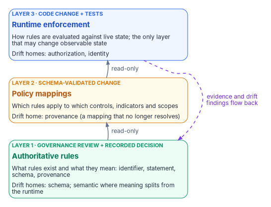
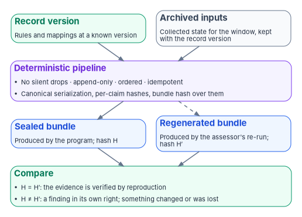

# Chapter 05 — Deterministic Governance: The Three-Layer Rule Model

*Automation makes the answer arrive faster; determinism makes it the same answer no matter who asks, which is the only kind an assessor can check without taking your word for it.*

::: {.callout-note}
## In this chapter
What "deterministic" means for governance, and why it is a stronger property than "automated." The three layers the program keeps its rules in, what each layer declares, how each is written as code and reviewed, and why there are three rather than two. How the layers line up with the drift classes of [Chapter 06](06-the-drift-engine.md) and with the security controls and machine-readable formats an authorization package uses. The properties the evidence pipeline must hold for a re-run to count as verification, and the limits of the whole idea.
:::

## The same inputs, the same evidence

[Chapter 03](03-one-authoritative-record.md) gave the program one authoritative record, and [Chapter 04](04-change-control-and-provenance.md) put every change to that record under control. Neither one answers the next question: when the program turns that record into a statement about the estate ("this control is satisfied," "this account is compliant," "this setting has drifted"), how does anyone know the statement is right?

The usual answer is trust. An engineer ran a script, a tool produced a report, a reviewer signed it. That is attestation, and [Chapter 01](01-why-governance-decays.md) explained why it decays. The program's answer is determinism: **given the same version of the authoritative record and the same collected inputs, the governance platform produces the same evidence, byte for byte.** If that holds, an assessor doesn't have to trust the run. They can repeat it and compare.

Determinism is a design property of the program's tooling, not a federal requirement. It is the program's response to the problem every point-in-time assessment has: the evidence describes a moment, and nobody can reproduce the moment afterward.

## Automation is not determinism

Three properties make governance deterministic, and none of them is speed.

1. **Reproducibility.** The same record version and the same inputs produce the same bundle of evidence. Independent re-execution is the test.
2. **Provenance.** Every claim carries its full envelope: who or what issued it, when it was observed and recorded, and the lineage that links it to the inputs and the rule that produced it. [Chapter 04](04-change-control-and-provenance.md) defines that envelope for changes; the same discipline applies to evidence.
3. **Hash-verifiable lineage.** The bundle's hash is computed over the hashes of its claims, so a change to any claim anywhere breaks the bundle hash.

| Property | What automation delivers | What determinism delivers |
|---|---|---|
| Speed | Faster output | Faster output |
| Reproducibility | Output may vary by run, operator or time | Same record version and inputs, same bundle |
| Provenance | Optional | A full envelope on every claim |
| Independent verification | Not guaranteed | An assessor re-runs and compares hashes |

: Automation and determinism {.striped .hover}

Byte-for-byte reproducibility is harder than it sounds. Two runs that reach the same conclusion can still serialize it differently: keys in another order, a timestamp formatted another way, a floating-point number rounded differently. Their hashes then differ even though nothing meaningful changed. The cure is a canonical serialization. RFC 8785, the JSON Canonicalization Scheme, is one published approach: it defines a single representation of JSON data, including deterministic property sorting, so that hashing and signing give the same result on both sides.[^c05-jcs] Whatever scheme the program's tooling uses, it has to be fixed, documented and part of the rule set, or determinism fails on formatting alone.

## Three layers of rules

The program keeps its governance rules in three distinct layers, so that what a rule means, where it applies and how it is evaluated can each be versioned, reviewed and checked for drift on its own. The common failure, sometimes called policy-as-config, puts all three in one configuration file. It collapses three change boundaries into one, and it loses the ability to judge each layer for its own risk.

{#fig-ch05-three-rule-layers fig-alt="Three stacked cards. At the bottom, green, Layer 1, authoritative rules, changed by governance review and a recorded decision: what rules exist and what they mean, as an identifier, statement, schema and provenance; it is the home of schema drift, and of semantic drift where meaning splits from the runtime. In the middle, amber, Layer 2, policy mappings, changed by a schema-validated change: which rules apply to which controls, indicators and scopes; it is the home of provenance drift, a mapping that no longer resolves. At the top, blue, Layer 3, runtime enforcement, changed by a code change and tests: how rules are evaluated against live state, the only layer that may change observable state; it is the home of authorization and identity drift. Arrows labeled read-only connect each lower layer to the one above, and a dashed violet arrow labeled evidence and drift findings flow back runs from the runtime down to the rules."}

| Layer | Authoritative for | Change boundary |
|---|---|---|
| 1. Authoritative rules | What rules exist and what they mean | Governance review, with the decision recorded |
| 2. Policy mappings | Which rules apply to which controls, indicators and scopes | A schema-validated change |
| 3. Runtime enforcement | How rules are evaluated against live state | A code change with tests |

: The three rule layers {.striped .hover}

Each layer has its own change cadence, its own review surface and its own drift classes. That is why the drift engine can tell a change in what a rule *means* from a mapping that points at a retired rule, and both from runtime code that disagrees with the rule it claims to enforce.

### Layer 1: authoritative rules

The rule layer is the single source of truth for which rules exist and what they mean. It lives in the program's governed repository and is shipped to the runtime as read-only data: the runtime reads it, never writes it, and never reads it from a working copy someone could have edited by hand. A rule declares four things:

- a stable, versioned identifier;
- a semantic statement a person can read;
- the schema constraints any concrete instance has to satisfy;
- its provenance: the document and the recorded decision that authored it.

A rule doesn't declare which components apply it, which controls it supports or how it is enforced. Those belong to the other two layers.

### Layer 2: policy mappings

The mapping layer joins rules to operational scope. A mapping entry says, in effect, "component X (or indicator Y) applies rule R within scope S." The mappings live in registries beside the rules: the list of adapters the program maintains ([Chapter 08](08-the-adapter-model.md)), and the bindings between rules and the controls or indicators they support.

Schema validation runs on every proposed mapping change and checks that each entry references a rule that exists. A dangling entry (one that names a retired rule, a renamed scope or an adapter that no longer exists) becomes a provenance finding, not a runtime crash. Mapping changes happen more often than rule changes: an adapter owner can add or retire a mapping through a normal reviewed change without invoking the rule-change process, and the schema gates keep the mappings consistent.

### Layer 3: runtime enforcement

The runtime layer is the evaluation logic. It reads rules and mappings and evaluates them against live state. It has two parts: the adapters, each of which implements the program's conformance contract for its platform and emits drift findings and evidence ([Chapter 07](07-evidence-over-attestation.md)); and an enforcement library that holds the decision logic. In the program's current tooling the enforcement runtime is a library called by the engine, with no command-line surface of its own, by design: enforcement is reached through the engine's path, where the ladder's gates apply, not invoked ad hoc.

The runtime is the **only** layer allowed to change observable state. Rules and mappings are read-only at runtime. How far the runtime may act on its own is not set here; it is set per operation class by the actuation ladder in [Book 01, Chapter 11](../b01-transformation-arc/11-analysis-plan-delivery.md#how-far-automation-may-go), where gated actuation (L3) is the default ceiling.

## Rules as code

Writing rules as code means each layer is a file in version control, changed through review, tested before it lands and evaluated by a program rather than read by a person. The idea is not unique to this program. CISA's ScubaGear, which assesses Microsoft 365 tenants against CISA's secure configuration baselines, works in the same three steps: PowerShell reads the tenant's configuration settings, Open Policy Agent compares those settings against Rego policies written to the baseline documents, and the results are reported in HTML, JSON and CSV.[^c05-scubagear] Open Policy Agent describes itself as decoupling "policy decision-making from policy enforcement" and lets users "specify policy as code" in a declarative language, Rego.[^c05-opa] Collection, decision and reporting are separate, and the policy is a reviewable file. That is the same separation the three layers formalize.

::: {.callout-warning}
## Illustrative, not production code
The fragments below show the shape of a rule, a mapping and a finding in the program's design. Field names are illustrative, not a published schema. They have not been run against a production estate; review and adapt them before use.
:::

A rule in layer 1 states meaning and shape, and nothing about where it applies:

```yaml
rule:
  id: FMP-RULE-ORG-004          # stable identifier
  version: 3
  statement: >
    Every enabled workforce account carries an organization code that
    exists in the governed organization registry.
  schema:
    attribute: orgCode
    type: string
    pattern: '^[A-Z]{2,4}-[A-Z0-9]{2,6}$'
    must_resolve_in: org-registry
  provenance:
    authored_by: decision-record/organization-code-format
    approved: 2026-08-14
```

A mapping in layer 2 binds that rule to scope and to the controls it supports, and says nothing about how it is evaluated:

```yaml
mapping:
  rule: FMP-RULE-ORG-004
  rule_version: 3
  applied_by: adapter/entra-directory
  scope: all-enabled-member-users
  supports_controls: [AC-2, CM-6]
```

The runtime in layer 3 reads both, evaluates the directory and emits a finding that carries everything an assessor needs to reproduce it:

```yaml
finding:
  rule: FMP-RULE-ORG-004
  rule_version: 3
  mapping: adapter/entra-directory#all-enabled-member-users
  record_version: 2026-10-20T00:00:00Z
  input_hash: sha256:<hash of the collected snapshot>
  subject: <object id>
  result: fail
  drift_class: DRIFT-SCHEMA
  observed_at: 2026-10-21T06:00:00Z
```

Evaluation is a pure function of the rule version, the mapping and the collected input. Nothing in it depends on the operator, the clock at evaluation time or the order in which objects happened to be returned. The `observed_at` time is part of the input, recorded when the state was collected, not when the rule ran.

## Reviewing rules

Each layer has its own reviewer and its own evidence of review, and the difference is the point.

| Layer | Who reviews | What the review checks | Evidence it leaves |
|---|---|---|---|
| Authoritative rules | The governance body that owns the record ([Chapter 09](09-who-governs.md)) | Is the meaning right, and is the change worth its blast radius? | A recorded decision, linked from the rule's provenance |
| Policy mappings | The adapter or indicator owner, with automated schema validation | Does every entry resolve to a live rule, and is the scope correct? | A schema-validated diff of the registry |
| Runtime enforcement | Engineering review, with tests | Does the code do what the rule says, and only that? | Test results and the remediation contracts the code emits |

: Each layer's review {.striped .hover}

These reviews are how the program meets the configuration-change controls an assessor will look for. SP 800-53's CM-3 requires an organization to determine which changes are configuration-controlled, review and approve or disapprove proposed changes "with explicit consideration for security and privacy impact analyses," document the decisions and retain records of the changes. CM-3(2) requires testing, validating and documenting changes before they are finalized, and CM-4 requires analyzing changes for security and privacy impact before they are implemented. All three are in the Moderate baseline.[^c05-sp80053][^c05-sp80053b] The three layers don't add controls; they make it possible to show, for each kind of change, which review happened and what it produced. [Chapter 04](04-change-control-and-provenance.md) covers the change-control mechanics.

## Why three layers and not two

A tempting simplification folds the mappings into the rules, declaring where each rule applies inside the rule itself. The program doesn't, for three reasons.

1. **Cadence.** Rule changes go through governance review; mapping changes don't need to. Folding them together either slows mapping work to the pace of governance, or weakens governance review to the pace of mapping work.
2. **Blast radius.** A bad mapping is fixed by editing a registry. A bad rule is fixed only by a new decision that supersedes the old one. Changes with different blast radii deserve different change boundaries.
3. **Drift attribution.** With separate layers, the drift engine can tell an assessor whether a finding is a shift in meaning or a mapping mistake. In a single artifact that distinction is lost.

The same reasoning keeps the runtime out of the mapping layer. The runtime has to execute, act and emit; a mapping must not.

## Where drift lives in the layers

The five drift classes of [Chapter 06](06-the-drift-engine.md) each have a home layer, and the home layer says who has to act.

| Drift class | Where the mismatch lives | Who resolves it |
|---|---|---|
| Schema | Rules: the declared schema against the actual structure | The owner of the data, or of the rule if the schema is wrong |
| Semantic | Between rules and runtime: meaning has shifted | Governance review and a code change, both |
| Provenance | Mappings: an entry references something that no longer resolves | The mapping owner; often a registry edit |
| Authorization | Runtime: a component acted or emitted outside its authorized envelope | The runtime owner, with security review |
| Identity | Runtime: an issuer or object can't be resolved to the record | The runtime owner and the record's steward |

: Drift classes by home layer {.striped .hover}

Provenance findings are mapping-layer concerns and are often simple to resolve. Semantic findings cross from the rules into the runtime and need both a governance decision and a code change. Knowing the layer turns "something is wrong" into "this reviewer, through this change boundary."

## How rules map to controls

The mapping layer is where a rule meets a control. In the example above, the organization-code rule supports AC-2 and CM-6. CM-6 requires an organization to establish and document configuration settings, implement them, identify and approve any deviations, and "monitor and control changes to the configuration settings." CM-2 requires a current baseline configuration under configuration control, and CM-2(2) requires keeping it current, complete, accurate and available using automated mechanisms. CA-7 requires continuous monitoring with organization-defined metrics and frequencies, ongoing control assessments, and response actions. All of those are in the Moderate baseline. CM-6(1), managing, applying and verifying configuration settings with automated mechanisms, is in the High baseline but not the Moderate one.[^c05-sp80053][^c05-sp80053b] A deterministic rule set is one way to satisfy these controls with evidence rather than narrative: the rules are the documented settings, the mappings say which component they bind, and the findings are the monitoring.

The authorization package also has a machine-readable form to map into. NIST's Open Security Controls Assessment Language (OSCAL) defines models in three layers: catalog, profile and control mapping in the control layer; system security plan and component definition in the implementation layer; and assessment plan, assessment results and plan of action and milestones in the assessment layer. A component definition describes how an individual component satisfies controls so that its content can be imported into a system security plan.[^c05-oscal] The program's three rule layers line up with those models as follows. The correspondence is the program's own, not something OSCAL defines:

| Program artifact | Closest OSCAL model | Why |
|---|---|---|
| The controls the rules support | Catalog, selected and tailored by a profile | The program doesn't restate controls; it points at a published catalog and baseline |
| Policy mappings for one adapter | Component definition | Both say how one component satisfies which controls |
| All mappings in force for a system | System security plan, implementation statements | The plan imports what the components declare |
| Runtime findings for an assessment window | Assessment results | Evidence and findings from a set of assessment activities |
| Open findings with remediation dates | Plan of action and milestones | Findings the system owner still has to address |

: The program's artifacts and the OSCAL models {.striped .hover}

FedRAMP's 2026 Key Security Indicators are a separate mapping target. They bind cloud service providers, not agencies, and an agency reviews each provider's quarterly Ongoing Certification Report rather than measuring the indicators itself ([Book 10, Chapter 03](../b10-cloud-boundary/03-what-changed-at-fedramp.md); [Book 12, Chapter 12](../b12-security-operations/12-evidence-metrics-and-continuous-monitoring.md)). A program that operates its own cloud service offering can bind rules to indicators in the same mapping layer; an agency consuming certified services maps its own rules to SP 800-53 controls. [Chapter 11](11-reciprocity-and-one-authorization.md) takes up how one body of evidence serves both.

## How the pipeline keeps determinism

Determinism is a property of the whole evidence pipeline, not of one step. The program's design holds every evidence emission to four properties:

1. **No silent drops.** Every collected record either enters the bundle or is recorded as rejected, with the reason.
2. **Append-only writes.** Records are never updated in place; a correction is a new record that references the one it corrects.
3. **Ordered records.** Order is defined by the data (observation time, then a stable key), not by arrival.
4. **Idempotent ingestion.** Ingesting the same record twice produces the same state as ingesting it once.

A bundle moves through a fixed lifecycle: **assemble, seal, submit, close**. Once sealed, a bundle is immutable. An update produces a new bundle that supersedes the old one and says so in its provenance. The system security plan entries, the plan of action and milestones, indicator reports and component definitions all come out of this one pipeline in the design, so they can't disagree with each other about the same window.

{#fig-ch05-rerun-is-verification fig-alt="Two inputs at the top, a green record version card, rules and mappings at a known version, and a slate archived inputs card, collected state for the window kept with the record version, both feed a violet deterministic pipeline card: no silent drops, append-only, ordered, idempotent; canonical serialization, per-claim hashes and a bundle hash over them. The pipeline produces a blue sealed bundle, produced by the program with hash H, and with a dashed arrow a blue regenerated bundle, produced by the assessor's re-run with hash H prime. Both feed a green compare card: if H equals H prime the evidence is verified by reproduction; if they differ, that is a finding in its own right, because something changed or was lost."}

This is also how determinism answers drift. A remediation contract the drift engine writes at time T ([Chapter 06](06-the-drift-engine.md)) is part of the bundle for any window that covers T. Re-running the bundle for that window months later produces the same contract record. An authorizing official can verify that the program responded to drift correctly by re-executing, not by reading a narrative. Drift detection without determinism is incomplete: the findings exist, but no assessor can reproduce them.

## What changes for the program

- **Evidence is regenerable.** The program doesn't have to keep every point-in-time bundle forever. A bundle can be recreated from the record version plus the archived inputs. The inputs still have to be retained for as long as the records schedule requires ([Book 12, Chapter 12](../b12-security-operations/12-evidence-metrics-and-continuous-monitoring.md#retention-tiers-and-tamper-protected-copies)).
- **Tool lock-in shrinks.** The evidence doesn't depend on one vendor's governance, risk and compliance tool to assemble it. Any tool that reads the bundles can present them.
- **Reconstruction after an incident is cheap.** An assessor looking at a past period can regenerate that period's evidence without the original team.
- **The audit cycle changes job.** If re-running is cheap and drift findings flow continuously, the annual assessment stops being the moment evidence is refreshed. It becomes a review of the rule changes, the decisions and the program's posture over the year, which is what an assessment should spend its time on. CA-7(1) asks for independent assessors to monitor controls on an ongoing basis;[^c05-sp80053] a re-runnable pipeline is what makes that practical.

For the authorizing official the property is simple: independent verification becomes a re-run, not an interview. The decision stays theirs. Determinism makes the evidence checkable; only the authorizing official accepts residual risk ([Book 01, Chapter 09](../b01-transformation-arc/09-who-leads-the-transformation.md)).

## Honest limits

- **Determinism is faithful to the record, not a check on it.** A wrong rule, evaluated deterministically, gives the same wrong answer every time. Whether the rules are correct is a separate concern, and the more important one. That is why layer 1 changes go through governance review and not just a test suite.
- **Continuous capture is a target, not today's state.** Adapters that collect at intervals are deterministic per interval. ScubaGear, for example, produces a report for each run, not a continuous stream. Continuous, event-time capture across all adapters is still engineering ahead.
- **Regeneration needs the inputs.** A program that discards its collected inputs after assembling a bundle loses the ability to regenerate it. Archive the inputs with the record version, or the strongest property in this chapter disappears.
- **Byte-identical depends on discipline.** One unpinned library version, one locale-dependent date format or one unordered set is enough to break reproducibility without changing any conclusion. The canonical serialization and the pinned toolchain are part of the rule set and change under the same review.

## Key takeaways

- Determinism, not automation, is what lets an assessor verify governance without trusting the operator: same record version and inputs, same evidence.
- It rests on three properties together: reproducibility, provenance and hash-verifiable lineage.
- Rules live in three layers (meaning, mapping, enforcement), each with its own change boundary, reviewer and drift classes; only the runtime may act, and the actuation ladder caps how far.
- The layers map onto SP 800-53's configuration and monitoring controls and onto OSCAL's models; the mapping is the program's design, the controls and models are published.
- Determinism is faithful to the record. Getting the rules right remains the primary job.

::: {.callout-tip}
## Continue the book
[← Previous: Chapter 04 — Change Control and Provenance](04-change-control-and-provenance.md) · [Book index](index.md) · [Next: Chapter 06 — The Drift Engine →](06-the-drift-engine.md)
:::

[^c05-jcs]: A. Rundgren, B. Jordan and S. Erdtman, RFC 8785, *JSON Canonicalization Scheme (JCS)*, Informational, June 2020, abstract, <https://www.rfc-editor.org/rfc/rfc8785> (accessed Oct 21, 2026).
[^c05-scubagear]: Cybersecurity and Infrastructure Security Agency, ScubaGear, README ("Step Two ... calls Open Policy Agent (OPA) to compare these settings against Rego security policies written per the baseline documents"; products assessed; HTML, JSON and CSV output), <https://github.com/cisagov/ScubaGear> (accessed Oct 21, 2026).
[^c05-opa]: Open Policy Agent, "Introduction," documentation, <https://www.openpolicyagent.org/docs> (accessed Oct 21, 2026).
[^c05-sp80053]: National Institute of Standards and Technology, SP 800-53 Rev. 5 (release 5.2.0), *Security and Privacy Controls for Information Systems and Organizations*, controls CA-7, CA-7(1), CM-2, CM-2(2), CM-3, CM-3(2), CM-4, CM-6 and CM-6(1); statements read from NIST's OSCAL Rev. 5 catalog, <https://github.com/usnistgov/oscal-content/blob/main/nist.gov/SP800-53/rev5/json/NIST_SP-800-53_rev5_catalog.json> (accessed Oct 21, 2026).
[^c05-sp80053b]: National Institute of Standards and Technology, SP 800-53B Rev. 5 Moderate and High baseline profiles, OSCAL, <https://github.com/usnistgov/oscal-content/blob/main/nist.gov/SP800-53/rev5/json/NIST_SP-800-53_rev5_MODERATE-baseline_profile.json> and <https://github.com/usnistgov/oscal-content/blob/main/nist.gov/SP800-53/rev5/json/NIST_SP-800-53_rev5_HIGH-baseline_profile.json> (both accessed Oct 21, 2026).
[^c05-oscal]: National Institute of Standards and Technology, "OSCAL Layers and Models," Open Security Controls Assessment Language, <https://pages.nist.gov/OSCAL/learn/concepts/layer/> (accessed Oct 21, 2026).
