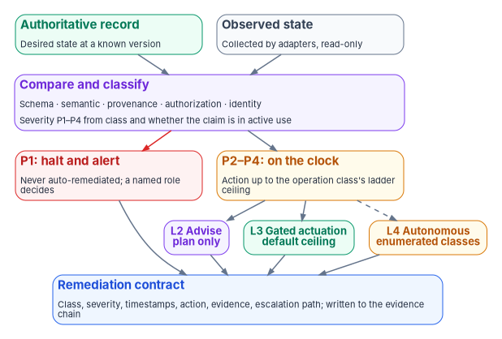
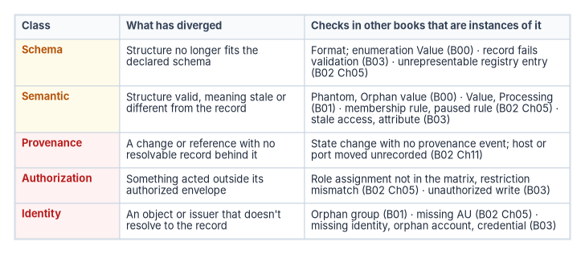

# Chapter 06 — The Drift Engine

*Drift isn't an exception to be explained at the next audit; it is the signal that tells the program, every day, where the estate has stopped matching the record.*

::: {.callout-note}
## In this chapter
What the drift engine compares, and why it compares against a versioned record rather than a last-known-good snapshot. The program's one drift model: five classes, and how the drift checks defined in Books 00 to 03 map onto them. How severity is computed and how it relates to the actuation ladder. When detection runs, what the engine remediates and what it never does, the remediation contract each finding leaves, and which parts of the engine are built today.
:::

## Drift as a signal

[Chapter 02](02-drift-is-the-primary-threat.md) argued that drift, not the dramatic breach, is what erodes a compliant estate: a setting changed under pressure, an account nobody removed, a rule paused and forgotten. This chapter describes the machinery that answers it. The drift engine is the part of the governance platform that finds the gap between the declared state in the authoritative record and the observed state of the estate, classifies it, sets its severity and records what was done about it.

The idea is old. NIST's guide to security-focused configuration management has four phases (planning, identifying and implementing configurations, controlling configuration changes, and monitoring) and observes that planning secure configurations and controlling change "is usually not sufficient to ensure that a system which was once secure will remain secure." Monitoring is how an organization finds when the actual configuration has become different from the approved baseline.[^c06-sp800128] What the program adds is a fixed model for classifying what monitoring finds, a severity that follows from the classification rather than from a debate, and a record of every response that becomes evidence.

{#fig-ch06-drift-pipeline fig-alt="At the top, a green authoritative record card, desired state at a known version, and a slate observed state card, collected by adapters, read-only, both feed a violet compare and classify card: schema, semantic, provenance, authorization or identity, with severity P1 to P4 from the class and whether the claim is in active use. From it a red arrow leads to a red card, P1 halt and alert, never auto-remediated, a named role decides; and another arrow leads to an amber card, P2 to P4 on the clock, action up to the operation class's ladder ceiling. The amber card branches to three pills: L2 Advise, plan only; L3 Gated actuation, the default ceiling; and with a dashed arrow L4 Autonomous, enumerated classes only. The P1 card and all three pills lead to a blue remediation contract card: class, severity, timestamps, action, evidence and escalation path, written to the evidence chain."}

## What the engine compares against

The engine measures drift against a **versioned authoritative record**, not against an arbitrary "last-known-good" snapshot. The difference matters in three ways.

- **The expected state is reproducible.** The same record version always yields the same expected state, so a drift finding can be re-derived later ([Chapter 05](05-deterministic-governance.md)).
- **Approved change isn't drift.** A change that went through [Chapter 04](04-change-control-and-provenance.md)'s change control updates the record first; the estate then converges to it. A snapshot-based tool sees every change, approved or not, as a deviation from the snapshot. NIST describes this reconciliation step: changes detected by monitoring are reconciled against approved changes by asking who made the change, whether it happened in a scheduled window, and whether it matches an approved change request, ticket or release.[^c06-sp800128] The engine does that check structurally, because an approved change carries a provenance record and an unapproved one doesn't.
- **The record can be wrong, and that is a different finding.** When the estate is right and the record is stale, the fix is a change to the record under review, not a remediation of the estate. The engine raises the finding either way; it doesn't decide which side is right.

## The program's drift model: five classes

The program classifies every drift finding into exactly one of five classes. Five is the design choice because each class is a distinct failure that needs a distinct response; calling everything "configuration drift" loses the ability to set severity and response deterministically.

| Class | What has diverged | Home layer ([Chapter 05](05-deterministic-governance.md#where-drift-lives-in-the-layers)) | Where it is detected |
|---|---|---|---|
| `DRIFT-SCHEMA` | A claim's structure no longer matches the declared schema | Rules | On every change to the record, and at runtime |
| `DRIFT-SEMANTIC` | The structure is valid, but the meaning is stale or inconsistent with the record | Between rules and runtime | At runtime |
| `DRIFT-PROVENANCE` | The provenance envelope is missing, invalid or broken, or a reference no longer resolves | Mappings | On every change to the record, and at runtime |
| `DRIFT-AUTHZ` | A claim was written, transmitted or acted on outside its authorized envelope | Runtime | At runtime |
| `DRIFT-IDENTITY` | An issuer or object can't be resolved to a verified object in the record | Runtime | At runtime |

: The five drift classes {.striped .hover}

### One model, many domain checks

Earlier books defined drift checks for their own domains, with their own names. Those checks stay: each book owns the detail of its domain. They are not separate taxonomies. Each is an instance of one of the five classes, and this table is the reconciliation.

{#fig-ch06-one-drift-model fig-alt="A table of five rows. Schema, amber: structure no longer fits the declared schema; instances are Format and enumeration Value from Book 00, a record that fails validation from Book 03, and an unrepresentable registry entry from Book 02 Chapter 05. Semantic, amber: structure valid, meaning stale or different from the record; instances are Phantom and Orphan value from Book 00, Value and Processing drift from Book 01, a membership rule or paused rule from Book 02 Chapter 05, and stale access and attribute drift from Book 03. Provenance, red: a change or reference with no resolvable record behind it; instances are a state change with no provenance event and a host or port moved without a record, from Book 02 Chapter 11. Authorization, red: something acted outside its authorized envelope; instances are a role assignment not in the matrix and a restriction mismatch from Book 02 Chapter 05, and an unauthorized write from Book 03. Identity, red: an object or issuer that does not resolve to the record; instances are an orphan group from Book 01, a missing administrative unit from Book 02 Chapter 05, and a missing identity, orphan account or credential drift from Book 03."}

| Book and check | Class | Book's severity | Why this class |
|---|---|---|---|
| [Book 00 Ch04](../b00-orientation/04-the-principles.md#principle-11): Format | Schema | Critical | A typed value fails its declared pattern |
| Book 00 Ch04: Value (not in the enumeration) | Schema | High | The value is outside the declared set |
| Book 00 Ch04: Orphan (an enumeration value with no principals) | Semantic | Medium | The record holds a value that describes nothing; dormant |
| Book 00 Ch04: Phantom (a principal carries a deprecated value) | Semantic | Medium | Valid shape, retired meaning |
| [Book 01 Ch04](../b01-transformation-arc/04-identity-transformation.md#drift-categories): Value drift (attribute differs from HR) | Semantic | — | Valid shape, different meaning from the record |
| Book 01 Ch04: Orphan drift (a group not in the governed library) | Identity | — | An object with no counterpart in the record |
| Book 01 Ch04: Processing drift (rule processing paused) | Semantic | — | The runtime no longer does what the rule says |
| [Book 02 Ch05](../b02-identity/05-delegation-without-ous.md#drift-detection): AU membership rule differs from the registry | Semantic | High | Runtime disagrees with the record |
| Book 02 Ch05: AU rule processing paused | Semantic | High | Runtime disagrees with the record |
| Book 02 Ch05: role assignment not in the matrix | Authorization | Critical | An assignment outside the authorized envelope |
| Book 02 Ch05: restriction mismatch | Authorization | Critical | Who may manage the unit differs from the decision |
| Book 02 Ch05: orphaned AU (no role assignments) | Semantic | Low | A record entry with nothing using it; dormant |
| Book 02 Ch05: missing AU | Identity | High | A record entry with no counterpart in the tenant |
| Book 02 Ch05: dynamic group as a role principal | Schema | Critical | The registry declares something the platform can't represent |
| [Book 02 Ch11](../b02-identity/11-reference-deployment.md) | All five, by their class names | P1–P4 | Already uses this model |
| [Book 03 Ch11](../b03-hr-identity/11-drift-metrics-and-evidence.md#drift-between-hr-and-the-directory): missing identity | Identity | High | A worker in the record with no account |
| Book 03 Ch11: stale access | Semantic | High | HR says separated; the directory says enabled |
| Book 03 Ch11: orphan account | Identity | High | An account with no worker in the record |
| Book 03 Ch11: attribute drift | Semantic | Medium | A value differs from HR |
| Book 03 Ch11: unauthorized write | Authorization | High | A write by a principal other than the provisioning service |
| Book 03 Ch11: credential drift | Identity | High | A live credential bound to a worker the record has separated |
| Book 03 Ch11: schema drift | Schema | Medium | A record fails validation |
| [Chapter 03](03-one-authoritative-record.md): contention (a write to a demoted copy) | Authorization | Critical when the copy is in use; otherwise High | Something wrote to a copy it isn't authorized to write: a second source of truth growing back |

: Domain drift checks mapped to the five classes {.striped .hover}

Book 00's four categories govern attribute values only, which is why they map to schema and semantic and never to the other three classes. The words "Value" and "Orphan" mean different things in Book 00 and Book 01; the class column resolves the ambiguity.

## Severity

Every finding carries one of four severities. Critical, High, Medium and Low in the domain books are the same scale as P1, P2, P3 and P4 here.

| Severity | Default rule | Response | Response target |
|---|---|---|---|
| P1, critical | A claim in active use with provenance, authorization or identity drift | Halt and alert; never remediated automatically | Immediate |
| P2, high | A claim in active use with schema or semantic drift | Remediate within the operation class's ladder ceiling | 1 hour |
| P3, medium | Drift in a dormant or historical claim | Remediate within the ceiling | 24 hours |
| P4, low | Style or metadata drift with no effect on meaning | Remediate within the ceiling | 72 hours |

: Severity, its default rule and the response {.striped .hover}

These severities and targets are the program's defaults, not an external standard. SP 800-53's CA-7 leaves the monitoring frequencies and response actions to the organization to define,[^c06-sp80053] and the program's choice is this table.

Severity is computed, not argued. The default is a function of two inputs: the drift class, and whether the affected claim is in active use. A domain check may pin its own severity in the table of the book that owns it, as Book 00 does for Format (critical, and it halts the remediation pass) and Book 03 does for its HR classes. Where a check is pinned, the pinned value is what the engine uses; where it isn't, the default rule applies. Either way the result is a lookup, so two operators looking at the same finding get the same severity. That turns the question "is this serious?" into "did the classifier run correctly?", which can be tested.

The source design for this table listed only provenance and identity drift at P1. Authorization drift on a live claim is added here because [Book 02, Chapter 11](../b02-identity/11-reference-deployment.md) already treats it as P1 (an SPN owner changed with no recorded migration event), and an action outside the authorized envelope is at least as serious as a missing provenance record.

## Cadence

Detection runs in two places, on different clocks.

- **On every proposed change to the record.** Checks run in the change pipeline before a change to the rules, mappings or registries can land: declared paths and structures exist, and every referenced document resolves. These find schema and provenance drift in the record itself, before it reaches the estate. They use the same gates as [Chapter 04](04-change-control-and-provenance.md).
- **Against the estate.** A scheduled comparison reads the platforms through their adapters and compares them with the record. Between comparisons, the engine can watch a platform's own change events where the platform provides them. [Book 02, Chapter 05](../b02-identity/05-delegation-without-ous.md#drift-detection) uses the Entra audit log this way for restricted administrative units.

The program doesn't set one interval for everything. Each check's cadence is set by the book that owns it, matched to how fast the drift matters and how fast the platform can be read, and recorded as part of the check. SP 800-53's CA-7 requires the organization to establish frequencies for monitoring and for assessing control effectiveness, and CA-7(4) requires risk monitoring that includes effectiveness, compliance and change monitoring;[^c06-sp80053] the per-check cadence is how the program meets both. [Book 12, Chapter 12](../b12-security-operations/12-evidence-metrics-and-continuous-monitoring.md) carries the continuous-monitoring metrics and reporting rhythm, and this chapter doesn't repeat them.

## What the engine remediates, and what it doesn't

Two independent settings govern every response, and confusing them is the most common design mistake.

- **Severity sets the clock**, and whether the run halts.
- **The operation class's ceiling on the actuation ladder sets who may act.** The ladder is defined in [Book 01, Chapter 11](../b01-transformation-arc/11-analysis-plan-delivery.md#how-far-automation-may-go): L0 Record, L1 Observe, L2 Advise, L3 Gated actuation as the default ceiling, and L4 Autonomous within guardrails only for enumerated low-blast-radius classes.

A P3 finding is therefore not automatically something the engine fixes on its own. If the fix belongs to an operation class enumerated at L4 (re-applying a dynamic membership rule from the registry, say, if the program has enumerated that class), the engine fixes it and records the contract. If the class sits at L3, the engine generates a corrective plan, runs it dry, and executes once a person authorizes it. Tenant-wide role changes, Conditional Access enforcement changes, bulk device-state changes and network policy touching thousands of endpoints stay at L3 permanently, whatever the severity. The source design's phrase "auto-remediate if deterministic" is read here as "remediate up to the ceiling": being deterministic is necessary for automatic remediation, not sufficient.

Platforms offer the same distinction natively, and the program uses them that way. Azure Machine Configuration, for example, has three enforcement modes: Audit (only report on the state of the machine), Apply and Monitor (apply the configuration, then monitor for changes), and Apply and Autocorrect (bring the machine back into conformance if drift occurs).[^c06-machine-config] In the program's correspondence, Audit is an L1 posture and Apply and Autocorrect is L4 for that setting; choosing Autocorrect is a decision to enumerate that setting's class at L4, and it belongs in the record like any other.

SP 800-53 has controls for automatic response. CM-3(5) asks for organization-defined security responses to be implemented automatically when baseline configurations are changed in an unauthorized manner, and CM-6(2) asks for organization-defined actions in response to unauthorized changes to configuration settings. CM-6(2) is in the High baseline; CM-3(5) is in neither the Moderate nor the High baseline.[^c06-sp80053][^c06-sp80053b] Automatic response is something an agency chooses, and the ladder is how the program makes that choice explicit per class.

The engine never does five things:

1. **It never remediates a P1 automatically.** P1 halts the affected run and alerts a named role. A person investigates and decides.
2. **It never fixes the copy instead of the record.** When the record is wrong, the fix is a reviewed change to the record or the rule, and the estate converges afterward. [Book 03, Chapter 11](../b03-hr-identity/11-drift-metrics-and-evidence.md) closes HR drift the same way: at the record or the rule, never at the copy.
3. **It never edits the record itself.** The engine reads the record. Changing it is a change under [Chapter 04](04-change-control-and-provenance.md), with its own review and provenance.
4. **It never judges whether a rule is correct.** It is faithful to the rules it is given ([Chapter 05](05-deterministic-governance.md#honest-limits)).
5. **It never accepts risk.** A finding that can't be remediated becomes a plan of action and milestones entry or a risk decision, and only the authorizing official accepts residual risk ([Chapter 09](09-who-governs.md)).

## The remediation contract

Every drift event, remediated automatically or by a person, leaves a remediation contract: a structured record that enters the evidence chain ([Chapter 07](07-evidence-over-attestation.md)) and from there the authorization artifacts. There is no separate drift log disconnected from the system security plan.

::: {.callout-warning}
## Illustrative, not production code
The record below shows the shape of a remediation contract in the program's design. Field names are illustrative, not a published schema, and the record has not been produced against a production estate.
:::

```yaml
remediation_contract:
  drift_class: DRIFT-SEMANTIC            # one of the five classes
  severity: P2                           # P1 | P2 | P3 | P4
  check: b02-ch05/au-membership-rule     # the domain check that fired
  record_version: 2026-10-20T00:00:00Z   # what the estate was compared with
  detection_timestamp: 2026-10-21T06:00:12Z
  detected_by: adapter/entra-directory   # adapter or workflow identifier
  ladder_ceiling: L4                     # the operation class's ceiling
  auto_remediated: true
  remediation_action: fix                # halt | fix | flag | log
  remediation_timestamp: 2026-10-21T06:04:40Z
  remediation_evidence: <change record id or commit hash>
  escalation_path: identity-platform-owner   # a named role, not a list
```

Every field is there so that a reviewer can re-derive the decision: the record version and the check reproduce the finding, the class and liveness reproduce the severity, and the ceiling explains who acted. The escalation path ends at a named role, defined in [Chapter 09](09-who-governs.md), not at a shared mailbox.

## What is built today

The model above is complete; the engine that implements it is not. Be precise about the difference when describing it to an assessor.

| Drift class | On every change to the record | Against the estate at runtime |
|---|---|---|
| `DRIFT-SCHEMA` | Built | Built |
| `DRIFT-PROVENANCE` | Built | Built |
| `DRIFT-SEMANTIC` | Not applicable | Partly built (target) |
| `DRIFT-AUTHZ` | Not applicable | Design only |
| `DRIFT-IDENTITY` | Not applicable | Design only |

: Maturity of the program's drift tooling, October 2026 {.striped .hover}

In practice, authorization and identity drift are found today by the assessment modules the domain books provide, and by people reviewing their output, not by a runtime engine. Book 02, Chapter 11 says the same. Semantic detection covers some checks and not others. The domain checks in the mapping table still run, through the domain books' own tooling and scheduled comparisons; what isn't built yet is the single runtime that runs all of them and writes their contracts uniformly. Until it is, a finding found by a person should still be recorded in the contract shape, so the evidence looks the same however it was found.

## Why this isn't a configuration-drift tool

Configuration-drift tools are useful, and the program uses the platforms' own. Three properties make the drift engine something different.

1. **Anchored to the record, not to a snapshot.** Drift is measured against a versioned record, so approved change is distinguishable from unapproved change and the expected state is reproducible.
2. **Five classes with computed severity.** Operators don't triage. Severity is a function of class and liveness, or a pinned value from the owning book.
3. **Remediation contracts are evidence.** Every response, automatic or human, leaves a record that flows into the authorization package.

An assessor looking at a system governed this way doesn't have to accept a drift report on trust. With the record version, the archived inputs and the checks, they can re-run detection for a window and compare the result with what the program reported. [Book 12, Chapter 12](../b12-security-operations/12-evidence-metrics-and-continuous-monitoring.md#what-an-assessor-verifies) covers what an assessor verifies from the monitoring side.

## Key takeaways

- The drift engine compares observed state with a versioned record, so approved change isn't drift and every finding can be re-derived.
- There is one drift model: five classes. The checks in Books 00 to 03 are instances of those classes, not separate taxonomies.
- Severity is computed from class and liveness, or pinned by the owning book; it sets the clock and whether the run halts.
- The actuation ladder, not the severity, decides who acts. P1 always halts for a person, and L3 is the default ceiling.
- Schema and provenance detection are built; semantic is partial; authorization and identity are design only and are found today by assessment modules and people.

::: {.callout-tip}
## Continue the book
[← Previous: Chapter 05 — Deterministic Governance](05-deterministic-governance.md) · [Book index](index.md) · [Next: Chapter 07 — Evidence Over Attestation →](07-evidence-over-attestation.md)
:::

[^c06-sp800128]: National Institute of Standards and Technology, SP 800-128, *Guide for Security-Focused Configuration Management of Information Systems*, August 2011 (updated October 10, 2019), §2.2 (the four SecCM phases; §2.2.4 Monitoring) and §3.4.1 (reconciling detected changes with approved changes; possible remediation actions), <https://csrc.nist.gov/pubs/sp/800/128/upd1/final>; text read from <https://nvlpubs.nist.gov/nistpubs/SpecialPublications/NIST.SP.800-128.pdf> (accessed Oct 21, 2026).
[^c06-sp80053]: National Institute of Standards and Technology, SP 800-53 Rev. 5 (release 5.2.0), *Security and Privacy Controls for Information Systems and Organizations*, controls CA-7, CA-7(4), CM-3(5) and CM-6(2); statements read from NIST's OSCAL Rev. 5 catalog, <https://github.com/usnistgov/oscal-content/blob/main/nist.gov/SP800-53/rev5/json/NIST_SP-800-53_rev5_catalog.json> (accessed Oct 21, 2026).
[^c06-sp80053b]: National Institute of Standards and Technology, SP 800-53B Rev. 5 Moderate and High baseline profiles, OSCAL, <https://github.com/usnistgov/oscal-content/blob/main/nist.gov/SP800-53/rev5/json/NIST_SP-800-53_rev5_MODERATE-baseline_profile.json> and <https://github.com/usnistgov/oscal-content/blob/main/nist.gov/SP800-53/rev5/json/NIST_SP-800-53_rev5_HIGH-baseline_profile.json> (both accessed Oct 21, 2026).
[^c06-machine-config]: Microsoft Learn, "What is Azure Machine Configuration?" (enforcement modes for custom policies), <https://learn.microsoft.com/azure/governance/machine-configuration/overview>; and "Understand machine configuration assignment resources" (assignmentType values Audit, ApplyandMonitor and ApplyandAutoCorrect), <https://learn.microsoft.com/azure/governance/machine-configuration/concepts/assignments> (both accessed Oct 21, 2026).
