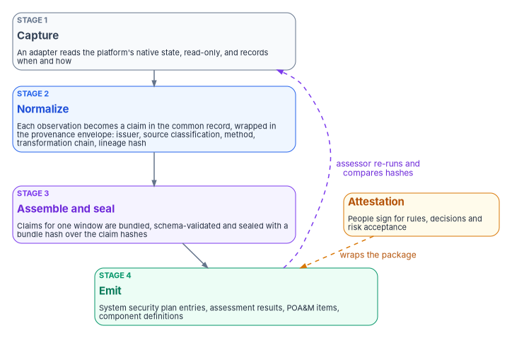
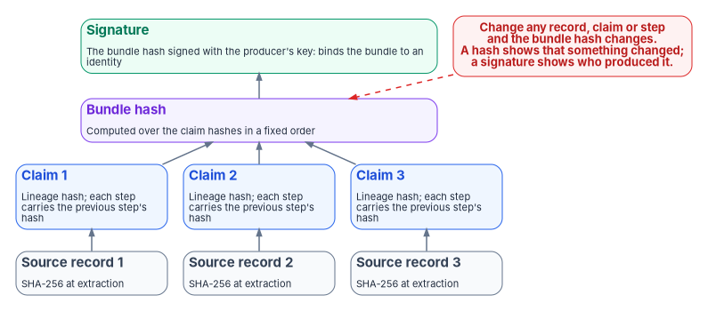

# Chapter 07 — Evidence Over Attestation

*An attestation tells the assessor what someone believed on the day they signed; evidence lets the assessor find out for themselves, and keeps doing so after the signature is dry.*

::: {.callout-note}
## In this chapter
The difference between attestation and evidence, and why the program makes evidence the primary artifact and attestation the accountability wrapper around it. What NIST SP 800-53A, SP 800-37 and FedRAMP's 2026 rules already say about automated assessment. The evidence chain from a platform's state to an authorization package, and the provenance envelope every claim carries. What a hash, a hash chain and a digital signature each prove, and what they don't. What an assessor can verify, what doesn't change, and the limits of the approach today.
:::

## Two artifacts, two questions

An attestation is a person, or a designated body, signing that a system was in a stated condition at a stated time. It answers *who is accountable for this claim?* Federal authorization needs that answer. An authorizing official signs an authorization decision, a system owner signs a plan, a control assessor signs a report, and nothing in this chapter removes any of those signatures.

Evidence is an artifact a machine produced, from the system itself, that shows the condition. It answers a different question: *is the claim true, and can I check it?* A screenshot of a settings page is weak evidence. A record produced by reading the setting through the platform's interface, stamped with when and how it was read and bound to the source data by a hash, is strong evidence, because someone else can repeat the reading and compare.

The two artifacts fail in different ways. An attestation can't be re-executed, only re-read. It says nothing about the hours and months between signatures, which is exactly when [Chapter 01](01-why-governance-decays.md) and [Chapter 02](02-drift-is-the-primary-threat.md) show compliance decaying. And it can't distinguish a value read from an authoritative source from a value someone typed into a spreadsheet. Evidence built the way this chapter describes has all three properties.

| | Attestation | Evidence |
|---|---|---|
| What it is | A person signing that something is true | A system-produced artifact showing that it is |
| Question it answers | Who is accountable? | Is it true, and can I check? |
| Time it covers | The moment of signing | Each collection, continuously or per interval |
| How an assessor verifies it | Re-reads it, interviews the signer | Repeats the collection and compares hashes |
| Role in the program | The accountability wrapper | The primary artifact |

: Attestation and evidence {.striped .hover}

The program's position is an inversion of the usual package. In a typical package, attestation is the substance and evidence is attached to support it. In the program's design, evidence is the substance and attestation is the human review layered on top: people sign for the rules, the decisions and the acceptance of risk, and the systems produce the proof of state. That is a design position. The next section shows how far federal guidance already goes in the same direction.

{#fig-ch07-evidence-chain fig-alt="Four numbered cards from top to bottom. Stage 1, slate, capture: an adapter reads a platform's native state, read-only, and records when and how. Stage 2, blue, normalize: each observation becomes a claim in the common record, wrapped in the provenance envelope with issuer, source classification, method, transformation chain and lineage hash. Stage 3, violet, assemble and seal: claims for one window are bundled, validated against the schema and sealed with a bundle hash computed over the claim hashes. Stage 4, green, emit: the sealed bundle produces the package artifacts, the system security plan entries, assessment results, plan of action and milestones items and component definitions. Beside the chain, an amber card labeled attestation, people sign for rules, decisions and risk acceptance, points with a dashed arrow to the package. A dashed violet arrow labeled assessor re-runs and compares hashes runs from the emit stage back up to the capture stage."}

## What federal assessment guidance already says

The argument for evidence over attestation isn't new to federal guidance. Three sources go most of the way.

**NIST SP 800-53A.** The assessment guide defines three methods, examine, interview and test, and its appendix on ongoing assessment describes a strategy built on a "desired state specification": express the intended state as data that can be compared automatically with the actual state, and treat a mismatch as a defect in one or more controls. Its example is an account-lockout policy of three attempts checked against a device configured for five. The guide then says that when this strategy is used, "security-related information generated from ISCM activities is equivalent to security control assessment results." It names three prerequisites (defined actual-state specifications, data-based desired-state specifications and a defined method for computing the differences) and says that when automated tools conduct an assessment, the method in use is *test*, which can be supplemented with interview, examine or manual testing where more assurance is needed.[^c07-sp80053a] That is the program's model in NIST's words: the authoritative record of [Chapter 03](03-one-authoritative-record.md) is the desired-state specification, the drift engine of [Chapter 06](06-the-drift-engine.md) computes the differences, and the output counts as assessment results.

**NIST SP 800-37.** The Risk Management Framework says that if a report generated by a security or privacy management and reporting tool contains what an assessment report must contain, that report constitutes the assessment report. It is equally plain about the limit. Automated tools may not generate enough information for every control or every part of a control, and in those cases manual assessments fill the gaps at frequencies the organization sets.[^c07-sp80037] Evidence displaces attestation where machines can observe the control, and not elsewhere.

**FedRAMP's 2026 rules.** FedRAMP's Consolidated Rules for 2026 govern cloud service offerings, their providers and their assessors, not an agency's own systems, but they point the same way. The rule requiring independent assessors to verify that the implemented measures match the documented ones carries a note asking for technical review and saying, in so many words, "don't simply review documentation or screenshots."[^c07-fedramp-ivv] A provider may use representative samples during verification, and the note to that rule observes that many modern services with effective automation can persistently verify most of their security measures automatically and don't need sampling.[^c07-fedramp-ivv] Under the 20x path, providers maintain their certification packages with automation as changes occur, from every three months for Class A to every week for Class D, and the rule notes that it doesn't expect persistent human review of everything at that cadence.[^c07-fedramp-cpo] Among the Key Security Indicators, one asks providers to use cryptographic methods to validate the integrity of machine-based information resources.[^c07-fedramp-ksi] [Book 10, Chapter 03](../b10-cloud-boundary/03-what-changed-at-fedramp.md) covers what changed at FedRAMP and [Chapter 11](11-reciprocity-and-one-authorization.md) of this book covers how an agency uses a provider's evidence.

None of these sources tells an agency to stop attesting. Together they say that machine-generated evidence of the actual state is an acceptable, and often better, basis for an assessment, provided the organization defines what the tools assess and covers the rest by other means.

## The evidence chain, from source to package

The program's evidence chain has four stages. [Book 12, Chapter 02](../b12-security-operations/02-the-evidence-contract.md#the-contract-one-record-every-source) defines the record every source emits and the join key that makes records from different platforms comparable, and [Book 11, Chapter 09](../b11-zero-trust/09-running-the-assessment.md#a-worked-trace-one-finding-four-hops) traces one ScubaGear result through all four stages. This section is the governance view of the same chain.

1. **Capture.** An adapter ([Chapter 08](08-the-adapter-model.md)) reads a platform's native state through the platform's own interface, read-only, and records when it read and by which method (an API call, a batch export, an event stream or a manual upload). The adapter declares its mission and the boundary it runs in, so each observation carries its source classification from the moment it is captured.
2. **Normalize.** Each observation becomes a claim in the program's common record, wrapped in the provenance envelope described below. A claim that can't be wrapped, because an issuer can't be resolved or a field is missing, is rejected with a reason rather than dropped.
3. **Assemble and seal.** Claims for one window are grouped into a bundle, validated against the bundle schema and sealed. The bundle lifecycle (assemble, seal, submit, close) and the four pipeline properties that keep it deterministic are in [Chapter 05](05-deterministic-governance.md#how-the-pipeline-keeps-determinism).
4. **Emit.** The sealed bundle produces the artifacts an authorization package uses. NIST's OSCAL has machine-readable models for each: the system security plan, which expresses a system's security implementation; the component definition, which describes the controls a component supports; assessment results, which record what an assessment found and when; and the plan of action and milestones, which holds the findings from a periodic or continuous assessment.[^c07-oscal-layers] Because all four come out of the same bundle, they can't disagree about the same window.

The chain doesn't end at the package. A drift finding from [Chapter 06](06-the-drift-engine.md) and the remediation contract it produces enter at stage 2 as claims like any other, so a response to drift is evidenced in the same bundle as the state that drifted.

## The provenance envelope

Every claim carries a provenance envelope. The envelope is the program's design, and [Chapter 04](04-change-control-and-provenance.md) applies the same discipline to changes to the authoritative record.

::: {.callout-warning}
## Illustrative, not production code
The envelope below shows the shape of the program's design. Field names are illustrative, not a published schema, and the example has not been produced against a production estate. Review any implementation against your own records and key-management requirements before relying on it.
:::

```yaml
provenance:
  claim_id: "urn:fmp:claim:{domain}:{claim_type}:{uuid}"
  issuer_identity: "{directory object ID of the adapter's workload identity}"
  source_system: "{system_name}:{version}"
  source_classification: authoritative     # authoritative | derived | synthesized
  extraction_timestamp: "2026-10-21T06:00:12Z"
  extraction_method: api                   # api | batch | stream | manual
  transformation_chain:
    - step: 1
      transform: "{transform_name}"
      applied_by: "{adapter_id}@{adapter_version}"
      applied_at: "2026-10-21T06:00:13Z"
      previous_step_hash: "{SHA-256 of the record before this step}"
  lineage_hash: "{SHA-256 of the canonical source record at extraction}"
  schema_version: "1.0"
  signer_certificate: "{SHA-256 fingerprint of the signing certificate}"
  signature: "{signature over the canonical claim}"
```

Four of these fields carry most of the weight.

- **`source_classification`** says whether the value was read from the system that owns it (*authoritative*), computed from authoritative values (*derived*), or produced by the program, such as a default or an inference (*synthesized*). The classification is set by the adapter's declaration, not by an operator, so an assessor can check it by re-running the adapter. A package that distinguishes the three at the field level tells an assessor which numbers to test directly and which to trace.
- **`transformation_chain`** records every step between the source and the claim. Each step includes the hash of the record before it, so removing or reordering a step breaks the chain. A re-run that produces a different chain is itself a provenance drift finding ([Chapter 06](06-the-drift-engine.md#the-programs-drift-model-five-classes)).
- **`lineage_hash`** binds the claim to the exact source record it came from. A reviewer holding the archived source record can recompute the hash and confirm the claim wasn't built from something else.
- **`signer_certificate` and `signature`** bind the claim to the identity that produced it. They are separate fields for a reason, covered in the next section.

Two corrections to the program's earlier drafts are worth stating, because they would mislead an assessor. The drafts put a certificate thumbprint in the `signature` field. A thumbprint is a hash of the certificate, computed by the client; Microsoft's .NET documentation notes that it "does not physically exist in the certificate" and that the standard property always uses SHA-1.[^c07-thumbprint] It identifies which certificate was used. It doesn't sign anything. And the drafts called the transformation chain append-only without saying what made it so. A list in a file is append-only only if each entry is bound to the one before it, which is what `previous_step_hash` does.

## Integrity: what each mechanism proves

Integrity claims are easy to overstate. Three mechanisms do three different jobs.

{#fig-ch07-integrity-layers fig-alt="A tree from bottom to top. Three slate cards at the bottom, source records one to three, each hashed with SHA-256 at extraction. Each points up to a blue claim card carrying its lineage hash and a transformation chain in which each step carries the previous step's hash. All three claim cards point up to a violet bundle hash card computed over the claim hashes in a fixed order. Above it a green signature card, the bundle hash signed with the producer's key, which binds the bundle to an identity. A red note beside the tree reads: change any record, claim or step and the bundle hash changes; a hash shows that something changed, a signature shows who produced it."}

**A hash detects change.** A cryptographic hash such as SHA-256 gives a fixed-length value that changes if any byte of the input changes. Computing the bundle hash over the claims' hashes, in a fixed order, builds a tree: change any source record, any claim or any step and the bundle hash changes. OSCAL supports the same idea for the documents a package references. A resource link in a package's back matter can carry one or more hashes, which NIST describes as being "for verification and change detection," with SHA-2 and SHA-3 algorithms listed.[^c07-oscal-rlink] What a hash can't show is *who* produced the data. Anyone who can change the data can recompute the hash.

**A hash chain detects removal and reordering.** Binding each step to the hash of the previous one turns a list into a chain. Deleting an entry, inserting one, or swapping two breaks every hash after the change. This is what makes "append-only" checkable instead of promised.

**A signature binds data to an identity.** FIPS 186-5 describes digital signatures as used "to detect unauthorized modifications to data and to authenticate the identity of the signatory."[^c07-fips1865] A signed bundle hash tells an assessor both that the bundle is unchanged and which key produced it. The strength of that second claim rests on how the key is protected and issued. [Book 07](../b07-pki/index.md) covers the certificate authority and key-protection side.

All three depend on the input being serialized the same way every time. Two runs can reach the same conclusion and serialize it differently, so the hashes differ although nothing meaningful changed. [Chapter 05](05-deterministic-governance.md#automation-is-not-determinism) covers canonical serialization and why it belongs in the rule set.

These mechanisms map onto controls an assessor already tests. SP 800-53 asks an organization to protect audit information and audit logging tools from unauthorized access, modification and deletion (AU-9), to protect their integrity with cryptographic mechanisms (AU-9(3)), to provide irrefutable evidence that an individual or process performed defined actions (AU-10), to use integrity verification tools to detect unauthorized changes to defined software, firmware and information (SI-7), and to document, monitor and maintain valid provenance of defined systems, components and associated data (SR-4).[^c07-sp80053] The program's evidence store is the audit information those controls are about. Where M-26-14 describes mature log management, it calls for logs "encrypted in transit and at rest, and regularly hashed for veracity."[^c07-m2614] [Book 12, Chapter 12](../b12-security-operations/12-evidence-metrics-and-continuous-monitoring.md#retention-tiers-and-tamper-protected-copies) covers the storage side: retention tiers and tamper-protected copies.

## What an assessor can verify

An evidence package built this way gives an assessor four things a package of signed narratives and screenshots doesn't.

| Property | What the assessor does | 800-53A method |
|---|---|---|
| Independent re-execution | Re-runs the assembly for a window from the record version and archived inputs, and compares the bundle hash with the sealed one | Test |
| Per-claim source classification | Samples authoritative claims and reads the same values from the source platform directly | Test, examine |
| Tamper-evident lineage | Recomputes lineage hashes from archived source records and checks the transformation chains and signatures | Examine, test |
| Drift-coupled scope | Follows a provenance drift finding to the exact claims it affects, rather than re-examining the whole package | Examine |

: What an assessor can verify in an evidence package {.striped .hover}

The re-execution test is the one that matters most. If the assessor's run produces the same hash, the evidence is verified by reproduction, not by trust in the operator. If it doesn't, the difference is a finding in its own right: an input was lost, a tool changed, or something was altered. Either way the assessor learns something an interview can't tell them. The operational version of this question set, control by control, is in [Book 12, Chapter 12](../b12-security-operations/12-evidence-metrics-and-continuous-monitoring.md#what-an-assessor-verifies).

SP 800-53A also tells assessors how to judge whether earlier assessment results can be reused, and its three tests read like a specification for this kind of evidence. Assessors consider changing conditions since the earlier assessment, because controls once effective may have become ineffective; the time elapsed, because credibility falls as it grows; and the degree of independence of the earlier assessment, which should match what the current one requires. Reuse is coordinated with and approved by the users of the results, and the date and type of the original assessment are documented.[^c07-sp80053a] An evidence bundle answers the first two directly: each claim carries its extraction time, and drift findings record what changed and when. It answers the third only if the assessor, not the operator, performs the re-run. That is a reason to give assessors their own read access to the archived inputs and the pipeline, rather than handing them outputs.

## What changes, and what doesn't

For the people who run the program, three things change.

- **Attestation moves up a level.** People stop signing that each control was in place on each cycle, and sign instead for what the machines can't decide: changes to the rules and the record ([Chapter 04](04-change-control-and-provenance.md)), exceptions, and the acceptance of risk.
- **Audit preparation shrinks.** A bundle assembles the same way every time. The team keeps the record truthful and the inputs retained, and the package follows; it doesn't rebuild the package for each audit.
- **Evidence is regenerated, not hoarded.** A past window's bundle can be rebuilt from the record version and the archived inputs, as [Chapter 05](05-deterministic-governance.md#what-changes-for-the-program) explains. The inputs still have to be kept for as long as the records schedule requires.

Three things don't change, by design.

- **The authorizing official still authorizes.** Evidence makes the posture checkable. Only the authorizing official accepts residual risk ([Book 01, Chapter 09](../b01-transformation-arc/09-who-leads-the-transformation.md)).
- **People still own the rules.** Determinism is faithful to the record, not a check on it. A wrong rule produces the same wrong evidence every time, which is why rule changes go through governance review and not just a test suite. [Chapter 09](09-who-governs.md) names who reviews what.
- **Some controls remain attestations.** A policy's approval, a training record, a physical inspection or a contract clause isn't a machine-observable state. SP 800-37 expects manual assessment to cover what tools can't,[^c07-sp80037] and the package should say plainly which controls are evidenced by machines and which by people, instead of implying full automation.

## Honest limits

- **Interval evidence is not continuous evidence.** Adapters that collect on a schedule, ScubaGear for example, produce evidence that is deterministic for each interval but says nothing about the time between intervals. Continuous event-time capture across every adapter is target state for the program, not today's state. A package should state each adapter's evidence class.
- **Signing is designed, not deployed.** The envelope reserves the signing fields, and the hash tree works without them. End-to-end signing across all adapters, with keys issued by the agency's own certificate authority, is target state. Until it exists, the evidence detects change but doesn't by itself prove who produced a bundle; the protection of the evidence store and its access logs carries that weight.
- **Evidence is only as good as its collection.** A source that emits nothing is invisible to every later stage, and an adapter that reads the wrong scope produces consistent, verifiable, wrong evidence. Coverage checks against the inventory ([Book 12, Chapter 02](../b12-security-operations/02-the-evidence-contract.md)) are part of the chain, not an extra.
- **Regeneration needs the inputs and the toolchain.** Re-running a window months later needs the archived inputs, the record version and the same adapter and pipeline versions. Losing any of them turns a verifiable bundle back into a statement that it was once verified.

## Key takeaways

- Attestation answers who is accountable; evidence answers whether the claim is true and lets someone else check. The program makes evidence primary and keeps attestation as the accountability wrapper.
- NIST SP 800-53A treats automated comparison of desired and actual state as equivalent to assessment results, SP 800-37 lets a tool's report be the assessment report, and FedRAMP's 2026 rules tell assessors not to rely on documentation or screenshots alone.
- The evidence chain runs capture, normalize, assemble and seal, emit; every claim carries a provenance envelope.
- A hash shows change, a hash chain shows removal and reordering, and a signature shows who produced the data. Don't claim more than each proves.
- An assessor verifies by re-running and comparing hashes, and the assessor should be the one who re-runs.

::: {.callout-tip}
## Continue the book
[← Previous: Chapter 06 — The Drift Engine](06-the-drift-engine.md) · [Book index](index.md) · [Next: Chapter 08 — The Adapter Model →](08-the-adapter-model.md)
:::

[^c07-sp80053a]: National Institute of Standards and Technology, SP 800-53A Rev. 5, *Assessing Security and Privacy Controls in Information Systems and Organizations*, January 2022, §3.2.3.5 (Reuse of Assessment Evidence-Related Considerations), Appendix C (assessment methods) and Appendix F (Ongoing Assessment and Automation, with footnote 64), <https://nvlpubs.nist.gov/nistpubs/SpecialPublications/NIST.SP.800-53Ar5.pdf> (accessed Oct 21, 2026).
[^c07-sp80037]: National Institute of Standards and Technology, SP 800-37 Rev. 2, *Risk Management Framework for Information Systems and Organizations: A System Life Cycle Approach for Security and Privacy*, December 2018, §3.7 footnote 108 (comparable report constitutes the assessment report) and Appendix F, "Information Generation, Collection, and Independence Requirements," <https://nvlpubs.nist.gov/nistpubs/SpecialPublications/NIST.SP.800-37r2.pdf> (accessed Oct 21, 2026).
[^c07-fedramp-ivv]: FedRAMP, "Independent Verification and Validation," *FedRAMP Consolidated Rules for 2026*, rules IVV-IAS-VIM (Verify Implementation, with note) and IVV-CSO-USR (Use Representative Samples, with note), <https://www.fedramp.gov/2026/reference/independent-verification-and-validation/> (accessed Oct 21, 2026).
[^c07-fedramp-cpo]: FedRAMP, "Certification Package Overview," *FedRAMP Consolidated Rules for 2026*, rules CPO-CSX-CPM and CPO-CSF-CPM (persistent maintenance of certification packages), <https://www.fedramp.gov/2026/reference/certification-package-overview/> (accessed Oct 21, 2026).
[^c07-fedramp-ksi]: FedRAMP, "Key Security Indicators," *FedRAMP Consolidated Rules for 2026*, indicator KSI-SVC-VRI (Validating Resource Integrity), <https://www.fedramp.gov/2026/reference/key-security-indicators/> (accessed Oct 21, 2026).
[^c07-oscal-layers]: National Institute of Standards and Technology, OSCAL, "Layers and Models Reference," control, implementation and assessment layers, <https://pages.nist.gov/OSCAL/learn/concepts/layer/> (accessed Oct 21, 2026).
[^c07-thumbprint]: Microsoft Learn, ".NET API reference: X509Certificate2.Thumbprint Property," Remarks, <https://learn.microsoft.com/dotnet/api/system.security.cryptography.x509certificates.x509certificate2.thumbprint> (accessed Oct 21, 2026).
[^c07-oscal-rlink]: National Institute of Standards and Technology, OSCAL Reference, v1.2.3, Catalog model JSON definitions, `back-matter` resource `rlinks` and `hashes` (allowed hash algorithms), <https://pages.nist.gov/OSCAL-Reference/models/v1.2.3/catalog/json-definitions/> (accessed Oct 21, 2026).
[^c07-fips1865]: National Institute of Standards and Technology, FIPS 186-5, *Digital Signature Standard (DSS)*, February 3, 2023, abstract, <https://csrc.nist.gov/pubs/fips/186-5/final> (accessed Oct 21, 2026).
[^c07-sp80053]: National Institute of Standards and Technology, SP 800-53 Rev. 5, *Security and Privacy Controls for Information Systems and Organizations*, controls AU-9, AU-9(3), AU-10, SI-7 and SR-4, <https://csrc.nist.gov/pubs/sp/800/53/r5/upd1/final>; control text checked against the release 5.2.0 OSCAL catalog, <https://github.com/usnistgov/oscal-content/blob/main/nist.gov/SP800-53/rev5/json/NIST_SP-800-53_rev5_catalog.json> (both accessed Oct 21, 2026).
[^c07-m2614]: Office of Management and Budget, M-26-14, *Ensuring Effective and Efficient Agency Logging and Network Visibility to Defend Against Evolving Cyber Threats*, May 22, 2026, Appendix C (Logging Maturity Model), <https://www.whitehouse.gov/wp-content/uploads/2026/05/M-26-14-Ensuring-Effective-and-Efficient-Agency-Logging-and-Network-Visibility-to-Defend-Against-Evolving-Cyber-Threats.pdf> (accessed Oct 21, 2026).
