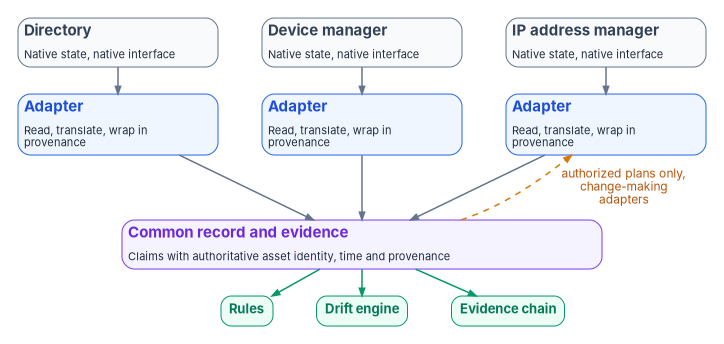
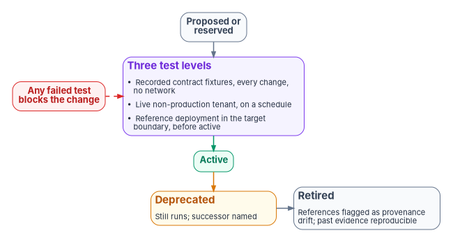

# Chapter 08 — The Adapter Model

*Every platform speaks its own language. An adapter translates that language into one record the program can govern, and the program doesn't have to learn any platform's dialect as a result.*

::: {.callout-note}
## In this chapter
What an adapter is and what it isn't. The two kinds, read-only and change-making, and why the program keeps them in separate lists. The five missions an adapter can serve. The contract every adapter declares and the invariants it can't opt out of. Why read-only comes first, how adapters are versioned against platform APIs that change underneath them, how an adapter earns active status and how it retires. How the model keeps the program platform-neutral, what an authorizing official gains from it, and its limits.
:::

## An overlay, not a replacement

The Federal Modernization Program doesn't replace the platforms an agency already runs. The directory, the device manager, the IP address manager, the ticketing system, the firewall manager and the cloud console stay where they are, each holding its own state in its own format behind its own interface. The program's authoritative record ([Chapter 03](03-one-authoritative-record.md)) needs to know what each of them holds, and in a smaller number of cases needs to change it.

An adapter is the piece that does that. It is a translator with a fixed job: read one platform's native state through that platform's own interface and express it in the program's common record, wrapped in the provenance envelope of [Chapter 07](07-evidence-over-attestation.md#the-provenance-envelope). A change-making adapter also does the reverse: it takes an authorized plan written in the common record's terms and turns it into the platform's own calls. Either way, the platform's idiosyncrasies stop at the adapter. The rules, the drift engine and the evidence chain see one record, whichever vendor's product produced it.

{#fig-ch08-adapter-translation fig-alt="Three slate platform cards at the top, a directory, a device manager and an IP address manager, each labeled native state, native interface. Each points down to its own blue adapter card: read through the platform's interface, translate to the common record, wrap in the provenance envelope. All three adapters point down to one violet card, the common record and evidence: claims with asset identity, time and provenance. From it, three green pills: rules, drift engine, evidence chain. A dashed amber arrow labeled authorized plans only, change-making adapters, runs from the common record back up to one of the adapters."}

An adapter is deliberately narrow. It doesn't hold rules: what the record should say lives in the rule layers of [Chapter 05](05-deterministic-governance.md#three-layers-of-rules), and an adapter that embedded its own policy would be a second, unreviewed source of truth. It doesn't decide: the drift engine classifies, the actuation ladder sets the ceiling and a named role approves ([Chapter 06](06-the-drift-engine.md)). And it never edits the authoritative record itself. It reports what it observed, and the record changes only through the controlled path in [Chapter 04](04-change-control-and-provenance.md).

The platform host that runs the adapters is described in [Book 01, Chapter 03](../b01-transformation-arc/03-platform-foundation.md), which gives adapter dispatch its own role and keeps the governance layer that decides separate from the execution layer that calls adapters. [Book 02, Chapter 04](../b02-identity/04-the-hidden-migration-surface.md#the-adapter-interface) applies the model to the services that depend on Active Directory.

## Two kinds: read-only and change-making

Every adapter declares one of two classes.

- **Conformance adapters are read-only.** They observe state and emit claims. They never change the platform. A policy assessor that compares a tenant's configuration with a baseline is the typical example.
- **Modernization adapters are change-making.** They move a platform toward a target state on authorized plans: moving identities from Active Directory to Microsoft Entra ID, reshaping the addressing plan, retiring a dependency. They also read, because every change starts and ends with a read.

The program keeps the two classes in two separate lists, one file each, and a single schema constrains both. The separation is by file rather than by a field inside one file so that a reviewer can check the most important invariant before reading any code: a read-only adapter appearing in the change-making list, or a change to the change-making list that the reviewer didn't expect, is visible in the change itself. The change-making list is, in effect, the grant of authority to write.

| | Conformance adapter | Modernization adapter |
|---|---|---|
| Behavior | Observes state and emits claims | Changes state toward a target, on authorized plans |
| Changes the platform | Never | Only through an authorized plan |
| Changes the authoritative record | Never | Never directly; through the change-control path |
| Actuation ladder | L1 Observe | Up to the operation class's ceiling; L3 gated actuation by default |
| Where it is listed | The read-only list | The change-making list |

: The two adapter classes {.striped .hover}

The ladder row ties this chapter to [Book 01, Chapter 11](../b01-transformation-arc/11-analysis-plan-delivery.md): a conformance adapter lives at L1, collecting actual state and supporting drift detection with no writes. A modernization adapter is what the delivery stage calls at L3, after a human has authorized the plan and a dry run has passed. The few enumerated low-risk classes that may run at L4 run through modernization adapters too. Nothing at L4 is possible through a conformance adapter, by construction.

## Five missions

Every adapter also declares exactly one mission: the concern it primarily serves.

| Mission | What the adapter is for | Examples |
|---|---|---|
| Identity | Who and what exists, and their attributes | Directory readers, HR-feed connectors, migration of identities between directories |
| Telemetry | What happened, and when | Log and event collection, health signals from the program's own host |
| Policy | Whether state matches a baseline | Secure-configuration assessors, baseline comparators |
| Enforcement | Whether the controls that act are in place and acting | Conditional access, network access control, firewall rule state |
| Integration | Moving governed work between systems | Ticketing, change management, the authorization tooling |

: The five adapter missions {.striped .hover}

Two classes by five missions makes ten cells, and every adapter sits in exactly one. There is no "miscellaneous" mission. A tool that serves two missions is split into two adapters, each with its own declaration, its own evidence and its own tests. That is a design choice with a cost (more adapters to maintain) and a benefit: the authorizing official can read the evidence by mission and map it to controls without untangling what a multi-purpose connector was doing at the time.

## The contract

An adapter is defined by its declaration, not its code. The declaration is an entry in one of the two lists, schema-validated on every change. The example below shows the shape.

::: {.callout-warning}
## Illustrative, not production code
The entry below shows the shape of an adapter declaration in the program's design. Field names and values are illustrative, not a published schema, and the entry has not been validated against a production tenant. Check every permission against current Microsoft Learn documentation, and grant the least set your own adapter needs, before relying on it.
:::

```yaml
- id: entra-directory
  name: Microsoft Entra ID directory reader
  class: conformance               # conformance (read-only) | modernization (change-making)
  mission-class: identity          # identity | telemetry | policy | enforcement | integration
  status: active                   # proposed | reserved | active | deprecated | retired
  version: 2.3.1                   # the adapter's own version
  platform-api:
    name: microsoft-graph
    version: v1.0                  # pinned; never beta in production
    cloud: global                  # global (also Microsoft 365 GCC) | gcc-high | dod
  permissions:                     # application permissions, all read-only
    - User.Read.All
    - GroupMember.Read.All
    - Policy.Read.All
  evidence-class: interval         # interval | continuous
  retention-years: 3               # program default; the records schedule governs
  invariants:
    boundary: system-boundary      # runs inside the declared boundary, or names its exception
    record-mutation: never         # never edits the authoritative record
    certificate-anchored: true     # emits under an identity bound to a certificate
    object-identity-only: true     # claims resolve to identified objects, not free text
  successor: null                  # set when deprecated
```

Four invariants apply to every adapter, whatever its class or vendor.

| Invariant | What it means |
|---|---|
| Boundary | The adapter runs inside the authorization boundary declared for the system, or its declaration names the specific exception and the decision that allowed it ([Book 10](../b10-cloud-boundary/index.md)). |
| No edits to the record | No adapter writes the authoritative record. A read-only adapter never writes anything; a change-making adapter writes only to its platform, only on an authorized plan. |
| Certificate-anchored | The adapter emits claims under its own workload identity, bound to a certificate, so every claim's issuer can be resolved ([Book 07](../b07-pki/index.md)). |
| Object identity only | Every claim refers to an identified object (a user, device, address or group by its authoritative identifier), not to a display name or a free-text string. This is what makes the join in [Book 12, Chapter 02](../b12-security-operations/02-the-evidence-contract.md#the-join-key-authoritative-asset-identity-plus-time) possible. |

: Invariants every adapter inherits {.striped .hover}

What the adapter must emit is fixed by the rest of the program: records in the shape of [Book 12's evidence contract](../b12-security-operations/02-the-evidence-contract.md#the-contract-one-record-every-source), each wrapped in the provenance envelope of [Chapter 07](07-evidence-over-attestation.md#the-provenance-envelope), with the adapter's identifier and version in every transformation step. An emission outside the declared envelope (a claim the adapter isn't declared to produce, or a write from a read-only adapter) is an authorization drift finding, and a declaration that breaks the schema is a schema drift finding when the change is proposed ([Chapter 06](06-the-drift-engine.md#the-programs-drift-model-five-classes)).

## Read-only first

The program's default is that every platform is reached by a read-only adapter before any change-making adapter touches it, and that many platforms are never reached any other way. There are four reasons.

- **Discovery comes before change.** A migration planned without an accurate picture of current state is a migration that breaks things. [Book 02, Chapter 07](../b02-identity/07-read-only-discovery.md) makes the same argument for Active Directory.
- **Least privilege is a control.** SP 800-53 AC-6 asks organizations to allow only the accesses "necessary to accomplish assigned organizational tasks."[^c08-sp80053] Observation needs read permissions. Microsoft's guidance for Microsoft Graph says the same thing in platform terms: grant the app the minimum permission it needs for the operation, and treat broad permissions such as `Directory.Read.All`, which it calls the highest-privileged read-only permission for Entra ID resources, with caution.[^c08-graph-perms]
- **A read-only adapter can be approved quickly.** An adapter that can't change anything carries far less risk, so it can go through review and into production well before any change-making counterpart, and the evidence starts flowing sooner.
- **Every write needs a read on each side.** The delivery stage in [Book 01, Chapter 11](../b01-transformation-arc/11-analysis-plan-delivery.md) compares live state with the expected-before state, writes, then re-reads and compares with the expected-after state. The read path is used either way.

Read-only has to be verified, not assumed. CISA's ScubaGear is a useful example because it is a read-only assessor in purpose. Its Microsoft Graph application permissions all end in `.Read` (among them `Directory.Read.All`, `Policy.Read.All` and `RoleManagement.Read.Directory`), and most of its product checks run under the Global Reader role. But its documentation lists Power Platform Administrator, with a Power Apps for Office 365 license, as the role needed to assess Power Platform, and notes that a Global Administrator always has the necessary permissions.[^c08-scuba-perms] A tool built to observe can still be run under an identity that is able to change things. The adapter's declaration should therefore list the permissions and roles it holds, and the conformance check should compare what the identity is actually granted with what is declared. An identity holding more than its declaration says is a finding, whatever the code does. [Book 11, Chapter 09](../b11-zero-trust/09-running-the-assessment.md#scubagear-as-a-registered-adapter) shows ScubaGear registered this way.

A change-making adapter runs under a different identity from its read-only counterpart, with separate credentials and a separate log stream. That is the separation of governance and execution from [Book 01, Chapter 03](../b01-transformation-arc/03-platform-foundation.md) applied to a single platform: revoking the change-making identity stops all writes and leaves observation and evidence running.

## Versioning

An adapter sits between two things that change on different schedules: the program's common record and the platform's API. Each needs its own version, and the adapter has to record both.

**The adapter's own version.** The program uses Semantic Versioning for adapters: a major version for an incompatible change to what the adapter emits, a minor version for backward-compatible additions and a patch version for backward-compatible fixes.[^c08-semver] Because every claim's transformation chain names the adapter and its version, an assessor regenerating a past window knows which adapter version produced it, and the program can re-run that version against the archived inputs ([Chapter 05](05-deterministic-governance.md#honest-limits)).

**The platform's API version.** The adapter pins the API version it was tested against. For Microsoft Graph, Microsoft's policy is that v1.0 holds the generally available APIs "ready for production use," that beta APIs can change or be deprecated and that "use of beta APIs in production applications is not supported." Microsoft declares a version, or a generally available API, deprecated at least 24 months before retiring or removing it.[^c08-graph-versioning] The program's rule follows: production adapters pin v1.0. Where a capability exists only in beta, which Microsoft's documentation shows for a number of features, the declaration says so, the dependency is recorded as a known risk with an owner, and the adapter's tests run against the beta surface more often. The program's earlier drafts defaulted one device-management adapter to beta without recording that as a risk; the declaration is where that decision has to be visible.

**Tolerating additive change.** Microsoft lists additions such as new nullable properties and new enumeration members as backward-compatible, and advises that clients "should be prepared to receive properties and derived types not previously defined."[^c08-graph-versioning] An adapter that fails on an unknown property breaks every time the platform improves. An adapter that silently passes an unknown value into the record corrupts it. The program's design does neither: unknown properties are ignored by the translation, and an unknown enumeration value becomes a semantic drift finding for a person to classify.

**The cloud the platform lives in.** The same API has different endpoints in different clouds. Microsoft Graph's global endpoint, `https://graph.microsoft.com`, also serves Microsoft 365 GCC; GCC High uses `https://graph.microsoft.us` and DoD uses `https://dod-graph.microsoft.us`, and an access token issued for one cloud can't be used in another.[^c08-graph-clouds] An adapter resolves its endpoint from the declared cloud rather than a hard-coded host name, and an unknown cloud fails at start-up instead of falling back to a default. That is what lets one adapter serve tenants in different clouds without per-tenant rewrites, and it is what [Book 10](../b10-cloud-boundary/index.md) means by treating the boundary as a declared fact.

## Earning active status, and retiring

{#fig-ch08-adapter-lifecycle fig-alt="A top-to-bottom flow. A slate pill, proposed or reserved, a declared name with no capability claimed, leads to a violet card of three test levels: recorded contract fixtures on every change with no network, a live non-production tenant on a schedule, and a reference deployment in the target boundary before the adapter may be called active. An arrow leads to a green pill, active. From active, an amber arrow leads to an amber card, deprecated, still running with a successor named, and beside it a slate card, retired, where references are flagged as provenance drift and past evidence stays reproducible from archived state. A red pill labeled any failed test blocks the change points to the test card."}

An adapter's status isn't self-asserted. In the program's design an entry moves through five states.

1. **Proposed** and **reserved.** A name and a declaration, with no claim of capability. Reserved names are a published roadmap of slots, not a statement that the program can do something today.
2. **Active**, earned through tests at three levels. Recorded contract fixtures run on every change, with no network access, and prove the adapter's translation against known platform responses. A live non-production tenant runs on a schedule and catches platform changes the fixtures can't. A reference deployment inside the target boundary runs before the adapter may be called active for that boundary and periodically after, and its results are themselves evidence. A failed test at any level blocks the change.
3. **Deprecated**, with a successor named. A deprecated adapter still runs, so evidence doesn't stop while the successor is brought up.
4. **Retired.** The adapter no longer runs. Any remaining reference to it, in a mapping or a rule, is a provenance drift finding, so nothing silently keeps depending on it. Its past evidence stays reproducible from archived inputs and the archived adapter version.

Retirement is a transition in the record, not a deletion. That is what lets the program change vendors or replace an adapter without losing the history an authorizing official has already relied on.

## Platform neutrality and lock-in

The adapter model is the program's main defense against lock-in, and it works at three levels.

**Between vendors.** The common record belongs to the agency and is defined by the program, not by any vendor. Replacing one IP address manager, ticketing system or device manager with another means writing or acquiring a new adapter that emits the same record. The rules, the drift engine, the evidence chain and the authorization artifacts don't change. This book names products only as examples; the model doesn't depend on any of them, and nothing here is an endorsement.

**Between the program and its tools.** The program's own tooling is not exempt. The record, the adapter declarations and the evidence bundles are files in a governed repository the agency owns, in documented formats, and the package artifacts use NIST's OSCAL models. OSCAL's component definition model is a published way for a product's supplier to describe the controls the product supports, and NIST notes that component definitions are authored by the vendors of products or services.[^c08-oscal-component] Where a vendor publishes one, the adapter can consume it instead of the program writing its own description of the product. [Chapter 05](05-deterministic-governance.md#what-changes-for-the-program) makes the related point that evidence assembled this way doesn't depend on one governance, risk and compliance tool to present it.

**Between clouds.** Endpoint resolution by declared cloud, and the boundary invariant, mean the same adapter code serves commercial, GCC, GCC High and DoD tenants where the platform's API exists in each. Where a feature doesn't exist in a cloud, the adapter records a boundary finding rather than a pass or a failure ([Book 11, Chapter 09](../b11-zero-trust/09-running-the-assessment.md#the-government-cloud-boundary-case)).

The model doesn't make lock-in disappear. It moves it to the adapter, which is small, specified and replaceable, and to the common record's schema, which the agency controls. SP 800-53 SA-9 asks organizations to define their oversight of external service providers and monitor their control compliance on an ongoing basis;[^c08-sp80053] a read-only adapter per provider platform is one concrete way to do the monitoring part.

## What an authorizing official gains

- **An evidence trail per adapter.** Every finding is labeled by class and mission, so the authorizing official can map evidence to controls by mission and see which adapter produced what.
- **Read-only evidence kept apart from change-making evidence.** Observations from an assessor that can't change anything are structurally distinct from records of changes, and can be weighed differently.
- **Invariants that can be checked by inspection.** Boundary, record mutation, certificate anchoring and object identity are declared in a schema-validated entry, not described in a narrative.
- **History that survives change.** A retired adapter's evidence stays reproducible, and a vendor change doesn't reset the evidence trail.

## Honest limits

- **The taxonomy is opinionated.** Tools that don't fit one mission must be split, and some splits are awkward. The alternative, a catch-all category, would make the evidence harder to read.
- **Adapters are engineering work.** The program provides the contract, the lists and the tests. Someone still has to write, test and maintain each adapter, and platform API changes keep that work going. Most entries in the program's lists are reserved names, not active adapters, and should be described that way.
- **Drift detection finds violations after the fact.** A read-only adapter that is granted write permissions, or a change-making adapter that writes outside its plan, is caught by the permission comparison and the drift engine, not prevented by the declaration. Preventing it is the job of identity and access controls on the adapter's workload identity.
- **Continuous capture is uneven.** Many adapters collect on an interval, which is deterministic per interval but not continuous ([Chapter 07](07-evidence-over-attestation.md#honest-limits)).

## Key takeaways

- An adapter translates one platform's native state into the program's common record, with provenance. It holds no rules, makes no decisions and never edits the authoritative record.
- Read-only and change-making adapters are kept in separate lists, so the grant of write authority is visible in a file a reviewer can check.
- Every adapter declares one class and one mission and inherits four invariants: boundary, no edits to the record, certificate-anchored and object identity only.
- Read-only comes first, and read-only is verified by comparing granted permissions with the declaration.
- Adapters version themselves, pin the platform API (v1.0, not beta, for Microsoft Graph in production), resolve endpoints by cloud, tolerate additive change and retire with a named successor.
- Lock-in moves to small, replaceable adapters and a record schema the agency owns.

::: {.callout-tip}
## Continue the book
[← Previous: Chapter 07 — Evidence Over Attestation](07-evidence-over-attestation.md) · [Book index](index.md) · [Next: Chapter 09 — Who Governs →](09-who-governs.md)
:::

[^c08-sp80053]: National Institute of Standards and Technology, SP 800-53 Rev. 5, *Security and Privacy Controls for Information Systems and Organizations*, controls AC-6 and SA-9, <https://csrc.nist.gov/pubs/sp/800/53/r5/upd1/final>; control text checked against the release 5.2.0 OSCAL catalog, <https://github.com/usnistgov/oscal-content/blob/main/nist.gov/SP800-53/rev5/json/NIST_SP-800-53_rev5_catalog.json> (both accessed Oct 21, 2026).
[^c08-graph-perms]: Microsoft Learn, "Overview of Microsoft Graph permissions," section "Best practices for using Microsoft Graph permissions," <https://learn.microsoft.com/graph/permissions-overview> (accessed Oct 21, 2026).
[^c08-scuba-perms]: Cybersecurity and Infrastructure Security Agency, ScubaGear v1.8.0 documentation, "Interactive Permissions" (user roles and application permissions), <https://github.com/cisagov/ScubaGear/blob/v1.8.0/docs/prerequisites/interactive.md> (accessed Oct 21, 2026).
[^c08-semver]: Semantic Versioning 2.0.0, summary, <https://semver.org/> (accessed Oct 21, 2026).
[^c08-graph-versioning]: Microsoft Learn, "Versioning, support, and breaking change policies for Microsoft Graph," sections "Support policy and deprecation information," "API contract and nonbackward compatible changes" and "Versions," <https://learn.microsoft.com/graph/versioning-and-support> (accessed Oct 21, 2026).
[^c08-graph-clouds]: Microsoft Learn, "Microsoft Graph national cloud deployments," sections "Microsoft Graph and Graph Explorer service root endpoints" and the note on access tokens, <https://learn.microsoft.com/graph/deployments> (accessed Oct 21, 2026).
[^c08-oscal-component]: National Institute of Standards and Technology, OSCAL, "Component Definition Model," <https://pages.nist.gov/OSCAL/learn/concepts/layer/implementation/component-definition/> (accessed Oct 21, 2026).
