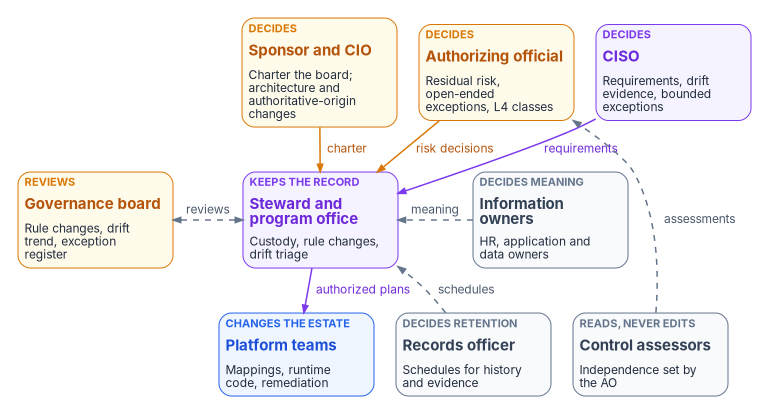
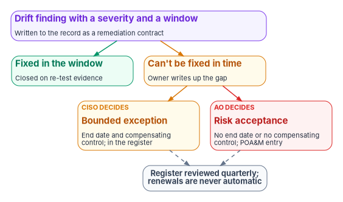

# Chapter 09 — Who Governs

*A governance platform can detect every drift and still decay, because the platform can't decide anything; the record stays true only while named people own its content, approve its rules, answer its findings and sign for the gaps it can't close.*

::: {.callout-note}
## In this chapter
Why the machinery in Chapters 03 to 08 needs owners, and where the federal roles come from: NIST SP 800-37 and SP 800-137, the configuration change control element in SP 800-53, and the records regulations. Five questions get one owner each: who keeps the authoritative record and who decides what it says, who approves rule changes, who reviews drift, who accepts exceptions, and who keeps the record as a federal record. Then the governance board and its cadence, the authorizing official's role, a responsibility matrix consistent with the program's other Who chapters, and the separations that stop the governors from marking their own work.
:::

The earlier chapters of this book describe a machine. One authoritative record holds desired state ([Chapter 03](03-one-authoritative-record.md)). Every change to it is controlled and provenanced ([Chapter 04](04-change-control-and-provenance.md)). Rules evaluate the same way every time ([Chapter 05](05-deterministic-governance.md)). The drift engine compares the estate with the record and writes a remediation contract for every difference ([Chapter 06](06-the-drift-engine.md)). Evidence comes from systems rather than from people's assurances ([Chapter 07](07-evidence-over-attestation.md)), through adapters that translate each platform into the same shape ([Chapter 08](08-the-adapter-model.md)).

None of that decides anything. A drift finding is a question: should the estate change to match the record, should the record change to match the estate, or should the agency carry the difference for a while? The machine can answer the first question for routine classes, as [Chapter 10](10-ticket-to-machine.md) describes. The other two need a person with the authority to answer them. Governance decays the same way compliance does. If nobody owns a rule, it goes stale. If nobody reads the findings, they pile up. If nobody signs for an exception, it becomes permanent. The record then describes an estate that no longer exists, and it does so with full provenance.

This chapter names the owners. It applies the program-wide model in [Book 01, Chapter 09](../b01-transformation-arc/09-who-leads-the-transformation.md) and the running mechanics in [Book 00, Chapter 07](../b00-orientation/07-who-runs-the-program.md) to the governance platform itself, and it agrees with [Book 12, Chapter 10](../b12-security-operations/10-who-runs-security-operations.md), which assigns the same kinds of decision for security operations. Where those chapters go deeper for their domain, they govern. The model below is the program's recommended design. Adapt it to the agency's structure, but keep one decider per row.

{#fig-ch09-who-governs fig-alt="Three rows of cards. Top row, decision makers: the sponsor and CIO in amber, who charter the board and decide architecture and authoritative-origin changes; the authorizing official in amber, who decides residual risk, open-ended exceptions and L4 classes; and the CISO in violet, who decides requirements, drift evidence and bounded exceptions. They send arrows labeled charter, risk decisions and requirements to a violet card in the middle row, the steward and program office, which keeps the record: custody, rule changes and drift triage. Beside it, an amber card for the governance board, which reviews rule changes, the drift trend and the exception register, is joined to the steward by a dashed two-way arrow labeled reviews; and a slate card for information owners, HR, application and data owners, who decide meaning, sends a dashed arrow labeled meaning to the steward. The steward sends authorized plans down to a blue card for platform teams, who own mappings, runtime code and remediation. A slate card for the records officer, who decides schedules for history and evidence, sends a dashed arrow labeled schedules to the steward, and a slate card for control assessors, who read but never edit and whose independence the authorizing official sets, sends a dashed arrow labeled assessments to the authorizing official."}

## Where the roles come from

Federal guidance doesn't describe a governance platform, but it describes every role the platform needs, and in two places it describes the platform's job.

**NIST SP 800-37 Rev. 2** supplies the decision rights. The authorizing official is "the only organizational official who can accept the security and privacy risk to organizational operations, organizational assets, and individuals," and approves plans, plans of action and milestones, and determines whether significant changes to a system require reauthorization. For federal agencies the role is assigned to government personnel only, and a designated representative can do everything except make and sign the authorization decision.[^c09-sp80037] The same appendix defines the **information owner or steward** as the official with authority over specified information and responsibility for the policies governing its generation, collection, processing, dissemination and disposal; that person may or may not be the system owner.[^c09-sp80037] It defines the **risk executive (function)**, led by the senior accountable official for risk management, which can be filled by one office or by a designated group such as "a risk board, executive steering committee, executive leadership council."[^c09-sp80037] And it asks organizations to make sure there are no conflicts of interest when one person holds several risk management roles.[^c09-sp80037]

The RMF's tasks put continuous monitoring on the same people. The organization-wide continuous monitoring strategy (task P-7) belongs to the senior accountable official for risk management or the risk executive (function), who approves it, "including the minimum frequency with which controls are to be monitored." The strategy should say how ongoing assessments use automated tools and how controls that can't be monitored automatically are assessed.[^c09-sp80037-tasks] Monitoring the system for changes (M-1) belongs to the system owner or common control provider with the senior agency information security officer, and its discussion asks organizations to monitor for unauthorized changes and find their root cause, not only to follow the configuration management process.[^c09-sp80037-tasks] The ongoing authorization decision (M-6) belongs to the authorizing official alone.[^c09-sp80037-tasks]

**NIST SP 800-137** applies the same roles to continuous monitoring. The risk executive (function) oversees the strategy and program and reviews its status reports as input to risk-tolerance decisions. The CIO leads the program and works with authorizing officials to fund it. The senior information security officer establishes and maintains it, develops configuration management guidance, consolidates plans of action and milestones, and acquires or maintains the automated tools that support it. The authorizing official reviews security status reports and decides whether the risk from operating the system remains acceptable. The system owner conducts security impact analyses on changes and remediates to keep the system authorized.[^c09-sp800137] The publication also requires the strategy itself to be reviewed. Organizations establish a procedure for reviewing every aspect of it, from the relevance of the metrics to the monitoring frequencies, and change it when, among other things, risk tolerance, the threat, the architecture or the count of plans of action and milestones changes.[^c09-sp800137]

**SP 800-53** supplies the board. CM-3, configuration change control, asks the organization to decide which changes are configuration-controlled, review and approve or disapprove them with explicit consideration of security and privacy impact, document the decisions, retain records of the changes, and coordinate and oversee the process through an organization-defined "configuration change control element" that meets on a defined schedule or when defined conditions arise. CM-3(4) requires organization-defined security and privacy representatives to be members of that element.[^c09-sp80053] Both CM-3 and CM-3(4) are in the Moderate baseline.[^c09-sp80053b] In the program's model, the governance board is the change control element for the authoritative record.

**The records regulations** supply the last owner. Each agency must assign records management responsibility to a person and office with the authority to carry it out, and must build records management requirements into the design, development and implementation of its electronic systems.[^c09-cfr1220] The authoritative record, its history and its evidence are records. Someone has to decide how long they last.

Two federal structures already exist that the program should use rather than duplicate. OMB M-19-17 requires each agency to designate an integrated, agency-wide ICAM office, team or other governance structure, including the offices of the CIO, CFO, Human Resources, General Counsel, CISO, the Senior Agency Official for Privacy, the Chief Acquisition Officer and physical security.[^c09-m1917] And the risk executive (function) already exists in some form in every agency that runs the RMF. The governance board described below can sit alongside either, report to either, or be chartered as a working group of one of them. What matters is that it has a written charter and that its members are named.

## Five questions, one owner each

### Who keeps the authoritative record, and who decides what it says

These are two jobs, and the program keeps them apart.

The **steward** keeps the record. In [Book 00, Chapter 07](../b00-orientation/07-who-runs-the-program.md#who-decides-what), the steward leads the program office and owns the plan and the repository. For this book that means custody: the repository's branch protections, who may approve and merge, the checks that run on every change, backups, and the platform that runs the rules and the drift engine. The steward decides governance artifacts' status, naming and schema, with the steward's review required on the pull request. The steward is accountable for the record being intact, current and available.

The steward does not decide what the facts mean. Each fact in the record has an **information owner**, in SP 800-37's sense.[^c09-sp80037] HR decides what a worker type or an organization code means ([Book 03](../b03-hr-identity/index.md)); an application owner decides who should have access to the application ([Book 04](../b04-access/index.md)); a data owner decides how data is classified ([Book 06](../b06-data-platform/index.md)); the CISO decides what a control requirement says. The record holds their decisions, with provenance pointing back to the decision. A steward who edits a fact to make a drift finding go away has made a decision that belonged to someone else.

The program's word "steward" collides with SP 800-37's "information owner or steward." In this workbook the steward is the program role that keeps the record; the information owners are the many officials who decide what the facts in it mean. Agencies that already use "data steward" for the second meaning should rename one of them in the charter.

### Who approves rule changes

[Chapter 05](05-deterministic-governance.md#reviewing-rules) splits the rules into three layers, each with its own review. This chapter adds the decider.

| Change | Reviewed by | Decided by | Recorded as |
|---|---|---|---|
| An authoritative rule (layer 1) inside the agreed architecture | The governance board | The steward | A decision record linked from the rule's provenance |
| An authoritative rule that encodes a control requirement, such as authentication strength, a configuration baseline or a logging floor | The governance board | The CISO; the steward implements | The requirement committed as policy; the rule cites it |
| A rule that changes the target architecture or the rules for authoritative origin | The governance board | The steward with the sponsor's recorded concurrence | Decision record plus the sponsor's concurrence ([Book 00, Chapter 07](../b00-orientation/07-who-runs-the-program.md#who-decides-what)) |
| A policy mapping (layer 2) | Schema validation and the steward | The owner of the adapter or indicator | A schema-validated diff of the registry |
| Runtime enforcement code (layer 3) | Engineering review with tests | The owning platform team | Test results and the commit |
| A change to the governance platform itself: the rule engine, the drift classifier, severity thresholds | The governance board, and a reviewer outside the program office | The steward | Decision record and a signed commit |
| Raising an operation class from L3 to L4 on the actuation ladder | The governance board and the CISO | The authorizing official | A recorded risk acceptance with the class's conditions ([Chapter 10](10-ticket-to-machine.md#approval-gates-keep-humans-on-the-decisions-that-matter)) |

Three rows need comment.

The **control-requirement row** keeps the CISO's decision with the CISO even when it is written as code. A rule that sets the minimum authentication strength is a requirement, and in [Book 01, Chapter 09](../b01-transformation-arc/09-who-leads-the-transformation.md#decision-rights-across-the-program) requirements are the CISO's. The steward turns the decision into a rule; the steward doesn't make it.

The **platform row** covers the most dangerous change in the system: a change to the thing that decides what counts as drift. A classifier tuned to ignore a class, or a threshold raised until a noisy finding disappears, removes evidence as surely as deleting it. The program therefore requires a reviewer from outside the program office, typically from the CISO's staff, on every such change. That is the program's reading of CM-3(4).[^c09-sp80053]

The **L4 row** gives the authorizing official the decision, as [Book 12, Chapter 11](../b12-security-operations/11-detection-engineering-and-response.md#the-response-ladder) does for autonomous containment. Letting a machine close the loop without a person, for a whole class of change, accepts the risk that it will be wrong at machine speed. The gated ceiling of [Book 01, Chapter 11](../b01-transformation-arc/11-analysis-plan-delivery.md#how-far-automation-may-go) is the default because it is a posture an authorizing official can sign. Each exception to that default needs a signature.

### Who reviews drift

Drift review has three layers, from the finding to the trend.

The **program office triages.** Every finding arrives as a remediation contract with a class, a severity, a window and an escalation path ([Chapter 06](06-the-drift-engine.md)). The program office checks that each one is routed to the right owner, that the window is running, and that anything the machine can't fix has a human assigned. It doesn't fix findings itself.

The **owner of the affected system remediates.** In the program's model the system owner decides how a finding on the system is remediated and on what schedule within the window, and the platform team does the work, as in [Book 12, Chapter 10](../b12-security-operations/10-who-runs-security-operations.md#the-responsibility-matrix). SP 800-137 gives the system owner the remediation activities needed to keep the system authorized.[^c09-sp800137] Where the finding is that the record is wrong, the information owner for that fact decides, and the correction goes through the rule-change table above.

The **CISO decides on the evidence, and the board watches the trend.** The program-wide matrix gives the CISO the decision on continuous monitoring evidence and drift findings ([Book 01, Chapter 09](../b01-transformation-arc/09-who-leads-the-transformation.md#decision-rights-across-the-program)): whether a finding class is serious enough to stop a wave, whether a closure carries enough proof, whether a source that stopped reporting is an incident. The governance board reviews the drift trend, the share of findings closed inside their windows, and the escalation rate, which [Chapter 10](10-ticket-to-machine.md#what-the-tempo-shows-leadership) defines. A rising trend is the board's signal that something upstream, a process, a team or a rule, is producing drift faster than it is closed.

### Who accepts exceptions

A finding that can't be closed inside its window isn't closed by exception. It is carried, by a named decision, with an end date. The program uses the time split Books 05, 08, 09, 11 and 12 already use ([Book 12, Chapter 10](../b12-security-operations/10-who-runs-security-operations.md#who-accepts-the-risk-of-what-isnt-seen)), together with [Book 04, Chapter 06](../b04-access/06-who-decides-access.md#exceptions)'s rule that an exception leaving a control unmet with no compensating control is a risk acceptance.

{#fig-ch09-exception-routing fig-alt="A violet card at the top, a drift finding with a severity and a window, written to the record as a remediation contract. A green arrow leads to a green card, fixed in the window and closed on re-test evidence. An amber arrow leads to an amber card, can't be fixed in time, where the owner writes up the gap. From it, an amber arrow leads to an amber card labeled CISO decides, a bounded exception with an end date and a compensating control, recorded in the register; and a red arrow leads to a red card labeled AO decides, a risk acceptance for a gap with no end date or no compensating control, with a plan of action and milestones entry. Both send dashed arrows to a slate pill: the register is reviewed quarterly and renewals are never automatic."}

- **A bounded exception** has an end date and a compensating control. The system owner or platform team writes it up, the steward records it in the exception register, and the CISO approves it.
- **A risk acceptance** is anything without an end date or past the agency's limit, or anything that leaves a control unmet with no compensating control. The CISO recommends; the authorizing official for the affected system decides; the item enters the plan of action and milestones. SP 800-53's CA-5 requires that plan to document planned remediation and to be updated from assessments, audits and continuous monitoring, and SP 800-37 gives its approval to the authorizing official.[^c09-sp80053][^c09-sp80037]

The register is reviewed quarterly by the board. No exception renews automatically. An exception renewed twice goes to the CISO and the authorizing official as a sign that the rule, or the system, needs to change, which is the rule [Book 04, Chapter 06](../b04-access/06-who-decides-access.md#exceptions) applies to application access. And an exception never edits the rule. The rule stays as written, the exception is a separate record that points at it, and the drift engine keeps reporting the difference, marked as excepted, until the end date. That way an excepted setting never looks like a passing one ([Book 12, Chapter 12](../b12-security-operations/12-evidence-metrics-and-continuous-monitoring.md#the-metric-set)).

### Who keeps the record as a record

The authoritative record is a recordkeeping system whether or not anyone calls it one. Its commit history documents who changed configuration-controlled settings, who approved them and when, which is exactly what CM-3 asks the organization to retain.[^c09-sp80053] Its evidence packets document control operation. Its decision records document how the agency governed its systems.

The **records officer** decides how long each class lasts and when it may be destroyed; the steward implements the schedule; the CISO is consulted. NARA's General Records Schedule 3.1 covers configuration and change management records, including documents "identifying, requesting, and analyzing possible changes, authorizing changes, and documenting implementation of changes," and schedules them for destruction five years after the system is superseded, terminated, defunded or no longer needed, with longer retention authorized for business use. Its item for IT oversight and compliance records covers reports, responses to findings and metrics, kept five years after the activity is completed or superseded. GRS 3.1 also says it doesn't apply to system data or content.[^c09-grs31] Which item fits which artifact in the repository, and whether any of it is permanent, is the records officer's call. System access records, including audit trails, fall under GRS 3.2, which [Book 01, Chapter 09](../b01-transformation-arc/09-who-leads-the-transformation.md#records-management-and-privacy) covers for AD-era logs.

The regulations also say what the repository must be able to do. NARA requires records management controls for electronic systems that protect a record's reliability, authenticity, integrity, usability, content, context and structure, including protection against unauthorized addition, deletion, alteration, use and concealment, and audit trails that keep records complete and unaltered.[^c09-cfr1236] A governed repository already has most of these. Protected branches and signed commits protect authenticity. The commit history is an audit trail. Provenance links supply context. The one feature that undoes them is rewriting history. A force-push to a protected branch, or a purge of an old commit, destroys records. The program's rule is that history is never rewritten without the records officer's concurrence and the CISO's. If a credential is committed by mistake, it is revoked and rotated first, so the secret in the history is worthless, and any purge that follows is a recorded records decision.

The privacy office has a narrower role. The record holds attributes about people, and SP 800-37 makes the senior agency official for privacy responsible for reviewing systems that create or process personally identifiable information.[^c09-sp80037] The privacy office reviews any new attribute flow into the record before it lands, as [Book 01, Chapter 09](../b01-transformation-arc/09-who-leads-the-transformation.md#records-management-and-privacy) requires for attribute flows generally.

## The governance board

The program's governance board is the change control element for the authoritative record. In most agencies it is the program's steering committee ([Book 00, Chapter 07](../b00-orientation/07-who-runs-the-program.md#the-rhythm)) with a governance agenda added, rather than a second body.

| Member | Why |
|---|---|
| The steward, chairing | Keeps the record and decides layer-1 rule changes |
| Workstream leads | Own the platforms the rules govern and the findings the rules produce |
| A representative of the CISO | The security representative CM-3(4) requires;[^c09-sp80053] decides control-requirement rules and reviews platform changes |
| A representative of the privacy office | The privacy representative CM-3(4) requires |
| Information owners, as needed | HR, application and data owners when a rule touches their facts |
| The sponsor's delegate | Brings architecture and authoritative-origin changes to the sponsor |
| The records officer, quarterly and on request | Retention, disposition and any history rewrite |
| The authorizing official's designated representative, as an observer | Sees the drift trend and the exception register before they reach the authorizing official |

The board reviews. It doesn't vote. Every item on its agenda has one decider from the tables above, and the board's job is to make sure that person decides with the facts in front of them and that the decision is recorded. A board that decides by consensus has no one accountable for the decision.

The board should be chartered in writing: membership, the decisions it reviews, the decision record it produces, its quorum and how an urgent change is handled between meetings. The sponsor and CIO charter it, because they own the program's scope and funding. If the agency's risk executive (function) is itself an executive steering committee or risk board, as SP 800-37 allows,[^c09-sp80037] the governance board reports to it; it doesn't replace it.

### Cadence

The frequencies are the program's design, chosen to fit the program rhythm in [Book 00, Chapter 07](../b00-orientation/07-who-runs-the-program.md#the-rhythm) and the reporting rhythm in [Book 12, Chapter 12](../b12-security-operations/12-evidence-metrics-and-continuous-monitoring.md#the-reporting-rhythm).

| Forum | Frequency | Who | Output |
|---|---|---|---|
| Drift engine and record checks | Continuous; on every change and on schedule | The governance platform | Remediation contracts; a P1 halts and alerts the named role at once |
| Findings queue triage | Daily | Program office; platform team on call | Every finding routed, every window running, every escalation assigned |
| Evidence and drift review | Weekly (the program's Friday review) | Program office and workstream leads | Open findings by severity and age; closures without re-test evidence sent back |
| Governance board | Every two weeks, with the steering committee | Members above | Rule-change decisions, drift trend, decision log committed to the repository |
| CISO metric review | Monthly | CISO, steward | Drift and evidence metrics; open exceptions; findings past their window |
| Posture report to the authorizing official | Monthly, or on a significant change | System owners, with the steward and CISO | Changes to plans, assessments and plans of action and milestones; decisions needed |
| Exception register and L4 class review | Quarterly | Board, with the records officer | Every exception confirmed, closed or sent for renewal; every L4 class confirmed or withdrawn |
| Continuous monitoring strategy review | At least yearly, and on the triggers SP 800-137 lists | CISO prepares; the risk executive (function) approves | A revised strategy, minimum frequencies and metrics[^c09-sp800137][^c09-sp80037-tasks] |
| Board charter review | Yearly | Sponsor and CIO | A re-signed charter with current names |

Two rules cut across the table. A P1 doesn't wait for any forum: it halts the run and goes to the named role at once, and [Book 01, Chapter 12](../b01-transformation-arc/12-migration-roadmap.md#gates-rollback-and-authority) adds that a missed window on a priority-one finding goes to the steward and the sponsor. And a governance board meeting that has nothing to decide still meets. Its standing items, the drift trend, the escalation rate and the exceptions nearing their end dates, are the reason it exists.

## The authorizing official's role

The authorizing official sits outside the program and above the record. The role is small in time and large in consequence, and the program asks for four things from it.

1. **Risk acceptances.** Every gap that the program carries rather than closes reaches the authorizing official for the affected system in writing, with an end date or with the reason it has none: the open-ended exceptions above, missed remediation windows, and classes of change the platform can't reach. The authorizing official approves the plan of action and milestones that holds them.[^c09-sp80037]
2. **Ongoing authorization.** The authorizing official reviews posture on an ongoing basis and decides whether risk remains acceptable (task M-6), and SP 800-37 says automated tools, metrics and dashboards support that decision by consolidating posture data for decision makers.[^c09-sp80037-tasks] The drift trend, the share of findings closed inside their windows and the exception register are the governance platform's contribution to that review. They are only useful if they are regenerated from stored records and mean what they say ([Chapter 07](07-evidence-over-attestation.md)).
3. **Significant change.** The authorizing official decides whether a significant change requires reauthorization.[^c09-sp80037] A change to the authoritative-origin rules, the boundary or the actuation ceilings is the kind of change that question applies to, so the board sends those to the authorizing official's designated representative as they are decided, not afterwards.
4. **Assessor independence and the L4 classes.** The authorizing official sets the degree of independence assessors need for ongoing assessments,[^c09-sp80037] and, in the program's model, accepts each class of change allowed to run at L4.

The authorizing official doesn't approve rule changes, triage findings or chair the board. The designated representative can attend the board and do the day-to-day work, but the acceptance of risk can't be delegated.[^c09-sp80037] Because the role is assigned to government personnel only, a program office staffed largely by contractors can prepare every risk acceptance and can't sign one. Most agencies have several authorizing officials. Each accepts risk only for the systems and common controls they authorize, so the governance platform's own controls, the record, the drift engine and the evidence pipeline, need an authorizing official of their own when systems inherit them as common controls ([Book 12, Chapter 10](../b12-security-operations/10-who-runs-security-operations.md#the-soc-is-a-common-control-provider) makes the same point for the SOC).

## The responsibility matrix

D = decides (accountable) · R = does the work · C = consulted · blank = informed at most. "Info owners" means HR, application owners and data owners, each for their own facts.

| Decision or work item | Sponsor / CIO | CISO | AO | Steward / program office | Governance board | Platform teams | System owner / ISSO | Info owners | Records / privacy | Assessors |
|---|---|---|---|---|---|---|---|---|---|---|
| Charter the governance board; name the steward | D | C | C | R | | | | | | |
| Custody of the record: protections, merge rights, checks, backups | | C | | D, R | | R | | | C | |
| What a fact in the record means | | | | R | C | C | C | D | C (privacy) | |
| Control requirements written as rules | | D | C | R | C | R | C | | | |
| Authoritative rule change inside the agreed architecture | | C | | D, R | C | C | C | C | | |
| Rule change to the target architecture or authoritative origin | D | C | C | D, R | C | C | | C | | |
| Policy mapping change (layer 2) | | | | C | | D, R | C | | | |
| Runtime enforcement code (layer 3) | | C | | C | | D, R | | | | |
| Change to the governance platform: engine, classifier, thresholds | | C | | D, R | C | C | | | | |
| Raise an operation class to L4 | | R | D | R | C | C | C | | | |
| Drift triage and routing | | | | D, R | | R | C | | | |
| Remediation of a finding within its window | | C | | C | | R | D | C | | |
| Continuous monitoring evidence and drift findings | | D | C | R | C | R | C | | | |
| Bounded exception with end date and compensating control | | D | C | R | C | R | R | C | | |
| Exception with no end date, or no compensating control | | R | D | R | C | C | R | C | | C |
| Missed remediation window (plan of action and milestones) | | R | D | R | | C | R | | | C |
| Exception register review | | C | C | R | D | C | C | | C | |
| Retention and disposition of history, decisions and evidence | C | C | | R | | | | | D (records) | |
| Any rewrite or purge of repository history | | C | | R | | | | | D (records) | |
| Privacy review of a new attribute flow into the record | | C | | R | | C | | C | D (privacy) | |
| Posture reports to the AO | | R | C | R | | | D, R | | | |
| Ongoing authorization decision | C | C | D | R | | | R | | | C |
| Assessor independence for ongoing assessments | | C | D | | | | | | | R |

Six rows need comment.

The **register review** row is the one place the board decides. Confirming that each exception is still within its terms is a check of the register against its own conditions, not a risk decision, and the board is the forum that sees every exception at once. A finding from that review that changes risk, an exception that has failed its conditions, goes back to the CISO or the authorizing official under their rows.

The **two exception rows** split on time, as Books 05, 08, 09, 11 and 12 split them, and on Book 04's compensating-control rule. A bounded exception is a reviewable decision the CISO can make. An open-ended one is a standing risk acceptance.

The **remediation row** gives the system owner the decision, as [Book 12, Chapter 10](../b12-security-operations/10-who-runs-security-operations.md#the-responsibility-matrix) does. The steward doesn't decide how another team's system is fixed; the steward makes sure it is.

The **architecture row** has two deciders on purpose, the steward and the sponsor, because [Book 00, Chapter 07](../b00-orientation/07-who-runs-the-program.md#who-decides-what) requires both to concur on a change to the target architecture or to the rules for authoritative origin; it is the second deliberate exception to one decider per row, after gate G2.

The **evidence row** matches [Book 01, Chapter 09](../b01-transformation-arc/09-who-leads-the-transformation.md#decision-rights-across-the-program): the CISO decides on continuous monitoring evidence and drift findings. The missed-window row is what happens when a finding can't be closed in time, and it matches the risk-acceptance row in [Book 00, Chapter 07](../b00-orientation/07-who-runs-the-program.md#who-decides-what).

The **history rows** give the records officer the decision because, once history is rewritten, the record of who changed what is gone for an audit, an investigation or a legal hold, the same reasoning Book 01 gives for AD-era logs.

One decision sits above every column. The organization-wide continuous monitoring strategy, with its minimum monitoring frequencies, is approved by the senior accountable official for risk management or the risk executive (function) (task P-7).[^c09-sp80037-tasks] The CISO prepares it and the program's tempo has to fit inside it. If the strategy says a control is assessed monthly, the program can monitor it more often but can't promise less.

## Who governs the governors

The governance platform holds the record of what everyone else did, so its own separations matter more than any team's.

1. **The steward can't approve the steward's own changes.** Every change to a rule or to the platform needs a reviewer other than its author, enforced by the repository's protected branches rather than by convention. Administrators, including the steward, can't bypass the protection ([Book 00, Chapter 07](../b00-orientation/07-who-runs-the-program.md#the-repository-as-the-programs-memory)). SP 800-53's AC-5 asks the organization to identify the duties that must be separated and define access authorizations to support that separation.[^c09-sp80053]
2. **The component that detects drift doesn't accept it.** The drift engine reports; it can't mark a finding excepted, lower its severity or close it without the evidence the contract requires. Excepted status comes only from an exception record a decider approved.
3. **Platform changes get an outside reviewer.** A change to what counts as drift is reviewed by someone outside the program office, as the rule-change table says.
4. **Assessors read, re-run and never edit.** Control assessors can read the record and regenerate any evidence from it, with the independence the authorizing official sets.[^c09-sp80037] They have no write access, and nothing they produce enters the record except as an assessment result.
5. **The authorizing official stays outside the program office.** The role belongs to government personnel and the risk acceptance can't be delegated.[^c09-sp80037] The steward shouldn't also be the authorizing official, and the CISO's representative who reviews a platform change shouldn't be the engineer who wrote it.

## What changes, in one table

| Old habit | What replaces it |
|---|---|
| The tool owner governs the tool | The steward keeps the record; information owners decide what its facts mean; the CISO decides requirements |
| Rules change when an engineer edits them | Each layer has a reviewer and a decider; platform changes get an outside reviewer |
| Findings are read by whoever has time | The program office triages daily; system owners decide remediation; the CISO decides on evidence; the board watches the trend |
| A finding nobody can fix gets closed | It is carried with an end date by the CISO, or without one by the authorizing official, and the drift engine keeps reporting it |
| The board decides by consensus | The board reviews; every item has one decider; the decision is recorded |
| The authorizing official sees the package once every few years | The authorizing official sees a monthly posture report built from the record, and signs every open-ended gap |
| The repository is a tool | The repository is a recordkeeping system; the records officer decides retention; history isn't rewritten without a records decision |

::: {.callout-tip}
## Continue the book
[← Previous: Chapter 08 — The Adapter Model](08-the-adapter-model.md) · [Book index](index.md) · [Next: Chapter 10 — Operational Tempo: Ticket to Machine, Not Ticket to Human →](10-ticket-to-machine.md)
:::

[^c09-sp80037]: National Institute of Standards and Technology, SP 800-37 Rev. 2, *Risk Management Framework for Information Systems and Organizations: A System Life Cycle Approach for Security and Privacy*, December 2018, Appendix D (Authorizing Official, Authorizing Official Designated Representative, Control Assessor, Information Owner or Steward, Risk Executive (Function), Senior Accountable Official for Risk Management, Senior Agency Official for Privacy) and footnote 113 (conflicts of interest), <https://nvlpubs.nist.gov/nistpubs/SpecialPublications/NIST.SP.800-37r2.pdf> (accessed Oct 21, 2026).
[^c09-sp80037-tasks]: National Institute of Standards and Technology, SP 800-37 Rev. 2, December 2018, Task P-7 (organization-wide continuous monitoring strategy), Task M-1 (monitor for changes, including unauthorized changes) and Task M-6 (ongoing authorization), primary responsibilities and discussion, <https://nvlpubs.nist.gov/nistpubs/SpecialPublications/NIST.SP.800-37r2.pdf> (accessed Oct 21, 2026).
[^c09-sp800137]: National Institute of Standards and Technology, SP 800-137, *Information Security Continuous Monitoring (ISCM) for Federal Information Systems and Organizations*, September 2011, §2.4 (ISCM Roles and Responsibilities) and §3.6 (Review and Update the Monitoring Program and Strategy), <https://nvlpubs.nist.gov/nistpubs/Legacy/SP/nistspecialpublication800-137.pdf> (accessed Oct 21, 2026).
[^c09-sp80053]: National Institute of Standards and Technology, SP 800-53 Rev. 5, *Security and Privacy Controls for Information Systems and Organizations*, controls AC-5, CA-5, CM-3 (items a–g) and CM-3(4), <https://csrc.nist.gov/pubs/sp/800/53/r5/upd1/final>; control text checked against the release 5.2.0 OSCAL catalog, <https://github.com/usnistgov/oscal-content/blob/main/nist.gov/SP800-53/rev5/json/NIST_SP-800-53_rev5_catalog.json> (both accessed Oct 21, 2026).
[^c09-sp80053b]: National Institute of Standards and Technology, SP 800-53B, *Control Baselines for Information Systems and Organizations*, Moderate baseline, release 5.2.0 OSCAL profile (includes CM-3, CM-3(2) and CM-3(4)), <https://github.com/usnistgov/oscal-content/blob/main/nist.gov/SP800-53/rev5/json/NIST_SP-800-53_rev5_MODERATE-baseline_profile.json> (accessed Oct 21, 2026).
[^c09-m1917]: Office of Management and Budget, M-19-17, *Enabling Mission Delivery through Improved Identity, Credential, and Access Management*, May 21, 2019, "Governance," item 1, <https://www.whitehouse.gov/wp-content/uploads/2019/05/M-19-17.pdf> (accessed Oct 21, 2026).
[^c09-cfr1220]: 36 CFR § 1220.34, "What must an agency do to carry out its records management responsibilities?," paragraphs (a) and (e), <https://www.law.cornell.edu/cfr/text/36/1220.34> (accessed Oct 21, 2026).
[^c09-cfr1236]: 36 CFR § 1236.10, "What records management controls must agencies establish for records in electronic information systems?," paragraphs (a)–(g), <https://www.law.cornell.edu/cfr/text/36/1236.10> (accessed Oct 21, 2026).
[^c09-grs31]: National Archives and Records Administration, General Records Schedule 3.1, *General Technology Management Records*, Transmittal No. 30, November 2019, introduction and items 030 (Configuration and change management records) and 040 (Information technology oversight and compliance records), <https://www.archives.gov/files/records-mgmt/grs/grs03-1.pdf> (accessed Oct 21, 2026).
