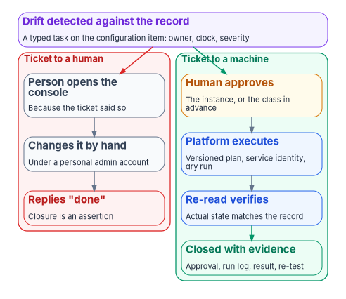
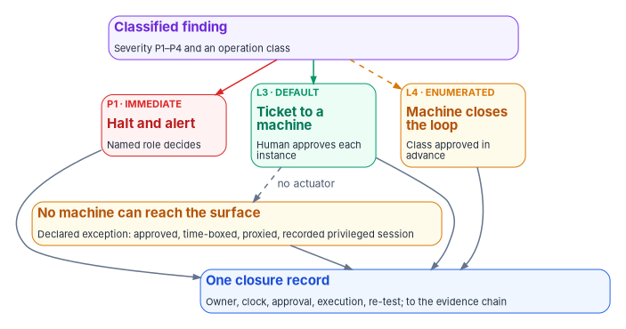

# Chapter 10 — Operational Tempo: Ticket to Machine, Not Ticket to Human

*A ticket that sends a person to a console changes who is to blame, not what is proved; a ticket that authorizes a machine leaves the person the one job a machine can't do, which is to approve.*

::: {.callout-note}
## In this chapter
Why a deterministic governance platform still decays without a declared tempo, and what that tempo is: response windows by severity, continuous detection, bounded remediation and escalation to named roles. Why native tools can change state but can't, on their own, produce the record an assessor relies on, and why putting a ticket in front of a person doesn't fix that. Which change classes qualify for a machine, how instance and class approvals map to the actuation ladder of [Book 01, Chapter 11](../b01-transformation-arc/11-analysis-plan-delivery.md), what happens when no machine can reach the surface, how the service desk fits, and what the tempo shows operations and leadership. The detailed reference, including the controls and the vendor landscape, is in [Appendix B](appendix-b-ticket-to-machine-reference.md).
:::

The drift engine in [Chapter 06](06-the-drift-engine.md) turns every difference between the record and the estate into a remediation contract with a class, a severity and an escalation path. That is necessary and not sufficient. A platform that detects perfectly and closes slowly produces a growing, accurate, timestamped list of things nobody fixed. Its evidence then documents neglect rather than discipline, and an assessor who reads it will draw that conclusion.

What keeps the list short is tempo: the cadence at which detection, remediation, escalation and closure actually run, and a rule about who does each. This chapter sets the program's tempo. Its argument is that most routine remediation shouldn't wait for a person to log in at all. The ticket should authorize a machine, the person's role should stop at approval, and the people the program has should spend their time on the findings that need judgment.

{#fig-ch10-ticket-to-machine fig-alt="A violet card at the top: drift detected against the record, raised as a typed task on the configuration item with an owner, a clock and a severity. A red arrow leads into a red-outlined group labeled ticket to a human: a person opens the console because the ticket said so, changes it by hand under a personal admin account, and replies done, so closure is an assertion. A green arrow leads into a green-outlined group labeled ticket to a machine: a human approves, either the instance or the class in advance; the platform executes from a versioned plan under a service identity after a dry run; a re-read verifies that actual state matches the record; and the task is closed with evidence, the approval, run log, result and re-test."}

## The program's tempo

The program declares a response window for each severity. The severities come from the drift engine's classification in [Chapter 06](06-the-drift-engine.md), which sets severity from the drift class and whether the affected claim is in active use. The windows are the program's design, not an external standard.

| Severity | May a machine fix it? | Response window | Who is in the loop |
|---|---|---|---|
| P1, critical | No. The run halts and alerts | Immediate | A named role decides before anything changes |
| P2, high | Yes, if the fix is deterministic and the class qualifies; otherwise a person decides the fix | 1 hour | An approver for each instance, unless the class is enumerated at L4 |
| P3, medium | Yes, if the class qualifies | 24 hours | An approver for each instance, or the class approved in advance |
| P4, low | Yes, if the class qualifies | 72 hours | The class approved in advance, reviewed after the fact |

Two limits apply to every row. First, an external clock overrides the program's window whenever it is shorter or different. A known exploited vulnerability runs on the remediation timelines of BOD 26-04, which revoked BOD 22-01 and BOD 19-02 on June 10, 2026 ([Book 12, Chapter 06](../b12-security-operations/06-vulnerability-management.md)),[^c10-bod2604] and an incident runs on CISA's clock, which requires notification within one hour of the incident's identification by the agency's top-level incident response team ([Book 12, Chapter 10](../b12-security-operations/10-who-runs-security-operations.md)).[^c10-cisa] The program's windows govern drift against the record, not the agency's other obligations. Second, "may a machine fix it" never overrides the ceiling for the class. The source of these windows said P3 and P4 findings auto-remediate. In the program's model that is true only where the class has been enumerated for L4; everywhere else the machine executes after a human approves, which is still a ticket to a machine.

The tempo makes three operating commitments.

1. **Detection is continuous.** The record's own checks run on every change to it, and adapters report runtime state as they run ([Chapter 08](08-the-adapter-model.md)). Detection doesn't wait for an audit cycle.
2. **Remediation is bounded.** Every finding has a window. A machine handles the deterministic fixes in qualifying classes; the rest go to a person with the window still running.
3. **Escalation lands on named roles.** Each remediation contract names its path: the steward for a finding about the record, the responsible workstream lead for a finding on a platform, and the CISO for a finding that bears on a control requirement or on evidence ([Chapter 09](09-who-governs.md#who-reviews-drift)). Never a distribution list.

A program that declares a tempo and doesn't keep it is generating drift of its own, in its operations rather than its estate. The governance platform shows this through its own backlog: a queue with chronic open findings past their windows says the program's tempo and its staffing don't match, and [Book 01, Chapter 12](../b01-transformation-arc/12-migration-roadmap.md#gates-rollback-and-authority) makes a missed window on a priority-one finding a rollback trigger that goes to the steward and the sponsor.

## Native tools change state; they don't close findings

"Doesn't the cloud console already do this?" is really three questions.

1. **Can the native tool detect drift and change state?** Yes. Configuration management, patch orchestration and posture services remediate, and [Book 12, Chapter 07](../b12-security-operations/07-patch-configuration-and-baselines.md#actuation-is-platform-native) shows each platform's stack doing it.
2. **Can its dashboard show current posture?** Yes, for its own boundary.
3. **Can that dashboard, by itself, be the evidence an assessor relies on for an authorization decision?** In the program's assessment, no.

A console shows current state. An evidence record has to answer four questions about each finding: who owns it, what clock they are working against, who approved the change or the exception, and what re-test proves it closed. SP 800-53's CM-3 asks for that record directly: approval or disapproval of configuration-controlled changes with explicit consideration of security and privacy impact, documented decisions, and retained records of the changes.[^c10-sp80053] SP 800-37 adds that the organization should monitor for unauthorized changes and work out their root cause, not only follow its change process.[^c10-sp80037] None of the native consoles is built to be the agency's system of record for ownership and approval across teams. That is why the program puts a coordination layer in front of them, and why actuation still stays on the native surface: the coordination layer never writes the configuration, applies the patch or fixes the rule itself. Its job is to make every drift an owned, clocked, approved and evidenced piece of work ([Book 12, Chapter 07](../b12-security-operations/07-patch-configuration-and-baselines.md#governance-is-unified-the-record) builds the record for patch and configuration).

The coordination pattern has five steps: test, detect drift, raise a typed task against the reconciled configuration item, actuate on the native surface, close with evidence. It is the same loop [Book 10, Chapter 07](../b10-cloud-boundary/07-the-front-door.md) uses for provisioning and the same five clauses [Book 00, Chapter 04](../b00-orientation/04-the-principles.md#principle-2) requires of every change.

## Ticket to machine, not ticket to human

The default shape of change management in most agencies is this: a ticket is raised, a person opens the console or runs a script because the ticket told them to, and the person replies "done." Adding a ticket in front of that doesn't change who is at the keyboard, what account they used or whether anything checked their work. The closure is an assertion, and [Book 00, Chapter 04](../b00-orientation/04-the-principles.md#principle-2) is explicit that a task closed by a person clicking "complete" with no machine-readable verification is prose, not evidence.

The program's rule is that wherever a machine can reach the surface, the ticket authorizes a machine, not a person. A human approves the change. The platform executes it under a service identity, from a versioned plan, after a dry run, and re-reads the object to verify the result. The human's role stops at approval.

Running a change that way produces, without anyone assembling it, what an assessor checks for:

- the change traces to a prior approval by a named person who isn't the requester;
- the artifact that ran is version-controlled and access-restricted;
- the execution is logged and attributed to the task and its service identity, not to a person's memory;
- the result is verified by a re-read and can be re-tested.

The controls already describe this shape. CM-3(1) asks for automated mechanisms to document proposed changes, notify approvers, prohibit changes until approvals arrive and document every change; CM-3(3) asks for automated mechanisms to implement baseline changes and deploy them across the installed base; CM-6(1) asks for automated mechanisms to manage, apply and verify configuration settings; and SI-2(5) asks for security-relevant updates to install automatically on organization-defined components.[^c10-sp80053] Not all of these are in the Moderate baseline: CM-3(2) testing and SI-2(2) automated flaw-remediation status are, while CM-3(1) and CM-6(1) are in the High baseline only.[^c10-sp80053b] The program adopts the shape for every system anyway, as design, because it is the cheapest way to produce the evidence CM-3 asks for at any baseline.

It also changes what people do. SP 800-137 encourages automating data collection, analysis and reporting where possible and is equally clear that an organization's security program can't be fully automated: the tools still need people to implement and maintain them and to interpret what they find.[^c10-sp800137] In the program's model people tune the classifier, review the escalations, decide the exceptions and write the rules. They don't triage routine drift ticket by ticket, and they don't make routine changes by hand.

## Which change classes qualify

A class of change qualifies for a ticket to a machine when it passes all six tests. The tests are the program's design.

1. **A machine can reach the surface.** The platform exposes the change through an API or a management stack the execution layer can call under a scoped service identity.
2. **The fix is deterministic.** The correct end state comes from the record, not from a judgment about context. If two careful engineers could reasonably choose different fixes, the class doesn't qualify.
3. **The scope is bounded.** Each action targets one object, or a pre-materialized list, and the blast radius is computed before approval ([Book 01, Chapter 11](../b01-transformation-arc/11-analysis-plan-delivery.md)).
4. **There is a way back.** Each action is rollback-paired, or the class is rollback-never by design with a defined recovery path, as a leaver's deprovisioning is.
5. **The result can be verified.** A re-read can confirm the object now matches the record.
6. **The class isn't on the permanent-L3 list.** Tenant-wide role changes, Conditional Access enforcement changes, bulk device-state changes and network policy that touches thousands of endpoints stay at gated actuation whatever the program's maturity ([Book 01, Chapter 11](../b01-transformation-arc/11-analysis-plan-delivery.md#how-far-automation-may-go)).

The tests decide whether a machine executes. The ladder decides whether a human approves each instance first. Examples, all illustrative:

| Class of change | Qualifies for a machine? | Default ceiling | Notes |
|---|---|---|---|
| Re-apply a drifted configuration setting on one device or server, where the baseline is in the record | Yes | L3; an L4 candidate once its false-positive rate is known | CM-6; the stack's own remediation does the work ([Book 12, Chapter 07](../b12-security-operations/07-patch-configuration-and-baselines.md)) |
| Deploy a security update through the native patch stack inside an approved window | Yes | L3, approved per ring or deployment | SI-2; an external deadline can shorten the window |
| Restore an attribute value on one person from the authoritative HR source | Yes, when the source value is itself valid | L3; L4 candidate for enumerated attributes | A Format failure halts instead ([Book 00, Chapter 04](../b00-orientation/04-the-principles.md#principle-11)) |
| Restore a dynamic group or administrative-unit rule to the version in the record | Yes | L3 | Membership recomputes for everyone the rule touches, so the blast radius is the group, not the rule |
| Remove a group member added outside the governed process | Yes, mechanically | L3 | The write may have been a legitimate emergency; a person decides |
| Change a Conditional Access policy | Yes, mechanically | L3 permanently | On the permanent list |
| Change a tenant-wide role assignment, or bulk device state | Yes, mechanically | L3 permanently | On the permanent list |
| Issue or renew a certificate within policy | Not as a ticket | Protocol automation | Volume rules out a ticket per event; see below |
| A value that fails its expected format, or a finding the classifier marks P1 | No | Halt | A person decides whether the record or the estate is wrong |
| A surface with no API the execution layer can reach | No | Declared exception | See below |

Certificates are the deliberate exception to the ticket. A certificate estate generates issuance and renewal events at a volume no approval queue can absorb, and the volume is rising: the CA/Browser Forum adopted a schedule in April 2025 that cuts the maximum validity of publicly trusted TLS certificates from 398 days to 47 days between March 2026 and March 2029.[^c10-cabf] Routing each renewal through an approval would train reviewers to approve without reading. Routine issuance is closed instead by protocol-enforced automation inside policy, as [Book 07](../b07-pki/index.md) describes. The exceptions in the certificate estate still use the front door: a new certificate authority, a non-standard lifetime, a trust-anchor change, or an unknown-issuer certificate found by the inventory. [Appendix B](appendix-b-ticket-to-machine-reference.md) carries the full reasoning.

## Approval gates keep humans on the decisions that matter

{#fig-ch10-tempo-paths fig-alt="A violet card at the top: a classified finding with a severity from P1 to P4 and an operation class. Three arrows lead to a row of three cards. A red arrow leads to a red card, P1 immediate, halt and alert, where a named role decides. A green arrow leads to a green card, L3 default, ticket to a machine, where a human approves each instance. A dashed amber arrow leads to an amber card, L4 enumerated, where the machine closes the loop for a class approved in advance. A dashed arrow labeled no actuator leads from the L3 card to an amber card below: no machine can reach the surface, so the fallback is a declared exception through an approved, time-boxed, proxied, recorded privileged session. All four paths lead to a blue card at the bottom: one closure record with the owner, clock, approval, execution and re-test, written to the evidence chain."}

The program places every class on the actuation ladder of [Book 01, Chapter 11](../b01-transformation-arc/11-analysis-plan-delivery.md#how-far-automation-may-go): L0 Record, L1 Observe, L2 Advise, L3 Gated actuation and L4 Autonomous within guardrails. A ticket to a machine runs at L3 or L4. The difference is where the approval attaches.

- **At L3 the approval attaches to the instance.** The execution layer prepares a plan for this finding, validates it, runs a dry run, and a named approver who isn't the author authorizes it through the repository's review before it runs ([Book 01, Chapter 11](../b01-transformation-arc/11-analysis-plan-delivery.md#authorization-gate)). This is the default ceiling. It keeps a person on every change while taking the person off the keyboard, and for most P2 and P3 work it is fast enough: the approver reads a blast-radius summary, not a console.
- **At L4 the approval attaches to the class.** The authorizing official accepts, in advance and in writing, that a named class may run without a person, under stated conditions: the scope limits, the exclusions, the verification, the rate at which a person reviews the closed work after the fact, and the conditions that drop the class back to L3. [Chapter 09](09-who-governs.md#who-approves-rule-changes) gives that decision to the authorizing official, and the governance board reviews every L4 class quarterly. L4 is for enumerated low-blast-radius classes only.

Four mechanics keep both honest.

1. **Separate identities.** The governance layer that decides and the execution layer that acts run as different processes, under different service principals, with different credential stores and logs ([Book 01, Chapter 11](../b01-transformation-arc/11-analysis-plan-delivery.md)). A component that could decide and act could cover its tracks.
2. **No standing privilege for people.** Where a person must act, they activate an eligible role for a limited time. Microsoft Entra Privileged Identity Management provides time-bound, approval-based role activation with justification, notifications, access reviews and downloadable audit history, and its assignments can target users, groups, service principals or managed identities.[^c10-pim]
3. **Requesters don't approve.** The approver is never the requester or the author of the plan. SP 800-53's AC-5 asks organizations to identify the duties that must be separated and define access authorizations to support that separation.[^c10-sp80053] The repository's protected branches enforce it for plans; the ticket flow enforces it for everything else ([Book 04, Chapter 06](../b04-access/06-who-decides-access.md#deciding-isnt-doing)).
4. **Closure is a re-read.** A 2xx response from an API isn't closure. The execution layer re-reads the object and compares it with the record before the task closes, and the next drift run must agree.

The ladder is also how the program answers the obvious objection, that automation is risky. It is, and the ladder says exactly how much of it each class is allowed. What an authorizing official gets is a record, per class, of the ceiling, the dry run, the approver and the rollback, which is a posture that can be signed. That is why L3 is the default and not a federal requirement: CISA's Zero Trust Maturity Model describes itself as a general guide rather than a strict set of requirements ([Book 01, Chapter 11](../b01-transformation-arc/11-analysis-plan-delivery.md#how-far-automation-may-go)).

## When no machine can reach the surface

Some surfaces have no API the execution layer can call: an appliance managed only through its own console, a legacy application with a vendor-only admin tool, a hypervisor setting outside the management stack. For these the fallback is a declared exception, not a silent one.

The compensating control is a time-boxed, proxied, recorded privileged session. The sequence matters.

1. The finding is raised as a task like any other, with its owner and window.
2. The task is marked as having no machine actuator, which is itself recorded as an exception in the register ([Chapter 09](09-who-governs.md#who-accepts-exceptions)).
3. A named approver approves the session before it starts: the target, the change, the time box and the operator.
4. The operator activates an eligible role and connects through a privileged-access proxy that records the session.
5. The change is made; the session closes when the time box ends.
6. The re-read verifies the result, and the recording is attached to the task as part of its evidence.

SP 800-53's AU-14 provides for exactly this: the capability for organization-defined users or roles to record, view, hear or log the content of a user session, with session auditing developed and used in consultation with legal counsel.[^c10-sp80053] Counsel's role is real; recorded sessions capture whatever is on screen. Each such exception has an end date, and the end is either a machine actuator for the surface or the surface's retirement. A class that stays manual for good is a standing risk acceptance for the authorizing official, not a permanent workaround.

The rule this section protects is short. The gap between a finding and a machine that can fix it is never closed by quietly sending a person to the console.

## How the service desk fits

The service desk is the front door, not a second governance system. In most agencies the IT service management platform already holds the tickets, the configuration items and the approval workflows. The program's design is to use it as the place where every finding becomes a typed task, and to keep one front door for every source: drift findings from the governance platform, posture and vulnerability findings from native tools, access requests from the identity governance tools, and the requests people raise themselves. Detection engines feed the front door; they don't each grow their own queue.

What changes is what happens after the ticket opens.

- **Routing follows authority.** [Book 04, Chapter 06](../b04-access/06-who-decides-access.md#the-help-desk-and-cloud-services-authority-split) routes every request by the authority it needs, from low-impact support through owner-governed access to governance actions that are never automated. Drift findings route the same way, by class and severity.
- **The help desk executes, and doesn't decide.** Where a person must act, the help desk acts only against an approved, assigned ticket and has no approval authority of its own. Most routine tasks run as connector actions in the ITSM platform's integrations, so the help desk does only the residual manual work ([Book 04, Chapter 06](../b04-access/06-who-decides-access.md#help-desk-and-cloud-services)).
- **The help desk is protected as a target.** The help desk becomes a high-value target during a modernization, and the identity-verification procedure for resets is a CISO decision, not a help desk one ([Book 01, Chapter 09](../b01-transformation-arc/09-who-leads-the-transformation.md#the-help-desk)). Moving routine changes off the help desk's keyboards also shrinks what an attacker who talks their way past it can do.
- **Closure writes back.** The ticket closes when the execution layer's re-read and the next drift run agree, and the closure record flows into the evidence chain ([Chapter 07](07-evidence-over-attestation.md)). The ticket's status is a view of the record, not a substitute for it.

[Book 10, Chapter 07](../b10-cloud-boundary/07-the-front-door.md) shows the same front door for provisioning, including two documented ways to build it on a service management platform and an infrastructure-as-code pipeline. Day-2 operations at the help desk, and the help desk's role in whether modernization sticks, are the subject of Book 15, Compliance Automation & Day-2 Operations (planned, see the [workbook index](../index.md)).

## The operations team's view

For the team that runs the governance platform, the tempo shows up as four things:

- **A live findings queue,** scoped by severity, class and adapter, with each finding's window counting down.
- **A remediation contract per finding,** recording what was done, by which identity, under whose approval, and whether a machine or a person executed it.
- **A window dashboard** showing burn-down by severity: how many P1 to P4 findings opened, closed inside their windows, and remain open past them.
- **Escalation channels** routed by the paths in each contract, not by ad hoc routing rules.

The work shifts from "monitor everything" to "tune the classifier and answer the escalations." Most P3 and P4 findings close through approved plans or L4 classes; most deterministic P2 findings close through L3 approvals; P1 findings and the judgment subset of P2 reach a person before anything changes.

## What the tempo shows leadership

Leadership needs three measures, and they are program health measures, not operations statistics.

| Measure | Definition | What a bad trend means |
|---|---|---|
| Detection coverage | Share of the in-scope estate whose adapters report runtime findings, by drift class | Drift on uncovered surfaces is invisible to the tempo; the program is measuring less than it thinks |
| Window adherence | Findings closed inside their response window ÷ findings closed in the period; and findings open past their window | The tempo and the staffing don't match, or a class needs a machine actuator |
| Escalation rate | Findings that reached a person ÷ all findings, by class | Either drift severity is rising, or the classifier needs tuning, or a class that should qualify for a machine doesn't yet |

Two more belong beside them. The **machine-closure share** is the share of closures executed by a machine under an approval rather than by a person at a console; it should rise as actuators are added. And the **declared-exception count** is the number of open tasks with no machine actuator, which should fall. The targets are the agency's to set. Window adherence follows the same rule [Book 12, Chapter 12](../b12-security-operations/12-evidence-metrics-and-continuous-monitoring.md#the-metric-set) applies to vulnerability remediation: measure closures within the window and overdue items separately, because a ratio of open findings that aren't yet overdue improves every time new findings arrive. The board reviews all five in the cadence set in [Chapter 09](09-who-governs.md#cadence), and [Chapter 12](12-governance-at-scale.md) carries them into the continuous-monitoring program.

## What the tempo doesn't require

- **It doesn't require round-the-clock staffing.** P3 and P4 findings close inside their windows through approved plans and L4 classes. A P1 halts the run and alerts, which keeps the record intact until a person responds.
- **It doesn't require eliminating drift.** Drift is the signal. The tempo bounds the response, not the occurrence.
- **It doesn't require a particular vendor.** The tempo runs on the agency's own governance platform and whatever ITSM platform the agency already has. The workbook names no products for it; [Appendix B](appendix-b-ticket-to-machine-reference.md) gives the change classes and the evidence each produces, and [Book 10](../b10-cloud-boundary/index.md) explains how to check any product's FedRAMP status and availability in the agency's cloud.

## Honest limits

- **Automation is bounded to deterministic fixes.** As runtime detection matures, more classes qualify. Today, semantic, authorization and identity drift escalate to a person more often than schema and provenance drift do, because their fixes depend on context.
- **Windows can only be kept for findings that are emitted.** An adapter that hasn't implemented runtime reporting contributes no findings, and its drift is invisible to the tempo. Detection coverage exists to show where.
- **The escalation paths assume the roles exist.** A program without a named steward, workstream leads and a CISO's representative on the board has to name them first ([Chapter 09](09-who-governs.md)). The platform can't manufacture authority.
- **Some surfaces will stay manual for a long time.** The declared-exception path makes them visible and bounded. It doesn't make them cheap.

## Key takeaways

1. A deterministic platform still decays without a tempo: response windows by severity, continuous detection, bounded remediation and named escalation paths.
2. Native tools change state; the evidence an assessor relies on is the owner, the clock, the approval and the re-test, which a console alone doesn't hold.
3. Wherever a machine can reach the surface, the ticket authorizes a machine and the person's role stops at approval.
4. A class qualifies when it is reachable, deterministic, bounded, reversible and verifiable, and isn't on the permanent-L3 list; L3 approves the instance, L4 approves the class, and the authorizing official accepts each L4 class.
5. Where no machine can reach, the fallback is a declared, approved, recorded privileged session with an end date, never a silent trip to the console.
6. The service desk is the one front door; routing follows authority, the help desk executes without deciding, and closure writes back from the record.

::: {.callout-tip}
## Continue the book
[← Previous: Chapter 09 — Who Governs](09-who-governs.md) · [Book index](index.md) · [Next: Chapter 11 — Reciprocity, Indicators and One Authorization →](11-reciprocity-and-one-authorization.md)
:::

[^c10-sp80053]: National Institute of Standards and Technology, SP 800-53 Rev. 5, *Security and Privacy Controls for Information Systems and Organizations*, controls AC-5, AU-14, CM-3 (items a–g), CM-3(1), CM-3(3), CM-6(1) and SI-2(5), <https://csrc.nist.gov/pubs/sp/800/53/r5/upd1/final>; control text checked against the release 5.2.0 OSCAL catalog, <https://github.com/usnistgov/oscal-content/blob/main/nist.gov/SP800-53/rev5/json/NIST_SP-800-53_rev5_catalog.json> (both accessed Oct 21, 2026).
[^c10-sp80053b]: National Institute of Standards and Technology, SP 800-53B, *Control Baselines for Information Systems and Organizations*, release 5.2.0 OSCAL profiles for the Moderate baseline (includes CM-3(2) and SI-2(2); not CM-3(1) or CM-6(1)) and the High baseline (includes CM-3(1) and CM-6(1)), <https://github.com/usnistgov/oscal-content/blob/main/nist.gov/SP800-53/rev5/json/NIST_SP-800-53_rev5_MODERATE-baseline_profile.json> and <https://github.com/usnistgov/oscal-content/blob/main/nist.gov/SP800-53/rev5/json/NIST_SP-800-53_rev5_HIGH-baseline_profile.json> (both accessed Oct 21, 2026).
[^c10-sp80037]: National Institute of Standards and Technology, SP 800-37 Rev. 2, *Risk Management Framework for Information Systems and Organizations: A System Life Cycle Approach for Security and Privacy*, December 2018, Task M-1, discussion (monitoring for unauthorized changes and their root cause), <https://nvlpubs.nist.gov/nistpubs/SpecialPublications/NIST.SP.800-37r2.pdf> (accessed Oct 21, 2026).
[^c10-sp800137]: National Institute of Standards and Technology, SP 800-137, *Information Security Continuous Monitoring (ISCM) for Federal Information Systems and Organizations*, September 2011, §1 (automation encouraged; many aspects not easily automated), §2.1 (data collection, analysis and reporting automated where possible) and §2.3, "Role of Automation in ISCM" (not possible to fully automate all security program functions), <https://nvlpubs.nist.gov/nistpubs/Legacy/SP/nistspecialpublication800-137.pdf> (accessed Oct 21, 2026).
[^c10-bod2604]: Cybersecurity and Infrastructure Security Agency, BOD 26-04, *Prioritizing Security Updates Based on Risk*, June 10, 2026, Background and Appendix A, Table 1, <https://www.cisa.gov/news-events/directives/bod-26-04-prioritizing-security-updates-based-risk> (accessed Oct 21, 2026).
[^c10-cisa]: Cybersecurity and Infrastructure Security Agency, "Federal Incident Notification Guidelines," <https://www.cisa.gov/federal-incident-notification-guidelines> (accessed Oct 21, 2026).
[^c10-pim]: Microsoft Learn, "What is Microsoft Entra Privileged Identity Management?," sections "What does it do?" and "Assign," <https://learn.microsoft.com/entra/id-governance/privileged-identity-management/pim-configure> (accessed Oct 21, 2026).
[^c10-cabf]: CA/Browser Forum, "Ballot SC-081v3: Introduce Schedule of Reducing Validity and Data Reuse Periods," voting April 4–11, 2025, <https://cabforum.org/2025/04/11/ballot-sc081v3-introduce-schedule-of-reducing-validity-and-data-reuse-periods/> (accessed Oct 21, 2026).
