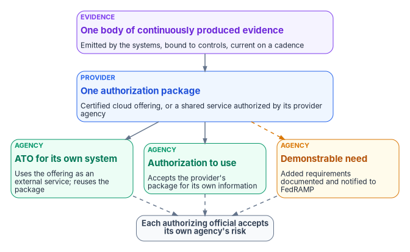
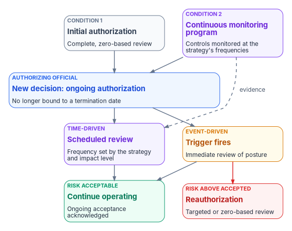

# Chapter 11 — Reciprocity, Indicators and One Authorization

*Reciprocity doesn't mean that one signature covers every agency. It means one body of evidence, kept current, is good enough for every authorizing official to reuse, and each of them still signs for their own agency's risk.*

::: {.callout-note}
## In this chapter
What reciprocity means in NIST and OMB terms, and the three federal mechanisms for reusing someone else's authorization work. What OMB M-24-15 and FedRAMP's 2026 rules say about reuse: the presumption of adequacy, the limits on asking for more, and the agency's own authorization. How the program applies this to a shared service that many agencies consume, and the corrections that requires to the program's earlier "single ATO" wording. What the 2026 Key Security Indicators are, and that they bind providers. How SP 800-37's ongoing authorization turns continuous evidence into a standing decision, and what is still the program's own design.
:::

The federal estate assesses the same controls over and over. A platform that twenty agencies use is examined by twenty assessment teams, each producing its own package, each package describing the same data center, the same identity service and the same patch process. The work is duplicated, and the packages also diverge: twenty snapshots taken at twenty different times, none of them current a month later. Chapter 01 of this book argued that a point-in-time assessment measures a moment. Multiplying the moments doesn't fix that.

The alternative is older than any of the program's tooling. NIST built the Risk Management Framework partly to "encourage reciprocity,"[^c11-sp80037] and the 2022 FedRAMP Authorization Act and OMB's 2024 memorandum that implements it make reuse the default for cloud services.[^c11-m2415][^c11-fr-m2415] What the program adds is the evidence side: if the package that everyone reuses is produced continuously by the systems rather than assembled once by people, reuse stops meaning "reuse last year's snapshot."

{#fig-ch11-one-package-many-decisions fig-alt="At the top, a violet card: one body of continuously produced evidence, emitted by the systems, bound to controls and current on a cadence. It points down to a blue card: one authorization package, for a certified cloud offering or for a shared service authorized by its provider agency. Three cards below it. Green: an agency issues an ATO for its own system, using the offering as an external service and reusing the package. Green: an agency issues an authorization to use, accepting the provider's package for its own information. Amber, reached by a dashed arrow: an agency with a demonstrable need documents added requirements and notifies FedRAMP. All three lead by dashed arrows to a slate pill: each authorizing official accepts its own agency's risk."}

## What reciprocity means

NIST defines reciprocity as an "agreement among participating organizations to accept each other's security assessments to reuse system resources and/or to accept each other's assessed security posture to share information."[^c11-sp80037] Two things in that definition matter. Reciprocity is about accepting *assessments*, not about transferring risk acceptance: nothing in it lets one organization's authorizing official accept risk on another's behalf. And it's an agreement, so it has terms. OMB Circular A-130 lists reciprocity among the things the RMF supports, alongside "consistent, well-informed, and ongoing authorization decisions."[^c11-a130]

SP 800-37 gives three concrete mechanisms for reusing someone else's authorization work.

| Mechanism | What it is | Who accepts the risk |
|---|---|---|
| Authorization to use | A customer organization accepts the authorization package another organization produced for a system a federal entity has authorized to operate. SP 800-37 calls it "a mechanism to promote reciprocity" and "a form of reciprocity" | The customer's authorizing official, with "the same level of responsibility and authority for risk management" as one issuing an ATO; the provider's ATO covers the system, the customer's ATU covers "the customer's information"[^c11-sp80037] |
| Joint authorization | Several authorizing officials, from the same organization or different ones, authorize one system together and "jointly accept" its risks. SP 800-53 has CA-6(1) for the same organization and CA-6(2) for different organizations | All participating officials, collectively; it remains in effect "only while there is agreement among authorizing officials"[^c11-sp80037][^c11-sp80053] |
| Type authorization | One package for an archetype system deployed identically in many places, used with site-specific controls or a facility authorization | The developing organization's authorizing official issues the ATO; each site's official accepts the risk of deployment and issues an authorization to use[^c11-sp80037] |

An authorization to use can only follow "a valid authorization to operate" by another federal entity, and it requires the customer to review the provider's package "as the fundamental basis for determining risk."[^c11-sp80037] [Book 10, Chapter 11](../b10-cloud-boundary/11-the-authorization-package.md) covers what that review contains for a cloud service.

## What M-24-15 says about reuse

OMB Memorandum M-24-15, *Modernizing the Federal Risk and Authorization Management Program* (July 25, 2024), is the governing policy for FedRAMP; FedRAMP's 2026 site describes it as having "formally rescinded and replaced" the program created by the 2011 memorandum.[^c11-m2415][^c11-fr-m2415] Its central idea for reuse is the **presumption of adequacy**. Where a cloud product or service has a FedRAMP authorization at a FIPS 199 impact level, "the Act requires that agencies must presume the security assessment documented in the authorization package is adequate for their use in issuing an authorization to operate at or below that FIPS 199 impact level."[^c11-m2415]

The memo sets limits on both sides of that presumption:

- **It applies only while the authorization is maintained**, "by satisfying ongoing requirements (i.e., continuous monitoring)." A stale package isn't presumed adequate.[^c11-m2415]
- **It doesn't replace the agency's decision.** The presumption "does not supersede or conflict with" agency heads' FISMA authorities, and when agencies reuse artifacts from the FedRAMP repository, "the appropriate agency authorizing officials must issue an authorization."[^c11-m2415]
- **It can be overcome, with reasons.** An agency may set it aside if it has a "demonstrable need" for security requirements beyond the package, or if the package is "wholly or substantially deficient." An agency that does further work must document why it found the earlier package deficient and inform the FedRAMP PMO.[^c11-m2415]
- **Joint authorizations are encouraged for widely reused services.** The memo supports agency authorizations, which can be issued by one agency or "conducted jointly by multiple agencies," and program authorizations signed by the FedRAMP Director. It names offerings that "receive high reuse across the Federal enterprise" as likely candidates for joint authorization.[^c11-m2415]

It also gives every agency standing duties that make reuse work. Each agency must give the FedRAMP PMO a copy of its authorization letter when it issues an ATO or ATU based on a FedRAMP authorization, make sure its own artifacts "are of sufficient quality for reuse by other agencies," leverage other agencies' authorization materials "to the greatest extent possible," make sure its governance, risk and compliance tools can produce and ingest OSCAL, and regularly review the continuous-monitoring materials providers supply.[^c11-m2415] The memo also points agencies to SP 800-37 for ongoing authorization.[^c11-m2415]

## What FedRAMP's 2026 rules add

FedRAMP's Consolidated Rules for 2026 rename the product, from "FedRAMP authorized" to "FedRAMP Certified" ([Book 10, Chapter 03](../b10-cloud-boundary/03-what-changed-at-fedramp.md)), and turn M-24-15's reuse principles into agency rules. The guidance to agencies says it plainly: agencies "should reuse FedRAMP Certification materials to the greatest extent possible" and should "treat FedRAMP as a reuse system, not a paperwork substitution." It is just as plain about what reuse is not. "Each agency still authorizes its own federal information systems," the authorizing official "accepts risk for the agency's specific use of that service," and an agency "should never create a standalone authorization to operate for a cloud service offering."[^c11-fr-use]

The agency rules then enforce the presumption:[^c11-fr-rules]

| Rule | Force | What it says |
|---|---|---|
| AGU-USE-ABU | MUST | Complete the ATO process for federal information systems that use FedRAMP Certified offerings |
| AGU-AGC-NAA | MUST | Notify FedRAMP after authorizing use, with a copy of the ATO letter "for the information system leveraging the cloud service" |
| AGU-AGC-NAR | MUST NOT | Require information or materials beyond FedRAMP's requirements, unless the agency head or a delegate finds a demonstrable need and notifies FedRAMP; FedRAMP notes this relates to the presumption of adequacy |
| AGU-AGC-TPP | MUST NOT | Require a specific certification type or path, on the same terms |
| AGU-AGC-GRC | MUST | Have governance, risk, compliance and inventory tools that produce and ingest machine-readable artifacts, at minimum OSCAL and JSON |
| CCM-AGM-ROR | MUST | Review each Ongoing Certification Report for how changes may affect the risk tolerance in the agency's ATO |

One inconsistency is worth knowing about. The same obligation to review each Ongoing Certification Report appears twice in the machine-readable ruleset: as CCM-AGM-ROR with the force MUST, and as AGU-USE-ROR with the force SHOULD.[^c11-fr-rules] The program treats it as MUST, because the stricter rule is the one an assessor will read, and because the review is the only way an agency learns that the package it reused has changed. Providers supply those reports every three months.[^c11-fr-ccm]

For a federal reader the consequence is straightforward. Reuse is the default and duplication needs a documented reason, but the reuse always ends in the agency's own signature on its own system. The program's model has to fit inside that.

## One package for a shared service

The program's reciprocity model was written for a specific case: one platform, operated once, consumed by many agencies. A government-wide HR platform is the example the program uses ([Book 03](../b03-hr-identity/index.md)). The question is whether such a platform is authorized once or once per consumer.

Earlier program material answered "one System Security Plan, one controlling Authority to Operate, covering all consuming agencies." Read against the sources above, that wording needs correcting, though the intent survives. **The program's position, restated:** one authorization package and one provider decision cover the platform; each consuming agency's authorizing official issues its own decision that reuses the package. Where the platform is a FedRAMP Certified cloud offering, that decision is an ATO for the agency's own system, which uses the offering as an external service.[^c11-fr-use] Where the platform is a shared service another federal entity has authorized, it can be an authorization to use.[^c11-sp80037] Where several agencies want to share the risk decision itself, the mechanism is a joint authorization under CA-6(2), with terms the participants agree in writing.[^c11-sp80037][^c11-sp80053] No mechanism lets the provider's authorizing official accept a consumer agency's risk, and SP 800-37 says explicit risk acceptance "cannot be delegated."[^c11-sp80037]

What the program does keep from its earlier model is the part that makes the package worth reusing:

- **Configuration latitude instead of forks.** Agencies differ in configuration, not in packages. The system security plan carries a latitude table: which settings each agency may elect, and within what bounds. This is the program's design.
- **Latitude is drift-governed.** An agency election outside the table is not a local preference; it's a drift finding. A configuration the plan forbids is authorization drift, and an unrecognized principal in an agency's tenant is identity drift, both P1 when the claim is in active use ([Chapter 06](06-the-drift-engine.md)).
- **A reciprocity record per consuming agency.** Each record names the provider's authorization decision and package version, the consuming agency, the agency's own decision that reuses it, the legal and policy basis the agency relies on, the agency's configuration elections, and the dates. The record is the program's design; it is not a federal form, and it doesn't replace the authorization letter FedRAMP requires agencies to submit.[^c11-fr-rules]
- **A per-agency evidence bundle.** The record, a component definition scoped to the agency's elections, current assessment results and a manifest of hashes, so the agency's assessor can check the bundle without access to the program's systems.

### Two corrections to the earlier design

The earlier material described each reciprocity record as "signed (HMAC-SHA256)" and the bundle as self-verifying "with nothing but the Python standard library," so that an auditor could verify it offline. Both claims overstate what the mechanisms do. An HMAC is a message authentication code computed "in combination with a shared secret key."[^c11-fips198] Anyone who can verify it holds the key, and so could also have produced it; an assessor without the key can't verify it at all. A manifest of hashes proves the files match the manifest, but anyone who changes a file can also rewrite the manifest. Proof of who produced a record needs a digital signature, which FIPS 186-5 describes as used "to detect unauthorized modifications to data and to authenticate the identity of the signatory."[^c11-fips186] The program's design is therefore a signed manifest: hashes detect change, the signature binds the bundle to the provider's key, and an agency verifies with the provider's published certificate. [Chapter 07](07-evidence-over-attestation.md#integrity-what-each-mechanism-proves) sets out what each mechanism proves.

The earlier material also called the program's health checks for this model "KSI-RECIP" indicators. The next section explains why that name collides with FedRAMP's, and the program now calls them reciprocity health checks.

### The trade-off, stated honestly

One package for many agencies concentrates risk by design. It is the point of leverage and the single point of failure: if the provider's authorization lapses, or its evidence stops being current, every consuming agency is affected at once. The program's response is to watch the package's health continuously rather than at renewal. Its reciprocity health checks ask whether every record cites a current provider decision and a legal basis, whether any record has expired silently, whether every bundle's signature verifies, and whether the system security plan is kept current on the program's cadence. The cadence targets the earlier material set (a draft plan update within 30 days of a change, a final one within 45, and reauthorization work started at least 30 days before any termination date) are the program's own service levels, not federal requirements.

Ongoing authorization, covered below, changes the shape of this risk. A package under ongoing authorization has no termination date to lapse past, so the failure to watch for is the continuous-monitoring program going quiet.[^c11-sp80037]

## The 2026 Key Security Indicators

FedRAMP's 2026 rules include 46 Key Security Indicators in ten themes. Each indicator is a short outcome statement with a list of related SP 800-53 controls.[^c11-fr-ksi][^c11-fr-rules]

| Theme | Indicators |
|---|---:|
| Cybersecurity Education (CED) | 1 |
| Change Management (CMT) | 4 |
| Cloud Native Architecture (CNA) | 8 |
| Identity and Access Management (IAM) | 6 |
| Incident Response (INR) | 3 |
| Monitoring, Logging, and Auditing (MLA) | 5 |
| Policy and Inventory (PIY) | 5 |
| Recovery Planning (RPL) | 4 |
| Supply Chain Risk (SCR) | 2 |
| Service Configuration (SVC) | 8 |

Two examples show the style. KSI-CMT-LMC, Logging Changes, reads in full "Modifications to the cloud service offering are logged and monitored."[^c11-fr-ksi] KSI-CED-RAT asks that the effectiveness of cybersecurity education and training be "persistently reviewed."[^c11-fr-rules] FedRAMP defines "persistently" as "occurring in a firm, steady way that is repeated over a long period of time in spite of obstacles or difficulties."[^c11-fr-defs]

**The indicators bind cloud service providers, not agencies.** The rules that use them are written to providers. A provider's Security Decision Record must summarize, for each applicable indicator, the measures that demonstrate it, the cycle of any measure implemented persistently, and verification and validation that the measures work (SDR-CSX-KSI). A provider seeking 20x Class C certification must use at least two automated methods for each indicator to "persistently verify and validate" it, and at Class D at least four (FRC-CSX-VVK).[^c11-fr-rules][^c11-fr-sdr] An agency's own systems are authorized by the agency under the RMF. [Book 12, Chapter 12](../b12-security-operations/12-evidence-metrics-and-continuous-monitoring.md) reaches the same conclusion from the security-operations side and shows how an agency uses the indicators: as a vocabulary for its own metrics, and as an input through each provider's quarterly report.

### What the program's own rules are, and aren't

Earlier program material described "more than 190 KSI rules across eleven families" and an evaluation engine that scores a tenant against them. Those rules exist, but they aren't FedRAMP's indicators, and calling them KSIs invites exactly the confusion the previous paragraph corrects. They are the program's own deterministic rule set ([Chapter 05](05-deterministic-governance.md)): each declares an objective, explicit pass criteria and the SP 800-53 controls it relates to, and the engine returns pass, fail, error or stale for each, backed by hashed evidence ([Chapter 07](07-evidence-over-attestation.md)). Many were written against CISA's secure configuration baselines for Microsoft 365 first, so their coverage of FedRAMP's themes is partial.

The useful relationship is a mapping, and it is the program's design. Where a program rule produces evidence that bears on a FedRAMP indicator, the result carries a tag naming the indicator, the source of the mapping and how fresh the evidence must be. That keeps one evidence path: the same result feeds the agency's own package and, where the agency is also a provider, the indicator summary. FedRAMP's own mappings move (several indicators' control lists changed on October 13, 2026), so the program reads them from FedRAMP's machine-readable ruleset when it needs them instead of keeping a copy.[^c11-fr-rules]

## One body of evidence, one standing decision

Reciprocity reuses one package across agencies. Ongoing authorization reuses one package across time. The second is what makes the first safe.

SP 800-37 defines ongoing authorization as "the subsequent (follow-on) risk determinations and risk acceptance decisions taken at agreed-upon and documented frequencies," a time-driven or event-driven process that is "dependent on a robust continuous monitoring program."[^c11-sp80037] OMB requires agencies to "transition information systems and common controls to an ongoing authorization process when eligible for such a process and with the formal approval of the respective authorizing officials."[^c11-a130]

{#fig-ch11-ongoing-authorization fig-alt="Two cards at the top. Slate, condition 1: initial authorization, a complete zero-based review. Violet, condition 2: a continuous monitoring program monitoring controls at the strategy's frequencies. Both point to a blue card: the authorizing official issues a new decision for ongoing authorization, no longer bound to a termination date. It leads to two cards. Violet, time-driven: a scheduled review at a frequency set by the strategy and impact level, which also receives a dashed arrow labeled evidence from the monitoring program. Amber, event-driven: a trigger fires and posture is reviewed immediately. Both lead to a green card: risk acceptable, continue operating, ongoing acceptance acknowledged. The event-driven card also leads by a red arrow to a red card: risk above what was accepted, reauthorization with a targeted or zero-based review."}

The mechanics are specific:[^c11-sp80037]

1. **Two conditions.** The system has had an initial authorization based on "a complete, zero-based review," and an organizational continuous monitoring program monitors its controls "with the appropriate degree of rigor and at the required frequencies."
2. **A new decision.** The authorizing official documents the transition by issuing a new authorization decision, which makes clear the system is "no longer bound to the termination date" in the initial one.
3. **Time-driven and event-driven review.** The authorizing official reviews posture at a frequency set by the continuous monitoring strategy, and immediately when an organization-defined trigger occurs. Either way the official "acknowledges the ongoing acceptance of identified risks."
4. **Reauthorization becomes the exception.** Under ongoing authorization, reauthorization is "in most instances, an event-driven action," and "reauthorizations are unnecessary in situations where the continuous monitoring program provides authorizing officials with the information necessary."
5. **Automation is necessary but not sufficient.** Automated tools may not generate information "for every control or every part of a control"; manual assessments fill the gaps. For moderate- and high-impact systems, the information is produced and analyzed by an entity that meets the organization's independence requirements.

This is where the book's argument lands. The authoritative record ([Chapter 03](03-one-authoritative-record.md)), controlled change ([Chapter 04](04-change-control-and-provenance.md)), deterministic rules ([Chapter 05](05-deterministic-governance.md)), drift detection ([Chapter 06](06-the-drift-engine.md)) and system-produced evidence ([Chapter 07](07-evidence-over-attestation.md)) are what a "robust continuous monitoring program" looks like when it is built rather than described. The evidence that keeps one agency's ongoing authorization current is the same evidence that keeps the shared package current for every agency that reuses it. And because FedRAMP presumes a package adequate only while it is maintained by continuous monitoring,[^c11-m2415] the evidence stream is what keeps reuse lawful as well as useful. The continuous-monitoring pipeline itself, with its metrics and retention, is [Book 12, Chapter 12](../b12-security-operations/12-evidence-metrics-and-continuous-monitoring.md); how the program runs it as a project across many systems is [Chapter 12](12-governance-at-scale.md).

## One evidence model, more than one regime

The program's compliance series includes an integration overview, kept in the repository, that explains how the evidence the series produces is routed and scored: [Governance Platform Integration Overview](https://github.com/WhalerMike/modernization-workbook/blob/main/docs/compliance/Vol_X_Book_00_Governance_Substrate_Integration_Overview.md). Its argument, which is the program's design, is that the compliance regime is not the engine. The governance platform files evidence under seven functional areas (identity, addressing, network, telemetry, endpoint, security and continuity), and a regime is a crosswalk laid over them. A federal reviewer reads the identity area through IA-2 and AC-2 and FedRAMP's Identity and Access Management theme; a SOC 2 auditor reads the same evidence through the Trust Services Criteria for logical access. Every crosswalk is generated from one table of control closures and gated against drift, and the traceability it produces says, per closure, whether a named test backs it or it is only asserted.

The overview is careful about the limit, and so is this chapter. Two regimes reading the same evidence is not two regimes satisfying each other. A FedRAMP certification, an agency ATO and a SOC 2 report each rest on their own boundary, assessor and rules. Shared evidence lowers the cost of each; it doesn't merge them.

## What is design and what is requirement

| Statement | Status | Basis |
|---|---|---|
| Agencies presume a maintained FedRAMP package adequate, and need a documented demonstrable need to ask for more | Requirement | M-24-15; AGU-AGC-NAR, AGU-AGC-TPP[^c11-m2415][^c11-fr-rules] |
| Each agency authorizes its own system; no standalone ATO for a cloud offering | Requirement | FedRAMP agency guidance; AGU-USE-ABU[^c11-fr-use][^c11-fr-rules] |
| An ATU or a joint authorization is how one package serves several organizations | NIST guidance | SP 800-37 Appendix F; CA-6(1), CA-6(2)[^c11-sp80037][^c11-sp80053] |
| Transition to ongoing authorization when eligible | Requirement | OMB A-130 Appendix I[^c11-a130] |
| Key Security Indicators bind providers | Requirement (on providers) | SDR-CSX-KSI, FRC-CSX-VVK[^c11-fr-rules] |
| One package per shared service, configuration latitude table, latitude deviations as drift | Program design | — |
| Reciprocity record and per-agency bundle with a signed manifest | Program design | — |
| Reciprocity health checks and the 30/45/30-day cadence targets | Program design | — |
| Indicator tags on program rule results; one evidence path | Program design | — |
| Seven functional evidence areas and regime crosswalks | Program design | Integration overview (repository) |

The program builds the record, bundle, health checks and cadence validation today. Generating a complete OSCAL system security plan and plan of action and milestones for each consuming agency from the reciprocity record is a target, not yet built. Book 14, Federal Compliance & Authorization (planned, see the [workbook index](../index.md)), will carry the package itself.

::: {.callout-tip}
## Continue the book
[← Previous: Chapter 10 — Operational Tempo: Ticket to Machine, Not Ticket to Human](10-ticket-to-machine.md) · [Book index](index.md) · [Next: Chapter 12 — Governance at Scale and the Continuous-Monitoring Program →](12-governance-at-scale.md)
:::

[^c11-sp80037]: National Institute of Standards and Technology, SP 800-37 Rev. 2, *Risk Management Framework for Information Systems and Organizations: A System Life Cycle Approach for Security and Privacy*, December 2018, §1.1 with footnote 9 (reciprocity), Task R-4 (risk acceptance not delegable), Appendix A (glossary, "reciprocity," "joint authorization") and Appendix F (types of authorizations; authorization to use; ongoing authorization, conditions for implementation and frequency; type and facility authorizations; traditional and joint authorizations), <https://nvlpubs.nist.gov/nistpubs/SpecialPublications/NIST.SP.800-37r2.pdf> (accessed Oct 21, 2026).
[^c11-a130]: Office of Management and Budget, Circular A-130, *Managing Information as a Strategic Resource*, July 2016, Appendix I, §4.d (Authorization to Operate and Continuous Monitoring), item 3, and the Risk Management Framework discussion (reciprocity), <https://www.whitehouse.gov/wp-content/uploads/legacy_drupal_files/omb/circulars/A130/a130revised.pdf> (accessed Oct 21, 2026).
[^c11-m2415]: Office of Management and Budget, M-24-15, *Modernizing the Federal Risk and Authorization Management Program*, July 25, 2024, §IV (The FedRAMP Authorization Process; a. The Presumption of Adequacy, with footnotes 7, 10 and 11; b. Authorization Process Requirements; c. Authorization Paths, with footnote 16), §VI (Continuous Monitoring) and §VII.d (Agencies, items 1–10), with footnote 32, <https://www.whitehouse.gov/wp-content/uploads/2024/07/M-24-15-Modernizing-the-Federal-Risk-and-Authorization-Management-Program.pdf> (accessed Oct 21, 2026).
[^c11-fr-m2415]: FedRAMP, "OMB Memorandum M-24-15," *FedRAMP Consolidated Rules for 2026*, Authority, <https://fedramp.gov/2026/authority/m-24-15/> (accessed Oct 21, 2026).
[^c11-fr-use]: FedRAMP, "Using a FedRAMP Certified Cloud Service," *FedRAMP Consolidated Rules for 2026*, <https://www.fedramp.gov/2026/agencies/use/> (accessed Oct 21, 2026).
[^c11-fr-rules]: FedRAMP, *FedRAMP Consolidated Rules for 2026*, machine-readable ruleset `fedramp-consolidated-rules.json`, version 2026.10.13.01 (last updated October 13, 2026): agency rules AGU-USE-ABU, AGU-USE-ROR, AGU-AGC-NAA, AGU-AGC-NAR, AGU-AGC-TPP and AGU-AGC-GRC; CCM-AGM-ROR; provider rules SDR-CSX-KSI and FRC-CSX-VVK; Key Security Indicator themes, indicators and control mappings (KSI-CED-RAT changelog of October 13, 2026), <https://github.com/FedRAMP/rules>; agency rules also read at <https://www.fedramp.gov/2026/agencies/rules/agency-use/> (both accessed Oct 21, 2026).
[^c11-fr-ccm]: FedRAMP, "Collaborative Continuous Monitoring," *FedRAMP Consolidated Rules for 2026*, rules CCM-AGM-ROR and CCM-OCR-AVL (Ongoing Certification Report every 3 months), <https://www.fedramp.gov/2026/reference/collaborative-continuous-monitoring/> (accessed Oct 21, 2026).
[^c11-fr-ksi]: FedRAMP, "Key Security Indicators," *FedRAMP Consolidated Rules for 2026*, Ruleset Reference (46 indicators in ten themes; KSI-CMT-LMC), <https://www.fedramp.gov/2026/reference/key-security-indicators/> (accessed Oct 21, 2026).
[^c11-fr-defs]: FedRAMP, "FedRAMP Definitions," *FedRAMP Consolidated Rules for 2026*, FRD-PER "Persistently," <https://www.fedramp.gov/2026/definitions/> (accessed Oct 21, 2026).
[^c11-fr-sdr]: FedRAMP, "Security Decision Record," *FedRAMP Consolidated Rules for 2026*, provider rules SDR-CSO-FRR, SDR-CSX-KSI and SDR-CSX-KMT, <https://fedramp.gov/2026/providers/20x/rules/security-decision-record/>; and "FedRAMP Certification," 20x Class C reference, FRC-CSX-VVK, <https://fedramp.gov/2026/reference/20x/c/fedramp-certification/> (both accessed Oct 21, 2026).
[^c11-sp80053]: National Institute of Standards and Technology, SP 800-53 Rev. 5, *Security and Privacy Controls for Information Systems and Organizations*, control CA-6 with enhancements CA-6(1) Joint Authorization — Intra-organization and CA-6(2) Joint Authorization — Inter-organization; text checked against the release 5.2.0 OSCAL catalog, <https://github.com/usnistgov/oscal-content/blob/main/nist.gov/SP800-53/rev5/json/NIST_SP-800-53_rev5_catalog.json> (accessed Oct 21, 2026).
[^c11-fips198]: National Institute of Standards and Technology, FIPS 198-1, *The Keyed-Hash Message Authentication Code (HMAC)*, July 2008, abstract, <https://csrc.nist.gov/pubs/fips/198-1/final> (accessed Oct 21, 2026).
[^c11-fips186]: National Institute of Standards and Technology, FIPS 186-5, *Digital Signature Standard (DSS)*, February 3, 2023, abstract, <https://csrc.nist.gov/pubs/fips/186-5/final> (accessed Oct 21, 2026).
