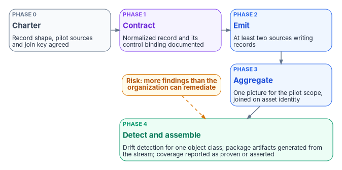
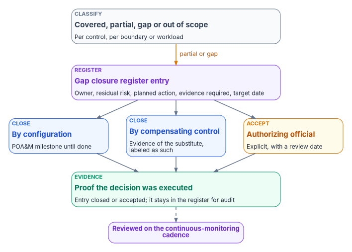

# Chapter 12 — Governance at Scale and the Continuous-Monitoring Program

*Governance scales when the parts that define it stay small and the parts that use it are allowed to grow, and it stays honest when every gap it can't close is written down with an owner, a decision and the evidence that the decision was carried out.*

::: {.callout-note}
## In this chapter
What federal guidance asks of an organization-wide monitoring program, as distinct from one system's. What the program holds small at scale and what it lets grow, how it hosts many programs on one record, and why it treats authorization boundaries as governed objects. The continuous-monitoring program run as a project: its charter, phases, success measures and cadence. Coverage classification, the gap closure register and the three ways a gap closes. What doesn't scale automatically, and the honest limits of coverage.
:::

The earlier chapters of this book describe governance for one estate: one authoritative record, controlled change, deterministic rules, drift detection, system-produced evidence and a machine tempo for routine work. A real agency doesn't have one estate. It has dozens or hundreds of systems, each with a system owner and an authorizing official, several modernization programs running at once, more than one authorization boundary, and teams that were never designed to share anything. The question this chapter answers is how the same model survives that multiplication without turning into a separate governance arrangement for each program, each with its own exceptions.

Federal guidance has already drawn the line between one system and the organization. SP 800-53's CA-7 asks for a system-level continuous monitoring strategy implemented "in accordance with the organization-level continuous monitoring strategy," and PM-31 asks for that organization-wide strategy, with organization-wide metrics, monitoring and assessment frequencies, correlation and analysis, response actions and status reporting.[^c12-sp80053] SP 800-37 makes it a Prepare-step task (P-7), owned by the senior accountable official for risk management, who approves the strategy "including the minimum frequency with which controls are to be monitored."[^c12-sp80037] OMB Circular A-130 requires agencies to establish and maintain an ISCM program with "metrics that provide meaningful indications of security status and trend analysis at all risk management tiers," and to make sure that all selected and implemented controls are addressed in the strategy and "effectively monitored on an ongoing basis."[^c12-a130] Governance at scale is the program's answer to those organization-level obligations. [Book 12, Chapter 12](../b12-security-operations/12-evidence-metrics-and-continuous-monitoring.md) is the security-operations answer to the system-level ones, with the pipeline, metrics and retention; this chapter doesn't repeat them.

## What stays small and what grows

The program's scaling rule is a design choice: hold the definitions small and stable, and let the uses grow, as long as every new use conforms to the definitions.

| Held small | Why | Allowed to grow | On what condition |
|---|---|---|---|
| The authoritative record's core: schemas, decision records and the program's numbered governing documents | Adding one is a governed decision ([Chapter 04](04-change-control-and-provenance.md)); the record doesn't swell in step with the program | Adapters | Each declares its class and mission and is schema-validated on entry; retiring one is a state change, not a deletion ([Chapter 08](08-the-adapter-model.md)) |
| The drift model: five classes, four severities | A new class would mean a decision record and a schema migration across everything ([Chapter 06](06-the-drift-engine.md)) | Policy mappings: rule-to-control bindings, indicator tags, adapter-to-mission declarations | Each mapping is data the rules read, validated like any other record ([Chapter 05](05-deterministic-governance.md)) |
| The tooling's command and interface surface | New capabilities go under existing domains, so the shape people learn doesn't change as features arrive | Evidence: assessment results, component definitions, drift findings, indicator results | Each item conforms to the evidence contract ([Chapter 07](07-evidence-over-attestation.md)) |

The held-small column is what keeps a hundred programs comparable. If every program could add its own drift class, a "P1" in one would mean something different from a "P1" in another, and the organization-wide metrics PM-31 asks for would add up incompatible numbers.

### One repository, one merge gate

The program's tooling went through a consolidation that matters for scale. Its record, schemas, runtime code and tests now live in one repository and ship as one installable package, where they once lived in several. The effect is that a whole class of drift can't happen: there is no state in which the record has moved on and the code that reads it hasn't. Schema validation, drift detection, adapter conformance checks and tests all run on the same merge gate, so adding an adapter or a program doesn't need a new pipeline. This is the program's engineering choice, not a federal requirement, but it is what keeps the cost of the hundredth program close to the cost of the tenth.

### Many programs, one record

A governance platform hosting several concurrent programs scales in three ways, all of them the program's design:

- **Per-program artifacts under shared schemas.** Each program's records live in its own area of the repository; the same schemas validate all of them.
- **Per-program adapter registration.** New adapters declare what they connect and for which mission, and inherit the record's invariants. Consistency is enforced by validation, not negotiated program by program.
- **Per-program findings in one taxonomy.** Drift findings are scoped to the program that owns the system, but they use the same classes and severities. Cross-program trends are visible without merging the program teams.

SP 800-37's common controls are the federal version of the same idea. The organization identifies controls that systems can inherit, assigns them to common control providers and publishes them, at whatever level makes sense (department, bureau or program), and a control that is only partly inherited is recorded as hybrid, with the split stated.[^c12-sp80037] OMB adds that common controls protecting systems of different impact levels are implemented at the highest of those levels, or the gap is factored into the risk assessment.[^c12-a130] A control implemented once, evidenced once and inherited many times is governance at scale in its oldest form.

## Boundaries as governed objects

Agencies don't operate inside one authorization boundary. A typical estate has a primary cloud boundary, a small number of services used outside it under documented exceptions, on-premises systems, and federation with other agencies. Each boundary changes what can be seen, who is authoritative for identity, what can be enforced and what provenance is available, which is [Book 10, Chapter 02](../b10-cloud-boundary/02-the-invisible-boundary.md)'s Boundary Impact Model.

The program scales across boundaries by recording each one as an object in the authoritative record rather than assuming it:

- **Adapters declare their boundary.** Every adapter states which boundary it observes, so a reading from one boundary is never mistaken for another.
- **The set of boundaries is closed.** The schema lists the boundaries the program recognizes. A new exception is added as a new value, together with the decision that authorizes it ([Book 10, Chapter 09](../b10-cloud-boundary/09-equivalents-and-exceptions.md)).
- **Findings cite their boundary.** A provenance finding at the edge of a cloud boundary says so, as in `DRIFT-PROVENANCE @ gcc-moderate-edge`, which makes the remediation scope explicit and lets the package cite it ([Book 10, Chapter 11](../b10-cloud-boundary/11-the-authorization-package.md)).

Adding a boundary is therefore a governed change with its own decision record, not a runtime setting someone flips.

## The continuous-monitoring program as a project

An organization-wide strategy doesn't build itself. The program runs continuous monitoring as a chartered project whose purpose is to turn monitoring "from a periodic reporting exercise into an operational fabric": evidence aggregated from many sources, drift detected as it happens, and authorization artifacts assembled from the closure stream instead of from assertions made after the fact. The charter, phases and success measures below are the program's design.

### Why it needs a charter

The charter's problem statement is one most agencies will recognize. Evidence is still assembled for assessments. Several management stacks produce several inventories that can't be reconciled. Drift is found during audits. The results are the same findings every cycle, no single compliance picture across identity, endpoint, network and data platforms, packages describing controls an assessor can't exercise, and continuous-monitoring obligations met by dashboards rather than machine-readable evidence.

SP 800-137 describes the destination in its own terms: a mature program moves an organization "from compliance-driven risk management to data-driven risk management," and "an organization's strategy for action based on the data collected is as important (if not more important) than collecting the data."[^c12-sp800137] It lays out six steps: define an ISCM strategy; establish the program (metrics, monitoring and assessment frequencies, technical architecture); implement it, automating collection, analysis and reporting "where possible"; analyze data and report findings; respond to findings; and review and update the strategy and program.[^c12-sp800137] The project below is how the program performs the establish and implement steps.

### Objectives and scope

The project has five objectives:

1. Designate the evidence contract: every deployed mechanism emits a normalized record that can be bound to a control ([Book 12, Chapter 02](../b12-security-operations/02-the-evidence-contract.md)).
2. Aggregate evidence from identity, endpoint, network and data-platform sources into one picture, reconciled on the authoritative asset identity.
3. Operate drift detection end to end: snapshot, compare, classify, alert, remediate, verify.
4. Assemble authorization-package artifacts from the evidence stream instead of compiling them by hand.
5. Distinguish proven claims from asserted ones, and label coverage honestly.

In scope are the record shape and its control binding, aggregation across the four platform families, reconciliation to the naming and addressing plane, drift operations, package assembly and coverage reporting. Three things are deliberately out of scope for the first phase: replacing the agency's existing monitoring tools (the project defines the contract; tools are realizations of it), implementing evidence for every one of FedRAMP's Key Security Indicators (which bind providers in any case, [Chapter 11](11-reciprocity-and-one-authorization.md)), and real-time inline enforcement.

Its guiding principles restate the book: evidence is a byproduct of the change path, not assembled later; one picture from many sources, with actuation staying platform-native; reconcile on the naming plane; classify every drift finding; and treat honesty as a first-class output.

### Phases and success measures

{#fig-ch12-conmon-project-phases fig-alt="Five cards in sequence. Slate, phase 0, charter: record shape, pilot sources and join key agreed. Violet, phase 1, contract: normalized record and its control binding documented. Blue, phase 2, emit: at least two sources writing records. Blue, phase 3, aggregate: one picture for the pilot scope, joined on asset identity. Green, phase 4, detect and assemble: drift detection for one object class, package artifacts generated from the stream, and coverage reported as proven or asserted. An amber pill with a dashed arrow to phase 4 reads: risk, more findings than the organization can remediate."}

| Phase | Work | Done when |
|---|---|---|
| 0. Charter and alignment | Confirm the record shape, the pilot sources and the naming-plane join key | Sponsor, lead and domain leads named; pilot scope agreed |
| 1. Evidence contract | Document the normalized record and its binding to controls | The contract is published and versioned in the authoritative record |
| 2. Emission | Enable at least two sources to emit normalized records | Two sources emitting on their own cadence |
| 3. Aggregation | Join records on the naming-plane identity into one picture for the pilot scope | One reconciled picture, with unjoinable records counted, not dropped |
| 4. Detection and assembly | Operate drift detection for one object class (identity attributes or device posture); generate package artifacts from the stream; publish coverage | Drift loop running for one class; artifacts generated for the pilot; coverage report separates proven from asserted |

The charter leaves the sponsor and lead "to be named," and that gap is the first thing phase 0 closes. The program's mapping is that the senior accountable official for risk management approves the strategy, as SP 800-37 Task P-7 assigns,[^c12-sp80037] and the domain leads (evidence contract, aggregation, drift detection, authorization package) sit under the governance roles in [Chapter 09](09-who-governs.md). Each phase ends at a gate in the same way as the program's G0 to G5 migration gates in [Book 01, Chapter 12](../b01-transformation-arc/12-migration-roadmap.md): the "done when" column is the gate's evidence.

### Risks and assumptions

The charter names four risks, and each has a mitigation in the program's design:

| Risk | Mitigation |
|---|---|
| Sources emit proprietary telemetry that can't be normalized without synthesis | An adapter per source translates to the contract; where it must derive a value, the evidence is labeled derived ([Chapter 08](08-the-adapter-model.md)) |
| The naming-plane join key is incomplete, so records can't be reconciled | Unjoinable records are counted and reported as a coverage gap, not silently dropped |
| Drift detection produces more findings than the organization can remediate | Severity sets the order; routine classes move to the machine tempo ([Chapter 10](10-ticket-to-machine.md)); the rest enter the gap register |
| Authorization-package format requirements change | Artifacts are generated from the stream, so a format change is a generator change, not a rewrite |

It assumes three things: that at least two sources can emit or be adapted to emit, that an authoritative naming and addressing plane exists or will, and that stakeholders accept honest coverage reporting. The last is the one most often violated in practice, and the one the rest of this chapter depends on.

### The cadence after cutover

Modernization doesn't end at cutover, and neither does monitoring. The program's continuous-monitoring strategy sets collection and review frequencies by signal type. The frequencies are the program's design; CA-7 and PM-31 require the organization to define them, not these particular values.[^c12-sp80053]

| Signal | Collected | Reviewed |
|---|---|---|
| Critical (P1) drift findings | Continuously or hourly | Immediately |
| Compliance-policy and Conditional Access results | Daily | Weekly |
| Attribute and group-membership changes | Daily | Weekly |
| Residual risk register | — | Monthly, or on change |
| Full control assessment | — | Quarterly |

Findings, approvals and verification results are kept long enough to support audit and incident review, and are immutable once written. Retention periods and tiers are [Book 12, Chapter 12](../b12-security-operations/12-evidence-metrics-and-continuous-monitoring.md#retention-tiers-and-tamper-protected-copies).

## Coverage, gaps and how gaps close

No single platform delivers every control. A program that implies otherwise hides residual risk in the space between what the platform does and what the package says. The program's coverage doctrine makes that space explicit.

### Classify coverage

Every control, for each boundary or workload, gets one of four classifications:

| Classification | Meaning |
|---|---|
| Covered | The platform enforces the control and produces evidence |
| Partial | The platform supports the control, but evidence or enforcement is incomplete |
| Gap | The control is required but not delivered by the platform |
| Out of scope | The control isn't required for this boundary or workload |

Coverage is not binary. "Partial" is the honest answer for many controls, and it is the classification most often rounded up to "covered" in a package. SP 800-37's guidance on automation explains why partial coverage is normal: automated tools may not generate information "for every control or every part of a control," and manual assessments are conducted to cover the gaps.[^c12-sp80037]

### The gap closure register

Every partial or gap classification becomes an entry in a living register of what remains after a modernization wave or a control implementation.

{#fig-ch12-gap-lifecycle fig-alt="At the top, a slate card: classify each control as covered, partial, gap or out of scope, per boundary or workload. An amber arrow labeled partial or gap leads to a violet card: gap closure register entry, with owner, residual risk, planned action, evidence required and target date. Three cards below it. Blue: close by configuration, with a POA&M milestone until done. Blue: close by compensating control, with evidence of the substitute labeled as such. Amber: accept, by the authorizing official, explicitly and with a review date. All three lead to a green card: proof the decision was executed; the entry is closed or accepted and stays in the register for audit. A dashed arrow leads to a violet pill: reviewed on the continuous-monitoring cadence."}

| Field | Content |
|---|---|
| Gap ID | A unique identifier that is never reused |
| Description | What is missing or incomplete |
| Residual risk | Impact and likelihood if it stays open |
| Owner | The accountable party |
| Planned action | How the gap will be closed |
| Evidence required | What will prove closure |
| Target date | When closure is expected |
| Status | Open, in progress, closed, accepted |

Four operating rules govern it:

- **No gap is closed without evidence.** The evidence is named when the entry is opened, not found when someone wants to close it.
- **Accepted residual risk needs explicit approval and a review date.**
- **The register is reviewed on a defined cadence**, the residual-risk row in the table above.
- **Closed items stay in the register for audit.** The register is a history, not a to-do list.

Its purpose is to keep gaps from being forgotten once the project phase that created them ends, which is how most residual risk becomes invisible.

### Three ways a gap closes

The program's gap treatment has five steps: record the gap in the register; assign an owner and a residual-risk rating; decide how it will be closed; define the evidence that will prove the decision was carried out; and review it on the continuous-monitoring cadence. The decision has three possible outcomes, and each sits on an existing federal mechanism:

| Decision | What it means | Federal mechanism |
|---|---|---|
| Close by configuration | Change the platform so the control is covered | A plan of action and milestones entry, which CA-5 asks the organization to develop and update from assessments, audits and continuous monitoring, until the change is verified[^c12-sp80053] |
| Close by compensating control | Meet the control's intent another way, with evidence labeled as coming from the substitute | Mitigation, one of SP 800-137's responses to findings;[^c12-sp800137] the narrative pattern is in [Book 10, Chapter 11](../b10-cloud-boundary/11-the-authorization-package.md) |
| Accept | Leave the gap open, with a documented rationale and a review date | Risk acceptance by the authorizing official, which SP 800-37 says "cannot be delegated"[^c12-sp80037] |

SP 800-137 lists the full set of responses as mitigation, acceptance, transference or sharing, and avoidance or rejection.[^c12-sp800137] The program's three outcomes cover the first two directly. Transference and avoidance (moving the workload to a provider who covers the control, or not doing the thing at all) show up in the register as a planned action under "close by configuration," because they also end in a changed estate that has to be verified.

The register and the plan of action and milestones are related but not the same artifact. OMB requires agencies to use plans of action and milestones "to record and manage the mitigation and remediation of identified weaknesses and deficiencies, not associated with accepted risks."[^c12-a130] An accepted gap leaves the plan of action and milestones and stays in the register, with its acceptance and review date. A gap being closed appears in both, and PM-4 asks that the organization's plans of action and milestones be reviewed "for consistency with the organizational risk management strategy and organization-wide priorities for risk response actions."[^c12-sp80053] The register is how the program keeps that review possible across a hundred systems: one place where every open, accepted and closed gap is visible with its evidence.

## What doesn't scale automatically

Some work stays human however good the tooling becomes, and the program says so:

- **Authoring the record.** Writing good schemas, rules and decision records is human work. The platform scales the *use* of the authoritative record, not its *production*.
- **Implementing adapters.** Each new tool needs an adapter. The platform provides the contract; vendors and agencies write the per-tool code ([Chapter 08](08-the-adapter-model.md)).
- **Cross-program review.** Changes to the record's core are reviewed by people under the decision rights in [Chapter 09](09-who-governs.md). Governance discipline scales that review, not tooling.
- **Risk acceptance.** Every accepted gap is an authorizing official's decision, one system at a time.

The platform's job is to reduce each of these to the irreducible human decision and remove the clerical work around it.

## The honest limits of coverage

Federal guidance is clear that automation doesn't excuse unmonitored controls. SP 800-137 says that "all implemented security controls, including management and operational controls, must be regularly assessed for effectiveness, even if the monitoring of such controls cannot be automated or is not easily automated."[^c12-sp800137] A coverage report that counts only what the platform can see, and implies the rest is fine, fails that test.

The program's own limits today are these:

- **Runtime detection is partial.** Schema and provenance drift are detected in continuous integration; semantic, authorization and identity drift are detected only where an adapter has been implemented for the platform concerned. Coverage is growing, adapter by adapter ([Chapter 06](06-the-drift-engine.md)).
- **Adapters are still engineering.** The platform makes adapter work consistent; it doesn't make it unnecessary.
- **Cross-agency federation is designed, not built.** Federation patterns appear in the program's decision records, but the runtime that would govern drift across agency boundaries isn't there yet. [Chapter 11](11-reciprocity-and-one-authorization.md)'s reciprocity model works within one shared service; it doesn't yet span agencies' own estates.
- **The package reflects the evidence present.** A mechanism that emits nothing is invisible, and the package can't attest a control whose evidence doesn't exist. Those controls are assessed manually, at the frequency the strategy sets, and labeled as such.

The coverage report is how these limits reach the people who decide. It distinguishes proven claims, backed by a named test and current evidence, from asserted ones, and it reports the counts of each rather than a single percentage. The authorizing official then accepts a risk they can see. That is the whole point of the book: governance that doesn't decay is governance whose gaps are written down, owned and evidenced, at whatever scale the agency runs.

| Before | After |
|---|---|
| A separate governance arrangement per program, with its own exceptions | One record, one drift model, one merge gate; programs grow by adding adapters, mappings and evidence |
| Boundaries assumed in every narrative | Boundaries recorded as governed objects; findings cite the boundary they crossed |
| Continuous monitoring as periodic reporting | A chartered project with phases, success measures and a cadence that continues after cutover |
| Coverage reported as a single percentage | Each control classified covered, partial, gap or out of scope; proven separated from asserted |
| Gaps remembered by the people who found them | A register with an owner, a decision, required evidence and a review date for every gap |

::: {.callout-tip}
## Continue the book
[← Previous: Chapter 11 — Reciprocity, Indicators and One Authorization](11-reciprocity-and-one-authorization.md) · [Book index](index.md) · [Next: Appendix A — Requirements Mapping: Controls, Mandates and Books →](appendix-a-requirements-mapping.md)
:::

[^c12-sp80053]: National Institute of Standards and Technology, SP 800-53 Rev. 5, *Security and Privacy Controls for Information Systems and Organizations*, controls CA-5, CA-7, PM-4 and PM-31, <https://csrc.nist.gov/pubs/sp/800/53/r5/upd1/final>; control text checked against the release 5.2.0 OSCAL catalog, <https://github.com/usnistgov/oscal-content/blob/main/nist.gov/SP800-53/rev5/json/NIST_SP-800-53_rev5_catalog.json> (both accessed Oct 21, 2026).
[^c12-sp80037]: National Institute of Standards and Technology, SP 800-37 Rev. 2, *Risk Management Framework for Information Systems and Organizations: A System Life Cycle Approach for Security and Privacy*, December 2018, Task P-5 (common controls), Task P-7 (organization-wide continuous monitoring strategy), Task R-4 (risk acceptance) and Appendix F (information generation, collection and independence requirements), <https://nvlpubs.nist.gov/nistpubs/SpecialPublications/NIST.SP.800-37r2.pdf> (accessed Oct 21, 2026).
[^c12-a130]: Office of Management and Budget, Circular A-130, *Managing Information as a Strategic Resource*, July 2016, Appendix I, §4.c (items 12 and 15, with footnote 82) and §4.d (items 5–8), <https://www.whitehouse.gov/wp-content/uploads/legacy_drupal_files/omb/circulars/A130/a130revised.pdf> (accessed Oct 21, 2026).
[^c12-sp800137]: National Institute of Standards and Technology, SP 800-137, *Information Security Continuous Monitoring (ISCM) for Federal Information Systems and Organizations*, September 2011, Executive Summary (steps; assessment of controls that can't be automated) and Chapter 3 introduction (process steps and responses to findings), <https://nvlpubs.nist.gov/nistpubs/Legacy/SP/nistspecialpublication800-137.pdf> (accessed Oct 21, 2026).
