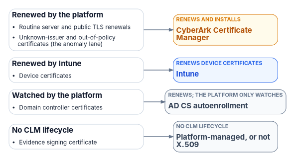

# Appendix B — Ticket-to-Machine Reference

*A ticket is evidence only when it authorized something that then ran, and a re-read proved the result.*

::: {.callout-note}
## In this appendix
The tables that [Chapter 10](10-ticket-to-machine.md) relies on: the coordination loop and the five clauses every governed request passes through, the lanes that each class of change takes, the approval each lane needs and the evidence each lane leaves, and the severity tempo. Then four worked examples, the program's exception for certificates, the one-front-door rule for detection tools, and the failure modes a security review of a reference implementation found. The control-by-control mapping is in [Appendix A](appendix-a-requirements-mapping.md).
:::

::: {.callout-important}
## Program design, with illustrative examples
The lanes, ceilings, severities and response windows in this appendix are the Federal Modernization Program's design, not federal requirements. Where a federal document says something relevant, it is cited. The worked examples are illustrative patterns, not records of a real engagement, and every identifier in them is invented. Product capabilities change quickly; confirm current behavior with each vendor before a plan, procurement or acquisition decision rests on this appendix.
:::

**Watch or present it:** a [narrated, self-running edition of this appendix](../../../presentations/b13-ticket-to-machine/B13_Ticket_to_Machine_Narrated.pptx) (about 10 minutes, captions) walks through the loop, the lanes, the tempo and the worked examples; the deck, script and video are on the [Presentations](../../presentations/index.md#reference-b13) page.

## The coordination loop

Native consoles can detect drift and change state, and their dashboards show current posture inside their own boundary. What a console can't do on its own is answer the four questions an assessor asks about a finding: who owns it, by when, under whose approval, and with what evidence of closure. The program puts a coordination layer in front of the native tools to answer them, and keeps every change on the native surface:

1. **Test.** A rule evaluates actual state against the authoritative record ([Chapter 05](05-deterministic-governance.md)).
2. **Detect drift.** A difference becomes a typed finding with a severity ([Chapter 06](06-the-drift-engine.md)).
3. **Raise a typed task** against the reconciled configuration item, with an owner and a clock.
4. **Actuate on the native surface**, under a service identity, through the platform's own interface.
5. **Close with evidence:** re-read the post-change state and write one record of the whole chain.

The coordination layer never writes the configuration, applies the patch or edits the firewall rule itself. Its job is to make every drift an owned, clocked, approved and evidenced piece of work. The default shape of change management fails that job even with a ticket in front of it: a ticket tells a person to open a console, the person does the work and replies "done," and the ticket records a claim. In the program's model the ticket authorizes a machine; the person's role ends at approval.

This lines up with where federal policy is pointing. OMB asked FedRAMP to oversee a cloud provider's change process itself rather than each individual change.[^aB-m2415] FedRAMP's 2026 rules let providers make routine recurring changes, the daily work of fixing flaws, handling incidents and doing maintenance, without formal notification, while keeping auditable records of how each change was classified.[^aB-fedramp-scn] And FedRAMP's change management indicator prefers redeploying version-controlled resources to modifying them in place "wherever reasonable."[^aB-fedramp-ksi] Those rules bind providers, not agencies; the program applies the same logic to an agency's own estate.

## The five-clause request chain

Every governed change, every move, add, change, deletion and reset, travels the five clauses of [Book 00, Chapter 04](../b00-orientation/04-the-principles.md#principle-2). In the coordination layer they run in order, and if any clause fails the chain stops and the task is not treated as closed. A refusal is written to the record like a success.

| Clause | What the coordination layer checks | Refuses when | Evidence it leaves |
|---|---|---|---|
| 1. Originates with the source of truth | The task traces to a lineage record: a drift finding, an HR event or an approved request | No origin record resolves | The origin record's identifier |
| 2. Carries an authoritative authorization | The approver resolves from the authority model; separation of duties holds, fail-closed | The requester or the plan's author is the approver; the target isn't reconciled to the authoritative record | Approver, approval time, the authority rule that resolved |
| 3. Executes under least privilege, elevated just in time | The executing identity activates a time-boxed, scoped role, then the native write runs through the platform's interface | No activation is issued (no activation, no actuation); the grant requested would be standing; the write is rejected | Activation identifier and expiry; run log tied to the task; artifact version |
| 4. Closes with provenance | The post-change state is re-read from the platform; a success response is not closure | The re-read doesn't show the intended state | Verification payload, timestamp, identity of the checking mechanism |
| 5. Emits verified, secured evidence automatically | One closure record flows into the continuous-monitoring stream with no human assembly | The record can't be written or signed | The closure record in the evidence chain ([Chapter 07](07-evidence-over-attestation.md)) |

The chain mirrors the [Book 01 actuation ladder](../b01-transformation-arc/11-analysis-plan-delivery.md): clause 2 is the human authorization that L3 gated actuation requires for each instance, or the advance acceptance of the class at L4, and clause 4 is the re-test that makes the result something an authorizing official can rely on. Privileged elevation follows [Book 04's](../b04-access/08-pim-self-request-with-approval.md) request-with-approval model.

## Change classes and their lanes

Each class of change takes one of five lanes. The lane decides who approves, what runs and what evidence results.

| Lane | Who approves | What executes | Evidence produced | Ladder ceiling |
|---|---|---|---|---|
| Machine, autonomous | The class, accepted in advance and in writing by the authorizing official, with its scope limits, exclusions and after-the-fact review rate; the governance board reviews each such class quarterly | The execution layer through a native interface, inside the response window | Finding, rule and baseline version, before and after state, re-read, run log | L4, enumerated low-blast-radius classes only |
| Machine, gated | A named approver who isn't the requester or the plan's author, per instance, ring or approved batch | The execution layer after a dry run, under a service identity | The above, plus the approval, the dry run and the activation | L3, the default ceiling |
| Human decision | The role that owns the decision | Whatever the decision authorizes, usually the gated lane | The decision record, then the gated-lane evidence | L2 until decided |
| Protocol-enforced | The policy encoded in the protocol and in DNS | The issuing protocol, with no ticket per event | Issuance logs, inventory, policy records | Not a ticket lane |
| Declared exception | The system owner, with a named compensating control and an end date | A person, through a time-boxed, proxied and recorded privileged session | The approval first, then the session recording | Temporary; tracked to closure |

The classes below are the program's starting assignment. An agency tunes them in its own authoritative record; a class moves only by a reviewed change to that record.

| Class of change | Example | Lane | Approval needed | Evidence beyond the lane's default |
|---|---|---|---|---|
| Configuration drift with a deterministic fix, low or medium severity | A tenant setting reverted by hand away from the secure baseline | Machine, gated; autonomous only where the class is enumerated at L4 | Per instance at L3; the class in advance at L4 | The baseline version the fix restored |
| Configuration drift with a deterministic fix, high severity | A storage account opened to public network access | Machine, gated, inside a 1-hour window; a person decides the fix if it isn't deterministic | Named approver per instance, unless the class is enumerated at L4 | Exposure window, from first detection to re-read |
| Critical drift, or any drift in authorization or provenance | A change with no provenance event; a policy that contradicts a principal's recorded assurance level | Halt and alert, then human decision | By the escalation path in the finding's contract: the steward for a finding about the record, the workstream lead for a finding on a platform, the CISO for one that bears on a control requirement or on evidence | Investigation notes linked to the finding |
| Vulnerability remediation and patching | A missing security update on a server fleet | Machine, gated by maintenance window | Change approval for the window or batch | Scan before and after; time against the response window |
| Access request inside policy | A user requests a role an approver can grant | Machine, gated through the five clauses | The approver named for that role | The just-in-time activation and its expiry |
| Over-privilege or idle entitlement finding | An identity holding an entitlement unused for 90 days | Human decision by the entitlement owner, then gated removal | Entitlement owner | The owner's decision and the re-read of the binding |
| High-blast-radius change | A tenant-wide role, a Conditional Access enforcement change, bulk device state, network policy touching thousands of endpoints | Machine, gated, permanently | Named approver, after a dry run | Dry-run output and rollback plan |
| Change to the authoritative record itself | A new baseline, a rule threshold, a change to which source is authoritative | Human decision | Reviewed pull request; steward and sponsor for architecture or authoritative-origin rules | The merged change and its review |
| Routine certificate issuance and renewal within policy | A web server's certificate renewed automatically | Protocol-enforced | None per event | Issuance and inventory records |
| Certificate anomaly | A new issuing CA, a non-standard lifetime, a trust anchor change, an unknown-issuer certificate found in inventory, a blocked issuance attempt against a CAA record | Human decision, then gated | PKI owner | The anomaly finding and its disposition |
| No machine actuator exists yet | An appliance with no supported interface | Declared exception | System owner, with compensating control and end date | Session recording; the exception's POA&M item |
| Emergency change | Containment during an incident | Act first under incident procedures, then record | Incident commander; retrospective review | Retroactive task and assessment |

Two rules hold across the table. A machine never changes the authoritative record to make drift disappear: authority to change the record belongs to its review process, not to an adapter's fix path. And no class routes a gap through a person at a console without saying so: where no machine can reach the surface, the exception is declared, approved first and recorded.

The emergency row follows the shape FedRAMP gives providers: significant changes may be made during an emergency without advance notification, provided procedures are followed, parties are notified and the materials and assessment are completed afterward.[^aB-fedramp-scn] Decision rights for every approver named above are in [Book 00, Chapter 07](../b00-orientation/07-who-runs-the-program.md); the authorizing official alone accepts residual risk.

### Drift classes and their default lanes

The program's drift classes, as [Book 02](../b02-identity/11-reference-deployment.md) names them, map to lanes by default. [Chapter 06](06-the-drift-engine.md) carries the full model.

| Drift class | What it means | Default lane |
|---|---|---|
| Schema | A value's encoding or structure doesn't match the current schema | Machine-executed when the transform is deterministic, gated at L3 unless the authorizing official has accepted the class at L4; a format failure on a claim in use is critical and halts ([Chapter 06](06-the-drift-engine.md)) |
| Semantic | A value is well formed but means the wrong thing, such as a deprecated naming pattern | Machine, gated; often escalates |
| Provenance | A state change appears with no provenance event | Halt and alert when the claim is in active use (P1); otherwise a P3 human decision ([Chapter 06](06-the-drift-engine.md)) |
| Authorization | A policy contradicts what the record says a principal may do | Halt and alert when the claim is in active use (P1); otherwise a P3 human decision ([Chapter 06](06-the-drift-engine.md)) |
| Identity | A principal exists with no counterpart in the record, or the reverse | Human decision, then gated |

## Severity and tempo

The tempo is how quickly each severity must be handled. It bounds the response, not the occurrence: drift is the signal, and a program with no findings is more likely blind than clean.

| Severity | May a machine fix it? | Response window | Who approves |
|---|---|---|---|
| P1, critical | No: the run halts and alerts | Immediate | A named role decides before anything changes |
| P2, high | Yes, if the fix is deterministic and the class qualifies | 1 hour | An approver per instance, unless the class is enumerated at L4 |
| P3, medium | Yes, if the class qualifies | 24 hours | An approver per instance, or the class approved in advance |
| P4, low | Yes, if the class qualifies | 72 hours | The class approved in advance, reviewed after the fact |

The source of this tempo said P3 and P4 findings auto-remediate. In the program's model that holds only for classes enumerated at L4; everywhere else the machine executes after a person approves, which is still a ticket to a machine. [Chapter 10](10-ticket-to-machine.md#which-change-classes-qualify) gives the six tests a class must pass to qualify.

These are the program's internal windows for drift against its own record. They don't replace external timelines: CISA's BOD 26-04 sets remediation timelines for vulnerabilities by exposure, KEV status, automatability and technical impact, and an agency's vulnerability findings follow those.[^aB-bod2604] Where both apply, the external clock governs whenever it is shorter or different in kind ([Chapter 10](10-ticket-to-machine.md)).

The tempo also names measures that belong to program leadership, not only to operations. [Chapter 10](10-ticket-to-machine.md) defines them:

| Measure | Question | What a bad value means |
|---|---|---|
| Detection coverage | What share of the estate emits drift findings? | Drift outside coverage is invisible to the tempo |
| Window adherence | What share of findings close inside their window, and how many are open past it? | The program is generating drift in its own operations |
| Escalation rate | What share of findings reach a human? | Severity is rising, or the classifier needs tuning |
| Machine-closure share | What share of closures did a machine execute under an approval? | Actuators aren't being added |
| Declared-exception count | How many open tasks have no machine actuator? | Manual work is becoming permanent |

A tempo doesn't need round-the-clock staffing: low and medium findings close through approved plans and L4 classes, and critical findings halt and hold until a person responds. It does need the escalation roles to exist. A program without a steward has to designate one; the tooling can't create authority.

## The evidence record

Every lane writes the same record shape, so an assessor reads one format whatever the platform.

| Field | Machine lanes | Declared exception | Protocol-enforced |
|---|---|---|---|
| Origin | Finding or request identifier | Finding identifier | Issuance policy identifier |
| Owner and clock | Task owner, response window, due time | System owner, end date | PKI owner |
| Approval | Approver and time, or the L4 class acceptance and rule version | Approver and time, before the session | Policy version |
| Executing identity | Service identity, activation identifier | The person, through the recorded session | The protocol client's identity |
| What ran | Version-controlled artifact and its hash | The session recording | The issuance transaction |
| Result | Re-read post-state and time | Re-read post-state and time | Certificate in inventory |
| Closure | One record linking all of the above | Same, plus the POA&M item | Inventory entry |

This is what the assessor checks: the change traces to a prior approval, the artifact that ran is version-controlled and access-restricted, the execution is logged and attributable to the task, and the result is re-testable. The controls those properties evidence, CM-3, CM-5(1), CM-4(2) and AU-10 among them, are mapped in [Appendix A](appendix-a-requirements-mapping.md). [Chapter 07](07-evidence-over-attestation.md) covers how the record is protected and signed.

NIST's guidance is balanced on the point that matters here: organization-wide monitoring "cannot be efficiently achieved through manual processes alone or through automated processes alone," and where manual processes are used they must be repeatable and verifiable.[^aB-sp800137] The declared-exception lane exists to meet that test for the work machines can't yet do.

## Worked examples

All four examples are illustrative. Names, identifiers and times are invented.

### Example 1: a configuration setting drifts

1. The nightly rule run compares a cloud tenant's sharing setting to the baseline in the authoritative record and finds it set to allow anonymous links. The rule is deterministic, the finding is P3, and in this example the authorizing official has accepted this class, restoring one named sharing setting on one tenant to its baseline, for L4.
2. The governance platform raises task `FMP-DRIFT-0412` against the tenant's configuration item, owner the collaboration platform team, due in 24 hours.
3. Because the class is enumerated at L4, no per-instance approval is needed. The execution layer activates its service identity, calls the tenant's configuration interface to restore the baseline value, and records the artifact version that ran.
4. It re-reads the setting, finds the baseline value, and closes the task with one record: finding, baseline version, before and after values, run log and re-read time. Without the L4 acceptance, step 3 would wait for a named approver; nothing else would change.

The evidence an assessor would read: a CM-6 deviation detected and corrected, a CM-3 record of the change, and a CA-7 monitoring result, all from one task. If the setting drifts again the next week, the second finding links to the first, and a pattern of repeats becomes a question for the record's steward, not another silent fix.

### Example 2: an access request through gated actuation

1. A user requests an administrative role for a project. The request carries origin record `REQ-2291`. Clause 1 passes.
2. The approver named for the role in the authoritative record approves. Clause 2 checks that the approver isn't the requester; it passes.
3. The execution layer activates a just-in-time role for its own identity, expiring in one hour, and assigns the user's role through the directory's interface as eligible for the project's duration, not standing. Clause 3 passes.
4. It re-reads the user's role assignments and finds the eligible assignment with its end date. Clause 4 passes.
5. One closure record, with the request, approval, activation, run log and re-read, flows into the evidence chain. Clause 5 passes.

Had the requester tried to approve their own request, clause 2 would have refused and the refusal would be the record. [Book 04, Chapter 09](../b04-access/09-access-governance.md) covers the review cycle that later recertifies the grant.

### Example 3: an unknown-issuer certificate

1. The certificate inventory finds a certificate on an internal web server issued by a CA that isn't in the approved list. Routine issuance never raises a ticket; an anomaly does.
2. The finding becomes task `FMP-PKI-0087`, owner the PKI owner, severity P2. No automatic fix applies, because replacing a certificate without knowing who depends on it can break a service.
3. The PKI owner decides to replace the certificate through the approved issuer and to add the rogue CA to the trust-store deny list. The decision is recorded.
4. The replacement runs in the gated lane: the protocol client on the server requests a new certificate from the approved issuer, and the platform re-reads the endpoint to confirm the new chain.

### Example 4: no actuator yet

1. A drift finding names a legacy network appliance whose only management surface is an interactive console. No machine actuator exists.
2. The system owner approves a declared exception: a named engineer, a two-hour window, access through the privileged access proxy with session recording, and a compensating control of daily configuration export and comparison. The exception carries an end date and a POA&M item for building an actuator or retiring the appliance.
3. The engineer makes the change inside the recorded session. The platform re-reads the appliance's exported configuration and closes the task with the recording attached.

The exception is visible, approved before the work, and temporary. A silent console session for the same change would have produced none of that.

## The certificate exception

Certificates are a large share of operational work, so it's tempting to route them through the same front door. The program doesn't, for routine lifecycle events, and the reason is volume. A configuration-drift finding is occasional and each one deserves a decision. A certificate estate with short validity periods generates renewals continuously, and publicly trusted TLS certificates are moving from a maximum of 398 days to 47 days in steps from March 2026 to March 2029.[^aB-cabf] Routing every renewal through an approval ticket wouldn't add rigor; it would train approvers to approve without reading.

So routine issuance is protocol-enforced and engine-driven (see [Certificates in this book and the CLM platform](#certificates-and-the-clm-platform)). ACME automates issuance once a client proves control of a name, with no person in the loop.[^aB-rfc8555] CAA records let a domain holder name the CAs allowed to issue for it, which puts part of the issuance policy in DNS where machines check it.[^aB-rfc8659] Short-lived certificates make expiry, not revocation, the normal end of a certificate's life. The anomalies, listed in the lanes table, still come through the front door, because they are rare, consequential and need a human. [Book 07, Chapter 08](../b07-pki/08-lifecycle-monitoring-and-decommissioning.md) covers the certificate lifecycle and the tooling.

## One front door for detection tools

Many tools detect: native cloud posture engines, vulnerability scanners, entitlement-management tools for cloud identity, certificate inventories. The program's rule is that each is a detection engine feeding the one coordination layer, not a second coordination layer of its own. An entitlement tool that finds over-privileged cloud roles raises tasks in the same queue, under the same five clauses, as a posture engine that finds an open storage account. Access requests and recertifications can come from an identity governance front end; they land in the same record, correlated to the same request identifiers, with closure written back.

Two cautions keep this honest. First, check each detection tool's actual platform coverage before counting on it; in the program's own research, coverage of on-premises virtualization platforms was the gap that recurred across tool categories, and it should be treated as open until a vendor's current documentation shows otherwise. Second, a reviewer will raise alternative architectures: a single multi-cloud posture engine in place of several native ones, or a compliance platform that generates the authorization package directly from machine-readable evidence. Neither changes the one-front-door rule, and both deserve a build-or-buy look before custom investment.

## Failure modes found in a reference implementation review

The program built a reference implementation of the five-clause chain on an IT service management platform, covering an identity-lifecycle domain with both a cloud directory leg and an on-premises directory leg. An adversarial security review of the on-premises leg found defects that were then fixed. They are worth listing because each is a way the pattern fails while looking correct.

| Failure mode | What went wrong | The fix, as a design rule |
|---|---|---|
| Origin not enforced | The chain accepted request identifiers without resolving them, so a caller with no lineage record could invoke it | Clause 1 resolves the origin or refuses; a negative test proves the refusal |
| Command injection | Parameter names were rendered unescaped into a script for the on-premises directory | Never build commands by string; escape or allow-list every name and value |
| Target substitution | A merge of caller input over defaults let input override the intended target | Fix the target from the authorized record; caller input can't override it |
| Cleartext secret in a queue | A password crossed a work queue in plain text | Secrets never travel in task payloads; use a vault reference |
| No post-state re-read | One leg treated a successful dispatch as closure | Clause 4 re-reads on every leg; a success code is not evidence |
| Test mode skipped the risky path | Every test ran in a mode that short-circuited before the vulnerable code, so the tests never exercised it | Test mode refuses on production, and negative tests run the real path with hostile input |

The same review supports two kinds of automated check. Negative tests prove the chain refuses what it must: self-approval, standing privilege, an unreconciled target, a missing origin and hostile parameter names. Build-time gates fail a build when a catalog item claims autonomous write without a recorded decision behind it, or when a control map names an actuator method that doesn't exist. Neither proves the code does everything this appendix describes; they prove the specific refusals and mappings they test. The reference implementation is a starting point to build and test from, not evidence that any agency's instance runs it.

## Certificates in this book and the CLM platform {#certificates-and-the-clm-platform}

[Book 07](../b07-pki/index.md) gives each class of certificate one issuer and one renewal engine, and makes CyberArk Certificate Manager, Self-Hosted the system of record for every certificate that Intune and the PIV system don't manage ([Chapter 04](../b07-pki/04-the-target-pki.md), [Chapter 05](../b07-pki/05-who-owns-the-certificate-estate.md)). The certificates this book's systems depend on map to it as follows; [Book 07, Appendix C](../b07-pki/appendix-c-anatomy-of-the-clm-platform.md) describes the platform itself.

| Certificate | Book 07 class | Issued by | Renewed by | What the CLM platform does |
|---|---|---|---|---|
| Routine server and public TLS renewals | C5 and C6 | Retained AD CS; public CA | CyberArk Certificate Manager | Drivers renew and install; ACME where the endpoint supports it |
| Device certificates | Device and user auth (Intune) | Cloud PKI | Intune | Nothing |
| Domain controller certificates | Domain controller and LDAPS | Retained AD CS | AD CS autoenrollment | Watches |
| Unknown-issuer and out-of-policy certificates (the anomaly lane) | Internal server TLS | Any | CyberArk Certificate Manager | Network discovery finds them; placement and owners bring them under policy |
| Evidence signing certificate | Not a Book 07 class | Agency CA | Platform-managed, or not X.509 | At most watches |

{fig-alt="Routine server and public TLS renewals, Unknown-issuer and out-of-policy certificates (the anomaly lane) go to CyberArk Certificate Manager (renews and installs); Device certificates go to Intune (renews device certificates); Domain controller certificates go to AD CS autoenrollment (renews; the platform only watches); Evidence signing certificate go to Platform-managed, or not X.509 (no clm lifecycle)."}

"Protocol-enforced" means engine-driven: Intune profiles, AD CS autoenrollment and the CLM platform's drivers renew most certificates, and ACME automates issuance only where the endpoint supports it ([Book 07, Chapter 08](../b07-pki/08-lifecycle-monitoring-and-decommissioning.md)).[^clm-acme][^clm-disc]

::: {.callout-tip}
## Continue the book
[← Previous: Appendix A — Requirements Mapping](appendix-a-requirements-mapping.md) · [Book index](index.md)
:::

[^aB-m2415]: Office of Management and Budget, M-24-15, *Modernizing the Federal Risk and Authorization Management Program (FedRAMP)*, July 25, 2024, §VI (Continuous Monitoring), <https://www.whitehouse.gov/wp-content/uploads/2024/07/M-24-15-Modernizing-the-Federal-Risk-and-Authorization-Management-Program.pdf> (accessed Oct 21, 2026).
[^aB-fedramp-scn]: FedRAMP, "Significant Change Notification," *FedRAMP Consolidated Rules for 2026*, SCN-CSO-EVA, SCN-CSO-MAR, SCN-CSO-EMG and SCN-RTR-NNR, <https://www.fedramp.gov/2026/reference/significant-change-notification/> (accessed Oct 21, 2026).
[^aB-fedramp-ksi]: FedRAMP, "Key Security Indicators," *FedRAMP Consolidated Rules for 2026*, KSI-CMT-RMV, <https://www.fedramp.gov/2026/reference/key-security-indicators/> (accessed Oct 21, 2026).
[^aB-bod2604]: Cybersecurity and Infrastructure Security Agency, BOD 26-04, *Prioritizing Security Updates Based on Risk*, June 10, 2026, Background and Appendix A, Table 1: Remediation Timelines, <https://www.cisa.gov/news-events/directives/bod-26-04-prioritizing-security-updates-based-risk> (accessed Oct 21, 2026).
[^aB-sp800137]: National Institute of Standards and Technology, SP 800-137, *Information Security Continuous Monitoring (ISCM) for Federal Information Systems and Organizations*, September 2011, Executive Summary, <https://nvlpubs.nist.gov/nistpubs/Legacy/SP/nistspecialpublication800-137.pdf> (accessed Oct 21, 2026).
[^aB-cabf]: CA/Browser Forum, "Ballot SC-081v3: Introduce Schedule of Reducing Validity and Data Reuse Periods," April 11, 2025, <https://cabforum.org/2025/04/11/ballot-sc081v3-introduce-schedule-of-reducing-validity-and-data-reuse-periods/> (accessed Oct 21, 2026).
[^aB-rfc8555]: R. Barnes et al., RFC 8555, *Automatic Certificate Management Environment (ACME)*, March 2019, <https://www.rfc-editor.org/rfc/rfc8555> (accessed Oct 21, 2026).
[^aB-rfc8659]: P. Hallam-Baker, R. Stradling and J. Hoffman-Andrews, RFC 8659, *DNS Certification Authority Authorization (CAA) Resource Record*, November 2019, <https://www.rfc-editor.org/rfc/rfc8659> (accessed Oct 21, 2026).
[^clm-acme]: CyberArk, 26.1, "ACME" (RFC 8555 with http-01 and dns-01; tested with certbot, win-acme and acme.sh), <https://docs.venafi.com/Docs/current/TopNav/Content/ACME/cco-ACME-about.php>, and "Deploying on Windows Server" ("you cannot have FIPS enabled on any server that is used for ACMEv2"), <https://docs.venafi.com/Docs/current/TopNav/Content/Install/r-deploy-windows-server.php> (accessed Oct 23, 2026).
[^clm-disc]: CyberArk, 26.1, "Importing certificates from a CA" and "Certificate discovery," <https://docs.venafi.com/Docs/current/TopNav/Content/Discovery/cco-Discovery-importingCertsfromCA.php> (accessed Oct 23, 2026).
