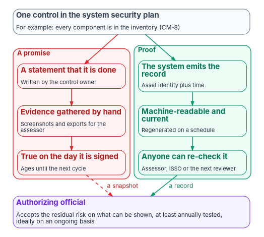

# Chapter 01 — Proof, Not a Promise

*A control is satisfied when the evidence for it exists and anyone can check it again, not when a document says it will be.*

::: {.callout-note}
## In this chapter
Why the agency's compliance work is mostly a matter of producing proof, and who owes which proof: the cloud provider, the agency or the assessor. What "Moderate" means, traced from FIPS 199 categorization through the FIPS 200 high-water mark to the SP 800-53B moderate baseline, and why FedRAMP's Class C is a separate fact. Why the law and OMB policy already expect continuous evidence rather than a periodic snapshot. And why assessment tools such as ScubaGear confirm a design but can't produce one.
:::

Federal compliance is usually described as a list of obligations: a control baseline, a set of directives, a stack of memoranda, a deadline for each. The list is real, but it hides what an authorizing official actually needs. An authorizing official doesn't need to know that a control is supposed to be in place. They need to know that it is, today, and they need to be able to show anyone who asks how they know.

That is the difference between a promise and proof. A promise is a statement in a system security plan, backed by evidence someone gathered by hand for the last assessment. It was true on the day it was signed and has been aging since. Proof is a record the system itself produces: what the control covers, when it was last checked and what it found, in a form another reviewer can check again and get the same answer.

The program's position, set out across this book, is that most of an agency's compliance debt isn't a shortage of staff or budget. It is a design mismatch. An estate built for a perimeter, with identity, addressing and evidence spread across separate tools, can describe its controls but can't prove them continuously, because nothing in the design produces the records. Adding reviewers to that estate makes the reporting heavier without making it truer. Rebuilding the parts that produce the records, chiefly authoritative asset identity, cryptographic identity and a single evidence contract, changes what the agency can show. That is a design position, not an external requirement, and the rest of the workbook argues it domain by domain.

{#fig-ch01-promise-and-proof fig-alt="At the top, a slate card: one control in the system security plan, for example every component is in the inventory, CM-8. Two columns lead down from it. The red column, labeled a promise, has three cards: a statement that it is done, written by the control owner; evidence gathered by hand, screenshots and exports for the assessor; true on the day it is signed, ages until the next cycle. The green column, labeled proof, has three cards: the system emits the record, asset identity plus time; machine-readable and current, regenerated on a schedule; anyone can re-check it, assessor, ISSO or the next reviewer. A dashed red arrow labeled a snapshot and a solid green arrow labeled a record both lead to a violet card at the bottom: the authorizing official accepts the residual risk on what can be shown, at least annually tested, ideally on an ongoing basis."}

## Who owes which proof

"Federal compliance" is often discussed as one obligation that falls on "the government." It doesn't. Three parties sit inside it, and most requirements bind one of them directly.

| Party | Role | Bound directly by |
|---|---|---|
| Cloud service provider | Builds and operates a cloud service offering and sells it to agencies | FedRAMP: the statute, OMB's implementing memorandum and FedRAMP's own rules, including the 2026 Key Security Indicators |
| Federal agency (authorizing official, ISSO, CISO, system owner) | Operates its own systems, on premises or on top of a certified cloud service, and authorizes each one | FISMA, OMB Circular A-130, NIST's standards and the Risk Management Framework, CISA's binding operational and emergency directives, OMB memoranda |
| Assessor (an independent assessment organization, or the agency's own assessment function) | Tests either party's evidence | Whichever framework it assesses against |

The table is a simplification, and the program uses it as one. An agency running its own tenant in a government cloud acts partly like a provider for the systems it hosts there, and an integrator building on a certified service for an agency sits in a fourth position. The common case is still the useful one: for any open compliance question, the first thing to settle is whether the answer starts with "we have to" or "our provider has to."

### The provider's certification is evidence, not the agency's authorization

The most common confusion runs in both directions. Some agencies treat FedRAMP as their provider's problem and miss their own monitoring obligations. Others spend effort on paperwork that belongs to the provider.

FedRAMP's 2026 guidance to agencies is plain on the point. FedRAMP certifies the cloud service; "each agency still authorizes its own federal information systems," it should reuse the provider's certification materials as "reusable security evidence," and it "should never create a standalone authorization to operate for a cloud service offering." Instead the agency authorizes its own system, which uses the service as an external service.[^c01-fr-use] OMB's memorandum M-24-15 makes the reuse strong: a FedRAMP authorization at a given FIPS 199 impact level carries a statutory presumption of adequacy, so the agency starts from the provider's assessment rather than repeating it. The same memorandum is equally clear that the agency's authorizing official "must issue an authorization" when reusing those artifacts.[^c01-m2415] [Book 13, Chapter 11](../b13-governance/11-reciprocity-and-one-authorization.md) works through what reciprocity does and doesn't cover.

So a provider selling "FedRAMP authorized" as though it closes the agency's compliance work oversells what the certification covers. It covers the provider's side of a shared boundary. The agency's side, its configuration of the service, its identities, its data, its integrations and its own systems around the service, is the agency's to prove.

### What the agency inherits from the provider

FedRAMP's Consolidated Rules for 2026 replaced most periodic assessment with Key Security Indicators: 46 indicators in ten themes, from change management and cloud-native architecture to supply chain risk and recovery planning, several of them requiring persistent, automated validation.[^c01-fr-ksi] Those indicators bind providers. What changes for the agency is what it can expect to receive and what it has to do with it. Providers must supply an Ongoing Certification Report every three months, and under rule CCM-AGM-ROR agencies "MUST review each Ongoing Certification Report" to understand how changes to the service may affect the risk they accepted.[^c01-fr-ccm] (A separate agency rule, AGU-USE-ROR, says SHOULD; the program follows the MUST, as [Book 12, Chapter 12](../b12-security-operations/12-evidence-metrics-and-continuous-monitoring.md) explains.)

The point for this chapter is the direction of travel. The provider side of the boundary now produces continuous, machine-readable evidence. The agency side is held to the same rising bar on a different legal basis, which the next two sections set out. An agency that reads "FedRAMP 20x" and concludes "not our problem" misses that its own authorization is moving the same way.

## What "Moderate" means

Most civilian systems that run on commercial cloud services are authorized at "Moderate." The word does real work, and it is worth tracing where it comes from, because three different documents use it for three different things.

{#fig-ch01-what-moderate-means fig-alt="A top-to-bottom chain. First, a slate card tagged FIPS 199: categorize each information type; confidentiality, integrity and availability each rated low, moderate or high; moderate means loss could have a serious adverse effect. Second, a slate card tagged FIPS 200: take the high-water mark; at least one objective moderate and none high gives a moderate-impact system. Third, a blue card tagged SP 800-53B: select the moderate baseline, then tailor it; 287 controls and enhancements in release 5.2.0, plus the privacy baseline where it applies. An arrow leads to a violet card: the agency's own authorization, with system security plan, assessment, POA&M and AO decision. Beside it an amber card tagged FedRAMP Class C: a provider's certification, which includes the current Moderate baseline and is inherited, not a substitute; a dashed arrow labeled reused as evidence leads from it to the agency's authorization."}

### FIPS 199: an impact level per security objective

FIPS 199, published in February 2004, is the federal standard for categorizing information and information systems. It applies to all federal information and systems other than classified information and national security systems.[^c01-fips199] For each type of information a system holds, the agency rates the potential impact of a loss of confidentiality, integrity and availability as low, moderate or high. The definitions are about consequences, not technology. The impact is moderate if a loss "could be expected to have a serious adverse effect on organizational operations, organizational assets, or individuals," which FIPS 199 amplifies as, for example, a significant degradation in mission capability, significant damage to assets, significant financial loss, or significant harm to individuals that doesn't involve loss of life or serious life-threatening injury.[^c01-fips199]

The result is written as a triple: the security category of a system is its confidentiality, integrity and availability impact, each taken as the highest value across all the information types the system holds.[^c01-fips199] OMB Circular A-130 makes the categorization an agency requirement: agencies shall identify authorization boundaries and "categorize information and information systems, in accordance with FIPS Publication 199 and NIST SP 800-60."[^c01-a130] It also says agencies should generally categorize systems that handle personally identifiable information at the moderate or high confidentiality level.[^c01-a130] In the control catalog the same step is RA-2, Security Categorization, which requires the result and its rationale to be documented in the security plan and approved by the authorizing official or a designated representative.[^c01-sp80053]

### FIPS 200: the high-water mark

FIPS 200 turns the three values into one. A low-impact system has all three objectives at low; a moderate-impact system has "at least one of the security objectives" at moderate and none higher; a high-impact system has at least one at high. FIPS 200 explains why it uses the highest value: there are significant dependencies among the three objectives, and in most cases a compromise of one ultimately affects the others.[^c01-fips200] The determination has to be made before any controls are selected.

Then FIPS 200 sets the floor. For moderate-impact systems, organizations "must, as a minimum, employ appropriately tailored security controls from the moderate baseline" in NIST SP 800-53, and must employ every control in that baseline unless the tailoring guidance allows an exception.[^c01-fips200] The word "Moderate" in an authorization is a statement that this happened: the system was categorized, the high-water mark was moderate, and the moderate baseline was selected and tailored.

### SP 800-53B: the moderate baseline

The baselines themselves live in SP 800-53B, published in October 2020 and updated in December 2020. It defines three security control baselines, one per impact level, and a separate privacy baseline that applies to systems regardless of impact level.[^c01-sp80053b] The baselines are a starting point: organizations tailor them to their mission, environment and risk, following the tailoring guidance in the same publication and the tailoring tasks in SP 800-37.[^c01-sp80053b]

In the current release of the control catalog, 5.2.0, the moderate baseline lists 287 controls and control enhancements: 177 base controls and 110 enhancements, against 149 in the low baseline and 370 in the high.[^c01-oscal] That number is the size of the promise a moderate system makes. Each of those entries is a control the system security plan will say is implemented, and each is a control the assessment will test.

### FedRAMP Class C: a separate fact

FedRAMP's 2026 rules replaced the old impact-level names for cloud services with certification classes. FedRAMP's notice on the designations says Class C "will include the current Moderate baseline," Class D the High baseline, and Class B the current LI-SaaS and Low baselines, with Class A a new pilot.[^c01-ntc0004] The workbook uses the class names for provider certifications.

The two facts are related but not interchangeable. A NIST baseline says which controls an agency system at an impact level must implement. A FedRAMP class says how a provider's service was certified. Class membership and NIST baseline membership can differ for the same control, which is why the workbook cites them separately; [Book 13, Appendix A](../b13-governance/appendix-a-requirements-mapping.md) gives worked examples. A moderate agency system built on a Class C service inherits the provider's evidence for the provider's side. It still has to prove the agency's side against its own tailored moderate baseline.

## Why every control needs proof

None of this would require continuous evidence if the law asked only for an assessment every few years. It doesn't. It never set a three-year rule, and the documents that govern agency authorization have pointed the other way for a decade.

FISMA requires each agency's information security program to include periodic testing and evaluation of its security policies, procedures and practices, "to be performed with a frequency depending on risk, but no less than annually," and that testing must cover the management, operational and technical controls of every system in the agency's inventory.[^c01-fisma] Annual is a floor, set by statute.

OMB Circular A-130 goes further. Agencies shall implement a risk management framework covering categorization, control selection and assessment, authorization and continuous monitoring; complete an initial authorization based on an explicit acceptance of risk; and "transition information systems and common controls to an ongoing authorization process when eligible for such a process and with the formal approval of the respective authorizing officials."[^c01-a130] Until an authorizing official approves that transition, a system stays under a static authorization with specific termination dates the agency enforces.[^c01-a130] A-130 also requires agencies to conduct control assessments before operation and periodically thereafter, at the frequency their continuous monitoring strategy sets, and to use plans of action and milestones to track what remains open.[^c01-a130]

The control catalog carries the same requirements into the system security plan. CA-7, Continuous Monitoring, requires a system-level strategy with defined metrics, monitoring and assessment frequencies, and ongoing control assessments. CA-5 requires a plan of action and milestones, updated from the findings of assessments, audits and continuous monitoring. CA-6 requires a senior official to authorize the system before it operates. All three are in the low baseline and every baseline above it.[^c01-sp80053] SP 800-37 adds the point that makes proof matter most: the explicit acceptance of risk is the authorizing official's responsibility "and cannot be delegated to other officials within the organization."[^c01-sp80037] The person who signs is accepting the risk that remains, and can only judge it from what the evidence shows.

Put together, the requirement is not exotic. The agency must know, at least annually and ideally continuously, whether each control is working; it must track what isn't; and one named official must accept what remains. A promise can satisfy that once. Only proof can satisfy it on an ongoing basis, because only proof can be regenerated without assembling it again by hand.

### What the program counts as proof

The program sets a definition, and it is a design choice, not a federal rule. A control counts as closed when four things are true:

1. **The evidence is produced by the system**, not assembled by staff for the assessment.
2. **It is machine-readable**, so a reviewer or a tool can read it without interpretation.
3. **It is current**, regenerated on a schedule the continuous monitoring strategy sets, not frozen at a point in time.
4. **It can be checked again**: another reviewer running the same check against the same records gets the same answer.

The shape of that evidence, every record keyed to an authoritative asset identity and a time, is [Book 12, Chapter 02](../b12-security-operations/02-the-evidence-contract.md). Why evidence beats attestation, and how drift between the record and the estate becomes a finding, is [Book 13, Chapter 07](../b13-governance/07-evidence-over-attestation.md). [Chapter 04](04-closure-with-proof.md) applies the definition control by control: a control closes only when the mechanism that closes it exists and its proof is recorded.

### What a promise looks like at assessment

The program's own reading of a typical estate, a framing pattern rather than any real engagement, is that the findings an assessor would record cluster where nothing produces the record:

- **Component inventory (CM-8)** assembled by hand per environment, so it diverges from the estate between scans.
- **DNS integrity (SC-20, SC-21)** unsigned in some zones because no single resolver spans every environment.
- **Audit records (AU-2, AU-12)** for DNS, DHCP and network sessions spread across formats no one correlates.
- **Authentication events (IA-2)** that legacy protocols don't record in a form the SIEM can tie to a user and device.
- **Stored credentials (IA-5)** in database logins that no credential system inventories or rotates.

Each of these becomes a plan of action and milestones item that comes back every cycle, because manual evidence assembly can close the paperwork but can't keep it closed. Each is closed, in the program's design, by a mechanism that produces its own record: an IPAM platform that creates the address, name and inventory entry together, a signed and validating resolver, a single log stream, token-based authentication, managed identities in place of stored passwords. The books on those domains carry the detail ([Book 08](../b08-ddi/index.md), [Book 02](../b02-identity/index.md), [Book 12](../b12-security-operations/index.md)).

## Why assessment tools aren't a roadmap

Agencies are often told to run an assessment tool as their compliance answer: CISA's ScubaGear for Microsoft 365, a vendor's posture score, a Zero Trust maturity self-assessment. These tools are valuable, and some are required. They answer a different question from the one an authorization needs answered first.

ScubaGear is a good example because its purpose is precise. CISA describes it as an assessment tool that "verifies that a Microsoft 365 (M365) tenant's configuration conforms to the policies described in" the SCuBA secure configuration baselines; it queries tenant settings for Entra ID, Exchange Online, SharePoint, Teams, Power BI, Power Platform and the security suite, compares them against those policies, and reports the result.[^c01-scubagear] BOD 25-01 makes running it mandatory for in-scope cloud tenants: agencies had to deploy the SCuBA assessment tools by April 25, 2025 and implement the mandatory policies by June 20, 2025, and the directive's stated purpose includes requiring agencies to "remediate deviations from the secure configuration baselines," with authorizing officials able to accept risk for specific deviations.[^c01-bod2501]

What a tool like this can't do follows from what it is. It measures a configuration against an intended state. It can tell an agency that DNSSEC isn't enabled; it can't design the naming platform that makes DNSSEC enforceable across every environment. It can score Zero Trust maturity as "Traditional"; it can't design the identity, policy and device chain that moves it to "Advanced." It covers the surface it was built for, a cloud tenant, and not the network, the data tier or the on-premises estate around it. A conformance tool measures drift from an intended state; it can't author one. Run against an estate with no target design, it measures drift from nothing.

So the program puts assessment last, not first. The sequence below is the program's design, not a federal requirement:

| Phase | Activity | What it produces |
|---|---|---|
| Understand | Find each control gap and its design root cause | A gap list tied to causes, not symptoms |
| Design | Choose the pattern that closes each gap with continuous evidence | A target design per domain |
| Implement | Build the infrastructure and integrations | Mechanisms that produce their own records |
| Govern | Set up the plan of action and milestones, supply chain, training and decision-rights structures | Owned findings and accountable decisions |
| Validate | Run the assessment tools, now as confirmation | A near-clean report because the design produces it |
| Authorize | Assemble the machine-readable package for the assessor and the authorizing official | An authorization based on proof |

When an agency reaches validation in that order, the tool confirms what the design already guarantees: the tenant meets its baseline because the configuration is managed as code and drift is caught, not because someone fixed settings to pass the scan. When an agency runs the tool first, it gets an accurate list of open findings and no framework for closing them, so it closes them one at a time and the next scan finds them reopened. [Book 11, Chapter 08](../b11-zero-trust/08-close-before-you-assess.md) makes the same argument for BOD 25-01 in particular, and [Book 11, Chapter 09](../b11-zero-trust/09-running-the-assessment.md) shows how to run the assessment once the design is in place.

## Honest limits

Four limits keep this chapter's argument in proportion.

- **This is guidance, not legal advice.** It is a way of sorting obligations and evidence, not a substitute for the agency's own legal, privacy and ISSO review of its posture.
- **Moderate is where most civilian cloud systems sit, not where all of them sit.** High-impact systems, national security systems and Defense impact levels have their own baselines and rules, and are out of scope here.
- **Proof doesn't remove judgment.** A record can show that a control ran and what it found. Whether the remaining risk is acceptable is still the authorizing official's decision, and no evidence pipeline makes it for them.
- **The program's design isn't the only way to produce proof.** The four properties above can be met with many tools. What matters is that the evidence comes from the systems, stays current and can be checked again, not which product emits it.

## What leadership should take from this

1. **Ask who owes the proof before asking whether it exists.** Provider evidence is reused; agency evidence is produced. Mixing them up either duplicates the provider's work or leaves the agency's side unproven.
2. **Treat "Moderate" as a commitment of a known size.** It means a categorization, a high-water mark and a tailored baseline of a few hundred controls and enhancements, every one of which the authorizing official is accepting on the evidence.
3. **Fund the mechanisms that produce records before the tools that measure them.** Assessment tools confirm a design. They can't stand in for one, and the annual testing floor and ongoing authorization both assume the evidence is already there.

[Chapter 02](02-the-federal-clock.md) sets out the dates by which all of this is being asked for, and whom each one binds.

::: {.callout-tip}
## Continue the book
[← Previous: Book index](index.md) · [Next: Chapter 02 — The Federal Clock →](02-the-federal-clock.md)
:::

[^c01-fr-use]: FedRAMP, "Using a FedRAMP Certified Cloud Service," *FedRAMP Consolidated Rules for 2026*, <https://www.fedramp.gov/2026/agencies/use/> (accessed Oct 21, 2026).
[^c01-m2415]: Office of Management and Budget, M-24-15, *Modernizing the Federal Risk and Authorization Management Program*, July 25, 2024, §IV.a (The Presumption of Adequacy) and footnote 11 (authorizing officials "must issue an authorization when reusing artifacts"), <https://www.whitehouse.gov/wp-content/uploads/2024/07/M-24-15-Modernizing-the-Federal-Risk-and-Authorization-Management-Program.pdf> (accessed Oct 21, 2026).
[^c01-fr-ksi]: FedRAMP, "Key Security Indicators," *FedRAMP Consolidated Rules for 2026*, Ruleset Reference (46 indicators in ten themes; KSI-CMT-VTD and other persistent-validation indicators; changelog entries of June 24 and October 13, 2026), <https://www.fedramp.gov/2026/reference/key-security-indicators/> (accessed Oct 21, 2026).
[^c01-fr-ccm]: FedRAMP, "Collaborative Continuous Monitoring," *FedRAMP Consolidated Rules for 2026*, rules CCM-OCR-AVL (Ongoing Certification Report every 3 months) and CCM-AGM-ROR (Review Ongoing Reports), <https://www.fedramp.gov/2026/reference/collaborative-continuous-monitoring/> (accessed Oct 21, 2026).
[^c01-fips199]: National Institute of Standards and Technology, FIPS 199, *Standards for Security Categorization of Federal Information and Information Systems*, February 2004, §2 (Applicability) and §3 (potential impact definitions and amplifications; security categorization applied to information systems), <https://nvlpubs.nist.gov/nistpubs/FIPS/NIST.FIPS.199.pdf> (accessed Oct 21, 2026).
[^c01-a130]: Office of Management and Budget, Circular A-130, *Managing Information as a Strategic Resource*, July 2016, Appendix I, §3.b (risk management framework), §4.a (Security Categorization), §4.d (Authorization to Operate and Continuous Monitoring), the requirement on categorizing systems that process PII, and §5.h (Ongoing Authorization), <https://www.whitehouse.gov/wp-content/uploads/legacy_drupal_files/omb/circulars/A130/a130revised.pdf> (accessed Oct 21, 2026).
[^c01-sp80053]: National Institute of Standards and Technology, SP 800-53 Rev. 5, *Security and Privacy Controls for Information Systems and Organizations*, controls RA-2, CA-5, CA-6 and CA-7, statements checked against the release 5.2.0 OSCAL catalog, <https://github.com/usnistgov/oscal-content/tree/main/nist.gov/SP800-53/rev5> (accessed Oct 21, 2026).
[^c01-fips200]: National Institute of Standards and Technology, FIPS 200, *Minimum Security Requirements for Federal Information and Information Systems*, March 2006, §2 (Information System Impact Levels, with footnote 3 on the high-water mark) and §4 (Security Control Selection), <https://nvlpubs.nist.gov/nistpubs/FIPS/NIST.FIPS.200.pdf> (accessed Oct 21, 2026).
[^c01-sp80053b]: National Institute of Standards and Technology, SP 800-53B, *Control Baselines for Information Systems and Organizations*, October 2020 (includes updates as of December 10, 2020), Abstract and §2.4 (Tailoring Control Baselines), <https://nvlpubs.nist.gov/nistpubs/SpecialPublications/NIST.SP.800-53B.pdf> (accessed Oct 21, 2026).
[^c01-oscal]: National Institute of Standards and Technology, SP 800-53 Rev. 5 release 5.2.0 baseline profiles in OSCAL JSON (`NIST_SP-800-53_rev5_LOW-baseline_profile.json`, `..._MODERATE-baseline_profile.json`, `..._HIGH-baseline_profile.json`); counts of included control and enhancement identifiers made by the program, <https://github.com/usnistgov/oscal-content/tree/main/nist.gov/SP800-53/rev5/json> (accessed Oct 21, 2026).
[^c01-ntc0004]: FedRAMP, Notice NTC-0004, *Initial Outcome from RFC-0020 FedRAMP Authorization Designations*, February 25, 2026, <https://www.fedramp.gov/notices/0004/> (accessed Oct 21, 2026).
[^c01-fisma]: Federal Information Security Modernization Act of 2014, 44 U.S.C. § 3554(b)(5), United States Code, 2023 edition, <https://www.govinfo.gov/content/pkg/USCODE-2023-title44/html/USCODE-2023-title44-chap35-subchapII-sec3554.htm> (accessed Oct 21, 2026).
[^c01-sp80037]: National Institute of Standards and Technology, SP 800-37 Rev. 2, *Risk Management Framework for Information Systems and Organizations: A System Life Cycle Approach for Security and Privacy*, December 2018, Task R-4 (Authorization Decision), discussion, <https://nvlpubs.nist.gov/nistpubs/SpecialPublications/NIST.SP.800-37r2.pdf> (accessed Oct 21, 2026).
[^c01-scubagear]: Cybersecurity and Infrastructure Security Agency, ScubaGear repository README, <https://github.com/cisagov/ScubaGear> (accessed Oct 21, 2026).
[^c01-bod2501]: Cybersecurity and Infrastructure Security Agency, Binding Operational Directive 25-01, *Implementing Secure Practices for Cloud Services*, December 17, 2024, Background and Required Actions 1 to 6, <https://www.cisa.gov/news-events/directives/bod-25-01-implementing-secure-practices-cloud-services> (accessed Oct 21, 2026).
