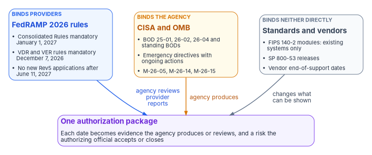
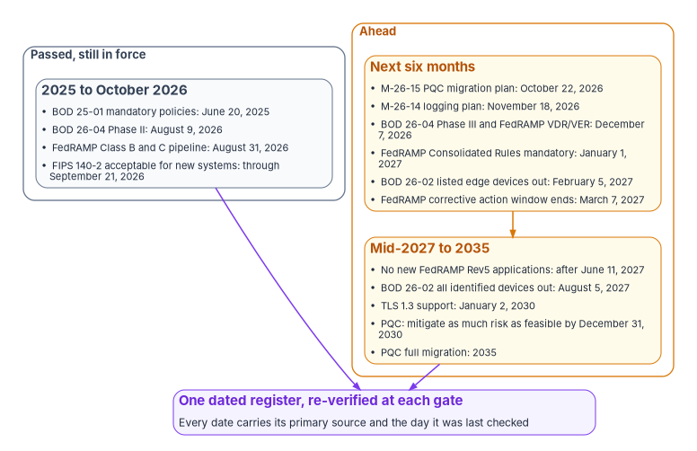

# Chapter 02 — The Federal Clock

*The dates that drive an authorization belong to FedRAMP, CISA and OMB, each binds a different party, and several had moved by the time anyone checked them.*

::: {.callout-note}
## In this chapter
Every federal date that drives the program's compliance and authorization work, sorted by whom it binds and checked against its primary source on October 21, 2026: FedRAMP's 2026 rules and their vulnerability rules, CISA's binding operational and emergency directives, OMB's memoranda on logging, software assurance and post-quantum cryptography, and the standards and vendor dates that change what an agency can prove. Where the program's earlier sources had a date wrong or out of date, the chapter says so. It ends with the dates still ahead and how the program keeps them current.
:::

[Book 00, Chapter 01](../b00-orientation/01-why-modernize-now.md) introduced the external clocks that set the modernization schedule: the federal policy dates and the vendor support dates that land on the same estate. This chapter takes the same clocks from the compliance side. The question here isn't when the estate has to change. It is what each date asks the agency to prove, who has to prove it, and what goes into the authorization package as a result.

Dates in this area move quickly. Directives are revised and versioned, memoranda rescind earlier ones, and calendar dates are often quoted from a summary rather than counted from the document. Every date below was checked against the issuing document on October 21, 2026. Where a document gives a period rather than a date, such as "within 60 days of issuance," the calendar date shown is the program's own count from the issue date, and the chapter says so. Treat every date as a snapshot and check it again before relying on it for a procurement or an authorization decision.

{#fig-ch02-who-each-clock-binds fig-alt="Three cards side by side. A blue card tagged binds providers, FedRAMP 2026 rules: Consolidated Rules mandatory January 1, 2027; VDR and VER rules mandatory December 7, 2026; no new Rev5 applications after June 11, 2027. An amber card tagged binds the agency, CISA and OMB: BOD 25-01, 26-02, 26-04 and standing BODs; emergency directives with ongoing actions; M-26-05, M-26-14 and M-26-15. A slate card tagged binds neither directly, standards and vendors: FIPS 140-2 modules for existing systems only; SP 800-53 releases; vendor end-of-support dates. Arrows from all three lead to a violet card at the bottom: one authorization package, in which each date becomes evidence the agency produces or reviews, and a risk the authorizing official accepts or closes. The arrows are labeled agency reviews provider reports, agency produces, and changes what can be shown."}

## Who each clock binds

The instruments carry different kinds of authority, and the difference decides what the agency does with each date.

| Instrument | Issued under | Binds | What the agency does with it |
|---|---|---|---|
| FedRAMP rules | The FedRAMP Authorization Act and OMB M-24-15[^c02-fr-m2415] | Cloud service providers | Reviews provider reports and reuses provider evidence in its own authorization |
| Binding operational directive (BOD) | 44 U.S.C. § 3553(b)(2) | Federal civilian agencies | Implements the required actions and keeps evidence that they hold |
| Emergency directive (ED) | 44 U.S.C. § 3553(h) | Federal civilian agencies running the named products | Acts on the stated deadlines and keeps any ongoing action running |
| OMB memorandum | OMB's authority over agency information security policy | Federal agencies | Plans, reports and implements as the memorandum sets out |
| NIST standard or catalog release | FISMA and 40 U.S.C. § 11331 | Agencies, through the standards they must follow | Updates its baseline, its control text and its evidence |

The statute gives CISA, through the Secretary of Homeland Security, two directive powers: binding operational directives "to implement the policies, principles, standards, and guidelines" OMB develops, and emergency directives in response to a known or reasonably suspected threat, vulnerability or incident that represents a substantial threat to an agency's information security.[^c02-usc3553] FISMA requires each agency's security program to comply with both, along with NIST's standards and OMB's policies.[^c02-usc3554] A directive is not guidance. Its required actions become controls the agency has to evidence.

## FedRAMP's 2026 rules: the provider clock

FedRAMP's Consolidated Rules for 2026 launched on June 25, 2026. FedRAMP publishes their schedule on a single page, and these are the dates as it gives them today:[^c02-fr-timeline]

| Date | What happens | Status on October 21, 2026 |
|---|---|---|
| July 4, 2026 | Optional early adoption: all stakeholders "should begin incrementally adopting or transitioning" | Passed |
| July 6, 2026 | Initial Implementation Marketplace listings open | Passed |
| July 28, 2026 | FedRAMP Ready becomes legacy; no Ready submissions accepted after this date | Passed |
| August 3, 2026 | 20x Class A pipeline opens | Passed |
| August 10, 2026 | Temporary Rev5 Program Certification pipelines open for Classes B and C (Ready conversion and lost sponsor) | Passed |
| August 31, 2026 | 20x Class B and C pipeline opens | Passed |
| December 7, 2026 | Vulnerability Detection and Response (VDR) and Vulnerability Evaluation and Reporting (VER) rules mandatory | Ahead |
| January 1, 2027 | The Consolidated Rules take mandatory effect for all stakeholders | Ahead |
| June 11, 2027 | No new Rev5 certification applications accepted | Ahead |

The December 7 date comes from a separate notice. FedRAMP brought the VDR and VER rules forward from a planned June 1, 2027 adoption to December 7, 2026, to line up with CISA's BOD 26-04. Providers that aren't yet following the rules can keep their certification under a corrective action plan through March 7, 2027; after that, FedRAMP says certification is revoked for offerings that don't follow them.[^c02-ntc0014] FedRAMP states that, based on confirmation with CISA, providers following the VDR and VER rules will meet or exceed BOD 26-04's expectations.[^c02-ntc0014]

Two corrections to how these dates are often quoted, including in the program's earlier sources:

- **January 1, 2027 doesn't close Rev5 to new applications.** FedRAMP keeps accepting new Rev5 certification applications until June 11, 2027. January 1 is when the 2026 rules take mandatory effect for all stakeholders, and FedRAMP notes that specific applicability and effective dates vary in certain areas.[^c02-fr-timeline]
- **None of these dates is an agency submission window.** The Class B and C pipeline that opened on August 31, 2026 is where providers of moderate services apply. An agency doesn't submit into it. The agency's date is the one on which its providers' certification evidence starts arriving in the new form, and from then its obligation is to review it: providers supply an Ongoing Certification Report every three months, and agencies "MUST review each Ongoing Certification Report."[^c02-fr-ccm] [Book 10, Chapter 03](../b10-cloud-boundary/03-what-changed-at-fedramp.md) covers what changed for the boundary, and [Book 13, Chapter 11](../b13-governance/11-reciprocity-and-one-authorization.md) how the agency reuses the evidence.

The program's earlier executive brief also said that from January 1, 2027 "all ConMon evidence must be machine-readable KSI format." That overstates the rule. The Key Security Indicators bind providers. The agency's own continuous monitoring is governed by OMB Circular A-130 and control CA-7, as [Chapter 01](01-proof-not-a-promise.md) sets out. Structuring the agency's own evidence on the same machine-readable model is the program's design choice, made so that inherited and agency evidence can be read together. It is not a federal deadline.

## CISA's binding operational directives

### BOD 26-04: risk-based remediation

CISA issued BOD 26-04, *Prioritizing Security Updates Based on Risk*, on June 10, 2026. It revokes BOD 19-02 and BOD 22-01 and supersedes both.[^c02-bod2604] Its required actions come in three phases:[^c02-bod2604]

- **Phase I, effective on issuance:** review and update vulnerability management policy, mitigate Known Exploited Vulnerabilities (KEV) on the directive's timelines, automate KEV status reporting through the CDM dashboard (or report manually every two weeks), keep Cyber Hygiene scanning unblocked, and attest quarterly to publicly exposed IP addresses and domains.
- **Phase II, within 60 days of issuance:** update vulnerability management processes and procedures to support ongoing remediation based on the CVE database (or an equivalent service) and the KEV catalog. Counted from June 10, that is August 9, 2026.
- **Phase III, within 180 days of issuance:** remediate each vulnerability no later than the directive's Table 1 timelines, continuously identify and tag every asset reachable from outside the agency network, and make sure CDM records include each asset's private as well as public addresses. Counted from June 10, that is December 7, 2026.

The timelines in Table 1 come from four questions about each vulnerable asset: is it publicly exposed, is the CVE in the KEV catalog, can exploitation be automated, and does exploitation give partial or total control. The answers set a maximum that runs from three days with forensic triage down to fixing on the next system upgrade, and the clock starts when CISA adds the CVE to KEV or the agency finds it on an asset in CDM, whichever is first.[^c02-bod2604] [Book 12, Chapter 06](../b12-security-operations/06-vulnerability-management.md) carries the full table and the program's implementation.

The program's earlier sources gave August 7, 2026 as the date agency policies were due. That date also appears in FedRAMP's notice on the directive.[^c02-ntc0014] The directive itself says "within 60 days of issuance" for Phase II, which falls on August 9, and its policy review is a Phase I action, effective immediately.[^c02-bod2604] The workbook uses the directive's own terms. Both dates have passed, so the difference matters only for evidence: what the authorization package needs to show is a policy and procedure set that implements the four-question model, dated on or before the Phase II deadline.

The same sources described December 7 as the date on which BOD 26-04 required "SBOM and vendor disclosure." It doesn't. BOD 26-04 sets agency remediation timelines; the VDR and VER rules that take effect the same day are FedRAMP rules for providers; and software bills of materials are now a contract choice for the agency, as the OMB section below explains.

### BOD 25-01: secure cloud configurations

BOD 25-01, *Implementing Secure Practices for Cloud Services*, issued December 17, 2024, covers production cloud tenants that have a finalized SCuBA secure configuration baseline; at issuance that meant Microsoft 365.[^c02-bod2501] Its dated actions have all passed: tenant inventory by February 21, 2025, assessment tools deployed and reporting by April 25, 2025, and the mandatory policies in effect at issuance implemented by June 20, 2025.[^c02-bod2501] What remains are its standing obligations, and those are what an authorization package has to evidence today:

- update the tenant inventory in the first quarter of each year;
- report continuously through CISA's monitoring integration, or quarterly by hand;
- implement future mandatory policies on the timelines CISA publishes for them;
- for a new tenant, implement all mandatory baselines and begin continuous monitoring before it receives an authorization to operate;
- identify and explain deviations in the reported results.

[Book 11, Chapter 04](../b11-zero-trust/04-scuba-and-bod-25-01.md) reads the directive in full.

### BOD 26-02: end-of-support edge devices

BOD 26-02, *Mitigating Risk From End-of-Support Edge Devices*, issued February 5, 2026, covers devices on the agency's network boundary that are reachable from the internet and no longer receive timely supported updates from the manufacturer. It works from a CISA list of end-of-support edge devices.[^c02-bod2602] Counted from issuance, its milestones fall on these dates:

| Required action | Period | Date |
|---|---|---|
| Update supported devices running end-of-support software | Immediately | February 5, 2026 |
| Inventory devices on CISA's list and report | 3 months | May 5, 2026 (passed) |
| Decommission listed devices whose end-of-support date falls on or before the deadline; inventory devices reaching end of support in the next 12 months | 12 months | February 5, 2027 |
| Decommission all identified end-of-support edge devices | 18 months | August 5, 2027 |
| Continuous discovery and an inventory of end-of-support and soon-to-be end-of-support devices, decommissioned by their dates | 24 months | February 5, 2028 |

This is where a vendor's support date becomes a federal deadline. Once the 24-month action is in place, every edge device's end-of-support date is, in effect, the agency's decommission date.

### Standing directives that are easy to forget

Three older directives remain on CISA's site without a revoked or closed marker, and each sets a recurring obligation rather than a one-time date:

- **BOD 23-01**, *Improving Asset Visibility and Vulnerability Detection on Federal Networks* (October 3, 2022): automated asset discovery every 7 days, vulnerability enumeration started every 14 days, signatures no more than 24 hours old, and results in the CDM dashboard within 72 hours of discovery completing.[^c02-bod2301]
- **BOD 23-02**, *Mitigating the Risk from Internet-Exposed Management Interfaces* (June 13, 2023): within 14 days of discovery or CISA notification, take a networked management interface off the internet or put it behind a separate Zero Trust policy enforcement point.[^c02-bod2302]
- **BOD 18-01**, *Enhance Email and Web Security* (October 16, 2017): STARTTLS, SPF and DMARC, a DMARC reject policy for every second-level domain, HTTPS-only with HSTS, and no SSLv2, SSLv3, 3DES or RC4.[^c02-bod1801]

Their deadlines passed years ago. Their requirements didn't, and a recurring requirement needs recurring evidence: a discovery job that runs every seven days is only proven by records that show it ran every seven days.

## Emergency directives

Emergency directives are shorter-lived, but they often leave ongoing actions behind. On January 8, 2026 CISA closed ten emergency directives issued between 2019 and 2024, including those on SolarWinds Orion, on-premises Exchange, Print Spooler and VMware. It explained that the vulnerability-specific ones were covered because "those vulnerabilities are now included in CISA's Known Exploited Vulnerabilities (KEV) catalog," and that the required actions were either implemented or covered by BOD 22-01, which BOD 26-04 has since replaced.[^c02-ed-retire] Three directives from the last year still carry obligations:

| Directive | Issued | Products | What still applies |
|---|---|---|---|
| ED 25-03, *Identify and Mitigate Potential Compromise of Cisco Devices*, V1 | September 25, 2025; V1 April 23, 2026 | Cisco ASA, Firepower and Secure Firewall | Apply each subsequent Cisco update within 48 hours of release; keep legacy ASA devices whose support ended on or before September 30, 2025 disconnected; handle newly found ASA hardware under BOD 26-02. V1's Firepower and Secure Firewall deadlines were April 24, April 30 and May 1, 2026, all passed.[^c02-ed2503] |
| ED 26-01, *Mitigate Vulnerabilities in F5 Devices* | October 15, 2025 | F5 BIG-IP hardware and software | Apply each subsequent F5 update within one week of release; disconnect and decommission public-facing F5 devices past end of support, or report the mission need and a decommissioning plan; follow BOD 23-02 for exposed management interfaces.[^c02-ed2601] |
| ED 26-03, *Mitigate Vulnerabilities in Cisco SD-WAN Systems*, V1 | February 25, 2026; V1 March 11, 2026 | Cisco Catalyst SD-WAN Manager and Controller | Its dated actions ran from February 26 to March 23, 2026 and have passed; its hunting and hardening guidance has no end date.[^c02-ed2603] |

ED 25-03 V1 also shows how a vendor date enters a directive: it names ASA models whose end of support was August 31, 2026 and required them to be patched in the meantime.[^c02-ed2503] An agency that runs any of these products owes evidence for the ongoing actions, such as update timestamps against the 48-hour or one-week window, as part of its continuous monitoring.

## OMB memoranda

### M-26-14: logging

OMB M-26-14, *Ensuring Effective and Efficient Agency Logging and Network Visibility to Defend Against Evolving Cyber Threats*, issued May 22, 2026, rescinded M-21-31 and counts its agency deadlines from the release of CISA's Logging Reference Architecture: an Agency Logging Plan within 90 days, then logging maturity Levels 1, 2 and 3 within 120, 180 and 320 days.[^c02-m2614] CISA published the reference architecture on August 20, 2026.[^c02-lra] [Book 00, Chapter 01](../b00-orientation/01-why-modernize-now.md) counts the calendar dates, which are the program's arithmetic rather than dates OMB published: November 18, 2026 for the plan, December 18, 2026 for Level 1, February 16, 2027 for Level 2 and July 6, 2027 for Level 3. [Book 12](../b12-security-operations/index.md) carries the logging requirements themselves.

### M-26-05: software and hardware assurance

OMB M-26-05, *Adopting a Risk-based Approach to Software and Hardware Security*, issued January 23, 2026, rescinded M-22-18 and its companion M-23-16. Agencies "shall continue to maintain a complete inventory of software and hardware" and develop assurance policies that match their own risk determinations. The secure software development attestation form becomes optional, and agencies "may also choose to adopt contractual terms" requiring a producer to provide a current software bill of materials on request, for a cloud platform an SBOM of the runtime production environment.[^c02-m2605] The compliance consequence runs in two directions. Collecting attestation forms is no longer a federal deadline. The inventory still is, and an SBOM requirement exists only if the agency writes it into its contracts. [Chapter 07](07-supply-chain-risk-management.md) covers the supply chain controls.

### M-26-15: post-quantum cryptography

OMB M-26-15, *Execution of the Migration to Post-Quantum Cryptography*, issued June 24, 2026, implements an executive order of June 22, 2026 on post-quantum migration. It doesn't apply to national security systems.[^c02-m2615] It sets the dates that now govern the civilian migration. The program's earlier sources gave only a general 2035 horizon; M-26-15 keeps 2035 for full migration but puts a firm 2030 deadline in front of it:

| Requirement | Date |
|---|---|
| Submit a post-quantum migration plan to OMB and the Office of the National Cyber Director | Within 120 days of the memorandum: October 22, 2026 by the program's count |
| Support TLS 1.3 or a successor version, consistent with Executive Order 14306 | As soon as practicable, no later than January 2, 2030 |
| Mitigate as much quantum risk as feasible across systems the agency owns or operates | December 31, 2030 |
| Plan phases: discovery 2026 to 2027, pilots 2027 to 2028, prioritized key-establishment migration 2028 to 2030, signature migration 2031, full migration 2035 | As stated in the plan guidance |

High-impact systems, high value assets and systems with highly sensitive data come first, and systems that can't support post-quantum or hybrid cryptography must be identified and prioritized for replacement or decommissioning. Agencies should engage their FedRAMP providers to set out post-quantum responsibilities in the shared responsibility model.[^c02-m2615] The plan deadline falls the day after this chapter's verification date, which makes it the nearest date on the whole clock. [Book 07](../b07-pki/index.md) and [Book 09, Chapter 03](../b09-network/03-what-tic-3-requires.md) cover what it means for certificates and network equipment.

The program's earlier sources also listed a January 1, 2027 CNSA 2.0 acquisition date. That requirement applies to national security systems, which M-26-15 and this workbook's scope exclude, so it isn't carried here.

### M-21-07: IPv6

OMB M-21-07, *Completing the Transition to Internet Protocol Version 6* (November 19, 2020), required agency plans with milestones of at least 20, 50 and 80 percent of IP-enabled assets on federal networks operating IPv6-only by the end of fiscal years 2023, 2024 and 2025, and a list of systems that can't be converted with a schedule for replacing or retiring them.[^c02-m2107] The last milestone passed with fiscal year 2025. The open item for an authorization is the list of systems that can't convert and the evidence that their replacement is on schedule.

## Standards and vendor dates

### FIPS 140-2 modules moved to the Historical List

NIST's Cryptographic Module Validation Program set September 21, 2026 as the last day FIPS 140-2 validated modules could be used for new systems; after that, their certificates move to the Historical List, "allowing agencies to continue using these modules for existing systems only."[^c02-cmvp] That date has passed. For SC-13, Cryptographic Protection, the practical effect is on new systems and new procurement: acquisition documents written now should ask for FIPS 140-3 validation, and existing systems that rely on 140-2 modules need the validation status recorded so an assessor can see which applies.

### SP 800-53 releases

The current release of SP 800-53 Rev. 5 is 5.2.0, a minor release issued on August 27, 2025.[^c02-sp80053] NIST's published schedule allows at most two minor releases a year, with comment periods beginning in February and August and publication, if needed, in May and November, and a major release every two years in November in place of a minor one.[^c02-sp80053-cadence] The program's earlier sources described February and August as release windows; they are comment windows. Release 5.2.0 itself came out in August, outside the publication months, so the schedule is a planning guide rather than a guarantee. Each release can add or revise controls, and the agency's baseline, its control text and the evidence mapped to it have to follow.

### Vendor end of support

Vendor support dates aren't federal deadlines, and [Book 00, Chapter 01](../b00-orientation/01-why-modernize-now.md) lists the Microsoft dates that matter most to a typical estate, from Windows Server 2016 on January 12, 2027 to Windows Server 2019 in 2029. They become compliance dates in three ways:

- **Through the baseline.** SA-22, Unsupported System Components, is in the low and moderate baselines and requires replacing components when support is no longer available, or providing an alternative source of continued support. SI-2, Flaw Remediation, requires security-relevant updates within an organization-defined period, which an unsupported product can't meet.[^c02-sp80053-ctl]
- **Through directives.** BOD 26-02 turns end of support into a decommission deadline for internet-facing edge devices, and ED 25-03 and ED 26-01 do the same for the named products.
- **Through the authorization.** A system that keeps an unsupported component past its date carries an open finding, a plan of action and milestones item, and a risk the authorizing official has to accept explicitly.

## The dates still ahead

{#fig-ch02-the-clock-ahead fig-alt="Two groups side by side and a card below. The slate group on the left, passed and still in force, lists 2025 to October 2026: BOD 25-01 mandatory policies June 20, 2025; BOD 26-04 Phase II August 9, 2026; FedRAMP Class B and C pipeline August 31, 2026; FIPS 140-2 acceptable for new systems through September 21, 2026. The amber group on the right, ahead, holds two cards. The first, next six months: M-26-15 PQC migration plan October 22, 2026; M-26-14 logging plan November 18, 2026; BOD 26-04 Phase III and FedRAMP VDR and VER December 7, 2026; FedRAMP Consolidated Rules mandatory January 1, 2027; BOD 26-02 listed edge devices out February 5, 2027; FedRAMP corrective action window ends March 7, 2027. It leads to the second, mid-2027 to 2035: no new FedRAMP Rev5 applications after June 11, 2027; BOD 26-02 all identified devices out August 5, 2027; TLS 1.3 support January 2, 2030; PQC mitigate as much risk as feasible by December 31, 2030; PQC full migration 2035. Arrows lead to a violet card: one dated register, re-verified at each gate, in which every date carries its primary source and the day it was last checked."}

Counted from October 21, 2026, the dates that still lie ahead are these. Dates marked as counted are the program's arithmetic from a stated period.

| Date | Instrument | Binds | What the agency needs to show |
|---|---|---|---|
| October 22, 2026 (counted) | M-26-15 | Agency | Post-quantum migration plan submitted |
| November 18, 2026 (counted) | M-26-14 | Agency | Agency Logging Plan submitted |
| December 7, 2026 (counted) | BOD 26-04 Phase III | Agency | Remediation within Table 1 timelines; external assets tagged |
| December 7, 2026 | FedRAMP VDR and VER rules | Providers | Agency reviews provider vulnerability reporting |
| December 18, 2026 (counted) | M-26-14 | Agency | Logging maturity Level 1 |
| January 1, 2027 | FedRAMP Consolidated Rules | Providers (all stakeholders) | Agency reviews Ongoing Certification Reports every cycle |
| February 5, 2027 (counted) | BOD 26-02 | Agency | Listed end-of-support edge devices decommissioned |
| February 16, 2027 (counted) | M-26-14 | Agency | Logging maturity Level 2 |
| March 7, 2027 | FedRAMP NTC-0014 | Providers | Corrective action window for VDR and VER ends; agency checks its providers' status |
| June 11, 2027 | FedRAMP | Providers | Last day for new Rev5 applications |
| July 6, 2027 (counted) | M-26-14 | Agency | Logging maturity Level 3 |
| August 5, 2027 (counted) | BOD 26-02 | Agency | All identified end-of-support edge devices decommissioned |
| February 5, 2028 (counted) | BOD 26-02 | Agency | Continuous edge discovery; decommission on each device's date |
| January 2, 2030 | M-26-15, EO 14306 | Agency | TLS 1.3 supported |
| December 31, 2030 | M-26-15 | Agency | Quantum risk mitigated as far as feasible |

## How the program keeps the clock

The program's answer to a moving clock is a design choice, not a federal requirement. Every federal date it relies on lives in one dated register in the authoritative record. Each entry names the issuing document, the exact wording of the requirement, whether the calendar date was published or counted, whom it binds and the day it was last checked against the source. Chapters, plans and diagrams cite the register rather than restating dates from memory. The register is re-verified at each program gate ([Book 01, Chapter 12](../b01-transformation-arc/12-migration-roadmap.md)) and whenever CISA, OMB or FedRAMP publishes a new version of a document it cites.

The register earns its keep the way the corrections in this chapter did. Several of the program's own source dates had drifted: a deadline quoted from a secondary notice rather than the directive, a FedRAMP date that closed one path but not another, a provider rule described as an agency obligation, a release schedule that confused comment periods with publication, a 2035 horizon overtaken by a 2030 deadline. None of those was careless. Each was correct, or nearly so, when it was written. That is the point of re-verifying: a date in an authorization package is evidence, and evidence that can't be traced back to its source on a known day is another promise.

::: {.callout-tip}
## Continue the book
[← Previous: Chapter 01 — Proof, Not a Promise](01-proof-not-a-promise.md) · [Book index](index.md) · [Next: Chapter 03 — The Control Baseline and the Crosswalk →](03-the-baseline-and-the-crosswalk.md)
:::

[^c02-usc3553]: 44 U.S.C. § 3553(b)(2) (binding operational directives) and § 3553(h) (emergency directives), United States Code, 2023 edition, <https://www.govinfo.gov/content/pkg/USCODE-2023-title44/html/USCODE-2023-title44-chap35-subchapII-sec3553.htm> (accessed Oct 21, 2026).
[^c02-usc3554]: 44 U.S.C. § 3554(a)(1)(B) (agency head responsibility for complying with NIST standards, operational directives, OMB policies and emergency directives), United States Code, 2023 edition, <https://www.govinfo.gov/content/pkg/USCODE-2023-title44/html/USCODE-2023-title44-chap35-subchapII-sec3554.htm> (accessed Oct 21, 2026).
[^c02-fr-m2415]: FedRAMP, "OMB Memorandum M-24-15," *FedRAMP Consolidated Rules for 2026*, Authority (published July 25, 2024; the FedRAMP Authorization Act requires OMB guidance on agency use of the program), <https://fedramp.gov/2026/authority/m-24-15/> (accessed Oct 21, 2026).
[^c02-fr-timeline]: FedRAMP, "Important Dates for the Consolidated Rules for 2026," <https://www.fedramp.gov/2026/timeline/> (accessed Oct 21, 2026).
[^c02-ntc0014]: FedRAMP, Notice NTC-0014, *FedRAMP Response to CISA BOD 26-04 (Prioritizing Security Updates Based on Risk)*, June 16, 2026, <https://www.fedramp.gov/notices/0014/> (accessed Oct 21, 2026).
[^c02-fr-ccm]: FedRAMP, "Collaborative Continuous Monitoring," *FedRAMP Consolidated Rules for 2026*, rules CCM-OCR-AVL and CCM-AGM-ROR, <https://www.fedramp.gov/2026/reference/collaborative-continuous-monitoring/> (accessed Oct 21, 2026).
[^c02-bod2604]: Cybersecurity and Infrastructure Security Agency, Binding Operational Directive 26-04, *Prioritizing Security Updates Based on Risk*, June 10, 2026, Required Actions (Phases I to III), remediation urgency variables and Appendix A, <https://www.cisa.gov/news-events/directives/bod-26-04-prioritizing-security-updates-based-risk> (accessed Oct 21, 2026).
[^c02-bod2501]: Cybersecurity and Infrastructure Security Agency, Binding Operational Directive 25-01, *Implementing Secure Practices for Cloud Services*, December 17, 2024, scope and Required Actions 1 to 6, <https://www.cisa.gov/news-events/directives/bod-25-01-implementing-secure-practices-cloud-services> (accessed Oct 21, 2026).
[^c02-bod2602]: Cybersecurity and Infrastructure Security Agency, Binding Operational Directive 26-02, *Mitigating Risk From End-of-Support Edge Devices*, February 5, 2026, definitions and required actions at 3, 12, 18 and 24 months, <https://www.cisa.gov/news-events/directives/bod-26-02-mitigating-risk-end-support-edge-devices> (accessed Oct 21, 2026).
[^c02-bod2301]: Cybersecurity and Infrastructure Security Agency, Binding Operational Directive 23-01, *Improving Asset Visibility and Vulnerability Detection on Federal Networks*, October 3, 2022, <https://www.cisa.gov/news-events/directives/bod-23-01-improving-asset-visibility-and-vulnerability-detection-federal-networks> (accessed Oct 21, 2026).
[^c02-bod2302]: Cybersecurity and Infrastructure Security Agency, Binding Operational Directive 23-02, *Mitigating the Risk from Internet-Exposed Management Interfaces*, June 13, 2023, <https://www.cisa.gov/news-events/directives/binding-operational-directive-23-02> (accessed Oct 21, 2026).
[^c02-bod1801]: Cybersecurity and Infrastructure Security Agency, Binding Operational Directive 18-01, *Enhance Email and Web Security*, October 16, 2017, <https://www.cisa.gov/news-events/directives/bod-18-01-enhance-email-and-web-security> (accessed Oct 21, 2026).
[^c02-ed-retire]: Cybersecurity and Infrastructure Security Agency, "CISA Retires Ten Emergency Directives, Marking an Era in Federal Cybersecurity," January 8, 2026, <https://www.cisa.gov/news-events/news/cisa-retires-ten-emergency-directives-marking-era-federal-cybersecurity> (accessed Oct 21, 2026).
[^c02-ed2503]: Cybersecurity and Infrastructure Security Agency, "V1: ED 25-03: Identify and Mitigate Potential Compromise of Cisco Devices," April 23, 2026 (supersedes the required actions of ED 25-03 of September 25, 2025), <https://www.cisa.gov/news-events/directives/v1-ed-25-03-identify-and-mitigate-potential-compromise-cisco-devices> (accessed Oct 21, 2026).
[^c02-ed2601]: Cybersecurity and Infrastructure Security Agency, "ED 26-01: Mitigate Vulnerabilities in F5 Devices," October 15, 2025, <https://www.cisa.gov/news-events/directives/ed-26-01-mitigate-vulnerabilities-f5-devices> (accessed Oct 21, 2026).
[^c02-ed2603]: Cybersecurity and Infrastructure Security Agency, "ED 26-03: Mitigate Vulnerabilities in Cisco SD-WAN Systems," February 25, 2026, and V1 of March 11, 2026, <https://www.cisa.gov/news-events/directives/ed-26-03-mitigate-vulnerabilities-cisco-sd-wan-systems> (accessed Oct 21, 2026).
[^c02-m2614]: Office of Management and Budget, M-26-14, *Ensuring Effective and Efficient Agency Logging and Network Visibility to Defend Against Evolving Cyber Threats*, May 22, 2026 (rescission of M-21-31; agency actions within 90, 120, 180 and 320 days of the release of the Logging Reference Architecture), <https://www.whitehouse.gov/wp-content/uploads/2026/05/M-26-14-Ensuring-Effective-and-Efficient-Agency-Logging-and-Network-Visibility-to-Defend-Against-Evolving-Cyber-Threats.pdf> (accessed Oct 21, 2026).
[^c02-lra]: Cybersecurity and Infrastructure Security Agency, "Logging Reference Architecture" (publish date August 20, 2026), <https://www.cisa.gov/Logging> (accessed Oct 21, 2026).
[^c02-m2605]: Office of Management and Budget, M-26-05, *Adopting a Risk-based Approach to Software and Hardware Security*, January 23, 2026, with footnote 1, <https://www.whitehouse.gov/wp-content/uploads/2026/01/M-26-05-Adopting-a-Risk-based-Approach-to-Software-and-Hardware-Security.pdf> (accessed Oct 21, 2026).
[^c02-m2615]: Office of Management and Budget, M-26-15, *Execution of the Migration to Post-Quantum Cryptography*, June 24, 2026, §1 (Overview), §3 (Required Agency Actions, including C.2 to C.4 and D, Plan Submission) and Appendix A §4 (TLS 1.3), <https://www.whitehouse.gov/wp-content/uploads/2026/06/M-26-15-Execution-of-the-Migration-to-Post-Quantum-Cryptography.pdf> (accessed Oct 21, 2026).
[^c02-m2107]: Office of Management and Budget, M-21-07, *Completing the Transition to Internet Protocol Version 6 (IPv6)*, November 19, 2020, agency action 4 (implementation plan milestones a to d), <https://www.whitehouse.gov/wp-content/uploads/2020/11/M-21-07.pdf> (accessed Oct 21, 2026).
[^c02-cmvp]: National Institute of Standards and Technology, Cryptographic Module Validation Program, project page (FIPS 140-2 to FIPS 140-3 transition; Historical List after September 21, 2026), <https://csrc.nist.gov/projects/cryptographic-module-validation-program> (accessed Oct 21, 2026).
[^c02-sp80053]: National Institute of Standards and Technology, SP 800-53 Rev. 5, *Security and Privacy Controls for Information Systems and Organizations*, publication page (Release 5.2.0, August 27, 2025), <https://csrc.nist.gov/pubs/sp/800/53/r5/upd1/final> (accessed Oct 21, 2026).
[^c02-sp80053-cadence]: National Institute of Standards and Technology, SP 800-53 Public Comment Site, "More Information" (release types and schedule), <https://csrc.nist.gov/projects/risk-management/sp800-53-controls/public-comments-home/more-info> (accessed Oct 21, 2026).
[^c02-sp80053-ctl]: National Institute of Standards and Technology, SP 800-53 Rev. 5, controls SA-22 and SI-2, and the release 5.2.0 low and moderate baseline profiles, OSCAL content, <https://github.com/usnistgov/oscal-content/tree/main/nist.gov/SP800-53/rev5/json> (accessed Oct 21, 2026).
