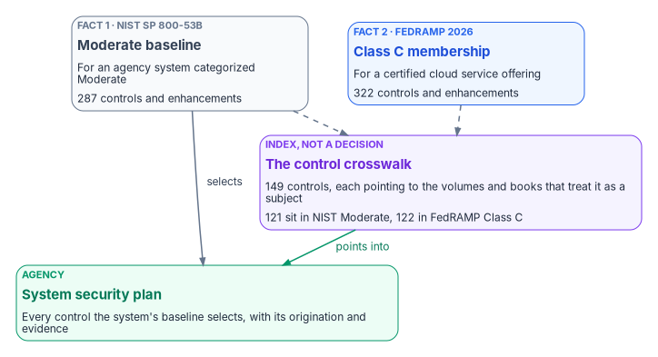
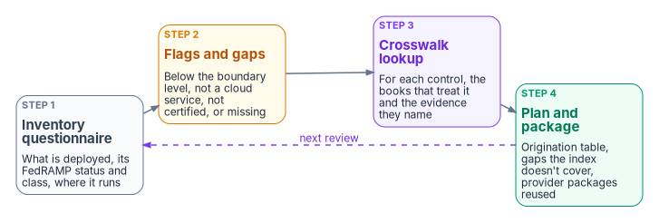

# Chapter 03 — The Control Baseline and the Crosswalk

*A crosswalk tells you where a control is treated. It doesn't tell you the control applies, that it is closed, or that anyone else's authorization covers it. Those are separate facts, and each has its own source.*

::: {.callout-note}
## In this chapter
The two baseline facts every control carries: membership in a NIST SP 800-53B baseline, and membership in a FedRAMP certification class. How the series control crosswalk was built and what a row in it does and doesn't claim. Its coverage by volume and by book, checked again for this chapter. The FedRAMP 2026 Key Security Indicator view, corrected to the indicators FedRAMP actually publishes, and why those indicators bind cloud providers rather than agencies. Then how an agency uses the crosswalk together with the product inventory questionnaire. [Appendix A](appendix-a-control-crosswalk.md) holds the condensed crosswalk and [Appendix B](appendix-b-product-inventory-questionnaire.md) the questionnaire.
:::

## Two facts, not one

"Is this control required at Moderate?" sounds like one question. It is two, and the answers don't always agree.

The first fact is NIST's. SP 800-53B provides three security control baselines, one for each system impact level (low, moderate and high), and a separate privacy baseline that applies to systems whatever their impact level.[^c03-53b] An agency system categorized Moderate starts from NIST's Moderate baseline and tailors it. In release 5.2.0 that baseline holds 287 controls and control enhancements.[^c03-53b-profiles] The release changed no baselines; NIST updated the version number to keep it in step with SP 800-53.[^c03-53b]

The second fact is FedRAMP's. Under the FedRAMP Consolidated Rules for 2026, launched on June 25, 2026, a cloud service offering is FedRAMP Certified in a certification class from A to D.[^c03-launch] FedRAMP's notice on the designations said that for Rev5, "Class C will include the current Moderate baseline" and Class D the current High baseline.[^c03-ntc0004] FedRAMP's 2026 control reference lists, for every control, the Rev5 classes whose baselines include it. Counted across all twenty families, 322 controls and enhancements are listed for Class C.[^c03-fr-controls] OMB's FedRAMP memorandum explains the difference in a footnote: a FedRAMP authorization follows the steps in SP 800-37, "but the control baselines used have been specifically tailored for cloud offerings."[^c03-m2415]

{#fig-ch03-two-facts-one-index fig-alt="Two cards side by side at the top. Left, slate: fact 1, NIST SP 800-53B, the Moderate baseline, for an agency system categorized Moderate, 287 controls and enhancements. Right, blue: fact 2, FedRAMP 2026, Class C membership, for a certified cloud service offering, 322 controls and enhancements. Dashed arrows from both lead to a violet card, an index, not a decision: the control crosswalk, 149 controls each pointing to the volumes and books that treat it as a subject, of which 121 sit in NIST Moderate and 122 in FedRAMP Class C. A green arrow labeled points into leads from the crosswalk to a green card, the agency's system security plan, covering every control the system's baseline selects with its origination and evidence. A slate arrow labeled selects runs from the NIST baseline directly to the system security plan."}

The two sets mostly overlap, and the places they don't are the places a plan goes wrong. Class C includes 36 controls and enhancements that NIST's Moderate baseline doesn't, and the controls this book relies on show the pattern:

| Control | NIST SP 800-53B | FedRAMP 2026 classes | What it means for a plan |
|---|---|---|---|
| AU-10 Non-repudiation | High only | D | Not required of a Moderate agency system or a Class C service |
| AU-12(1) System-wide and Time-correlated Audit Trail | High only | D | Same: a design choice below High |
| SC-12(1) Availability (of cryptographic keys) | High only | D | Same |
| CM-5(1) Automated Access Enforcement and Audit Records | High only | C, D | Required of a Class C service, not of a Moderate agency system |
| SI-2(3) Time to Remediate Flaws and Benchmarks for Corrective Actions | none | C, D | FedRAMP adds it; NIST selects it in no baseline |
| SI-4(16) Correlate Monitoring Information | none | C, D | FedRAMP adds it |
| AU-6(4) Central Review and Analysis | none | D | FedRAMP adds it at Class D only |
| SC-8 and SC-8(1) Transmission Confidentiality and Integrity, Cryptographic Protection | Moderate, High | B, C, D | FedRAMP selects them a class lower than NIST |
| CA-5 Plan of Action and Milestones | Low, Moderate, High | none listed | FedRAMP's 2026 reference page shows no class line for CA-5 |

: Where NIST baselines and FedRAMP classes diverge, for controls the series treats {.striped .hover}

Sources for the table: NIST's OSCAL baseline profiles and FedRAMP's 2026 Rev5 control reference, both read on October 21, 2026.[^c03-53b-profiles][^c03-fr-controls] [Book 13, Appendix A](../b13-governance/appendix-a-requirements-mapping.md) reached the same results for its own controls. The CA-5 gap looks like an omission on the page rather than a policy: a plan of action and milestones is in every NIST baseline, and the program keeps one whatever the class line says.

The rule this chapter follows, and every chapter of this book follows, is to cite the two facts separately. "Required at Moderate" means nothing until it says which. An agency system categorized Moderate uses the NIST baseline its categorization selects. A FedRAMP Class C service uses FedRAMP's.

### Controls that sit outside both

Two families in the crosswalk have no security-baseline membership at all, and that is by design, not by omission. SP 800-53B says the program management controls "are implemented at the organization level and are not directed at individual information systems." PM-1 is marked as deployed organization-wide, not associated with the security control baselines, and independent of any system impact level.[^c03-53b] The PII processing and transparency controls are selected through the privacy baseline instead: PT-1 to PT-5 and PT-7 are in it, and so is AT-3(5), role-based training on processing personally identifiable information.[^c03-53b-profiles] FedRAMP lists no class for the PM and PT controls the series indexes.[^c03-fr-controls] [Chapter 05](05-program-management-controls.md) and [Chapter 08](08-privacy-pii-processing.md) treat them as what they are: agency-level and privacy-program obligations, not things a cloud provider's package can close.

## How the crosswalk was built

The series crosswalk is a reverse index. It answers one question: for a given SP 800-53 Rev. 5 control, where in the Federal Compliance series is it treated? It exists for three jobs: answering an assessor, building a system security plan's control-origination table, and checking that a control family is covered before an authorization review.

The rules for what earns a row are the author's, and they are strict:

- **Only first-class treatment counts.** A row was extracted from each book's own control-closure tables and from the sections where the control is the substantive subject. A control a book mentions in passing, cites in a framework cross-reference or names in a vendor appendix was deliberately left out.
- **Titles are NIST's.** Every title is the official SP 800-53 Rev. 5 short title, which sometimes differs from a book's prose. For this chapter all 149 identifiers and titles were checked against the CSRC control catalog export for release 5.2.0 and the OSCAL catalog. All 149 exist and none is withdrawn; the titles match apart from capitalization and the crosswalk's practice of prefixing an enhancement with its base control's title.[^c03-cprt][^c03-oscal]
- **Enhancements get their own row only when a book cites the enhancement.** Otherwise coverage is recorded at the base control.
- **Implementation rows sit beside architecture rows.** Where the implementation volume turns a control into deployable code, it appears on the same row as the architecture book that closes it, so the "what" and the "how" are visible together.
- **The training volume contributes only its own subject.** It adds AT-2 and AT-3, the training program itself, not the many controls it teaches.
- **Coordination is not a second closure.** The three coordination and day-2 volumes (workflow-platform control-compliance automation, multi-cloud DDI automation and workflow-platform day-2 operations) record where a control is *made operational and evidenced*: drift raised as a tracked task, a change gated by an approved record, an asset reconciled to the inventory's join key. A row for one of them is not an independent claim that the control closes there. Only four controls appear in those volumes and nowhere else: CM-5 (separation of duties over DDI change), AC-2(3), AC-2(4) and SA-9(2).

::: {.callout-important}
## A pointer, not an inheritance claim
"Addressed here" is a coverage pointer. Whether a control is fully inherited from a provider, partly satisfied or shared depends on the authorization boundary and the assessor's determination. Read the named book, and the evidence it names, for the substantive treatment. [Chapter 04](04-closure-with-proof.md) sets out what it takes for a control to count as closed.
:::

### A hand-maintained superset and a generated slice

The crosswalk is maintained by hand. Alongside it, the program's design generates a smaller crosswalk from its machine-checked closure record, behind the same drift gate as each book's generated "controls closed here" table, so that slice can't silently fall out of step. The hand-maintained table is the superset: it indexes controls in books the closure record hasn't yet reached. The difference between the two is a queue of controls that are *claimed in prose but not yet proven by the record*, and the series publishes it rather than hiding it. As the record is back-filled book by book, the generated slice grows toward the full index. That is the same rule [Chapter 04](04-closure-with-proof.md) applies to closure itself: a number someone maintains by hand is a claim; a number a generator derives from records is evidence.

## Coverage by volume and by book

The crosswalk indexes 149 distinct controls and enhancements in 18 families. Recounted from the table for this chapter, the distinct controls each volume treats are below. A control treated in several volumes is counted in each, so the column doesn't sum to 149.

| Volume (subject) | Distinct controls | Where the depth is |
|---|---|---|
| I — Foundation and transport | 41 | [Volume overview](https://github.com/WhalerMike/modernization-workbook/blob/main/docs/compliance/Vol_I_Book_00_Foundation_Transport_Overview.md); workbook [Book 08](../b08-ddi/index.md), [Book 09](../b09-network/index.md), [Book 07](../b07-pki/index.md) |
| II — Data platform | 22 | [Volume overview](https://github.com/WhalerMike/modernization-workbook/blob/main/docs/compliance/Vol_II_Book_00_Data_Platform_Overview.md); workbook [Book 06](../b06-data-platform/index.md) |
| III — Security operations | 54 | [Volume overview](https://github.com/WhalerMike/modernization-workbook/blob/main/docs/compliance/Vol_III_Book_00_Security_Operations_Overview.md); workbook [Book 12](../b12-security-operations/index.md) |
| IV — Governance and assurance | 54 | This book, [Chapters 05](05-program-management-controls.md) to [09](09-training-and-awareness-controls.md) and [11](11-the-authorization-package.md) |
| V — Training and certification | 2 | [Volume overview](../b16-people/01-people-close-the-gap.md); [Chapter 09](09-training-and-awareness-controls.md) |
| VI — Implementation as code | 38 | [Volume overview](../b15-day2-operations/02-day-two-is-where-compliance-lives.md) |
| VII — Workflow-platform control-compliance automation | 9 | [Volume overview](../b15-day2-operations/02-day-two-is-where-compliance-lives.md) |
| VIII — Multi-cloud DDI landing-zone automation | 6 | [Volume overview](https://github.com/WhalerMike/modernization-workbook/blob/main/docs/compliance/Vol_VIII_Book_00_DDI_Automation_Overview.md) |
| IX — Workflow-platform day-2 operations | 16 | [Volume overview](../b15-day2-operations/01-the-help-desk-decides.md) |
| **Series, distinct** | **149** | [Appendix A](appendix-a-control-crosswalk.md) |

: Distinct controls treated in each volume, recounted from the crosswalk on October 21, 2026 {.striped .hover}

The crosswalk's own summary table gave 12 controls for the workflow-platform automation volume and 10 for the day-2 operations volume. Recounted from the rows themselves, the figures are 9 and 16: three enhancements the text attributes to the automation volume (AC-2(3), AC-2(4) and SA-9(2)) are indexed under the day-2 volume's SaaS-integration book, and the day-2 volume's per-book rows add up to 16 distinct controls. The table above uses the recount. Volumes VI to IX raise the per-volume figures far more than the series total, because they mostly operationalize controls the architecture volumes already treat.

By book, coverage is concentrated. The crosswalk has 293 book-to-control pointers, and the twelve books that treat the most controls account for 136 of them:

| Book (subject) | Distinct controls | Controls treated |
|---|---|---|
| Cloud landing zone with authoritative DDI and IPAM | 16 | SC-20, SC-21, SC-22, SC-7, SC-8, AC-4, CM-2, CM-8, AU-2, AU-12, IA-5(2), IA-9, IR-4, SA-9, SI-3, PL-8 |
| Business continuity | 15 | CP-2 to CP-10 and seven CP enhancements |
| SQL Server authentication modernization | 14 | AC-2, AC-3, AC-17, IA-2, IA-3, IA-5, IA-5(1), AU-2, AU-12, CM-2, CM-8, CA-7, SC-8, SI-4 |
| SIEM, XDR and detection | 13 | AU-6, AU-6(1), AU-6(4), AU-7, AU-8, AU-11, IR-4, IR-6, IR-8, SI-4 and three SI-4 enhancements |
| Network access control (802.1X) | 11 | IA-3, IA-3(1), AC-3, AC-17, AC-19, AC-20, CM-6, CM-7, CM-8, SC-7(3), SC-7(5) |
| Data protection | 11 | SC-12, SC-12(1), SC-13, SC-17, SC-28, MP-2 to MP-5, AC-4, AU-10 |
| Telecommunications modernization (SD-WAN and SASE) | 10 | SC-7, SC-7(7), SC-8, AC-4, AU-2, AU-12, CA-7, SA-9, SI-3, SI-4 |
| Privileged access management | 10 | AC-5, AC-6 and five AC-6 enhancements, AC-11, AC-12, IA-11 |
| Network enforcement | 9 | AC-4, AC-17, AC-19, IA-3, SC-7, SC-7(8), SC-8, SC-8(1), SI-4 |
| Database consolidation and network physics | 9 | AU-9, CA-3, CP-9, CP-10, SA-8, SC-5, SC-8, SC-28, SI-12 |
| Cybersecurity training and awareness | 9 | AT-2, AT-3, AT-4 and four AT enhancements, CP-3, IR-2 |
| Program management | 9 | PM-1, PM-2, PM-5, PM-7, PM-9, PM-11, PM-14, PM-15, PM-30 |

: The books that treat the most controls {.striped .hover}

Ninety-four of the 149 controls are treated in exactly one book. The contingency, supply chain, privacy and program management families each live almost entirely in one governance book, which is why this book carries them in their own chapters ([06](06-contingency-and-continuity.md), [07](07-supply-chain-risk-management.md), [08](08-privacy-pii-processing.md) and [05](05-program-management-controls.md)). [Chapter 12](12-the-series-as-a-map.md) turns the index around and reads it as a map, volume by volume.

### What the index doesn't cover

The crosswalk says itself that it is not a gap analysis against a baseline. That can now be quantified. Of the 287 controls and enhancements in NIST's Moderate baseline, the crosswalk indexes 121. Of the 322 FedRAMP lists for Class C, it indexes 122.[^c03-53b-profiles][^c03-fr-controls] The remaining Moderate controls are of three kinds:

- **Policy and procedure controls.** The "-1" control of each of the eighteen security families (AC-1, AU-1 and so on) is in the Moderate baseline. The series indexes only one of them, SR-1.
- **Families the series doesn't build.** Physical and environmental protection (18 Moderate controls) and maintenance (9) have no crosswalk rows. In a cloud boundary much of PE is inherited from the provider; on premises it is the agency's.
- **Enhancements the books don't cite by number.** Seventy-five Moderate-baseline enhancements, most of them in AC, CM and IA, have no row of their own; where a book treats them at all, it is under the base control.

None of this is a defect in the index. It is the reason the index can't stand in for the system security plan. The plan has to address every control the system's baseline selects, and the crosswalk only says where the workbook can help with some of them.

## The FedRAMP 2026 indicator view

The crosswalk also carried a column of FedRAMP 20x indicator labels: theme codes such as KSI-IAM and KSI-MLA, and a label, KSI-022, for the training controls. Those labels predate the 2026 rules. FedRAMP now publishes 46 Key Security Indicators in ten themes, each with its own identifier (KSI-CED-RAT, KSI-CMT-RMV and so on) and a list of "Related SP 800-53 Controls." FedRAMP revised many of those mappings on October 13, 2026.[^c03-ksi] No indicator is numbered KSI-022; the training controls are cited by KSI-CED-RAT, "Reviewing All Training."

Recomputed from FedRAMP's page on October 21, 2026, 118 of the crosswalk's 149 controls are cited by at least one indicator. By theme:

| Theme | Crosswalk controls cited | Indicators that cite them |
|---|---|---|
| Cybersecurity Education (CED) | 7 | KSI-CED-RAT |
| Change Management (CMT) | 9 | KSI-CMT-LMC, CMT-RMV, CMT-RVP, CMT-VTD |
| Cloud Native Architecture (CNA) | 13 | KSI-CNA-DFP, CNA-IBP, CNA-MAT, CNA-OFA, CNA-RNT, CNA-RVP, CNA-ULN |
| Identity and Access Management (IAM) | 39 | KSI-IAM-AAM, IAM-APM, IAM-ELP, IAM-JIT, IAM-SNU, IAM-SUS |
| Incident Response (INR) | 3 | KSI-INR-AAR, INR-RIR, INR-RPI |
| Monitoring, Logging, and Auditing (MLA) | 23 | KSI-MLA-EVC, MLA-LET, MLA-OSM, MLA-RVL |
| Policy and Inventory (PIY) | 9 | KSI-PIY-GIV, PIY-RIS, PIY-RSD |
| Recovery Planning (RPL) | 14 | KSI-RPL-ABO, RPL-ARP, RPL-RRO, RPL-TRC |
| Supply Chain Risk (SCR) | 15 | KSI-SCR-MIT, SCR-MON |
| Service Configuration (SVC) | 25 | KSI-SVC-ACM, SVC-ASM, SVC-EIS, SVC-PRR, SVC-SIN, SVC-VCM, SVC-VRI |

: Crosswalk controls by FedRAMP 2026 indicator theme (a control cited by several themes is counted in each) {.striped .hover}

Several of the crosswalk's theme assignments don't survive the check. AC-4 and AC-17 are cited by identity indicators, not network-architecture ones. CA-3 is cited by KSI-SCR-MON, not by the inventory theme. SI-2 is cited by KSI-CMT-VTD and SI-2(2) by KSI-SVC-EIS, not by the logging theme. CA-5, CA-6, the media protection controls, and every PM and PT control the series indexes are cited by no indicator at all.[^c03-ksi] [Appendix A](appendix-a-control-crosswalk.md) carries the per-control indicator list.

### The indicators bind providers

The indicator view is useful to an agency, but it doesn't describe the agency's obligations. FedRAMP 20x, in FedRAMP's own words, works "by asking cloud service providers to demonstrate desired security capabilities," and FedRAMP describes the indicators as giving measurable validation that control protections are working.[^c03-ksi-providers] The indicators are outcome statements a provider demonstrates to become and stay certified ([Book 10, Chapter 03](../b10-cloud-boundary/03-what-changed-at-fedramp.md)).

What FedRAMP's rules ask of agencies is different. Agencies must complete the Authorization to Operate process for federal information systems that use certified cloud services (AGU-USE-ABU), and must make sure their governance, risk, compliance and inventory tools can produce and ingest machine-readable artifacts, including at least OSCAL JSON (AGU-AGC-GRC).[^c03-agu] They also review each provider's quarterly Ongoing Certification Report against the risk tolerance in their ATO. The Collaborative Continuous Monitoring rule says MUST and the Agency Use rule says SHOULD; the workbook follows the stricter one ([Book 12, Chapter 12](../b12-security-operations/12-evidence-metrics-and-continuous-monitoring.md), [Book 13, Chapter 11](../b13-governance/11-reciprocity-and-one-authorization.md)).

So read an indicator mapping in the crosswalk as a statement about *the provider's* evidence. An agency that runs its own estate the same way, with logged and monitored changes and redeployment from version control, is making a design choice and can show its assessor the same kind of evidence. It isn't meeting a FedRAMP requirement, because none applies to it.

## The product inventory questionnaire

The crosswalk starts from controls. The questionnaire starts from the estate. It exists because a compliance plan executed without full visibility into the agency's deployed tooling can't select a coordination approach, or claim an inherited control, without first knowing what is already in place and how it is authorized.

It is organized by the same volumes as the crosswalk. Each row is a product category (cloud platforms, DDI and IPAM, certificates and PKI, the HR system of record, directory and identity provider, network equipment, network access control, SD-WAN and SASE, privileged access, vulnerability assessment, patch and systems management, cloud posture, SIEM, XDR, SOAR, backup, SBOM tooling, GRC and OSCAL tooling, the workflow platform and its connectors, and so on) with example products. For each, the agency fills four working columns:

| Column | What to record |
|---|---|
| In use? | Yes, no, or partly |
| Product and offering | The specific offering, not the vendor: a government edition and a commercial edition of the same product are different answers |
| FedRAMP status | The Marketplace status, certification class and FedRAMP ID, read on the day you fill the row |
| Deployment surface | Cloud service, network equipment, operating system, or cross-surface |

: The questionnaire's working columns {.striped .hover}

A fifth column, *Maps to*, is pre-filled. It names the series book and functional plane the answer feeds, which is how the questionnaire hands off to the crosswalk.

The FedRAMP status column is the one that goes stale fastest. The Marketplace publishes its data as a dataset that records, for each listing, its status, certification class and impact level. On October 21, 2026 it held 781 listings, and the statuses included "FedRAMP Certified," "Initial Implementation," "FedRAMP In Process," "Agency Authorization In Process" and "Legacy FedRAMP Ready."[^c03-marketplace] The last of those exists because FedRAMP stopped accepting FedRAMP Ready submissions after July 28, 2026.[^c03-timeline] A status recorded in the spring may not be the status in the fall; record the date you read it.

### The scope rule and its dispositions

The questionnaire asks the agency to name the level its boundary is authorized at, and then to check every in-boundary dependency against it. Its dispositions, with two corrections:

| Situation | Disposition |
|---|---|
| Certified at the boundary's level (Class C for a Moderate boundary) | In scope. Record the FedRAMP ID |
| Certified only at a higher class (Class D, no Class C offering) | Usable. The questionnaire flagged this case for review; under M-24-15, agencies must presume a FedRAMP package adequate for an authorization "at or below" its impact level, and FedRAMP's notice on the designations says agencies may use a certification package at any security category they deem appropriate under the Risk Management Framework.[^c03-m2415][^c03-ntc0004] Record it; the higher class is not a defect |
| On-premises equipment or software, not a cloud service | Not a FedRAMP item. FedRAMP's scope is cloud computing products and services that handle federal information for an agency.[^c03-scope] The equipment is assessed inside the agency's own authorization, with its own evidence; [Appendix B](appendix-b-product-inventory-questionnaire.md) lists the instruments the series uses |
| A cloud service that isn't FedRAMP certified | Flag it. Agencies must promote the use of certified services when the use is within FedRAMP's scope, and some uses are outside it.[^c03-scope] The program's design is to treat an uncertified in-boundary dependency as a decision for the authorizing official: find a certified or government edition, replace it, or document why the use is out of scope |
| A category with no product at all | Flag it as a gap |

: Questionnaire dispositions, as corrected for this chapter {.striped .hover}

Everything flagged rolls up into the questionnaire's flags-and-gaps list, which becomes the procurement and boundary-decision agenda.

Two rules of the instrument are worth keeping as program design. First, a published questionnaire ships empty. A pre-filled block answers the questions before the reader starts, and the reader's own estate is the point; an agency's filled-in edition stays with the agency. Second, a preference for products the agency already licenses is earned, not automatic: an incumbent suite is the default candidate for a role only where it genuinely reaches every surface the role covers, across providers, operating systems and network equipment. Where it reaches only its own vendor's surfaces, the better cross-vendor option at the boundary's level wins. Product names in the questionnaire are examples of a category, never recommendations, and [Chapter 04](04-closure-with-proof.md) explains why every product claim in it carries a date.

## How an agency uses the two together

{#fig-ch03-using-the-instruments fig-alt="Four cards from left to right. Step 1, slate: the inventory questionnaire, recording what is deployed, its FedRAMP status and class, and where it runs. Step 2, amber: flags and gaps, for anything below the boundary level, not a cloud service, not certified, or missing. Step 3, violet: crosswalk lookup, giving for each control the books that treat it and the evidence they name. Step 4, green: plan and package, with the origination table, the gaps the index doesn't cover and the provider packages reused. A dashed violet arrow labeled next review returns from step 4 to step 1."}

The order matters, and it is the program's design:

1. **Inventory first.** Fill the questionnaire against the estate as it is. Verify each status on the Marketplace that day. Flag what fails the scope rule.
2. **Decide the flags.** The flags-and-gaps list goes to whoever owns boundary and procurement decisions ([Chapter 10](10-who-owns-compliance.md)). A flag that nobody decides is a finding waiting to be written.
3. **Look up the controls.** For each control the system's baseline selects, the crosswalk names the books that treat it. Use the row to find the mechanism and the evidence the book names; don't copy the row into the plan as if it were an implementation statement.
4. **Write what the index can't.** Every Moderate control with no crosswalk row still needs an implementation statement in the system security plan. Where a certified provider's package covers it, the agency reuses that package under the presumption of adequacy and records its own decision; the provider's indicators and quarterly reports become part of the agency's continuous-monitoring input ([Chapter 11](11-the-authorization-package.md)).
5. **Repeat.** Product statuses, FedRAMP mappings and the index itself all change. The next review starts again at step 1.

For an assessor, the crosswalk answers "where does your program treat SC-20?" in one lookup. It doesn't answer "is SC-20 closed?" That question has a different answer, and the next chapter sets the rule for it.

::: {.callout-tip}
## Continue the book
[← Previous: Chapter 02 — The Federal Clock](02-the-federal-clock.md) · [Book index](index.md) · [Next: Chapter 04 — Closure: A Control Closes Only With Its Proof →](04-closure-with-proof.md)
:::

[^c03-53b]: National Institute of Standards and Technology, SP 800-53B, *Control Baselines for Information Systems and Organizations*, September 2020 (includes updates as of December 10, 2020; release 5.2.0 planning note of August 27, 2025, "no changes to the baselines"), abstract and Table 3-13, Program Management Family, <https://csrc.nist.gov/pubs/sp/800/53/b/upd1/final>; PDF <https://nvlpubs.nist.gov/nistpubs/SpecialPublications/NIST.SP.800-53B.pdf> (accessed Oct 21, 2026).
[^c03-53b-profiles]: National Institute of Standards and Technology, SP 800-53 Rev. 5.2.0 Low, Moderate, High and Privacy baseline profiles in OSCAL (last modified May 11, 2026), <https://github.com/usnistgov/oscal-content/tree/main/nist.gov/SP800-53/rev5/json> (accessed Oct 21, 2026). Moderate: 287 controls and enhancements; membership of each crosswalk control computed from the profiles' included control identifiers.
[^c03-launch]: FedRAMP, "Propelling Change: FedRAMP Launches Consolidated Rules for 2026," June 25, 2026, <https://www.fedramp.gov/2026-06-25-propelling-change-fedramp-launches-consolidated-rules-for-2026/> (accessed Oct 21, 2026).
[^c03-ntc0004]: FedRAMP, Notice NTC-0004, *Initial Outcome from RFC-0020 FedRAMP Authorization Designations*, February 25, 2026, <https://www.fedramp.gov/notices/0004/> (accessed Oct 21, 2026).
[^c03-fr-controls]: FedRAMP, "Full Rev5 Control Reference," *FedRAMP Consolidated Rules for 2026*, all twenty family pages ("FedRAMP Rev5 Baselines" line per control; Class C listed for 322 controls and enhancements; CA-05 shows no class line), <https://www.fedramp.gov/2026/reference/controls/> (accessed Oct 21, 2026).
[^c03-m2415]: Office of Management and Budget, M-24-15, *Modernizing the Federal Risk and Authorization Management Program (FedRAMP)*, July 25, 2024, §IV.a (The Presumption of Adequacy) and footnote 7, <https://www.whitehouse.gov/wp-content/uploads/2024/07/M-24-15-Modernizing-the-Federal-Risk-and-Authorization-Management-Program.pdf> (accessed Oct 21, 2026).
[^c03-cprt]: National Institute of Standards and Technology, SP 800-53 Rev. 5, release 5.2.0, publication page (planning note of August 27, 2025) <https://csrc.nist.gov/pubs/sp/800/53/r5/upd1/final>, and the Cybersecurity and Privacy Reference Tool export for SP_800_53_5_2_0, <https://csrc.nist.gov/projects/cprt/catalog#/cprt/framework/version/SP_800_53_5_2_0/home> (accessed Oct 21, 2026).
[^c03-oscal]: National Institute of Standards and Technology, SP 800-53 Rev. 5.2.0 OSCAL catalog (version 5.2.0, last modified May 11, 2026), <https://github.com/usnistgov/oscal-content/blob/main/nist.gov/SP800-53/rev5/json/NIST_SP-800-53_rev5_catalog.json> (accessed Oct 21, 2026).
[^c03-ksi]: FedRAMP, "Key Security Indicators," *FedRAMP Consolidated Rules for 2026*, indicator statements, themes and "Related SP 800-53 Controls," including the mapping updates of October 13, 2026, <https://www.fedramp.gov/2026/reference/key-security-indicators/> (accessed Oct 21, 2026).
[^c03-ksi-providers]: FedRAMP, "Key Security Indicators," Cloud Service Providers, FedRAMP 20x Certification Rules, *FedRAMP Consolidated Rules for 2026*, <https://www.fedramp.gov/2026/providers/20x/key-security-indicators/> (accessed Oct 21, 2026).
[^c03-agu]: FedRAMP, "Agency Use of FedRAMP Certified Cloud Services," *FedRAMP Consolidated Rules for 2026*, rules AGU-USE-ABU, AGU-AGC-GRC and AGU-USE-ROR, <https://www.fedramp.gov/2026/reference/agency-use/> (accessed Oct 21, 2026).
[^c03-marketplace]: FedRAMP Marketplace product data, <https://www.fedramp.gov/marketplace/products.json>, dataset last changed October 21, 2026 (fields `status`, `cert_class`, `impact_level`; 781 listings), browsable at <https://www.fedramp.gov/marketplace/products/> (accessed Oct 21, 2026).
[^c03-timeline]: FedRAMP, "Important Dates for the Consolidated Rules for 2026" (July 28, 2026: FedRAMP Ready goes legacy), <https://www.fedramp.gov/2026/timeline/> (accessed Oct 21, 2026).
[^c03-scope]: FedRAMP, "Scope of FedRAMP," *FedRAMP Consolidated Rules for 2026*, <https://www.fedramp.gov/2026/scope/> (accessed Oct 21, 2026).
