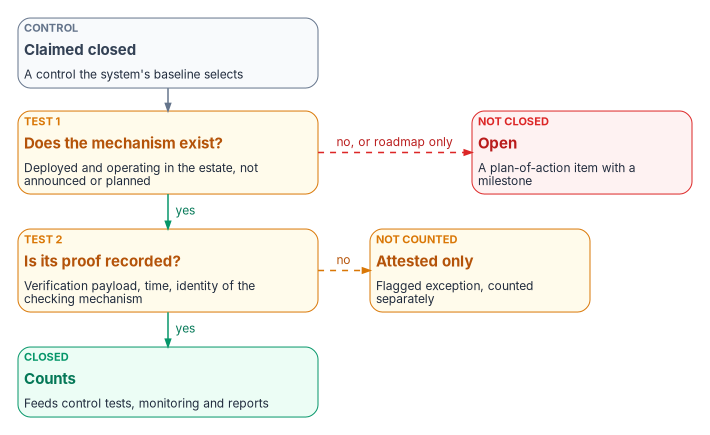
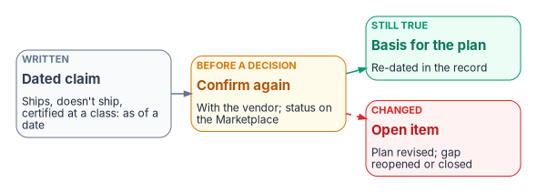

# Chapter 04 — Closure: A Control Closes Only With Its Proof

*A control isn't closed because someone planned it, bought it or ticked a box. It is closed when the thing that closes it is running and the record shows it working.*

::: {.callout-note}
## In this chapter
What "closed" means in this book, as two tests: the mechanism that closes the control exists, and its proof is recorded. Why the program states some closures as necessity claims, and why those claims are about mechanism classes, never products. The rule that no closure counts without its proof, the rule that a vendor roadmap is not a commitment, and the rule that every operation travels the authorized path, each stated plainly and linked to the Book 13 chapters that carry them in full. Then the federal controls these rules help an agency show, and where they stop.
:::

## What "closed" has to mean

[Chapter 03](03-the-baseline-and-the-crosswalk.md) ended on a question the crosswalk can't answer: is a control closed? A compliance program that can't answer it precisely ends up answering it loosely. A control gets called closed when the product that would close it has been purchased, when a vendor has announced the feature, when a change ticket has been marked complete, or when a document describes how it will work. None of those is the control operating.

Federal assessment asks something harder. SP 800-53 has the assessor determine "the extent to which the controls are implemented correctly, operating as intended, and producing the desired outcome."[^c04-sp80053] Weaknesses found that way go into a plan of action and milestones that documents the planned remediation, and that plan is updated from assessments, audits and continuous monitoring.[^c04-sp80053] An authorizing official reading a plan of action needs to know which items are genuinely done. A program that closes items without proof makes that impossible.

The program's answer is two tests, applied in order. Both are program design.

{#fig-ch04-when-a-control-closes fig-alt="A vertical flow. A slate card, a control claimed closed, one the system's baseline selects, leads to an amber card, test 1: does the mechanism exist, deployed and operating in the estate, not announced or planned. A dashed red arrow labeled no, or roadmap only leads to a red card: not closed, open, a plan-of-action item with a milestone. A green arrow labeled yes leads to a second amber card, test 2: is its proof recorded, meaning a verification payload, a time and the identity of the checking mechanism. A dashed amber arrow labeled no leads to an amber card: not counted, attested only, a flagged exception counted separately. A green arrow labeled yes leads to a green card: closed, counts, feeding control tests, monitoring and reports."}

1. **The mechanism exists.** The thing that closes the control is deployed and operating in the estate. A purchase order, a pilot that ended, or a feature on a roadmap fails this test. So does a mechanism that exists but can't reach the part of the estate the control covers.
2. **Its proof is recorded.** The closure carries a machine-readable verification, a time and the identity of what checked it. A closure without that payload is an assertion, however honest.

A control that fails the first test is open, and it belongs in the plan of action with a milestone. A control that passes the first test but fails the second is something worse than open: it looks closed and can't be shown to be. The rest of this chapter is the rules that keep each test honest.

## A control closes only when the mechanism that closes it exists

The series states some of its closures as *necessity claims*: for a named set of controls, a named class of mechanism is the only way to close them. The claim is stronger than a recommendation, and it is meant to be falsifiable. Every "required" in it has to pair with the control text, the protocol behavior or the physics that rules the alternatives out, never with an adjective.

The series states three such anchors. Each is the program's own argument, not a federal requirement; the corrections below come from checking the controls it names.

| Mechanism class | Controls the program says it closes | Why the program says there is no alternative | Checked against the control text |
|---|---|---|---|
| An authoritative naming and addressing plane (IPAM and DDI) | SC-20, SC-21, SC-22; CM-8, CM-8(1); IA-9 | You can't attest authoritative name resolution without an authoritative resolver, and you can't inventory what you can't enumerate. A scanner measures drift from a source of truth; it can't create one | SC-20 asks the system to return data origin and integrity artifacts with its authoritative answers; CM-8 asks for an inventory that accurately reflects the system and includes every component. The source also cited SC-20(1), which NIST has withdrawn and folded into SC-20. IA-9 is in no NIST baseline and FedRAMP lists no class for it, so it is a design choice, not a baseline obligation[^c04-sp80053][^c04-fr-controls] |
| An encrypted, application-aware transport overlay (SD-WAN) | SC-8, SC-8(1) on direct internet circuits; SC-5; SI-4 | A circuit has no encryption, path intelligence or telemetry of its own. Validated TLS closes SC-8 for the flow that negotiates it; a network-layer overlay closes it for every flow on the circuit at once, including the DNS queries and legacy protocols TLS doesn't reach | SC-8(1) asks for cryptographic mechanisms and names no protocol, so TLS per flow and an overlay per circuit are both valid mechanisms. The claim is about completeness, not exclusivity, and other overlays (plain IPsec, zero-trust tunnels) also encrypt every flow. SC-5 is denial-of-service protection; treating traffic-class separation as part of it is the program's reading[^c04-sp80053] |
| Distributed policy enforcement for local breakout (TIC 3.0 enforcement points) | SC-7, SC-7(7); AC-4 | Breaking out locally removes the old central access point; an ungoverned local circuit is a boundary finding, not a modernization | SC-7(7) asks that split tunneling be prevented unless securely provisioned with defined safeguards; AC-4 asks for information flow enforcement. [Book 09, Chapter 05](../b09-network/05-sd-wan-sase-and-governed-transport.md) carries what TIC 3.0 asks of the branch edge[^c04-sp80053] |

: The program's three necessity anchors, with the corrections made in checking them {.striped .hover}

The transport argument behind the second and third rows is [Book 09, Chapter 02](../b09-network/02-transport-is-physics-control-is-compliance.md): local breakout solves a latency problem, closes none of the protection controls by itself, and without a governed edge it loses the boundary protection the old hairpin provided. The naming argument behind the first row is [Book 08](../b08-ddi/index.md). This chapter needs only the shape of the argument: a necessity claim names the mechanism, says why nothing else closes the control, and shows the control text that makes it so.

### Mechanism, not product

"No alternate closure path" is a claim about mechanism classes, never about vendors. "Only port-based authentication closes IA-3 for unmanaged network ports" names a protocol behavior. It doesn't name a product. Every product the series names is a deployed example of its mechanism, and for each layer there are certified alternatives that implement the same mechanism.

The program's design follows from that: **many compliant paths exist before the agency chooses, and exactly one exists after.** The agency selects one implementation per layer, and once chosen it becomes the governed path. Two implementations of the same truth plane (two IPAM systems, two inventories, two identity sources) recreate the fragmented-truth problem the program exists to end ([Book 13, Chapter 03](../b13-governance/03-one-authoritative-record.md)). The choice is a decision with an owner ([Chapter 10](10-who-owns-compliance.md)), not a default that drifts.

## No closure counts without its proof

The second test has its own rule, and [Book 13, Chapter 04](../b13-governance/04-change-control-and-provenance.md#no-closure-counts-unless-it-carries-its-proof) states it in full. In short: a remediation task, a daily check, a plan-of-action milestone or a control test closed by a person clicking "complete", with no machine-readable verification attached, is prose, not evidence. It asserts that work happened. It proves nothing an assessor can consume.

The rule has three requirements, all program design:

1. **Every closure carries provenance.** The closing update carries the verification that justified it (the probe result, the posture query, the re-test output) with a timestamp and the identity of the checking mechanism. A closure record without that payload doesn't validate.
2. **Human-only closure is an exception state, not a path.** Operations need an escape hatch, so it stays possible. It is visibly flagged, counted separately and never folded into control tests, continuous-monitoring evidence or service-level figures.
3. **Reports are derivations, never compilations.** Continuous-monitoring roll-ups, plan-of-action aging and patch service levels are generated from the closure records by something that can be re-run and compared. A report that can't be regenerated from closure records is an artifact of effort, not of state.

For a compliance program the consequence is direct. Manual closure doesn't just fail to prove a single item; it poisons everything built on it. A dashboard, a service-level report or a monthly continuous-monitoring summary assembled from manually closed tasks is a compilation of assertions, every row unverified. Reporting isn't something added after closure. It is something a well-formed closure emits. [Book 13, Chapter 07](../b13-governance/07-evidence-over-attestation.md) builds the evidence model on that point, and [Book 12, Chapter 02](../b12-security-operations/02-the-evidence-contract.md) defines the record every source emits: an asset identity and a time.

### Proof is a read, so it can be automated fully

Verifying a closure is a read: probe the estate, attach the result, gate the close. That matters because the program caps how far automation may write to the estate ([Book 01, Chapter 11](../b01-transformation-arc/11-analysis-plan-delivery.md#how-far-automation-may-go)). The cap doesn't apply to proof. Where an estate change needs a human approver, the change still happens under that approval; checking that it happened and closing the coordination record with the result needs none. Closure verification is the one place a capped deployment can run at full automation.

### The program holds itself to the same rule

The series applies the rule to its own documents. Each book's table of controls closed is generated from the closure record and checked for drift, because hand-maintained numbers silently go wrong ([Chapter 03](03-the-baseline-and-the-crosswalk.md#a-hand-maintained-superset-and-a-generated-slice)). Beyond that, the program's design binds each closure claim to a named test that would disprove it, and it reports the share of claims that have one. That share is the program's own measure of how much of its closure story is proven rather than asserted. It is expected to rise, and it is published while it is low.

### What "closed" means when the evidence is continuous

The series tied this rule to FedRAMP 20x, saying a control is "closed" under the 2026 rules when its evidence is generated automatically, machine-readable, continuously updated and validated against a published indicator schema. FedRAMP doesn't define closure that way, and its indicators bind cloud providers, not agencies ([Chapter 03](03-the-baseline-and-the-crosswalk.md#the-indicators-bind-providers)). What FedRAMP does say points the same direction. It tells providers that indicators "aren't one-time requirements" and that the processes fulfilling them should continuously collect evidence, detect configuration drift, monitor control effectiveness over time and alert on deviations from baselines.[^c04-ksi-providers] It publishes its rules, including the indicators, as a machine-readable dataset with schemas.[^c04-rules-json] And it requires agencies to make sure their governance, risk, compliance and inventory tools can produce and ingest machine-readable artifacts, including at least OSCAL JSON.[^c04-agu]

The program therefore adopts the series' four properties as its own design for agency evidence: generated by the systems rather than assembled by staff, machine-readable, current on a defined cadence, and checkable by a program. They describe proof that passes the second test. They aren't a FedRAMP definition.

## A vendor roadmap is not a commitment

The first test fails quietly when a plan treats a vendor's announcement as a mechanism. The series names real products on purpose, because a necessity claim has to name a real mechanism, not a category: "the cloud provider's configuration remediation actions," not "some posture tool." That specificity has a cost. The market the series describes moves in weeks, not review cycles. In the program's own drafting, a workflow-platform capability documented as not yet built shipped within weeks, and native integrations treated as missing turned out to exist already. Neither statement was wrong when it was written; both were dated, sourced and stale within a month.

Authorization status moves the same way. FedRAMP stopped accepting FedRAMP Ready submissions after July 28, 2026, and on October 21, 2026 its Marketplace data listed 53 offerings as "Legacy FedRAMP Ready."[^c04-timeline][^c04-marketplace] A status read from the Marketplace in the spring can be wrong by the fall without anyone having made a mistake.

{#fig-ch04-dated-vendor-claims fig-alt="Left to right. A slate card, written: a dated claim, that something ships, doesn't ship, or is certified at a class, as of a date. It leads to an amber card, before a decision: confirm again with the vendor and check status on the Marketplace. A green arrow leads to a green card, still true: the basis for the plan, re-dated in the record. A dashed red arrow leads to a red card, changed: an open item, with the plan revised and the gap reopened or closed."}

The rule, stated once for every book in the series, is program design:

1. **Every vendor capability claim is dated, not permanent.** A document's date code marks when its vendor claims were last verified. It never asserts that they are still current.
2. **Confirm before you commit.** Before a claim becomes the basis of a project plan, a procurement action or an acquisition decision, confirm the current state directly with the vendor and, for authorization status, on the FedRAMP Marketplace. Don't assume it from the series' snapshot.
3. **Gaps move both ways.** A closed gap can reopen and an open gap can close between two drafting sessions. Treat every "not yet built" and every "ships natively" as equally perishable.

Two federal hooks make the rule practical rather than a slogan. SA-4 asks an agency to put security and privacy functional requirements, assurance requirements and acceptance criteria in the acquisition contract, so a capability the plan depends on can be written into the contract rather than left in a roadmap slide. SA-4 is in all three NIST baselines and in FedRAMP Classes B, C and D.[^c04-sp80053][^c04-fr-controls] And the plan of action is where a roadmap item belongs until it ships: an open weakness with a milestone, not a closed control with a footnote. [Chapter 07](07-supply-chain-risk-management.md) carries the supplier side of the same discipline.

## Every operation travels the authorized path

Proof governs the end of an operation. The program's lifecycle rule governs the whole of it: every move, add, change, deletion and reset in the estate travels the same five clauses, and an operation that skips one is unauthorized by construction. It originates with the source of truth, carries an authorization that resolves from the authority model, executes under least privilege elevated just in time, closes with provenance, and emits verified evidence automatically. [Book 13, Chapter 04](../b13-governance/04-change-control-and-provenance.md#the-five-clause-path) states the five clauses and their provenance record in full, and [Book 00, Chapter 04](../b00-orientation/04-the-principles.md) states the rule as the program's second principle. This book doesn't restate them; it adds the compliance reading.

For compliance work, the source of truth that originates an operation is the control baseline and its plan of action. A remediation task with no baseline gap behind it has nothing to close against, and a closure with no originating gap can't be counted toward any control. Clause 3 is AC-6 in practice: SP 800-53 asks that only the access necessary to the assigned task be allowed, and a time-boxed, scoped elevation recorded in the closure is how the program shows it.[^c04-sp80053] [Book 04, Chapter 08](../b04-access/08-pim-self-request-with-approval.md) builds the elevation pattern.

### A source of truth for every object class

Clause 1 needs a source of truth for every kind of object a closure can touch, including non-human ones, where most estates have never designated one. [Book 13, Chapter 04](../b13-governance/04-change-control-and-provenance.md#where-work-comes-from) gives the registry for people, contractors, devices, declared infrastructure, compliance work and migration work. The series extends it to object classes that compliance closures touch often. These rows are program design:

| Object class | Source of truth | Projections (never truth) |
|---|---|---|
| Network names, addresses and segments | The IPAM and DDI system | Zone dumps, spreadsheets, scanner output |
| Assets and components (CM-8) | The authoritative inventory, keyed on the naming plane's join key | The workflow platform's configuration database (a reconciled projection), per-stack consoles |
| Service accounts, workload identities, app registrations | A non-human identity registry recording purpose, scope, expiry and owner | Directory service principals, key vault entries |
| AI systems | The agency's AI use case inventory, with a joiner, mover and leaver lifecycle | Deployment manifests, model endpoints |
| Applications | The application portfolio registry | App registrations, service-catalog entries |
| Certificates | The CLM platform's inventory, reconciled with the PKI's issuance records ([Book 07, Chapter 08](../b07-pki/08-lifecycle-monitoring-and-decommissioning.md)) | Local certificate stores, binding configurations |
| Organizational structure and physical location | The governed organization and location attributes | Directory OU trees, site topology |

: Further sources of truth the compliance closures depend on {.striped .hover}

The AI row isn't only design. OMB requires agencies to keep their annual AI use case inventory updated, and makes maintaining it a responsibility of the agency's Chief AI Officer.[^c04-m2521] Using that inventory as the source of truth for AI systems' lifecycle reuses an obligation the agency already has.

Two rules make the registry work. Every non-human item anchors to a human owner who can be resolved in the HR source of truth. If the chain doesn't end in a person, the item is orphaned: clause 2 can't find an approver for it, so no operation against it can be authorized and nothing can attest it. And non-human objects get a lifecycle too. Provisioning is a joiner, re-scoping or re-owning is a mover, decommissioning is a leaver, and reset (rotating credentials, secrets and keys) is the high-risk verb, because rotation is where standing privilege hides. An estate item with no record in its source of truth, or with an owner who can no longer be resolved, is an orphan finding, the most valuable output a discovery scan can produce.

## How the rules line up with the controls

The rules are the program's design, not federal requirements. They are built to make the following controls easy to show. Statements are summarized from SP 800-53 Rev. 5, release 5.2.0; baselines are NIST SP 800-53B and FedRAMP's 2026 Rev5 control reference, cited separately.[^c04-sp80053][^c04-53b][^c04-fr-controls]

| Control | What it asks, in short | NIST SP 800-53B | FedRAMP 2026 classes | Where the rules support it |
|---|---|---|---|---|
| CA-2 Control Assessments | Assess whether controls are implemented correctly, operating as intended and producing the desired outcome | Low, Moderate, High | B, C, D | The two closure tests; the proof attached to every closure is what an assessor reads |
| CA-5 Plan of Action and Milestones | Document planned remediation of weaknesses; update it from assessments, audits and continuous monitoring | Low, Moderate, High | none listed on the page | Every control failing the first test, and every roadmap item, is a plan-of-action entry with a milestone |
| CA-7 Continuous Monitoring | A system-level strategy with metrics, frequencies, ongoing assessment, correlation, response and status reporting | Low, Moderate, High | B, C, D | Closure records stream into monitoring; reports are derived from them |
| CM-8 System Component Inventory | An inventory that accurately reflects the system and includes every component | Low, Moderate, High | B, C, D | The authoritative inventory as the source of truth for assets; consoles and the configuration database as projections |
| AC-6 Least Privilege | Allow only the access necessary for assigned tasks | Moderate, High | C, D | Clause 3: just-in-time, scoped elevation recorded in the closure |
| SA-4 Acquisition Process | Put security and privacy requirements, assurance requirements and acceptance criteria in acquisition contracts | Low, Moderate, High | B, C, D | A capability the plan depends on goes into the contract, not a roadmap |
| PM-4 Plan of Action and Milestones Process | An organization-level process that keeps plans of action developed, maintained and reported, and reviews them for consistency | none (organization level) | none | Plan-of-action aging derived from closure records, not compiled |

: Controls the closure rules are built to evidence {.striped .hover}

The CA-5 row repeats the anomaly [Chapter 03](03-the-baseline-and-the-crosswalk.md#two-facts-not-one) noted: FedRAMP's 2026 reference page shows no class line for CA-5. Keep a plan of action anyway. It is in every NIST baseline, and it is where every rule in this chapter sends an unfinished closure.

## Honest limits

- **Proof is only as good as the probe.** A closure that carries a payload from a weak check proves little. Checks are reviewed like any other rule ([Book 13, Chapter 05](../b13-governance/05-deterministic-governance.md)).
- **A necessity claim can be wrong.** It is written to be falsifiable, so test it. If an alternative mechanism closes the control, the claim narrows; the SC-8 row above already has.
- **Dated claims still need someone to re-date them.** The vendor rule works only if a named owner re-verifies before each decision ([Chapter 10](10-who-owns-compliance.md)).
- **The authorizing official still decides.** Closure with proof makes residual risk visible. It doesn't accept it; only the authorizing official does ([Book 13, Chapter 09](../b13-governance/09-who-governs.md)).

## Key takeaways

- A control is closed when the mechanism that closes it exists in the estate and its proof is recorded. Otherwise it is open, or attested only.
- Necessity claims name mechanism classes and show the control text behind them. Products are examples.
- No closure counts without its proof, and reports are derived from closure records, never compiled.
- A vendor roadmap is not a commitment. Date every claim and confirm it before a plan or contract rests on it.
- Every operation travels the authorized path, starting from a source of truth that names an owner.

::: {.callout-tip}
## Continue the book
[← Previous: Chapter 03 — The Control Baseline and the Crosswalk](03-the-baseline-and-the-crosswalk.md) · [Book index](index.md) · [Next: Chapter 05 — Program Management Controls →](05-program-management-controls.md)
:::

[^c04-sp80053]: National Institute of Standards and Technology, SP 800-53 Rev. 5, *Security and Privacy Controls for Information Systems and Organizations*, release 5.2.0 (planning note of August 27, 2025), <https://csrc.nist.gov/pubs/sp/800/53/r5/upd1/final>; control statements read from the OSCAL catalog (version 5.2.0, last modified May 11, 2026), <https://github.com/usnistgov/oscal-content/blob/main/nist.gov/SP800-53/rev5/json/NIST_SP-800-53_rev5_catalog.json>, and identifiers and titles checked against the CSRC Cybersecurity and Privacy Reference Tool export for SP_800_53_5_2_0 (accessed Oct 21, 2026). Controls cited: AC-4, AC-6, CA-2, CA-5, CA-7, CM-8, CM-8(1), IA-9, PM-4, SA-4, SC-5, SC-7, SC-7(7), SC-8, SC-8(1), SC-20, SC-20(1) (withdrawn, incorporated into SC-20), SC-21, SC-22, SI-4.
[^c04-fr-controls]: FedRAMP, "Full Rev5 Control Reference," *FedRAMP Consolidated Rules for 2026*, family pages for AC, CA, CM, IA, PM, SA, SC and SI ("FedRAMP Rev5 Baselines" per control; IA-09, CA-05 and PM-04 show no class line), <https://www.fedramp.gov/2026/reference/controls/> (accessed Oct 21, 2026).
[^c04-53b]: National Institute of Standards and Technology, SP 800-53B, *Control Baselines for Information Systems and Organizations*, release 5.2.0, <https://csrc.nist.gov/pubs/sp/800/53/b/upd1/final>; baseline membership read from the OSCAL Low, Moderate and High baseline profiles, <https://github.com/usnistgov/oscal-content/tree/main/nist.gov/SP800-53/rev5/json> (accessed Oct 21, 2026).
[^c04-ksi-providers]: FedRAMP, "Key Security Indicators," Cloud Service Providers, FedRAMP 20x Certification Rules, *FedRAMP Consolidated Rules for 2026*, section "Encouraging Improvement," <https://www.fedramp.gov/2026/providers/20x/key-security-indicators/> (accessed Oct 21, 2026).
[^c04-rules-json]: FedRAMP, *FedRAMP Consolidated Rules for 2026*, machine-readable rules repository (`fedramp-consolidated-rules.json`, the canonical rules dataset, with schemas), <https://github.com/FedRAMP/rules> (accessed Oct 21, 2026).
[^c04-agu]: FedRAMP, "Agency Use of FedRAMP Certified Cloud Services," *FedRAMP Consolidated Rules for 2026*, rule AGU-AGC-GRC, <https://www.fedramp.gov/2026/reference/agency-use/> (accessed Oct 21, 2026).
[^c04-timeline]: FedRAMP, "Important Dates for the Consolidated Rules for 2026" (July 28, 2026: FedRAMP Ready goes legacy), <https://www.fedramp.gov/2026/timeline/> (accessed Oct 21, 2026).
[^c04-marketplace]: FedRAMP Marketplace product data, <https://www.fedramp.gov/marketplace/products.json>, dataset last changed October 21, 2026 (`status` field; 53 listings "Legacy FedRAMP Ready" of 781) (accessed Oct 21, 2026).
[^c04-m2521]: Office of Management and Budget, M-25-21, *Accelerating Federal Use of AI through Innovation, Governance, and Public Trust*, April 3, 2025, introduction ("updating their annual AI use case inventory") and the Chief AI Officer responsibilities, item E ("maintain the agency's AI Use Case Inventory"), <https://www.whitehouse.gov/wp-content/uploads/2025/02/M-25-21-Accelerating-Federal-Use-of-AI-through-Innovation-Governance-and-Public-Trust.pdf> (accessed Oct 21, 2026).
