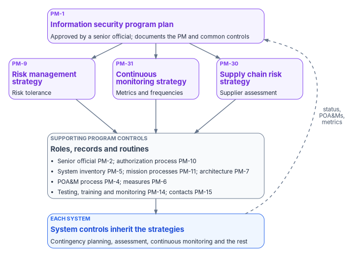

# Chapter 05 — Program Management Controls

*No product closes a program management control. Each one closes when a named official signs an artifact the agency wrote, and when the agency can show it still follows what it signed.*

::: {.callout-note}
## In this chapter
Why the Program Management family is organization-level, outside the NIST system baselines and absent from every FedRAMP class, so no cloud provider's certification supplies it. What each of the thirteen PM controls the program depends on asks for, the artifact that answers it and the evidence an assessor can check. Which parts of the program's templates are federal requirements and which are the program's own design, and the corrections this chapter makes to the program's earlier PM material.
:::

Most of this book is about controls that a system carries: a configuration, a log, a backup. The Program Management family is different. NIST SP 800-53B, which sets the Low, Moderate and High control baselines, marks the whole family "deployed organization-wide," "not associated with security control baselines" and "independent of any system impact level," and says the controls "are implemented at the organization level and are not directed at individual information systems."[^c05-sp80053b] FedRAMP's 2026 control reference, which lists the FedRAMP class for every control that has one, lists none for any of the 37 PM controls and enhancements.[^c05-fr-pm]

Two consequences follow. A cloud service's FedRAMP certification never satisfies a PM control for the agency, because FedRAMP doesn't ask the provider for one. And no system's authorization package can close the family by itself, because the family describes the organization the systems belong to. OMB Circular A-130 puts the obligation on the agency directly: it must "develop and maintain an information security program plan" that "documents the program management controls and common controls in place or planned."[^c05-a130]

Earlier program material framed these controls as artifacts that "FedRAMP 20x Authorization requires." That framing is corrected here. The requirement comes from FISMA, OMB Circular A-130 and SP 800-53, and it binds the agency whether or not it uses a single cloud service. What the earlier material got right is the point it made about mechanism: none of these controls closes through infrastructure. No resolver, overlay or enforcement point can write an organization's risk tolerance or appoint its senior official. A PM control closes when the artifact exists, a named official has approved it, and the agency can show it is still being followed ([Chapter 04](04-closure-with-proof.md)).

{#fig-ch05-pm-layer fig-alt="At the top, a violet card: the information security program plan, PM-1, approved by a senior official, which documents the program management and common controls. Below it, three violet cards side by side for the three organization-wide strategies: risk management strategy, PM-9, with risk tolerance; continuous monitoring strategy, PM-31, with metrics and frequencies; supply chain risk management strategy, PM-30. All three lead down to a slate card listing the supporting program controls: senior official PM-2, authorization process PM-10, system inventory PM-5, mission and business processes PM-11, enterprise architecture PM-7, POA&M process PM-4, measures PM-6, testing, training and monitoring PM-14, security contacts PM-15. It leads down to a blue card: each system's controls, such as contingency planning, assessment and continuous monitoring, which inherit the strategies. A dashed arrow labeled status, POA&Ms and metrics leads from the system card back up to the program plan."}

## The controls at a glance

The table lists the thirteen PM controls this chapter covers, in the order the sections below take them. The control statements are paraphrased from SP 800-53 Rev. 5, release 5.2.0.[^c05-sp80053] None of them is in a NIST system baseline and none is in a FedRAMP class; every one is the agency's.[^c05-sp80053b][^c05-fr-pm]

| Control | Title | What it asks, in short | The artifact | What an assessor can check |
|---|---|---|---|---|
| PM-1 | Information Security Program Plan | An organization-wide plan describing the program's requirements, PM and common controls, roles and coordination, approved by a senior official accountable for the risk; reviewed at a set frequency; protected | The security program plan | Current approved version, approver, review record, access restrictions |
| PM-2 | Information Security Program Leadership Role | Appoint a senior agency information security officer with the mission and resources to run the program | The appointment and the role matrix | Signed appointment; roles named against activities |
| PM-4 | Plan of Action and Milestones Process | A process that keeps program and system POA&Ms developed, maintained and reported, and reviews them against the risk strategy | The POA&M process description | Process document, review records, consistency reviews |
| PM-5 | System Inventory | An inventory of organizational systems, updated at a set frequency | The system inventory | Inventory with dates; agreement with authorization records |
| PM-6 | Measures of Performance | Develop, monitor and report security and privacy measures of performance | The measures and their reports | Defined measures, reported results over time |
| PM-7 | Enterprise Architecture | An enterprise architecture that considers security, privacy and the resulting risk | Architecture artifacts and review gates | Gate records showing security review at each stage |
| PM-9 | Risk Management Strategy | A strategy for security risk and privacy risk, implemented consistently and reviewed at a set frequency | The risk management strategy and risk tolerance statement | Approved strategy; POA&M and acceptance decisions that cite it |
| PM-10 | Authorization Process | Manage systems' security and privacy state through authorization; designate the roles; integrate authorization into organization-wide risk management | The authorization process | Role designations; decision documents; process tied to the strategy |
| PM-11 | Mission and Business Process Definition | Define mission and business processes with security and privacy in mind; determine the protection needs that arise; review them at a set frequency | The mission and business process register | Register with protection needs; review dates |
| PM-14 | Testing, Training, and Monitoring | A process that keeps testing, training and monitoring plans developed, maintained and executed, and reviews them against the risk strategy | The testing, training and monitoring plan | Schedule, execution records, review records |
| PM-15 | Security and Privacy Groups and Associations | Contact with security and privacy groups and associations, for training, current practice and information sharing | The contact registry | Registry with review dates; records of participation |
| PM-30 | Supply Chain Risk Management Strategy | An organization-wide strategy for supply chain risk across the system life cycle, implemented consistently and reviewed at a set frequency | The supply chain risk management strategy | Approved strategy; supplier assessments that follow it |
| PM-31 | Continuous Monitoring Strategy | An organization-wide continuous monitoring strategy with metrics, monitoring and assessment frequencies, correlation, response and status reporting | The continuous monitoring strategy | Approved strategy; metrics reported at its frequencies |

Two enhancements belong with these. PM-5(1) asks for an inventory of every system, application and project that processes personally identifiable information, and PM-30(1) asks the organization to identify, prioritize and assess suppliers of critical or mission-essential technologies, products and services.[^c05-sp80053] [Chapter 08](08-privacy-pii-processing.md) carries the first and [Chapter 07](07-supply-chain-risk-management.md) the second.

## The information security program plan (PM-1)

PM-1 asks for one plan for the whole organization. It must give "an overview of the requirements for the security program," describe the PM and common controls in place or planned, assign roles and responsibilities, reflect coordination among the organizational entities responsible for security, and be "approved by a senior official with responsibility and accountability for the risk being incurred." The organization reviews and updates it at a frequency and after events it defines, and protects it "from unauthorized disclosure and modification."[^c05-sp80053] OMB's definition matches: a formal document that gives an overview of the organization-wide security requirements and describes the PM and common controls.[^c05-a130] FedRAMP's control reference adds no guidance or parameter values for PM-1.[^c05-fr-pm]

The plan is the document every other control is read against. A system security plan says which common controls a system inherits; the program plan says who provides them and how they're kept current. Without it there is no authoritative statement of what the program is trying to achieve, so an assessor has nothing to measure a system's tailoring decisions against.

The program's template for the plan has six sections. The structure is the program's design; the content each section asks for comes from PM-1 and A-130.

| Section | What it holds |
|---|---|
| 1. Purpose and scope | The organization the plan covers; the systems in scope by reference to the system inventory (PM-5); the effective date, review cycle, owner (the senior agency information security officer) and approver |
| 2. Authorities | The laws, policies and standards the program implements (below) |
| 3. Objectives | The program's risk-based objectives, in the agency's own words and tied to its mission |
| 4. Roles and responsibilities | The role matrix (PM-2, PM-10) and the coordination arrangements among the CIO's office, privacy, acquisition and mission owners |
| 5. Program management and common controls | Each PM control and each common control, its provider and the artifact that implements it; this chapter's table is the starting point |
| 6. Resources | The staff, tools, training and assessment funding the program needs; PM-3 asks that security and privacy resources be included in capital planning and investment requests[^c05-sp80053] |

The authorities section of the earlier template needed three corrections. FISMA is the Federal Information Security Modernization Act of 2014, codified at 44 U.S.C. chapter 35, subchapter II, beginning at §3551.[^c05-fisma] The cloud authority is now the *FedRAMP Consolidated Rules for 2026* under OMB M-24-15, not a "FedRAMP 20x Authorization Framework"; [Book 10, Chapter 03](../b10-cloud-boundary/03-what-changed-at-fedramp.md) sets out what changed. And CISA's BOD 26-04 is not an SBOM directive. It is *Prioritizing Security Updates Based on Risk*, issued June 10, 2026, which revokes BOD 19-02 and BOD 22-01 and sets vulnerability remediation, KEV reporting and asset-tagging actions in three phases, the last due within 180 days of issuance, which is December 7, 2026.[^c05-bod2604] FedRAMP's vulnerability detection and response rules, which bind cloud providers, become mandatory the same day ([Book 12, Chapter 06](../b12-security-operations/06-vulnerability-management.md)). Software bills of materials, vulnerability disclosure reports and exploitability statements belong to the supply chain strategy, covered below and in [Chapter 07](07-supply-chain-risk-management.md).

The objectives section needed one correction. The earlier template set an objective to "achieve and sustain KSI scores meeting the FedRAMP 20x Authorize threshold across all 10 KSI themes." FedRAMP's Key Security Indicators bind cloud service providers, not agencies; an agency's obligation is to review each provider's quarterly Ongoing Certification Report ([Book 12, Chapter 12](../b12-security-operations/12-evidence-metrics-and-continuous-monitoring.md), [Book 13, Chapter 11](../b13-governance/11-reciprocity-and-one-authorization.md)). The program restates the objective as maintaining each system's authorization through continuous monitoring and reviewing every consumed provider's reports.

## The senior official and the authorization process (PM-2, PM-10)

PM-2 is one sentence: appoint "a senior agency information security officer with the mission and resources to coordinate, develop, implement, and maintain an organization-wide information security program."[^c05-sp80053] The statute behind it is FISMA, which requires the agency head to delegate to the CIO the authority to ensure compliance, including "designating a senior agency information security officer."[^c05-fisma] OMB Circular A-130 says the same from the CIO's side: agencies shall "ensure that the CIO designates a senior agency information security officer."[^c05-a130]

PM-10 asks the organization to manage its systems' security and privacy state through authorization processes, to "designate individuals to fulfill specific roles and responsibilities within the organizational risk management process," and to integrate authorization into an organization-wide risk management program.[^c05-sp80053] SP 800-37 Rev. 2 makes role assignment the first task of the Risk Management Framework (Task P-1), with the head of agency, the CIO and the senior agency official for privacy primarily responsible.[^c05-sp80037]

Two of those roles are reserved to government staff. SP 800-37 calls the authorizing official "an inherent U.S. Government function" that "is assigned to government personnel only," and says the same of the senior agency information security officer, which organizations may also call the chief information security officer.[^c05-sp80037] The authorizing official "is the only organizational official who can accept the security and privacy risk," and the one activity the official can't delegate to a designated representative is the authorization decision itself.[^c05-sp80037] The earlier template's note that the system security officer "may be a contractor with documented oversight" is the program's design position; SP 800-37 doesn't reserve that role. Its note that the assessor "must be FedRAMP-recognized" is corrected: a FedRAMP-recognized assessor is how a cloud provider is certified, while an agency selects the assessors for its own systems under CA-2, with CA-2(1) asking for independent assessors at the Moderate and High baselines.[^c05-sp80053]

The role matrix below is the program's template. It names roles against activities; the PM-2 and PM-10 evidence is the same matrix with a named person in every cell that carries an R or an A, and the signed appointment of the senior agency information security officer.

| Activity | Authorizing official | Senior agency information security officer | System security officer | DevSecOps lead | SOC lead | Privacy officer |
|---|---|---|---|---|---|---|
| Authorization decision | **A** | R | C | I | I | C |
| Annual assessment | A | **R** | R | C | C | C |
| POA&M management | I | A | **R** | C | C | I |
| Incident response | A | R | **R** | C | **R** | C |
| Vulnerability remediation reporting (BOD 26-04) | I | A | R | **R** | R | I |
| Review of providers' Ongoing Certification Reports | I | A | **R** | C | C | I |
| Privacy impact assessment | I | C | C | C | I | **R** |
| Security training | I | **A** | R | C | C | I |

R = responsible, A = accountable, C = consulted, I = informed. [Book 13, Chapter 09](../b13-governance/09-who-governs.md) sets out the governance roles around these, and [Chapter 10](10-who-owns-compliance.md) of this book sets out who owns compliance as a whole.

## The risk management strategy (PM-9)

PM-9 asks for "a comprehensive strategy" to manage security risk from operating the organization's systems and privacy risk to individuals from the authorized processing of personally identifiable information, implemented consistently and reviewed at a frequency the organization sets.[^c05-sp80053] SP 800-37 makes it Task P-2: establish a risk management strategy "that includes a determination of risk tolerance," with the head of agency primarily responsible.[^c05-sp80037]

The strategy is what every later risk decision cites. When the authorizing official accepts a residual risk, when a POA&M sets a due date, when a supply chain finding is accepted rather than fixed, the record should point to the part of the strategy that allowed it. A strategy nobody cites is not being implemented "consistently across the organization," which is what PM-9(b) asks.

SP 800-39, the NIST guide the earlier material built on, describes risk management as four components (frame, assess, respond and monitor) applied at three tiers: the organization, the mission and business process, and the information system.[^c05-sp80039] The earlier template mapped the tiers to the components ("Tier 2: risk assessment"; "Tier 3: risk response"). That is corrected: every tier frames, assesses, responds to and monitors risk, at its own level. SP 800-39 also lists five risk responses, not four: accepting, avoiding, mitigating, sharing and transferring.[^c05-sp80039]

The center of the strategy is the risk tolerance statement, signed by the authorizing official and the senior agency information security officer. The program's template expresses tolerance per category; the values are an example of the form, which each agency sets for itself.

| Risk category | Example tolerance | Rationale to record |
|---|---|---|
| Availability of mission-essential functions | Low | Set from the business impact analysis ([Chapter 06](06-contingency-and-continuity.md)) |
| Confidentiality of personally identifiable information | Very low | Statutory obligations and public trust ([Chapter 08](08-privacy-pii-processing.md)) |
| Confidentiality of internal information | Moderate | Business operations |
| Integrity of payment and case records | Low | Accuracy and audit trail |
| Supply chain | Low | The supply chain strategy (PM-30) |

The program's register scores each risk as likelihood times impact, each on a 1-to-5 scale, and sets a response window by score: document and monitor at 1–4, a POA&M within 90 days at 5–9, within 30 days at 10–15, and escalation to the authorizing official with a POA&M within 15 days at 16–25. Those thresholds are the program's design, not federal requirements. Where a federal timeline applies, it governs: a vulnerability in CISA's Known Exploited Vulnerabilities catalog carries the remediation timeline BOD 26-04 sets, whatever the register's score.[^c05-bod2604]

## The plan of action and milestones process (PM-4)

PM-4 is the organization-level process behind every system's plan of action and milestones. It asks for a process that keeps the POA&Ms for the security, privacy and supply chain risk management programs and their systems "developed and maintained," documenting remedial actions and "reported in accordance with established reporting requirements," and it asks the organization to review them "for consistency with the organizational risk management strategy and organization-wide priorities for risk response actions."[^c05-sp80053] FISMA requires every agency program to include "a process for planning, implementing, evaluating, and documenting remedial action."[^c05-fisma] OMB requires agencies to use POA&Ms "to record and manage the mitigation and remediation of identified weaknesses and deficiencies, not associated with accepted risks," and to make them available to OMB, DHS, inspectors general and GAO on request.[^c05-a130] FedRAMP lists PM-4 in no class.[^c05-fr-pm]

The system-level POA&M is CA-5; PM-4 is what makes a hundred of them comparable. The process document says where POA&Ms live, which fields every item carries, who reviews them and how often, and how the review checks each item against the risk strategy. [Book 13, Chapter 12](../b13-governance/12-governance-at-scale.md) explains how an accepted risk leaves the POA&M and stays in the program's gap register, which is the distinction OMB's wording draws. The evidence for PM-4 is the process document plus dated records of the consistency reviews it promises.

## The system inventory (PM-5)

PM-5 asks the organization to "develop and update" an inventory of organizational systems at a frequency it defines.[^c05-sp80053] OMB requires agencies to maintain an inventory of their major information systems, information holdings and dissemination products, and a separate inventory of the systems that process personally identifiable information.[^c05-a130] SP 800-37 Task P-18 has each system registered with the organization's program or management offices.[^c05-sp80037]

The earlier material conflated two inventories, and this chapter separates them. PM-5 is the list of *systems*: each authorization boundary, with its owner, impact level, authorizing official and authorization status. The list of *components* inside a boundary is CM-8, a system-level control in all three NIST baselines.[^c05-sp80053] An assessor reads PM-5 first, to find out which systems exist, and then each system's CM-8 inventory, to find out what's in it. The two must agree: every component belongs to a system on the PM-5 list, and every system on the list has a component inventory.

The program builds both from the same sources, in three layers. This is the program's design.

- **Infrastructure.** A scheduled Azure Resource Graph query exports every resource in the subscriptions assigned to each boundary, tagged with the system's identifier from the PM-5 list.
- **Software.** The build pipeline produces a software bill of materials for each deployed artifact ([Chapter 07](07-supply-chain-risk-management.md)). A monthly reconciliation compares the software inventory with the infrastructure inventory, and an unexplained difference that lasts 30 days becomes a POA&M item.
- **Identity.** The directory is the authoritative account inventory for each boundary; [Book 02](../b02-identity/index.md) and [Book 12, Chapter 03](../b12-security-operations/03-identity-telemetry.md) cover how it is kept and monitored.

The infrastructure layer is a Resource Graph query of the `Resources` table, which Microsoft documents with the same `project` and `order by` operators used here.[^c05-arg] FedRAMP's KSI-PIY-GIV, which asks providers to generate inventories automatically from authoritative sources, maps to CM-8, not to PM-5.[^c05-fr-ksi]

::: {.callout-warning}
## Illustrative code
The query below is illustrative and hasn't been tested against a production tenant. Check the tag names and subscription scope against your own environment, and run it with read-only permissions.
:::

```kusto
// Component inventory (CM-8) for one authorization boundary,
// tagged with the system identifier from the PM-5 system inventory
Resources
| where subscriptionId in ("<subscription-id-1>", "<subscription-id-2>")
| extend systemId = tostring(tags["fmp-system-id"])
| project
    resourceId = id,
    resourceType = type,
    resourceName = name,
    location,
    resourceGroup,
    systemId,
    tags
| order by resourceType asc, resourceName asc
```

A component whose `systemId` is empty, or names a system that isn't on the PM-5 list, is the first thing the reconciliation flags.

## Mission and business processes and the enterprise architecture (PM-11, PM-7)

PM-11 asks the organization to define its mission and business processes "with consideration for information security and privacy and the resulting risk," to determine the information protection and PII processing needs those processes create, and to review the processes at a set frequency.[^c05-sp80053] SP 800-37 Task P-8 identifies the missions, business functions and processes each system supports.[^c05-sp80037]

The PM-11 artifact is a register of mission and business processes, each with the systems it depends on, the impact of losing it and the protection needs that follow. The program's template carries the recovery values from the business impact analysis, so the register and the contingency plans agree. The rows below show the form with illustrative values; the real values come from each agency's analysis ([Chapter 06](06-contingency-and-continuity.md)), not from this table.

| Mission or business process | System dependency | Impact if unavailable | RTO (example) | RPO (example) |
|---|---|---|---|---|
| Payment disbursement | `<system>` | Direct harm to the public | 4 hours | 1 hour |
| Eligibility or case determination | `<system>` | Service delay | 24 hours | 4 hours |
| Online public account services | `<system>` | Service degradation | 8 hours | 2 hours |
| Contact center | `<system>` | Public service impact | 4 hours | 1 hour |

PM-7 asks for an enterprise architecture developed and maintained "with consideration for information security, privacy, and the resulting risk."[^c05-sp80053] OMB requires agencies to develop an enterprise architecture and to "incorporate Federal information security and privacy requirements into the agency's enterprise architecture."[^c05-a130] SP 800-37 Task P-16 places each system within it.[^c05-sp80037]

The program implements PM-7 as review gates in the system life cycle. A system passes five gates, and at each one the record shows the security and privacy review that happened. The gates are the program's design.

1. **Concept.** Security categorization, a privacy threshold analysis, the proposed boundary and data flows.
2. **Design.** Control selection and tailoring, a threat model, supply chain requirements written into the acquisition.
3. **Build.** Security testing in the pipeline, the software bill of materials, configuration baselines.
4. **Deploy.** The authorization decision, or the authorization to use for a consumed cloud service, before production.
5. **Operate.** Continuous monitoring, the annual assessment, POA&M management and the next review of the architecture.

FedRAMP's KSI-PIY-RSD, which asks providers to review how well they build security and privacy into the software life cycle, lists PM-7 among its related controls.[^c05-fr-ksi] For a provider, that indicator is the evidence. For an agency, the gate records are.

## Measures of performance and the continuous monitoring strategy (PM-6, PM-31)

PM-6 is one sentence: "develop, monitor, and report on the results of information security and privacy measures of performance."[^c05-sp80053] PM-31 asks for the organization-wide continuous monitoring strategy: organization-wide metrics, monitoring and assessment frequencies, ongoing monitoring, correlation and analysis, response actions, and reporting of the security and privacy status of organizational systems to defined roles at a defined frequency.[^c05-sp80053] SP 800-37 Task P-7 makes the strategy a Prepare-step task, owned by the senior accountable official for risk management.[^c05-sp80037] FedRAMP lists PM-31 in no class, like the rest of the family.[^c05-fr-pm]

The two controls fit together. PM-31's metrics are the measures PM-6 reports, and a measure that isn't in the strategy is a number with no frequency, owner or response behind it. [Book 12, Chapter 12](../b12-security-operations/12-evidence-metrics-and-continuous-monitoring.md) defines the program's metric set and the pipeline that produces it; [Book 13, Chapter 12](../b13-governance/12-governance-at-scale.md) explains why the organization-wide metrics have to stay comparable across programs. This chapter doesn't repeat them.

The earlier material mapped each monitoring dimension to a FedRAMP Key Security Indicator theme, and two of the mappings were wrong: it put endpoint threats under the Policy and Inventory theme, which covers inventories and program reviews, not endpoints. The program no longer uses indicator themes to label the agency's own monitoring, because the indicators bind providers. The dimensions themselves stand as the program's design:

| Dimension | Cadence (program design) | Where it is built |
|---|---|---|
| Identity anomalies | Real time | [Book 12, Chapter 03](../b12-security-operations/03-identity-telemetry.md) |
| Network anomalies | Real time | [Book 12, Chapter 04](../b12-security-operations/04-platform-and-m365-telemetry.md) |
| Endpoint threats | Real time | [Book 05, Chapter 10](../b05-devices/10-operating-and-evidencing-the-fleet.md) |
| Vulnerability posture | Daily | [Book 12, Chapter 06](../b12-security-operations/06-vulnerability-management.md) |
| Software inventory drift | Every build | [Chapter 07](07-supply-chain-risk-management.md) |
| Log completeness | Hourly | [Book 12, Chapter 12](../b12-security-operations/12-evidence-metrics-and-continuous-monitoring.md) |

## Testing, training and monitoring (PM-14)

PM-14 asks for a process that keeps the organization's plans for security and privacy testing, training and monitoring "developed and maintained" and executed, and that reviews those plans for consistency with the risk strategy.[^c05-sp80053] It doesn't ask for any particular test. It asks that the plans exist, that they run, and that someone checks them against the strategy.

FISMA sets the floor for testing: periodic testing and evaluation of the effectiveness of security policies, procedures and practices "with a frequency depending on risk, but no less than annually."[^c05-fisma] There's no three-year rule ([Book 13](../b13-governance/index.md)). The program's schedule, which is its design except where a row cites a requirement, is:

| Activity | Frequency | Responsible | Evidence |
|---|---|---|---|
| Control assessment by an independent assessor | At least annually, as FISMA sets the floor[^c05-fisma] | Senior agency information security officer, for the authorizing official | Assessment report |
| Penetration test | Annually (program design); CA-8 is in the NIST High baseline only[^c05-sp80053] | Assessor | Test report |
| Incident response tabletop | Twice a year | System security officer, SOC lead | After-action report |
| Automated control monitoring | Continuous | DevSecOps, SOC | Monitoring dashboard and exported results |
| Vulnerability scanning | Continuous | SOC | Scanner output ([Book 12, Chapter 06](../b12-security-operations/06-vulnerability-management.md)) |
| Software composition scan | Every merge | DevSecOps | Pipeline logs ([Chapter 07](07-supply-chain-risk-management.md)) |
| Contingency plan test | Annually, at the exercise level SP 800-34 recommends for the system's impact level | System security officer | Test plan, results and after-action report ([Chapter 06](06-contingency-and-continuity.md)) |
| Configuration baseline review | Quarterly | DevSecOps | Baseline comparison |

The training plan covers role-based security awareness for all users, program procedures for the security team, incident response for the response team, supply chain awareness for developers and acquisition staff, and privacy for everyone with access to personally identifiable information. [Chapter 09](09-training-and-awareness-controls.md) covers the AT controls and their evidence; Book 16, People: Training & Education (planned, see the [workbook index](../index.md)), will carry training in depth. The monitoring plan is the continuous monitoring strategy above.

## Security contacts (PM-15)

PM-15 asks the organization to "establish and institutionalize contact with selected groups and associations within the security and privacy communities" for three purposes: ongoing education and training, staying current with recommended practices and technologies, and sharing current threat, vulnerability and incident information.[^c05-sp80053] The artifact is a contact registry, kept by the senior agency information security officer and reviewed on a cadence the program sets (quarterly, in its design).

The earlier registry needed corrections. It listed email addresses for CISA's incident reporting and KEV teams; federal agencies report incidents to CISA through the CISA Incident Reporting Form, within one hour of the incident being identified by the agency's top-level computer security incident response team, security operations center or IT department.[^c05-cisa-ir] It listed the MS-ISAC as a federal threat-sharing membership; the MS-ISAC describes itself as the cybersecurity partner for "U.S. State, Local, Tribal, and Territorial (SLTT) government organizations," and moved to a member-funded model in 2025.[^c05-msisac] A federal agency's primary government channel is CISA. The registry the program keeps has four groups:

| Group | Examples | Why the agency keeps the contact |
|---|---|---|
| Government | CISA (incident reporting, the Known Exploited Vulnerabilities catalog, directives), the FedRAMP program office, the agency's inspector general | Mandatory reporting, directive compliance, audit coordination, changes to consumed cloud services' certifications |
| Vendor advisories | Each major vendor's security response center and advisory feed, starting with those whose products are in the system inventory | Vulnerability and exploitability information for the software inventory |
| Vulnerability data | NIST's National Vulnerability Database | Vulnerability records for the software inventory |
| Professional and industry groups | Cloud, audit and federal IT associations the agency chooses | Education, practice and peer exchange |

The evidence is the registry with its review dates, and a record that the contacts are used: subscriptions current, briefings attended, information received and acted on.

## The supply chain risk management strategy (PM-30)

PM-30 asks for "an organization-wide strategy for managing supply chain risks associated with the development, acquisition, maintenance, and disposal of systems, system components, and system services," implemented consistently and reviewed at a set frequency.[^c05-sp80053] OMB requires agencies to "develop supply chain risk management plans as described in NIST SP 800-161."[^c05-a130] The current edition is SP 800-161 Rev. 1, *Cybersecurity Supply Chain Risk Management Practices for Systems and Organizations*, published May 2022 and updated November 1, 2024.[^c05-sp800161]

The strategy is the organizational commitment that turns a software-composition pipeline into a governed program. The pipeline produces bills of materials, vulnerability reports and exploitability statements; the strategy says who owns supply chain risk, how suppliers are assessed, what contracts require and how findings feed the risk register. [Chapter 07](07-supply-chain-risk-management.md) covers the pipeline, the formats and the supplier terms. This chapter covers only the strategy's governance shape, which is the program's design:

| Role | Responsibility in the program's charter |
|---|---|
| CIO | Approves the charter |
| Senior agency information security officer | Executive sponsor; owns the strategy and its annual review |
| System security officer | Runs the program day to day; keeps the supply chain entries in the risk register |
| DevSecOps lead | Owns the software-composition pipeline |
| Acquisition security liaison | Writes supply chain requirements into solicitations and contracts (SR-2, SR-3 and SR-5, [Chapter 07](07-supply-chain-risk-management.md)) |
| Supplier risk analyst | Assesses suppliers (SR-6) and critical suppliers (PM-30(1)) |
| Legal and contracts | Reviews contract clauses and foreign ownership questions |

Assessments run annually for every critical supplier, at each new acquisition, when a component in the software inventory is added to the KEV catalog or named in a vendor advisory, and when the bill of materials shows a new dependency. The approved, dated and versioned charter is the PM-30 artifact.

Three of the earlier material's claims about this strategy are corrected. The bill of materials, vulnerability report and exploitability statement are not "BOD 26-04 tiers"; BOD 26-04 is about remediating vulnerabilities by risk.[^c05-bod2604] The strategy doesn't "seed" FedRAMP's Supply Chain Risk indicators; those bind providers, and neither of them lists PM-30 among its related controls.[^c05-fr-ksi] And the charter's "pre-deadline BOD 26-04 submission" row is dropped, because the directive sets no submission of that kind.

## What is requirement and what is design

| Statement | Status | Basis |
|---|---|---|
| The PM family is organization-level, outside the NIST system baselines | NIST guidance | SP 800-53B Table 3-13[^c05-sp80053b] |
| No PM control is in a FedRAMP class | Fact of the 2026 control reference | FedRAMP Full Rev5 Control Reference, PM family[^c05-fr-pm] |
| Agencies keep a security program plan, designate a senior agency information security officer, use POA&Ms, keep a system inventory and an enterprise architecture, and plan supply chain risk management | Requirement | FISMA; OMB Circular A-130[^c05-fisma][^c05-a130] |
| The authorizing official and senior agency information security officer roles are reserved to government personnel; risk acceptance can't be delegated | NIST guidance | SP 800-37 Rev. 2, Appendix D[^c05-sp80037] |
| Security testing at least annually | Requirement | 44 U.S.C. §3554(b)(5)[^c05-fisma] |
| Federal incident reports to CISA within one hour | Requirement | CISA federal incident notification guidelines[^c05-cisa-ir] |
| The six-section program plan template and the role matrix | Program design | — |
| The risk scoring matrix and its 90/30/15-day response windows | Program design | — |
| The three-layer inventory build and the 30-day reconciliation rule | Program design | — |
| The five life-cycle gates for enterprise architecture | Program design | — |
| The testing schedule's frequencies, except the annual floor | Program design | — |
| The supply chain charter's roles and assessment triggers | Program design | — |

::: {.callout-tip}
## Continue the book
[← Previous: Chapter 04 — Closure: A Control Closes Only With Its Proof](04-closure-with-proof.md) · [Book index](index.md) · [Next: Chapter 06 — Contingency Planning and Business Continuity →](06-contingency-and-continuity.md)
:::

[^c05-sp80053b]: National Institute of Standards and Technology, SP 800-53B, *Control Baselines for Information Systems and Organizations*, October 2020 (includes updates as of December 10, 2020), §3.13 and Table 3-13, Program Management Family, <https://nvlpubs.nist.gov/nistpubs/SpecialPublications/NIST.SP.800-53B.pdf> (accessed Oct 21, 2026).
[^c05-fr-pm]: FedRAMP, "Program Management (PM)," *FedRAMP Consolidated Rules for 2026*, Full Rev5 Control Reference (37 controls and enhancements; no "FedRAMP Rev5 Baselines" class listing and no FedRAMP guidance or parameter values for any PM control), <https://www.fedramp.gov/2026/reference/controls/program-management/> (accessed Oct 21, 2026).
[^c05-a130]: Office of Management and Budget, Circular A-130, *Managing Information as a Strategic Resource*, July 2016, §5.a(1)(a) (inventories), §5.a(2) (enterprise architecture), §5.f(2)(a) (CIO designates a senior agency information security officer) and §10.a (definition of "information security program plan"); Appendix I, §4.b, item 5 (security and privacy in the enterprise architecture) and §4.c, items 1, 4 and 15 (information security program plan, supply chain risk management plans, plans of action and milestones), <https://www.whitehouse.gov/wp-content/uploads/legacy_drupal_files/omb/circulars/A130/a130revised.pdf> (accessed Oct 21, 2026).
[^c05-sp80053]: National Institute of Standards and Technology, SP 800-53 Rev. 5, *Security and Privacy Controls for Information Systems and Organizations*, controls PM-1 to PM-7, PM-9 to PM-11, PM-14, PM-15, PM-30, PM-30(1), PM-31, PM-5(1), CA-2(1), CA-8 and CM-8; statements and baseline membership checked against the release 5.2.0 OSCAL catalog (last modified May 11, 2026) and the SP 800-53B Low, Moderate and High OSCAL baseline profiles, <https://github.com/usnistgov/oscal-content/tree/main/nist.gov/SP800-53/rev5/json> (accessed Oct 21, 2026).
[^c05-fisma]: Federal Information Security Modernization Act of 2014, 44 U.S.C. §3554(a)(3)(A) (designating a senior agency information security officer) and §3554(b)(5), (6) and (8) (testing at least annually; remedial action process; continuity plans), via Cornell Legal Information Institute, <https://www.law.cornell.edu/uscode/text/44/3554> (accessed Oct 21, 2026).
[^c05-bod2604]: Cybersecurity and Infrastructure Security Agency, BOD 26-04, *Prioritizing Security Updates Based on Risk*, June 10, 2026, revocation of BOD 19-02 and BOD 22-01, and Required Actions, Phases I–III (Phase III within 180 days of issuance), <https://www.cisa.gov/news-events/directives/bod-26-04-prioritizing-security-updates-based-risk> (accessed Oct 21, 2026).
[^c05-sp80037]: National Institute of Standards and Technology, SP 800-37 Rev. 2, *Risk Management Framework for Information Systems and Organizations: A System Life Cycle Approach for Security and Privacy*, December 2018, §3.1, Tasks P-1, P-2, P-7, P-8, P-16 and P-18, and Appendix D (authorizing official; authorizing official designated representative; senior agency information security officer), <https://nvlpubs.nist.gov/nistpubs/SpecialPublications/NIST.SP.800-37r2.pdf> (accessed Oct 21, 2026).
[^c05-sp80039]: National Institute of Standards and Technology, SP 800-39, *Managing Information Security Risk: Organization, Mission, and Information System View*, March 2011, Chapter 2 (the four components of risk management, the types of risk response, and the three tiers), <https://nvlpubs.nist.gov/nistpubs/Legacy/SP/nistspecialpublication800-39.pdf> (accessed Oct 21, 2026).
[^c05-arg]: Microsoft Learn, "Starter Resource Graph query samples," and "Understanding the Azure Resource Graph query language," Resource Graph tables, <https://learn.microsoft.com/azure/governance/resource-graph/samples/starter> and <https://learn.microsoft.com/azure/governance/resource-graph/concepts/query-language> (accessed Oct 21, 2026).
[^c05-fr-ksi]: FedRAMP, *FedRAMP Consolidated Rules for 2026*, machine-readable ruleset `fedramp-consolidated-rules.json`, version 2026.10.13.01, Key Security Indicators KSI-PIY-GIV, KSI-PIY-RSD, KSI-SCR-MIT and KSI-SCR-MON and their related controls, <https://github.com/FedRAMP/rules> (accessed Oct 21, 2026).
[^c05-cisa-ir]: Cybersecurity and Infrastructure Security Agency, "Federal Incident Notification Guidelines," effective April 1, 2017 (one-hour reporting; CISA Incident Reporting Form), <https://www.cisa.gov/federal-incident-notification-guidelines> (accessed Oct 21, 2026).
[^c05-msisac]: Center for Internet Security, "Multi-State Information Sharing and Analysis Center (MS-ISAC)," <https://www.cisecurity.org/ms-isac> (accessed Oct 21, 2026).
[^c05-sp800161]: National Institute of Standards and Technology, SP 800-161 Rev. 1, *Cybersecurity Supply Chain Risk Management Practices for Systems and Organizations*, May 2022, updated November 1, 2024, <https://csrc.nist.gov/pubs/sp/800/161/r1/upd1/final> (accessed Oct 21, 2026).
