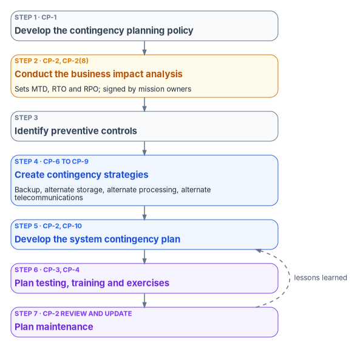
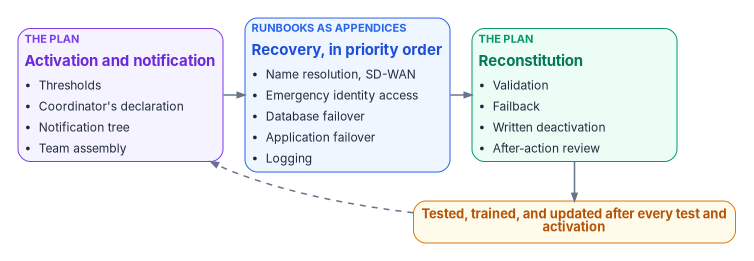

# Chapter 06 — Contingency Planning and Business Continuity

*A failover that works is a capability. A plan that an official approved, that the people in it have rehearsed, and that changed after the last test is what the contingency planning controls ask for.*

::: {.callout-note}
## In this chapter
What each Contingency Planning control asks, at which NIST baseline and FedRAMP class. The SP 800-34 planning process, the business impact analysis that sets recovery objectives, and the contingency plan section by section, with the difference between a plan and a runbook. How alternate storage, backups, alternate processing and alternate telecommunications actually work in the cloud services the program uses, with corrections to several earlier claims about them. How the plan is tested and staff trained, and what an assessor can check for each control.
:::

The other books in this workbook build infrastructure meant to survive failure. [Book 08](../b08-ddi/index.md) builds name resolution and address management as a governed service, [Book 09](../b09-network/index.md) puts two transport paths under an SD-WAN overlay, [Book 06](../b06-data-platform/index.md) consolidates databases onto standalone instances and availability groups, [Book 02](../b02-identity/index.md) keeps two emergency access accounts for when normal administrator sign-in fails, and [Book 12](../b12-security-operations/index.md) keeps tamper-protected copies of logs. Each of those capabilities comes with procedures, and the procedures work. An assessor reviewing all of them would find a resilient estate and an open CP-2 finding.

The reason is that CP-2 asks for a plan, not a capability. The control asks for a contingency plan for the system that identifies essential functions and their contingency requirements, sets "recovery objectives, restoration priorities, and metrics," names roles and "assigned individuals with contact information," addresses keeping essential functions going during a disruption and eventually restoring the system "without deterioration of the controls originally planned and implemented," and is "reviewed and approved" by defined roles. The plan is distributed, coordinated with incident handling, reviewed, updated after changes and tests, and protected.[^c06-sp80053] FISMA requires every agency security program to include "plans and procedures to ensure continuity of operations for information systems,"[^c06-fisma] and OMB requires agencies to develop and test contingency plans and to provide for "the recovery and reconstitution of information systems to a known state."[^c06-a130]

A runbook that walks a database administrator through an availability group failover is a recovery procedure. The SD-WAN configuration that moves traffic to a second circuit when the first degrades is a resilience capability. Neither says who decides that a contingency exists, who is told and in what order, which systems come back first, or when the organization is back to normal. The plan says those things, and it uses the runbooks as its appendices.

{#fig-ch06-planning-process fig-alt="Seven cards connected top to bottom, from SP 800-34 Rev. 1. A slate card: step 1, develop the contingency planning policy, CP-1. An amber card: step 2, conduct the business impact analysis, which sets maximum tolerable downtime, recovery time objective and recovery point objective, CP-2 and CP-2(8). A slate card: step 3, identify preventive controls. A blue card: step 4, create contingency strategies, including backup, alternate storage, alternate processing and alternate telecommunications, CP-6 to CP-9. A blue card: step 5, develop the information system contingency plan, CP-2 and CP-10. A violet card: step 6, plan testing, training and exercises, CP-3 and CP-4. A violet card: step 7, plan maintenance, CP-2 review and update. A dashed arrow labeled lessons learned leads from step 7 back to step 5."}

## What the family asks, and at which baseline

The table lists the CP controls and enhancements the program implements, with NIST SP 800-53B baseline membership and FedRAMP 2026 class membership as two separate facts.[^c06-sp80053][^c06-fr-cp] CP-5 was withdrawn and folded into CP-2.

| Control | Title | NIST SP 800-53B | FedRAMP 2026 | What it asks, in short |
|---|---|---|---|---|
| CP-1 | Policy and Procedures | L M H | B C D | A contingency planning policy and procedures, a designated official to manage them, and review at set frequencies |
| CP-2 | Contingency Plan | L M H | B C D | The plan, approved, distributed, coordinated with incident handling, reviewed, updated and protected |
| CP-2(1) | Coordinate with Related Plans | M H | C D | Develop the plan with the owners of related plans |
| CP-2(3) | Resume Mission and Business Functions | M H | C D | Plan to resume all or essential functions within a set time of activation |
| CP-2(8) | Identify Critical Assets | M H | C D | Identify the critical assets that support those functions |
| CP-3 | Contingency Training | L M H | B C D | Role-based training within a set time of assuming a role, when the system changes, and at a set frequency |
| CP-4 | Contingency Plan Testing | L M H | B C D | Test the plan at a set frequency with defined tests, review the results and correct |
| CP-4(1) | Coordinate with Related Plans | M H | C D | Coordinate testing with the owners of related plans |
| CP-4(2) | Alternate Processing Site | H | D | Test at the alternate processing site |
| CP-6 | Alternate Storage Site | M H | C D | An alternate storage site with agreements for storing and retrieving backups, and equivalent controls |
| CP-6(1) | Separation from Primary Site | M H | C D | Far enough from the primary to reduce exposure to the same threats |
| CP-6(3) | Accessibility | M H | C D | Identify access problems in an area-wide disaster and how to mitigate them |
| CP-7 | Alternate Processing Site | M H | C D | An alternate processing site with agreements to resume operations within a set time, the equipment to do so, and equivalent controls |
| CP-7(1), (2), (3) | Separation; Accessibility; Priority of Service | M H | C D | Separation, access planning and priority-of-service terms for the processing site |
| CP-8 | Telecommunications Services | M H | C D | Alternate telecommunications services, with agreements, to resume operations within a set time |
| CP-8(1), (2) | Priority of Service Provisions; Single Points of Failure | M H | C D | Priority terms with both providers, Telecommunications Service Priority where it applies, and no shared single point of failure |
| CP-9 | System Backup | L M H | B C D | Back up user-level and system-level information and system documentation at set frequencies, and protect the backups |
| CP-9(1) | Testing for Reliability and Integrity | M H | C D | Test backups at a set frequency |
| CP-9(8) | Cryptographic Protection | M H | C D | Encrypt backups against disclosure and modification |
| CP-10 | System Recovery and Reconstitution | L M H | B C D | Recover and reconstitute to a known state within a time consistent with the recovery objectives |
| CP-10(2) | Transaction Recovery | M H | C D | Transaction recovery for transaction-based systems |

Three corrections follow from the table. The earlier material treated CP-1 as out of scope because it is an agency-level policy; CP-1 is in all three NIST baselines and every FedRAMP class, and the control lets the organization set the policy at the organization, mission or system level, so the plan cites it rather than omitting it.[^c06-sp80053] The alternate storage, processing and telecommunications controls (CP-6, CP-7 and CP-8) are not in the Low baseline or FedRAMP Class B; they begin at Moderate. And several enhancements the earlier material relied on are High-only: testing at the alternate processing site (CP-4(2)), sampling restores during plan tests (CP-9(2)) and transferring backups to the alternate storage site at a set rate (CP-9(5)) are in the NIST High baseline and FedRAMP Class D, not Moderate.[^c06-sp80053][^c06-fr-cp]

FedRAMP's 2026 reference assigns parameter values to only two CP controls, CP-2(3) and CP-10(4), and both defer the time period to "service provider and organization Service Level Agreements." It sets no test type or frequency for CP-4 and no backup frequency for CP-9.[^c06-fr-cp] Those values are the agency's to set, in the plan, and SP 800-34 is where the agency's choices should come from.

## The planning process

NIST SP 800-34 Rev. 1, *Contingency Planning Guide for Federal Information Systems* (May 2010, updated November 11, 2010), is still the current edition.[^c06-sp80034-csrc] It defines a seven-step process "that an organization may apply to develop and maintain a viable contingency planning program": develop the contingency planning policy, conduct the business impact analysis, identify preventive controls, create contingency strategies, develop the information system contingency plan, ensure plan testing, training and exercises, and ensure plan maintenance.[^c06-sp80034]

The guide also places the system contingency plan among related plans: the business continuity plan, the continuity of operations plan, the crisis communications plan, the cyber incident response plan, the disaster recovery plan and the occupant emergency plan, among others.[^c06-sp80034] OMB lists the same family of plans as related to system contingency plans.[^c06-a130] CP-2(1) and CP-4(1) are the controls that make the system plan coordinate with them, which in practice means the plan names the continuity of operations coordinator and the incident response plan owner, and they take part in its tests.

## The business impact analysis

The business impact analysis comes before the plan, and its critical inputs aren't technical. A database administrator can say how long a failover takes. Only the mission owner can say how long the organization can work without the system. SP 800-34 describes three steps: determine the mission and business processes and their recovery criticality, identify the resources they require, and identify recovery priorities for the system's resources.[^c06-sp80034] Its definitions anchor the numbers the plan uses:

- **Maximum tolerable downtime (MTD)** "represents the total amount of time the system owner/authorizing official is willing to accept for a mission/business process outage or disruption and includes all impact considerations."[^c06-sp80034]
- **Recovery time objective (RTO)** "defines the maximum amount of time that a system resource can remain unavailable before there is an unacceptable impact on other system resources, supported mission/business processes, and the MTD." The RTO "must normally be shorter than the MTD."[^c06-sp80034]
- **Recovery point objective (RPO)** "represents the point in time, prior to a disruption or system outage, to which mission/business process data can be recovered." It is about tolerable data loss and, unlike the RTO, "is not considered as part of MTD."[^c06-sp80034]

Two more points from the guide matter for federal systems. When it isn't feasible to meet the RTO and the MTD can't move, SP 800-34 says a plan of action and milestones "should be initiated to document the situation and plan for its mitigation." And a system that supports continuity of operations mission essential functions "must be able to meet the function's MTD of 12 hours or less" under Federal Continuity Directive 1, as the guide states it.[^c06-sp80034]

The earlier material added a fourth value, work recovery time: the time after technical restoration to check data integrity, reconcile transactions and clear backlogs, with RTO plus work recovery time kept below the MTD. SP 800-34 doesn't use the term. It makes the same point in its own words, that reprocessing time "must be added to the RTO to stay within the time limit established by the MTD."[^c06-sp80034] The program keeps work recovery time as a column in its template, as its own design.

The program runs the analysis in five steps. The steps are its design, built on SP 800-34's three.

1. **Scope from the inventory.** Every system on the system inventory ([Chapter 05](05-program-management-controls.md)) is a candidate. A system that isn't on the inventory isn't in any contingency plan, which is one more reason to keep the inventory current.
2. **Interview three people per system.** The mission owner sets the MTD. The system owner says whether the RTO is technically achievable. One or two heavy users describe the reconciliation they do after an outage, which sets the work recovery time. Questions for mission owners: if this system went down now, when would you have to escalate? When would the outage affect external commitments or statutory obligations? Are there windows (end-of-day processing, batch jobs, reporting deadlines) when an outage is worse? What manual workarounds exist, and how long can staff sustain them?
3. **Turn the RPO into a number of records.** Pull peak transaction rates from monitoring for the last 90 days and calculate how many records accumulate in one RPO window at peak. For a contact center with a 15-minute RPO, that number is the call records the agency accepts losing if the failure comes at the worst time.
4. **Map dependencies.** A dependency with a longer RTO than the system that depends on it is a constraint: the dependent system can't come back first, whatever its own RTO says. Resolve each one by changing an RTO or removing the hard dependency.
5. **Compile and sign.** The table goes to each mission owner and the system security officer for signature.

The values below show the form with illustrative numbers; each agency's come from its own analysis.

| System | MTD | RTO | RPO | Work recovery time | Primary dependencies |
|---|---|---|---|---|---|
| Contact center (telephony platform) | 4 hours (business hours) | 2 hours | 15 minutes (call records) | 30 minutes | Name resolution, identity provider, WAN |
| Case management database | 8 hours | 4 hours | 5 minutes | 60 minutes | Database replica, name resolution, directory |
| Collaboration platform | 24 hours | 8 hours | 60 minutes | 2 hours | Identity provider, storage |
| Name resolution and addressing | 2 hours | 1 hour | Not applicable (resolution is stateless; zone data isn't) | 15 minutes | Network, zone replication |
| SD-WAN control plane | 30 minutes | 15 minutes (automatic path selection) | Not applicable | 5 minutes | Internet circuits |
| Identity provider (cloud service) | 4 hours | Provider-managed | Provider-managed | 15 minutes (emergency access check) | Internet connectivity |
| Audit logging platform | 12 hours | 6 hours | 60 minutes | 30 minutes | Storage, network |
| Deployment artifact store | 48 hours | 24 hours | 24 hours | 4 hours | Storage, name resolution |

::: {.callout-important}
## The MTD is the mission owner's decision
Each mission owner reviews and signs the row for their system before the analysis goes into the plan. If the owner thinks the MTD is wrong, the technical RTO is re-evaluated to close the gap. The MTD isn't lowered to fit a convenient technical answer. Where the gap can't be closed, it becomes a plan of action and milestones item, as SP 800-34 describes.
:::

## The plan, section by section

SP 800-34 structures the information system contingency plan as five components: supporting information (an introduction and concept of operations), the activation and notification phase, the recovery phase, the reconstitution phase, and appendices.[^c06-sp80034] The program arranges those components into seven working sections. The arrangement is its design; every section maps to one of the guide's components.

{#fig-ch06-plan-and-runbooks fig-alt="Three cards left to right. A violet card: activation and notification, owned by the plan: thresholds, the coordinator's declaration, the notification tree, team assembly. A blue card: recovery, in priority order, with a note that the runbooks are its appendices: name resolution and SD-WAN, emergency identity access, database failover, application failover, logging. A green card: reconstitution, owned by the plan: validation, failback, deactivation and the after-action review. Below them, an amber pill: the plan is tested, trained and updated after every test and every activation, with a dashed arrow back to the first card."}

### Section 1: Introduction

The introduction states the plan's purpose, its scope (each system from the business impact analysis, the network services they depend on, the cloud services inside the authorization boundary, and the third-party services under interconnection agreements), a plain-language system description that refers to the system security plan, the authorities (FISMA, OMB Circular A-130, SP 800-34 Rev. 1, SP 800-53 Rev. 5, the agency's contingency planning policy under CP-1 and its continuity of operations plan), a record of changes, and the approval. The program's design is that the system owner approves the plan, the contingency planning coordinator and the system security officer co-sign it, the authorizing official receives it with the authorization package ([Chapter 10](10-who-owns-compliance.md)), and any change to roles, activation or recovery procedures needs re-approval. CP-2 asks only that the plan be "reviewed and approved by" roles the organization defines.[^c06-sp80053]

### Section 2: Concept of operations

The concept of operations describes the phases (activation, notification, recovery, validation and reconstitution) and the recovery order, which follows from the business impact analysis. Network services come first because everything depends on them; identity next because nothing else can be recovered without authentication.

| Priority | System | MTD | Rationale |
|---|---|---|---|
| 1 | Name resolution and SD-WAN | 2 hours / 30 minutes | Every other system depends on the network |
| 2 | Identity provider | 4 hours (emergency access available) | Authentication comes before any application recovery |
| 3 | Contact center | 4 hours | Public-facing mission obligation |
| 4 | Case management database | 8 hours | Case work continuity |
| 5 | Audit logging platform | 12 hours | Needed for investigation, not an operational blocker |
| 6 | Collaboration platform | 24 hours | Manual alternatives exist |
| 7 | Deployment artifact store | 48 hours | No live sessions depend on it |

The section also records its assumptions: the alternate region is provisioned and tested at least annually; recovery staff have had their contingency training; the notification roster is reviewed quarterly; the alternate storage site holds current copies; internet connectivity at the alternate site returns within an hour if lost; and the loss of every person with recovery authority at once is the continuity of operations plan's scenario, not this plan's. It refers to Section 3 for contacts and keeps personal phone numbers out of the plan body, in a separately controlled roster. CP-2(h) asks for the plan to be protected from unauthorized disclosure and modification, and a roster of personal numbers is the part most worth protecting.[^c06-sp80053]

### Section 3: Roles and responsibilities

The **contingency plan coordinator** is the one person with authority to declare the plan active, direct recovery resources, brief management and declare the plan deactivated. A named alternate holds the same authority. The coordinator evaluates events against the activation thresholds, declares activation (verbally, then in writing within two hours), notifies management and external stakeholders, coordinates the recovery leads, authorizes the move from recovery to reconstitution, and runs the after-action review.

| Recovery lead | Responsibilities |
|---|---|
| Network | SD-WAN path verification, name resolution failover, carrier coordination |
| Database | Availability group failover, data integrity checks, restore from backup if needed |
| Identity | Emergency access accounts, Conditional Access adjustments, directory validation |
| Application | Application tier failover to the alternate region, name resolution cutover checks |
| Security and logging | Logging continuity, the SIEM workspace in the alternate region |

Each lead has a named backup. The management team (director level and above) is notified at activation, authorizes external communications and manual workarounds that affect the public or partner agencies, and receives status every two hours. A vendor directory lists the cloud provider's support and incident channels, the SD-WAN vendor's support, each carrier's network operations center with circuit identifiers, and the name resolution platform vendor. External stakeholders (partner agencies with interconnection agreements, public-facing service channels, the inspector general) are listed with notification templates in an appendix.

### Section 4: Activation and notification

The plan activates when any of these is confirmed: a Priority 1 or 2 outage that has lasted, or is projected to last, more than 30 minutes with no clear resolution path; a security incident that has caused or is likely to cause data destruction, encryption of production systems or loss of authentication; a facility event affecting the primary data center or cloud region; a cloud provider's declaration of a regional outage; or direction from the continuity of operations plan. The coordinator, or the alternate, activates. Management is notified at the same time and doesn't approve activation.

| Time after the decision | Step |
|---|---|
| 0–15 minutes | The coordinator declares activation and notifies all recovery leads at once through the emergency notification system, or the out-of-band roster if that system is down |
| 15–30 minutes | Leads confirm and report to their stations; each checks team availability, access to procedures and access to credentials; the network lead reports first |
| 30–60 minutes | The coordinator gives management an initial report: what failed, when, the impact, the projected timeline and the decisions needed now |
| Every 2 hours | Status to management: systems recovered, systems recovering, projected completion, blockers, decisions needed |
| As needed | Management authorizes external notification using the appendix templates |

If any Priority 1 or 2 system won't meet its MTD, the coordinator escalates to the CIO. If the cause is a security incident, the system security officer notifies the senior agency information security officer, and the incident response plan governs reporting to CISA, which federal agencies do within one hour of the incident being identified by the agency's top-level incident response team, security operations center or IT department.[^c06-cisa-ir] CP-2(c) asks for contingency planning to be coordinated with incident handling, and this escalation path is where the two plans meet.[^c06-sp80053]

### Section 5: Recovery

The recovery section summarizes each component's procedure, its acceptance criteria and its expected duration, and points to the appendix that holds the runbook. The appendices are the runbooks from the technical books: network recovery (SD-WAN path verification and name resolution failover), database recovery (availability group failover and point-in-time restore), identity recovery (emergency access and Conditional Access adjustment), application and cloud service recovery, logging recovery, notification templates, and the after-action report template.

| Component | Expected duration | Acceptance criteria |
|---|---|---|
| SD-WAN path failover | Automatic; record the observed time | Every site passing traffic on the surviving path; no loss for 60 seconds |
| Name resolution failover | 15–30 minutes | Resolution working from every site; address leases active; address management data current |
| Emergency identity access | 5 minutes | Emergency accounts authenticate; use is logged and reviewed |
| Database failover, synchronous replica | 5–15 minutes | New primary read-write; applications connected |
| Database failover, asynchronous replica | 30–60 minutes | New primary read-write; integrity checks done; missing transactions identified and logged |
| Application failover to the alternate region | 30–60 minutes | Health checks pass; name records updated; user sessions work |
| Logging validation | 30 minutes | Events arriving; no ingestion gap longer than the RPO |

Expected durations come from the last test, not from design estimates. For each Priority 1 system, the section also gives the manual workaround if recovery runs past the RTO. For the contact center: activate backup lines, brief supervisors on paper call-tracking, and post reduced capacity on the public status page. The coordinator authorizes a workaround; it runs alongside technical recovery, not instead of it.

### Section 6: Reconstitution

The coordinator moves the plan to reconstitution when Priority 1 to 4 systems have met their acceptance criteria and have run in the recovery environment for an hour without incident. Lower priorities may still be recovering. Failback runs in reverse order: applications return after name resolution, network, database and identity are stable at the primary site, using failback procedures in each appendix. Before the database fails back, every transaction written at the alternate site must be present at the primary; if the primary is restored from backup rather than resynchronized, a reconciliation finds and reapplies the missing transactions. CP-10 asks for recovery to "a known state," and CP-10(2) asks transaction-based systems to support transaction recovery.[^c06-sp80053]

Each lead then confirms normal capacity on primary infrastructure, completed integrity checks with no unexplained gaps, logging resumed with no gap, every temporary measure reversed (manual tracking, emergency accounts, Conditional Access changes), and monitoring thresholds reset. SP 800-34 describes validation in the same terms: data testing to confirm the data is complete and current, and functionality testing before the system returns to use.[^c06-sp80034] The coordinator then deactivates the plan in writing, with the event timeline, and schedules an after-action review within five business days. Plan updates from the review are due within 30 days. The timelines are the program's design.

### Section 7: Maintenance

The plan is reviewed annually and after any activation, any test that finds significant gaps, any material system change (a new application, an architecture change, a new provider, a WAN topology change), any change in recovery staff or organization, and any change in law or policy. SP 800-34 recommends review "at an organization-defined frequency or whenever significant changes occur," notes that contact lists need more frequent review, and says plans for moderate- and high-impact systems "should be reviewed more often."[^c06-sp80034] The system security officer owns the review, each recovery lead keeps their appendix current, and mission owners revalidate their analysis values each year. The current version lives in the document management system, with a printed copy in the coordinator's secure binder and at the alternate site, and every lead is told when a new version is published, which is what CP-2(f) asks.[^c06-sp80053]

## Alternate storage and backups (CP-6, CP-9)

CP-6 asks for an alternate storage site "including necessary agreements to permit the storage and retrieval of system backup information," with controls equivalent to the primary site; CP-6(1) asks that it be "sufficiently separated from the primary storage site to reduce susceptibility to the same threats."[^c06-sp80053] CP-9 asks for backups of user-level information, system-level information and system documentation at frequencies the organization sets, and for the backups' confidentiality, integrity and availability to be protected; CP-9(1) asks for backups to be tested and CP-9(8) for them to be encrypted.[^c06-sp80053]

A replica is not a backup, and the plan has to keep the two apart. A replica gives the alternate storage site an up-to-date copy. It also copies a deletion, a corruption or an encryption by ransomware as faithfully as it copies a good transaction. CP-9's backups are the point-in-time copies that let the agency go back to before the event.

### Databases

SQL Server Always On availability groups have two availability modes. Under synchronous-commit, the primary waits for the secondary to harden the log before committing, so a synchronized secondary holds every committed transaction. Under asynchronous-commit, the primary doesn't wait, which "allows them to lag behind the primary databases, making some data loss possible," and the only failover is a forced failover "with possible data loss."[^c06-sql-ag] An asynchronous replica in a second region is the usual alternate storage for the database tier, and its RPO is whatever log hadn't been sent when the primary failed.

The earlier material said asynchronous replication lag is "under 60 seconds and bounded by the configurable maximum replication lag setting." Microsoft documents no such setting for availability groups. Microsoft says the gap "is small" typically but "can become substantial if the server hosting the secondary replica is over loaded or the network is slow."[^c06-sql-ag] The plan records lag as it is measured and tests the RPO against measurements, not against a setting.

The replica also needs a backup behind it. In Azure, Azure Backup keeps vaulted backups in a Microsoft-managed subscription and tenant, isolated from production. It offers immutable vaults that stop recovery points being deleted before they expire, soft delete that keeps deleted backup data for 14 to 180 days, and multi-user authorization through a Resource Guard, so one administrator can't disable those protections alone.[^c06-azbackup] Those are the features that make a backup survive the incident that destroyed the primary, which is what CP-9(d) asks for.

### Microsoft 365 content

The earlier material said Microsoft 365 "multi-geo data residency configuration replicates content to a secondary geo location" and that confirming CP-6 meant verifying multi-geo. That is wrong. Multi-Geo is a licensed add-on for customers "who need to store data in multiple Geographies to satisfy Data Residency requirements"; it places each user's or site's data in a chosen geography.[^c06-multigeo] It doesn't keep a second copy anywhere, and the United States is a single geography in its table.

Microsoft's own resiliency is built in, and it is Microsoft's control. Every Exchange Online mailbox database is in a database availability group "replicated to geographically separate datacenters within the same territory," with at least three copies, one of them lagged to recover from catastrophic logical corruption. SharePoint and OneDrive write every file "simultaneously" to a primary and a secondary datacenter region, and the save fails if either write fails.[^c06-m365-res] Microsoft also says it keeps backups only of Microsoft 365 system documentation, relying on replication for customer data, and that "most data loss results from customer actions," which is why it gives customers tools to restore deleted items themselves.[^c06-m365-res]

For the agency's plan that means three things. Microsoft's replication is an inherited capability, documented in the provider's authorization package, and the plan cites it rather than claiming it ([Book 10, Chapter 11](../b10-cloud-boundary/11-the-authorization-package.md)). The agency's own share of CP-9 is recovering from what replication copies faithfully: a mass deletion, a malicious overwrite, an encryption by ransomware through a synced client. And it needs a point-in-time backup for that. Microsoft 365 Backup backs up SharePoint sites, OneDrive accounts and Exchange mailboxes and restores them to prior points in time, and Microsoft states it "is now available for Government Community Cloud (GCC) organizations."[^c06-m365-backup] Retention policies and third-party backup services are alternatives; whichever the agency chooses, the plan names it and the annual test restores from it.

### Configuration baselines

The configuration that makes a system what it is must survive too: infrastructure as code, policy definitions, and device management policies. Infrastructure as code already lives in a replicated repository. Intune has no built-in export of its policies, but Microsoft Graph exposes them, and the Microsoft Graph PowerShell cmdlets `Get-MgDeviceManagementDeviceCompliancePolicy` and `Get-MgDeviceManagementDeviceConfiguration` read compliance and configuration policies with the `DeviceManagementConfiguration.Read.All` permission.[^c06-graph] A Microsoft 365 GCC tenant uses the worldwide Graph endpoint, `https://graph.microsoft.com`; a GCC High tenant uses `https://graph.microsoft.us`, which `Connect-MgGraph -Environment USGov` selects.[^c06-graph-clouds]

The earlier script wrote its exports to "the alternate Key Vault." Key Vault holds secrets, keys and certificates, not files. The corrected script writes to a storage account in the alternate region, using `New-AzStorageContext -UseConnectedAccount` (Microsoft Entra authorization) and `Set-AzStorageBlobContent`.[^c06-azstorage] [Book 05](../b05-devices/index.md) covers Intune policy itself.

::: {.callout-warning}
## Illustrative code
The scripts in this chapter are illustrative and haven't been tested against a production tenant. Check module versions, permissions, cloud environment and endpoints against your own environment, and run them first in a test tenant with read-only permissions where the script only reads. The SD-WAN script calls a placeholder API: every SD-WAN orchestrator has its own, and the paths and field names must come from your vendor's documentation.
:::

```powershell
# Export Intune compliance and configuration policies to storage in the
# alternate region (CP-6 / CP-9 configuration baseline). Run quarterly and
# after any policy change.
# Requires Microsoft.Graph.DeviceManagement and Az.Storage.
# GCC uses the default (worldwide) Graph environment; GCC High uses -Environment USGov.

$ExportPath = "C:\CP6\PolicyExports"
$Timestamp  = Get-Date -Format "yyyyMMdd-HHmmss"
New-Item -ItemType Directory -Path $ExportPath -Force | Out-Null

Connect-MgGraph -Scopes "DeviceManagementConfiguration.Read.All"

$Policies = @()
$Policies += Get-MgDeviceManagementDeviceCompliancePolicy -All |
    ForEach-Object { [PSCustomObject]@{ Kind = "compliance"; Policy = $_ } }
$Policies += Get-MgDeviceManagementDeviceConfiguration -All |
    ForEach-Object { [PSCustomObject]@{ Kind = "configuration"; Policy = $_ } }

foreach ($Item in $Policies) {
    $SafeName = $Item.Policy.DisplayName -replace '[^A-Za-z0-9-]', '-'
    $FilePath = Join-Path $ExportPath "$($Item.Kind)-$SafeName-$Timestamp.json"
    $Item.Policy | ConvertTo-Json -Depth 10 | Set-Content -Path $FilePath -Encoding UTF8
}

# Upload to a storage account in the alternate region, authorized with the
# signed-in account (Connect-AzAccount first; -Environment AzureUSGovernment
# for Azure Government).
$Context = New-AzStorageContext -StorageAccountName "<alternate-region-account>" -UseConnectedAccount

Get-ChildItem -Path $ExportPath -Filter "*-$Timestamp.json" | ForEach-Object {
    Set-AzStorageBlobContent -File $_.FullName `
        -Container "policy-exports" `
        -Blob "intune/$($_.Name)" `
        -Context $Context `
        -Force | Out-Null
}

Write-Output "Exported $($Policies.Count) policies to alternate-region storage."
```

Two limits are worth stating. These two cmdlets don't cover every Intune policy type; settings catalog policies, for example, are read through a different Graph resource, so the export list has to be checked against what the tenant actually uses. And an export is only evidence if a restore from it has been tried, which belongs in the annual test.

### Audit logs

The earlier material listed "a geo-redundant Log Analytics workspace" as the logging tier's CP-9 evidence. Microsoft's workspace replication is real but narrower than that suggests. It is "a paid, configurable feature" in which switching to the secondary workspace "is an action you trigger manually," and it is supported only for workspaces in listed region groups, which name commercial Azure regions and no Azure Government region.[^c06-la-repl] Microsoft's Sentinel continuity guidance tells customers in US government clouds to "create two workspaces, one in each of their relevant regions."[^c06-sentinel-bcdr] The plan states which arrangement the agency uses, and [Book 12, Chapter 12](../b12-security-operations/12-evidence-metrics-and-continuous-monitoring.md) covers retention and tamper-protected copies of logs.

### Testing the storage site

Once a year, for each data category, the system security officer:

1. Identifies the most recent backup or replica point in the alternate site.
2. Restores it into an isolated environment, never production.
3. Checks integrity: row counts, checksums on critical tables, and spot checks of representative records against a known-good baseline.
4. Records the backup's age at the time of the test, the restore duration, the integrity results and any gaps.
5. Updates the plan with the date and results.

That record is the CP-9(1) evidence and part of the CP-4 test.

## Alternate processing (CP-7)

CP-7 asks for an alternate processing site "including necessary agreements to permit the transfer and resumption" of operations within a set time, the equipment and supplies to resume there (or contracts to deliver them), and controls equivalent to the primary site's. Its enhancements ask for separation, for planning around access problems in an area-wide disaster, and for "priority-of-service provisions" in the agreements.[^c06-sp80053] FedRAMP adds guidance only to CP-7(1): the provider "may determine what is considered a sufficient degree of separation," and for a hostile cyber attack "the degree of separation between sites will be less relevant."[^c06-fr-cp]

For a cloud workload the alternate processing site is a second region. Three things in the earlier material need correcting. First, a region pair isn't a recovery plan; Microsoft says deploying resources to a paired region "doesn't automatically make them more resilient, nor does it provide automatic high availability, disaster recovery capabilities, or failover," and that Microsoft-managed failover of geo-redundant storage happens only "in catastrophic situations."[^c06-regions] Second, the earlier claim that "the CSP's FedRAMP ATO covers both regions" is something to check, not assume: the plan records that both regions are inside the boundary of the cloud service's certification and of the agency's own authorization ([Book 10](../b10-cloud-boundary/index.md)). Third, the RTO the plan records for failover comes from the last test, not from the design.

Azure Site Recovery replicates virtual machines to a secondary region, sequences multi-tier failover through recovery plans, and runs test failovers as drills that don't affect "ongoing replication, or your production environment."[^c06-asr] That makes it a direct source of CP-4 evidence: a dated test failover, the recovery point used, the elapsed time and the validation results. For the database tier, the plan records the primary, the synchronous secondary and the asynchronous secondary in the alternate region, with the last tested failover time for each.

### The contact center

The earlier material described cloud contact center failover as "DNS-based health checks with automatic routing policy changes." For Amazon Connect that is not the mechanism. Amazon's multi-region feature, Global Resiliency (which current AWS documentation calls Connect Customer Global Resiliency), replicates an instance to a second region and links the two with a *traffic distribution group*, to which phone numbers are claimed; traffic is then shifted between the instances in 10% increments. It is available only in specific pairs of commercial regions (US East (N. Virginia) with US West (Oregon), Europe (Frankfurt) with Europe (London), and Asia Pacific (Tokyo) to Asia Pacific (Osaka)); access is through an AWS solutions architect or technical account manager; and AWS recommends testing the failover monthly.[^c06-connect-gr] An agency whose contact center runs elsewhere, including in a government region, needs to confirm with the provider what multi-region option exists there, and record it in the plan.

Route 53 health checks still matter for the contact center's web and chat endpoints, where DNS failover answers queries "using only the healthy resources."[^c06-r53-failover] The earlier script for checking them used the wrong cmdlet to list health checks and the wrong shape for the status output. In AWS Tools for PowerShell, `Get-R53HealthCheckList` lists the account's health checks and `Get-R53HealthCheckStatus -HealthCheckId` returns a collection of observations.[^c06-r53-cmdlets]

```powershell
# Record the health checks behind the contact center's failover records
# (CP-7 evidence). Requires AWS.Tools.Route53 and read-only credentials.

Import-Module AWS.Tools.Route53

$ContactCenterChecks = Get-R53HealthCheckList | Where-Object {
    $_.HealthCheckConfig.FullyQualifiedDomainName -like "*<contact-center-domain>*"
}

foreach ($Check in $ContactCenterChecks) {
    $Observations = Get-R53HealthCheckStatus -HealthCheckId $Check.Id
    [PSCustomObject]@{
        HealthCheckId    = $Check.Id
        Fqdn             = $Check.HealthCheckConfig.FullyQualifiedDomainName
        Type             = $Check.HealthCheckConfig.Type
        FailureThreshold = $Check.HealthCheckConfig.FailureThreshold
        HealthyCheckers  = ($Observations | Where-Object { $_.StatusReport.Status -like "Success*" }).Count
        TotalCheckers    = $Observations.Count
        CheckedAt        = Get-Date -Format "o"
    }
}
```

The plan records the health check configuration, the failover records, and the observed time to fail over in the last test.

## Alternate telecommunications (CP-8)

CP-8 asks for alternate telecommunications services, with agreements, so operations can resume within a set time "when the primary telecommunications capabilities are unavailable." CP-8(1) asks for priority-of-service provisions in both the primary and alternate agreements and, where a common carrier provides the service, a request for Telecommunications Service Priority for services used for national security emergency preparedness. CP-8(2) asks that the alternate not share a single point of failure with the primary.[^c06-sp80053] Telecommunications Service Priority is an FCC program managed by CISA under which service providers must prioritize provisioning and restoration of enrolled circuits, for "organizations with national security and emergency preparedness missions."[^c06-tsp]

The program's position, set out in [Book 09, Chapter 05](../b09-network/05-sd-wan-sase-and-governed-transport.md), is that two circuits satisfy the "alternate services" clause on paper but resume nothing by themselves. Dual-homing that fails over on routing reconvergence is all-or-nothing, blind to brownouts (loss, latency and jitter that never drop the link), carries no per-class policy and leaves no record of path health. An SD-WAN overlay probes both paths continuously, steers traffic by class when one degrades, and records path quality, and that record becomes the CP-8 test evidence. This is the program's design argument, and the one place in the CP family where it holds that the mechanism matters: most of the family closes on authored artifacts (a signed plan, a training record, a test report), while CP-8's "resumption of operations" depends on how failover actually behaves. The plan documents detection thresholds and cutover times as observed in the last test, not as a datasheet states them.

The plan carries a circuit inventory:

| Circuit | Provider | Type | Bandwidth | Uptime commitment | Role |
|---|---|---|---|---|---|
| `<primary-01>` | `<carrier A>` | MPLS or dedicated | `<N>` Mbps | Per contract | Primary |
| `<backup-01>` | `<carrier B>` | Broadband internet | `<N>` / `<N>` Mbps | Per contract | Alternate, overlay-steered |
| `<oob-01>` | `<carrier C>` | Cellular | `<N>` Mbps | Best effort | Out-of-band management only |

It also records the failover detection threshold, the observed cutover time from the last test, the priority restoration terms with each carrier (and Telecommunications Service Priority enrollment where it applies), and evidence that the two circuits don't share a building entry, conduit or exchange. The script below shows the shape of the path-quality evidence; the API is a placeholder.

```powershell
# Record per-site path quality from the SD-WAN orchestrator (CP-8 evidence).
# PLACEHOLDER API: replace the base URL, paths and field names with your
# vendor's documented API. Store the token in a secret store, not in code.

$OrchestratorUrl = "https://<sdwan-orchestrator>/<api-base>"
$Headers = @{ Authorization = "Bearer $env:SDWAN_API_TOKEN" }

$Sites = Invoke-RestMethod -Uri "$OrchestratorUrl/<sites-path>" -Headers $Headers -Method Get

foreach ($Site in $Sites) {
    $Paths = Invoke-RestMethod -Uri "$OrchestratorUrl/<sites-path>/$($Site.id)/<path-quality-path>" `
        -Headers $Headers -Method Get
    foreach ($Path in $Paths) {
        [PSCustomObject]@{
            Site        = $Site.name
            Path        = $Path.name
            Underlay    = $Path.underlayType
            State       = $Path.state
            LossPercent = $Path.lossPercent
            LatencyMs   = $Path.latencyMs
            JitterMs    = $Path.jitterMs
            Active      = $Path.isActive
            CollectedAt = Get-Date -Format "o"
        }
    }
}
```

## Testing and training (CP-4, CP-3)

CP-4 asks the organization to test the plan at a frequency it sets, "using the following tests to determine the effectiveness of the plan and the readiness to execute the plan," then review the results and correct what needs correcting.[^c06-sp80053] FedRAMP sets neither the frequency nor the test type.[^c06-fr-cp] SP 800-34 gives the recommendation the earlier material lacked, by impact level:[^c06-sp80034]

- For low-impact systems, "a tabletop exercise at an organization-defined frequency is sufficient."
- For moderate-impact systems, "a functional exercise at an organization-defined frequency should be conducted," including all plan points of contact and "an element of system recovery from backup media."
- For high-impact systems, "a full-scale functional exercise" that includes "a system failover to the alternate location" and a full recovery and reconstitution to a known state.

The earlier material said tabletop exercises are "generally accepted as the minimum" at Moderate. That is corrected: for a Moderate system the SP 800-34 recommendation is a functional exercise with a restore from backup, and the program follows it. The program's cycle, as its design, is a tabletop in the plan's first year to train staff and shake out the plan, then a functional exercise as each year's CP-4 test, with a full-scale exercise for any High system and after any architecture change that resets the baseline. The guide's own Moderate template says the plan "will be tested at least annually."[^c06-sp80034]

An assessor looks for four artifacts: a test plan written before the test (scenario, objectives, participants, schedule, metrics); an execution record (attendance, the completed script with pass or fail per step, the metrics collected); the lessons learned, categorized by severity; and evidence that the plan changed because of them, which is what CP-2(e) and (g) ask.[^c06-sp80053] A test with no findings usually means the scenario was too easy, so each test includes at least one deliberate complication: a key person unavailable, a wrong number in the roster, an expired credential at the alternate site.

### A ransomware tabletop

**Scenario.** At 9:15 on a Tuesday morning the security operations center sees endpoint alerts for lateral movement and encrypted files on three servers. By 9:30 the primary database server is unresponsive and the team suspects its files are encrypted. Application workloads in the primary region are degraded. At 9:45 the coordinator is told.

**Objectives.** Practice activation and notification; decide which recovery procedures run and in what order; find gaps in the notification tree and roster; exercise the decision to fail over to the asynchronous replica and accept data loss up to the RPO; practice the management briefing.

| Time | Activity | Facilitator notes |
|---|---|---|
| 0:00–0:10 | Scenario and ground rules | Read the scenario aloud; confirm roles |
| 0:10–0:25 | Activation decision | Inject: the coordinator is in a meeting with external stakeholders; does the alternate know they hold the authority? |
| 0:25–0:45 | Notification | Walk the tree; inject: one recovery lead's number is wrong |
| 0:45–1:05 | Recovery sequencing | Inject: the synchronous replica is in the same region and also affected; only the asynchronous replica is clean |
| 1:05–1:20 | Management briefing | The coordinator briefs management at the one-hour mark |
| 1:20–1:45 | Gaps | What did people need and not find? Which procedures were unclear? |
| 1:45–2:00 | Close | Summarize gaps; assign owners and dates |

| Metric | Target | Actual |
|---|---|---|
| Inject to activation | Under 30 minutes | Record during the exercise |
| Activation to all leads notified | Under 15 minutes | Record during the exercise |
| Roster contacts reached first time | Over 90% | Record during the exercise |
| Procedures located within two minutes | 100% | Record during the exercise |
| Briefing included every required element | 100% | Record during the exercise |

The ransomware scenario also tests the line between this plan and the incident response plan. Containment and forensics come first and belong to incident response ([Book 12, Chapter 11](../b12-security-operations/11-detection-engineering-and-response.md)); recovery into an environment that may still be compromised repeats the incident. That is CP-4(1) in practice: the incident response owner takes part in the test.

### The after-action report

The after-action report ties the test evidence together: an exercise summary (date, participants, scenario, duration); what worked, stated specifically; findings in a structured form; the plan updates required, by section, with dates; and approvals. The signed report is the CP-4 artifact.

| Finding | Category | Description | Root cause | Corrective action | Owner | Due |
|---|---|---|---|---|---|---|
| AAR-01 | Contact information | The alternate coordinator's number belonged to a former employee | Roster not updated after a personnel change | Update the roster; add a quarterly roster review | System security officer | 30 days |
| AAR-02 | Recovery procedure | The team was unsure what data loss the asynchronous failover meant | The procedure doesn't state the RPO | Add the RPO to the start of the database failover appendix | Database recovery lead | 30 days |

### Training

CP-3 asks for contingency training consistent with each person's role, "within" a set time "of assuming a contingency role or responsibility," "when required by system changes," and at a set frequency thereafter, with the training content itself reviewed.[^c06-sp80053] SP 800-34 recommends training "at least annually," with newly appointed staff trained "shortly thereafter," and sets the aim that staff can carry out their roles "without aid of the actual ISCP document."[^c06-sp80034] Taking part in the annual exercise covers the annual training; the attendance record is the evidence. It doesn't cover the onboarding requirement, which the plan meets with a short role briefing within the period the agency sets. [Chapter 09](09-training-and-awareness-controls.md) covers how training evidence is kept.

## More than one cloud

The architecture above uses Microsoft's services. An agency with workloads elsewhere meets CP-6 to CP-10 with each platform's own services and produces each platform's own evidence. The services below are examples.

| Platform | Backup and recovery services (examples) |
|---|---|
| Microsoft Azure | Azure Backup; Azure Site Recovery[^c06-azbackup][^c06-asr] |
| Amazon Web Services | AWS Backup, with cross-region copies and Vault Lock; AWS Elastic Disaster Recovery, with non-disruptive drills[^c06-aws] |
| Oracle Cloud Infrastructure | OCI Full Stack Disaster Recovery, whose DR plans are automated runbooks for a protection group[^c06-oci] |
| VMware | VMware Live Site Recovery (formerly Site Recovery Manager), which Broadcom now delivers as part of VCF Protection and Recovery[^c06-vmware] |

The program's design is that recovery actions stay native to each platform, and what unifies them is evidence: each platform's test results, backup status and replication lag are recorded under the same evidence contract ([Book 12, Chapter 02](../b12-security-operations/02-the-evidence-contract.md)), so the CP-4, CP-9 and CP-10 evidence for the agency reads as one picture rather than five consoles. Recovering a workload from one platform into another is a deliberate design choice the plan has to state, not something any of these services does by default.

## FedRAMP's recovery planning indicators

FedRAMP's 2026 rules include four Recovery Planning indicators: KSI-RPL-ABO (backups aligned with recovery objectives), KSI-RPL-ARP (recovery plans aligned with recovery objectives), KSI-RPL-RRO (RTOs and RPOs defined and reviewed) and KSI-RPL-TRC (recovery capability tested), each "persistently reviewed" or "persistently tested," and together mapped to CP-2, CP-4, CP-6 to CP-10 and their enhancements.[^c06-fr-ksi] They bind cloud service providers, not agencies ([Book 12, Chapter 12](../b12-security-operations/12-evidence-metrics-and-continuous-monitoring.md)). For an agency they matter twice: as what to look for when reviewing each provider's quarterly Ongoing Certification Report, and as a useful vocabulary for its own evidence. The earlier material's advice to expose "what is the current RPO for each critical system, and when was the last successful recovery test" stands as the program's design for its own continuity dashboard, not as a FedRAMP requirement on the agency.

## The controls and their evidence

| Control | What the program produces | Evidence an assessor can check |
|---|---|---|
| CP-1 | The contingency planning policy, cited by the plan | Approved policy; designated official; review dates |
| CP-2 | The seven-section plan built on SP 800-34 | Approved plan; distribution record; change log; review record |
| CP-2(1) | Coordination with the continuity of operations and incident response plans | Cross-references; coordinators named; joint review |
| CP-2(3) | Resumption times from the analysis | Signed analysis with RTOs per function |
| CP-2(8) | Critical assets ranked by MTD | The analysis table and recovery priority table |
| CP-3 | Role briefings and annual exercise participation | Training and attendance records |
| CP-4, CP-4(1) | Annual exercise at the SP 800-34 level for the impact level | Test plan, execution record, metrics, signed after-action report, plan updates |
| CP-6, CP-6(1), CP-6(3) | Alternate-region replicas and backups; separation documented; access plan | Region records; restore test results |
| CP-7, CP-7(1)–(3) | Alternate region for processing; tested failover; priority terms | Test failover records with times; support terms |
| CP-8, CP-8(1), CP-8(2) | Two carriers under an overlay; priority terms; path diversity | Circuit inventory; carrier terms; observed failover time; path-quality records |
| CP-9, CP-9(1), CP-9(8) | Point-in-time backups including Microsoft 365 content and configuration; encrypted; tested | Backup reports; immutability and soft-delete settings; restore test results |
| CP-10, CP-10(2) | Reconstitution procedures, data synchronization before failback, validation checklist, written deactivation | Section 6 of the plan; failback test records; deactivation notices |

## What is requirement and what is design

| Statement | Status | Basis |
|---|---|---|
| Agencies develop and test contingency plans and provide for recovery to a known state | Requirement | FISMA; OMB Circular A-130[^c06-fisma][^c06-a130] |
| CP-6, CP-7 and CP-8 begin at Moderate; CP-4(2), CP-9(2) and CP-9(5) are High only | NIST baselines and FedRAMP classes | SP 800-53B; FedRAMP control reference[^c06-sp80053][^c06-fr-cp] |
| FedRAMP sets no CP-4 test type or CP-9 frequency | Fact of the 2026 control reference | FedRAMP control reference[^c06-fr-cp] |
| Functional exercise with a restore from backup for Moderate systems; full-scale with failover for High | NIST guidance | SP 800-34 Rev. 1[^c06-sp80034] |
| MTD, RTO and RPO as defined above | NIST guidance | SP 800-34 Rev. 1[^c06-sp80034] |
| Incident reports to CISA within one hour | Requirement | CISA federal incident notification guidelines[^c06-cisa-ir] |
| Work recovery time as a planning value | Program design | — |
| The seven working sections, the activation thresholds and the notification timetable | Program design | — |
| Recovery priority order, acceptance criteria and expected durations | Program design, set from the agency's tests | — |
| The 5-day after-action review and 30-day plan update | Program design | — |
| The yearly cycle of tabletop, then functional exercises | Program design, within SP 800-34's recommendation | — |
| The SD-WAN overlay as the CP-8 mechanism | Program design | [Book 09, Chapter 05](../b09-network/05-sd-wan-sase-and-governed-transport.md) |
| Native recovery per platform, unified by the evidence contract | Program design | [Book 12, Chapter 02](../b12-security-operations/02-the-evidence-contract.md) |

::: {.callout-tip}
## Continue the book
[← Previous: Chapter 05 — Program Management Controls](05-program-management-controls.md) · [Book index](index.md) · [Next: Chapter 07 — Supply Chain Risk Management →](07-supply-chain-risk-management.md)
:::

[^c06-sp80053]: National Institute of Standards and Technology, SP 800-53 Rev. 5, *Security and Privacy Controls for Information Systems and Organizations*, controls CP-1 to CP-10 and enhancements CP-2(1), (3), (8), CP-4(1), (2), CP-6(1), (2), (3), CP-7(1), (2), (3), CP-8(1), (2), CP-9(1), (2), (3), (5), (8), CP-10(2), (4) (CP-5 withdrawn); statements and baseline membership checked against the release 5.2.0 OSCAL catalog (last modified May 11, 2026) and the SP 800-53B Low, Moderate and High OSCAL baseline profiles, <https://github.com/usnistgov/oscal-content/tree/main/nist.gov/SP800-53/rev5/json> (accessed Oct 21, 2026).
[^c06-fisma]: Federal Information Security Modernization Act of 2014, 44 U.S.C. §3554(b)(8), via Cornell Legal Information Institute, <https://www.law.cornell.edu/uscode/text/44/3554> (accessed Oct 21, 2026).
[^c06-a130]: Office of Management and Budget, Circular A-130, *Managing Information as a Strategic Resource*, July 2016, Appendix I, §4.g, Contingency Planning, with footnotes 88 and 89, <https://www.whitehouse.gov/wp-content/uploads/legacy_drupal_files/omb/circulars/A130/a130revised.pdf> (accessed Oct 21, 2026).
[^c06-fr-cp]: FedRAMP, "Contingency Planning (CP)," *FedRAMP Consolidated Rules for 2026*, Full Rev5 Control Reference ("FedRAMP Rev5 Baselines" class listing per control; FedRAMP parameters for CP-02(03) and CP-10(04); FedRAMP guidance for CP-07(01)), <https://www.fedramp.gov/2026/reference/controls/contingency-planning/>; and "Rev5 Control Guidance," <https://www.fedramp.gov/2026/reference/rev5-control-guidance/> (both accessed Oct 21, 2026).
[^c06-sp80034-csrc]: National Institute of Standards and Technology, "SP 800-34 Rev. 1, Contingency Planning Guide for Federal Information Systems," publication page (May 2010; updated November 11, 2010), <https://csrc.nist.gov/pubs/sp/800/34/r1/upd1/final> (accessed Oct 21, 2026).
[^c06-sp80034]: National Institute of Standards and Technology, SP 800-34 Rev. 1, *Contingency Planning Guide for Federal Information Systems*, May 2010 (updated November 11, 2010), Chapter 1 (the seven-step process), §2.2 (related plans), §3.2 (business impact analysis; MTD, RTO and RPO, with footnote 19), §3.5 (training; tests and exercises by impact level), §3.6 (plan maintenance), Chapter 4 (plan components; validation) and Appendix A (Moderate template, test attestation), <https://nvlpubs.nist.gov/nistpubs/Legacy/SP/nistspecialpublication800-34r1.pdf> (accessed Oct 21, 2026).
[^c06-cisa-ir]: Cybersecurity and Infrastructure Security Agency, "Federal Incident Notification Guidelines," effective April 1, 2017, <https://www.cisa.gov/federal-incident-notification-guidelines> (accessed Oct 21, 2026).
[^c06-sql-ag]: Microsoft Learn, "What is an Always On availability group?" (availability modes; types of failover), "Differences between availability modes for an Always On availability group," and "Failover and Failover Modes (Always On Availability Groups)," <https://learn.microsoft.com/sql/database-engine/availability-groups/windows/overview-of-always-on-availability-groups-sql-server>, <https://learn.microsoft.com/sql/database-engine/availability-groups/windows/availability-modes-always-on-availability-groups> and <https://learn.microsoft.com/sql/database-engine/availability-groups/windows/failover-and-failover-modes-always-on-availability-groups> (accessed Oct 21, 2026).
[^c06-azbackup]: Microsoft Learn, "Overview of security features in Azure Backup" (data isolation, immutability, soft delete, multi-user authorization), and "Azure Backup security best practices to safeguard backup data" (soft delete retention of up to 180 days, default 14), <https://learn.microsoft.com/azure/backup/security-overview> and <https://learn.microsoft.com/azure/backup/azure-backup-data-protection-best-practices> (accessed Oct 21, 2026).
[^c06-multigeo]: Microsoft Learn, "Microsoft 365 Multi-Geo: Overview and requirements," <https://learn.microsoft.com/microsoft-365/enterprise/microsoft-365-multi-geo> (accessed Oct 21, 2026).
[^c06-m365-res]: Microsoft Learn, "Data resiliency in Microsoft 365" (resiliency principles), "Exchange Online data resiliency" (database availability groups; lagged copies), "SharePoint and OneDrive data resiliency in Microsoft 365" (blob storage resilience) and "Dealing with data corruption in Microsoft 365" (backups of system documentation), <https://learn.microsoft.com/compliance/assurance/assurance-data-resiliency-overview>, <https://learn.microsoft.com/compliance/assurance/assurance-exchange-data-resiliency>, <https://learn.microsoft.com/compliance/assurance/assurance-sharepoint-onedrive-data-resiliency> and <https://learn.microsoft.com/compliance/assurance/assurance-dealing-with-data-corruption> (accessed Oct 21, 2026).
[^c06-m365-backup]: Microsoft Learn, "Overview of Microsoft 365 Backup," <https://learn.microsoft.com/microsoft-365/backup/backup-overview> (accessed Oct 21, 2026).
[^c06-graph]: Microsoft Learn, Microsoft Graph PowerShell reference, "Get-MgDeviceManagementDeviceCompliancePolicy" and "Get-MgDeviceManagementDeviceConfiguration" (Microsoft.Graph.DeviceManagement module; permissions), <https://learn.microsoft.com/powershell/module/microsoft.graph.devicemanagement/get-mgdevicemanagementdevicecompliancepolicy> and <https://learn.microsoft.com/powershell/module/microsoft.graph.devicemanagement/get-mgdevicemanagementdeviceconfiguration> (accessed Oct 21, 2026).
[^c06-graph-clouds]: Microsoft Learn, "Microsoft Graph national cloud deployments," service root endpoints, and "Connect-MgGraph" (environments), <https://learn.microsoft.com/graph/deployments> and <https://learn.microsoft.com/powershell/module/microsoft.graph.authentication/connect-mggraph> (accessed Oct 21, 2026).
[^c06-azstorage]: Microsoft Learn, Az.Storage reference, "New-AzStorageContext" and "Set-AzStorageBlobContent," <https://learn.microsoft.com/powershell/module/az.storage/new-azstoragecontext> and <https://learn.microsoft.com/powershell/module/az.storage/set-azstorageblobcontent> (accessed Oct 21, 2026).
[^c06-la-repl]: Microsoft Learn, "Enhance resilience by replicating your Log Analytics workspace across regions" (switchover is manual; supported region groups), and "Reliability in Azure Monitor Logs," <https://learn.microsoft.com/azure/azure-monitor/logs/workspace-replication> and <https://learn.microsoft.com/azure/reliability/reliability-monitor-logs> (accessed Oct 21, 2026).
[^c06-sentinel-bcdr]: Microsoft Learn, "Business continuity and disaster recovery for Microsoft Sentinel," regional and cloud support, <https://learn.microsoft.com/azure/sentinel/business-continuity-disaster-recovery> (accessed Oct 21, 2026).
[^c06-regions]: Microsoft Learn, "Azure region pairs and nonpaired regions," <https://learn.microsoft.com/azure/reliability/regions-paired> (accessed Oct 21, 2026).
[^c06-asr]: Microsoft Learn, "About Site Recovery," and "Run a test failover (disaster recovery drill) to Azure," <https://learn.microsoft.com/azure/site-recovery/site-recovery-overview> and <https://learn.microsoft.com/azure/site-recovery/site-recovery-test-failover-to-azure> (accessed Oct 21, 2026).
[^c06-connect-gr]: Amazon Web Services, *Amazon Connect Administrator Guide*, "Get started with Connect Customer Global Resiliency," <https://docs.aws.amazon.com/connect/latest/adminguide/get-started-connect-global-resiliency.html> (accessed Oct 21, 2026).
[^c06-r53-failover]: Amazon Web Services, *Amazon Route 53 Developer Guide*, "Configuring DNS failover," <https://docs.aws.amazon.com/Route53/latest/DeveloperGuide/dns-failover-configuring.html> (accessed Oct 21, 2026).
[^c06-r53-cmdlets]: Amazon Web Services, *AWS Tools for PowerShell Cmdlet Reference*, "Get-R53HealthCheckList" and "Get-R53HealthCheckStatus," <https://docs.aws.amazon.com/powershell/latest/reference/items/Get-R53HealthCheckList.html> and <https://docs.aws.amazon.com/powershell/latest/reference/items/Get-R53HealthCheckStatus.html> (accessed Oct 21, 2026).
[^c06-tsp]: Cybersecurity and Infrastructure Security Agency, "Telecommunications Service Priority (TSP)," <https://www.cisa.gov/resources-tools/services/telecommunications-service-priority-tsp> (accessed Oct 21, 2026).
[^c06-aws]: Amazon Web Services, *AWS Backup Developer Guide*, "What is AWS Backup?" (cross-Region backup; AWS Backup Vault Lock), and *AWS Elastic Disaster Recovery User Guide*, "What is Elastic Disaster Recovery?" (non-disruptive recovery and failback drills), <https://docs.aws.amazon.com/aws-backup/latest/devguide/whatisbackup.html> and <https://docs.aws.amazon.com/drs/latest/userguide/what-is-drs.html> (accessed Oct 21, 2026).
[^c06-oci]: Oracle, *OCI Full Stack Disaster Recovery*, "Overview of Disaster Recovery Plans," <https://docs.oracle.com/en-us/iaas/disaster-recovery/doc/overview-dr-plans.html> (accessed Oct 26, 2026; the page moved from its earlier address under docs.oracle.com/en/cloud/iaas/disaster-recovery/cssgm/).
[^c06-vmware]: Broadcom, "Build numbers and versions of VMware Live Site Recovery / VMware Site Recovery Manager," knowledge base article 313905 (VMware Live Recovery renamed and integrated into VMware Cloud Foundation as VCF Protection and Recovery; VMware Live Recovery 9.0.5.1, April 20, 2026), <https://knowledge.broadcom.com/external/article/313905> (accessed Oct 21, 2026).
[^c06-fr-ksi]: FedRAMP, *FedRAMP Consolidated Rules for 2026*, machine-readable ruleset `fedramp-consolidated-rules.json`, version 2026.10.13.01, Key Security Indicators KSI-RPL-ABO, KSI-RPL-ARP, KSI-RPL-RRO and KSI-RPL-TRC, statements and related controls, <https://github.com/FedRAMP/rules> (accessed Oct 21, 2026).
