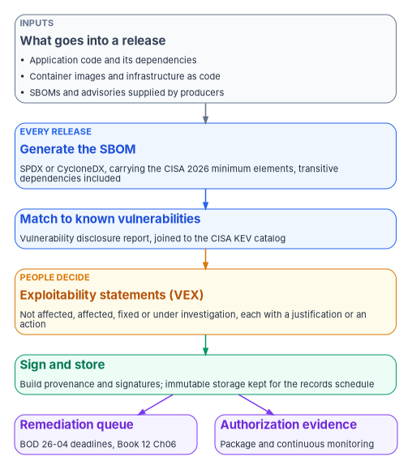
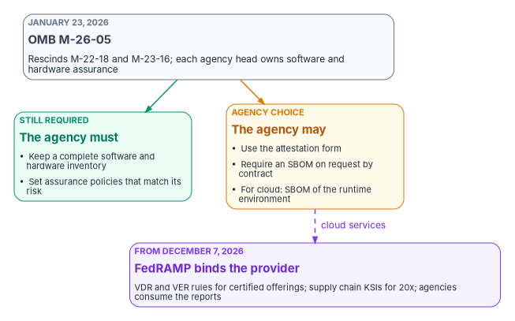

# Chapter 07 — Supply Chain Risk Management

*Most of the code an agency runs was written by someone else, so supply chain risk is closed by knowing what you run, who made it and what is wrong with it, and by keeping that knowledge current.*

::: {.callout-note}
## In this chapter
The NIST SP 800-53 supply chain controls (the SR family and PM-30), what each asks for and which baselines carry it, and how SP 800-161 Rev. 1 spreads the work across the organization. Where federal policy stands in October 2026, after OMB M-26-05 rescinded the secure-development attestation mandate: the software and hardware inventory is still required, while attestations and SBOMs are now agency choices made through contract terms. The program's evidence pipeline (software bill of materials, vulnerability disclosure report, exploitability statements) in the formats that matter, the FedRAMP rules that bind cloud providers from December 7, 2026, supplier disclosure, build provenance, and who owns each decision.
:::

A federal system is mostly other people's software. An operating system, a database engine, a web framework and the hundreds of open source packages underneath it arrive through procurement, package managers and cloud services. Each carries its own flaws, and the agency inherits them on the day it installs the product. Supply chain risk management is the discipline of keeping that inheritance visible: which components are in production, who produced them, which known vulnerabilities affect them, whether those vulnerabilities can be exploited where the component actually runs, and what the supplier has promised to tell the agency when something changes.

The program treats this as an evidence problem, not a paperwork one. The project charter that seeded this chapter states the principles plainly: inventory before you remediate, because you can't prioritize what you haven't named; remediation urgency follows exploitability and exposure, not a single calendar; a new software-as-a-service product needs a recorded authorization status before anyone provisions it; component and vulnerability status flow into the evidence stream continuously; and supply chain risk acceptance has a named owner ([Book 00, Chapter 06](../b00-orientation/06-the-project-portfolio.md)). Those are program design positions. The rest of this chapter shows which of them federal requirements now compel and which the agency adopts by choice.

{#fig-ch07-evidence-pipeline fig-alt="Top to bottom. A slate card, sources: application code and dependencies, container images, infrastructure as code, and supplier-provided SBOMs. It leads to a blue card, SBOM generation in CI on every release, in SPDX or CycloneDX, carrying the CISA 2026 minimum elements. That leads to a blue card, vulnerability matching, which compares SBOM components with vulnerability databases and the CISA KEV catalog and produces a vulnerability disclosure report. That leads to an amber card, exploitability decision by people, producing VEX statements of not affected, affected, fixed or under investigation, each with a justification or action. That leads to a green card, sign and store: build provenance and signatures, immutable storage under the agency records schedule. Two arrows leave the green card: one to a violet card, the remediation queue governed by BOD 26-04 deadlines in Book 12 Chapter 06, and one to a violet card, the authorization package and continuous monitoring evidence."}

## What the controls ask for

NIST SP 800-53 Rev. 5 puts supply chain risk management in its own family, SR, with twelve base controls, and adds one organization-wide program control, PM-30.[^c07-sp80053] The controls are short and parameter-heavy: the organization decides what systems, which suppliers and how often. That leaves the design to the agency and the burden of proof on the agency's records.

| Control | What it asks for | NIST baseline | FedRAMP Rev5 classes |
|---|---|---|---|
| PM-30 Supply Chain Risk Management Strategy | An organization-wide strategy for supply chain risk across development, acquisition, maintenance and disposal, implemented consistently and reviewed on a set schedule | None (program management) | None listed |
| SR-1 Policy and Procedures | A supply chain risk management policy and procedures, an official who manages them, and scheduled reviews | Low, Moderate, High | B, C, D |
| SR-2 Supply Chain Risk Management Plan | A plan covering the life cycle from research and development to disposal for defined systems, reviewed and protected from unauthorized disclosure and modification | Low, Moderate, High | B, C, D |
| SR-2(1) Establish SCRM Team | A named team that leads defined supply chain activities | Low, Moderate, High | B, C, D |
| SR-3 Supply Chain Controls and Processes | A process to find and address supply chain weaknesses, the controls used against supply chain risk, and documentation of both | Low, Moderate, High | B, C, D |
| SR-4 Provenance | Valid provenance of defined systems, components and associated data | None | None listed |
| SR-5 Acquisition Strategies, Tools, and Methods | Acquisition strategies, contract tools and procurement methods that protect against and mitigate supply chain risk | Low, Moderate, High | B, C, D |
| SR-6 Supplier Assessments and Reviews | Assessment and review of supply chain risks tied to suppliers and what they provide, on a defined frequency | Moderate, High | C, D |
| SR-7 Supply Chain Operations Security | Operations security safeguards for supply chain information | None | None listed |
| SR-8 Notification Agreements | Agreements and procedures with supply chain entities to notify the agency of supply chain compromises, results of assessments or audits, or both | Low, Moderate, High | B, C, D |
| SR-9 Tamper Resistance and Detection | A tamper protection program for the system or component | High | D |
| SR-10 Inspection of Systems or Components | Inspection of defined components to detect tampering | Low, Moderate, High | B, C, D |
| SR-11 Component Authenticity | Anti-counterfeit policy and procedures and reporting of counterfeit components; SR-11(1) trains people to spot counterfeits and SR-11(2) keeps components under configuration control during repair | Low, Moderate, High | B, C, D |
| SR-12 Component Disposal | Disposal of defined data, documentation, tools or components by defined methods | Low, Moderate, High | B, C, D |

: The supply chain controls. Baseline membership is from the NIST SP 800-53B baselines; FedRAMP classes are from FedRAMP's Rev5 control reference. {.striped .hover}

Sources for the table: control statements from the NIST catalog, release 5.2.0;[^c07-sp80053] NIST baselines from SP 800-53B as published in NIST's machine-readable baseline profiles;[^c07-sp80053b] FedRAMP classes from FedRAMP's Rev5 control reference for the SR family.[^c07-fedramp-sr] The two lists are separate facts and differ at the edges: SR-6 is a NIST Moderate control and a FedRAMP Class C and D control, and SR-9 is NIST High and FedRAMP Class D. [Book 13's requirements mapping](../b13-governance/appendix-a-requirements-mapping.md) explains why the book cites them separately.

Three points shape the rest of the chapter.

The first is that most of the family isn't about software at all. SR-9 through SR-12 are about tampering, counterfeits, repair and disposal, which are hardware and property-management questions. The source volume claimed its software pipeline closed SR-10 and SR-11. It contributes evidence to both (hash checks and signatures detect altered software), but anti-counterfeit training, configuration control during repair and component disposal need the agency's procurement and property processes, and the program records them there.

The second is that SR-1, SR-2, SR-3, SR-5 and SR-8 are in every NIST baseline. Even a Low system needs a policy, a plan, a named team, acquisition language and notification agreements.

The third is that the closing artifacts are governance artifacts. A software bill of materials, a vulnerability report, an exploitability decision, a contract clause and a supplier notification agreement close these controls. No network technology produces any of them. The program says a technology is required only when the control text, physics or protocol behavior makes it the only way to close a control, and saying plainly that supply chain risk isn't such a case is part of what makes that claim credible elsewhere ([Chapter 04](04-closure-with-proof.md)).

## How SP 800-161 Rev. 1 frames the work

NIST SP 800-161 Rev. 1, *Cybersecurity Supply Chain Risk Management Practices for Systems and Organizations*, is the companion guidance for the SR family. It was published in May 2022 and updated on November 1, 2024.[^c07-sp800161] It integrates supply chain risk into existing risk management at three levels, each producing different deliverables: at Level 1, the enterprise, the strategy, policy and implementation plan set the tone and boundaries; at Level 2, the mission and business process level, those are tailored to specific missions; and at Level 3, the operational level, system plans determine whether a system meets requirements and carries appropriately tailored controls.[^c07-sp800161]

That maps cleanly onto the controls. PM-30's strategy is a Level 1 artifact owned by the agency. SR-2's plan exists at Levels 2 and 3 for each system. SR-3, SR-5 and SR-6 are where Level 1 policy turns into contract terms and supplier reviews. SP 800-161 also expects acquisition strategy to cover approved and prohibited supplier lists and to ensure products "are supplied with a software bill of materials that complies with appropriate agency-approved protocols," and its supplemental guidance suggests SBOMs for purchased, open source and in-house software.[^c07-sp800161] For an open source project that publishes no SBOM, it lists three options: contribute SBOM generation to the project, fund the capability, or generate an SBOM on first consumption of each version used.[^c07-sp800161] The November 2024 update revised the online Appendix F, which carries the software supply chain guidance, to clarify the SBOM language and add the elements of vulnerability advisory reports according to ISO/IEC 29147.[^c07-sp800161]

## The federal position in October 2026

::: {.callout-important}
## Correction: the attestation mandate is rescinded
The source volume described a mandatory framework built on Executive Order 14028 section 4, OMB M-22-18 and OMB M-23-16. On January 23, 2026, OMB Memorandum M-26-05, *Adopting a Risk-based Approach to Software and Hardware Security*, rescinded M-22-18 and its companion M-23-16.[^c07-m2605] SBOMs and secure-development attestations are now agency choices made through contract terms, not a government-wide mandate.
:::

M-26-05 is two pages long and worth reading whole. It says each agency head "is ultimately responsible for assuring the security of software and hardware" on the agency's network, that there is no one-size-fits-all method, and that M-22-18 "imposed unproven and burdensome software accounting processes."[^c07-m2605] What it keeps and what it makes optional are specific:

| Item | Status under M-26-05 |
|---|---|
| A complete inventory of software and hardware | Required: agencies "shall continue to maintain" it |
| Software and hardware assurance policies and processes that match the agency's risk determinations and mission needs | Required |
| The Secure Software Development Attestation Form and the other M-22-18 resources | Agency choice |
| A contract term requiring a producer to provide a current SBOM upon request | Agency choice; for a cloud platform, the term should require an SBOM of the runtime production environment |
| NIST SP 800-218 (SSDF), CISA's 2025 SBOM minimum elements draft, CISA's hardware bill of materials framework | Listed as references for further options |

: What M-26-05 requires and what it leaves to the agency. {.striped .hover}

Source: M-26-05 and its footnote on cloud platforms.[^c07-m2605]

{#fig-ch07-federal-position fig-alt="Top: a slate card, OMB M-26-05, January 23, 2026, rescinds M-22-18 and M-23-16; each agency head owns software and hardware assurance. Two arrows lead down. Left, a green card labelled still required: keep a complete software and hardware inventory, and set assurance policies that match the agency's risk. Right, an amber card labelled agency choice: use the attestation form, require an SBOM on request by contract, and for cloud services an SBOM of the runtime environment. A dashed arrow labelled cloud services runs from the amber card to a violet card at the bottom, labelled from December 7, 2026: FedRAMP binds the provider, with VDR and VER rules for certified offerings, supply chain KSIs for 20x, and agencies consuming the reports."}

Three related facts have moved with it.

- **Executive Order 14028.** Section 4 directed NIST to issue guidance on software supply chain practices, including "providing a purchaser a Software Bill of Materials (SBOM) for each product," and directed Commerce to publish minimum elements for an SBOM.[^c07-eo14028] It directed guidance; it didn't itself require any vendor to deliver an SBOM. The source's claim that it "mandates SBOM for software sold to the federal government" is corrected here.
- **The secure software development framework.** Executive Order 14306 of June 6, 2025 rewrote the software provisions of Executive Order 14144, directing NIST to stand up an industry consortium, publish a preliminary update to SP 800-218 by December 1, 2025, and publish a final version within 120 days of the preliminary one; the order's software provisions say nothing about attestation.[^c07-eo14306] NIST released SSDF version 1.2 (SP 800-218 Rev. 1) as an initial public draft on December 17, 2025, with comments closed January 30, 2026.[^c07-ssdf12] As of October 21, 2026 the current final publication is still SSDF version 1.1 of February 2022.[^c07-ssdf11]
- **The attestation form.** CISA's page for the Secure Software Development Attestation Form, released March 11, 2024, is now marked as archived content that "may not reflect current policy or programs."[^c07-cisa-attest] An agency that still wants attestations asks for them in its contracts.

The program's position follows directly. The inventory is mandatory, so the SBOM pipeline exists first to serve it: an SBOM is the most precise inventory of software the agency can have. For acquired software the agency decides, system by system, whether to write an SBOM-on-request clause into the contract, and for cloud services it asks for the runtime production environment, as M-26-05's footnote suggests.[^c07-m2605] This matches the charter's own principle that remediation timelines are risk-based rather than uniform: the federal rule has moved toward the program, not away from it.

## The evidence pipeline

The pipeline produces three linked artifacts per release: an SBOM that says what is in it, a vulnerability disclosure report that says which known vulnerabilities affect those components, and exploitability statements that say whether each one matters in this deployment. Each is a machine-readable file keyed to the release, signed and stored as evidence. [Book 12, Chapter 02](../b12-security-operations/02-the-evidence-contract.md) defines the evidence contract every record follows (asset identity plus time); this pipeline is one producer under that contract.

### Formats

Two SBOM formats are in wide use, and CISA's guidance names both.[^c07-cisa-sbom2026]

- **SPDX.** The Linux Foundation's System Package Data Exchange specification is recognized as the international standard ISO/IEC 5962:2021; its current version is 3.0.[^c07-spdx]
- **CycloneDX.** OWASP's CycloneDX covers SBOMs, SaaSBOMs and hardware BOMs as well as vulnerability disclosure and VEX.[^c07-cyclonedx] The current version, 1.7, was released October 21, 2025, and Ecma International published it as the second edition of ECMA-424 in December 2025.[^c07-cyclonedx][^c07-ecma424]

Two formats dominate exploitability statements.

- **CSAF.** The OASIS Common Security Advisory Framework 2.0 became an OASIS Standard on November 18, 2022 and defines five profiles, one of them VEX.[^c07-csaf] A CSAF VEX document must give every vulnerability at least one product status (`fixed`, `known_affected`, `known_not_affected` or `under_investigation`); every product marked `known_not_affected` needs an impact statement and every product marked `known_affected` needs an action statement.[^c07-csaf]
- **OpenVEX.** The OpenVEX specification, version 0.2.0, uses the statuses `not_affected`, `affected`, `fixed` and `under_investigation`. A `not_affected` statement needs a justification or an impact statement, and an `affected` statement needs an action statement.[^c07-openvex]

CycloneDX can carry the same decisions in each vulnerability's `analysis` block.[^c07-cdx-schema] The program accepts any of the three from suppliers and normalizes them on intake, because CISA's guidance tells organizations to accept any widely used, interoperable, machine-processable format and to avoid deprecated versions for new software.[^c07-cisa-sbom2026]

| Program status | OpenVEX `status` | CSAF VEX `product_status` | CycloneDX `analysis.state` |
|---|---|---|---|
| Not affected | `not_affected` | `known_not_affected` | `not_affected` (or `false_positive`) |
| Affected | `affected` | `known_affected` | `exploitable` |
| Fixed | `fixed` | `fixed` | `resolved` (or `resolved_with_pedigree`) |
| Under investigation | `under_investigation` | `under_investigation` | `in_triage` |

: The program's normalization of exploitability statuses across formats. The values in each column are the formats' own; the row alignment is the program's design. {.striped .hover}

Sources for the column values: OpenVEX 0.2.0, CSAF 2.0 and the CycloneDX schema.[^c07-openvex][^c07-csaf][^c07-cdx-schema]

### What an SBOM must contain

::: {.callout-important}
## Correction: the NTIA minimum elements were replaced
The source cited the 2021 NTIA minimum elements and a "CISA 2025 update." CISA's 2025 document was a public-comment draft (comments closed October 3, 2025).[^c07-cisa-sbom2025] On July 29, 2026 CISA and seventeen partner organizations published the *2026 Minimum Elements for a Software Bill of Materials*, which "updates and replaces" the NTIA version and applies to all software, including open source, AI software and software as a service.[^c07-cisa-sbom2026] M-26-05, written before the final version, cites the 2025 draft.[^c07-m2605]
:::

The 2026 minimum elements define seventeen data fields. Ten are new since 2021 (the SBOM author's signature, the data format's name and version, the generation context, the tool's name and version, the SBOM's own version, and each component's hash value, hash algorithm and license), and "Supplier Name" is renamed "Component Producer."[^c07-cisa-sbom2026] The document says the elements "do not create new requirements"; they refine how organizations generate and request SBOMs.[^c07-cisa-sbom2026] Authors should say explicitly when a field is unknown rather than leave it blank, and an SBOM should cover transitive dependencies too.[^c07-cisa-sbom2026]

| CISA 2026 element | Where the program records it in CycloneDX JSON |
|---|---|
| SBOM Author; SBOM Author Signature | `metadata.authors`; `signature` |
| SBOM Timestamp; SBOM Version | `metadata.timestamp`; `version` |
| SBOM Data Format Name and Version | `bomFormat`; `specVersion` |
| SBOM Tool Name and Version | `metadata.tools` |
| SBOM Generation Context | `metadata.lifecycles` |
| Component Producer | `components[].supplier` or `components[].manufacturer` |
| Component Name; Component Version | `components[].name`; `components[].version` |
| Component Identifiers | `components[].purl`, `cpe` or `swid` |
| Component Hash Value and Algorithm | `components[].hashes` |
| Component License | `components[].licenses` |
| Component Dependency Relationship | `dependencies` |

: The CISA 2026 data fields and the CycloneDX fields that carry them. Field names are from the CycloneDX schema; the mapping is the program's design. {.striped .hover}

Sources: CISA's 2026 minimum elements, Appendix A, and the CycloneDX 1.7 schema.[^c07-cisa-sbom2026][^c07-cdx-schema] The source's table mapped the author to `metadata.author`; current CycloneDX schemas use `authors`, and the component-level `author` field is marked deprecated.[^c07-cdx-schema]

### Vulnerability disclosure report

A vulnerability disclosure report (VDR) lists the known vulnerabilities affecting the components in an SBOM. CycloneDX describes the capability as communicating "known and unknown vulnerabilities affecting components and services" and aligns it with ISO/IEC 29147:2018, the same standard SP 800-161's 2024 update cites for vulnerability advisory reports.[^c07-cdx-vdr][^c07-sp800161] The pipeline produces one from each SBOM with a scanner, then joins it to the CISA Known Exploited Vulnerabilities (KEV) catalog. Every KEV entry carries its own `dateAdded`, `dueDate` and `forensicTriage` fields.[^c07-kev] The deadline that governs the agency's own remediation is BOD 26-04's, set by four questions about each vulnerable asset; [Book 12, Chapter 06](../b12-security-operations/06-vulnerability-management.md) builds that queue, and this pipeline feeds it rather than computing deadlines of its own.

Watch the acronym. FedRAMP uses "VDR" for its Vulnerability Detection and Response rules, a set of provider obligations. The CycloneDX VDR is a document. The chapter spells out which one it means.

### Exploitability statements

A scanner can say a vulnerable component is present; it can't say whether the vulnerable code is reachable in this deployment. That judgment needs a person, and the program's process records it:

1. **Generate.** The pipeline produces the SBOM and VDR for every release.
2. **Escalate.** Any component in the KEV catalog goes straight to the remediation queue and a person reviews it the same day.
3. **Analyze.** The owning team reviews each new vulnerability for exploitability in context.
4. **Decide.** The team writes a VEX statement with a status and, for `not_affected`, a justification from the format's list, or for `affected`, an action statement.
5. **Sign and publish.** The statement is signed, stored with the SBOM and VDR, and shared with anyone downstream who consumes the software.
6. **Review.** Every `under_investigation` and `not_affected` statement is revisited when the vulnerability record or the deployment changes, and on a fixed cycle the agency sets.

Steps 2 through 6 are program design. The status and justification vocabularies come from the formats; the source's example used the justification `protected_by_mitigating_control`, which is a CycloneDX value and is invalid in OpenVEX, whose closest values are `inline_mitigations_already_exist` and `vulnerable_code_not_in_execute_path`.[^c07-openvex][^c07-cdx-schema]

### Illustrative code

::: {.callout-warning}
## Illustrative code
The workflow, documents, script and query below are illustrative. They have not been tested against a production pipeline or tenant. Action versions, inputs and schemas were checked against their publishers' documentation on October 21, 2026; pin actions to a full commit SHA, review every step and adapt names, storage and permissions before running anything.
:::

The workflow generates a CycloneDX SBOM on each push to `main` and each published release, scans it, attests the SBOM's build provenance, and copies both files to immutable storage. It corrects four problems in the source's version: `cyclonedx-xml` isn't a valid `format` for the SBOM action (its values are `spdx`, `spdx-json`, `cyclonedx` and `cyclonedx-json`);[^c07-sbom-action] the scan action is now at version 7;[^c07-scan-action] storage access used a long-lived SAS token held as a secret, which the workflow replaces with OpenID Connect sign-in;[^c07-azure-login] and it wrote evidence straight to the Archive tier, which takes the files offline. Immutability is a policy set on the container, not a tier, and every access tier supports it.[^c07-immutable]

```yaml
# .github/workflows/sbom.yml
name: SBOM, vulnerability report and attestation

on:
  push:
    branches: [main]
  release:
    types: [published]

permissions:
  contents: write        # SBOM action uploads release assets on release events
  actions: read
  id-token: write        # OIDC for artifact attestations and Azure sign-in
  attestations: write

jobs:
  sbom:
    runs-on: ubuntu-latest
    steps:
      - uses: actions/checkout@v6

      - name: Generate SBOM (CycloneDX JSON)
        uses: anchore/sbom-action@v0
        with:
          path: .
          format: cyclonedx-json
          output-file: sbom-${{ github.sha }}.cdx.json

      - name: Scan SBOM and write vulnerability report
        id: scan
        uses: anchore/scan-action@v7
        with:
          sbom: sbom-${{ github.sha }}.cdx.json
          output-format: cyclonedx-json
          output-file: vdr-${{ github.sha }}.cdx.json
          fail-build: false   # the gate is the queue in Book 12 Ch06, not this step

      # In a pipeline that builds a deployable artifact, attest the artifact
      # itself and pass the SBOM with sbom-path. This repository-level example
      # attests build provenance for the SBOM file.
      - name: Attest build provenance for the SBOM
        uses: actions/attest@v4
        with:
          subject-path: sbom-${{ github.sha }}.cdx.json

      - name: Sign in to Azure with OIDC
        uses: azure/login@v3
        with:
          client-id: ${{ secrets.AZURE_CLIENT_ID }}
          tenant-id: ${{ secrets.AZURE_TENANT_ID }}
          subscription-id: ${{ secrets.AZURE_SUBSCRIPTION_ID }}
          # environment: AzureUSGovernment   # set for Azure Government

      - name: Copy SBOM and report to immutable evidence storage
        run: |
          for f in sbom vdr; do
            az storage blob upload \
              --auth-mode login \
              --account-name "${{ vars.EVIDENCE_STORAGE_ACCOUNT }}" \
              --container-name sbom-evidence \
              --name "$(date -u +%Y/%m/%d)/${f}-${{ github.sha }}.cdx.json" \
              --file "${f}-${{ github.sha }}.cdx.json" \
              --tier Cool
          done
```

Notes on the workflow. The SBOM action uploads SBOMs as release assets automatically when it runs on a release, which needs `contents: write` and `actions: read`.[^c07-sbom-action] The scan action's `fail-build` defaults to `true` with a `medium` severity cutoff;[^c07-scan-action] the program sets it to `false` here because the remediation deadline comes from BOD 26-04, not from a severity score, and a merge gate belongs in a separate pull-request workflow the team tunes deliberately. GitHub's attestation action needs `id-token: write`, `contents: read` and `attestations: write`, and consumers verify with `gh attestation verify`.[^c07-gh-attest-howto] The `az storage blob upload` command accepts `--auth-mode login` and `--tier`.[^c07-az-blob] The container must already have a time-based retention policy, set to the period in the agency's records schedule; the source's flat "seven years (NARA standard)" isn't carried, because retention comes from the schedule that covers the record.

A vulnerability entry in the CycloneDX JSON report looks like this. The source's XML version nested the score in a `base` element and used a `patch_available` response; neither exists in the schema, where `score` is a number and the responses are `can_not_fix`, `will_not_fix`, `update`, `rollback` and `workaround_available`.[^c07-cdx-schema]

```json
{
  "id": "CVE-2024-12345",
  "source": { "name": "NVD", "url": "https://nvd.nist.gov/vuln/detail/CVE-2024-12345" },
  "ratings": [
    {
      "score": 9.8,
      "severity": "critical",
      "method": "CVSSv31",
      "vector": "CVSS:3.1/AV:N/AC:L/PR:N/UI:N/S:U/C:H/I:H/A:H"
    }
  ],
  "affects": [ { "ref": "pkg:pypi/requests@2.28.0" } ],
  "analysis": {
    "state": "exploitable",
    "response": ["update"],
    "detail": "A network-reachable API endpoint uses this version."
  }
}
```

The CVE identifier is a placeholder. In a real report `affects[].ref` points at the `bom-ref` of the component in the SBOM.[^c07-cdx-schema]

An OpenVEX statement recording a `not_affected` decision:

```json
{
  "@context": "https://openvex.dev/ns/v0.2.0",
  "@id": "https://example.gov/vex/2026/vex-0001.json",
  "author": "Agency application security team",
  "timestamp": "2026-10-21T00:00:00Z",
  "version": 1,
  "statements": [
    {
      "vulnerability": { "name": "CVE-2024-12345" },
      "products": [ { "@id": "pkg:pypi/requests@2.28.0" } ],
      "status": "not_affected",
      "justification": "vulnerable_code_not_in_execute_path",
      "impact_statement": "The vulnerable function is never called in the production configuration."
    }
  ]
}
```

The required document fields (`@context`, `@id`, `author`, `timestamp`, `version`) and the justification value are from the OpenVEX specification.[^c07-openvex] Use a team or role as author, not a person's name.

The KEV join below fixes two bugs in the source's script (`.json` and `.read` were referenced without being called) and reads the CycloneDX JSON report. It records each KEV entry's own fields and leaves the deadline calculation to the BOD 26-04 queue.

```python
# kev_join.py: flag components in the vulnerability report that are in the KEV catalog
import json
import sys
import requests

KEV_URL = "https://www.cisa.gov/sites/default/files/feeds/known_exploited_vulnerabilities.json"

def kev_hits(vdr_path: str) -> list[dict]:
    kev = {e["cveID"]: e for e in requests.get(KEV_URL, timeout=60).json()["vulnerabilities"]}
    with open(vdr_path, encoding="utf-8") as f:
        vdr = json.load(f)
    hits = []
    for vuln in vdr.get("vulnerabilities", []):
        entry = kev.get(vuln.get("id", ""))
        if entry:
            hits.append({
                "cve": entry["cveID"],
                "components": [a["ref"] for a in vuln.get("affects", [])],
                "kev_date_added": entry.get("dateAdded"),
                "kev_due_date": entry.get("dueDate"),
                "forensic_triage": entry.get("forensicTriage"),
            })
    return hits

if __name__ == "__main__":
    print(json.dumps(kev_hits(sys.argv[1]), indent=2))
```

The field names `cveID`, `dateAdded`, `dueDate` and `forensicTriage` match the KEV JSON feed.[^c07-kev]

The program loads the joined results into a custom table in the security analytics workspace through the Logs Ingestion API ([Book 12, Chapter 06](../b12-security-operations/06-vulnerability-management.md) shows the ingestion pattern). A detection that lists KEV-affected components still open past the deadline the queue assigned:

```kql
SupplyChainVulnerabilities_CL
| where TimeGenerated > ago(1d)
| where KevListed_b == true
| where VexStatus_s in ("affected", "under_investigation")
| where now() > Deadline_t
| project CVE = Cve_s, Component = Component_s, Deadline = Deadline_t,
          DaysOverdue = datetime_diff('day', now(), Deadline_t)
| order by DaysOverdue desc
```

The source called `now` without parentheses. `datetime_diff(period, datetime1, datetime2)` returns `datetime1 - datetime2` in the given period, so the argument order above yields a positive number of overdue days.[^c07-kql] Table and column names are the program's own.

## FedRAMP: what binds cloud providers

For cloud services the agency doesn't build, FedRAMP sets the supply chain and vulnerability rules, and those rules bind the provider. The agency's obligation is to consume what the provider reports.

Two of the 2026 Key Security Indicators sit in the Supply Chain Risk theme. KSI-SCR-MIT tells a 20x provider to "persistently identify, review, and mitigate potential supply chain risks," and KSI-SCR-MON says third-party software information resources "are automatically monitored for upstream vulnerabilities," through contractual notification requirements or active monitoring services.[^c07-ksi-scr] Rev5 providers carry the SR controls listed above for their class.[^c07-fedramp-sr]

FedRAMP's vulnerability rules are the larger change. Its notice NTC-0014 of June 16, 2026 makes the Vulnerability Detection and Response (VDR) and Vulnerability Evaluation and Reporting (VER) rules mandatory for every FedRAMP-certified offering on December 7, 2026, with a corrective-action grace period through March 7, 2027, after which certification is revoked for offerings not following them.[^c07-ntc14] The VDR rules define vulnerability detection to include supply chain monitoring, tell providers to remediate KEV entries by the catalog's due dates "even if the vulnerability has been fully mitigated," and say providers should not deploy new machine-based resources that carry KEVs.[^c07-vdr] The VER rules require providers to evaluate each detected vulnerability for exploitability, internet reachability and potential agency impact, rated N0 to N5, and to report detection and response activity persistently, at least monthly in human-readable form, with JSON for automated retrieval recommended at a frequency that rises with class.[^c07-ver] [Book 12, Chapter 06](../b12-security-operations/06-vulnerability-management.md) covers how these rules meet BOD 26-04.

The VER rules also address agencies. Agencies should review provider vulnerability reports at intervals matching their risk posture and should use automated processing of the machine-readable data; FedRAMP's note recommends reviewing only overdue and accepted vulnerabilities rated above N2 unless the service sits in a higher-risk system. Agencies should use the reported information to maintain their own plans of action and milestones when they mitigate a provider's vulnerability or accept continued use of a service with accepted vulnerabilities.[^c07-ver] Both are SHOULD rules. The program adopts them as design: the provider's report lands in the same queue and the same record as the agency's own findings ([Chapter 11](11-the-authorization-package.md)).

M-26-05's cloud footnote completes the picture. Where the agency adopts an SBOM clause for a cloud platform, it asks for the runtime production environment, not the vendor's client tools.[^c07-m2605] The charter's gate (no new software as a service without a recorded authorization status) checks the service's FedRAMP certification on the Marketplace and the agency's own authorization of the system that uses it, as [Book 00, Chapter 06](../b00-orientation/06-the-project-portfolio.md) and [Book 10](../b10-cloud-boundary/index.md) describe.

## Supplier disclosure

SR-6 asks the agency to assess suppliers; SR-8 asks for agreements under which suppliers notify it of compromises and assessment results.[^c07-sp80053] The program keeps a supplier record for every producer whose components appear in a production SBOM or who provides a cloud service in the boundary. The source's matrix named specific vendors with FedRAMP package identifiers; those identifiers aren't carried, because certification status changes and must be read from the Marketplace at the time of review.

| Field | What the program records |
|---|---|
| Supplier and products | The producer name as it appears in the SBOM, and the products in use |
| Certification status | For cloud services, FedRAMP certification and class from the Marketplace, with the date checked |
| Advisory channel | Where the supplier publishes advisories, and in what machine-readable format (CSAF, CycloneDX, OpenVEX, or none) |
| SBOM availability | Whether the supplier provides SBOMs, in which format, and whether the contract requires one on request |
| Notification agreement | The clause or terms under which the supplier must report compromises and assessment results (SR-8) |
| Utilization and pricing | Whether the agency has asked the vendor for its utilization rates and prices paid, and whether contracts issued after March 31, 2026 carry the disclosure provision OMB M-26-10 requires |
| Last review | Date and outcome of the most recent supplier assessment (SR-6) |

: The supplier record. Program design. {.striped .hover}

The utilization and pricing row comes from OMB M-26-10. Effective March 31, 2026, agencies must request that current vendors, "This includes resellers, third-party vendors, and manufacturers," provide the agency's utilization rates and prices paid for IT products and services, and must "Include appropriate provisions in solicitations and contracts issued after the date of this memorandum to require IT vendors to disclose utilization and pricing information to the Government, without limiting the extent to which that information may be shared across agencies."[^c07-m2610] The memo gives no clause wording, so the contracting officer drafts it; [Book 00, Appendix C](../b00-orientation/appendix-c-funding-and-acquisition.md) has the acquisition checklist this fits into.

Machine-readable advisories make the record cheaper to keep. Microsoft, for example, began publishing CSAF files for its CVEs on November 12, 2024, listed through a provider metadata file,[^c07-msrc-csaf] and in September 2026 began publishing VEX statements for all Microsoft-assigned CVEs.[^c07-msrc-vex] A supplier that publishes CSAF or OpenVEX can feed the exploitability step directly; one that publishes only web pages costs the agency analyst time on every advisory, which is a fair factor in an SR-6 review.

## Build provenance

An SBOM describes a build. Provenance proves the artifact that was scanned is the artifact that was deployed. SLSA, the Supply-chain Levels for Software Artifacts framework, is the reference model. Its current version, 1.2, has two tracks.[^c07-slsa-build][^c07-slsa-source]

| Track and level | Name | What it requires |
|---|---|---|
| Build L1 | Provenance exists | A consistent build process; the build platform generates provenance automatically and it is distributed |
| Build L2 | Hosted build platform | L1, on a hosted platform that generates and signs the provenance, which consumers validate |
| Build L3 | Hardened builds | L2, on a platform that isolates builds from one another and keeps signing secrets away from user-defined build steps |
| Source L4 | Two-party review | Changes to protected branches must be agreed to by two or more trusted persons before submission |

: SLSA levels relevant to the program. {.striped .hover}

Sources: SLSA 1.2 build track basics and source track requirements.[^c07-slsa-build][^c07-slsa-source]

The source said Build Level 3 meant "hardened build, two-party review." That conflates the tracks: hardening is Build L3, and two-party review is Source L4.[^c07-slsa-build][^c07-slsa-source] GitHub's artifact attestations provide SLSA Build Level 2 on their own; running the build in a reusable workflow shared across repositories isolates it from the calling workflow and meets Build Level 3.[^c07-gh-attest-concept] Attestations in public repositories use the Sigstore public-good instance and a public transparency log; private repositories use GitHub's own Sigstore instance with no transparency log.[^c07-gh-attest-concept] GitHub also cautions that an attestation isn't a guarantee an artifact is secure: the consumer still sets a policy and evaluates the attestation against it.[^c07-gh-attest-concept] The program targets Build L2 for every production release workflow first, then Build L3 through shared reusable workflows, and requires two-party review on protected branches as a change-control rule ([Book 13, Chapter 04](../b13-governance/04-change-control-and-provenance.md)).

## The closure record

What each control's closure rests on in the program's design, and what the pipeline can't supply:

| Control | Closing evidence | Not supplied by the pipeline |
|---|---|---|
| PM-30 | The agency strategy, approved and on its review cycle | Everything; it is an executive artifact |
| SR-1, SR-2, SR-2(1) | Policy, per-system plans, named team | Approval and review records |
| SR-3 | SBOM per release, VDR, VEX statements, documented controls | Sub-tier supplier flow-down if the agency adopts SR-3(3) |
| SR-5 | Contract clauses (SBOM on request, notification, runtime SBOM for cloud), pre-production scan | The decision of which clauses each acquisition carries |
| SR-6 | Supplier records with review dates and outcomes | The assessment judgment |
| SR-8 | Notification clauses; advisory-feed subscriptions; supplier vulnerability intake into the queue | The contract negotiation |
| SR-10 | Hash and signature verification of software artifacts at deployment | Hardware inspection |
| SR-11 | Signed provenance and attestations for software | Anti-counterfeit policy for hardware, SR-11(1) training, SR-11(2) repair control |
| SR-12 | None | Disposal records from property management |

: How the supply chain controls close. Program design. {.striped .hover}

A control closes only when the mechanism that closes it exists and its proof is recorded ([Chapter 04](04-closure-with-proof.md)). For SR-12 the honest entry is that this pipeline closes nothing, and the closure record says which process does.

## Who owns what

| Decision or artifact | Owner |
|---|---|
| Supply chain strategy (PM-30) | The CISO owns it and its annual review, with the senior procurement executive consulted; the CIO approves the governance charter ([Chapter 05](05-program-management-controls.md), [Chapter 10](10-who-owns-compliance.md)) |
| Contract terms (SBOM on request, notification, runtime SBOM) | The contracting officer, advised by the CISO's supply chain team |
| SBOM and provenance pipeline | The engineering teams that build and release software |
| Exploitability statements | The owning application team, reviewed by security |
| Supplier records and reviews | The supply chain team named under SR-2(1) |
| Residual supply chain risk | The authorizing official, and no one else |

: Ownership of supply chain decisions. Program design. {.striped .hover}

The charter left the sponsor and lead "to be named" and asked only that supply chain risk acceptance have a named owner. Under SP 800-37 that owner is the authorizing official, who alone accepts residual risk; [Chapter 10](10-who-owns-compliance.md) and [Book 13, Chapter 09](../b13-governance/09-who-governs.md) set out the decision rights. The source's implementation checklist carried calendar targets from July to December 2026 that have passed; the sequence below is tied to the program's phases instead ([Book 01, Chapter 12](../b01-transformation-arc/12-migration-roadmap.md)).

1. **Charter.** Pick the pilot system, name the supply chain team and the risk-acceptance owner, and agree on risk-based timelines.
2. **Inventory.** Generate SBOMs for the pilot's production releases; record every supplier and cloud service with its certification status.
3. **Intake.** Join SBOMs to the KEV catalog and the BOD 26-04 queue; subscribe to supplier advisory feeds in machine-readable form where they exist.
4. **Remediate and gate.** Track at least one finding to closure under its deadline; turn on the provisioning gate for new software as a service.
5. **Evidence.** Sign and store SBOMs, reports and statements; reach Build L2, then L3; put contract clauses into the next acquisitions.

## What to take from this chapter

1. The SR family closes through governance artifacts: policy, plans, contracts, supplier records, SBOMs, vulnerability reports and exploitability statements. SR-1, SR-2, SR-3, SR-5 and SR-8 are in every NIST baseline.
2. M-26-05 rescinded M-22-18 and M-23-16 on January 23, 2026. The software and hardware inventory is still required; attestations and SBOMs are agency choices made through contract terms, and for cloud platforms the SBOM to ask for is the runtime production environment.
3. CISA's 2026 minimum elements replaced the 2021 NTIA list on July 29, 2026, with seventeen fields; SPDX and CycloneDX are the two formats in wide use, and CSAF and OpenVEX carry exploitability.
4. From December 7, 2026 FedRAMP's VDR and VER rules bind certified providers; agencies should consume the reports with automation and fold them into their own plans of action.
5. Build L3 is hardened builds; two-party review is a separate source-track level. Provenance proves the scanned artifact is the deployed one.

::: {.callout-tip}
## Continue the book
[← Previous: Chapter 06 — Contingency Planning and Business Continuity](06-contingency-and-continuity.md) · [Book index](index.md) · [Next: Chapter 08 — Privacy: PII Processing and Transparency →](08-privacy-pii-processing.md)
:::

[^c07-sp80053]: National Institute of Standards and Technology, SP 800-53 Rev. 5, *Security and Privacy Controls for Information Systems and Organizations*, release 5.2.0, controls PM-30 and SR-1 through SR-12 with enhancements, OSCAL catalog, <https://github.com/usnistgov/oscal-content/tree/main/nist.gov/SP800-53/rev5> (accessed Oct 21, 2026).
[^c07-sp80053b]: National Institute of Standards and Technology, SP 800-53B, *Control Baselines for Information Systems and Organizations*, Low, Moderate, High and Privacy baseline profiles in OSCAL, <https://github.com/usnistgov/oscal-content/tree/main/nist.gov/SP800-53/rev5/json> (accessed Oct 21, 2026).
[^c07-fedramp-sr]: FedRAMP, "Supply Chain Risk Management (SR)," Full Rev5 Control Reference, *FedRAMP Consolidated Rules for 2026* ("FedRAMP Rev5 Baselines" per control), <https://www.fedramp.gov/2026/reference/controls/supply-chain-risk-management/> (accessed Oct 21, 2026).
[^c07-sp800161]: National Institute of Standards and Technology, SP 800-161 Rev. 1, *Cybersecurity Supply Chain Risk Management Practices for Systems and Organizations*, May 2022, updated November 1, 2024 (section 2.3, the three levels; section 3 acquisition guidance; CM-8 supplemental guidance and the C-SCRM enhancement on SBOMs for open source projects; Appendix I change log for Appendix F), <https://csrc.nist.gov/pubs/sp/800/161/r1/upd1/final> (accessed Oct 21, 2026).
[^c07-m2605]: Office of Management and Budget, M-26-05, *Adopting a Risk-based Approach to Software and Hardware Security*, January 23, 2026, <https://www.whitehouse.gov/wp-content/uploads/2026/01/M-26-05-Adopting-a-Risk-based-Approach-to-Software-and-Hardware-Security.pdf> (accessed Oct 21, 2026).
[^c07-eo14028]: Executive Order 14028, *Improving the Nation's Cybersecurity*, May 12, 2021, 86 Fed. Reg. 26633 (sections 4(e)(vii) and 4(f)), <https://www.govinfo.gov/content/pkg/FR-2021-05-17/html/2021-10460.htm> (accessed Oct 21, 2026).
[^c07-eo14306]: Executive Order 14306, *Sustaining Select Efforts to Strengthen the Nation's Cybersecurity and Amending Executive Order 13694 and Executive Order 14144*, June 6, 2025, 90 Fed. Reg. 24723 (section 2(b)), <https://www.govinfo.gov/content/pkg/FR-2025-06-11/html/2025-10804.htm> (accessed Oct 21, 2026).
[^c07-ssdf12]: National Institute of Standards and Technology, SP 800-218 Rev. 1 (Initial Public Draft), *Secure Software Development Framework (SSDF) Version 1.2*, December 17, 2025, <https://csrc.nist.gov/pubs/sp/800/218/r1/ipd> (accessed Oct 21, 2026).
[^c07-ssdf11]: National Institute of Standards and Technology, SP 800-218, *Secure Software Development Framework (SSDF) Version 1.1*, February 2022, <https://csrc.nist.gov/pubs/sp/800/218/final> (accessed Oct 21, 2026).
[^c07-cisa-attest]: Cybersecurity and Infrastructure Security Agency, "Secure Software Development Attestation Form" (archived content), <https://www.cisa.gov/secure-software-attestation-form> (accessed Oct 21, 2026).
[^c07-cisa-sbom2025]: Cybersecurity and Infrastructure Security Agency, "2025 Minimum Elements for a Software Bill of Materials (SBOM)," draft for public comment, August 22, 2025, <https://www.cisa.gov/resources-tools/resources/2025-minimum-elements-software-bill-materials-sbom> (accessed Oct 21, 2026).
[^c07-cisa-sbom2026]: Cybersecurity and Infrastructure Security Agency and partners, *2026 Minimum Elements for a Software Bill of Materials (SBOM)*, July 29, 2026 (Introduction; Notable Updates; Machine-Processable Data; Correlating SBOM With Security Advisories; Appendix A, Table 1), <https://www.cisa.gov/sites/default/files/2026-07/2026_cisa_sbom_minimum_elements_508c.pdf> (accessed Oct 21, 2026).
[^c07-spdx]: SPDX, "Specifications" (current version 3.0; recognized as ISO/IEC 5962:2021), <https://spdx.dev/use/specifications/> (accessed Oct 21, 2026).
[^c07-cyclonedx]: OWASP CycloneDX, "Specification Overview" (latest version 1.7, released 2025-10-21), <https://cyclonedx.org/specification/overview/> (accessed Oct 21, 2026).
[^c07-ecma424]: Ecma International, ECMA-424, *CycloneDX Bill of materials specification*, 2nd edition, December 2025, <https://ecma-international.org/publications-and-standards/standards/ecma-424/> (accessed Oct 21, 2026).
[^c07-cdx-schema]: OWASP CycloneDX, JSON schemas `bom-1.6.schema.json` and `bom-1.7.schema.json` (definitions `vulnerability`, `rating`, `impactAnalysisState`, `impactAnalysisJustification`, `metadata`, `component`), <https://github.com/CycloneDX/specification/tree/master/schema> (accessed Oct 21, 2026).
[^c07-cdx-vdr]: OWASP CycloneDX, "Vulnerability Disclosure Report (VDR)," capabilities, <https://cyclonedx.org/capabilities/vdr/> (accessed Oct 21, 2026).
[^c07-csaf]: OASIS, *Common Security Advisory Framework Version 2.0*, OASIS Standard, November 18, 2022 (section 4, profiles; section 6.1.27, mandatory tests for the VEX profile), <https://docs.oasis-open.org/csaf/csaf/v2.0/os/csaf-v2.0-os.html> (accessed Oct 21, 2026).
[^c07-openvex]: OpenVEX, "OpenVEX Specification v0.2.0," <https://github.com/openvex/spec/blob/main/OPENVEX-SPEC.md> (accessed Oct 21, 2026).
[^c07-kev]: Cybersecurity and Infrastructure Security Agency, Known Exploited Vulnerabilities Catalog, JSON feed, catalog version 2026.10.21, <https://www.cisa.gov/sites/default/files/feeds/known_exploited_vulnerabilities.json> (accessed Oct 21, 2026).
[^c07-sbom-action]: Anchore, "sbom-action," README (inputs `path`, `format`, `output-file`, `upload-release-assets`; release-asset permissions), <https://github.com/anchore/sbom-action> (accessed Oct 21, 2026).
[^c07-scan-action]: Anchore, "scan-action," README (`anchore/scan-action@v7`; inputs `sbom`, `output-format`, `output-file`, `fail-build`, `severity-cutoff`), <https://github.com/anchore/scan-action> (accessed Oct 21, 2026).
[^c07-gh-attest-howto]: GitHub Docs, "Using artifact attestations to establish provenance for builds," <https://docs.github.com/en/actions/how-tos/secure-your-work/use-artifact-attestations/use-artifact-attestations> (accessed Oct 21, 2026).
[^c07-gh-attest-concept]: GitHub Docs, "Artifact attestations," <https://docs.github.com/en/actions/concepts/security/artifact-attestations> (accessed Oct 21, 2026).
[^c07-azure-login]: Microsoft Learn, "Use the Azure Login action with OpenID Connect," <https://learn.microsoft.com/azure/developer/github/connect-from-azure-openid-connect>; and Azure, "login" action README (`azure/login@v3`, `id-token: write`), <https://github.com/Azure/login> (both accessed Oct 21, 2026).
[^c07-az-blob]: Microsoft Learn, "az storage blob upload," Azure CLI reference, <https://learn.microsoft.com/cli/azure/storage/blob?view=azure-cli-latest#az-storage-blob-upload> (accessed Oct 21, 2026).
[^c07-immutable]: Microsoft Learn, "Store business-critical blob data with immutable storage in a write once, read many (WORM) state" (time-based retention and legal holds; all access tiers support immutable storage), <https://learn.microsoft.com/azure/storage/blobs/immutable-storage-overview> (accessed Oct 21, 2026).
[^c07-kql]: Microsoft Learn, "datetime_diff()," Kusto Query Language reference, <https://learn.microsoft.com/kusto/query/datetime-diff-function> (accessed Oct 21, 2026).
[^c07-ksi-scr]: FedRAMP, "Supply Chain Risk," Key Security Indicators, FedRAMP 20x Certification Rules, *FedRAMP Consolidated Rules for 2026* (KSI-SCR-MIT, KSI-SCR-MON), <https://www.fedramp.gov/2026/providers/20x/key-security-indicators/supply-chain-risk/> (accessed Oct 21, 2026).
[^c07-ntc14]: FedRAMP, NTC-0014, "FedRAMP Response to CISA BOD 26-04 (Prioritizing Security Updates Based on Risk)," June 16, 2026, <https://www.fedramp.gov/notices/0014/> (accessed Oct 21, 2026).
[^c07-vdr]: FedRAMP, "Vulnerability Detection and Response," *FedRAMP Consolidated Rules for 2026* (definition of vulnerability detection; VDR-TFR-KEV; VDR-CSO-AKE; effective dates), <https://www.fedramp.gov/2026/reference/vulnerability-detection-and-response/> (accessed Oct 21, 2026).
[^c07-ver]: FedRAMP, "Vulnerability Evaluation and Reporting," *FedRAMP Consolidated Rules for 2026* (VER-EVA-ELX, VER-EVA-EIR, VER-EVA-EPA, VER-RPT-PER, VER-TFR-MHR, VER-TFR-MRH, VER-AGM-RVR, VER-AGM-MAP), <https://www.fedramp.gov/2026/reference/vulnerability-evaluation-and-reporting/> (accessed Oct 21, 2026).
[^c07-msrc-csaf]: Microsoft Security Response Center, "Toward greater transparency: Publishing machine-readable CSAF files," November 12, 2024, <https://www.microsoft.com/en-us/msrc/blog/2024/11/toward-greater-transparency-publishing-machine-readable-csaf-files> (accessed Oct 21, 2026).
[^c07-msrc-vex]: Microsoft Security Response Center, "Toward greater transparency: Expanding machine-readable Vulnerability Exploitability eXchange (VEX)," September 8, 2026, <https://www.microsoft.com/en-us/msrc/blog/2026/09/toward-greater-transparency-expanding-machine-readable-vulnerability-exploitable-exchange> (accessed Oct 21, 2026).
[^c07-slsa-build]: SLSA, "Build track basics," SLSA specification version 1.2, <https://slsa.dev/spec/v1.2/build-track-basics> (accessed Oct 21, 2026).
[^c07-slsa-source]: SLSA, "Source track: requirements," SLSA specification version 1.2, <https://slsa.dev/spec/v1.2/source-requirements> (accessed Oct 21, 2026).
[^c07-m2610]: Office of Management and Budget, M-26-10, *Reinforcing Transparency, Accountability, and Oversight of Federal Technology*, March 31, 2026, §2 Requirements and note 8, <https://www.whitehouse.gov/wp-content/uploads/2026/03/M-26-10-Reinforcing-Transparency-Accountability-and-Oversight-of-Federal-Technology.pdf> (accessed Oct 23, 2026).
