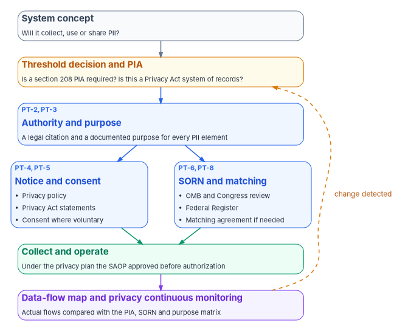
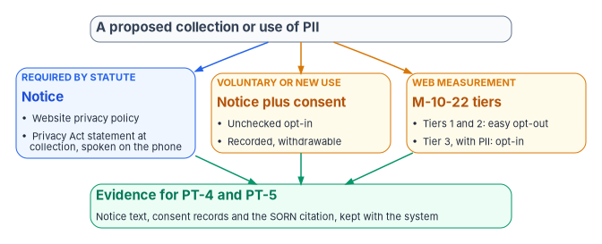

# Chapter 08 — Privacy: PII Processing and Transparency

*Privacy compliance is a public promise about why the agency holds each kind of personal information and under what authority, and the work is keeping that promise true as systems change.*

::: {.callout-note}
## In this chapter
The NIST SP 800-53 PII processing and transparency controls, PT-1 through PT-8, and the privacy baseline they sit in. The legal frame behind them: the Privacy Act, OMB Circular A-130 and its Appendix II, OMB Circular A-108 on system of records notices, and privacy impact assessments under section 208 of the E-Government Act. The program's templates for authority, purpose, notice and consent, specific categories of PII and the data-flow map, corrected against their primary sources, and who signs what before a system that processes PII goes live.
:::

A system that processes personally identifiable information (PII) carries obligations that the security baseline doesn't cover. Encryption and access control protect PII from people who shouldn't have it. The privacy controls ask a different set of questions: by what authority does the agency collect this at all, for what purpose, did it tell the person, did it publish the system in the *Federal Register*, does it hold more than it needs, and does it still use the data only for the purposes it announced? Those questions are answered by documents the public can read and by records that show the documents match the system.

Two facts set the scope. First, NIST's privacy baseline "is applied to systems irrespective of impact level."[^c08-sp80053b] A Moderate system and a Low system that hold the same PII carry the same privacy controls. Second, none of the PT controls carries a FedRAMP class; FedRAMP's Rev5 control reference lists the family without class membership,[^c08-fedramp-pt] and none of the ten themes of FedRAMP's 2026 Key Security Indicators is a privacy theme.[^c08-ksi] A cloud provider's certification doesn't close the agency's privacy controls. They are the agency's, end to end, and the privacy office and the system owner close them together.

{#fig-ch08-privacy-artifacts fig-alt="Top to bottom. A slate card, system concept: will it collect, use or share PII? It leads to an amber card, threshold decision and PIA: does section 208 require a PIA, is this a Privacy Act system of records. That leads to a blue card, authority and purpose, PT-2 and PT-3: a legal citation and a documented purpose for every PII element. That leads to two cards side by side: a blue card, notice and consent, PT-4 and PT-5, a privacy policy, Privacy Act statements at collection and consent where collection is voluntary; and a blue card, SORN and matching, PT-6 and PT-8, OMB and Congress review, then the Federal Register. Both lead to a green card, collect and operate, under the approved privacy plan. A violet card, the data-flow map and privacy continuous monitoring, compares actual flows with the published artifacts; a dashed arrow labelled change detected returns from it to the threshold decision."}

## The PT family

NIST SP 800-53 Rev. 5 groups the PII-specific transparency controls in the PT family. Every base control and the enhancements marked below are in the privacy baseline.[^c08-sp80053][^c08-sp80053b]

| Control | What it asks for |
|---|---|
| PT-1 Policy and Procedures | A PII processing and transparency policy and procedures, an official who manages them, and scheduled reviews |
| PT-2 Authority to Process PII | Determine and document the authority that permits each kind of processing, and restrict processing to what is authorized; enhancements tag data with its authorized processing (PT-2(1)) and enforce it automatically (PT-2(2)) |
| PT-3 PII Processing Purposes | Identify and document the purposes, describe them in public notices and policies, restrict processing to compatible purposes, and monitor changes in processing |
| PT-4 Consent | Mechanisms for individuals to consent to processing before collection that support informed decisions |
| PT-5 Privacy Notice | Notice on first interaction, in plain language, identifying the authority and purposes; PT-5(2) requires Privacy Act statements on forms that feed a system of records |
| PT-6 System of Records Notice | Draft SORNs to OMB guidance, submit new and significantly modified SORNs to OMB and Congress for advance review, publish them in the *Federal Register* and keep them accurate; PT-6(1) reviews routine uses and PT-6(2) reviews exemption rules on a set schedule |
| PT-7 Specific Categories of PII | Defined processing conditions for specific categories; PT-7(1) covers Social Security numbers and PT-7(2) prohibits processing information about how a person exercises First Amendment rights except where authorized |
| PT-8 Computer Matching Requirements | For a matching program: Data Integrity Board approval, a computer matching agreement, a *Federal Register* notice, independent verification before adverse action, and notice and an opportunity to contest |

: The PT family. Base controls PT-1 to PT-8 and enhancements PT-5(2), PT-6(1), PT-6(2), PT-7(1) and PT-7(2) are in the NIST privacy baseline; PT-2(1), PT-2(2), PT-3(1), PT-3(2), PT-4(1) to PT-4(3) and PT-5(1) are not. {.striped .hover}

Source: NIST's catalog, release 5.2.0, and its privacy baseline profile.[^c08-sp80053][^c08-sp80053b]

The PT family isn't the whole privacy baseline. It also carries program controls such as PM-18 (privacy program plan), PM-19 (privacy program leadership role) and PM-5(1) (inventory of PII), and RA-8 (privacy impact assessments), among others.[^c08-sp80053b] Two corrections to the source follow from that. The source called its PT-1 template a "Privacy Program Plan"; the privacy program plan is PM-18, an agency-level document, while PT-1 is the policy and procedures for this family. The source also covered only six of the eight PT controls; it left out PT-6 and PT-8, which are where the Privacy Act's publication and matching rules land. This chapter covers all eight. The agency-level program controls belong to [Chapter 05](05-program-management-controls.md).

## The legal frame

The PT controls restate obligations that already exist in law and OMB policy. The assessor's question is whether the agency meets those obligations, so it helps to know where each comes from.

- **The Privacy Act of 1974.** A *system of records* is a group of records under an agency's control "from which information is retrieved by the name of the individual" or by an identifying number or symbol assigned to the individual.[^c08-privacy-act] For such a system the Act requires the agency to tell each person it asks for information, on the collection form or a separate form the person can keep, the authority for the request and whether disclosure is mandatory or voluntary, the principal purposes, the routine uses, and the effects of not providing the information (subsection (e)(3)); to publish a notice describing the system in the *Federal Register* (e)(4); to keep no record of how a person exercises First Amendment rights unless authorized (e)(7); and to publish any new use at least 30 days in advance and invite comment (e)(11).[^c08-privacy-act] Subsection (r) requires advance notice of new or significantly changed systems and matching programs to OMB and to the House and Senate oversight committees, and subsection (u) requires every agency that runs a matching program to have a Data Integrity Board.[^c08-privacy-act]
- **Section 208 of the E-Government Act of 2002.** It requires a privacy impact assessment before an agency develops or procures IT that collects identifiable information about the public, or starts a new electronic collection from ten or more people, and it requires privacy policies on agency websites, including policies in machine-readable formats. OMB Memorandum M-03-22 implements it and reproduces the section's text.[^c08-m0322]
- **OMB Circular A-130.** Agencies must designate a Senior Agency Official for Privacy (SAOP), limit PII to what is authorized, relevant and necessary, "take steps to eliminate unnecessary collection, maintenance, and use of Social Security numbers," conduct PIAs, and post privacy policies on websites, mobile applications and other digital services.[^c08-a130] Appendix II sets out how agencies manage PII, including the Fair Information Practice Principles, a PII inventory, and PIAs as an analysis that continues "throughout the information system and PII life cycles," not a one-time milestone.[^c08-a130] Appendix I makes the SAOP review and approve the privacy plans for agency systems "prior to authorization, reauthorization, or ongoing authorization," and review authorization packages for systems that handle PII before the authorizing official decides.[^c08-a130]
- **OMB Circular A-108.** It governs how agencies write, report and publish SORNs, matching notices and Privacy Act statements, and how they review their privacy controls.[^c08-a108]
- **OMB Memorandum M-17-12.** It sets how agencies prepare for and respond to a breach of PII, including a breach response plan and an SAOP-led tabletop exercise "not less than annually."[^c08-m1712]

[Book 03, Appendix B](../b03-hr-identity/appendix-b-security-and-privacy.md) applies this frame to one concrete flow, personnel data moving from the HR system into the directory, and is a worked example of everything below.

## Authority to process (PT-2)

PT-2 asks the agency to determine and document the authority for each kind of processing and to process nothing more.[^c08-sp80053] The program keeps that as a matrix, one row per category of PII. The rule that makes it useful is that each row names a specific statute, executive order or regulation; "general mission authority" isn't enough, and agency counsel signs each citation.

| PII category | Legal basis | Citation | Retention | Disposal |
|---|---|---|---|---|
| [Category, e.g., Social Security number] | Statute / executive order / regulation / voluntary | [Specific citation, from counsel] | [Records schedule item] | [Method, e.g., NIST SP 800-88 purge] |
| [Name and date of birth] | [Basis] | [Citation] | [Schedule item] | [Method] |
| [Contact information collected for optional notifications] | Voluntary | [Citation for the program; consent recorded] | [Schedule item] | [Method] |
| [Additional category] | [Basis] | [Citation] | [Schedule item] | [Method] |

: Authority-to-process matrix. Template; program design. {.striped .hover}

The source's sample rows carried fixed retention periods ("7 years post-case closure," "5 years post-determination"). They aren't carried. Retention comes from the records schedule that covers the record, which A-130 requires agencies to follow,[^c08-a130] and the matrix cites the schedule item rather than a number.

### System of records notices (PT-6)

If the system retrieves records by a name or other personal identifier, it is a Privacy Act system of records and needs a published SORN, either the agency's own or a government-wide one that covers it.[^c08-privacy-act][^c08-a108] The source got the timeline wrong. It described a "40-day advance review" and attributed it to A-108. The actual sequence has three parts:

1. **Report to OMB and Congress.** A-108 requires agencies to report a proposal to establish or significantly modify a system of records "at least 30 days prior to the submission of the notice to the Federal Register." OMB has 30 days to comment, and that review period "may not run concurrently with" the *Federal Register* publication period. Only significant changes are reported.[^c08-a108]
2. **Publish.** The SORN is published in the *Federal Register* (subsection (e)(4)).[^c08-privacy-act]
3. **Comment on routine uses.** New or significantly modified routine uses need a 30-day public comment period after publication before they take effect.[^c08-privacy-act][^c08-a108]

Plan on at least 60 days from the report to OMB and Congress before a new system can collect under a new routine use, and longer if OMB extends its review. A-108 lists the kinds of change that count as significant, including a change that substantially increases who can access the information and a new or significantly changed routine use, and it requires every SORN to stay "accurate, up-to-date, and appropriately scoped."[^c08-a108] The source's "review every three years" cadence isn't an OMB rule and isn't carried; PT-6(1) and PT-6(2) leave the review frequency to the agency, and the program sets it in the privacy continuous monitoring strategy described below.[^c08-sp80053]

| System of records | SORN | *Federal Register* citation | Published | Routine uses last reviewed | Exemptions last reviewed |
|---|---|---|---|---|---|
| [System name] | [Agency or government-wide SORN identifier] | [Volume FR page, date] | [Date] | [Date] | [Date] |

: SORN register for systems in the authorization boundary. Template; program design. {.striped .hover}

If a SORN doesn't exist yet, the gap goes on the plan of action and milestones with a milestone that leaves room for the full sequence above before the first collection.

## Purposes (PT-3)

PT-3 asks the agency to document the purposes for processing, describe them publicly, restrict processing to compatible purposes, and watch for changes.[^c08-sp80053] The program records purpose at the level of individual data elements, because that's where purpose creep happens: a field collected for one job gets reused for another.

| PII element | Collection purpose | Secondary use permitted? | Authorization for secondary use | Minimization action |
|---|---|---|---|---|
| [SSN] | [Unique identification where a statute requires it] | [No] | — | [Display last four digits; store full value encrypted; exclude from external APIs] |
| [Name] | [Identification and correspondence] | [Yes, if a routine use or agreement covers it] | [Routine use number in the SORN; agreement reference] | [Limit to what each use needs] |
| [Date of birth] | [Eligibility check] | [Only in de-identified form] | [Authority] | [Not returned by APIs unless required] |
| [Email address] | [Optional notifications] | [No] | Consent at enrollment | [Withdrawable at any time] |

: Purpose specification matrix. Template; program design. {.striped .hover}

A use not in the matrix needs a PIA update and, for a system of records, may need a SORN change before it starts.[^c08-a108] Once a year, and whenever the data-flow map changes, the owner checks that every PII element in the data dictionary appears in the matrix, that no element is used for an unlisted purpose, that secondary uses still match the SORN and any agreements, and that new elements were assessed for purpose and minimization. The SAOP signs the result. That cadence is program design.

### Tagging purpose in the data catalog

PT-2(1) and PT-3(1), outside the privacy baseline, suggest tagging data elements with their authorized processing and purposes.[^c08-sp80053] The source mapped its purpose fields to "Purview Data Map custom attributes" and said they enforced purpose limits as DLP conditions. That overstates what the catalog does. In Microsoft Purview, managed attributes are key-value pairs that add structured metadata to cataloged assets so people can find and filter them.[^c08-purview-attr] They describe an asset; they don't block anything. Enforcement comes from sensitivity labels and data loss prevention policies, which [Book 12, Chapter 09](../b12-security-operations/09-data-protection-and-classification.md) builds. The program records collection purpose, legal authority and the minimization rule as managed attributes for traceability, and enforces through labels and DLP.

## Notice and consent (PT-4, PT-5)

Most federal collections rest on a statute, not on consent. When a statute authorizes the collection, the person doesn't have to agree for it to be lawful, but the person must still be told. Consent comes into play for collection that is voluntary, for a use beyond the original authority, and for web measurement that tracks people across sessions. PT-4 asks for consent mechanisms where they apply; PT-5 asks for notice in every case.[^c08-sp80053]

{#fig-ch08-notice-or-consent fig-alt="Top: a slate card, a proposed collection or use of PII. It splits three ways. Left, a blue card, required by statute or executive order: notice, the website privacy policy and, if the data enters a system of records, a Privacy Act statement at the point of collection. Middle, an amber card, voluntary collection or a use beyond the original authority: notice plus recorded consent with a way to withdraw. Right, an amber card, web measurement: single-session or multi-session without PII allows an easy opt-out; multi-session with PII, Tier 3, requires opt-in. All three lead to a green card at the bottom: the notice text, the consent records and the SORN citation are kept as evidence for PT-4 and PT-5."}

### Privacy Act statements

When the agency asks people for information that will go into a system of records, it gives them a Privacy Act statement on the form or on a separate form they can keep, whether the collection happens on paper, a website, a mobile app or the telephone; for telephone collection the agency reads the statement aloud and offers it in writing.[^c08-a108] A-108 requires five elements in plain language: the authority and whether disclosure is mandatory or voluntary, the principal purposes, the published routine uses, the effects of not providing the information, and a citation to the relevant SORN, with a link where practicable.[^c08-a108] The source attributed the required elements to M-03-22. Their origin is subsection (e)(3) of the Privacy Act, and A-108 adds the SORN citation.[^c08-privacy-act][^c08-a108]

A model statement the program adapts per form (the bracketed text is filled in by the system owner and approved by counsel and the SAOP):

> **Privacy Act Statement.** *[System name], [program office], [agency name].*
> **Authority:** [Statute or executive order that authorizes the collection].
> **Purpose:** We collect this information to [principal purpose]. [We may also use it to (secondary purpose authorized by the SORN).]
> **Routine uses:** We may share this information outside [agency name] as the Privacy Act permits, including [plain-language summary of the main routine uses]. The full list is in [SORN identifier], [*Federal Register* citation], at [link].
> **Disclosure:** Providing [specific item] is [mandatory under (citation) / voluntary]. [If you don't provide it, (effect).] [There is no penalty for not providing it.]

A-108 lets agencies summarize the routine uses in plain language and link to the full list rather than reprint it.[^c08-a108]

### Website privacy policies and web measurement

Section 208 and M-03-22 require a privacy policy on agency websites. M-03-22 tells agencies to call the general notice the "Privacy Policy"; to say when providing information is voluntary and how to consent to its use; to explain visitors' rights under the Privacy Act and other privacy laws; to explain which information is kept in a system of records and provide a Privacy Act statement at the point of collection or through a link; and to say what the site collects automatically and why.[^c08-m0322] The source cited "E-Gov Act §208(b)(1)" for the website privacy policy; subsection (b) is the PIA requirement, and website privacy policies are in subsection (c).[^c08-m0322] The source also said FedRAMP's 2026 rules require a machine-accessible privacy notice URL in the agency's package. No such FedRAMP rule was found and the claim isn't carried. The machine-readable requirement that does exist is section 208's, for website privacy policies.[^c08-m0322] Publishing the policy at a stable URL and checking it in each annual review is program design.

Web analytics are governed by OMB Memorandum M-10-22, which replaced M-03-22's tracking rules. It defines three tiers: single-session technologies (Tier 1), multi-session without PII (Tier 2) and multi-session with PII (Tier 3). Agencies must not use measurement technologies "from which it is not easy for the public to opt-out," must use opt-in for Tier 3, need SAOP review, a 30-day public comment period and written CIO approval before a new Tier 3 use, and should keep the data one year or less unless a law, policy or specific need requires longer.[^c08-m1022] The source's "cookie consent banner" for analytics is stricter than M-10-22 requires for Tiers 1 and 2, where an easy opt-out is the rule; the program uses opt-in only where the tier requires it or the agency chooses to.

### The consent matrix

| Data source | Interaction | Statutory authority? | Consent needed? | Mechanism | Withdrawal |
|---|---|---|---|---|---|
| Public web form, program application | Statutory collection into a system of records | Yes | No; notice and Privacy Act statement | Statement shown before the form | Not applicable |
| Public portal, optional notifications | Voluntary | No (for this element) | Yes | Unchecked opt-in box naming what is collected, how it's used, and that it's voluntary | Account settings, effective immediately |
| Contact center, call recording | Collection by telephone | Depends on the program | If voluntary, yes | Spoken notice at the start of the call; statement offered in writing | Caller ends the call |
| Web analytics | Tier 1 or 2 measurement | Not applicable | No; easy opt-out | Privacy policy explains; opt-out offered | Opt-out |
| Web analytics with PII | Tier 3 measurement | Not applicable | Yes; opt-in | Opt-in before collection | Revoke opt-in |
| Data received from another agency | Interagency exchange | Through the sending agency's SORN and routine use | No; the agreement governs | Agreement on file; routine use confirmed | Governed by the source SORN |
| Employee records | Employment | Yes | No | Privacy Act statements on the personnel forms | Not applicable |

: Consent mechanism matrix. Program design, with the web rows from M-10-22 and the telephone row from A-108. {.striped .hover}

Sources for the web and telephone rows: M-10-22 and A-108.[^c08-m1022][^c08-a108] A pre-checked box is not a choice; the opt-in control starts unchecked. That is program design, consistent with PT-4's requirement that consent mechanisms support informed decisions.[^c08-sp80053]

## Specific categories of PII (PT-7)

PT-7 lets the agency define stronger conditions for specific categories of PII and names two in its enhancements.[^c08-sp80053]

- **Social Security numbers, PT-7(1).** Eliminate unnecessary collection, maintenance and use and explore alternatives; don't deny any right, benefit or privilege because a person won't disclose an SSN; and tell anyone asked for an SSN whether disclosure is mandatory or voluntary, under what authority, and how it will be used.[^c08-sp80053] The second and third duties come from section 7 of the Privacy Act, which applies to federal, state and local agencies.[^c08-privacy-act] A-130 carries the first.[^c08-a130] The Social Security Number Fraud Prevention Act of 2017 adds that an agency may not include an SSN on any document sent by mail unless the agency head determines it's necessary; the prohibition has applied since September 15, 2022.[^c08-ssn-mail]
- **First Amendment information, PT-7(2).** Prohibit processing information about how a person exercises First Amendment rights unless a statute or the person authorizes it, or it is within an authorized law enforcement activity, which is subsection (e)(7) of the Privacy Act.[^c08-sp80053][^c08-privacy-act]

::: {.callout-important}
## Correction: the SSN authority is not M-17-12
The source attributed its SSN rules (eliminate SSNs as identifiers, display only the last four digits, minimize collection) to OMB M-17-12. M-17-12 governs breach preparation and response.[^c08-m1712] The SSN reduction duty is in A-130 and PT-7(1), the disclosure notice is section 7 of the Privacy Act, and the mailing restriction is the 2017 Act.[^c08-a130][^c08-privacy-act][^c08-ssn-mail] Truncating SSNs to the last four digits on screens is a sound program design rule, not a quoted federal requirement.
:::

The source's table of "special categories" cited authorities that don't say what it claimed (it attributed biometric and geolocation protections to memoranda on other subjects). The program replaces it with one rule: the categories that get heightened protection are those PT-7's enhancements name, plus those counsel identifies from statutes that apply to the program. Health information is the common case; the HIPAA Privacy Rule applies to covered entities and, for a covered entity's protected health information, to business associates,[^c08-hipaa] so whether it applies to a given flow is a determination counsel records in the data-flow map.

| Category | Classification label (example) | Protection | Access | Logging |
|---|---|---|---|---|
| SSN, full | Restricted | Encrypted at rest with an agency-controlled key; never in logs or external API responses | Named roles only; no standing service-account access | Every read and write |
| SSN, last four digits | Confidential | Standard encryption | Standard roles | Standard audit |
| Financial account numbers | Restricted | Encrypted; never logged in clear text | Payment roles; dual approval for changes | Every access, with an alert threshold |
| Health information | Restricted | Encrypted; field-level where practical | Roles scoped to assigned cases | Every access |
| Biometric data | Restricted | Encrypted separately from application data | System identity only; no routine human reads of raw data | Alert on any human read |
| First Amendment information | Not collected unless authorized | — | — | — |

: Specific-category control matrix. Program design; label names follow the agency's taxonomy from Book 12 Chapter 09. {.striped .hover}

Automatic labeling finds these categories in content. Microsoft Purview ships built-in sensitive information types for U.S. Social Security numbers, credit card numbers and U.S./U.K. passport numbers, among others.[^c08-purview-sit] [Book 12, Chapter 09](../b12-security-operations/09-data-protection-and-classification.md) maps them to labels and DLP policies; this chapter only requires that every category in the matrix has a matching classifier and policy, and that the PIA says which.

| Display location | Format | Full SSN accessible? | Justification |
|---|---|---|---|
| Public account page | Last four digits | No | Confirmation only |
| Case header | Last four digits | No | Case association |
| Identity verification screen | Full | Yes, with a role | Identity match required by [authority] |
| External API responses | Never included | Not applicable | Excluded from every schema |

: SSN display register for a system. Template; program design. {.striped .hover}

## The data-flow map

Every PT control assumes the agency knows where its PII goes. A-130 Appendix II requires privacy programs to "maintain an inventory of PII" and regularly review it,[^c08-a130] and PM-5(1) asks for an inventory of the systems and components that process PII.[^c08-sp80053] The data-flow map is the program's form of that inventory at system level: one row per flow from source to destination, reviewed against the SORN, the PIA and the purpose matrix.

| Flow | Source | PII | Purpose | Destination | Leaves the boundary? | In transit | At rest | Retention | Disposal |
|---|---|---|---|---|---|---|---|---|---|
| F-001 | Public web form | Name, date of birth, SSN, address, contact details | Application intake | Case management system | No | TLS | Encrypted with an agency-controlled key | [Schedule item] | [Method] |
| F-002 | Case management | SSN, case data | Determination | Adjudication system | No | TLS | Encrypted | [Schedule item] | [Method] |
| F-003 | Contact center | Name, last four of SSN, case number, recording | Service | Customer relationship system | No | TLS | Encrypted | [Schedule item] | [Method] |
| F-004 | Case management | [Elements] | [Purpose under a routine use or matching agreement] | Another federal agency | Yes | TLS with mutual authentication | Per the agreement | Per the agreement | Per the agreement |
| F-005 | HR system | Employee PII | Workforce administration | Directory and payroll services | Depends on the provider | TLS | Encrypted | [Schedule item] | [Method] |

: PII data-flow register. Template; program design. The source's rows named specific programs and partner agencies and aren't carried. {.striped .hover}

The program requires four scenarios in every map before the authorizing official decides, wherever they apply: public intake, from the first form through case creation, with the notice shown before any PII is entered; contact center, including recordings, screen pops and the customer relationship system; HR and workforce flows, checked against the governing personnel SORN ([Book 03, Appendix B](../b03-hr-identity/appendix-b-security-and-privacy.md)); and every interagency exchange. That requirement is program design.

For an interagency exchange the first question is whether it's a *matching program* under the Privacy Act. If it is, PT-8 applies: Data Integrity Board approval, a computer matching agreement, a published matching notice, independent verification before any adverse action, and notice and a chance to contest.[^c08-sp80053][^c08-privacy-act] A-108 sets the matching notice process, which mirrors the SORN process with its own 30-day advance reporting to OMB and Congress.[^c08-a108] If it isn't, the exchange rests on a routine use in the sending agency's SORN and an agreement between the agencies, and the receiving agency confirms the routine use covers its use before data flows.

### What automated discovery adds

The source said Purview's lineage scan "provides automated discovery of data flows." It provides less than that, and the difference matters. Data Map scans capture metadata from registered sources (names, schemas, classifications), and lineage arrives from connected transformation services such as Azure Data Factory and Azure Synapse, which report the sources and outputs of the pipelines they run.[^c08-purview-scan] A file exported by hand, an API call between applications or a flow through a service Purview doesn't connect to won't appear. The program uses the scans to find gaps in the manual map, not to replace it: each quarter it compares scan results with the register, and every flow found by the scan but missing from the register is investigated, documented or stopped before the next annual review. The record of each comparison (date, reviewer role, flows found, resolved and accepted) is evidence for PT-3 and PM-5(1).

## Privacy impact assessments

A PIA is required before the agency develops or procures IT that collects, maintains or disseminates identifiable information about members of the public, or starts a new electronic collection from ten or more people, and it must be updated when a change creates new privacy risk.[^c08-m0322] M-03-22 lists the usual triggers: converting paper records to electronic systems, making anonymous information identifiable, significant changes in how a system manages identifiable information, merging databases, newly applying authentication technology to a system the public uses, systematically incorporating commercial data, new interagency uses, significant new internal uses, and adding data that raises the risk, such as health or financial information.[^c08-m0322] Systems that hold information only about government personnel and contractors fall outside the statutory requirement,[^c08-m0322] and many agencies assess them anyway; the program does.

A-130 treats the PIA as a living analysis, conducted with program managers, system owners, security officials and counsel, that continues through the system's life.[^c08-a130] The source's milestone table began with a "privacy threshold analysis" to decide whether a PIA is needed. That is common agency practice, not an OMB-defined step, and the program keeps it as its own intake form. RA-8, in the privacy baseline, asks for PIAs before developing or procuring IT that processes PII and before new collections.[^c08-sp80053]

## Assessment and monitoring

A-108 replaced OMB's old requirement for annual Privacy Act reviews with privacy continuous monitoring: agencies select privacy controls during system development, then "monitor and assess privacy controls ... on an ongoing basis," at a rigor and frequency that keeps up with changing risk.[^c08-a108] At a minimum the controls must keep information minimized to what a purpose requires, keep SORNs accurate and published with significant changes reported, and keep routine uses compatible with the original purpose.[^c08-a108] The SAOP approves each system's privacy plan before authorization and reviews the package before the authorizing official decides.[^c08-a130]

The program's privacy continuous monitoring strategy sets these cadences. They are program design within the A-108 and A-130 requirements:

| Activity | Owner | Cadence | Evidence |
|---|---|---|---|
| PIA review | System privacy officer | On any change that triggers one; at least annually | Updated PIA |
| SORN, routine-use and exemption review (PT-6(1), PT-6(2)) | Counsel and SAOP | Annually and on significant change | Review record; revised SORN if needed |
| Purpose matrix check (PT-3) | System privacy officer | Annually and on data-flow change | Signed checklist |
| Data-flow comparison with scan results | Data owner and privacy officer | Quarterly | Comparison record |
| Privacy notice and Privacy Act statement check | Web owner and privacy officer | Annually and on change | Captured notice text and URL check |
| Breach response tabletop | SAOP | At least annually (M-17-12) | After-action report |
| Privacy control assessment | ISSO and assessor | With the security assessment cycle | Privacy section of the assessment report |

: Privacy continuous monitoring cadences. Program design, except the tabletop frequency, which M-17-12 sets. {.striped .hover}

The breach tabletop frequency is M-17-12's.[^c08-m1712] Breach response itself is an incident-response subject ([Book 12, Chapter 11](../b12-security-operations/11-detection-engineering-and-response.md)).

## Before a system that processes PII goes live

| Milestone | What has to be true | When | Owner |
|---|---|---|---|
| Threshold decision | Whether a PIA is required and whether the system is a system of records | At concept approval | System privacy officer |
| PIA | Drafted with the design; updated before go-live | Before design is final and again before go-live | SAOP and system privacy officer |
| SORN | Reported to OMB and Congress at least 30 days before submission to the *Federal Register*; published; routine-use comment period closed | Start at least 60 days before the first collection under a new routine use | Counsel and SAOP |
| Matching agreement and notice | Board approval, agreement, published notice, if a matching program | Before any match | Data Integrity Board |
| Authority and purpose matrices | Complete for every element, citations signed by counsel | Before the package goes to the SAOP | System privacy officer and counsel |
| Privacy notices | Website policy published; Privacy Act statements on every collection form and script | Before go-live | Web owner and SAOP |
| Data-flow map | Every applicable scenario documented and compared with scan results | Before the authorization decision | Data owner and system privacy officer |
| Privacy plan | Approved by the SAOP | Before authorization | SAOP |

: Privacy milestones before go-live. Program design built on the cited requirements. {.striped .hover}

The SORN timing and SAOP approval come from A-108 and A-130.[^c08-a108][^c08-a130] [Chapter 11](11-the-authorization-package.md) shows where the privacy artifacts sit in the authorization package.

## Who owns what

| Role | Owns |
|---|---|
| Senior Agency Official for Privacy | The privacy program, PIA and SORN approval, privacy plan approval before authorization, breach response |
| System privacy officer | The system's PT artifacts: authority and purpose matrices, consent matrix, data-flow map, PIA drafts |
| Agency counsel | Legal citations, SORN and routine-use language, matching determinations, HIPAA and other statutory determinations |
| System owner and data owner | Keeping the system matched to the artifacts; reporting changes that trigger a PIA or SORN review |
| ISSO | Privacy controls in the assessment and plan of action |
| Web and communications owner | Privacy policy and notice publication |
| Authorizing official | Accepting residual privacy risk, after the SAOP's review |

: Privacy ownership. Program design, with SAOP duties from A-130. {.striped .hover}

The SAOP duties are A-130's.[^c08-a130] [Chapter 10](10-who-owns-compliance.md) puts these roles in the wider compliance picture.

Privacy closes through documents, not technology. Labels and DLP enforce the purposes and categories the documents define, but no classifier can supply the statutory authority or publish the notice the Privacy Act requires. The program says so plainly, for the same reason it says it about supply chain controls in [Chapter 07](07-supply-chain-risk-management.md).

## What to take from this chapter

1. The privacy baseline applies whatever the impact level, and FedRAMP certification doesn't close it: the PT controls are the agency's.
2. PT-1 is policy and procedures; the privacy program plan is PM-18. PT-6 and PT-8 carry the Privacy Act's publication and matching rules and belong in every privacy review.
3. A new or significantly changed system of records is reported to OMB and Congress at least 30 days before its notice goes to the *Federal Register*, that review can't overlap publication, and new routine uses wait out a 30-day comment period.
4. Privacy Act statements need five elements, including the SORN citation, at every point of collection, including the telephone.
5. A data catalog describes data; labels and DLP enforce rules; neither discovers every flow. The data-flow map, checked against scans each quarter, is what keeps the notices true.

::: {.callout-tip}
## Continue the book
[← Previous: Chapter 07 — Supply Chain Risk Management](07-supply-chain-risk-management.md) · [Book index](index.md) · [Next: Chapter 09 — Training and Awareness Controls →](09-training-and-awareness-controls.md)
:::

[^c08-sp80053]: National Institute of Standards and Technology, SP 800-53 Rev. 5, *Security and Privacy Controls for Information Systems and Organizations*, release 5.2.0, controls PT-1 through PT-8 with enhancements, PM-5(1), PM-18 and RA-8, OSCAL catalog, <https://github.com/usnistgov/oscal-content/tree/main/nist.gov/SP800-53/rev5> (accessed Oct 21, 2026).
[^c08-sp80053b]: National Institute of Standards and Technology, SP 800-53B, *Control Baselines for Information Systems and Organizations*, September 2020, updated December 10, 2020 (abstract: the privacy baseline "is applied to systems irrespective of impact level"), <https://csrc.nist.gov/pubs/sp/800/53/b/upd1/final>; and the privacy baseline profile in OSCAL, <https://github.com/usnistgov/oscal-content/tree/main/nist.gov/SP800-53/rev5/json> (both accessed Oct 21, 2026).
[^c08-fedramp-pt]: FedRAMP, "Personally Identifiable Information Processing and Transparency (PT)," Full Rev5 Control Reference, *FedRAMP Consolidated Rules for 2026* (no FedRAMP Rev5 baseline class listed for any PT control), <https://www.fedramp.gov/2026/reference/controls/personally-identifiable-information-processing-and-transparency/> (accessed Oct 21, 2026).
[^c08-ksi]: FedRAMP, "Key Security Indicators," FedRAMP 20x Certification Rules, *FedRAMP Consolidated Rules for 2026* (the ten themes), <https://www.fedramp.gov/2026/providers/20x/key-security-indicators/> (accessed Oct 21, 2026).
[^c08-privacy-act]: Privacy Act of 1974, 5 U.S.C. § 552a, subsections (a)(5), (e)(3), (e)(4), (e)(7), (e)(11), (o), (r) and (u), and section 7 of Pub. L. 93-579 (disclosure of Social Security numbers) in the statutory notes, <https://www.law.cornell.edu/uscode/text/5/552a> (accessed Oct 21, 2026).
[^c08-m0322]: Office of Management and Budget, M-03-22, *OMB Guidance for Implementing the Privacy Provisions of the E-Government Act of 2002*, September 26, 2003 (section II.B, when to conduct a PIA, and the note on government personnel; section III, privacy policies on agency websites; Attachment A, text of section 208, including subsection (c) on website privacy policies and machine-readable formats), <https://georgewbush-whitehouse.archives.gov/omb/memoranda/m03-22.html> (accessed Oct 21, 2026).
[^c08-a130]: Office of Management and Budget, Circular A-130, *Managing Information as a Strategic Resource*, July 28, 2016 (section 5.f.1, privacy; Appendix I, section 4(e), SAOP responsibilities including privacy plan approval before authorization; Appendix II, sections 3, 5.b and 5.e, Fair Information Practice Principles, PII inventory, PIAs), <https://www.whitehouse.gov/wp-content/uploads/legacy_drupal_files/omb/circulars/A130/a130revised.pdf> (accessed Oct 21, 2026).
[^c08-a108]: Office of Management and Budget, Circular A-108, *Federal Agency Responsibilities for Review, Reporting, and Publication under the Privacy Act* (section 6, publishing SORNs, including significant changes, routine-use comment periods and Privacy Act statements in 6.l; section 7, reporting to OMB and Congress; sections 8 and 9, matching notices; section 12, privacy continuous monitoring), <https://www.whitehouse.gov/wp-content/uploads/legacy_drupal_files/omb/circulars/A108/omb_circular_a-108.pdf> (accessed Oct 21, 2026).
[^c08-m1712]: Office of Management and Budget, M-17-12, *Preparing for and Responding to a Breach of Personally Identifiable Information*, January 3, 2017 (section X, tabletop exercises and annual plan reviews), <https://www.whitehouse.gov/wp-content/uploads/legacy_drupal_files/omb/memoranda/2017/m-17-12_0.pdf> (accessed Oct 21, 2026).
[^c08-m1022]: Office of Management and Budget, M-10-22, *Guidance for Online Use of Web Measurement and Customization Technologies*, June 25, 2010 (usage tiers; clear notice and personal choice; data retention limits; rescission of M-03-22 section III(D)(2)(v)), <https://obamawhitehouse.archives.gov/sites/default/files/omb/assets/memoranda_2010/m10-22.pdf> (accessed Oct 21, 2026).
[^c08-ssn-mail]: Social Security Number Fraud Prevention Act of 2017, Pub. L. 115-59, September 15, 2017, <https://www.govinfo.gov/content/pkg/PLAW-115publ59/html/PLAW-115publ59.htm> (accessed Oct 21, 2026).
[^c08-hipaa]: 45 C.F.R. § 164.500, "Applicability," Subpart E, Privacy of Individually Identifiable Health Information, <https://www.law.cornell.edu/cfr/text/45/164.500> (accessed Oct 21, 2026).
[^c08-purview-attr]: Microsoft Learn, "Managed attributes in Microsoft Purview Data Map," <https://learn.microsoft.com/purview/legacy/how-to-managed-attributes> (accessed Oct 21, 2026).
[^c08-purview-scan]: Microsoft Learn, "Scans and ingestion in Data Map" (scanning captures technical metadata and applies classifications; lineage ingested from connected resources such as Azure Data Factory and Azure Synapse), <https://learn.microsoft.com/purview/data-map-scan-ingestion> (accessed Oct 21, 2026).
[^c08-purview-sit]: Microsoft Learn, "Sensitive information type entity definitions," <https://learn.microsoft.com/purview/sit-sensitive-information-type-entity-definitions> (accessed Oct 21, 2026).
