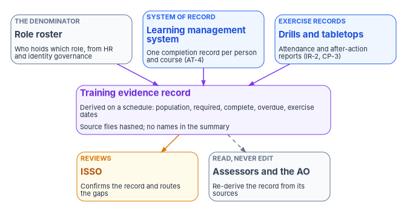
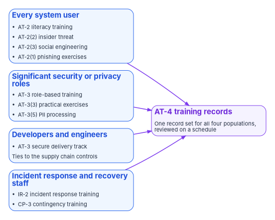

# Chapter 09 — Training and Awareness Controls

*Training is the one control family that no configuration can close; it closes when the right people have been trained for the roles they actually hold, and the record proves it.*

::: {.callout-note}
## In this chapter
The federal requirements for security and privacy training: FISMA, OMB Circular A-130, OPM's rule at 5 CFR 930.301, and NIST SP 800-50 Rev. 1, which replaced the 2003 guide and SP 800-16 in 2024. Then the controls one by one, with their NIST and FedRAMP baselines stated separately: literacy training with its insider threat and social engineering enhancements, role-based training, incident response and contingency training, and training records. The last part shows how the agency turns those records into evidence an assessor can re-derive, and how a learning management system feeds that evidence. [Book 16](../index.md) covers curriculum, delivery and education in depth. This chapter stays with the controls and their evidence.
:::

Almost every other control in this book closes through something a machine can show. A Conditional Access policy enforces access rules. A logging configuration emits events. A protective DNS resolver blocks known-bad domains. An assessor can read the setting, re-run the query and see the result. Training is different. The awareness and training (AT) family asks whether people know what to do, and the only thing that proves it is a record of who was trained, on what, and when, set against a list of who should have been.

That makes training controls easy to over-claim. A policy that says "all users complete annual training" is an attestation. A dashboard that shows 98 percent completion is a number with no denominator unless someone can say which roster the 98 percent was measured against, where the completions came from, and whether the people in high-risk roles are in the 2 percent who haven't finished. This chapter treats training the way [Book 13](../b13-governance/index.md) treats every control: evidence over attestation, derived from the system that holds the facts, with the derivation repeatable by someone who didn't produce it.

The chapter covers the controls and their evidence. Curriculum design, delivery methods, learning paths for the people who run the program, and how the agency measures whether training changes behavior belong to Book 16, People: Training & Education, which is planned and listed on the [workbook index](../index.md).

{#fig-ch09-training-evidence-chain fig-alt="Three cards across the top feed one violet card in the middle. On the left, a slate card labeled the denominator: the role roster, saying who holds which role, from HR and identity governance. In the center, a blue card labeled system of record: the learning management system, with one completion record per person and course, for AT-4. On the right, a blue card labeled exercise records: drills and tabletops, with attendance and after-action reports, for IR-2 and CP-3. All three send arrows to the violet training evidence record, derived on a schedule with population, required, complete and overdue counts and exercise dates, with source files hashed and no names in the summary. From the record, an amber arrow goes to an amber card, the ISSO, who reviews, confirms the record and routes the gaps, and a dashed arrow goes to a slate card, assessors and the authorizing official, who read but never edit and re-derive the record from its sources."}

## What federal law and policy require

Four layers of requirement sit under the AT controls. They agree on the essentials and differ in age.

**FISMA** makes training part of every agency's information security program. The program must include security awareness training that informs personnel, "including contractors and other users," of the risks associated with their activities and their responsibilities under agency policy. The agency head must make sure the agency has trained personnel sufficient to comply, and the CIO's delegated authority includes training and overseeing personnel with significant responsibilities for information security.[^c09-fisma]

**OMB Circular A-130** turns that into seven obligations. Agencies must run mandatory agency-wide security and privacy awareness and training programs for all employees and contractors, consistent with OMB, NIST and OPM guidance. They must give users foundational and more advanced training and "ensure that measures are in place to test the knowledge level" of users. They must give role-based security and privacy training to people with assigned security and privacy roles, including managers, "before authorizing access" or before they perform their duties. And they must establish rules of behavior, with consequences for violating them, and make sure employees and contractors have read and agreed to them.[^c09-a130] The rules-of-behavior obligation is SP 800-53's PL-4, which asks for a documented acknowledgment before access is granted.[^c09-sp80053]

**OPM's rule at 5 CFR 930.301** is the oldest layer and the most specific about audiences. It requires each executive agency to have a plan for information systems security awareness and training, to identify employees with significant information security responsibilities and give them role-specific training under NIST guidance, and to expose all users of federal information systems, including "employees, contractors, students, guest researchers, visitors," to security awareness materials at least annually. It lists what executives, program and functional managers, CIOs and security staff, and IT operations staff must each be trained in; requires new employees to receive awareness material before they get access; leaves the frequency of refresher training to the agency, based on the sensitivity of the information people use; and requires training when the system environment or procedures change significantly or an employee moves into a role that needs it.[^c09-cfr930] The section dates from June 14, 2004 and has not been amended since. It cites the 2002 FISMA as its authority and points to a NIST publications web address that predates the current site.[^c09-cfr930] Its substance still binds; its pointers are out of date.

**NIST SP 800-50 Rev. 1**, *Building a Cybersecurity and Privacy Learning Program*, published September 2024, is the current guidance those pointers lead to. It superseded the 2003 SP 800-50 and SP 800-16, which NIST withdrew the same day.[^c09-sp80050][^c09-sp80016] It reframes training as a cybersecurity and privacy learning program with a four-phase life cycle (plan and strategy, analysis and design, development and implementation, assessment and improvement), adds privacy as a foundational element, and sends role definitions for cybersecurity work to the NICE Workforce Framework in SP 800-181 Rev. 1.[^c09-sp80050] It divides the audience into three segments: all users, privileged access account holders, and staff with significant cybersecurity or privacy responsibilities.[^c09-sp80050] The source material for this chapter cited SP 800-16 as current; it is not.

Two narrower requirements add content. OMB M-17-12 requires every person with access to federal information or systems to be trained on how to identify and respond to a breach of personally identifiable information, including the agency's internal reporting process, before they get access, and suggests specialized breach training for supervisors and people responsible for high value assets.[^c09-m1712] And Executive Order 13587, signed October 7, 2011, created the Insider Threat Task Force and directed it to issue minimum standards that are "binding on the executive branch."[^c09-eo13587] The task force's minimum standards require insider threat programs to create procedures for initial and recurring employee training, with documentation, and to verify that all cleared employees have completed insider threat awareness training.[^c09-nittf] Those standards govern the agency's insider threat program for classified information. AT-2(2), below, asks for insider threat awareness for every system user. The agency should build one module that satisfies both, and record it once.

## The controls, one by one

The table gives each control's NIST SP 800-53B baseline and FedRAMP 2026 class membership as separate facts, as [Book 13, Appendix A](../b13-governance/appendix-a-requirements-mapping.md) does. An agency system categorized Moderate selects from the NIST column. A FedRAMP Class C cloud service is held to the FedRAMP column. The two agree for most of this family, but not for all of it.

| Control | What it asks | NIST SP 800-53B | FedRAMP 2026 |
|---|---|---|---|
| AT-1, Policy and Procedures | An awareness and training policy and procedures, a designated official to manage them, and review on a defined schedule | L, M, H, Privacy | B, C, D |
| AT-2, Literacy Training and Awareness | Security and privacy literacy training for all system users, including managers, senior executives and contractors, at initial training, at a defined frequency, and when system changes or defined events require it; content updated and incident lessons learned incorporated | L, M, H, Privacy | B, C, D |
| AT-2(1), Practical Exercises | Exercises in literacy training that simulate events and incidents | — | — |
| AT-2(2), Insider Threat | Training on recognizing and reporting potential indicators of insider threat | L, M, H | B, C, D |
| AT-2(3), Social Engineering and Mining | Training on recognizing and reporting potential and actual social engineering and social mining | M, H | C, D |
| AT-3, Role-based Training | Role-based security and privacy training for defined roles before access or duties, at a defined frequency, and on system changes; content updated and lessons learned incorporated | L, M, H, Privacy | B, C, D |
| AT-3(3), Practical Exercises | Practical exercises in role-based training | — | — |
| AT-3(5), Processing Personally Identifiable Information | Initial and recurring training for defined roles on the PII processing and transparency controls | Privacy | — |
| AT-4, Training Records | Document and monitor awareness and role-based training; retain individual training records for a defined period | L, M, H, Privacy | B, C, D |
| AT-6, Training Feedback | Feedback on training results to defined personnel at a defined frequency | — | — |
| IR-2, Incident Response Training | Training consistent with assigned roles within a defined period of assuming the role or gaining access, on system changes and at a defined frequency; content reviewed and updated | L, M, H, Privacy | B, C, D |
| IR-2(1) and IR-2(2), Simulated Events; Automated Training Environments | Simulated events in incident response training; an automated training environment | H | D |
| IR-2(3), Breach | Training on identifying and responding to a breach, including the reporting process | Privacy | — |
| CP-3, Contingency Training | Training consistent with contingency roles within a defined period of assuming the role, on system changes and at a defined frequency; content reviewed and updated | L, M, H | B, C, D |
| CP-3(1), Simulated Events | Simulated events in contingency training | H | D |

Sources: control text from NIST SP 800-53 Rev. 5, release 5.2.0;[^c09-sp80053] NIST baselines from the SP 800-53B Low, Moderate, High and privacy baseline profiles;[^c09-sp80053b] FedRAMP classes from the 2026 Rev5 control reference, which assigns no FedRAMP-specific parameter values to any AT, IR-2 or CP-3 control.[^c09-fedramp-controls]

Three corrections to the source material follow from the table.

- **Two enhancements it claimed to close aren't in any NIST or FedRAMP baseline.** AT-2(1) and AT-3(3), the practical-exercise enhancements, are optional. Phishing simulation and hands-on labs are good practice, and SP 800-50 Rev. 1 recommends experiential learning,[^c09-sp80050] but an agency that adopts them is tailoring them in, not meeting a Moderate requirement.
- **AT-3(5) is a privacy-baseline control, not a Moderate one.** It applies because the system processes PII and the privacy baseline is selected, which is [Chapter 08](08-privacy-pii-processing.md)'s ground.
- **AT-2(3) was missing.** Social engineering and mining is in NIST's Moderate baseline and FedRAMP Classes C and D. The source's awareness content covered phishing and social engineering but never claimed the control, so the control-closure table omitted one of the Moderate requirements it actually met.

Most of these controls leave the frequencies and time periods to the organization. Neither NIST nor FedRAMP sets "annual" for AT-2, AT-3, IR-2 or CP-3. The annual floor for awareness comes from 5 CFR 930.301,[^c09-cfr930] and the "before access" rule from A-130, AT-2, AT-3 and M-17-12.[^c09-a130][^c09-m1712] Every other number in this chapter is the agency's to define, and the program's suggested values are labeled as design.

## Literacy training and awareness (AT-2)

AT-2 covers everyone who uses the system, and its first requirement is timing. Training happens as part of initial training for new users, before access under A-130 and OPM's rule, then at the agency's frequency, which can't be less often than annually for awareness, and again when a system change or a defined event calls for it.[^c09-sp80053][^c09-cfr930] SP 800-50 Rev. 1, quoting SP 800-53's discussion of AT-2, notes that subsequent literacy training can be one or more short ad hoc sessions on recent attack schemes or policy changes rather than a repeat of the full course.[^c09-sp80050]

The program's awareness content, by design, covers these modules. The controls each one helps evidence are in the right-hand column.

| Module | Content | Controls it evidences |
|---|---|---|
| Zero trust and the agency's access model | Why access is verified each time; phishing-resistant sign-in; what a user should expect to be asked | AT-2 |
| Phishing and social engineering | Recognizing pretexts in email, phone and chat; help desk impersonation; reporting with the built-in report button | AT-2, AT-2(3) |
| Authentication hygiene | Phishing-resistant methods, why SMS codes are a fallback, never approving an unexpected prompt | AT-2, IA-5 |
| Insider threat | Behavioral indicators, reporting obligations, the agency's insider threat program | AT-2(2) |
| Data handling | Controlled unclassified information markings, sensitivity labels, sharing rules | AT-2 |
| Breach and incident reporting | What a suspected breach is, how and to whom to report it, at once | AT-2, IR-2(3) where selected |
| Rules of behavior and acceptable use | The system use notice; the rules of behavior acknowledgment | PL-4, AC-8 |
| Remote and mobile work | Device and network risks away from the office | AT-2 |

Two items need care. The breach module is the M-17-12 requirement, and its point is speed: M-17-12 has the agency's principal SOC report breaches to US-CERT, now part of CISA, under its notification guidelines,[^c09-m1712] whose one-hour clock starts when the top-level SOC or CSIRT identifies the incident ([Book 12, Chapter 10](../b12-security-operations/10-who-runs-security-operations.md)). The source material taught a "72-hour reporting window" for PII breaches. That figure is not the federal rule and the program doesn't teach it; [Chapter 08](08-privacy-pii-processing.md) carries the breach process. And the insider threat module should be the same module the insider threat program uses for cleared staff, so one completion record serves AT-2(2) and the task force's standard.[^c09-nittf]

### Phishing exercises (AT-2(1))

Phishing simulation is the most common form of the optional practical-exercise enhancement. SP 800-50 Rev. 1 recommends measuring click-through and report rates, ideally by work role, and offers the NIST Phish Scale for rating how hard a simulated message is. It also sets three conditions the source material didn't: include the legal team in designing and reviewing exercises, avoid "using legitimate brands or naming federal organizations" in the bait, and tell employees that random exercises happen and that results guide learning, so that the exercises are not punitive and no one is called out.[^c09-sp80050] The source proposed scenarios that impersonate `.gov` and `.mil` senders. The program instead tests the same instincts with lures that don't impersonate a real agency, after legal review.

In a Microsoft 365 GCC tenant, Attack simulation training in Microsoft Defender for Office 365 Plan 2 is one option. Microsoft documents it as available in GCC, GCC High and DoD, with some features missing in GCC High and DoD, and licensed through Microsoft 365 G5, Office 365 G5 or Defender for Office 365 Plan 2 for Government.[^c09-ast] Any platform that records results per user and exports them works the same way for evidence.

## Role-based training (AT-3)

AT-3 applies to the roles the agency defines, before those people get access or perform duties, and again at the agency's frequency and on system changes.[^c09-sp80053] The hard part is the definition. SP 800-50 Rev. 1 describes it as a multi-step process that starts with defining the significant cybersecurity and privacy work roles and identifying the staff aligned to them, usually led by the CIO, CISO or chief privacy officer in partnership with HR.[^c09-sp80050] FISMA requires role-based training for personnel with significant security responsibilities,[^c09-fisma] and A-130 extends it to privacy roles.[^c09-a130]

The program's model uses six role tiers. The tiers, examples and hours are the program's design; the agency should set its own from its role definitions and the NICE Framework.

| Tier | Examples | Training focus | Frequency (design) | Hours per year (design) |
|---|---|---|---|---|
| 1. System and platform administrators | Cloud, identity, network, DNS and server administrators | Hardening the platforms they run, change control, break-glass procedures, backup and recovery | Annual, and on adoption of a new platform | 24–40 |
| 2. Privileged access users | Holders of eligible administrative roles, privileged workstation users | Just-in-time activation, session controls, the privileged access model in [Book 04](../b04-access/index.md) | Annual | 8–16 |
| 3. Developers and engineers | Application developers, pipeline owners, infrastructure-as-code authors | Secure coding, dependency management, software bills of materials, pipeline security | Annual, plus lab exercises | 24–40 |
| 4. Incident responders | SOC analysts, incident handlers, detection engineers | Playbooks, investigation, evidence handling, the incident response plan | Semiannual | 16–24 |
| 5. Data stewards and PII processors | Records managers, HR system owners, staff who process PII | Classification and labeling, data loss prevention, privacy notices and assessments, breach handling | Annual | 8–12 |
| 6. Executives and program officials | Authorizing officials, system owners, ISSMs, contracting officer's representatives | Risk acceptance, plans of action and milestones, the authorization package, contract security clauses | Annual | 4–8 |

Three notes on the tiers.

**Tier membership is a fact the agency already holds.** Who holds an eligible administrative role is in the identity platform. Who owns a system is in the system inventory. Who processes PII is, or should be, in the privacy program's records. The program derives each tier's roster from those sources rather than from a training coordinator's spreadsheet, so a person who gains a role appears in the roster that day and is overdue on the date the role's training requirement says. [Book 03](../b03-hr-identity/index.md) builds the HR-driven identity record this depends on, and [Book 04](../b04-access/index.md) the eligible-role model. A roster that lags the role assignment is the most common way an AT-3 record overstates completion.

**Developers get a secure delivery track.** The supply chain controls in [Chapter 07](07-supply-chain-risk-management.md) automate software bills of materials and vulnerability scanning in the pipeline. The automation produces findings; developers decide whether a finding is fixed or carried with a justified exploitability statement. The track teaches those decisions: dependency pinning and review, reading a scanner's output, what a vulnerability exploitability statement asserts, pipeline secrets and workflow permissions, and secure code review. The source's hands-on formats, an annual SBOM lab, an annual triage exercise, quarterly paired code review and an annual supply-chain tabletop with the incident response team, are good design. They count toward AT-3, and toward AT-3(3) if the agency selects it.

**Data stewards get the privacy track.** For a system on the privacy baseline, AT-3(5) asks for initial and recurring training on the PII processing and transparency controls,[^c09-sp80053] and SP 800-50 Rev. 1 says role-based privacy training for federal agencies should address the agency's privacy artifacts, including system of records notices, privacy impact assessments and Privacy Act statements.[^c09-sp80050] [Chapter 08](08-privacy-pii-processing.md) defines those artifacts; this track teaches the people who produce and use them.

{#fig-ch09-four-populations fig-alt="Four blue cards on the left, one per training population, each listing the controls it evidences. Every system user: AT-2 literacy training, AT-2(2) insider threat, AT-2(3) social engineering and AT-2(1) phishing exercises. Significant security or privacy roles: AT-3 role-based training, AT-3(3) practical exercises and AT-3(5) PII processing. Developers and engineers: an AT-3 secure delivery track that ties to the supply chain controls. Incident response and recovery staff: IR-2 incident response training and CP-3 contingency training. Each sends a violet arrow to one violet card on the right, AT-4 training records: one record set for all four populations, reviewed on a schedule."}

## Incident response and contingency training (IR-2, CP-3)

IR-2 and CP-3 are written the same way. Each asks for training consistent with assigned roles, within an organization-defined period of taking on the role, when system changes require it, and at a defined frequency after that, with the content reviewed and updated.[^c09-sp80053] Both are in every NIST baseline and FedRAMP Classes B to D; their simulated-event enhancements are High and Class D only.[^c09-sp80053b][^c09-fedramp-controls]

The guidance behind them is older than the controls. SP 800-34 Rev. 1, the contingency planning guide (May 2010, updated November 2010, still final), says training for people with contingency plan responsibilities should be provided at least annually, that people newly appointed to plan roles should be trained shortly afterward, and that recovery staff should ideally be able to do their jobs "without aid of the actual ISCP document," because the plan may be unavailable in the first hours of a disruption.[^c09-sp80034] Both it and SP 800-84, *Guide to Test, Training, and Exercise Programs for IT Plans and Capabilities* (September 2006, still final), separate training, which teaches people their roles, from exercises and tests, which check that the plan and the people work.[^c09-sp80034][^c09-sp80084] SP 800-61 Rev. 3, the April 2025 incident response guide, adds one recommendation under the Cybersecurity Framework's awareness and training category: role-based training should include incident-related responsibilities.[^c09-sp80061]

The distinction matters for evidence. The source's quarterly calendar counted three functional failover tests as CP-3 training. They are CP-4 contingency plan tests, which [Chapter 06](06-contingency-and-continuity.md) covers. They train the people who take part, and the program records their attendance, but CP-3's evidence is the training itself: a record that each person named in the contingency plan was trained for their role within the period the agency set.

The program's cadence, by design:

| Event | Frequency (design) | Participants | Evidence | Controls |
|---|---|---|---|---|
| Incident response procedure walkthrough | Semiannual | SOC and incident response team | Attendance record, procedure version | IR-2 |
| Playbook drill | Quarterly | SOC analysts | Drill report | IR-2; IR-2(1) if selected |
| Tabletop: ransomware (one of the twice-yearly incident response exercises, [Chapter 05](05-program-management-controls.md)) | Annual | Incident response team and leadership | Attendance, after-action report | IR-2, CP-3 |
| Tabletop: supply chain compromise | Annual | Incident response, development and leadership | Attendance, after-action report | IR-2, AT-3 |
| Contingency role training | On appointment, then annual | Everyone named in a contingency plan | Completion record per person | CP-3 |
| Contingency exercise: multi-system outage (the plan's first-year tabletop, then the annual functional exercise, [Chapter 06](06-contingency-and-continuity.md)) | Annual | All recovery-designated staff and leadership | Attendance, after-action report, plan updates | CP-3, CP-4 |
| Failover tests by platform | Per [Chapter 06](06-contingency-and-continuity.md) | Platform teams | Test report with measured recovery time | CP-4 |

Every tabletop produces an after-action report that records attendance by role and date, the scenario and its injects, the gaps found against the plan, and corrective actions with owners and due dates. The ISSO reviews it and it is filed with the system's evidence. The corrective actions go where [Book 13, Chapter 09](../b13-governance/09-who-governs.md) sends every finding: fixed inside a window, or carried by a named decision. Lessons learned also go back into the training content, which CP-2 asks for explicitly, and AT-2 and AT-3 ask for in their own words.[^c09-sp80053] [Book 12, Chapter 11](../b12-security-operations/11-detection-engineering-and-response.md) covers the playbooks the drills exercise.

## Training records as evidence (AT-4)

AT-4 is two sentences: document and monitor training activities, and retain individual training records for a period the organization defines.[^c09-sp80053] Everything else in this chapter becomes assessable through it.

### What the record has to answer

An assessor reviewing AT-2, AT-3, IR-2 and CP-3 asks four questions, and the record should answer each one for a stated review window.

1. Did every system user complete literacy training, including the insider threat and social engineering content, before access and within the agency's frequency?
2. Did every person in each defined role complete that role's training?
3. Did developers and engineers complete the secure delivery track?
4. Were the people named in the incident response and contingency plans trained for their roles, and did the drills and tabletops happen on schedule?

Each answer has a numerator and a denominator. The numerator comes from the learning management system, which holds one completion record per person and course. The denominator comes from the role roster: the identity platform for users and privileged roles, the system inventory for owners, the contingency and incident response plans for recovery staff. A completion percentage that doesn't say which roster it was measured against isn't evidence, because it can't be re-derived.

### Where the record lives

The learning management system is the system of record for individual completions; the evidence record is derived from it. The program keeps the two apart for three reasons.

- **It is how the platforms are built.** Microsoft describes Viva Learning as a learning hub that ingests content and learner records from a learning management system, and says the LMS "is the ultimate source of content and learner records."[^c09-viva-lms] The hub is a view. The evidence should come from the source.
- **It survives a product change.** The derived record has a fixed shape. Replacing the learning platform means writing a new export mapping, not redefining the control. A vendor's roadmap is not a commitment, and an evidence pipeline that depends on one product staying in service will break when it doesn't.
- **It keeps sensitive data where it belongs.** SP 800-50 Rev. 1 warns that training records "are often part of employment or contract records" and can be tied to performance evaluations, and asks program managers to manage the risks of processing learning data, including risks in learning management systems and reporting.[^c09-sp80050] The derived record carries counts, not names. The per-person detail stays in the system of record, behind its access controls, where the ISSO and the assessor can sample it.

The derived record follows the evidence contract in [Book 12, Chapter 02](../b12-security-operations/02-the-evidence-contract.md): what was measured, against what, from which sources, when, and with what integrity check. [Book 13, Chapter 07](../b13-governance/07-evidence-over-attestation.md) explains why an assessor should be able to regenerate it rather than trust it.

::: {.callout-warning}
## Illustrative, not production code
The record layout and script below are illustrative. They haven't been tested against a production learning management system or a real workforce. Field names, course identifiers and file layouts are examples; map them to the agency's own systems and review the script before running it.
:::

A derived training evidence record, as the program designs it:

```json
{
  "recordType": "training-evidence-record",
  "generatedAt": "2026-10-01T06:00:00Z",
  "reviewWindow": { "start": "2025-10-01", "end": "2026-09-30" },
  "sources": [
    { "role": "completions", "system": "agency LMS export", "file": "lms-completions-2026-10-01.csv", "sha256": "<hash>" },
    { "role": "roster", "system": "role roster from HR and identity governance", "file": "role-roster-2026-10-01.csv", "sha256": "<hash>" }
  ],
  "populations": [
    { "population": "all-users",       "controls": ["AT-2", "AT-2(2)", "AT-2(3)"], "required": 4210, "complete": 4122, "overdue": 88 },
    { "population": "tier1-admins",    "controls": ["AT-3"],                       "required": 64,   "complete": 64,   "overdue": 0 },
    { "population": "tier3-developers","controls": ["AT-3"],                       "required": 91,   "complete": 89,   "overdue": 2 },
    { "population": "tier5-stewards",  "controls": ["AT-3", "AT-3(5)"],            "required": 47,   "complete": 46,   "overdue": 1 },
    { "population": "ir-dr-roles",     "controls": ["IR-2", "CP-3"],               "required": 38,   "complete": 38,   "overdue": 0 }
  ],
  "exercises": [
    { "type": "ir-tabletop", "controls": ["IR-2"], "date": "2026-08-14", "afterActionReport": "aar-2026-08-14.pdf", "sha256": "<hash>" },
    { "type": "contingency-tabletop", "controls": ["CP-3", "CP-4"], "date": "2026-07-22", "afterActionReport": "aar-2026-07-22.pdf", "sha256": "<hash>" }
  ],
  "review": { "reviewerRole": "ISSO", "reviewed": null, "nextReview": "2027-01-01" }
}
```

Four things differ from the source material's version, on purpose. The record states its review window and its roster, so its percentages can be recomputed. It carries hashes of its source files, so an assessor can confirm the record was built from the files they are shown. It names the reviewer's role, not a person, and leaves the review empty until the ISSO completes it. And it has no pass or fail field. Whether 88 overdue users is acceptable is a decision, made by the ISSO under the threshold the agency sets, and recorded as a review, not computed into the record by the script that produced it. The program's suggested threshold is 95 percent completion per population, with every overdue person in a privileged tier treated as a finding regardless of the percentage, because the people the percentage hides are the ones the control exists for.

The script below builds the population counts from two exports. It uses only standard PowerShell cmdlets and reads files; it calls no service.

```powershell
# Illustrative: derive training population counts from an LMS completion export
# and a role roster. Both inputs are CSV files exported by their systems of record.
param(
    [string]$CompletionsCsv = '.\lms-completions.csv',   # UserPrincipalName,CourseId,Status,CompletedDate
    [string]$RosterCsv      = '.\role-roster.csv',       # UserPrincipalName,Population,RequiredBy
    [datetime]$WindowStart  = '2025-10-01',
    [datetime]$WindowEnd    = '2026-09-30',
    [string]$OutFile        = '.\training-evidence-record.json'
)

# Which courses satisfy which population (agency-defined; examples only)
$requiredCourses = @{
    'all-users'        = @('SEC-AWARE-2026')
    'tier1-admins'     = @('ROLE-ADMIN-2026')
    'tier3-developers' = @('ROLE-SECDEV-2026')
    'tier5-stewards'   = @('ROLE-PRIVACY-2026')
    'ir-dr-roles'      = @('ROLE-IR-2026', 'ROLE-CP-2026')
}
$controls = @{
    'all-users'        = @('AT-2', 'AT-2(2)', 'AT-2(3)')
    'tier1-admins'     = @('AT-3')
    'tier3-developers' = @('AT-3')
    'tier5-stewards'   = @('AT-3', 'AT-3(5)')
    'ir-dr-roles'      = @('IR-2', 'CP-3')
}

$completions = Import-Csv -Path $CompletionsCsv | Where-Object {
    $_.Status -eq 'completed' -and
    [datetime]$_.CompletedDate -ge $WindowStart -and
    [datetime]$_.CompletedDate -le $WindowEnd
}
$roster = Import-Csv -Path $RosterCsv

$populations = foreach ($group in ($roster | Group-Object -Property Population)) {
    $courses  = $requiredCourses[$group.Name]
    $complete = 0
    $overdue  = 0
    foreach ($person in $group.Group) {
        $done = $completions | Where-Object {
            $_.UserPrincipalName -eq $person.UserPrincipalName -and $_.CourseId -in $courses
        }
        # A person is complete only when every required course for the population is done
        $doneIds = @($done | Select-Object -ExpandProperty CourseId -Unique)
        if ($doneIds.Count -eq $courses.Count) { $complete++ }
        elseif ([datetime]$person.RequiredBy -lt $WindowEnd) { $overdue++ }
    }
    [ordered]@{
        population = $group.Name
        controls   = $controls[$group.Name]
        required   = $group.Count
        complete   = $complete
        overdue    = $overdue
    }
}

$record = [ordered]@{
    recordType   = 'training-evidence-record'
    generatedAt  = [datetime]::UtcNow.ToString('o')
    reviewWindow = [ordered]@{ start = $WindowStart.ToString('yyyy-MM-dd'); end = $WindowEnd.ToString('yyyy-MM-dd') }
    sources      = @(
        [ordered]@{ role = 'completions'; file = (Split-Path $CompletionsCsv -Leaf); sha256 = (Get-FileHash -Path $CompletionsCsv -Algorithm SHA256).Hash }
        [ordered]@{ role = 'roster';      file = (Split-Path $RosterCsv -Leaf);      sha256 = (Get-FileHash -Path $RosterCsv -Algorithm SHA256).Hash }
    )
    populations  = @($populations)
    review       = [ordered]@{ reviewerRole = 'ISSO'; reviewed = $null }
}

$record | ConvertTo-Json -Depth 6 | Set-Content -Path $OutFile -Encoding utf8
```

The script counts a person complete only when every course their population requires is done inside the window, and overdue only when their required-by date has passed. It doesn't decide anything. The exercise entries come from the filed after-action reports, which the ISSO adds when each report is approved.

### Feeding the record from Microsoft 365

Agencies on Microsoft 365 sometimes plan to pull completions from Viva Learning through Microsoft Graph, as the source material did. Three facts about that interface matter. The employee learning API exists so that a learning management system or provider can push content and learner records into Viva Learning; it isn't a reporting export.[^c09-viva-api] The documented call that lists course activities works per user (`GET /users/{user-id}/employeeExperience/learningCourseActivities`) and supports only delegated permissions, with `LearningAssignedCourse.Read.All` as the least privileged. The tenant-level path the source used, `/employeeExperience/learningCourseActivities`, is documented only for getting one activity by its ID, and the `LearningAssignmentReport.Read.All` permission the source required isn't a Microsoft Graph permission.[^c09-graph-list] And Microsoft lists these APIs for the global service only, not the US Government L4 or L5 (DoD) clouds.[^c09-graph-list] A Microsoft 365 GCC tenant uses the global Graph service; a GCC High tenant can't use them. For all three reasons the program takes its completions from the learning management system's own export, as the script does, and treats any hub as a convenience for learners.

### How long to keep it

AT-4 leaves the retention period to the organization, and FedRAMP sets no value for it.[^c09-sp80053][^c09-fedramp-controls] NARA's General Records Schedule 2.6, item 010, covers non-mission employee training program records, including "mandatory training tracking and reporting files" and employee attendance records, for all federal workers, "civilian, military, and contractors," and authorizes destruction when three years old or three years after superseded, with longer retention allowed for business use.[^c09-grs26] Information security training is one of the schedule's own examples. The records officer decides which item applies to the learning management system's records and to the derived evidence records, as [Book 13, Chapter 09](../b13-governance/09-who-governs.md) assigns for every record the program keeps. The program's suggestion is to keep the derived records and their source hashes for at least as long as the system's authorization package relies on them.

## Cloud providers and the training indicator

FedRAMP's 2026 Key Security Indicators include one for training. KSI-CED-RAT, Reviewing All Training, says the effectiveness of cybersecurity education and training is "persistently reviewed," including at least general training for all employees, role-specific training for employees in high-risk roles, secure software delivery training for development and engineering staff, and training for staff involved in incident response or disaster recovery. FedRAMP relates it to AT-2, AT-2(2), AT-2(3), AT-3, AT-3(5), AT-4, CP-3, CP-3(1), IR-2 and its three enhancements, and several other controls.[^c09-fedramp-ksi]

The indicator binds cloud service providers, not agencies ([Book 12, Chapter 12](../b12-security-operations/12-evidence-metrics-and-continuous-monitoring.md#fedramps-key-security-indicators)). The source material treated it as the agency's own requirement and as the last item in an internal checklist the agency had to finish. For the agency it does two smaller things. It is a provider's obligation the agency can see: when a system relies on a certified cloud service, the agency reviews the provider's quarterly Ongoing Certification Report under FedRAMP's rules ([Book 13, Chapter 11](../b13-governance/11-reciprocity-and-one-authorization.md)), and the provider's training evidence is part of what it certifies. And it is a useful vocabulary. The four populations in this chapter are the indicator's four dimensions, adopted as the program's design because they cover the controls an agency must evidence anyway. The indicator's emphasis on effectiveness, not only completion, is also where [Book 16](../index.md) will pick up: AT-6's feedback loop, SP 800-50 Rev. 1's assessment and improvement phase, and metrics that show whether behavior changed.[^c09-sp80050]

## Who owns the training evidence

[Chapter 10](10-who-owns-compliance.md) assigns the compliance roles in full. For training, the program's model is short.

- The **CISO** owns the agency's awareness and training policy (AT-1 asks for a designated official to manage it), defines which roles are significant, and sets the completion threshold.[^c09-sp80053]
- The **CIO** oversees personnel with significant security responsibilities and makes sure they are trained, which SP 800-37 lists among the CIO's duties.[^c09-sp80037]
- The **system owner** makes sure the system's users and support staff receive the security and privacy training they need, a responsibility SP 800-37 assigns by name.[^c09-sp80037]
- The **ISSO** runs the system's training day to day, which SP 800-37 says the system security officer's duties may include, and reviews the derived record.[^c09-sp80037]
- The **senior agency official for privacy** owns the privacy content and AT-3(5); the **insider threat program** owns the insider threat module; the **training office** runs the learning management system and its export; **HR and identity engineering** own the roster; and the **records officer** decides retention.
- **Supervisors** are accountable for their staff completing on time, and **contracting officer's representatives** for contractor staff, whom every requirement in this chapter covers.

## What changes, in one table

| Old habit | What replaces it |
|---|---|
| "Annual training" as the whole requirement | Before access, at a defined frequency, on system changes and on new roles; annual is OPM's floor for awareness, not NIST's rule |
| A completion percentage on a dashboard | Counts per population, measured against a stated roster for a stated window, re-derivable from hashed sources |
| A training coordinator's list of who needs role training | Rosters derived from the identity platform, the system inventory and the plans, so a new role holder is tracked from the day they get the role |
| Optional enhancements claimed as Moderate closures | NIST baseline and FedRAMP class stated separately; AT-2(1) and AT-3(3) tailored in by choice; AT-2(3) claimed because it's required |
| Failover tests counted as contingency training | CP-3 evidenced by role training records; failover tests evidence CP-4 |
| Phishing tests that impersonate federal senders and name the people who clicked | Legally reviewed lures that don't impersonate real organizations, results used for learning, not discipline |
| Evidence pulled from whatever learning tool is current | The learning management system as system of record, a fixed derived record, and a mapping that changes when the tool does |
| A script that marks the control as passed | A record that states the facts and an ISSO review that makes the decision |

::: {.callout-tip}
## Continue the book
[← Previous: Chapter 08 — Privacy: PII Processing and Transparency](08-privacy-pii-processing.md) · [Book index](index.md) · [Next: Chapter 10 — Who Owns Compliance →](10-who-owns-compliance.md)
:::

[^c09-fisma]: Federal Information Security Modernization Act of 2014, 44 U.S.C. § 3554, subsections (a)(3)(D), (a)(4) and (b)(4), <https://www.law.cornell.edu/uscode/text/44/3554> (accessed Oct 21, 2026).
[^c09-a130]: Office of Management and Budget, Circular A-130, *Managing Information as a Strategic Resource*, July 2016, Appendix I, §4.h (Awareness and Training), items 1–7, <https://www.whitehouse.gov/wp-content/uploads/legacy_drupal_files/omb/circulars/A130/a130revised.pdf> (accessed Oct 21, 2026).
[^c09-cfr930]: 5 CFR § 930.301, "Information systems security awareness training program," paragraphs (a)(1)–(5) and (b)–(d), <https://www.law.cornell.edu/cfr/text/5/930.301>; source note (69 FR 32836, June 14, 2004) and authority (5 U.S.C. 4118; Pub. L. 107-347) checked in the eCFR text of subpart C as of October 1, 2026, <https://www.ecfr.gov/api/versioner/v1/full/2026-10-01/title-5.xml?part=930&subpart=C> (both accessed Oct 21, 2026).
[^c09-sp80050]: National Institute of Standards and Technology, SP 800-50 Rev. 1, *Building a Cybersecurity and Privacy Learning Program*, September 2024, Introduction, §1.3 (CPLP Life Cycle), §2.4.1 (Measurements), §§2.5.1–2.5.4 (audience segments and determining significant responsibilities), §2.7.2 (Experiential Learning), and footnote 6 in §1.5 (role-based privacy training), <https://nvlpubs.nist.gov/nistpubs/SpecialPublications/NIST.SP.800-50r1.pdf>; publication page and supersession of SP 800-50 and SP 800-16, <https://csrc.nist.gov/pubs/sp/800/50/r1/final> (both accessed Oct 21, 2026).
[^c09-sp80016]: National Institute of Standards and Technology, SP 800-16, *Information Technology Security Training Requirements: A Role- and Performance-Based Model*, April 1998, publication page ("Withdrawn on September 12, 2024. Superseded by SP 800-50 Rev. 1"), <https://csrc.nist.gov/pubs/sp/800/16/final> (accessed Oct 21, 2026).
[^c09-sp80053]: National Institute of Standards and Technology, SP 800-53 Rev. 5, *Security and Privacy Controls for Information Systems and Organizations*, controls AT-1, AT-2 and enhancements (1)–(6), AT-3 and enhancements (1)–(5), AT-4, AT-6, CP-2 (item g), CP-3 and CP-3(1), IR-2 and enhancements (1)–(3), and PL-4, <https://csrc.nist.gov/pubs/sp/800/53/r5/upd1/final>; control text checked against the release 5.2.0 OSCAL catalog, <https://github.com/usnistgov/oscal-content/blob/main/nist.gov/SP800-53/rev5/json/NIST_SP-800-53_rev5_catalog.json> (both accessed Oct 21, 2026).
[^c09-sp80053b]: National Institute of Standards and Technology, SP 800-53B, *Control Baselines for Information Systems and Organizations*, OSCAL Low, Moderate, High and privacy baseline profiles, release 5.2.0, <https://github.com/usnistgov/oscal-content/tree/main/nist.gov/SP800-53/rev5/json> (accessed Oct 21, 2026).
[^c09-fedramp-controls]: FedRAMP, "Full Rev5 Control Reference," *FedRAMP Consolidated Rules for 2026*, Awareness and Training, Incident Response (IR-02 and enhancements) and Contingency Planning (CP-03 and CP-03(01)) family pages, "FedRAMP Rev5 Baselines" line per control, <https://www.fedramp.gov/2026/reference/controls/awareness-and-training/>, <https://www.fedramp.gov/2026/reference/controls/incident-response/>, <https://www.fedramp.gov/2026/reference/controls/contingency-planning/> (accessed Oct 21, 2026).
[^c09-m1712]: Office of Management and Budget, M-17-12, *Preparing for and Responding to a Breach of Personally Identifiable Information*, January 3, 2017, §IV (Training and Awareness Campaigns) and §VII.D.1 (Reporting to US-CERT), <https://www.whitehouse.gov/wp-content/uploads/legacy_drupal_files/omb/memoranda/2017/m-17-12_0.pdf> (accessed Oct 21, 2026).
[^c09-eo13587]: Executive Order 13587, *Structural Reforms To Improve the Security of Classified Networks and the Responsible Sharing and Safeguarding of Classified Information*, October 7, 2011, 76 FR 63811, §6, <https://www.govinfo.gov/content/pkg/FR-2011-10-13/html/2011-26729.htm> (accessed Oct 21, 2026).
[^c09-nittf]: National Insider Threat Task Force, *Insider Threat Minimum Standards* (checklist), revision of February 4, 2021, "Employee Training and Awareness," items 1–3, <https://archive.dni.gov/files/NCSC/documents/features/Minimum_Standards_revision-20210204.pdf> (accessed Oct 21, 2026).
[^c09-ast]: Microsoft Learn, "Get started using Attack simulation training in Defender for Office 365," section "What do you need to know before you begin?," <https://learn.microsoft.com/defender-office-365/attack-simulation-training-get-started>; and "Microsoft Defender for Office 365 Features service description," Attack simulation training, <https://learn.microsoft.com/office365/servicedescriptions/microsoft-defender-for-office-365-features> (both accessed Oct 21, 2026).
[^c09-sp80034]: National Institute of Standards and Technology, SP 800-34 Rev. 1, *Contingency Planning Guide for Federal Information Systems*, May 2010 (updated November 11, 2010), §3.5 (Plan Testing, Training, and Exercises) and §3.5.2 (Training), <https://nvlpubs.nist.gov/nistpubs/Legacy/SP/nistspecialpublication800-34r1.pdf>; status checked on <https://csrc.nist.gov/pubs/sp/800/34/r1/upd1/final> (both accessed Oct 21, 2026).
[^c09-sp80084]: National Institute of Standards and Technology, SP 800-84, *Guide to Test, Training, and Exercise Programs for IT Plans and Capabilities*, September 2006, publication page (final), <https://csrc.nist.gov/pubs/sp/800/84/final> (accessed Oct 21, 2026).
[^c09-sp80061]: National Institute of Standards and Technology, SP 800-61 Rev. 3, *Incident Response Recommendations and Considerations for Cybersecurity Risk Management: A CSF 2.0 Community Profile*, April 2025, Table 2, PR.AT-02, recommendation R1, <https://doi.org/10.6028/NIST.SP.800-61r3> (accessed Oct 21, 2026).
[^c09-viva-lms]: Microsoft Learn, "Add learning management systems for Microsoft Viva Learning," section "Dataflow architecture," <https://learn.microsoft.com/viva/learning/configure-lms> (accessed Oct 21, 2026).
[^c09-viva-api]: Microsoft Learn, "Use the employee learning API to integrate with Viva Learning," Microsoft Graph v1.0, <https://learn.microsoft.com/graph/api/resources/viva-learning-api-overview?view=graph-rest-1.0> (accessed Oct 21, 2026).
[^c09-graph-list]: Microsoft Learn, "List learningCourseActivities," Microsoft Graph v1.0, national cloud availability, permissions and HTTP request, <https://learn.microsoft.com/graph/api/learningcourseactivity-list?view=graph-rest-1.0>; "learningCourseActivity resource type," <https://learn.microsoft.com/graph/api/resources/learningcourseactivity?view=graph-rest-1.0>; "Get learningCourseActivity," HTTP request, <https://learn.microsoft.com/graph/api/learningcourseactivity-get?view=graph-rest-1.0>; and "Microsoft Graph permissions reference," employee learning permissions, <https://learn.microsoft.com/graph/permissions-reference> (all accessed Oct 21, 2026).
[^c09-grs26]: National Archives and Records Administration, General Records Schedule 2.6, *Employee Training Records*, Transmittal No. 35, May 2024, introduction and item 010 (Non-mission employee training program records), <https://www.archives.gov/files/records-mgmt/grs/grs02-6.pdf> (accessed Oct 21, 2026).
[^c09-fedramp-ksi]: FedRAMP, "Key Security Indicators," *FedRAMP Consolidated Rules for 2026*, Cybersecurity Education theme, KSI-CED-RAT (statement and Related SP 800-53 Controls), <https://www.fedramp.gov/2026/reference/key-security-indicators/> (accessed Oct 21, 2026).
[^c09-sp80037]: National Institute of Standards and Technology, SP 800-37 Rev. 2, *Risk Management Framework for Information Systems and Organizations: A System Life Cycle Approach for Security and Privacy*, December 2018, Appendix D (Chief Information Officer, System Owner, System Security or Privacy Officer), <https://nvlpubs.nist.gov/nistpubs/SpecialPublications/NIST.SP.800-37r2.pdf> (accessed Oct 21, 2026).
