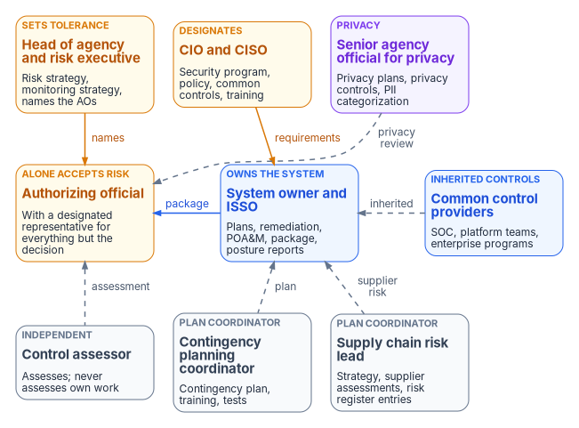
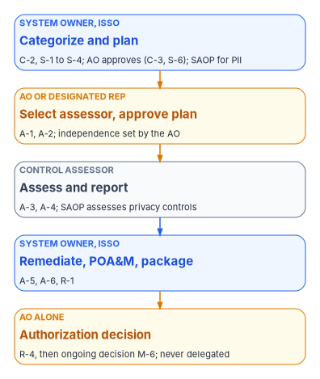

# Chapter 10 — Who Owns Compliance

*Compliance has no single owner, and that is the danger; the Risk Management Framework names a role for every task, and a system stays authorized only while each of those roles has a person in it who knows the task is theirs.*

::: {.callout-note}
## In this chapter
Where the compliance roles come from: FISMA, OMB Circular A-130, NIST SP 800-37 Rev. 2 and the controls that require them. Then each role in turn: the head of agency and the risk executive (function), the CIO, the CISO as senior agency information security officer, the senior agency official for privacy, the authorizing official and the designated representative, the system owner, the ISSO and ISSM, the control assessor, common control providers, the contingency planning coordinator and the supply chain risk lead. Which roles only government staff may hold, one owner for each step of the authorization path, a responsibility matrix consistent with Book 00 Chapter 07, Book 01 Chapter 09, Book 12 Chapter 10 and Book 13 Chapter 09, and the separations that keep an assessment honest.
:::

Ask who owns compliance in most agencies and the answer is "the security office," which means the answer is nobody in particular. The security office writes policy, but it doesn't own the system whose plan is out of date. The system owner owns the system, but often learns about a failed control from the assessor. The assessor finds the gap and isn't allowed to fix it. The authorizing official signs the decision and may never have seen the evidence behind it. Each of them is doing their job. The failures happen between the jobs: a plan of action and milestones that nobody updates, a privacy plan nobody approved, an assessor who also built the controls they assessed, a risk acceptance signed by someone who couldn't sign it.

Federal guidance already prevents most of this by naming the roles and giving each task to one or two of them. The Risk Management Framework in NIST SP 800-37 Rev. 2 lists a primary responsibility for every task, from assigning roles to deciding whether a system may keep operating.[^c10-sp80037-tasks] This chapter maps those roles onto the program. It applies the program-wide model in [Book 01, Chapter 09](../b01-transformation-arc/09-who-leads-the-transformation.md) and the running mechanics in [Book 00, Chapter 07](../b00-orientation/07-who-runs-the-program.md) to compliance and authorization, and it agrees with the Who chapters that cover parts of the same ground: [Book 10, Chapter 08](../b10-cloud-boundary/08-who-owns-the-boundary.md) for the cloud boundary, [Book 12, Chapter 10](../b12-security-operations/10-who-runs-security-operations.md) for security operations, and [Book 13, Chapter 09](../b13-governance/09-who-governs.md) for the authoritative record. [Chapter 05](05-program-management-controls.md) of this book gives the program's role template for the program management controls. Where those chapters go deeper for their domain, they govern. The model below is the program's recommended design. Adapt it to the agency's structure, but keep one decider per row.

{#fig-ch10-who-owns-compliance fig-alt="Three rows of cards. Top row, the officials who set the posture: the head of agency and risk executive in amber, who set the risk strategy and the monitoring strategy and name the authorizing officials; the CIO and CISO in amber, who designate and own the security program, policy, common controls and training; and the senior agency official for privacy in violet, who owns privacy plans, privacy controls and the categorization of systems with PII. Middle row: the authorizing official in amber, who alone accepts risk, with a designated representative for everything but the decision; the system owner and ISSO in blue, who own the plans, remediation, the plan of action and milestones, the package and posture reports; and common control providers in blue, such as the SOC, platform teams and enterprise programs. Bottom row, in slate: the control assessor, independent and never assessing their own work; the contingency planning coordinator, who owns the contingency plan, training and tests; and the supply chain risk lead, who owns the strategy, supplier assessments and risk register entries. Arrows: the head of agency names the authorizing official; the CIO and CISO send requirements to the system owner; the privacy official sends a dashed privacy review arrow to the authorizing official; the system owner sends the package to the authorizing official; common control providers send inherited controls to the system owner; the assessor sends a dashed assessment arrow to the authorizing official; and the contingency coordinator and supply chain lead send dashed arrows labeled plan and supplier risk to the system owner."}

## Where the roles come from

Four layers of requirement define the roles. None of them uses the word "compliance owner."

**FISMA** puts accountability at the top. The head of each agency is responsible for providing information security protections commensurate with risk, and must delegate to the CIO the authority to ensure compliance with the law. That delegation includes designating a senior agency information security officer who carries out the CIO's responsibilities, has the professional qualifications to do so, has information security duties "as that official's primary duty," and heads an office with the mission and resources to help the agency comply. It also includes training and overseeing personnel with significant information security responsibilities.[^c10-fisma]

**OMB Circular A-130** adds privacy and the authorizing official. Agencies must designate a senior agency official for privacy with agency-wide responsibility and accountability for the privacy program, and must make sure the CIO designates the senior agency information security officer.[^c10-a130] Agencies must designate senior federal officials to authorize each system and each set of agency-designated common controls, and only federal government personnel may serve as an authorizing official. The authorizing official is a senior official with budgetary oversight for the system or responsibility for the mission it supports, and is accountable for its privacy risks as well as its security risks. The circular gives the senior agency official for privacy a voice in the decision: agencies must consider the privacy official's input, the privacy official reviews the authorization package for any system that handles PII, and if the two can't agree, the head of the agency decides. Agencies may make the CIO or the privacy official a co-authorizing official.[^c10-a130]

**NIST SP 800-37 Rev. 2** defines each role and gives it tasks. Appendix D describes the authorizing official and designated representative, chief information officer, common control provider, control assessor, head of agency, information owner or steward, risk executive (function), senior accountable official for risk management, senior agency information security officer, senior agency official for privacy, system owner and system security or privacy officer, among others.[^c10-sp80037] It allows one person to hold several roles and several people to share one, provided "there are no conflicts of interest."[^c10-sp80037] And it gives every RMF task a primary owner, which the matrix below uses.[^c10-sp80037-tasks]

**SP 800-53** makes the role assignments themselves controls. PM-2 asks the agency to appoint a senior agency information security officer, PM-19 a senior agency official for privacy, and PM-29 a senior accountable official for risk management and a risk executive (function). PM-10 asks the agency to designate individuals for the roles in its risk management process. CA-6 asks for a senior official as authorizing official for each system and for each set of inheritable common controls.[^c10-sp80053] The evidence for those controls is a signed appointment with a name in it, not an organization chart.

Two specialist roles come from elsewhere. SP 800-34 Rev. 1 puts contingency planning under an information system contingency plan (ISCP) coordinator.[^c10-sp80034] And the Federal Acquisition Supply Chain Security Act makes the head of each executive agency responsible for assessing and responding to supply chain risk, while SP 800-161 Rev. 1 describes the cybersecurity supply chain risk management (C-SCRM) program office that usually does the work.[^c10-fascsa][^c10-sp800161]

## The roles

### The head of agency and the risk executive (function)

The head of agency is accountable for the agency's security and privacy, sets the risk management strategy and the agency's risk tolerance (RMF task P-2), and makes sure the agency has adequately trained personnel.[^c10-sp80037][^c10-sp80037-tasks] The head of agency, or someone the head designates, is the senior accountable official for risk management, who leads the **risk executive (function)**. That function can be one office or a group, such as "a risk board, executive steering committee, executive leadership council," and it owns the organization-wide view: aggregated risk, consistent decisions across authorizing officials, and the organization-wide continuous monitoring strategy (task P-7), including the minimum frequency for monitoring controls.[^c10-sp80037][^c10-sp80037-tasks] In the program's model the head of agency or the senior accountable official names each authorizing official, because A-130 asks the agency to designate them and RMF task P-1, assigning roles, belongs to the head of agency, the CIO and the senior agency official for privacy.[^c10-a130][^c10-sp80037-tasks]

### The CIO

The CIO designates the senior agency information security officer, maintains security policies and procedures, oversees personnel with significant security responsibilities and makes sure they are trained, and reports to the head of agency on the security program's effectiveness. With authorizing officials, the CIO decides the resources dedicated to protecting systems, coordinating with the privacy official for systems that process PII. The CIO may be an authorizing official or co-authorizing official for selected systems.[^c10-sp80037] In the program's model the CIO, with the executive sponsor, also owns the program's scope and funding ([Book 01, Chapter 09](../b01-transformation-arc/09-who-leads-the-transformation.md#decision-rights-across-the-program)), which is where most compliance gaps are actually decided: a control that has no budget will become a plan of action and milestones.

### The CISO

The CISO is the senior agency information security officer, the official who carries out the CIO's FISMA security responsibilities and is the CIO's primary liaison to authorizing officials, system owners, common control providers and system security officers. SP 800-37 notes that organizations may also call the role the senior information security officer or chief information security officer.[^c10-sp80037] RMF task P-5 gives the CISO, with the privacy official, the job of identifying the organization-wide common controls systems can inherit.[^c10-sp80037-tasks] In the program's model the CISO decides the control requirements every system must meet ([Book 01, Chapter 09](../b01-transformation-arc/09-who-leads-the-transformation.md#decision-rights-across-the-program)), owns the awareness and training policy ([Chapter 09](09-training-and-awareness-controls.md)), owns the supply chain risk strategy ([Chapter 05](05-program-management-controls.md)), and reviews each cloud provider's Ongoing Certification Report or names a delegate to do so ([Book 10, Chapter 08](../b10-cloud-boundary/08-who-owns-the-boundary.md)).

SP 800-37 says the senior agency information security officer "may serve as authorizing official designated representative or as a security control assessor."[^c10-sp80037] Both are allowed. Both need care. A CISO whose office implements common controls can't impartially assess them, and a CISO acting as a designated representative is preparing decisions about controls the CISO set. The program allows either only where the agency writes down why there is no conflict, which is what SP 800-37's conflict-of-interest condition requires in any case.

### The senior agency official for privacy

The senior agency official for privacy has agency-wide responsibility and accountability for privacy compliance and privacy risk. SP 800-37 gives the role eight duties that bear directly on authorization: coordinating with the CISO; reviewing and approving the categorization of systems that handle PII; designating which privacy controls are program management, common, system-specific or hybrid; setting assessment methods and metrics for privacy controls; reviewing and approving privacy plans before authorization, reauthorization or ongoing authorization; reviewing authorization packages for systems that handle PII; conducting privacy control assessments; and running a privacy continuous monitoring program.[^c10-sp80037] The privacy official keeps responsibility for privacy assessments even when an independent assessor performs them.[^c10-sp80037] [Chapter 08](08-privacy-pii-processing.md) covers the privacy controls themselves.

### The authorizing official and the designated representative

The authorizing official is "the only organizational official who can accept the security and privacy risk to organizational operations, organizational assets, and individuals." The authorizing official approves plans, memorandums of agreement, and plans of action and milestones, and decides whether a significant change requires reauthorization. For federal agencies the role "is assigned to government personnel only."[^c10-sp80037] The RMF gives the authorizing official, or the designated representative, the approval of the system's categorization, the approval of its security and privacy plans, the selection of its assessor and approval of the assessment plan, the risk analysis and the risk response, and reserves to the authorizing official alone the authorization decision (R-4) and the ongoing authorization decision (M-6).[^c10-sp80037-tasks] The authorizing official also decides how independent the assessor must be.[^c10-sp80037]

The **designated representative** coordinates and conducts the day-to-day work of managing risk on the authorizing official's behalf. The only thing the representative can't do is make and sign the authorization decision, "the acceptance of risk."[^c10-sp80037] In practice the representative is the person the system owner, ISSO and assessor deal with week to week, and the person who decides whether an item needs the authorizing official's own attention. The program's rule is the one [Book 13, Chapter 09](../b13-governance/09-who-governs.md#the-authorizing-officials-role) sets: the representative can prepare every risk acceptance and can attend every board, but every acceptance is signed by the authorizing official.

Most agencies have several authorizing officials. Each accepts risk only for the systems and common controls they authorize, so the SOC's controls and the governance platform's controls need authorizing officials of their own when other systems inherit them ([Book 12, Chapter 10](../b12-security-operations/10-who-runs-security-operations.md#the-soc-is-a-common-control-provider)). A system that uses a FedRAMP-certified cloud service still needs the agency's own authorization decision, as [Book 13, Chapter 11](../b13-governance/11-reciprocity-and-one-authorization.md) explains.

### The system owner

The system owner is responsible for the system's procurement, development, integration, modification, operation, maintenance and disposal, for meeting the user community's operational needs, and for compliance with security requirements. With the system security and privacy officers, the system owner develops and maintains the security and privacy plans and makes sure the system runs according to them. The system owner decides who has access, with the information owner; makes sure users and support staff receive the training they need; provides access, information and documentation to assessors; receives the assessment results; and, after reducing the risks found, assembles the authorization package and submits it to the authorizing official or the representative.[^c10-sp80037] SP 800-37 notes that organizations may call system owners program managers or business or asset owners.[^c10-sp80037]

The RMF makes the system owner the primary owner of more tasks than any other role: describing and categorizing the system, selecting, tailoring and documenting its controls, implementing them, remediating findings, preparing the plan of action and milestones, assembling the package, monitoring for change, updating the plans, reporting posture and disposing of the system.[^c10-sp80037-tasks] Compliance belongs to the system owner more than to anyone else. The security office helps; it doesn't take the system owner's place.

### The ISSO and the ISSM

SP 800-37's **system security officer** is the role most agencies call the information system security officer, or ISSO. The ISSO keeps the system's security posture current, works closely with the system owner, and is the principal advisor on all matters involving the system's controls. In many organizations the ISSO runs day-to-day security operations for the system, which can include physical and environmental protection, personnel security, incident handling, and security training and awareness. The ISSO helps develop and update the plans, manages and controls changes to the system, and assesses their security impact.[^c10-sp80037] A **system privacy officer** does the same for privacy, and SP 800-37 lets organizations combine or separate the two.[^c10-sp80037]

The **ISSM**, the information system security manager, is a common title, not an RMF role. SP 800-37 allows for it in a footnote: organizations may define a system security manager or security manager role with responsibilities like a system security officer's, or with oversight of a security program, and ISSOs may report to it.[^c10-sp80037] SP 800-50 Rev. 1's example policies give the ISSM the authority to waive training-based account suspension and the duty to submit training plans and reports.[^c10-sp80050] In the program's model the ISSM oversees a portfolio of systems and their ISSOs: the ISSM rolls up their plans of action and milestones, reviews their posture reports before they reach the authorizing official, and acts as the CISO's named delegate for provider reports where the CISO chooses one. Agencies that don't use the title give those duties to the CISO's staff.

SP 800-37 doesn't reserve the ISSO role to government personnel. The program's position, as in [Chapter 05](05-program-management-controls.md), is that a contractor may serve as ISSO with documented government oversight, provided the ISSO doesn't also assess the controls they manage.

### The control assessor

The control assessor assesses whether controls are implemented correctly, operating as intended and producing the desired outcome, prepares the assessment reports, rates the severity of deficiencies and recommends corrective actions. Assessors don't assess inherited controls at the system level; they assess only the system's own part of a hybrid control.[^c10-sp80037] The authorizing official sets the required level of independence, explicitly, for any assessment that supports an authorization or ongoing authorization decision.[^c10-sp80037]

CA-2(1) asks for independent assessors, and it is in NIST's Moderate and High baselines; CA-7(1) asks the same for ongoing monitoring.[^c10-sp80053] SP 800-53's discussion of CA-2(1) defines impartiality: assessors are free from conflicts of interest about the development, operation or management of the system, and don't "assess their own work, act as management or employees" of the organizations they serve, or advocate for them. Independent assessment can come from inside the organization or by contract, and the authorizing official decides whether a contracted assessment is independent enough, including whether the system owner influenced the contracting. Where a small organization's assessors must come from the system owner's chain, independent experts should review the results.[^c10-sp80053] A FedRAMP-recognized third-party assessment organization is how a cloud provider earns certification; an agency selects the assessors for its own systems ([Chapter 05](05-program-management-controls.md)).

### Common control providers

A common control provider implements, assesses and monitors controls that systems inherit, documents them in plans, has them assessed by qualified assessors with appropriate independence, and produces plans of action and milestones for those that fall short. Those plans and reports go to the owners of inheriting systems after the authorizing official for the common controls approves them.[^c10-sp80037] In the program, the top-level SOC is the common control provider for monitoring and incident response ([Book 12, Chapter 10](../b12-security-operations/10-who-runs-security-operations.md#the-soc-is-a-common-control-provider)); platform teams provide identity, endpoint and network controls; and the governance platform provides the authoritative record ([Book 13, Chapter 09](../b13-governance/09-who-governs.md)). Agency-wide programs, the awareness and training program and the privacy program among them, are common controls too, and the privacy official decides which privacy controls are common.[^c10-sp80037]

### The contingency planning coordinator

SP 800-34 Rev. 1 says responsibility for contingency planning "generally falls under the auspice of" the ISCP coordinator, "typically a functional or resource manager," who develops the contingency strategy with the other managers of the system and the processes it supports and typically manages the plan's development and execution. The guide says every federal information system must have a contingency plan; its sample policy statement has the coordinator document the plan and review it annually; and it has the coordinator design the test plan and keep a record of changes to the plan.[^c10-sp80034] CP-2 asks for the plan to address contingency roles and responsibilities with named individuals and to be reviewed and approved by personnel the organization defines.[^c10-sp80053]

In the program's model the coordinator is a named person for each system or group of systems, accountable to the system owner, who approves the plan; the coordinator owns the business impact analysis, the plan, the contingency training roster and the test schedule, and the ISSO makes sure the results reach the package. [Chapter 06](06-contingency-and-continuity.md) covers the plan and its tests; [Chapter 09](09-training-and-awareness-controls.md) covers CP-3's training record.

### The supply chain risk lead

The Federal Acquisition Supply Chain Security Act makes the head of each executive agency responsible for assessing the supply chain risk of covered articles, avoiding, mitigating, accepting or transferring it, and prioritizing those assessments by mission criticality. That responsibility includes a supply chain risk management strategy and implementation plan, integrating supply chain practices across the system life cycle, sharing information with other agencies as the Federal Acquisition Security Council directs, and reporting on progress.[^c10-fascsa] SP 800-161 Rev. 1 describes a C-SCRM program office, made up of dedicated staff or matrixed representatives from information security, procurement, risk management, engineering, software development, IT, legal and HR, that "may include or report to a dedicated executive-level official," chairs internal working groups, assesses suppliers and products, manages the supply chain risk register and drafts strategy and policy for the accountable risk executives.[^c10-sp800161]

The program's charter template in [Chapter 05](05-program-management-controls.md) makes the CISO the executive sponsor who owns the strategy and its annual review, with the CIO approving the charter. In this chapter the **supply chain risk lead** is the person who runs the program day to day: keeps the supplier assessments current, enters supply chain findings in the risk register and sees that they reach the right plan of action and milestones. The acquisition side, writing requirements into solicitations and contracts, stays with the contracting officer and the acquisition security liaison. [Chapter 07](07-supply-chain-risk-management.md) covers the controls and the pipeline. A supply chain risk the agency decides to carry on a system is a risk acceptance like any other, and goes to that system's authorizing official.

### The roles that keep the record

Two program roles complete the picture. The **steward and program office** keep the authoritative record that holds the plans, findings and evidence, and the **records officer** decides how long that record and its evidence are kept. [Book 13, Chapter 09](../b13-governance/09-who-governs.md) assigns both. **Information owners**, the officials with authority over specific information, give system owners the security and privacy requirements for the systems that process it and help categorize them.[^c10-sp80037][^c10-sp80037-tasks]

## Who must be a government official

SP 800-37 marks six roles as inherent U.S. Government functions, assigned only to government personnel: the authorizing official, the CIO, the risk executive (function), the senior accountable official for risk management, the senior agency information security officer and the senior agency official for privacy.[^c10-sp80037] A-130 says the same of the authorizing official.[^c10-a130]

| Role | Government personnel only? | Program position |
|---|---|---|
| Authorizing official | Yes (SP 800-37, A-130) | Never delegated; signs every risk acceptance |
| Designated representative | Not stated | A government official, because the role acts for the authorizing official; program design |
| CIO, CISO, senior agency official for privacy | Yes (SP 800-37) | — |
| Senior accountable official for risk management, risk executive (function) | Yes (SP 800-37) | — |
| System owner | Not stated | A government official, because the role answers for the system to the authorizing official; program design |
| ISSO, ISSM | Not stated | A contractor may serve, with documented government oversight; program design |
| Control assessor | Not stated | Government or contracted, with the independence the authorizing official sets |
| Contingency planning coordinator, supply chain risk lead | Not stated | Government or contractor; the approvals they need sit with government roles |

A program office or security team staffed mainly by contractors can do almost all of the work in this chapter. It can prepare every plan, every assessment, every package and every risk acceptance. It can't sign any of the decisions in the government-only rows.

## One owner for each step of the authorization path

The authorization path is where ownership gaps show first, because each step hands off to the next. The figure gives each step its owner from the RMF.

{#fig-ch10-authorization-path fig-alt="Five cards in a vertical chain. First, a blue card for the system owner and ISSO: categorize and plan, tasks C-2 and S-1 to S-4, with the authorizing official approving under C-3 and S-6 and the senior agency official for privacy approving for systems with PII. An amber arrow leads to an amber card for the authorizing official or designated representative: select the assessor and approve the assessment plan, tasks A-1 and A-2, with independence set by the authorizing official. An amber arrow leads to a slate card for the control assessor: assess and report, tasks A-3 and A-4, with the privacy official assessing privacy controls. A blue arrow leads to a blue card for the system owner and ISSO: remediate, plan of action and milestones, and package, tasks A-5, A-6 and R-1. An amber arrow leads to the last amber card, the authorizing official alone: the authorization decision, task R-4, then the ongoing decision under M-6, never delegated."}

The handoffs fail in predictable ways, and the program checks for each.

- **The categorization is approved by nobody.** C-3 asks the authorizing official or representative, and the privacy official for systems with PII, to approve it.[^c10-sp80037-tasks] A categorization that only the system owner signed is a draft.
- **The system owner picks the assessor.** A-1 gives assessor selection to the authorizing official or representative.[^c10-sp80037-tasks] When the system owner chooses and pays the assessor, the authorizing official has to decide whether that arrangement leaves the assessment independent enough, which is the case CA-2(1)'s discussion describes.[^c10-sp80053]
- **The privacy plan goes unapproved.** For a system that handles PII, the package isn't complete without the privacy official's approval of the privacy plan and review of the package.[^c10-sp80037]
- **The plan of action and milestones belongs to the ISSO alone.** A-6 gives it to the system owner and common control provider, and the authorizing official approves it.[^c10-sp80037-tasks][^c10-sp80037] An ISSO who maintains it without the system owner's commitment is maintaining a wish list.

## The responsibility matrix

D = decides (accountable) · R = does the work · C = consulted · blank = informed at most. "Head / SAORM" is the head of agency or the senior accountable official for risk management and the risk executive (function). "AO" includes the designated representative except where the decision can't be delegated. "Coordinators" are the contingency planning coordinator and the supply chain risk lead, each for their own rows. "Program office" is the steward and program office of Book 00 and Book 13.

| Decision or work item | Head / SAORM | CIO | CISO | SAOP | AO | System owner | ISSO / ISSM | Assessor | Common control providers | Coordinators | Program office |
|---|---|---|---|---|---|---|---|---|---|---|---|
| Risk management strategy and risk tolerance (P-2) | D | C | R | C | C | | | | | | C |
| Organization-wide continuous monitoring strategy (P-7) | D | C | R | R | C | C | | | C | | C |
| Designate the CISO (senior agency information security officer) | | D | | | | | | | | | |
| Designate the senior agency official for privacy | D | C | | | | | | | | | |
| Name the authorizing official for each system and set of common controls (CA-6) | D | R | C | C | | | | | | | |
| Security control requirements and organization-wide common controls (P-5) | | C | D | C | C | C | C | | R | | C |
| Which privacy controls are common, program-level or system-specific | | | C | D | | C | C | | | | |
| Security categorization (C-2, C-3) | | | C | D (PII) | D | R | R | | | | |
| Select, tailor and document controls (S-1, S-2, S-4) | | | C | C | | D | R | | R | C | C |
| Approve the security plan (S-6) | | | C | | D | R | R | | | | |
| Approve the privacy plan | | | | D | C | R | R | | | | |
| Select the assessor and set its independence; approve the assessment plan (A-1, A-2) | | | C | C | D | C | C | R | | | |
| Assess security controls and write the report (A-3, A-4) | | | C | | | C | C | D, R | C | | |
| Assess privacy controls | | | | D, R | | C | C | R | | | |
| Remediate findings within their windows (A-5) | | | C | | | D | R | R | R | | C |
| Keep the plan of action and milestones (A-6) | | | C | C | C | D | R | | R | | C |
| Approve the plan of action and milestones; accept residual risk | | | R | C | D | R | R | C | | | |
| Assemble and submit the authorization package (R-1) | | | C | R | | D, R | R | C | R | | R |
| Authorization decision (R-4) | | C | C | C | D | R | R | C | | | |
| Authorizing official and privacy official disagree on a system with PII | D | C | C | R | R | C | | | | | |
| Significant change: does it require reauthorization? | | | C | C | D | R | R | C | | | |
| Posture reports to the AO (M-5) | | | R | R | C | D, R | R | C | R | | R |
| Ongoing authorization decision (M-6) | | C | C | C | D | R | R | C | | | |
| Review of cloud providers' Ongoing Certification Reports | | | D | C | C | C | R | | | | |
| Contingency plan, its training roster and test schedule (CP-2, CP-3, CP-4) | | | C | | | D | R | | | R | |
| Supply chain risk management charter (PM-30) | | D | R | C | | | | | | R | |
| Supply chain risk strategy and supplier assessments | | C | D | C | C | C | C | | | R | |
| Supply chain risk carried on a system | | | R | | D | R | R | | | R | |
| Awareness and training policy, roles and threshold (AT-1 to AT-4) | | C | D | C | | R | R | | R | | |
| Assessor independence for ongoing assessments | | | C | C | D | | | R | | | |

Seven rows need comment.

The **categorization** row has two deciders on purpose. RMF task C-3 names the authorizing official or representative and the senior agency official for privacy as primary owners of the approval,[^c10-sp80037-tasks] and SP 800-37 lists approving the categorization of systems with PII among the privacy official's duties.[^c10-sp80037] For a system without PII the authorizing official decides alone.

The **two plan rows** split the security plan from the privacy plan for the same reason. S-6 gives plan approval to the authorizing official or representative,[^c10-sp80037-tasks] and the privacy official reviews and approves privacy plans before authorization.[^c10-sp80037] Both must be in place before the decision.

The **disagreement** row is A-130's: when the authorizing official and the privacy official can't resolve how a system with PII should be protected, the head of agency reviews the risks and decides whether the authorization is issued.[^c10-a130] It is rare, and it should be recorded when it happens.

The **assessor** rows separate who picks the assessor from who does the assessing. The authorizing official selects and sets independence; the assessor decides the findings. Nobody else edits an assessment report. The privacy official keeps responsibility for privacy assessments even when an assessor does the work.[^c10-sp80037]

The **plan of action and milestones** rows match [Book 00, Chapter 07](../b00-orientation/07-who-runs-the-program.md#who-decides-what) and [Book 13, Chapter 09](../b13-governance/09-who-governs.md#the-responsibility-matrix): the system owner keeps the plan and decides how findings are fixed; the authorizing official approves it and accepts what can't be fixed in time. The remediation row matches [Book 12, Chapter 10](../b12-security-operations/10-who-runs-security-operations.md#the-responsibility-matrix).

The **provider report** row matches [Book 10, Chapter 08](../b10-cloud-boundary/08-who-owns-the-boundary.md), which follows FedRAMP's recommendation that agencies designate a federal senior information security official to review each provider's reports. If a report shows something that may change the agency's risk, the decision moves to the authorizing official under the significant-change row.

The **supply chain** rows follow [Chapter 05](05-program-management-controls.md)'s charter: the CIO approves the charter and the CISO owns the strategy. The law makes the head of agency responsible for supply chain risk,[^c10-fascsa] and in the program's model that responsibility is exercised through the risk management strategy the head approves and the authorizing officials who accept specific supply chain risks for their systems.

Two decisions sit above the matrix. The continuous monitoring strategy, with its minimum monitoring frequencies, belongs to the senior accountable official for risk management or the risk executive (function) (task P-7);[^c10-sp80037-tasks] the program's cadence has to fit inside it. And the authorizing official's acceptance of risk can't be delegated to anyone in any column.[^c10-sp80037]

## Keeping the roles apart

The compliance roles check each other, so the separations matter as much as the assignments.

1. **Nobody assesses their own work.** The assessor isn't the ISSO, the system owner or the engineer who implemented the controls being assessed. CA-2(1)'s impartiality test is the program's test.[^c10-sp80053]
2. **The authorizing official isn't the system owner for the same system.** SP 800-37 allows one person to hold several roles if there's no conflict of interest.[^c10-sp80037] An official who owns a system's budget and schedule and also accepts its risk is judging their own delivery. The program's design keeps the two apart; where an agency can't, the risk executive (function) should review that system's acceptances.
3. **The CISO doesn't assess the CISO's common controls.** The CISO may serve as an assessor,[^c10-sp80037] but not over controls the CISO's office implements or provides for inheritance.
4. **Requesters don't approve their own risk acceptances.** The system owner or ISSO who writes up a gap doesn't approve it. The bounded-exception and risk-acceptance split in [Book 13, Chapter 09](../b13-governance/09-who-governs.md#who-accepts-exceptions) applies to every compliance gap.
5. **The privacy official's review isn't optional for systems with PII.** An authorization package for such a system without the privacy official's review is incomplete, whatever its security content.[^c10-a130][^c10-sp80037]

## Where each Who chapter fits

| Chapter | What it settles |
|---|---|
| [Book 00, Chapter 07 — Who Runs the Program](../b00-orientation/07-who-runs-the-program.md) | Program roles, the decision table, gate deciders, the rhythm and the repository conventions |
| [Book 01, Chapter 09 — Who Leads the Transformation](../b01-transformation-arc/09-who-leads-the-transformation.md) | Program-wide decision rights: the sponsor, the CISO, the authorizing official, the program office, platform teams, application owners, HR, records and privacy |
| [Book 10, Chapter 08 — Who Owns the Boundary](../b10-cloud-boundary/08-who-owns-the-boundary.md) | The cloud boundary, provider reports, capability exceptions and the authorization letter |
| [Book 12, Chapter 10 — Who Runs Security Operations](../b12-security-operations/10-who-runs-security-operations.md) | Logging, detection, incident response, the SOC as a common control provider |
| [Book 13, Chapter 09 — Who Governs](../b13-governance/09-who-governs.md) | The authoritative record, rule changes, drift review, exceptions and records management |
| [Chapter 05 — Program Management Controls](05-program-management-controls.md) | The program's role template for the PM controls and the supply chain charter |
| This chapter | The RMF roles, the authorization path and who owns each step of a system's compliance |

## What changes, in one table

| Old habit | What replaces it |
|---|---|
| "The security office owns compliance" | The system owner owns the system's compliance; the CISO sets requirements and common controls; the authorizing official accepts risk |
| The authorizing official signs at the end | The authorizing official, or the representative, approves the categorization, the plans, the assessor and the assessment plan before the assessment starts |
| The system owner hires the assessor | The authorizing official selects the assessor and sets the independence required |
| The ISSO keeps the plan of action and milestones | The system owner keeps it and commits to it; the authorizing official approves it |
| Privacy reviews the system when asked | The privacy official approves the categorization and privacy plan for systems with PII and reviews every such package |
| The designated representative signs "for" the authorizing official | The representative prepares; the authorizing official signs every acceptance of risk |
| An organization chart as evidence of roles | Signed appointments with names for PM-2, PM-19, PM-29 and CA-6, and a matrix with a person in every D and R |
| A contractor-heavy team "owns" authorization | Contractors prepare the work; government officials make the decisions only they may make |

::: {.callout-tip}
## Continue the book
[← Previous: Chapter 09 — Training and Awareness Controls](09-training-and-awareness-controls.md) · [Book index](index.md) · [Next: Chapter 11 — The Authorization Package and Continuous Monitoring →](11-the-authorization-package.md)
:::

[^c10-fisma]: Federal Information Security Modernization Act of 2014, 44 U.S.C. § 3554, subsections (a)(1)(A) and (a)(3)(A)–(D), <https://www.law.cornell.edu/uscode/text/44/3554> (accessed Oct 21, 2026).
[^c10-a130]: Office of Management and Budget, Circular A-130, *Managing Information as a Strategic Resource*, July 2016, §5.f.1 (Privacy, items a–b, and note 25) and §5.f.2 (Information Security, item a); Appendix I, §4.d.1 (designating authorizing officials) and §5.f (Authorizing Official), <https://www.whitehouse.gov/wp-content/uploads/legacy_drupal_files/omb/circulars/A130/a130revised.pdf> (accessed Oct 21, 2026).
[^c10-sp80037]: National Institute of Standards and Technology, SP 800-37 Rev. 2, *Risk Management Framework for Information Systems and Organizations: A System Life Cycle Approach for Security and Privacy*, December 2018, Appendix D (introduction and footnotes 112–113; Authorizing Official; Authorizing Official Designated Representative; Chief Information Officer; Common Control Provider; Control Assessor; Head of Agency; Information Owner or Steward; Risk Executive (Function); Senior Accountable Official for Risk Management; Senior Agency Information Security Officer; Senior Agency Official for Privacy; System Owner and footnote 121; System Security or Privacy Officer and footnote 124), <https://nvlpubs.nist.gov/nistpubs/SpecialPublications/NIST.SP.800-37r2.pdf> (accessed Oct 21, 2026).
[^c10-sp80037-tasks]: National Institute of Standards and Technology, SP 800-37 Rev. 2, December 2018, Chapter 3, primary responsibilities for tasks P-1, P-2, P-5, P-7, C-2, C-3, S-1, S-2, S-4, S-6, A-1 to A-6, R-1 to R-5 and M-1 to M-7, <https://nvlpubs.nist.gov/nistpubs/SpecialPublications/NIST.SP.800-37r2.pdf> (accessed Oct 21, 2026).
[^c10-sp80053]: National Institute of Standards and Technology, SP 800-53 Rev. 5, *Security and Privacy Controls for Information Systems and Organizations*, controls CA-2(1) (with discussion), CA-6, CA-7(1), CP-2 (items a.3 and a.7), PM-2, PM-10, PM-19 and PM-29, <https://csrc.nist.gov/pubs/sp/800/53/r5/upd1/final>; control text checked against the release 5.2.0 OSCAL catalog, and CA-2(1) and CA-7(1) baselines against the SP 800-53B Moderate and High profiles, <https://github.com/usnistgov/oscal-content/tree/main/nist.gov/SP800-53/rev5/json> (both accessed Oct 21, 2026).
[^c10-sp80034]: National Institute of Standards and Technology, SP 800-34 Rev. 1, *Contingency Planning Guide for Federal Information Systems*, May 2010 (updated November 11, 2010), Chapter 3 introduction (ISCP Coordinator), §3.1 (sample contingency policy statement), §3.5 (testing) and §3.6 (plan maintenance), <https://nvlpubs.nist.gov/nistpubs/Legacy/SP/nistspecialpublication800-34r1.pdf> (accessed Oct 21, 2026).
[^c10-fascsa]: 41 U.S.C. § 1326, "Requirements for executive agencies," subsections (a) and (b), <https://www.law.cornell.edu/uscode/text/41/1326> (accessed Oct 21, 2026).
[^c10-sp800161]: National Institute of Standards and Technology, SP 800-161 Rev. 1, *Cybersecurity Supply Chain Risk Management Practices for Systems and Organizations*, May 2022, with updates as of November 1, 2024, §2.3.5 (C-SCRM PMO) and Appendix E (FASCSA), <https://nvlpubs.nist.gov/nistpubs/SpecialPublications/NIST.SP.800-161r1-upd1.pdf> (accessed Oct 21, 2026).
[^c10-sp80050]: National Institute of Standards and Technology, SP 800-50 Rev. 1, *Building a Cybersecurity and Privacy Learning Program*, September 2024, §2.2.1 (Examples of Learning Program Policy Statements), <https://nvlpubs.nist.gov/nistpubs/SpecialPublications/NIST.SP.800-50r1.pdf> (accessed Oct 21, 2026).
