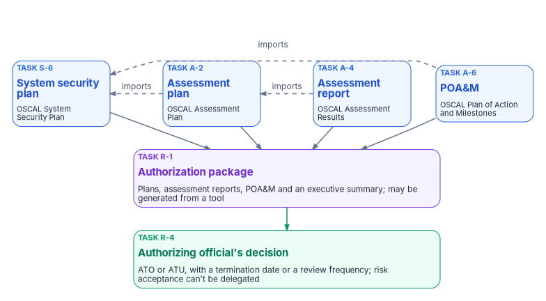
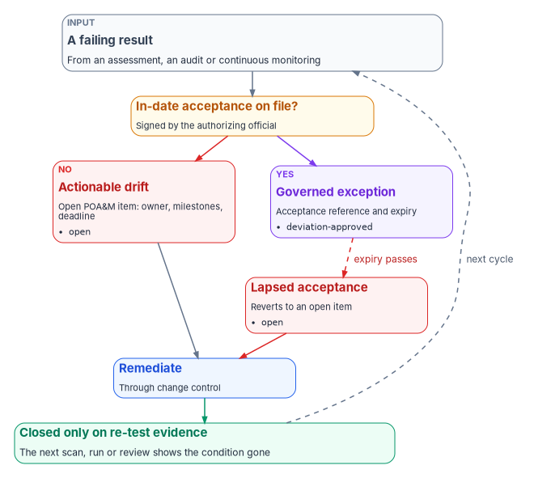

# Chapter 11 — The Authorization Package and Continuous Monitoring

*An authorization package is not a binder that gets signed every few years; it is four linked records, kept in a machine-readable form, that stay true for as long as the evidence behind them keeps arriving.*

::: {.callout-note}
## In this chapter
What the authorization package contains and which Risk Management Framework task produces each part. The OSCAL model for each artifact and how the models link. The assessment plan, the program's catalog of test plans, and what assessment results must say. The plan of action and milestones as a lifecycle with dispositions rather than a list, with illustrative code that builds one in OSCAL. Continuous monitoring under CA-7 and SP 800-137, ongoing authorization, and what FedRAMP's 2026 rules ask of cloud providers and of the agencies that review their quarterly reports.
:::

Every chapter before this one ends in an artifact: a contingency plan that was tested, a supply chain register, a privacy notice, a training record. This chapter is where they meet the person who has to decide. The authorizing official doesn't read the evidence directly. They read a package that summarizes it, and they accept the risk the package describes. If the package is assembled by hand once every few years, it describes the system on the day it was assembled. If it is generated from the evidence the systems produce, it can describe the system today.

Two framing facts govern everything below. First, the agency authorizes its own system. When that system uses a FedRAMP-certified cloud service, the provider's certification is evidence the agency reads, not a decision the agency inherits; [Book 10, Chapter 11](../b10-cloud-boundary/11-the-authorization-package.md) covers how the boundary with the provider is written into the package, and FedRAMP's rules require the agency to complete its own authorization process before using a certified service.[^c11-fr-agu] Second, the agency's package is built from evidence, not from statements about evidence. The evidence contract that every source emits, keyed on authoritative asset identity plus time, is [Book 12, Chapter 02](../b12-security-operations/02-the-evidence-contract.md); why a system-produced record outranks a signed statement is [Book 13, Chapter 07](../b13-governance/07-evidence-over-attestation.md). This chapter is the compliance view of the same machinery: what the package must contain, and how it stays current.

## What the package contains

NIST SP 800-37 Rev. 2 defines the package by its contents. Task R-1 says authorization packages "include security and privacy plans, security and privacy assessment reports, plans of action and milestones, and an executive summary," with more at the authorizing official's request, and that organizations "maintain version and change control" as the package is updated.[^c11-sp80037] Each part is the output of an earlier task, and each task has an owner.

{#fig-ch11-package-and-models fig-alt="Four blue cards in a row, each naming an artifact, the RMF task that produces it and its OSCAL model. First, the system security plan, approved under Task S-6, carried by the OSCAL System Security Plan model. Second, the assessment plan, Task A-2, carried by the Assessment Plan model, which imports the system security plan. Third, the security assessment report, Task A-4, carried by the Assessment Results model, which imports the assessment plan. Fourth, the plan of action and milestones, Task A-6, carried by the POA&M model, which imports the system security plan. Arrows labeled imports run from the assessment plan to the security plan, from the assessment results to the assessment plan, and from the POA&M to the security plan. All four feed a violet card: Task R-1, the authorization package with an executive summary. That leads to a green card: Task R-4, the authorizing official's decision, which can't be delegated."}

| Artifact | Common name | RMF task that produces it | Who is responsible |
|---|---|---|---|
| System security plan (and privacy plan) | SSP | S-6: review and approve the security and privacy plans | Authorizing official or designated representative approves; the system owner writes it |
| Security assessment plan | SAP | A-2: develop, review and approve plans to assess implemented controls | Authorizing official or designated representative, and the control assessor |
| Security assessment report | SAR | A-4: prepare the assessment reports documenting findings and recommendations | Control assessor |
| Plan of action and milestones | POA&M | A-6: prepare the plan of action and milestones based on the assessment reports | System owner or common control provider |
| Authorization package | — | R-1: assemble the package and submit it to the authorizing official | System owner, common control provider, and the senior agency official for privacy for systems that process personal information |
| Authorization decision | ATO or ATU | R-4: determine if the risk is acceptable | Authorizing official |

Source: SP 800-37 Rev. 2, Tasks S-6, A-2, A-4, A-6, R-1 and R-4.[^c11-sp80037]

Four details in those tasks shape the rest of the chapter.

- **The package is meant to be generated.** R-1's expected output is a package "which may be generated from a security or privacy management tool," and NIST encourages organizations "to maximize the use of automated tools in the preparation, assembly, and transmission of authorization packages."[^c11-sp80037] Under ongoing authorization, the package is presented to the authorizing official "via automated reports."[^c11-sp80037]
- **A comparable report counts.** If another report contains what an assessment report or an authorization package must contain, SP 800-37 says that report "would itself constitute" the assessment report or the package.[^c11-sp80037] That is the license for a machine-readable bundle to replace a document, and the condition on it: the bundle has to hold the content.
- **Risk acceptance stays with one person.** "The explicit acceptance of risk is the responsibility of the authorizing official and cannot be delegated to other officials within the organization."[^c11-sp80037] Everything the program automates stops short of that decision ([Book 13, Chapter 09](../b13-governance/09-who-governs.md#the-authorizing-officials-role)).
- **The decision carries a date or a frequency.** The decision conveys "the authorization termination date or time-driven authorization frequency"; a system under ongoing authorization has the frequency instead of the date.[^c11-sp80037] The section on ongoing authorization below explains how a system earns that.

The package isn't submitted to FedRAMP. An agency's authorization of its own system is its own decision under the RMF. What the agency does owe FedRAMP, when its system uses a certified cloud service, is notice: the 2026 rules require it to notify FedRAMP after authorizing use, with a copy of the authorization letter ([Book 13, Chapter 11](../b13-governance/11-reciprocity-and-one-authorization.md#what-fedramps-2026-rules-add)).

## One OSCAL model per artifact

NIST's Open Security Controls Assessment Language gives each artifact above a machine-readable model. OSCAL arranges its models in three layers: the control layer (catalog, profile and control mapping), the implementation layer (component definition and system security plan), and the assessment layer (assessment plan, assessment results, and plan of action and milestones), which NIST describes as focusing "on assessment activities, on communicating all assessment findings including supporting evidence."[^c11-oscal-layers] The current release is OSCAL 1.2.3, published August 7, 2026, with JSON and XML schemas for every model.[^c11-oscal-release]

| Package artifact | OSCAL model | Layer | What it must link to |
|---|---|---|---|
| Control baseline (for example the NIST Moderate baseline) | Catalog and profile | Control | The NIST SP 800-53 catalog, which NIST publishes in OSCAL |
| System security plan | System Security Plan | Implementation | The profile it implements |
| Reusable component narratives (an in-boundary equivalent, a shared platform) | Component Definition | Implementation | The controls each component supports |
| Security assessment plan | Assessment Plan | Assessment | The system security plan (`import-ssp`, required) |
| Security assessment report | Assessment Results | Assessment | The assessment plan (`import-ap`, required) |
| Plan of action and milestones | Plan of Action and Milestones | Assessment | The system security plan (`import-ssp`) or a system identifier |

Sources: OSCAL layers and models page; OSCAL 1.2.3 JSON schemas.[^c11-oscal-layers][^c11-oscal-release]

The source volume said the POA&M imports the assessment plan. It doesn't: in the 1.2.3 schema the POA&M's import is `import-ssp`, an optional link to the system security plan (with `system-id` as the alternative), and its only required parts are a UUID, metadata and the POA&M items.[^c11-oscal-release] The chain therefore runs SSP ← assessment plan ← assessment results, with the POA&M hanging from the SSP and pointing at observations and risks. The difference matters to a generator: a POA&M built only from one assessment run's results loses the items that came from continuous monitoring, audits or earlier assessments, which CA-5 says it must also carry.

Machine-readable form isn't only good practice. FedRAMP's 2026 agency rules require that internal governance, risk, compliance and inventory tools "can produce and ingest machine-readable artifacts," at minimum OSCAL and JSON.[^c11-fr-agu] An agency whose package exists only as documents can't meet that rule for its own system, and can't read a provider's certification data as data either.

## The assessment plan and the test plans

CA-2 asks for a control assessment plan that describes the controls under assessment, the assessment procedures, and the assessment environment, team, roles and responsibilities; that the authorizing official or a designated representative review and approve it before the assessment; and a control assessment report that documents the results.[^c11-sp80053] SP 800-37 adds that assessment plans "reflect the type of assessment the organization is conducting," naming continuous monitoring and post-remediation assessments among the types, and that approved plans should "employ procedures, methods, techniques, tools, and automation to support continuous monitoring and near real-time risk management."[^c11-sp80037] The procedures themselves come from SP 800-53A, which gives each control objectives to examine, interview and test; for CA-5, for example, the objects to examine include the control assessment plan, the assessment report, the assessment evidence and the plan of action and milestones, and the test is of the mechanisms for developing and maintaining it.[^c11-sp80053a]

Two features of the assessment plan need care.

**Independence.** CA-2(1) asks for independent assessors, and it is in the NIST Moderate baseline, as is CA-7(1), which asks for independent assessors to monitor controls on an ongoing basis.[^c11-sp80053][^c11-baselines] A self-assessment run by the system's own team, however automated, is not the independent assessment. The source volume was candid about this: every verdict its evaluation engine produced was a self-assessment, advisory until an independent security control assessment confirmed it. The program keeps that line. Automated results are evidence the assessor uses; the assessor decides what they show. An agency may engage a FedRAMP-recognized assessment organization as its independent assessor, but nothing requires it to for its own system.

**The test plans.** An assessment plan names procedures. Something has to say which tests actually run, against what, and what counts as passing. The program keeps a single catalog of every test plan that governs behavior, and three rules keep the catalog honest. They are the program's design.

1. **Every plan has an entry.** No plan lives only on a wiki, in a ticket or in someone's head. If a plan governs behavior, the catalog names it and points to it.
2. **Every plan declares its pass signal.** An executable plan emits an exit code, a structured report or a test-result stream. A review plan names the reviewer and the date. A plan whose pass signal is "seems fine" is an essay, not a plan.
3. **Retired plans stay in the catalog.** They're marked deprecated and point to their successor, so the audit trail survives the program's own changes.

Four kinds of check run as blocking gates on every relevant change: discovery and drift smoke tests, schema validation of every registry, metadata validation of every authoritative document, and the drift findings the comparison emits. Their results stay in the same evidence chain as everything else. The catalog is what lets the assessment plan cite tests by name, and it is what makes an automated assessment repeatable: a re-run of the same plan against the same evidence gives the same verdict ([Book 13, Chapter 05](../b13-governance/05-deterministic-governance.md)).

## Assessment results

The assessment report is the authorizing official's view of what the assessor found. SP 800-37 says it records findings "necessary to determine the effectiveness of the controls implemented within or inherited by the information system," and, under ongoing authorization, presents information about deficiencies "(i.e., other than satisfied findings determined by assessors)."[^c11-sp80037] In OSCAL, the Assessment Results model carries one or more results, each with a start time and the controls reviewed, and each finding names its target and an objective status whose state is `satisfied` or `not-satisfied`, with an optional reason of `pass`, `fail` or `other`.[^c11-oscal-release] (The source volume listed `other` as a third state; in the schema it is a reason, not a state.)

The program's design adds three properties to each finding, all carried as OSCAL properties and links:

- **The evidence behind it.** Each finding links to the observations that support it, and each observation records how it was made (examine, interview or test), when it was collected and the asset it concerns. A finding with no observation is an assertion.
- **The source of the verdict.** A configuration result from a conformance scanner, a record from an evidence category the program built, or a manual review. The assessor weighs them differently, and the report says which is which ([Chapter 04](04-closure-with-proof.md)).
- **The freshness.** When the evidence was collected and when it stops being current. Stale evidence produces a finding about the monitoring, not a pass.

A report that shows every control satisfied deserves a second look before anyone celebrates. The source volume reported a clean result against the program's own rule set while acknowledging that the rule set mapped to fewer than half of FedRAMP's published indicators. A clean result against a partial yardstick says the yardstick is partial. The program's rule is that the assessment report states what it measured against and what it didn't, so the authorizing official sees the coverage, not just the score ([Book 13, Chapter 12](../b13-governance/12-governance-at-scale.md#the-honest-limits-of-coverage)).

## The plan of action and milestones

CA-5 asks for a plan of action and milestones that documents planned remediation of weaknesses or deficiencies found in assessment, and for updates to it at a defined frequency "based on the findings from control assessments, independent audits or reviews, and continuous monitoring activities."[^c11-sp80053] SP 800-37's Task A-6 says what each entry holds: the tasks to be accomplished, with a recommendation for completion before or after authorization; the resources required; milestones; and scheduled completion dates. The authorizing official reviews it "to ensure there is agreement with the remediation actions planned," and it is then used to monitor progress.[^c11-sp80037]

One sentence in Task A-6 is easy to misread. "Plan of action and milestones entries are not necessary when deficiencies are accepted by the authorizing official as residual risk."[^c11-sp80037] That doesn't make an accepted deficiency disappear. SP 800-37 says in the same paragraph that deficiencies are still documented in the assessment reports, which can be kept in an automated tool "to maintain an effective audit trail." The program goes further, as a design choice: an accepted deficiency stays in the record as a governed exception, with the acceptance it rests on and a date it expires, so that an acceptance can't silently outlive the conditions it was granted under.

{#fig-ch11-poam-lifecycle fig-alt="At the top, a slate card: a failing result from an assessment, an audit or continuous monitoring. It leads to an amber decision card: is there an in-date acceptance by the authorizing official? The no branch leads to a red card, actionable drift, POA&M item open with owner, milestones and deadline, OSCAL risk status open. The yes branch leads to a violet card, governed exception, accepted risk with a reference and an expiry date, OSCAL risk status deviation-approved. A dashed red arrow labeled expiry passes leads from the governed exception to a red card, lapsed acceptance, which reverts to open. The actionable drift card leads to a blue card, remediate through change control, then to a green card, closed only on re-test evidence. A dashed arrow from the green card back to the top is labeled next cycle. The lapsed acceptance card also leads to the remediate card."}

The disposition vocabulary comes from the evidence contract the series specified, and it is the program's design. Every item that can fail resolves to one of three dispositions, and no item may be "always satisfied":

| Disposition | Meaning | POA&M treatment | OSCAL risk status |
|---|---|---|---|
| Actionable drift | Failing, with no acceptance on file | An open item with an owner, milestones and a deadline; blocks the pipeline gate | `open` |
| Governed exception | Failing, covered by an in-date acceptance or a registered compensating decision | Recorded with the acceptance reference and its expiry; doesn't block the gate | `deviation-approved` |
| Lapsed acceptance | Failing, and the acceptance has expired | Reverts to an open item; blocks the gate | `open` |

OSCAL's risk status vocabulary is `open`, `investigating`, `remediating`, `deviation-requested`, `deviation-approved` and `closed`;[^c11-oscal-release] the mapping in the last column is the program's. Two properties of this scheme matter to an assessor. An exception surfaces as a POA&M-linked entry rather than a silent pass, and every expiry is computed from a stated "as of" date, so a re-run with the same inputs gives the same dispositions. And an item closes only when re-test evidence shows the condition gone, not when a ticket closes ([Book 12, Chapter 12](../b12-security-operations/12-evidence-metrics-and-continuous-monitoring.md#closing-a-finding)). Where a gap closes by configuration, by a compensating control or by acceptance is the gap closure register in [Book 13, Chapter 12](../b13-governance/12-governance-at-scale.md#three-ways-a-gap-closes).

The source volume called a zero-item POA&M "the correct target state." The program doesn't. An empty POA&M on a moderate system means either that every control is effective, which is unusual, or that the assessment didn't look in the places where the findings are. The authorizing official should ask which.

## Illustrative code

::: {.callout-warning}
## Illustrative code
The data and script in this section are illustrative. They haven't been tested against a production evidence pipeline. Check field names against the OSCAL release you target, validate every output against NIST's published schema for that release, and review the script before running it on real findings.
:::

The source volume's commands invoked one particular evidence engine. The series' own evidence contract is engine-neutral, and so is this example: any pipeline that can produce failing findings with a disposition can produce a POA&M.

A finding arrives from the evidence pipeline already carrying its disposition. The shape below follows the evidence contract in [Book 12, Chapter 02](../b12-security-operations/02-the-evidence-contract.md): an asset identity, a control, a verdict, a time and a disposition. The names are examples.

```json
[
  {
    "id": "F-0001",
    "asset_id": "srv-app-014",
    "control": "si-2",
    "source": "vulnerability scanner",
    "summary": "KEV-listed flaw open past its remediation timeline",
    "verdict": "fail",
    "disposition": "actionable_drift",
    "collected": "2026-10-20T14:05:00Z",
    "due": "2026-10-23T00:00:00Z"
  },
  {
    "id": "F-0002",
    "asset_id": "tenant-m365",
    "control": "cm-6",
    "source": "secure configuration baseline run",
    "summary": "Baseline setting fails; covered by a signed acceptance",
    "verdict": "fail",
    "disposition": "governed_exception",
    "collected": "2026-10-20T09:00:00Z",
    "due": "2026-12-31T00:00:00Z",
    "acceptance_ref": "RA-2026-017"
  }
]
```

The script turns each finding into an OSCAL observation, a risk and a POA&M item, linked by UUID, with the program's own fields carried as properties in an agency namespace.

```python
"""Build an OSCAL plan of action and milestones from evidence-contract findings.

Illustrative only. Input: a JSON list of failing findings, each already carrying
a disposition. Output: an OSCAL 1.2.3 POA&M document. Validate the output against
NIST's published JSON schema before relying on it.
"""
import json
import sys
import uuid
from datetime import datetime, timezone

NS = "https://agency.example.gov/ns/fmp"   # the agency's own property namespace
STATUS = {                                  # disposition -> OSCAL risk status
    "actionable_drift": "open",
    "lapsed_acceptance": "open",            # an expired acceptance reverts to open
    "governed_exception": "deviation-approved",
}

def now():
    return datetime.now(timezone.utc).isoformat(timespec="seconds")

def build(findings, ssp_href, system_name):
    observations, risks, items = [], [], []
    for f in findings:
        obs_id, risk_id = str(uuid.uuid4()), str(uuid.uuid4())
        observations.append({
            "uuid": obs_id,
            "title": f"{f['id']}: {f['control'].upper()} on {f['asset_id']}",
            "description": f["summary"],
            "methods": ["TEST"],
            "types": ["finding"],
            "props": [
                {"name": "asset-id", "ns": NS, "value": f["asset_id"]},
                {"name": "evidence-source", "ns": NS, "value": f["source"]},
            ],
            "collected": f["collected"],
        })
        risk = {
            "uuid": risk_id,
            "title": f"{f['control'].upper()} deficiency on {f['asset_id']}",
            "description": f["summary"],
            "statement": f"Control {f['control'].upper()} is not satisfied on {f['asset_id']}.",
            "status": STATUS[f["disposition"]],
            "props": [{"name": "disposition", "ns": NS, "value": f["disposition"]}],
            "deadline": f["due"],
            "related-observations": [{"observation-uuid": obs_id}],
        }
        if f["disposition"] == "governed_exception":
            risk["props"].append({"name": "acceptance-ref", "ns": NS, "value": f["acceptance_ref"]})
        risks.append(risk)
        items.append({
            "uuid": str(uuid.uuid4()),
            "title": f"{f['id']}: remediate {f['control'].upper()} on {f['asset_id']}",
            "description": f["summary"],
            "props": [{"name": "control-id", "ns": NS, "value": f["control"]}],
            "related-observations": [{"observation-uuid": obs_id}],
            "related-risks": [{"risk-uuid": risk_id}],
        })
    return {"plan-of-action-and-milestones": {
        "uuid": str(uuid.uuid4()),
        "metadata": {
            "title": f"Plan of action and milestones: {system_name}",
            "last-modified": now(),
            "version": now()[:10],
            "oscal-version": "1.2.3",
        },
        "import-ssp": {"href": ssp_href},
        "observations": observations,
        "risks": risks,
        "poam-items": items,
    }}

if __name__ == "__main__":
    findings = json.load(open(sys.argv[1], encoding="utf-8"))
    doc = build(findings, ssp_href="ssp.json", system_name="Example moderate system")
    json.dump(doc, sys.stdout, indent=2)
```

The output for the two findings above validates against the OSCAL 1.2.3 POA&M JSON schema.[^c11-oscal-release] Validation is a step in the pipeline, not an afterthought. One practical trap: the OSCAL JSON schemas use Unicode property escapes such as `\p{L}` in their patterns, which Python's standard `re` module rejects, so a validator built on the `jsonschema` package needs its pattern check routed through the third-party `regex` module:

```python
# Validate a POA&M against NIST's published schema for the same OSCAL release.
# Requires the jsonschema and regex packages; the schema file comes from the
# OSCAL release assets (oscal_poam_schema.json).
import json
import regex
import jsonschema
from jsonschema import validators

def unicode_pattern(validator, pattern, instance, schema):
    if isinstance(instance, str) and not regex.search(pattern, instance):
        yield jsonschema.ValidationError(f"{instance!r} does not match {pattern!r}")

Validator = validators.extend(jsonschema.Draft7Validator, {"pattern": unicode_pattern})
schema = json.load(open("oscal_poam_schema.json", encoding="utf-8"))
doc = json.load(open("poam.json", encoding="utf-8"))
errors = list(Validator(schema).iter_errors(doc))
for e in errors:
    print(list(e.path), e.message[:200])
print("valid" if not errors else f"{len(errors)} error(s)")
```

Three things the script deliberately doesn't do. It doesn't decide dispositions: those come from the acceptance register and the evidence, upstream. It doesn't drop governed exceptions: they appear with their status and reference, which is the point. And it doesn't merge with earlier POA&M items; a production pipeline keeps item UUIDs stable across runs so an item's history survives, and carries items from audits and earlier assessments alongside the ones monitoring found.

## Continuous monitoring

A package describes the system on the day it was generated. Continuous monitoring is what keeps that day recent. CA-7 asks for a system-level continuous monitoring strategy, implemented under the organization's, that establishes system-level metrics and the frequencies for monitoring and for assessing control effectiveness, and that includes ongoing assessments, ongoing monitoring of the metrics, correlation and analysis of what both produce, response actions, and reporting of the system's security and privacy status to defined people at a defined frequency.[^c11-sp80053] CA-7(4) adds that risk monitoring, covering effectiveness, compliance and change monitoring, be an integral part of the strategy; it is in all three NIST baselines.[^c11-sp80053][^c11-baselines]

SP 800-137 gives the program around the control. Organizations "define an ISCM strategy; establish an ISCM program; implement an ISCM program; analyze data and report findings; respond to findings; and review and update the ISCM strategy and program."[^c11-sp800137] It is also explicit about automation's limit: organization-wide monitoring "cannot be efficiently achieved through manual processes alone or through automated processes alone," and all implemented controls, including management and operational controls, "must be regularly assessed for effectiveness, even if the monitoring of such controls cannot be automated or is not easily automated."[^c11-sp800137] A contingency plan test or a training record is as much a part of continuous monitoring as a configuration scan.

The metric set, the pipeline from emission to response and what an assessor examines for CA-7 are in [Book 12, Chapter 12](../b12-security-operations/12-evidence-metrics-and-continuous-monitoring.md). Running the monitoring program as a chartered project across many systems is [Book 13, Chapter 12](../b13-governance/12-governance-at-scale.md). What this chapter adds is the cadence that keeps the package itself current, and the contract that makes the cadence trustworthy.

### The cadence

CA-7 leaves the frequencies to the organization. The program's design is a four-tier rhythm.

| Cadence | Activity | Controls it evidences | Owner |
|---|---|---|---|
| Monthly | Regenerate assessment results and the POA&M from current evidence | CA-2, CA-5, CA-7 | ISSO |
| Monthly | Secure configuration baseline run against the cloud tenant, with drift dispositions ([Book 11, Chapter 10](../b11-zero-trust/10-evidence-not-verdicts.md)) | CM-6, CA-7 | ISSO |
| Monthly | POA&M review: items past their dates, items with no end date, acceptances approaching expiry | CA-5 | ISSO and ISSM |
| Monthly | Posture report to the authorizing official: changes to plans, assessment results and the POA&M since the last report | CA-7 | ISSM |
| Quarterly | Evidence quality review: which categories are stale, which verdicts rest on derived or manual evidence | CA-7 | ISSM |
| Quarterly | Review of each provider's Ongoing Certification Report, and attendance at its Quarterly Review | CA-7, SA-9 | Designated senior official (below) |
| Quarterly | Training completion review ([Chapter 09](09-training-and-awareness-controls.md)) | AT-2, AT-3 | Training coordinator |
| Semi-annual | Incident response exercise | IR-3 | SOC lead |
| Annual | Contingency plan test: a tabletop in the plan's first year, then a functional exercise with a restore from backup ([Chapter 06](06-contingency-and-continuity.md)) | CP-4 | Contingency planning coordinator |
| Annual | Full re-assessment of every control by the independent assessor, covering those not monitored by automation | CA-2, CA-2(1), CA-7(1) | Control assessor |
| Annual | Update of the contingency plan, the security plan and the continuous monitoring strategy | CP-2, PL-2, CA-7 | System owner |

The annual floor isn't optional. FISMA requires each agency's program to include "periodic testing and evaluation of the effectiveness of information security policies, procedures, and practices, to be performed with a frequency depending on risk, but no less than annually."[^c11-fisma] Continuous monitoring is how the agency meets that requirement continuously; it doesn't relieve the agency of it.

Trend analysis is worth a separate word. The source volume claimed CA-7(3), Trend Analyses, which asks the organization to use trend analyses to decide whether control implementations or the monitoring itself need to change.[^c11-sp80053] CA-7(3) isn't in any NIST baseline.[^c11-baselines] The program adopts it anyway, as a design choice: monthly results are kept, not overwritten, so a quarterly review can compare them, and a control that passed every month and then failed is a different finding from one that has always failed.

### Evidence freshness

Each evidence category has a freshness limit, after which its evidence no longer supports a verdict. The limits below are the program's design; they echo the monitoring frequencies an organization sets under CA-7.

| Evidence category | What goes stale | Review |
|---|---|---|
| Identity | Conditional Access policies, privileged role assignments | Quarterly; privileged access per [Book 04](../b04-access/index.md) |
| Data | Data loss prevention policies, key rotation | Annually, and on change |
| Network | Transport and boundary configuration baselines | Semi-annually, and on change |
| Telemetry | Detection rules; retention configuration | Rules quarterly; retention monthly |
| Endpoint | Vulnerability findings; privileged workstation posture | Weekly for findings; quarterly for workstations |
| Security | Software inventory and supply chain records ([Chapter 07](07-supply-chain-risk-management.md)) | Monthly |
| Continuity | Contingency plan, tests and tabletop exercises ([Chapter 06](06-contingency-and-continuity.md)) | Annually |
| Training | Completion and effectiveness records ([Chapter 09](09-training-and-awareness-controls.md)) | Exported monthly |

### The evidence contract's five rules

The series specified the evidence layer as an open contract rather than a tool, so that any conformant engine, whether a purpose-built governance platform, a commercial governance, risk and compliance product or native OSCAL tooling, can satisfy it. It takes three inputs: a control map in the authoritative record, in which each row ties a requirement to the mechanism that closes it and the evidence category that proves it; evidence records per category; and the cadence and disposition rules above. It produces two outputs: the OSCAL assessment plan, results and POA&M, and the continuous monitoring stream that re-emits them on the cadence. Five rules hold it together. They are the program's design.

1. **The control map is the authoritative record.** No document asserts a closure the map doesn't carry, and a gate in continuous integration enforces it.
2. **Mechanism, not product.** A closure claim names protocol behavior, never a vendor. The product that realizes the mechanism is recorded in the agency's selection record.
3. **The evidence record is the truth.** Narrative never overrides a machine-readable evidence record. If they disagree, the record governs and the disagreement is itself a finding.
4. **Nothing is always satisfied.** Every item that can fail carries a live disposition.
5. **OSCAL is the boundary.** Outputs are in an open format, so the engine can be replaced without losing the package.

The fifth rule is the one an authorizing official should care about most. A package locked inside one vendor's tool is a package the agency can't move, reuse or hand to another agency's assessor. [Book 13, Chapter 08](../b13-governance/08-the-adapter-model.md) shows how the program keeps engines and sources replaceable.

## Ongoing authorization

No federal rule sets a three-year authorization; authorizations run for periods the agency sets ([Book 13, Chapter 01](../b13-governance/01-why-governance-decays.md)). There is FISMA's annual testing floor, above, and there is OMB's direction to move to ongoing authorization: Circular A-130 tells agencies to "transition information systems and common controls to an ongoing authorization process when eligible for such a process and with the formal approval of the respective authorizing officials," and to reauthorize "on a time- or event-driven basis in accordance with agency risk tolerance."[^c11-a130]

SP 800-37 defines ongoing authorization as "the subsequent (follow-on) risk determinations and risk acceptance decisions taken at agreed-upon and documented frequencies," time-driven or event-driven.[^c11-sp80037] An organization may eliminate the authorization termination date when the continuous monitoring program "is sufficiently robust and mature" to give the authorizing official what they need for ongoing risk determination; the authorization frequency then replaces the date, and at each review the official either acknowledges that the risk remains acceptable or says it no longer is.[^c11-sp80037] The two conditions, the Monitor-step tasks (M-1 to M-6) and the mechanics of the transition are set out in [Book 13, Chapter 11](../b13-governance/11-reciprocity-and-one-authorization.md#one-body-of-evidence-one-standing-decision). The Monitor step's own task names say what the cadence above is for: ongoing assessments (M-2), ongoing risk response (M-3), authorization package updates (M-4), security and privacy reporting (M-5) and ongoing authorization (M-6).[^c11-sp80037]

For this book the consequence is practical. The authorizing official can only stop signing a dated decision if the package they review is current, and it can only be current if it is generated. That is why the package, the POA&M generator and the cadence belong in one chapter.

## What FedRAMP's 2026 rules expect

FedRAMP's Consolidated Rules for 2026 launched on June 25, 2026, and take mandatory effect on January 1, 2027; FedRAMP stops accepting applications for new Rev5 certifications after June 11, 2027.[^c11-fr-launch][^c11-fr-timeline] The class pipelines that opened in August 2026 are for cloud providers seeking certification, not for agencies. Their continuous-monitoring rules are written mostly to providers, with a short list of agency duties.

**What providers must do.** A provider must supply an Ongoing Certification Report to all necessary parties every three months, covering, where applicable, changes to its certification data, planned changes for at least the next three months, accepted vulnerabilities, transformative changes, updated security and configuration recommendations, the agencies using the service, and FedRAMP reportable incidents or an attestation that none occurred.[^c11-fr-ccm] Providers at Classes C and D must also host a synchronous Quarterly Review every three months, open to all necessary parties (Class B should; Class A may).[^c11-fr-ccm] And FedRAMP's Vulnerability Detection and Response and Vulnerability Evaluation and Reporting rules become mandatory for every certified offering on December 7, 2026, with certification kept through March 7, 2027 under a corrective action plan and revoked after that for offerings not following them.[^c11-fr-ntc14] [Book 12, Chapter 06](../b12-security-operations/06-vulnerability-management.md) explains how those rules line up with BOD 26-04.

**What agencies must do.** The rule CCM-AGM-ROR says agencies "MUST review each Ongoing Certification Report" to understand how changes to the service may affect the risk tolerance agreed in their authorization; the agency-use rule AGU-USE-ROR states the same review as SHOULD, and the program follows the stricter MUST ([Book 13, Chapter 11](../b13-governance/11-reciprocity-and-one-authorization.md#what-fedramps-2026-rules-add)).[^c11-fr-ccm][^c11-fr-agu] Agencies should consider the security category of their authorization when assigning staff to review reports and attend Quarterly Reviews, and should designate a federal senior information security official to do it.[^c11-fr-ccm][^c11-fr-agu] And they must notify FedRAMP if a report, a Quarterly Review or other certification data raises a concern that would likely lead the authorizing official to rescind the authorization.[^c11-fr-agu]

The 2026 Key Security Indicators bind providers, not agencies. They are what a provider demonstrates to earn and keep certification; an agency uses them as vocabulary for its own metrics and as an input through each provider's quarterly report ([Book 12, Chapter 12](../b12-security-operations/12-evidence-metrics-and-continuous-monitoring.md#fedramps-key-security-indicators)). The source volumes modeled the agency's own monitoring "on the FedRAMP 20x KSI schema" and counted the agency's rule set against FedRAMP's indicators. That comparison is useful as a coverage check and nothing more: the agency's package is an RMF package, judged against its own baseline by its own authorizing official.

### A correction the source got wrong

The source volume built a whole section around a "BOD 26-04 VDR/VER submission": an SBOM for all production software by December 7, 2026, vulnerability disclosure and exploitability reports filed with CISA by email, and an annual SBOM certification. None of that is in BOD 26-04. The directive, *Prioritizing Security Updates Based on Risk* (June 10, 2026), sets risk-based remediation timelines, asset tagging and reporting through the CDM program; it doesn't mention SBOMs or VEX, and gives no SBOM submission address.[^c11-bod2604] The "VDR" and "VER" in the source are FedRAMP's provider rules above, which a provider follows and an agency reads about in the quarterly report. SBOMs themselves are now an agency choice: OMB M-26-05 (January 23, 2026) rescinded M-22-18 and M-23-16, kept the requirement to "maintain a complete inventory of software and hardware," and lets agencies adopt contract terms requiring a producer to provide a current SBOM on request.[^c11-m2605] [Chapter 07](07-supply-chain-risk-management.md) covers what that means for supply chain controls.

## Vendor scores are not assessment evidence

An authorizing official will reasonably ask why the program builds its own results when the platform vendor already ships posture tooling. The answer is that the vendor tools measure something else. Microsoft describes Secure Score as "a measurement of an organization's security posture, with a higher number indicating more recommended actions taken," and a recommended action marked "risk accepted" simply earns no points: the status is a record in the portal, not an item in the agency's POA&M.[^c11-securescore] Microsoft's own guidance on Compliance Manager says a high compliance score doesn't mean full compliance: it "doesn't express an absolute measure of organizational compliance with regard to a particular standard or regulation."[^c11-compliancemanager]

Both are useful to operators. Neither is the assessment. A score measures progress against the vendor's recommendations; an assessment result states whether a control objective is satisfied, on what evidence, judged by an assessor against the agency's baseline. The program's design uses vendor scores as operational signals and keeps them out of the package, except where an assessor chooses to examine them. Configuration evidence against CISA's secure configuration baselines, with dispositions and expiries, is a different thing, and [Book 11](../b11-zero-trust/index.md) shows how it is produced.

## What the authorizing official should find

| Check | Where |
|---|---|
| The security plan, assessment plan, assessment results and POA&M exist, in OSCAL, and link to each other | The package; schema validation record |
| The assessment plan was approved before the assessment, and names the procedures, the team and its independence | Assessment plan; approval record |
| Every test the plan cites has a catalog entry and a declared pass signal | Test plan catalog |
| The assessment results state what they measured against and what they didn't | Assessment results; coverage statement |
| Every failing item is an open POA&M item, a governed exception with an expiry, or a lapsed acceptance that has reverted to open | POA&M |
| No acceptance is past its expiry without a new decision | POA&M; acceptance register |
| Controls that can't be monitored by automation have a manual assessment at a stated frequency | Continuous monitoring strategy |
| Each provider's Ongoing Certification Report has a named reviewer and a record of review | Continuous monitoring records |
| Contingency, incident response and training evidence is within its freshness limit | Chapters [06](06-contingency-and-continuity.md) and [09](09-training-and-awareness-controls.md) evidence |
| The decision states a termination date or, under ongoing authorization, a review frequency | Authorization decision |

## What changes, in one table

| Old habit | What replaces it |
|---|---|
| The package is a binder assembled before the assessment | Four linked OSCAL records, regenerated from evidence on a cadence |
| The POA&M imports the assessment results of one run | The POA&M hangs from the security plan and carries items from assessments, audits and monitoring |
| An empty POA&M is the goal | An empty POA&M prompts the question of what the assessment didn't look at |
| Accepted risk drops out of the record | Accepted risk stays as a governed exception with an expiry; a lapsed acceptance reverts to open |
| A self-assessment score is presented as the assessment | Automated results are evidence; the independent assessor decides what they show |
| Authorization lasts three years | FISMA's annual floor, continuous monitoring, and ongoing authorization when the program is mature enough |
| FedRAMP's indicators and VDR rules are agency deliverables | They bind providers; the agency reviews each quarterly report and notifies FedRAMP of serious concerns |
| BOD 26-04 requires an SBOM submission | BOD 26-04 sets remediation timelines; SBOMs are a contract choice under M-26-05 |

::: {.callout-tip}
## Continue the book
[← Previous: Chapter 10 — Who Owns Compliance](10-who-owns-compliance.md) · [Book index](index.md) · [Next: Chapter 12 — The Series as a Map: Which Volume and Book Closes Each Control →](12-the-series-as-a-map.md)
:::

[^c11-fr-agu]: FedRAMP, "Agency Use" rules, *FedRAMP Consolidated Rules for 2026*, rules AGU-USE-ABU, AGU-USE-ROR, AGU-USE-DSO, AGU-USE-NFC and AGU-AGC-GRC, <https://www.fedramp.gov/2026/agencies/rules/agency-use/> (accessed Oct 21, 2026).
[^c11-sp80037]: National Institute of Standards and Technology, SP 800-37 Rev. 2, *Risk Management Framework for Information Systems and Organizations: A System Life Cycle Approach for Security and Privacy*, December 2018, §3.5 Tasks A-2, A-4 (with footnote 92) and A-6; §3.6 Tasks R-1 (with footnotes 94, 96 and 97), R-4 (with footnote 103); §3.7 Monitor tasks M-1 to M-7; Task S-6; and Appendix F (ongoing authorization), <https://nvlpubs.nist.gov/nistpubs/SpecialPublications/NIST.SP.800-37r2.pdf> (accessed Oct 21, 2026).
[^c11-oscal-layers]: National Institute of Standards and Technology, OSCAL, "OSCAL Layers and Models," <https://pages.nist.gov/OSCAL/learn/concepts/layer/> (accessed Oct 21, 2026).
[^c11-oscal-release]: National Institute of Standards and Technology, OSCAL release v1.2.3 (published August 7, 2026), JSON schemas `oscal_poam_schema.json`, `oscal_assessment-results_schema.json` and `oscal_assessment-plan_schema.json` (required properties, `import-ssp`, `import-ap`, objective status state and reason, risk status values), <https://github.com/usnistgov/OSCAL/releases/tag/v1.2.3>; model reference at <https://pages.nist.gov/OSCAL-Reference/models/v1.2.3/plan-of-action-and-milestones/json-outline/> (both accessed Oct 21, 2026).
[^c11-sp80053]: National Institute of Standards and Technology, SP 800-53 Rev. 5, *Security and Privacy Controls for Information Systems and Organizations*, controls CA-2, CA-2(1), CA-5, CA-7, CA-7(1), CA-7(3) and CA-7(4); text read from the release 5.2.0 OSCAL catalog, <https://github.com/usnistgov/oscal-content/blob/main/nist.gov/SP800-53/rev5/json/NIST_SP-800-53_rev5_catalog.json> (accessed Oct 21, 2026).
[^c11-sp80053a]: National Institute of Standards and Technology, SP 800-53A Rev. 5, *Assessing Security and Privacy Controls in Information Systems and Organizations*, January 2022, <https://csrc.nist.gov/pubs/sp/800/53/a/r5/final>; CA-05 assessment procedure (examine, interview and test objects) read from the release 5.2.0 OSCAL catalog, which carries the SP 800-53A procedures (both accessed Oct 21, 2026).
[^c11-baselines]: National Institute of Standards and Technology, SP 800-53B control baselines, release 5.2.0 OSCAL profiles `NIST_SP-800-53_rev5_LOW-baseline_profile.json`, `..._MODERATE-baseline_profile.json` and `..._HIGH-baseline_profile.json` (Moderate includes CA-2(1), CA-7(1) and CA-7(4); no baseline includes CA-7(3)), <https://github.com/usnistgov/oscal-content/tree/main/nist.gov/SP800-53/rev5/json> (accessed Oct 21, 2026).
[^c11-sp800137]: National Institute of Standards and Technology, SP 800-137, *Information Security Continuous Monitoring (ISCM) for Federal Information Systems and Organizations*, September 2011, Executive Summary and Chapter 3, <https://nvlpubs.nist.gov/nistpubs/Legacy/SP/nistspecialpublication800-137.pdf> (accessed Oct 21, 2026).
[^c11-fisma]: 44 U.S.C. § 3554(b)(5), Federal agency responsibilities (Federal Information Security Modernization Act of 2014), <https://www.law.cornell.edu/uscode/text/44/3554> (accessed Oct 21, 2026).
[^c11-a130]: Office of Management and Budget, Circular A-130, *Managing Information as a Strategic Resource*, July 2016, Appendix I, §4.d, items 3 and 4, <https://www.whitehouse.gov/wp-content/uploads/legacy_drupal_files/omb/circulars/A130/a130revised.pdf> (accessed Oct 21, 2026).
[^c11-fr-launch]: FedRAMP, "Propelling Change: FedRAMP Launches Consolidated Rules for 2026," June 25, 2026, <https://www.fedramp.gov/2026-06-25-propelling-change-fedramp-launches-consolidated-rules-for-2026/> (accessed Oct 21, 2026).
[^c11-fr-timeline]: FedRAMP, "Important Dates for the Consolidated Rules for 2026," <https://www.fedramp.gov/2026/timeline/> (accessed Oct 21, 2026).
[^c11-fr-ccm]: FedRAMP, "Collaborative Continuous Monitoring," *FedRAMP Consolidated Rules for 2026*, rules CCM-AGM-ROR, CCM-AGM-CSC, CCM-OCR-AVL and CCM-QTR-MTG, <https://www.fedramp.gov/2026/reference/collaborative-continuous-monitoring/> (accessed Oct 21, 2026).
[^c11-fr-ntc14]: FedRAMP, NTC-0014, "FedRAMP Response to CISA BOD 26-04 (Prioritizing Security Updates Based on Risk)," June 16, 2026, <https://www.fedramp.gov/notices/0014/> (accessed Oct 21, 2026).
[^c11-bod2604]: Cybersecurity and Infrastructure Security Agency, BOD 26-04, *Prioritizing Security Updates Based on Risk*, June 10, 2026, <https://www.cisa.gov/news-events/directives/bod-26-04-prioritizing-security-updates-based-risk> (accessed Oct 21, 2026).
[^c11-m2605]: Office of Management and Budget, M-26-05, *Adopting a Risk-based Approach to Software and Hardware Security*, January 23, 2026, <https://www.whitehouse.gov/wp-content/uploads/2026/01/M-26-05-Adopting-a-Risk-based-Approach-to-Software-and-Hardware-Security.pdf> (accessed Oct 21, 2026).
[^c11-securescore]: Microsoft Learn, "Microsoft Secure Score," <https://learn.microsoft.com/defender-xdr/microsoft-secure-score>; and "Assess your security posture with Microsoft Secure Score," section "Choose a recommended action status," <https://learn.microsoft.com/defender-xdr/microsoft-secure-score-improvement-actions> (both accessed Oct 21, 2026).
[^c11-compliancemanager]: Microsoft Learn, "Compliance Manager frequently asked questions," question "If I have a high score, does it mean I'm fully compliant?", <https://learn.microsoft.com/purview/compliance-manager-faq> (accessed Oct 21, 2026).
